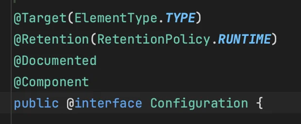
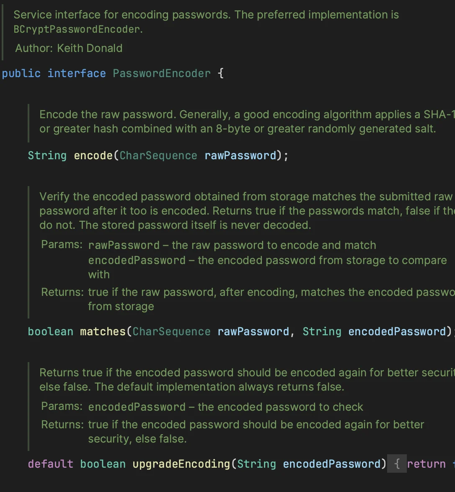
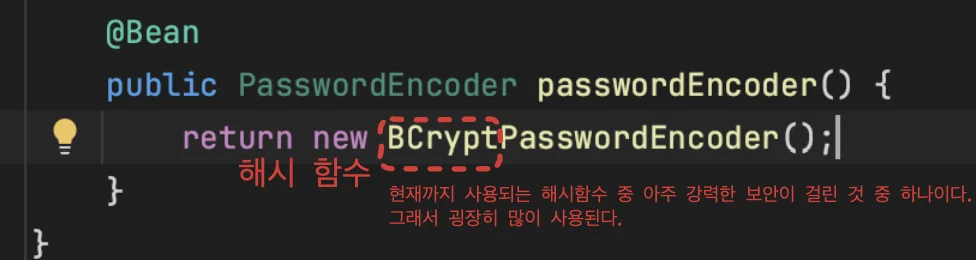
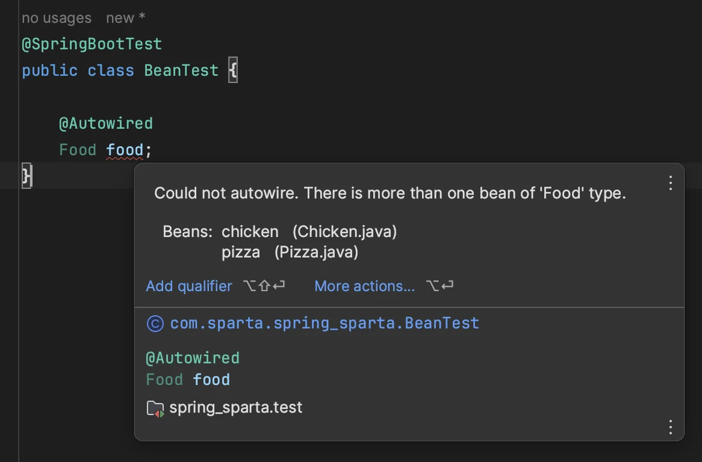

<a id="1c3eda9b0fe181a78460c1deb6f7fa7e"></a>

## Bean 수동 등록

<a id="1c3eda9b0fe181ed8c0ae57ef53dc36d"></a>

일반적으로 <strong><u>컴포넌트 스캔</u></strong>에 의해 <strong>빈을 자동으로 등록</strong>하는 것이 좋다&#46; 

- <code>&#64;Component</code> Anotaion을 통해 해당 클래스를 컴포넌트 스캔하여 스프링 Ioc 컨테이너에 빈으로 자동 등록한다&#46;

- <strong>3Layer Anotation</strong>인  <code>&#64;Controller</code>, <code>&#64;Service</code>, <code>&#64;Repository</code> 내부에 <code>&#64;Coponent</code> Anotation이 포함되어 있다&#46;<br>즉, <strong>3 Layer Anotation</strong> 사용 시 해당 클래스를 <strong><u>컴포넌트 스캔</u></strong>하여  <strong><u>빈으로 자동 등록</u></strong>한다&#46;

<a id="1c3eda9b0fe181a29af2df59aa212206"></a>

왜냐하면 프로젝트가 커지면 커질수록 등록해야 할 Bean들이 많아지고

<a id="1c3eda9b0fe1811fa0afc46d75e2d3ec"></a>

비지니스와 관련된 로직들은 그 수가 많기 때문에 <code>&#64;Controller</code>, <code>&#64;Service</code> 와 같은 Anotation들을 사용해서 <strong><u>자동 등록</u></strong> 시 <strong><u>개발 생산성이 높</u></strong>아진다&#46; 

> <strong>🧐 그렇다면 </strong><strong><u>수동 빈 등록</u></strong><strong> </strong><strong>은 어떤 경우에 사용하는가?&#93;</strong>

<a id="1c3eda9b0fe181a78ca5d2e3916f0b7c"></a>

<strong>기술적인 문제</strong>나 <strong>공통 관심사를 처리</strong>할 때 수동으로 등록하는 것이 좋다&#46; 

- 공통 log 처리

- 같은 비지니스 logic을 를 지원하는 위한 부가적이고 공통적인 기능들인 
    <details>
    <summary>기술 지원 Bean</summary>

    - 비밀번호를 암호화하는 객체 

    - …<br>

    </details>

<a id="1c3eda9b0fe181ff9fbbd5f9abec99ae"></a>

해당 내용들은 수가 적기 때문에 수동으로 등록하기 부담이 없다&#46;

<a id="1c3eda9b0fe18184b39dcc4ef321cdbe"></a>

또한 수동으로 등록한 빈에서 오류가 발생 시 수가 적기 때문에 쉽게 찾을 수 있다&#46; 

<a id="1c3eda9b0fe181afba55c156ae51d81c"></a>

### 실습) 수동 빈 등록

> 📌 <code>&#64;Configuration</code>&#58; 스프링 IoC 컨테이너에 <br><code>&#64;Bean</code>&#58;  수동 빈 등록
> 
> <details>
> <summary>&#64;Configuration</summary>
> 
> 
> 
> </details>

<details>
<summary>🧐 <strong>PasswordEncoder</strong></summary>

> &#60; interface &#62; 로 구현체 필요하다<br>따라서 BCryptPasswordEncoder 구현체를 지정



</details>

<details>
<summary>🧐 <strong>BCryptPasswordEncoder</strong></summary>



</details>

<details>
<summary><strong>빈 수동 등록&#58; </strong><code>PasswordConfig</code></summary>

<a id="1c3eda9b0fe181008dd4eef17a0512fd"></a>

```java
package com.sparta.spring_sparta.config;

import org.springframework.context.annotation.Bean;
import org.springframework.context.annotation.Configuration;
import org.springframework.security.crypto.bcrypt.BCryptPasswordEncoder;
import org.springframework.security.crypto.password.PasswordEncoder;

@Configuration
public class PasswordConfig {   // 빈 저장 이름: passwordConfig

    @Bean
    public PasswordEncoder passwordEncoder() {
        return new BCryptPasswordEncoder();
    }
}
```

</details>

<details>
<summary><strong>테스트&#58; </strong><code>PasswordEncoderTest</code></summary>

- <code>passwordEncoder&#46;matches(inputPassword, encodePassword);</code>
    - <code>matches(입력된 비밀번호, 암호화된 비밀번호)</code>&#58; 서로 비교 후 boolean 데이터 반환

<a id="1c3eda9b0fe1817c8211c2ed591058df"></a>

```java
package com.sparta.springauth;

import org.junit.jupiter.api.DisplayName;
import org.junit.jupiter.api.Test;
import org.springframework.beans.factory.annotation.Autowired;
import org.springframework.boot.test.context.SpringBootTest;
import org.springframework.security.crypto.password.PasswordEncoder;

@SpringBootTest
public class PasswordEncoderTest {

    @Autowired
    PasswordEncoder passwordEncoder;

    @Test
    @DisplayName("수동 등록한 passwordEncoder를 주입 받아와 문자열 암호화")
    void test1() {
        String password = "Robbie's password";

        // 암호화
        String encodePassword = passwordEncoder.encode(password);
        System.out.println("encodePassword = " + encodePassword);

        String inputPassword = "Robbie";

        // 복호화를 통해 암호화된 비밀번호와 비교
        boolean matches = passwordEncoder.matches(inputPassword, encodePassword);
        System.out.println("matches = " + matches); // 암호화할 때 사용된 값과 다른 문자열과 비교했기 때문에 false
    }
}
```

</details>

<a id="1c3eda9b0fe1810a916dfde5741c04a3"></a>

## 같은 타입의 Bean이 2개 시, 해결방법

> ☝🏻 테스트 코드에서는 <strong><code>&#64;SpringBootTest</code></strong><strong>를  명시</strong>해야 <strong><u>빈의 의존성 주입(</u></strong><strong><u><code>DI</code></u></strong><strong><u>)이 가능</u></strong>하다&#46;

<details>
<summary><strong>🧐 문제)</strong>  같은 타입의 빈의 구현체가 2개일시, <code>&#64;Autowire</code>를 사용하여 상위 인터페이스(타입) 빈을 가져올 경우 아래와 같은 오류 메세지가 뜬다&#46;</summary>

> <strong>Error) Could not autowire&#46; There is more than one bean of ‘Food’ type&#46;</strong>

<a id="1c3eda9b0fe1814eb6fad1e7f2b08d82"></a>

→ Food 타입의 빈이 하나 이상 있어 autowire를 사용할 수 없다&#46; 그래서 둘 중에 하나를 골라야 한다&#46;



</details>

<details>
<summary><strong>방법1)</strong>  구현체 이름을 명시</summary>

<a id="1c3eda9b0fe1816a9e5ad5134ec9d2aa"></a>

```java
@SpringBootTest
public class BeanTest {

    @Autowired
    Food pizza;

    @Autowired
    Food chicken;

    @Test
    @DisplayName("테스트")
    void test1() {
        pizza.eat();
        chicken.eat();
    }
}
```

</details>

<details>
<summary><strong>방법2)</strong> <code>&#64;Primary</code> 를 통한 우선순위 명시</summary>

<a id="1c3eda9b0fe1816c88cec74ab8862ffa"></a>

```java
@Component
@Primary
public class Chicken implements Food {
```

</details>

<details>
<summary><strong>방법3)</strong> <code>&#64;Qualifier(&#34;&#34;)</code>로 구현체 빈 명시</summary>

<a id="1c3eda9b0fe181e48e91ebd455e927c9"></a>

```java
@Qualifier("chicken")
@Autowired
Food food;
```

</details>

> ☝🏻 스프링에서 위와 같이 설정에서 우선순위를 논하는 경우가 많다&#46; <br>기본적으로 <strong>큰 범위가 우선순위가 낮</strong>다&#46;<br><code>&#64;Primary</code>가 <code>&#64;Qualifier</code> 보다 더 큰 범위를 가져 우선순위가 더 낮다&#46;<br> → <code>&#64;Qualifier</code> &#62; <code>&#64;Primary</code>
