<a id="1c9eda9b0fe18085b3a0cca3ee049d3e"></a>

## 빅오(O) 표기법

> 📖 
> 
> <a id="1c9eda9b0fe1801cb114ed3a523701bd"></a>
> 
> <strong><code>빅오(Big O)</code></strong><strong> </strong>표기법은 <strong><u>알고리즘의 성능을 분석</u></strong>할 때 사용하는 수학적 표현이다&#46; 
> 
> <a id="1c9eda9b0fe180e495f0c00d7f11e477"></a>
> 
> 이는 특히 알고리즘이 처리해야할 데이터의 양이 증가할 때, 해당 알고리즘이 얼마나 빠르게 실행 되는지를 나타낸다&#46; 

<details>
<summary>빅오(O) 표기법</summary>

> ✏️ 
> 
> 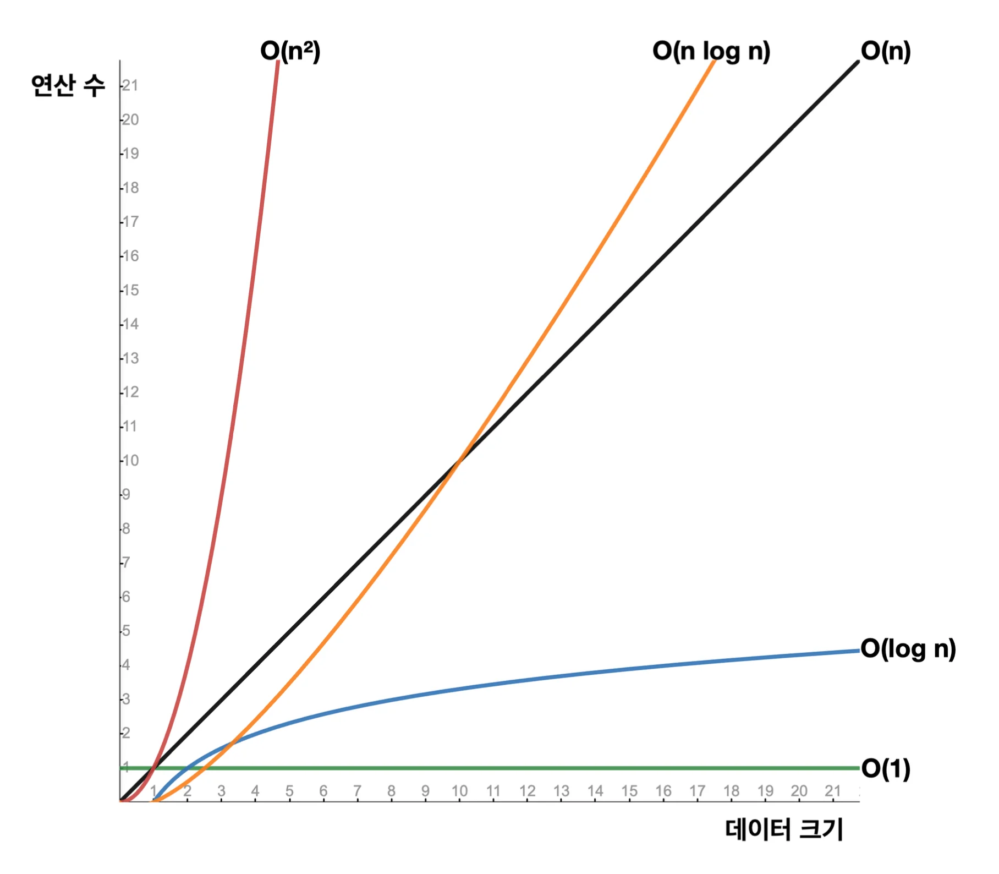
> 
> - <code class="language-math">O(1)</code><strong>, 상수시간</strong>
>     - 입력 데이터 크기에 상관없이 알고리즘의 실행 시간이 일정하다&#46;
> 
>     - ex) 배열 &#45; 인덱스
> 
> - <code class="language-math">O(n)</code><strong>, 선형 시간</strong>
>     - 알고리즘의 실행 시간이 입력 데이터의 크기에 비례하여 증가한다&#46; 
> 
>     - ex) 배열 검색, 배열의 모든 요소를 순회하는 경우
> 
> - <code class="language-math">O(n^2)</code>, 제곱 시간
>     - 알고리즘의 실행 시간이 입력 데이터의 크기 제곱에 비례하여 증가한다&#46; 
> 
> - <code class="language-math">O(log n)</code><strong>, 로그 시간</strong>
>     - 알고리즘의 실행 시간이 데이터의 크기의 로그에 비례하여 증가하낟&#46;
> 
>     - 이진 탐색
> 
> - <code class="language-math">O(nlog N)</code>, 선형 로그 시간
>     - ex) 많은 효율적인 정렬 알고리즘<br>

> <code>빅오 표기법</code> &#45; <strong>상수항 무시</strong>

<a id="1c9eda9b0fe180a8af6bc9145f8b06e6"></a>

빅오 표기법은 매우 큰 데이터를 입력한다고 가정하고, 데이터 양 증가에 따른 성능의 변화 추세를 비교하는데 사용한다&#46; 쉽게 이야기해서 정확한 성능을 측정하는 것이 목표가 아니라 <strong><u>매우 큰 데이터가 들</u></strong>어왔을 때의 <strong><u>대략적인 추세를 비교</u></strong>를 하는 것이 목적이다&#46;

<a id="1c9eda9b0fe180f3a87bdea228f09e4a"></a>

 따라서 <strong><u>데이터가 매우 많이 들어오면 추세를 보는데 </u></strong><strong><u>상수는 크게 의미가 없</u></strong>어진다&#46;

<a id="1c9eda9b0fe180c98e44ea2a5546d818"></a>

이런 이유로 <code>빅오 표기법</code>에서는 <strong><u>상수를 제거</u></strong>한다&#46; 예를 들어<u> </u><code class="language-math">O(n &#43; 2)</code><u>, </u><code class="language-math">O(n/2)</code>도 모두 <code class="language-math">O(n)</code>으로 표시한다&#46;

> <strong><code>빅오 표기법</code></strong> &#45; 최악의 경우

<a id="1c9eda9b0fe180489c0bd3fdfc71e71a"></a>

빅오 표기법은 별도의 이야기가 없으면 <strong><u>보통 최악의 상황을 가정</u></strong>해서 표기한다&#46; 

<a id="1caeda9b0fe180d591a0e92ea461aa98"></a>

성능 측정의 경우, 최악의 상황을 기준으로 평가를 해야 판단이 가능하다&#46;

<a id="1c9eda9b0fe180fa80fcc12b6fabde1b"></a>

물론 최적, 평균, 최악의 경우로 나누어 표기하는 경우도 있다&#46;

<details>
<summary>ex) 배열의 순차 검색 ⇒ <code class="language-math">O(n)</code></summary>

- <strong><code>최적의 경우</code></strong><strong>&#58; 바로 찾음 ⇒ </strong><code class="language-math">O(1)</code>

- <strong><code>최악의 경우</code></strong><strong>&#58; </strong>마지막 항목에 있거나 항목이 없는 경우, 전체 요소 순회 ⇒<strong> </strong><code class="language-math">O(n</code><strong>)</strong>

- <strong><code>평균의 경우</code></strong><strong>&#58; </strong>보통 중간쯤 데이터를 발견한다<strong>&#46; ⇒ </strong><code class="language-math"> O(n/2)</code><strong> </strong>
    - <strong>상수를 제외하면 </strong><code class="language-math">O(n)</code><strong>이지만, 최악과 비교를 위해 </strong><code class="language-math">O(n/2)</code><strong>로 표기하는 경우도 있다&#46;</strong><br>	<br>

</details>

</details>

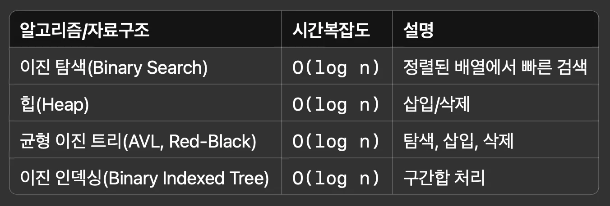

<a id="1c9eda9b0fe1806d91fbd4b64a20f4db"></a>

## 배열 

> 📖 
> 
> <a id="1c9eda9b0fe180308cb7cc440b40f449"></a>
> 
>  <strong><u>여러 데이터(자료)를 구조화</u></strong>해서 다루는 것을 <strong><code>자료구조</code></strong>라 말한다&#46;
> 
> <a id="1c9eda9b0fe1804c99b5dbad12d169d0"></a>
> 
> 자바는 <code>컬렉션 프레임워크</code>를 통해 <strong><u>다양한 자료구조</u></strong>를 지원한다&#46;
> 
> <a id="1c9eda9b0fe180f2823fcf1005e7474b"></a>
> 
> 컬렉션 프레임워크와 자료 구조를 설명하기 전, 먼저 자료 구조의 <strong><u>가장 기본</u></strong>이 되는 <strong>배열의 특징</strong>을 학습한다&#46;

<a id="1c9eda9b0fe1800c97c0cc82c0588b21"></a>

### 배열, 인덱스

> ✏️ 
> 
> <a id="1c9eda9b0fe18087befbecd7d160b25c"></a>
> 
> 배열의 특징
> 
> ---
> 
> <a id="1c9eda9b0fe180278cf4f3fa76a5f562"></a>
> 
> <code class="language-math">배열&#92; 요소&#92; 위치 = 배열의&#92; 시작&#92; 참조 &#43; ( 자료의&#92; 크기 &#42; 인덱스&#92; 위치 )</code>
> 
> ---
> 
> - <strong><u>탐색</u></strong> 시, <strong>인덱스(index)</strong>를 사용하여 <strong><u>매우 빠른 연산</u></strong><strong>(</strong><strong><code>O(1)</code></strong><strong>)</strong>이 가능하다&#46; 
> 
> - <strong> </strong><u>인덱스를 통한 입력, 변경, 조회</u>의 경우  <u>한번의 계산</u>으로 자료 위치를 찾을 수 있다&#46;

<details>
<summary><strong>ex) 배열 </strong><strong><code>index</code></strong><strong>  사용</strong></summary>

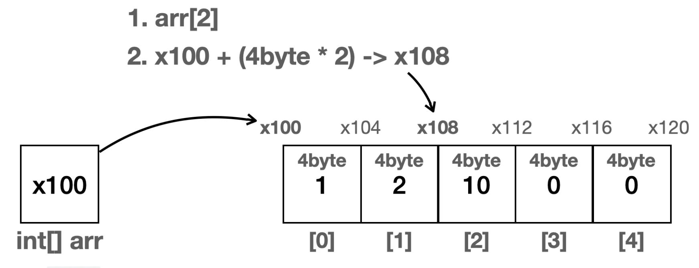

> <code>arr&#91;2&#93; </code>조회

<a id="1c9eda9b0fe180079512fbbe22bead4f"></a>

배열은 메모리 상에서 순서대로 붙어서 존재한다&#46; 

<a id="1c9eda9b0fe180f393f9d888ac4f93bc"></a>

int는 4byte를 차지한다&#46; 

<a id="1c9eda9b0fe180249640ccd745e35152"></a>

따라서 <strong><u>배열의 시작 위치를 알</u></strong>면  <strong><code>자료의 크기(4byte)</code></strong><strong>와 </strong><strong><code>인덱스 번호</code></strong><strong> 를 </strong><strong><u>곱한 값을 더해</u></strong>  <strong><u>해당 인덱스 요소의 위치를 바로 메모리에서 찾</u></strong>을 수 있다&#46; 

- <code>arr&#91;2&#93;</code>  = <code>x100 &#43; (4byte &#42; 2)</code> = <code>x108</code>

</details>

<details>
<summary>예시 코드</summary>

<details>
<summary>&#91; 코드 &#93; ArrayMain1</summary>

<a id="1c9eda9b0fe180189ebdf299826352bd"></a>

```java
package collection.array;

import java.util.Arrays;

public class ArrayMain1 {

    public static void main(String[] args) {
        int[] arr = new int[5];

        // index 입력: O(1)
        System.out.println("==index 입력: O(1)==");
        arr[0] = 1;
        arr[1] = 2;
        arr[2] = 3;
        System.out.println(Arrays.toString(arr));

        // index 변경: O(1)
        System.out.println("==index 변경: O(1)==");
        arr[2] = 10;
        System.out.println(Arrays.toString(arr));

        // index 조회: O(1)
        System.out.println("==index 조회: O(1)==");
        System.out.println("arr[2] = " + arr[2]);

        // 검색: O(n)
        System.out.println("==배열 검색: O(n)==");
        System.out.println(Arrays.toString(arr));
        int value = 10;
        for (int i = 0; i < arr.length; i++) {
            System.out.println("arr[" + i + "]: " + arr[i]);
            if (arr[i] == value) {
                System.out.println(value + "찾음");
                break;
            }
        }
    }
}

```

<a id="1c9eda9b0fe180fe8af5fa65a6b809c8"></a>

<strong>실행 결과</strong>

<a id="1c9eda9b0fe18025888fc79833095f17"></a>

```plaintext
==index 입력: O(1)== 
[1, 2, 3, 0, 0]

==index 변경: O(1)== 
[1, 2, 10, 0, 0]

==index 조회: O(1)== 
arr[2] = 10

==배열 검색: O(n)== 
[1, 2, 10, 0, 0] 
arr[0]:1
arr[1]:2 
arr[2]:10
10 찾음
```

</details>

</details>

<a id="1c9eda9b0fe18055b6a6fdc3276a3c5b"></a>

### 데이터 추가

> ✏️ 
> 
> - 첫번째 위치에 추가&#58; <code>O(n)</code>
> 
> - 중간 위치에 추가&#58; …
> 
> - 마지막 위치에 추가&#58; <code>O(1)</code>

<details>
<summary><strong><u>첫번째 위치</u></strong>에 요소 추가</summary>

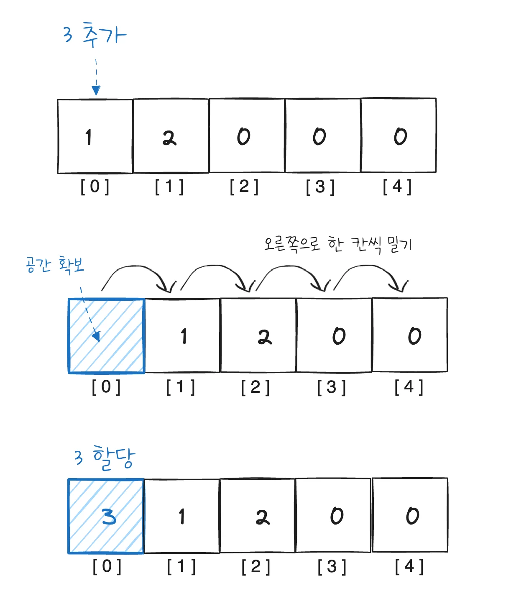

<a id="1c9eda9b0fe180f0acbed5c1d87aa296"></a>

첫번째 위치에 새로운 요소를 추가하는 경우

<a id="1c9eda9b0fe1800e8911e5e21c14743f"></a>

그림과 같이 모든 요소들을 한칸 씩 이동시켜 공간을 확보 해야한다&#46; 

<a id="1c9eda9b0fe18050a354c20464bfc58a"></a>

이때의 연산이 <code>O(n)</code> 시간복잡도를 가진다&#46; 

<a id="1c9eda9b0fe18093af28cc2ac4bc7ea6"></a>

그리고 요소 탐색 및 삽입에서 <code>O(1)</code>의 복잡도를 가지기 때문에 최종적으로는 <code>O(n)</code> 시간복잡도를 갖는다&#46;

</details>

<details>
<summary><strong><u>중간 위치</u></strong>에 요소 추가 </summary>

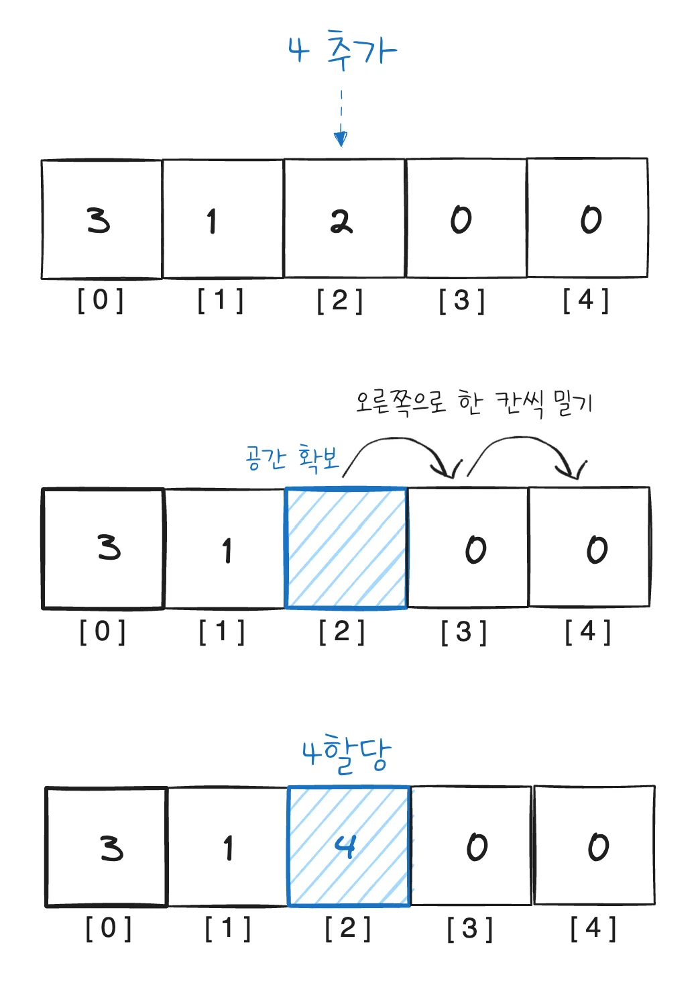

- 배열의 위치 찾기&#58; <code>O(1)</code>

- 추가하려는 위치의 요소부터 한칸 씩 이동시켜 공간을 확보한다&#46;
    - 평균 연산&#58; <code>O(n/2)</code>

- 최종 연산 계산
    - <code>O(1 &#43; n/2)</code> → <code>O(n)</code>

    <a id="1c9eda9b0fe1804b98a1ec594dc79240"></a>

            &#42; <u>상수항은 무시</u>한다&#46;

</details>

<details>
<summary><strong><u>마지막 위치</u></strong>에 추가</summary>

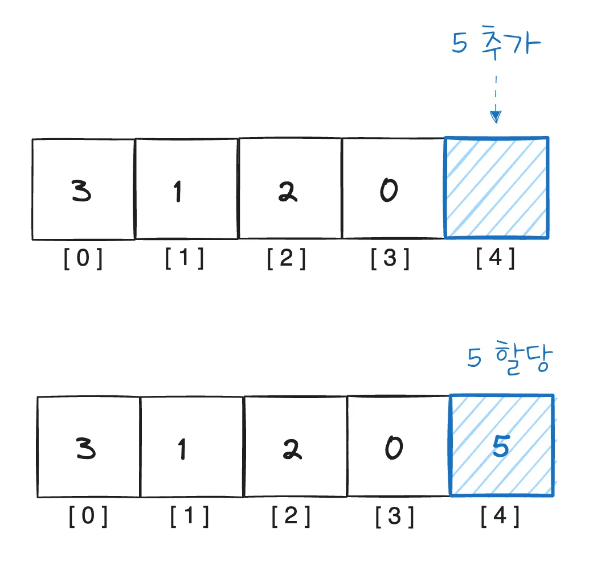

<a id="1c9eda9b0fe1800c9f18e606616db016"></a>

마지막 위치의 경우 바로 값을 대입하면 된다&#46; 

- 시간복잡도&#58; <code>O(1)</code>

</details>

<a id="1c9eda9b0fe180b5b4ede0e87c05a1b6"></a>

### 코드

<details>
<summary>&#91; 코드 &#93; ArrayMain2</summary>

<a id="1c9eda9b0fe180448a2be7f361e82f5d"></a>

```java
package collection.array;

import java.util.Arrays;

public class ArrayMain2 {

    public static void main(String[] args) {
        int[] arr = new int[5];
        arr[0] = 1;
        arr[1] = 2;
        System.out.println(Arrays.toString(arr));

        // 배열의 첫번째 위치에 추가
        // 기본 배열의 데이터를 한 칸씩 뒤로 밀고 배열의 첫번째 위치에 추가
        System.out.println("배열의 첫번쨰 위치에 3 추가 O(n)");
        int newValue = 3;
        addFirst(arr, newValue);
        System.out.println(Arrays.toString(arr));

        // index 위치에 추가
        // 기본 배열의 데이터를 한 칸 씩 뒤로 밀고 배열의 idnex 위치에 추가
        System.out.println("배열의 index(2) 위치에 4 추가 O(n)");
        int index = 2;
        int value = 4;
        addAtIndex(arr, index, value);
        System.out.println(Arrays.toString(arr));

        System.out.println("배열의 마지막 위치에 5 추가 O(1)");
        addLast(arr, 5);
        System.out.println(Arrays.toString(arr));
    }

    private static void addLast(int[] arr, int newValue) {
        arr[arr.length - 1] = newValue;
    }

    private static void addFirst(int[] arr, int newValue) {
        for (int i = arr.length - 1; i > 0; i--) {
            arr[i] = arr[i - 1];
        }
        arr[0] = newValue;
    }

    private static void addAtIndex(int[] arr, int index, int newValue) {
        for (int i = arr.length - 1; i > index; i--) {
            arr[i] = arr[i - 1];
        }
        arr[index] = newValue;
    }
}
```

- 실행 결과
    <a id="1c9eda9b0fe18038a1d8e096834041a6"></a>

    ```plaintext
    [1, 2, 0, 0, 0]
    배열의 첫번쨰 위치에 3 추가 O(n)
    [3, 1, 2, 0, 0]
    배열의 index(2) 위치에 4 추가 O(n)
    [3, 1, 4, 2, 0]
    배열의 마지막 위치에 5 추가 O(1)
    [3, 1, 4, 2, 5]
    ```

</details>

> ☝🏻 
> 
> <a id="1c9eda9b0fe180daa3deec8a66b0ecb8"></a>
> 
> <strong>배열의 한계점</strong>
> 
> <a id="1c9eda9b0fe180049c1cc3d904c334af"></a>
> 
> <strong><code>배열</code></strong>은 가장 기본적인 자료구조이다&#46; 그리고 <strong><u>인덱스</u></strong>를 사용하는 경우 <strong><u>가장 최적의 연산이 가능</u></strong>하다&#46; ⇒ <code class="language-math">O(1)</code>
> 
> <a id="1c9eda9b0fe1803b8555c50c740d58fb"></a>
> 
> 하지만<strong><u> 크기를 배열 생성 시점에 미리 정</u></strong>해야하는 단점이 있다&#46;
> 
> <a id="1c9eda9b0fe180c4834fe70e4f88607e"></a>
> 
> <strong><u>너무 크게 생성을 하면 메모리가 낭비가 심</u></strong>해지고 <strong><u>너무 작게 생성하는 경우 데이터를 담을 수 없</u></strong>다&#46;<br>
> 
> <a id="1c9eda9b0fe180b19c65c54d09e8df4c"></a>
> 
> 이러한 문제점은 <strong><u>동적으로 크기를 정</u></strong>할 수 있다면 해결 가능하다&#46;

<a id="1c9eda9b0fe1805a808dc29aa743a760"></a>

## 배열 리스트 ( ArrayList )

> ☝🏻 
> 
> <a id="1c9eda9b0fe180e5a887f81875a9e4f1"></a>
> 
> <strong><code>배열</code></strong>의 경우, <strong><u>2가지 문제점</u></strong>이 있었다&#46; 
> 
> - 배열의 <strong><u>길이를 </u></strong><strong><u>동적으로 변경 할 수 없</u></strong>다&#46; 
> 
> - 데이터를 추가할 수 없다&#46; 
> 
> ---
> 
> <a id="1c9eda9b0fe180ebbbc3de5fc1cebf6b"></a>
> 
> 이러한 문제점은 <strong><u>List (리스트)</u></strong>를 사용함으로써 해결할 수 있다&#46;

> ✏️ 
> 
> <a id="1c9eda9b0fe1806e9aa6ecab9397eb70"></a>
> 
> <strong><code>리스트( List )</code></strong>는 <strong><u>순서가 있</u></strong>고, <strong><u>중복을 허용</u></strong>하는 자료 구조이다&#46;
> 
> <a id="1c9eda9b0fe180ba881adbb8bb67125b"></a>
> 
> 배열보다 유연한 자료구조 로써 <strong><u>크기를 동적으로 변경</u></strong>할 수 있다&#46; 

<a id="1c9eda9b0fe18010aefad2c62dbdc4fe"></a>

### V1&#58; 기본 구현

> ☝🏻 
> 
> <a id="1c9eda9b0fe1804687effaff96427bfe"></a>
> 
> <strong>참고</strong>
> 
> <a id="1c9eda9b0fe180519f64f779eb30c816"></a>
> 
> 자료 구조 자체를 설명하는 것에 목적을 둬 예제를 단순하게 구성했다&#46;
> 
> - 복잡한 검증용 체크 로직은 제외
> 
> - 입력한 인덱스에 대한 size 초과 시 예외처리 ❌ 

<a id="1c9eda9b0fe180d88ea7ee6ba95a8c39"></a>

### 코드

<details>
<summary>&#91; 코드 &#93; MyArrayListV1</summary>

<a id="1c9eda9b0fe18091b1c1f5fd5a7a9267"></a>

```java
package collection.array.v1;

import java.util.Arrays;

public class MyArrayListV1 {

    private static final int DEFAULT_CAPACITY = 5;

    private Object[] elementData;
    private int size = 0;

    public MyArrayListV1() {
        this.elementData = new Object[DEFAULT_CAPACITY];
    }

    public MyArrayListV1(int initialCapacity) {
        this.elementData = new Object[initialCapacity];
    }

    public int size() {
        return size;
    }

    public void add(Object e) {
        elementData[size] = e;
        size++;
    }

    public Object get(int index) {
        return elementData[index];
    }

    public Object set(int index, Object element) {
        Object oldValue = get(index);
        elementData[index] = element;
        return oldValue;
    }

    public int indexOf(Object o) {
        for (int i = 0; i < size; i++) {
            if (o.equals(elementData[i])) {
                return i;
            }
        }
        return -1;
    }

    @Override
    public String toString() {
        return  Arrays.toString(Arrays.copyOf(elementData, size)) +
                ", size=" + size +
                ", capacity=" + elementData.length;
    }
}

```

</details>

<details>
<summary>&#91; 코드 &#93; MyArrayListV1Main</summary>

<a id="1c9eda9b0fe1802d8efdca2779ab6272"></a>

```java
package collection.array.v1;

public class MyArrayListV1Main {
    public static void main(String[] args) {
        MyArrayListV1 list = new MyArrayListV1();
        System.out.println("==데이터 추가==");
        System.out.println(list);
        list.add("a");
        System.out.println(list);
        list.add("b");
        System.out.println(list);
        list.add("c");
        System.out.println(list);

        System.out.println("==기능 사용==");
        System.out.println("list.size() = " + list.size());
        System.out.println("list.get(1) = " + list.get(1));
        System.out.println("list.indexOf('c') = " + list.indexOf("c"));
        System.out.println("list.set(2, 'z'), oldValue  = " + list.set(2," z") );
        System.out.println(list);

        System.out.println("==범위 초과==");
        list.add("d");
        System.out.println(list);
        list.add("e");
        System.out.println(list);

        // 범위 초과, capacity가 늘어나지 않으면 예외 발생
        list.add("f");
        System.out.println(list);
    }
}

```

</details>

<details>
<summary>실행 결과</summary>

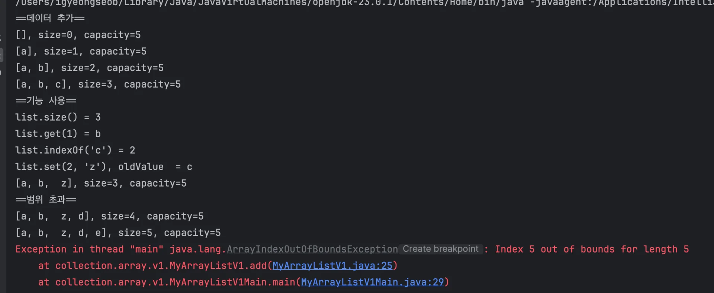

</details>

<a id="1c9eda9b0fe1803b9ec2e1f74ff59ce5"></a>

### 설명

<details>
<summary>데이터 추가</summary>

> ☝🏻 
> 
> - <code>size</code>&#58; 실제 배열 크기(배열 안에 들어간 요소 개수)
> 
> - <code>capacity</code>&#58;  resize한 배열의 크기

<details>
<summary>1번째 요소 삽입</summary>

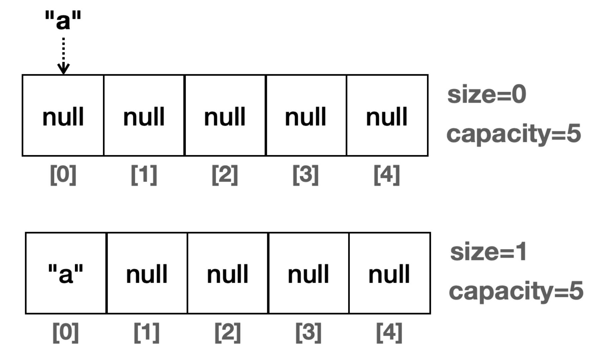

<a id="1c9eda9b0fe1806bb705d839d8c0745b"></a>

```java
list.add("a")

// List 크기(size): 1
// 초기화된 List 크기(capacity): 5
```

</details>

<details>
<summary>2번째 요소 삽입</summary>

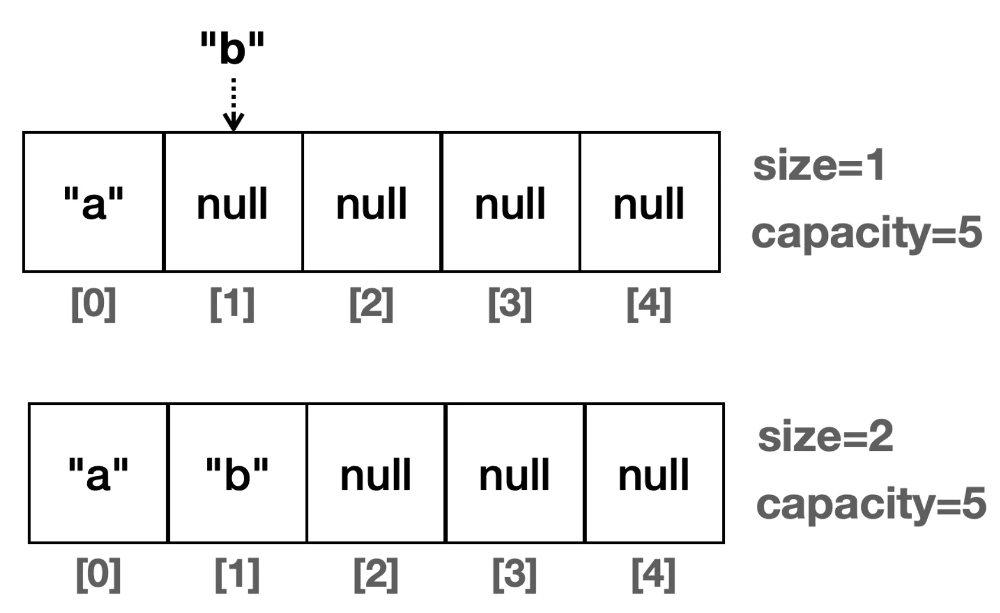

<a id="1c9eda9b0fe18022a755e75ebf05aced"></a>

```java
list.add("b")

// List 크기(size): 2
// 초기화된 List 크기(capacity):5
```

</details>

<details>
<summary>3번째 요소 삽입</summary>

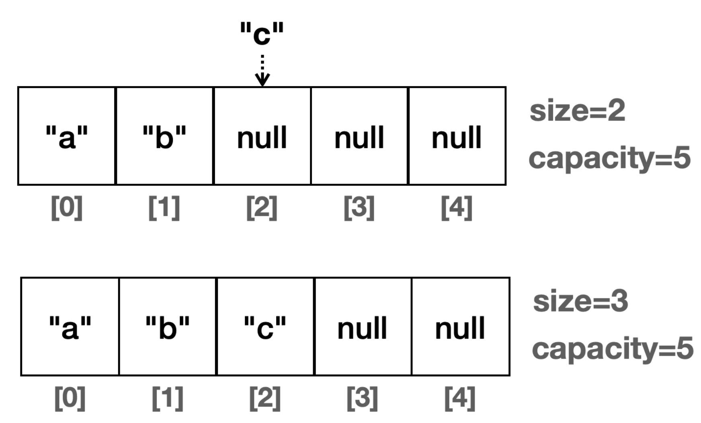

<a id="1c9eda9b0fe180ae9401f3d10d7b30be"></a>

```java
list.add("c")

// List 크기(size): 3
// 초기화된 List 크기(capacity):5
```

</details>

</details>

<details>
<summary>데이터 변경</summary>

<details>
<summary>3번째 요소 변경</summary>

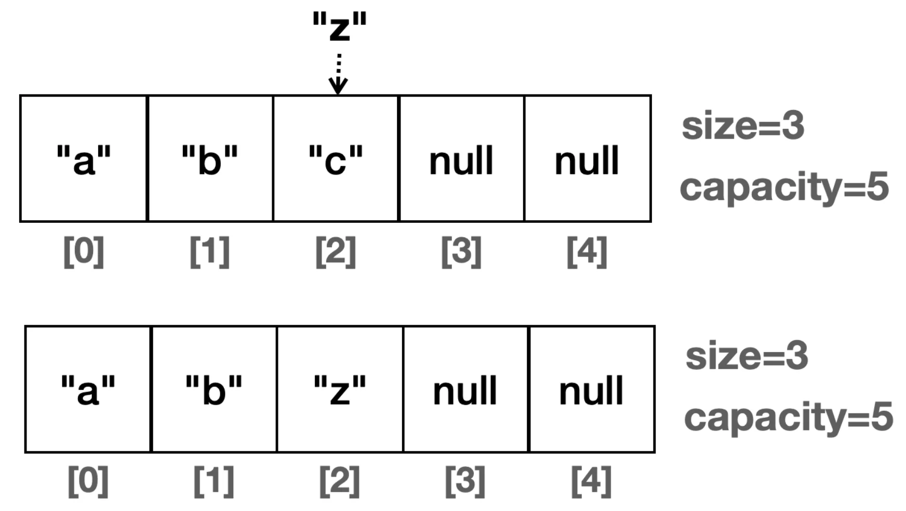

<a id="1c9eda9b0fe180d6a418fd5214c1768e"></a>

```java
list.set(2, "z")

// list = [ a, b, z ]
// List 크기(size): 3 
// 초기화된 List 크기(capacity):5
```

</details>

</details>

<details>
<summary><strong>&#91; 🤬 오류 &#93;</strong> 범위 초과</summary>

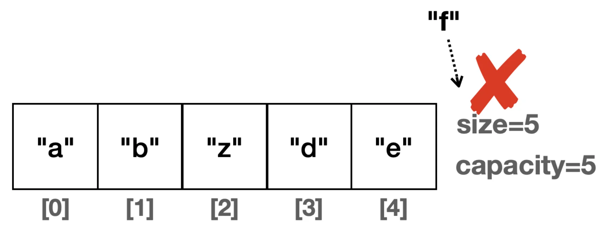

<a id="1c9eda9b0fe1803489dacab96ea90a7d"></a>

```java
// List 크기(size): 5
// 초기화된 List 크기(capacity):5
list.add("f");
```

<a id="1c9eda9b0fe1805080f2c0645351ea63"></a>

<strong>🤬 예외 발생</strong>

> ☝🏻 
> 
> <a id="1c9eda9b0fe18027a17fd4ff7688276d"></a>
> 
> <strong>배열이 최대 크기에 도달하여 꽉 찼기때문에 데이터 삽입이 불가능하다&#46; </strong>
> 
> - <strong><code>resize</code></strong><strong> 로 배열의 크기를 늘려야 한다&#46;</strong>

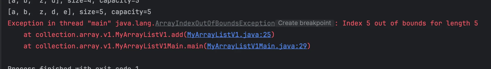

- <code>ArrayIndexOutOfBoundsException</code>이 발생된다&#46; 

</details>

<a id="1c9eda9b0fe1809eb4adc69b5a2cf5b3"></a>

### 개선점

<a id="1c9eda9b0fe180f8accdd1d86f9eb6db"></a>

<strong><u>배열의 크기를 넘어가는 삽입</u></strong>이 일어나는 순간 <strong><code>ArrayIndexOutOfBoudsException</code></strong> 이 발생된다&#46; 

<a id="1c9eda9b0fe180a08eb2fa37ec794f0f"></a>

따라서 <strong><u>배열이 꽉 차는 경우 다시 배열 크기를 키워 초기화</u></strong>할 수 있도록 개선이 필요하다 &#46; ( 리사이징 )

<a id="1c9eda9b0fe18077997ff4f392c835ad"></a>

### V2&#58; 동적 배열

<a id="1c9eda9b0fe180f0ad87ca7b1e70083d"></a>

### 코드

> ✏️ 
> 
> <a id="1c9eda9b0fe180c1bf36e073d3ba71a1"></a>
> 
> <code>Arrays&#46;copyOf(기존배열, 새로운길이)</code> 
> 
> <a id="1c9eda9b0fe180e382a5eb142a58dd46"></a>
> 
> 새로운 길이로 배열을 생성하고, 기존 배열의 값을 새로운 배 열에 복사한다&#46;

<details>
<summary>&#91; 코드 &#93; MyArrayListV2 &#45; <strong>리사이징</strong></summary>

<a id="1c9eda9b0fe180fdb3e7ee5318a8c4f5"></a>

```java
package collection.array.v2;

import java.util.Arrays;

public class MyArrayListV2 {

    private static final int DEFAULT_CAPACITY = 5;

    private Object[] elementData;
    private int size = 0;

    public MyArrayListV2() {
        this.elementData = new Object[DEFAULT_CAPACITY];
    }

    public MyArrayListV2(int initialCapacity) {
        this.elementData = new Object[initialCapacity];
    }

    public int size() {
        return size;
    }

    public void add(Object e) {
        // 라사이징 로직 추가
        if (size == elementData.length) {
            grow();
        }
        elementData[size] = e;
        size++;
    }

    // 리사이징
    private void grow() {
        int oldCapacity = elementData.length;
        int newCapacity = oldCapacity * 2;
        elementData = Arrays.copyOf(elementData, newCapacity);
    }

    public Object get(int index) {
        return elementData[index];
    }

    public Object set(int index, Object element) {
        Object oldValue = get(index);
        elementData[index] = element;
        return oldValue;
    }

    public int indexOf(Object o) {
        for (int i = 0; i < size; i++) {
            if (o.equals(elementData[i])) {
                return i;
            }
        }
        return -1;
    }

    @Override
    public String toString() {
        return  Arrays.toString(Arrays.copyOf(elementData, size)) +
                ", size=" + size +
                ", capacity=" + elementData.length;
    }
}

```

</details>

<details>
<summary>&#91; 코드 &#93; MyArrayListV2Main &#45; client</summary>

<a id="1c9eda9b0fe18022822be15627e38bb8"></a>

```java
package collection.array.v2;

public class MyArrayListV2Main {

    public static void main(String[] args) {
        MyArrayListV2 list = new MyArrayListV2(2);
        System.out.println(list);

        list.add("a");
        System.out.println(list);
        list.add("b");
        System.out.println(list);
        list.add("c");
        System.out.println(list);
        list.add("d");
        System.out.println(list);
        list.add("e");
        System.out.println(list);
        list.add("f");
        System.out.println(list);
    }
}

```

</details>

<details>
<summary>실행 결과 </summary>

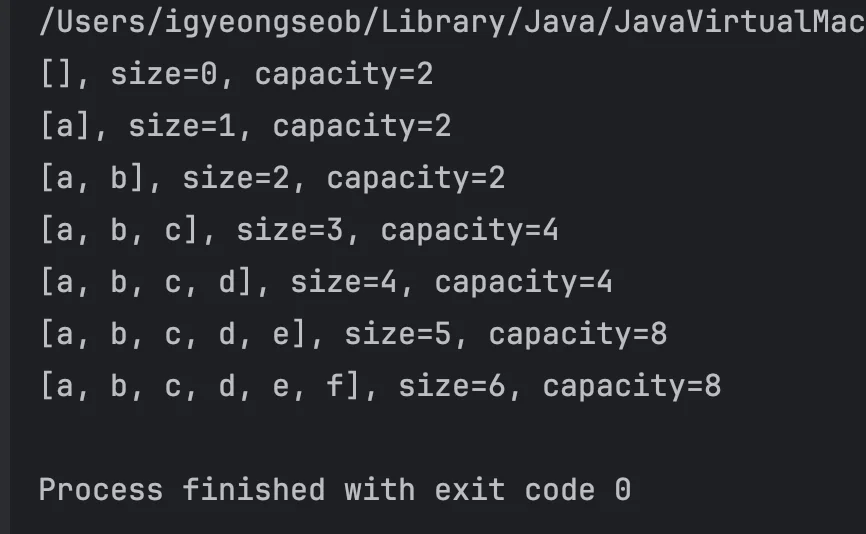

</details>

<a id="1c9eda9b0fe180a9b1f1d796ffc9d003"></a>

### 설명

<details>
<summary>리사이징 동작</summary>

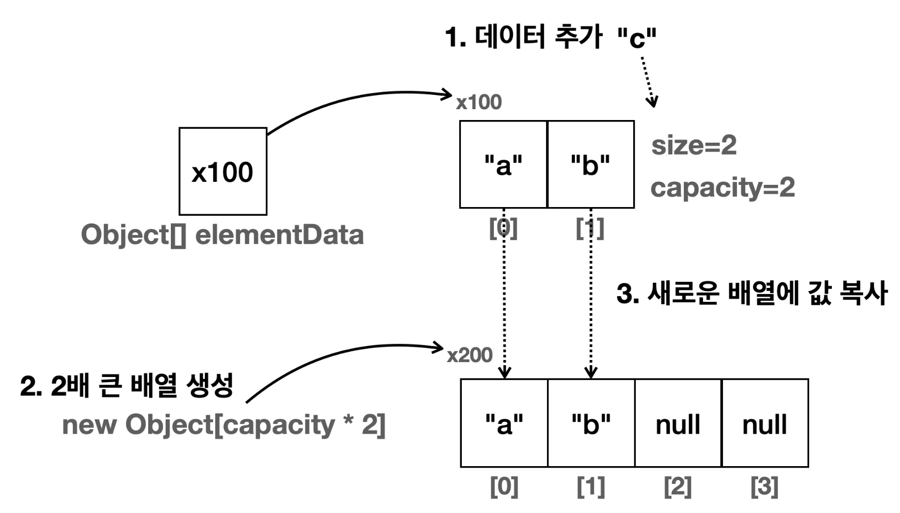

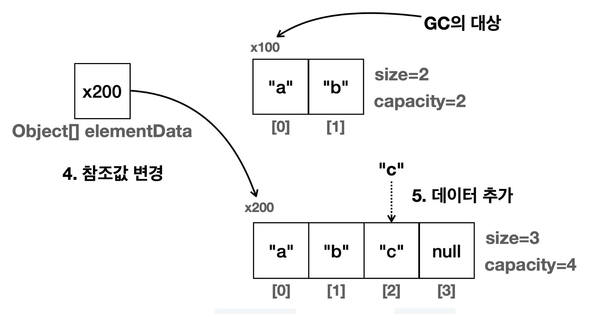

<details>
<summary>1&#46; 데이터를 추가하면 <code>size</code>가 배열의 크기인 capacity를 초과하게 된다&#46; <br>이때, <code>grow()</code> 를 호출한다&#46;</summary>

<a id="1c9eda9b0fe180789fc0c495bbcbb651"></a>

```java
public void add(Object e) {
    if (size == elementData.length) {
        grow();
    }
    elementData[size] = e;
    size++;
}
```

</details>

<details>
<summary>2&#46; <code>grow()</code> 메서드</summary>

1. 2배 큰 배열을 새로 생성

1. 새로운 배열에 기존 배열의 값을 복사함

1. <code>Arrays&#46;copyOf(기존배열, 새로운길이)</code> 를 사해 2배 큰 배열을 새로 생성<br>동시에 새로운 배열에 기존 배열의 값을 복사함

1. 참조값 변경<br>	<br><br>

</details>

<a id="1c9eda9b0fe180f9b093dea85e93ee48"></a>

위와 같이 리사이징을 통해 기존 보다 2배 큰 capacity를 가지는 배열이 만들어진다&#46; 

<a id="1c9eda9b0fe180419a21e6a2e6d42090"></a>

그리고 해당 배열에 데이터를 추가한다&#46;

- 기존 배열은 더이상 참조하는 곳이 없으므로 GC의 대상이 되어 자동 삭제된다&#46; 

</details>

<a id="1c9eda9b0fe18019adfdd362d61229ca"></a>

### 개선점

<a id="1c9eda9b0fe1806dad1def9ae5f36f61"></a>

배열이 꽉 찬 경우, 리사이징 및 기존 데이터 값 복사를 통해 2배 더 큰 새로운 배열을 만들어 <code>ArrayIndexOutOfBoundsException</code> 문제를 해결했다&#46; 

<a id="1c9eda9b0fe180cbb141f7acb80e343f"></a>

그러나 몇가지 기능 추가 및 타입 안정성 문제를 해결해야된다&#46; 

<details>
<summary>추가 기능</summary>

- 중간 삽입 ( index 삽입 )

- 데이터 삭제

</details>

<details>
<summary>타입 안정성 문제</summary>

- Object → 제네릭

</details>

<a id="1c9eda9b0fe18003864ef5d1b4a1a8d9"></a>

### V3&#58; 기능 추가 &#45; 중간 삽입, 삭제

<a id="1c9eda9b0fe180728214e0b67369d732"></a>

### 코드

<details>
<summary>&#91; 코드 &#93; MyArrayListV3</summary>

<a id="1c9eda9b0fe1801dbb8ac234322e7f4e"></a>

```java
package collection.array.v3;

import java.util.Arrays;

public class MyArrayListV3 {

    private static final int DEFAULT_CAPACITY = 5;

    private Object[] elementData;
    private int size = 0;

    public MyArrayListV3() {
        this.elementData = new Object[DEFAULT_CAPACITY];
    }

    public MyArrayListV3(int initialCapacity) {
        this.elementData = new Object[initialCapacity];
    }

    public int size() {
        return size;
    }

    public void add(Object e) {
        if (size == elementData.length) {
            grow();
        }
        elementData[size] = e;
        size++;
    }

    // 코드 추가
    public void add(int index, Object e) {
        // 예외처리 생략
        // 0 < index <= size

        if (size == elementData.length) {
            grow();
        }
        shiftRightFrom(index);
        elementData[index] = e;
        size++;

    }

    // 코드 추가, 마지막 요소부터 index까지 오른쪽으로 밀기
    private void shiftRightFrom(int index) {
        for(int i = size; i > index; i--) {
            elementData[i] = elementData[i - 1];
        }
    }

    private void grow() {
        int oldCapacity = elementData.length;
        int newCapacity = elementData.length * 2;
        elementData = Arrays.copyOf(elementData, newCapacity);
    }

    public Object get(int index) {
        return elementData[index];
    }

    public Object set(int index, Object element) {
        Object oldValue = get(index);
        elementData[index] = element;
        return oldValue;
    }

    // 코드 추가
    public Object remove(int index) {
        Object oldValue = get(index);
        shiftLeftFrom(index);

        size--;
        elementData[size] = null;
        return oldValue;
    }

    // 코드 추가, 요소 index부터 마지막까지 왼쪽으로 밀기
    private void shiftLeftFrom(int index) {
        for (int i = index; i < size - 1; i++) {
            elementData[i] = elementData[i + 1];
        }
    }

    public int indexOf(Object o) {
        for (int i = 0; i < size; i++) {
            if (o.equals(elementData[i])) {
                return i;
            }
        }
        return -1;
    }

    @Override
    public String toString() {
        return  Arrays.toString(Arrays.copyOf(elementData, size)) +
                ", size=" + size +
                ", capacity=" + elementData.length;
    }
}

```

</details>

<details>
<summary>&#91; 코드 &#93; MyArrayListV3Main</summary>

<a id="1c9eda9b0fe18073a58dccaa60c2b80e"></a>

```java
package collection.array.v3;

public class MyArrayListV3Main {

    public static void main(String[] args) {
        MyArrayListV3 list = new MyArrayListV3();

        // 끝에 추가 // O(1)
        list.add("a");
        list.add("b");
        list.add("c");
        System.out.println(list);

        // 원하는 위치에 추가
        System.out.println("addLast");
        list.add(3, "addLast");  // O(1),  Why? index=3 맨 끝 위치
        System.out.println(list);

        System.out.println("addLast");
        list.add(0, "addLast");  // O(n),  Why? 첫번쨰 요소까지 연산 처리를 해야됨
        System.out.println(list);

        // 삭제
        Object removed1 = list.remove(4); // remove Last O(1)
        System.out.println("removed(4) = " + removed1);
        System.out.println(list);


        Object removed2 = list.remove(0); // remove First O(n)
        System.out.println("removed(0) = " + removed2);
        System.out.println(list);
    }
}

```

</details>

<details>
<summary>실행 결과 </summary>

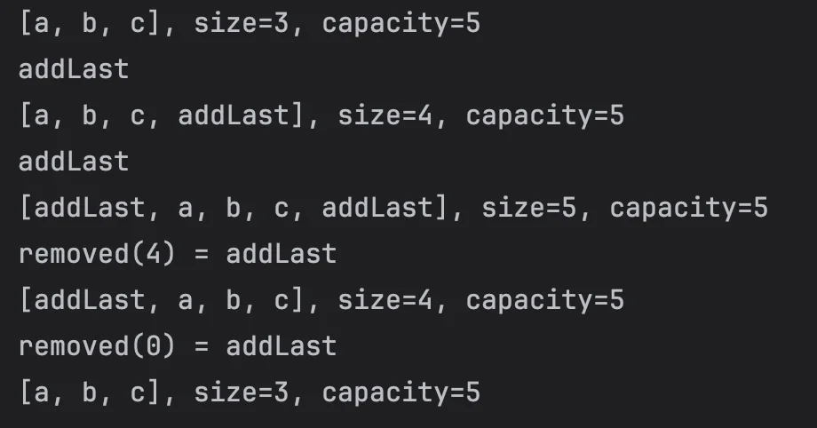

</details>

<a id="1c9eda9b0fe18025ad85e4882dc96ab5"></a>

### 설명

<details>
<summary><strong>기본 데이터 추가</strong></summary>

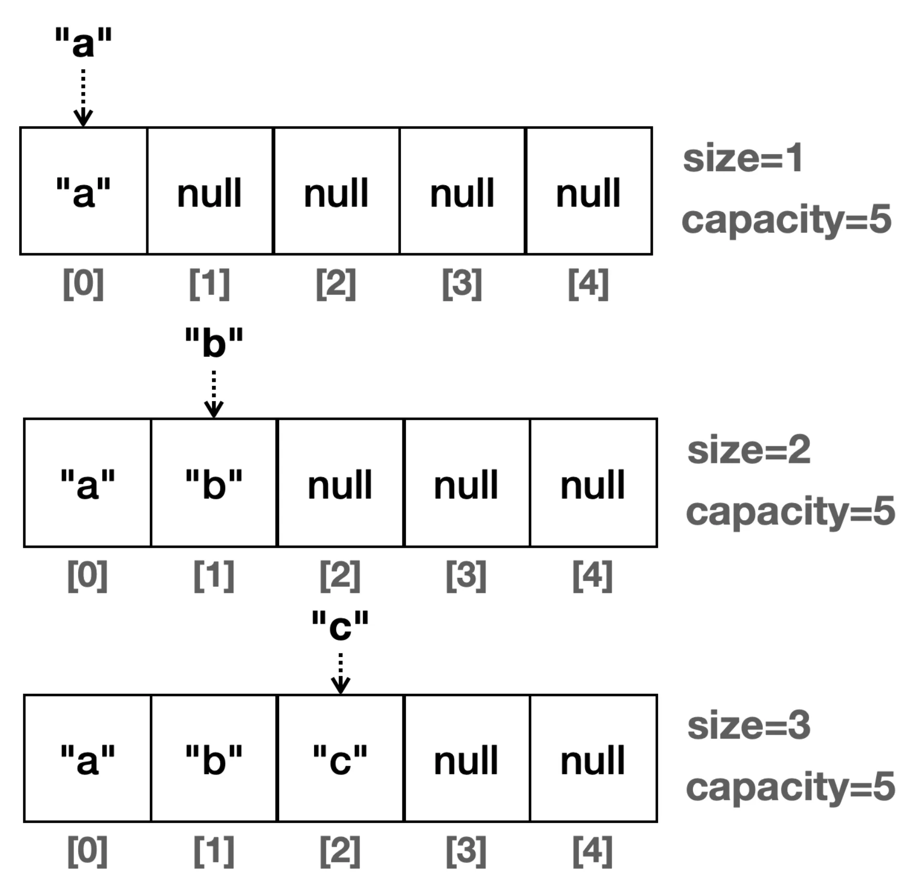

- <code>add()</code> 를 사용해서 데이터를 추가하는 경우 리스트의 마지막( <code>size</code> )에 데이터를 추가한다&#46;

- 데이터를 리스트의 마지막에 추가하기 때문에 기존 데이터를 이동하지 않는다&#46;
    <a id="1c9eda9b0fe180769f69d79f621238e2"></a>

    ⇒ 시간복잡도&#58; <code class="language-math">O(1)</code>

</details>

<details>
<summary><strong>마지막에 추가</strong></summary>

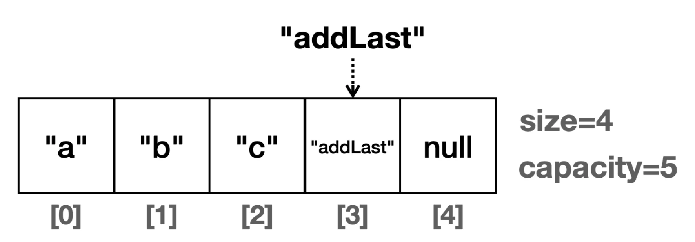

- <code>add(index, e)</code> 를 사용해서 원하는 위치에 데이터를 추가할 수 있다&#46; 

- 위 예시의 경우, 데이터를 리스트의 마지막에 추가하기 때문에 기존 데이터를 이동하지 않는다&#46; 
    <a id="1c9eda9b0fe1800b9c8bf1c15411e29d"></a>

    ⇒ 시간복잡도&#58; <code class="language-math">O(1)</code>

</details>

<details>
<summary><strong>앞에 추가</strong></summary>

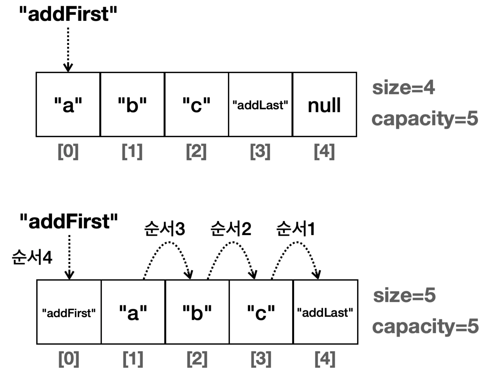

- <code>add(index, e)</code>를 사용하여 앞에 데이터를 추가하는 예시이다&#46; 

- 추가할 공간 확보를 위해 데이터를 오른쪽으로 한 칸씩 이동해야 한다&#46; 
    <a id="1c9eda9b0fe180f89a89d182d1484c61"></a>

    ⇒ 시간복잡도&#58; <code class="language-math">O(n)</code>

</details>

<details>
<summary>마지막 삭제</summary>

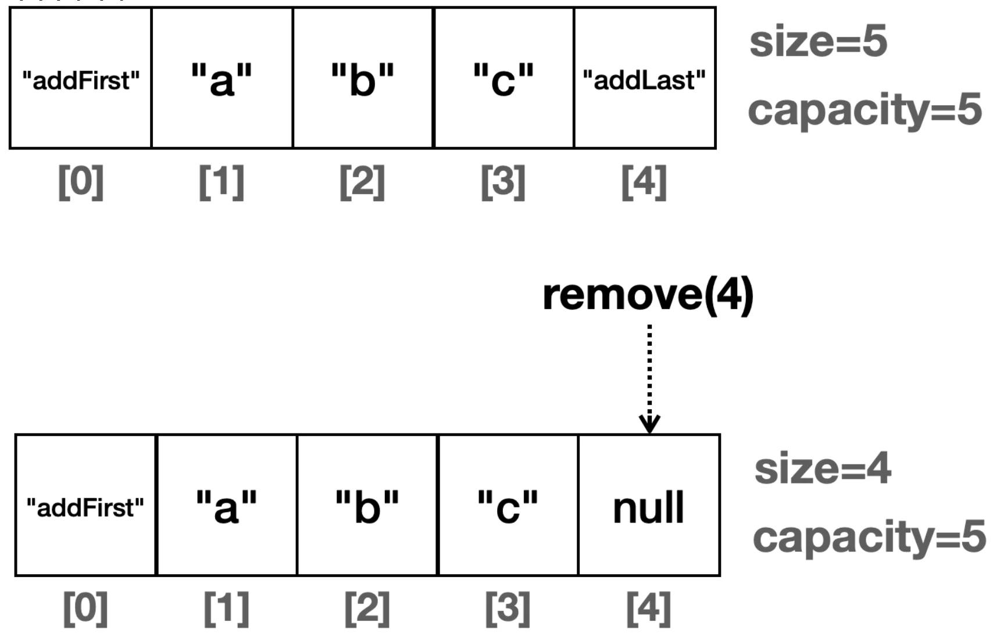

- <code>remove(index)</code> 를 사용해서 원하는 위치에 있는 데이터를 삭제 가능하다&#46;

- 마지막 위치라면 기존 데이터를 이동할 필요가 없다&#46; 
    <a id="1c9eda9b0fe1808ab275c8e52da54b42"></a>

    ⇒ 시간복잡도&#58; <code class="language-math">O(1)</code>

</details>

<details>
<summary>앞에 삭제</summary>

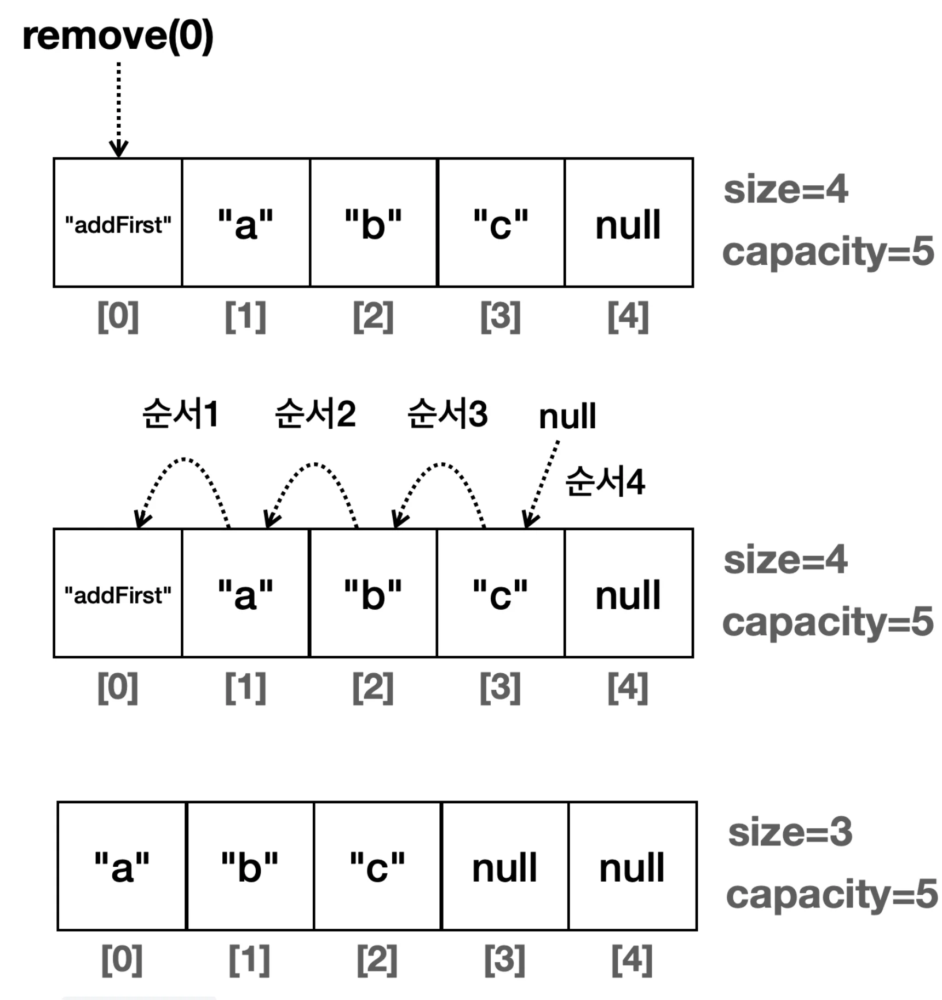

- <code>remove(index)</code> 를 사용해서 원하는 위치에 있는 데이터를 삭제 가능하다&#46;

- 데이터를 삭제할 위치는 배열의 인덱스를 사용하므로 <code class="language-math">O(1)</code>로 빠르게 찾을 수 있지만,<br>마지막 요소가 아닌 경우, 삭제 시 생긴 빈 공간을 채우기 위해  데이터를 이동시켜야 한다&#46; 

<a id="1c9eda9b0fe18058a91ecf1c79b46fb6"></a>

    ⇒ 시간복잡도&#58; <code class="language-math">O(n)</code><br><br>	<br>

</details>

<a id="1c9eda9b0fe180ba8813d6b6e815faf5"></a>

### 개선점

<a id="1c9eda9b0fe180259c8cca13cdfe8d03"></a>

중간 삽입, 삭제 기능을 추가했다&#46; 

<a id="1c9eda9b0fe180758b65f77e4625a911"></a>

그러나 여전히 타입 안정성 문제를 개선할 필요가 있다&#46; 

- Object → 제네릭

> 🗒️ 
> 
> <a id="1c9eda9b0fe180cf9dfeee87b014cce8"></a>
> 
> <strong>정리</strong>
> 
> ---
> 
> <a id="1c9eda9b0fe180fa965bed3dc064c1d4"></a>
> 
> 지금까지 우리가 만든 자료 구조를 배열 리스트( <code>ArrayList</code> )라 한다&#46; 
> 
> - 리스트(List) 자료 구조를 사용하는데, 내부의 데이터는 배열(<code>Array</code>)에 보관한다&#46;
> 
> <a id="1c9eda9b0fe180b7a839fe41f1e84b5e"></a>
> 
> <strong><u>조회, Last 요소 연산</u></strong>의 경우 <code class="language-math">O(1)</code> 으로 빠른 연산처리가 가능하지만 <strong><u>처음, 중간 요소 연산</u></strong>의 경우 <code class="language-math">O(n)</code>으로 느리다&#46; 
> 
> <a id="1c9eda9b0fe180ffac86c2004d3136e0"></a>
> 
> 따라서 데이터를 순서대로 입력하고, 순서대로 출력하는 경우 가장 효율적인 연산 처리가 가능하다&#46;

<a id="1c9eda9b0fe18088bec7c842081d2ef5"></a>

### V4&#58; 제네릭

> ☝🏻 
> 
> <a id="1c9eda9b0fe1803c9334fc897bf91f30"></a>
> 
> 앞서 만든 <code>MyArrayList</code>들은 <code>Object</code>를 입력 받기 때문에 <strong>어떤 타입이든 입력될 수 있</strong>으며, 또한 <strong>결과로 Object 반환</strong>하다&#46; 
> 
> <a id="1c9eda9b0fe180f68c87d020854b83eb"></a>
> 
> 따라서 <strong><u>필요한 경우 다운캐스팅</u></strong>을 해야하며, <strong><u>타입 안정성 또한 떨어진</u></strong>다&#46; 

<details>
<summary><strong>&#91; 🤬 오류 &#93;</strong> 다운캐스팅 → <code>ClassCastException</code></summary>

> ⚠️ 
> 
> <a id="1c9eda9b0fe1804e9b50c46c7153dc9e"></a>
> 
> <code>numberList</code> 에는 숫자만 입력되기를 기대했지만, <br><code>Object</code> 를 받아서 저장하기 때문에 <strong><u>모든 타입을 다 저장할 수 있</u></strong>다&#46; 
> 
> <a id="1c9eda9b0fe1808fa44df8d98871cdb0"></a>
> 
> 따라서 숫자를 입력하다가 <strong>실수로 문자를 입력해도 아무런 문제가 되지 않</strong>는다&#46;

<a id="1c9eda9b0fe1802db927cdb6f172bd79"></a>

```java
package collection.array;
 
public class MyArrayListV3BadMain {
		public static void main(String[] args) {
				MyArrayListV3 numberList = new MyArrayListV3();
				
				// 숫자만 입력 하기를 기대 
				numberList.add(1); 
				numberList.add(2); 
				numberList.add("문자3"); //문자를 입력 
				System.out.println(numberList);
				
				// Object를 반환하므로 다운 캐스팅 필요
				Integer num1 = (Integer) numberList.get(0); 
				Integer num2 = (Integer) numberList.get(1);
				
				// ClassCastException 발생, 문자를 Integer로 캐스팅
				Integer num3 = (Integer) numberList.get(2);
		}
}
```

</details>

<a id="1c9eda9b0fe18017b571f9653ab0159e"></a>

### 코드

<details>
<summary>&#91; 코드 &#93; MyArrayListV4</summary>

<a id="1c9eda9b0fe180ccacebe01bebee3cdc"></a>

```java
package collection.array.v4;

import java.util.Arrays;

public class MyArrayListV4<E> {


    private static final int DEFAULT_CAPACITY = 5;
		
		// Error) new E[] 컴파일 오류
    private Object[] elementData;
    private int size = 0;

    public MyArrayListV4() {
        this.elementData = new Object[DEFAULT_CAPACITY];
    }

    public MyArrayListV4(int initialCapacity) {
        this.elementData = new Object[initialCapacity];
    }

    public int size() {
        return size;
    }

    public void add(E e) {
        if (size == elementData.length) {
            grow();
        }
        elementData[size] = e;
        size++;
    }

    // 코드 추가
    public void add(int index, E e) {
        // 예외처리
        // 0 < index <= size

        if (size == elementData.length) {
            grow();
        }
        shiftRightFrom(index);
        elementData[index] = e;
        size++;

    }

    // 코드 추가, 마지막 요소부터 index까지 오른쪽으로 밀기
    private void shiftRightFrom(int index) {
        for(int i = size; i > index; i--) {
            elementData[i] = elementData[i - 1];
        }
    }

    @SuppressWarnings("unchecked")   // 
    public E get(int index) {
        return (E) elementData[index];
    }

    public E set(int index, E element) {
        E oldValue = get(index);
        elementData[index] = element;
        return oldValue;
    }

    // 코드 추가
    public E remove(int index) {
        E oldValue = get(index);
        shiftLeftFrom(index);

        size--;
        elementData[size] = null;
        return oldValue;
    }

    // 코드 추가, 요소 index부터 마지막까지 왼쪽으로 밀기
    private void shiftLeftFrom(int index) {
        for (int i = index; i < size - 1; i++) {
            elementData[i] = elementData[i + 1];
        }
    }

    public int indexOf(E o) {
        for (int i = 0; i < size; i++) {
            if (o.equals(elementData[i])) {
                return i;
            }
        }
        return -1;
    }

    private void grow() {
        int oldCapacity = elementData.length;
        int newCapacity = elementData.length * 2;
        elementData = Arrays.copyOf(elementData, newCapacity);
    }

    @Override
    public String toString() {
        return  Arrays.toString(Arrays.copyOf(elementData, size)) +
                ", size=" + size +
                ", capacity=" + elementData.length;
    }
}
```

</details>

<details>
<summary>&#91; 코드 &#93; MyArrayListV4Main</summary>

<a id="1c9eda9b0fe180de9921f0f23639c3b7"></a>

```java
package collection.array.v4;

public class MyArrayListV4Main {

    public static void main(String[] args) {
        MyArrayListV4<String> stringList = new MyArrayListV4<>();
        stringList.add("a");
        stringList.add("b");
        stringList.add("c");
        String string = stringList.get(0);
        System.out.println("string = " + string);

        MyArrayListV4<Integer> intList = new MyArrayListV4<>();
        intList.add(1);
        intList.add(2);
        intList.add(3);
        Integer integer = intList.get(0);
        System.out.println("integer = " + integer);
    }
}
```

</details>

<details>
<summary>실행 결과 </summary>

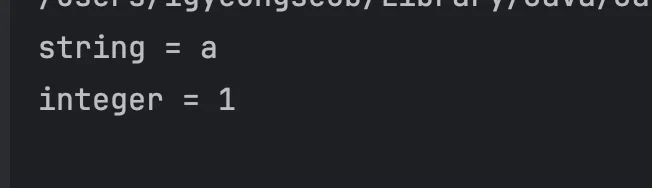

</details>

<a id="1c9eda9b0fe1802787d8f1399e700d00"></a>

### 정리

<a id="1c9eda9b0fe180ee90c5f9f5cc6390f1"></a>

제네릭을 통해 타입 인자를 타입 값을 넘겨 <strong><u>타입 안정성</u></strong><strong><u>을 확보</u></strong>했다&#46;

- <strong><u>타입 인자 외 다른 타입으로 값을 저장</u></strong> 시, <strong>컴파일 오류</strong>가 발생된다&#46;

- 값 조회 시, <strong><u>위험한 다운 캐스팅 없</u></strong>이 안전하게 조회 가능하다&#46;

<a id="1c9eda9b0fe180d1be13c9cd1ff2a9f0"></a>

### V5&#58; 제네릭2

> 🧐 
> 
> <a id="1c9eda9b0fe1809eb2fafc88cabb9beb"></a>
> 
> <strong>Object 배열을 사용한 이유</strong>
> 
> ---
> 
> <a id="1c9eda9b0fe1807daa38e2527475f64d"></a>
> 
> <strong><code>V4 제네릭</code></strong>을 적용한 <strong><code>MyArrayList</code></strong> 에서 <code>Object&#91;&#93;</code>을 그대로 사용했다&#46; 
> 
> <a id="1c9eda9b0fe1805bb9ccfc80447538d4"></a>
> 
> <u>제네릭은 </u><strong><u>런타임</u></strong><u>에 이레이저에 의해 타입 정보가 사라지</u>기 때문에 <strong><u>제네릭 기반으로 배열 생</u></strong><strong><u>성</u></strong><u> </u><strong><u>시</u></strong><u> </u><strong><u>컴파일 오류</u></strong>가 발생된다&#46; 
> 
> <a id="1c9eda9b0fe1806e9096d73a69fbf45a"></a>
> 
> ```java
> new E[DEFAULT_CAPACITY]  <- 🤬 컴파일 오류
> ```
> 
> <a id="1c9eda9b0fe180e7a5a1f75676b7c17f"></a>
> 
> 따라서  <strong><code>Object</code></strong> 를 그대로 사용해야 정상 처리 가능하다&#46;
> 
> <a id="1c9eda9b0fe1806ebabeca390f6590d6"></a>
> 
> ```java
> new Object[DEFAULT_CAPACITY]`
> ```

> ☝🏻 
> 
> <a id="1c9eda9b0fe1808e87a3fb51c57acca3"></a>
> 
> <strong>주의)</strong> <code>Object</code>는 모든 데이터를 담을 수 있기 때문에 데이터를 담는데는 아무런 문제가 없다
> 
> <a id="1c9eda9b0fe18033a4dad15430ee9b92"></a>
> 
> 다만 데이터를 조회할 때 문제가 될 수 있는데, 이때는 조회한 <code>Object</code> 타입을 <strong><u>지정한 타입 매개변수로 다운캐스팅</u></strong> 해준다&#46;
> 
> <a id="1c9eda9b0fe1806aa45cead2963ceeaf"></a>
> 
> ```java
> public E get(int index) {
>      return (E) elementData[index];
> }
> ```

<a id="1c9eda9b0fe180ab87aac3fac1a26ae1"></a>

### 정리

-  생성자에는 제네릭의 타입 매개변수를 사용할 수 없다&#46;
    <a id="1c9eda9b0fe180e3addaf22df1c595b1"></a>

    → 배열을 생성 시, Object 배열 사용

-  제네릭이 리스트의 데이터를 입력 받고 반환하는 곳의 타입을 고정하기 때문에 
    <a id="1c9eda9b0fe18004ab75e8223e98cf89"></a>

    고정된 타입으로 Object 배열에 데이터를 보관하고, 또 데이터를 꺼낼 때도 같은 고정된 타입으로 안전하게 다운 캐스팅 할 수 있다&#46;

> 📌 
> 
> <a id="1c9eda9b0fe180149294d0422f68af4e"></a>
> 
> <strong>ArrayList </strong><strong>의 빅오</strong>
> 
> ---
> 
> - 데이터 추가
>     - 마지막에 추가&#58; <code class="language-math">O(1)</code>
> 
>     - 앞, 중간에 추가&#58; <code class="language-math">O(n)</code>
> 
> - 데이터 삭제
>     - 마지막에 삭제&#58; <code class="language-math">O(1)</code>
> 
>     - 앞, 중간에 삭제&#58; <code class="language-math">O(n)</code> 
> 
> - 인덱스 조회&#58; <code class="language-math">O(1)</code>
> 
> - 데이터 검색&#58; <code class="language-math">O(n)</code>

> 🗒️ 
> 
> <a id="1c9eda9b0fe180bc8d62d5e21a95aa69"></a>
> 
> <strong>MyArrayList의 단점</strong>
> 
> ---
> 
> - 정확한 크기를 미리 알지 못하면 <u>메모리가 낭비</u>된다&#46; <br> → 배열 뒷 부분에 사용되지 않고, 낭비되는 메모리 존재
> 
> - 데이터를 중간에 추가하거나 삭제할 때 비효율적이다&#46;
>     -  데이터를 한 칸씩 밀어야 한다&#46; 
> 
>     - 시간복잡도&#58; <code class="language-math">O(n)</code>
> 
> <a id="1c9eda9b0fe1808c92f1fca75fd71d8f"></a>
> 
> 이러한 단점들을 <code>LinkedList</code> 자료구조에서 해결한다&#46;  ( 다음 챕터 참조 )
