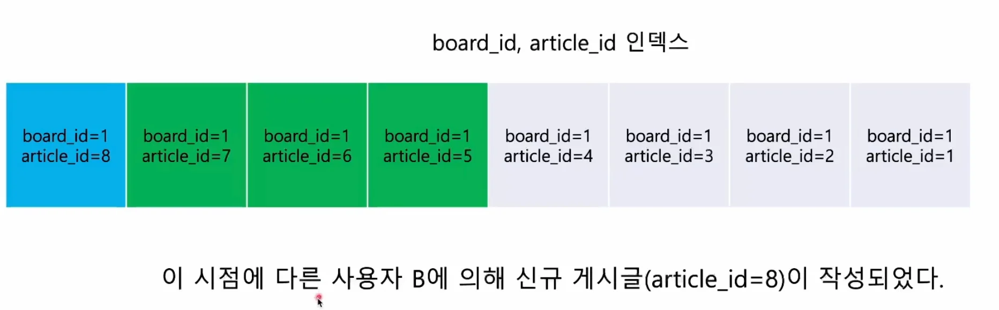
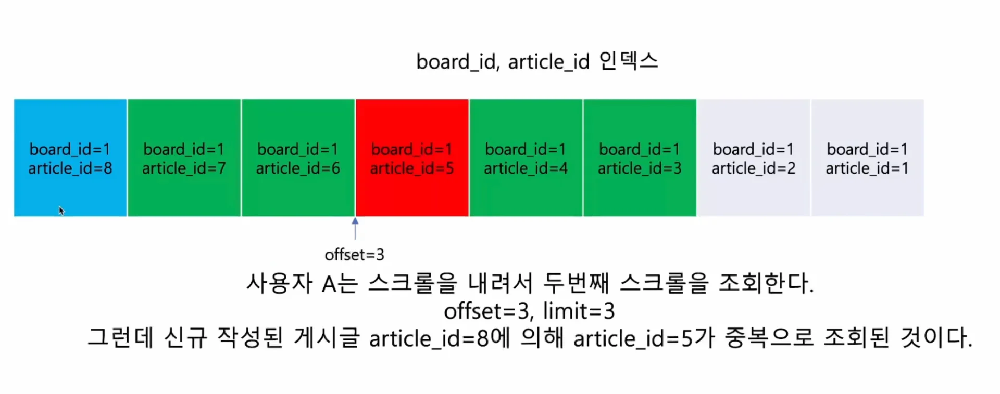
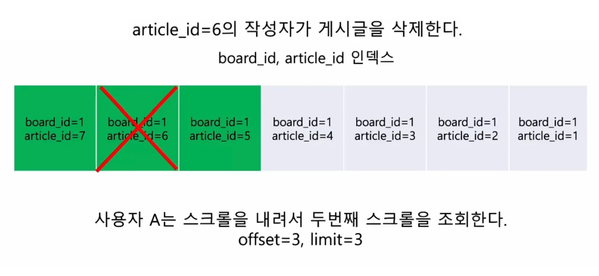
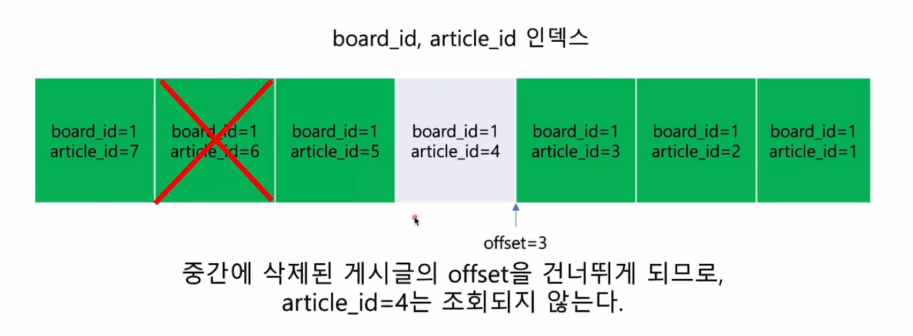
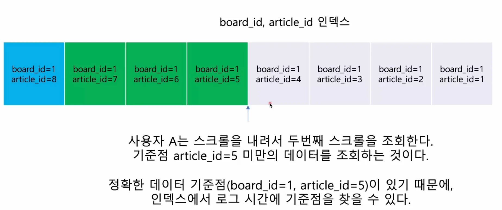
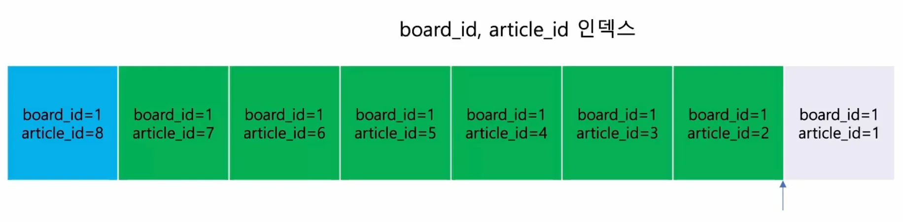

### 설계 &#45; 주의점

### &#91; 🤬 오류 &#93; 페이징 처리와 동일하게 구현하는 경우 발생될 수 있는 문제점들

<strong>오류 1) 신규 데이터 생성 시, 데이터 중복 발생 </strong>

오류2) 데이터 누락 발생

---

페이지 번호 방식을 사용하면 데이터가 <strong>중복, 누락</strong> 될 수 있다&#46; 

이를 해결하기 위해서는 무한 스크롤에 적합한 방식이 필요하다&#46; 

### 무한 스크롤 

> ✏️ 
> 
> 
> 
> 무한스크롤 구현 시, <strong>마지막으로 불러온 데이터를 기준점</strong>으로 활용한다&#46; 

