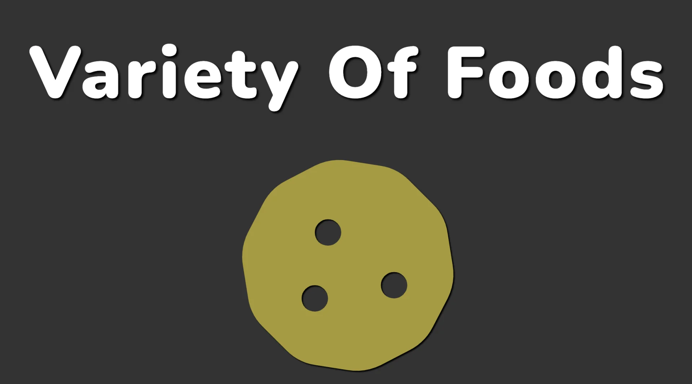
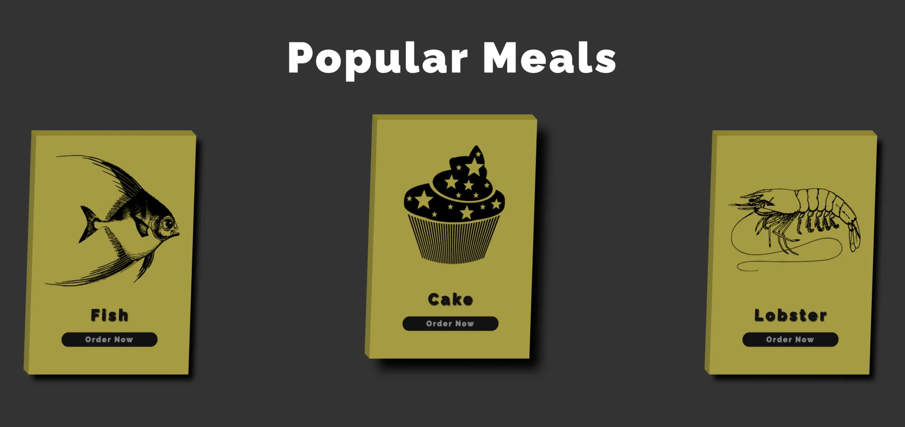
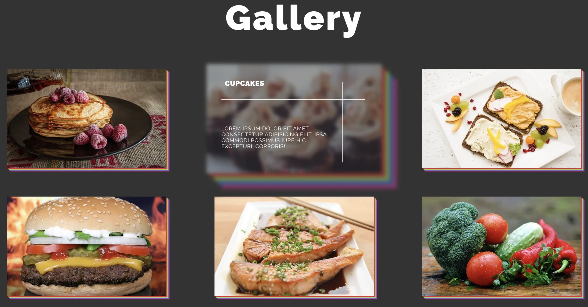
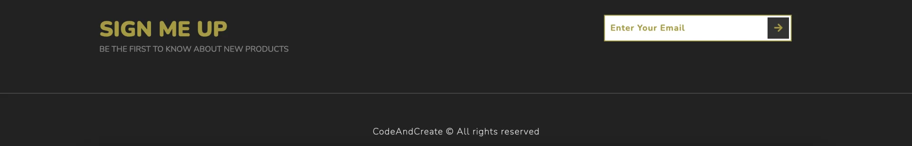
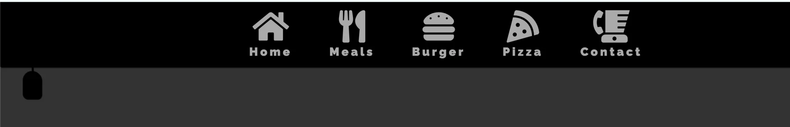

<a id="1c3eda9b0fe1818690c1ca4b8ef2a94b"></a>

## Default setting

- 아이콘 link

<a id="1c3eda9b0fe181bdbbd6f220b51d684d"></a>

```html
<link
      rel="stylesheet"
      href="https://cdnjs.cloudflare.com/ajax/libs/font-awesome/5.15.1/css/all.min.css"
    />
  </head>
```

- html

<a id="1c3eda9b0fe18190bfdafd26f32d8e6e"></a>

```html
<!DOCTYPE html>
<html lang="en">
  <head>
    <meta charset="UTF-8" />
    <meta name="viewport" content="width=device-width, initial-scale=1.0" />
    <title>Foods</title>
    <link rel="stylesheet" href="style.css" />
    <link
      rel="stylesheet"
      href="https://cdnjs.cloudflare.com/ajax/libs/font-awesome/5.15.1/css/all.min.css"
    />
  </head>
  <body>
    <script src="script.js"></script>
  </body>
</html>
```

- css

<a id="1c3eda9b0fe181278e71effc04141d2b"></a>

```css
@import url("https://fonts.googleapis.com/css2?family=Noto+Sans+KR:wght@100&family=Raleway:ital,wght@0,100;0,200;0,300;0,400;0,500;0,600;0,900;1,700;1,800&display=swap");

* {
  font-family: "Noto Sans KR", sans-serif;
  font-family: "Raleway", sans-serif;
  margin: 0;
  padding: 0;
  box-sizing: border-box;
  text-decoration: none;
  outline: none;
  font-weight: 400;
}

html {
  font-size: 62.5%;
}
```

<a id="1c3eda9b0fe1816981bedc75188d9e81"></a>

## Section 1 &#45; 이미지 자동 변경 



<a id="1c3eda9b0fe1815cbab0cb935a92e900"></a>

### html

<a id="1c3eda9b0fe181cc9655e360b35b561b"></a>

```html
<section class="section-1">
        <h1 class="section-1-heading">variety of foods</h1>
        <div class="section-1-icons">
          <i class="change fas fa-egg"></i>
          <i class="fas fa-stroopwafel"></i>
          <i class="fa fa-cheese"></i>
          <i class="fas fa-hotdog"></i>
          <i class="fas fa-drumstick-bite"></i>
          <i class="fas fa-apple-alt"></i>
          <i class="fas fa-ice-cream"></i>
          <i class="fas fa-fish"></i>
          <i class="fas fa-cookie"></i>
          <i class="fas fa-seedling"></i>
        </div>
 </section>
 <!-- End of Section 1 -->
```

<a id="1c3eda9b0fe1810f8381c33cb2d13a15"></a>

### css

<a id="1c3eda9b0fe18165a024d31aa7cad6fc"></a>

```css
.section-1 {
  width: 100%;
  height: 100vh;
  background-color: var(--background-color);
  display: flex;
  flex-direction: column;
  align-items: center;
  justify-content: space-evenly;
}

.section-1-heading {
  font-size: 12rem;
  font-weight: 900;
  color: var(--font-color);
  text-align: center;
  text-transform: capitalize;
  letter-spacing: 0.5rem;
  text-shadow: 0.3rem 0.3rem 0.3rem #000;
}

.section-1-icons i {
  font-size: 35rem;
  color: var(--image-color);
  position: absolute;
  transform: translate(-50%, -50%) scale(0);
  text-shadow: var(--text-shadow);
  transition: transform 0.3s;
}

.section-1-icons i.change {
  transform: translate(-50%, -50%) scale(1);
}
```

<a id="1c3eda9b0fe181c98f52fe4886198f72"></a>

### js

<a id="1c3eda9b0fe1818787d2fd78039ba52e"></a>

```javascript
export function rotaionItems() {
  const icons = document.querySelectorAll(".section-1-icons i");
  let i = 1;

  setInterval(() => {
    i++;

    const icon = document.querySelector(".section-1-icons .change");

    icon.classList.remove("change");

    if (i > icons.length) {
      icons[0].classList.add("change");
      i = 1;
    } else {
      icon.nextElementSibling.classList.add("change");
    }
  }, 1000);
} 
```

<a id="1c3eda9b0fe18176af7ae400161da1c6"></a>

### item&#46;nextElementSibling &#45; 해당 하는 아이템의 부모 노드에 가서 다음 아이템을 가져옴&#46;

<details>
<summary>작성한 코드  →  Error) 인덱스 값이 이어지지 않음</summary>

<a id="1c3eda9b0fe1813388d6ee35431a5333"></a>

```css
// rotattion food-image-items
const icons = document.querySelectorAll(".section-1-icons i");
let currentItemIndex = 0;
let previousItemIndex = currentItemIndex - 1;
const iconsLength = icons.length;


const itemsInfo = {
     currentItemIndex: 0,
     previousItemIndex: currentItemIndex - 1,
     iconsLength: icons.length,
};

setInterval(() => {
  rotattionItemsAlgorithm({
    icons,
    currentItemIndex,
    previousItemIndex,
    iconsLength
  });

// 1. 아이콘 아이템 배열 가져옴
// 2. 인덱스로 이전 아이템 현재 아이템 구분하여 css-class-change 제거 및 추가하는 함수 작성
//   - 아이템 인덱스 계산 알고리즘 작성  -> calculateRotationItemsIndex
//   - 이전 아이템 css-class-change 제거, 현재 아이템 css-class-change 추가
//   - 해당 내용 일정 시간 초마다 반복 실행 -> `setTimeout()`

function rotattionItemsAlgorithm(
  icons,
  currentItemIndex,
  previousItemIndex,
  iconsLength
) {
  if (currentItemIndex > iconsLength) {
    currentItemIndex = 0;
  }

  if (currentItemIndex === 0) {
    if (
      icons[previousItemIndex] != undefined &&
      icons[previousItemIndex].classList.contains("change") === true
    ) {
      icons[previousItemIndex].classList.remove("change");
    }
    icons[currentItemIndex].classList.add("change");
    currentItemIndex++;
    return;
  }

  icons[previousItemIndex].classList.remove("change");
  icons[currentItemIndex].classList.add("change");
  return;
} 
```

</details>

<a id="1c3eda9b0fe181a7a397fe513ffb7387"></a>

## Section 2 &#45; 3D cards



<a id="1c3eda9b0fe181348194c783e78b66f2"></a>

### html

<a id="1c3eda9b0fe181399ed3e16787926f46"></a>

```html
<section class="section-2">
        <h1 class="section-heading-2">popular meals</h1>
        <div class="cards-container">
          <div class="card">
            
            <h3 class="card-name">Fish</h3>
            <button class="card-btn">Order now</button>
          </div>
          <div class="card">
            
            <h3 class="card-name">Cake</h3>
            <button class="card-btn">Order now</button>
          </div>
          <div class="card">
            
            <h3 class="card-name">Lobster</h3>
            <button class="card-btn">Order now</button>
          </div>
        </div>
      </section>
```

<a id="1c3eda9b0fe1814ea927eabb77c7c8d5"></a>

### css

<a id="1c3eda9b0fe181988b2aff5a88789f84"></a>

```css
.section-2 {
  width: 100%;
  height: 100%;
  background-color: #222;
  color: var(--font-color);
  padding: 20rem 0;
  text-align: center;
}

.cards-container {
  display: flex;
  justify-content: space-around;
}

.section-heading-2 {
  color: var(--font-color);
  font-size: 8rem;
  font-weight: 900;
  text-transform: capitalize;
  letter-spacing: 0.5rem;
  margin-bottom: 10rem;
  text-shadow: var(--text-sadow);
}

/* card */

.card {
  background-color: var(--image-color);
  height: 45rem;
  width: 32rem;
  display: flex;
  flex-direction: column;
  align-items: center;
  position: relative;
  transform: rotateY(20deg) skewX(-2deg);
  box-shadow: 1rem 1rem 1rem #000;
  transition: transform 0.5s, box-shadow 0.5s;
}

.card:hover {
  transform: rotateY(20deg) skewX(-2deg) translateY(-3rem);
  box-shadow: 2rem 2rem 2rem #000;
}

.card::before {
  content: "";
  height: 100%;
  width: 1rem;
  background-color: #817824;
  position: absolute;
  top: 0;
  left: -1rem;
  transform: skewY(45deg);
  transform-origin: right;
  box-shadow: -0.1rem, -0.1rem, -0.1rem #000;
}

.card::after {
  content: "";
  height: 1rem;
  width: 100%;
  background-color: #8f8317;
  position: absolute;
  top: -1rem;
  left: 0;
  transform: skewX(45deg);
  transform-origin: bottom;
  box-shadow: -0.1rem, -0.1rem, -0.1rem #000;
}

.card-name {
  font-size: 3rem;
  font-weight: 900;
  text-transform: capitalize;
  color: #111;
  letter-spacing: 0.5rem;
  text-shadow: 0.15rem 0.15rem 0.15rem #111;
}

.card-img {
  width: 100%;
  /* height: 30rem;  */
}

.card-btn {
  width: 60%;
  background-color: #111;
  color: #888;
  border-radius: 5rem;
  font-size: 1.5rem;
  font-weight: 800;
  letter-spacing: 0.2rem;
  text-transform: capitalize;
  border: none;
  padding: 0.5rem 0;
  transition: transform color 0.1s ease-in;
  margin-top: 1.5rem;
}

.card-btn:hover {
  transform: scale(1.1);
  color: #fff;
}

/* Card 3D 설정 */
```

<a id="1c3eda9b0fe18165aaa5cbd76386df44"></a>

## Section  3 &#45;  Food Gallery



<a id="1c3eda9b0fe1812b9f38cbcf7f68db31"></a>

### html

<a id="1c3eda9b0fe181b3a317f93ec7b781de"></a>

```html
<section class="section-3">
  <h1 class="section-heading"></h1>
  <div class="gallery">
    <a href="" class="gallery-link">
      
      <h3 class="food-name">Pancakes</h3>
      <p class="food-description">
        Lorem ipsum dolor sit amet consectetur adipisicing elit. Ipsa
        commodi possimus iure hic excepturi. Corporis!
      </p>
    </a>
    <a href="" class="gallery-link">
      
      <h3 class="food-name">cupcakes</h3>
      <p class="food-description">
        Lorem ipsum dolor sit amet consectetur adipisicing elit. Ipsa
        commodi possimus iure hic excepturi. Corporis!
      </p>
    </a>
    <a href="" class="gallery-link">
      
      <h3 class="food-name">hummus</h3>
      <p class="food-description">
        Lorem ipsum dolor sit amet consectetur adipisicing elit. Ipsa
        commodi possimus iure hic excepturi. Corporis!
      </p>
    </a>
    <a href="" class="gallery-link">
      
      <h3 class="food-name">hamburger</h3>
      <p class="food-description">
        Lorem ipsum dolor sit amet consectetur adipisicing elit. Ipsa
        commodi possimus iure hic excepturi. Corporis!
      </p>
    </a>
    <a href="" class="gallery-link">
      
      <h3 class="food-name">salmon</h3>
      <p class="food-description">
        Lorem ipsum dolor sit amet consectetur adipisicing elit. Ipsa
        commodi possimus iure hic excepturi. Corporis!
      </p>
    </a>
    <a href="" class="gallery-link">
      
      <h3 class="food-name">vegetables</h3>
      <p class="food-description">
        Lorem ipsum dolor sit amet consectetur adipisicing elit. Ipsa
        commodi possimus iure hic excepturi. Corporis!
      </p>
    </a>
  </div>
</section>
```

<a id="1c3eda9b0fe181aa9151f6f4b8faa9e0"></a>

### css

<a id="1c3eda9b0fe1810682cafe8eba206e13"></a>

```css
.section-3 {
  background-color: #333;
  padding: 5rem 0;
}

.section-3-heading {
  text-align: center;
  text-transform: capitalize;
  color: var(--font-color);
  letter-spacing: 0.5rem;
  font-size: 10rem;
  font-weight: 900;
}

.gallery {
  display: flex;
  flex-wrap: wrap;
  align-items: center;
  justify-content: space-evenly;
  margin-top: 5rem;
}

.gallery-link {
  position: relative;
  margin: 4rem 1rem;
}

.gallery-link::before {
  content: "";
  position: absolute;
  top: 2vw;
  left: 80%;
  width: 0.2rem;
  height: 0;
  background-color: #fff;
  z-index: 10;
  transition: height 0.5s;
}

.gallery-link::after {
  content: "";
  position: absolute;
  top: 30%;
  left: 2rem;
  width: 0;
  height: 0.2rem;
  background-color: #fff;
  transition: width 0.5s;
}

.gallery-link:hover::before {
  height: 80%;
}

.gallery-link:hover::after {
  width: 90%;
}

.food-img {
  width: 24vw;
  height: 15vw;
  object-fit: cover;
  box-shadow: 0.3rem 0.3rem 0.1rem #e92929, 0.5rem 0.5rem 0.1rem #a2e946,
    0.7rem 0.7rem 0.1rem #297ce9, 0.9rem 0.9rem 0.1rem #e92999;
  transition: all 0.5s;
}

.gallery-link:hover .food-img {
  box-shadow: 1rem 1rem 0.1rem #e92929, 2rem 2rem 0.1rem #a2e946,
    3rem 3rem 0.1rem #297ce9, 4rem 4rem 0.1rem #e92999;
  transform: scale(1.1);
  filter: blur(0.5rem);
  opacity: 0.5;
}

.food-name {
  position: absolute;
  top: 3rem;
  left: 3rem;
  font-size: 2rem;
  font-weight: 700;
  text-transform: uppercase;
  letter-spacing: 0.1rem;
  color: #fff;
  width: 0;
  overflow: hidden;
  transition: width 0.3s;
}

.gallery-link:hover .food-name {
  width: 100%;
  transition: width 1.5s 0.5s;
}

.food-description {
  position: absolute;
  bottom: 3vw;
  left: 2rem;
  width: 70%;
  font-size: 1.5rem;
  font-weight: 300;
  letter-spacing: 0.1rem;
  text-transform: uppercase;
  color: #fff;
  opacity: 0;
  visibility: hidden;
  transition: opacity 0.3s;
}

.gallery-link:hover .food-description {
  opacity: 1;
  visibility: visible;
  transition: opacity 1s 1s;
}
```

<a id="1c3eda9b0fe181eeae32e52b0416a231"></a>

## Section  4 &#45;  Footer customize



<a id="1c3eda9b0fe1812684a5ea0baafeb0f0"></a>

### html

<a id="1c3eda9b0fe181068ea1dcedd1a8a2f7"></a>

```html
<section class="section-4">
  <div class="section4-text">
    <h2 class="setction4-heading">sign me up</h2>
    <p class="section4-paragrahp">
      be the first to know about new products
    </p>
  </div>
  <form action="" class="signup-form">
    <input
      type="email"
      class="signup-form-input"
      placeholder="Enter Your Email"
    />
    <button type="submit" class="signup-form-btn">
      <i class="fas fa-arrow-right"></i>
    </button>
  </form>
  <p class="copylink">CodeAndCreate @ All rights reserved</p>
</section>
```

<a id="1c3eda9b0fe181a0ad51e34afbd288d4"></a>

### css

<a id="1c3eda9b0fe18128a722de381cab04c2"></a>

```css
.section-4 {
  width: 100%;
  height: 30vh;
  background-color: #222;
  display: flex;
  justify-content: space-around;
  padding: 3rem 0;
  position: relative;
  align-items: flex-start;
}

.section-4-text {
  text-transform: uppercase;
}

.section-4-heading {
  font-size: 4rem;
  font-weight: 900;
  color: #a79a2d;
}

.section-4-paragraph {
  font-size: 1.5rem;
  color: #888;
}

.signup-form {
  /* position: relative; */
  display: flex;
  align-items: center;
}

.signup-form-input {
  width: 35rem;
  height: 5rem;
  padding: 1rem;
  border: 0.2rem solid #a79a2d;
  font-size: 1.6rem;
  font-weight: 700;
  letter-spacing: 0.1rem;
  color: #a79a2d;
}

.signup-form-input::placeholder {
  color: #a79a2d;
}

.signup-form-btn {
  position: relative;
  left: -4.5rem;
  width: 4rem;
  height: 4rem;
  background-color: #333;
  color: #a79a2d;
  border: none;
  font-size: 1.8rem;
  cursor: pointer;
}

.copyright {
  position: absolute;
  bottom: 3rem;
  font-size: 1.7rem;
  font-weight: 200;
  color: #eee;
  letter-spacing: 0.1rem;
  border-top: 0.1rem solid #888;
  padding-top: 6rem;
  width: 100%;
  text-align: center;
}
```

<a id="1c3eda9b0fe181b39a19ddd5aef50474"></a>

## Section  5 &#45; NavBar 



<a id="1c3eda9b0fe181819f6fff3553a7b479"></a>

### html

<a id="1c3eda9b0fe181bcad25c12e380b40f1"></a>

```html
<!-- Navbar -->
    <nav class="navbar target">
      <a href="" class="navbar-link"
        ><i class="fas fa-home"></i><span>Home</span></a
      >
      <a href="" class="navbar-link"
        ><i class="fas fa-utensils"></i><span>Meals</span></a
      >
      <a href="" class="navbar-link"
        ><i class="fas fa-hamburger"></i><span>Burger</span></a
      >
      <a href="" class="navbar-link"
        ><i class="fas fa-pizza-slice"></i><span>Pizza</span></a
      >
      <a href="" class="navbar-link"
        ><i class="fas fa-blender-phone"></i><span>Contact</span></a
      >
    </nav>
    <div class="menu target"></div>
```

<a id="1c3eda9b0fe181e0b5e5c7ca58b030d3"></a>

### css

<a id="1c3eda9b0fe181918eb2fdda787a6c7a"></a>

```css
/* Navbar */
.navbar {
  width: 100%;
  height: 14rem;
  background-color: #000;
  position: fixed;
  top: -14rem;
  z-index: 150;
  display: flex;
  justify-content: center;
  align-items: center;
  box-shadow: 0.2rem 0.2rem 0.2rem #000;
  /* text-align: center; */
  transition: top 0.4s;
}

.navbar.change {
  top: 0;
  transition: top 0.4s 0.2s;
}

.navbar-link {
  color: #aaa;
  margin: 0 4rem;
  display: flex;
  flex-direction: column;
  justify-content: center;
  align-items: center;
  /* position: relative; */
  opacity: 0;
  transition: color 0.3, opacity, 2s;
}

.change .navbar-link {
  opacity: 1;
}

.change .navbar-link:nth-child(1) {
  transition: opacity 0.4s 0.5s, color 0.3s;
}

.change .navbar-link:nth-child(2) {
  transition: opacity 0.4s 0.6s, color 0.3s;
}

.change .navbar-link:nth-child(3) {
  transition: opacity 0.4s 0.7s, color 0.3s;
}

.change .navbar-link:nth-child(4) {
  transition: opacity 0.4s 0.8s, color 0.3s;
}

.change .navbar-link:nth-child(5) {
  transition: opacity 0.4s 0.9s, color 0.3s;
}

.navbar-link:hover {
  color: #fff;
}

.navbar-link i {
  font-size: 7rem;
}

.navbar-link span {
  font-size: 2.5rem;
  font-weight: 900;
  letter-spacing: 0.5rem;
  margin-top: 0.5rem;
}

.menu {
  width: 4rem;
  height: 6rem;
  background-color: #000;
  position: fixed;
  top: 1rem;
  left: 5rem;
  border-radius: 30rem 30rem 15rem 15rem;
  box-shadow: 0.1rem 0.1rem 0.1rem #000, -0.1rem -0.1rem 0.1rem #000;
  cursor: pointer;
  z-index: 100;
  transition: top 0.4s 0.2s;
}

.menu.change {
  top: 15rem;
  transition: top 0.4s;
}

.menu::before {
  content: "";
  width: 0.3rem;
  height: 15rem;
  background-color: #000;
  position: absolute;
  top: -15rem;
  left: calc(50% - 0.15rem);
  box-shadow: 0.1rem 0rem 0.1rem #000;
  /* transition: all 0.4s; */
}
```

<a id="1c3eda9b0fe181a8a740ec017d83ecb3"></a>

### js

<a id="1c3eda9b0fe181c59c8cc54021ac716e"></a>

```javascript
export function navbarEvent() {
  document.querySelector(".menu").addEventListener("click", () => {
    document.querySelectorAll(".target").forEach((item) => {
      item.classList.toggle("change");
    });
  });
}
```

<a id="1c3eda9b0fe181268a72fd04b1e0bd8e"></a>

## Section  6 &#45; apply Responsive CSS

<a id="1c3eda9b0fe181d3967dfedc22648a84"></a>

### section header &#45; selector 명칭 수정 필요&#33; &#45; 강의랑 프로젝트랑 달라서 적용이 안되었음&#46;

<a id="1c3eda9b0fe18113aa03f73b99867500"></a>

### css

<a id="1c3eda9b0fe18196b242c8154d5066d4"></a>

```css
/* Responsive */
@media (max-width: 1400px) {
  html {
    font-size: 50%;
  }

  .section-2 {
    height: auto;
  }

  .cards-container {
    margin-top: 10rem;
  }

  .gallery-link {
    width: 40rem;
    height: 25rem;
    margin: 5rem;
  }

  .food-img {
    width: 100%;
    height: 100%;
  }
}

@media (max-width: 1000px) {
  .section-heading {
    font-size: 9rem;
    margin: 0 5rem;
  }

  .section-1-icons i {
    font-size: 25rem;
  }

  .cards-container {
    flex-wrap: wrap;
  }

  .card {
    margin: 5rem;
  }

  .section-4 {
    height: 30rem;
  }
}

@media (max-width: 900px) {
  .navbar-link {
    margin: 2rem;
  }

  .navbar-link i {
    font-size: 4rem;
  }

  .navbar-link span {
    font-size: 2rem;
  }
}

@media (max-width: 700px) {
  .section-heading {
    font-size: 7rem;
    margin: 0 10rem;
  }

  .section-1-icons i {
    font-size: 20rem;
  }

  .menu {
    left: 2rem;
  }

  .section-4 {
    height: 40rem;
    flex-direction: column;
    justify-content: flex-start;
    align-items: center;
  }

  .section-4-text {
    margin-bottom: 8rem;
  }
}

@media (max-width: 550px) {
  html {
    font-size: 40%;
  }

  .navbar-link {
    margin: 0 0.7rem;
  }
}
```
