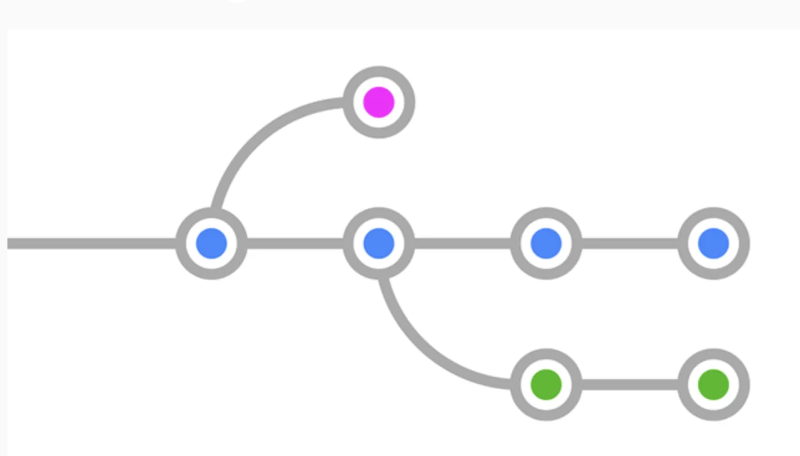

<a id="1c3eda9b0fe181b98367cbcce0de3754"></a>

## 1&#46; Branch&#58; 분기된 가지(다른 차원)

> 📌 <strong>브랜치 사용 필요성</strong>
> 
> - 프로젝트를 하나 이상의 모습으로 관리해야 할 때
>     <a id="1c3eda9b0fe18131a553f519e925849c"></a>
> 
>     ex) 실제 배포용, 테스트 서버용, 새로운 시도용
> 
> - 여러 작업들이 각각 독립되어 진행될때 
>     - 예) 신기능 1, 신기능 2, 코드개선, 긴급수정&#46;&#46;&#46;
> 
>     - 각각의 차원에서 작업한 뒤 확정된 것을 메인 차원에 통합

<a id="1c3eda9b0fe1813199e1c587a675bcdd"></a>

### 브랜치 생성 / 이동 / 삭제

<details>
<summary>브랜치 생성</summary>

<a id="1c3eda9b0fe181859e61c83fa47b57a2"></a>

```bash
git branch [브랜치명]
```

</details>

<details>
<summary>브랜치 목록 확인</summary>

<a id="1c3eda9b0fe181f99e7efe67e23a32f5"></a>

```bash
git branch
```

</details>

<details>
<summary>&#91;브랜치명&#93;  브랜치로 이동</summary>

<a id="1c3eda9b0fe181a88e77e38793622272"></a>

```bash
git switch [브랜치명]
```

> • <code>checkout</code> 명령어가 Git 2&#46;23 버전부터 <code>switch</code>, <code>restore</code>로 분리

</details>

<details>
<summary>브챈치 생성과 동시에 이동하기</summary>

<a id="1c3eda9b0fe1814897bec4493d27b983"></a>

```bash
git switch -c new-teams
```

</details>

<details>
<summary>브랜치 삭제하기</summary>

<a id="1c3eda9b0fe1815b8741db57e8c9ee8e"></a>

```bash
git branch -d (삭제할 브랜치명)
```

</details>

<details>
<summary>브랜치 이름 바꾸기</summary>

<a id="1c3eda9b0fe181db89c1d6b0c5717b99"></a>

```bash
git branch -m (기존 브랜치명) (새 브랜치명)
```

</details>

<details>
<summary>merger 하지 않고 branch를 삭제하고 싶은 경우</summary>

<a id="1c3eda9b0fe1819db5c1d922b4a1f7b7"></a>

지워질 브랜치에만 있는 내용의 커밋이 있을 경우, 즉 다른 브랜치로 가져오지 않은 내용이 있는 브랜치를 지울 때는 <code>&#45;d</code> 대신 <code>&#45;D</code>(대문자)로 강제 삭제 해야한다&#46;

<a id="1c3eda9b0fe181ca890ad2e01ce74350"></a>

```bash
git branch -D (강제삭제할 브랜치명)
```

</details>

<a id="1c3eda9b0fe181868f7beb9cfc148acc"></a>

### 각각의 브랜치에서 서로 다른 작업 해보기

<details>
<summary>branch &#45; <code>main</code></summary>

1. Leopards의 <code>members</code>에 <code>Olivia</code> 추가
    - 커밋 메시지&#58; <code>Add Olivia to Leopards</code>

1. Panthers의 <code>members</code>에 <code>Freddie</code> 추가
    - 커밋 메시지&#58; <code>Add Freddie to Panthers</code>

</details>

<details>
<summary>branch &#45; <code>add&#45;coach</code></summary>

1. Tigers의 매니저 정보 아래 <code>coach&#58; Grace</code> 추가
    - 커밋 메시지&#58; <code>Add Coach Grace to Tigers</code>

1. Leopards의 매니저 정보 아래 <code>coach&#58; Oscar</code> 추가
    - 커밋 메시지&#58; <code>Add Coach Oscar to Leopards</code>

1. Panthers의 매니저 정보 아래 <code>coach&#58; Teddy</code> 추가
    - 커밋 메시지&#58; <code>Add Coach Teddy to Panthers</code>

</details>

<details>
<summary>branch &#45; <code>new&#45;teams</code></summary>

1. <code>pumas&#46;yaml</code> 추가
    - 커밋 메시지&#58; <code>Add team Pumas</code>

    <a id="1c3eda9b0fe18163b350eecca6a2be20"></a>

    ```bash
    team: Pumas

    manager: Jude

    members:
    - Ezra
    - Carter
    - Finn
    ```

1. <code>jaguars&#46;yaml</code>
    - 커밋 메시지&#58; <code>Add team Jaguars</code>

    <a id="1c3eda9b0fe181219c69cb07ce46b0c0"></a>

    ```bash
    team: Jaguars

    manager: Stanley

    members:
    - Caleb
    - Harvey
    - Myles
    ```

</details>

<details>
<summary>여러 브랜치의 내역 편리하게 보기</summary>

<a id="1c3eda9b0fe181aa877ae0bbcf7cdc84"></a>

```bash
git log --all --decorate --oneline --graph
```

> <code>git log</code>&#58;  현재 브랜치의 commit 내역만 볼수 있음


</details>

- 소스트에서 확인
    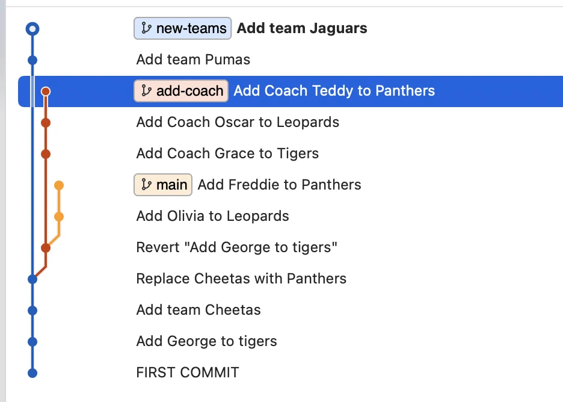

<a id="1c3eda9b0fe181858802cb8ea314a0eb"></a>

## 2&#46; branch를 합치는 두가지 방법 (merge, rebase)

<a id="1c3eda9b0fe181a9996feeb6b47b17e1"></a>

### 2&#46;1 &#45; merge

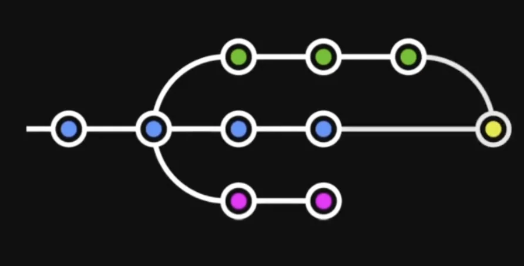

> <code>merge</code> 는 아래와 같이 브랜치의 흔적을 남긴다&#46; 


<a id="1c3eda9b0fe181f3b970df93a3b34cd3"></a>

### 2&#46;2 &#45; rebase

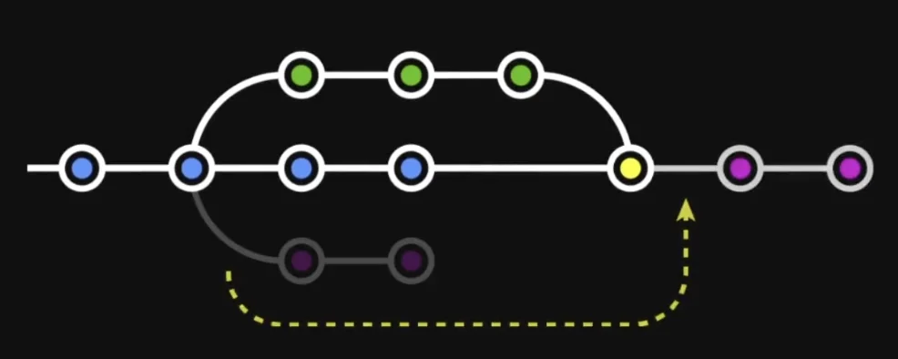

> <code>rebase</code> 사용 시 아래와 같이 히스토리가 깔끔하게 한줄로 정리된다&#46;


> 📌 진행하는 프로젝트의 성격에 따라 <strong>브랜치의 사용 내역들을 남겨둘 필요가 있</strong>다면 <code>merge</code>를 사용하고 <strong>히스토리를 깔끔하게 만드는게 중요</strong>하다면 <code>Rebase</code>를 사용한다&#46;<br><br>많은 브랜치가 사용되는 프로젝트에서는 <code>merge</code>를 사용한다면 프로젝트의 진행 내역들을 보고 파악하기가 어려울 수 있다&#46; 

> ⚠️ 이미 팀원들간 공유된 커밋들에 대해서는 <code>rebase</code>를 사용하지 않는 것이 좋다&#46; 
> 
> <a id="1c3eda9b0fe18133b4eff1bd5a6941d4"></a>
> 
> <code>rebase</code>는 이미 작업한 commit 내역들을 가져와 앞에 추가하는 것으로  
> 
> 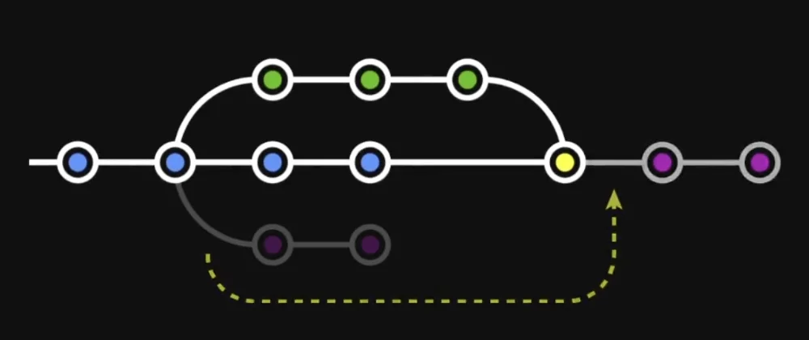

<a id="1c3eda9b0fe18121b54cd070b7cb5639"></a>

### 실습

<details>
<summary><strong>merge</strong></summary>

<a id="1c3eda9b0fe181e69670cda5e14d5ec1"></a>

<code>main</code> 브랜치로 <strong>switch</strong> 후 병합(merge)

<a id="1c3eda9b0fe181599500e31cba4e1127"></a>

```bash
git merge add-coach
```

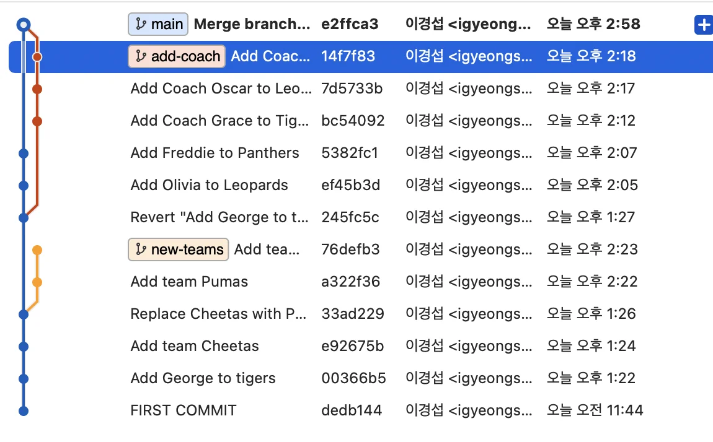

- 병합 후 branch 삭제
    - swtich <code>main</code>

    <a id="1c3eda9b0fe181d68010d9c6b246a8a1"></a>

    ```bash
    git switch main
    ```

    - <code>&#45;d</code>&#58; 삭제

    <a id="1c3eda9b0fe181ecafdfcabdf6eb0f62"></a>

    ```bash
    git branch -d add-coach
    ```

<details>
<summary><strong>🧐 </strong><strong><code>merge</code></strong><strong>는 </strong><strong><code>reset</code></strong><strong>으로 되돌리기 가능</strong></summary>

<a id="1c3eda9b0fe18166b8adde744cdb997b"></a>

<code>merge</code> 도 하나의 커밋이다 <code>reset</code>을 통해 <code>merge</code> 하기 전 해당 브랜치의 마지막 시점으로 되돌릴 수 있다&#46;

<a id="1c3eda9b0fe181c5bf12db786dc6a4fc"></a>

```bash
 git reset --hard [hash]
```

<a id="1c3eda9b0fe181369a11dc342f1dffbd"></a>

<del>ㅅㅂ&#46;&#46; 그냥 꼬였다…  main commit 내역이 그냥 날라갔다… </del>

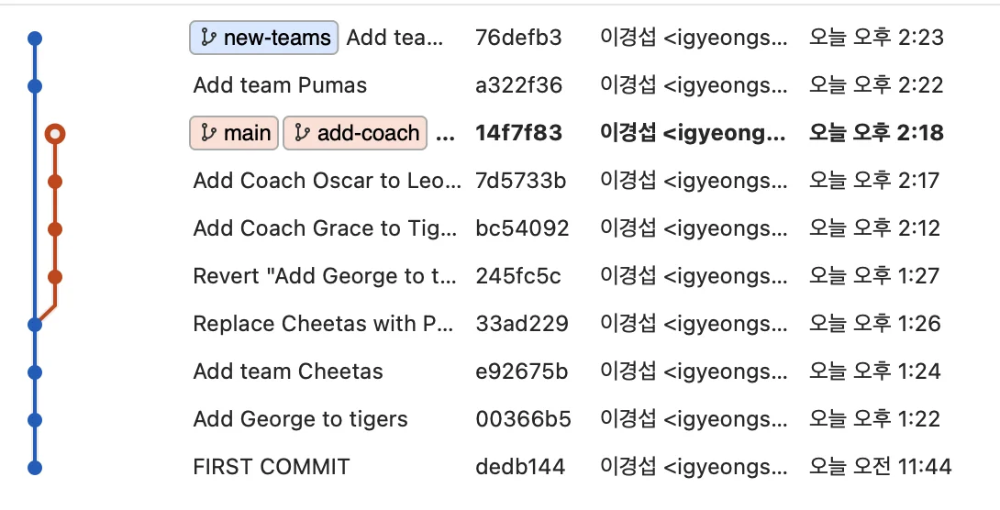

</details>

</details>

<details>
<summary><strong>rebase</strong></summary>

- <code>new&#45;teams</code> 브랜치로 이동 &#91;switch, merge와는 반대&#93; 및 <code>main</code>으로 <strong>rebase</strong>

<a id="1c3eda9b0fe1814da89cdb4f88dcabb2"></a>

```bash
git rebase main
```

- 소스트리에서 히스토리 확인 <br>아래와 같이 main의 포인터가 뒤쳐있는 것을 확인할 수 있음
    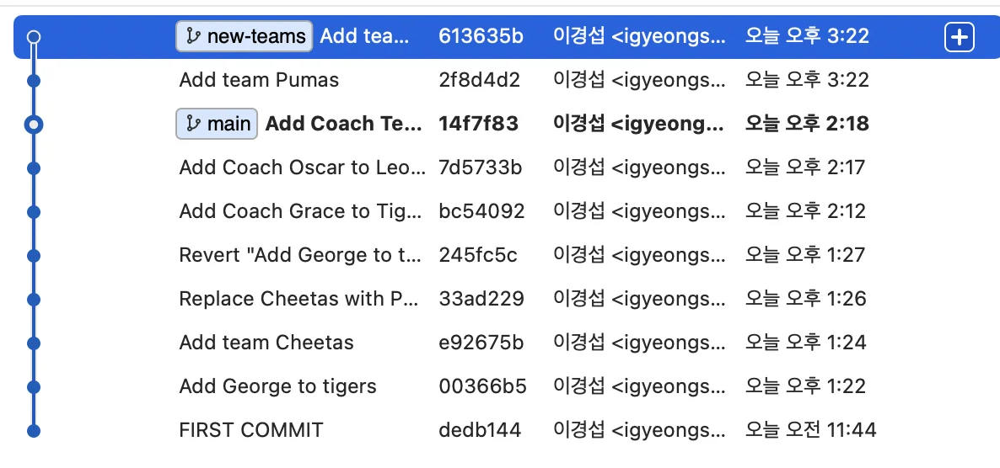

-  <code>main</code> 브랜치로 이동 후 아래 명령어로 <code>new&#45;teams</code>의 시점으로 <strong>fast&#45;forward</strong>
    <a id="1c3eda9b0fe181dbb0feed572be73219"></a>

    ```bash
    git merge new-teams
    ```

- <code>new&#45;teams</code>  브랜치 삭제(<code>&#45;d</code>)
    <a id="1c3eda9b0fe1819292ffda7b130d2ead"></a>

    ```bash
    git branch -d new-teams
    ```

    <a id="1c3eda9b0fe181a8a18ec49465209613"></a>

    아래와 같이 깔끔하게 정리됨

    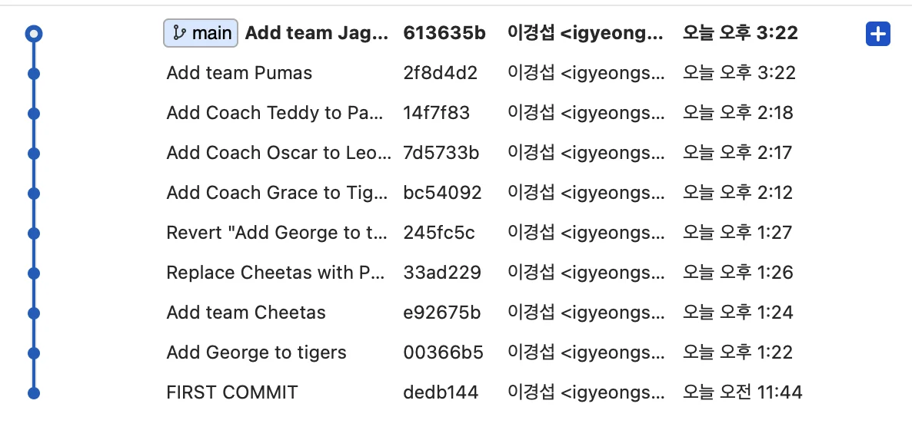

</details>

<a id="1c3eda9b0fe181008dfade711e7ae45e"></a>

## 3&#46; 충돌 해결하기

<a id="1c3eda9b0fe181fc8a3ffa2a118dee87"></a>

### 시나리오? 사전 준비?

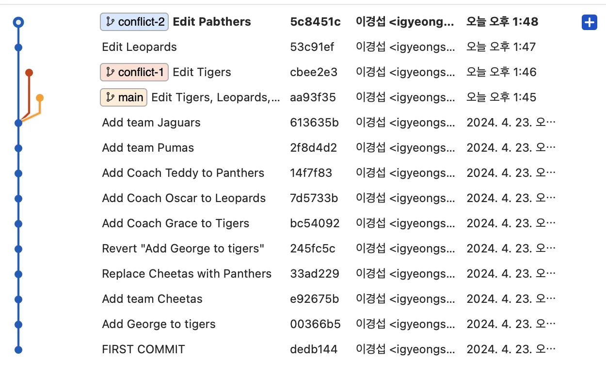

1. <code>conflict&#45;1</code>, <code>conflict&#45;2</code> 브랜치 생성

1. <code>main</code> 브랜치
    - Tigers의 <code>manager</code>를 <code>Kenneth</code>로 변경

    - Leopards의 <code>coach</code>를 <code>Nicholas</code>로 변경

    - Panthers의 <code>coach</code>를 <code>Shirley</code>로 변경

    <a id="1c3eda9b0fe1818582b0c83bd89cf94a"></a>

         → 커밋 메시지&#58; <code>Edit Tigers, Leopards, Panthers</code>

1. <code>conflict&#45;1</code> 브랜치
    - Tigers의 <code>manager</code>를 <code>Deborah</code>로 변경

    <a id="1c3eda9b0fe18110909fcb6a84babe90"></a>

         → 커밋 메시지&#58; <code>Edit Tigers</code>

1. <code>conflict&#45;2</code> 브랜치
    - Leopards의 <code>coach</code>를 <code>Melissa</code>로 변경

    <a id="1c3eda9b0fe1812eaf8bf2270354879a"></a>

        → 커밋 메시지&#58; <code>Edit Leopards</code>

    - Panthers의 <code>coach</code>를 <code>Raymond</code>로 변경

    <a id="1c3eda9b0fe1819f87abdee141ba52b5"></a>

       → 커밋 메시지&#58; <code>Edit Panthers</code>

<a id="1c3eda9b0fe181d2bb8adfa7def50e46"></a>

### <code>merge</code> 충돌(conflict) 해결 방법

<details>
<summary><strong>충돌된 파일 목록들 </strong><strong><code>검색 기능</code></strong><strong>으로 한번에 찾기</strong></summary>

<a id="1c3eda9b0fe18191b5a8fa23d6b191d1"></a>

아래와 같이 <strong><code>검색</code></strong>을 활용해서 <strong><u>충돌이 발생된 목록들을 한번에 확인</u></strong>할 수 있다&#46; 

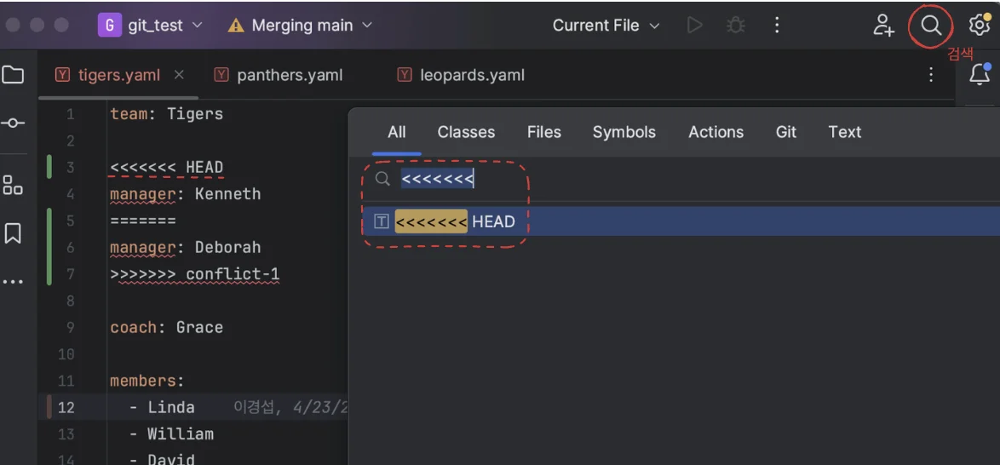

</details>

<details>
<summary><strong>당장 충돌 해결이 어려울 경우, 아래의 명령어로 </strong><strong><code>merge</code></strong><strong>를 중단한다&#46;</strong></summary>

<a id="1c3eda9b0fe18148ab30f4e8f664b4a1"></a>

충돌한 부분이 너무 많아 당장 해결을 못하는 경우 사용

<a id="1c3eda9b0fe1819aa8e1cf19c3a03349"></a>

```bash
git merge --abort
```

</details>

> 📌 하나의 commit 으로 합쳐져서 병합(merge)됨

> <code>merge</code>  시 합치려고 하는 main branch로 switch 필요
> 
> <a id="1c3eda9b0fe181aa9969cdc893462297"></a>
> 
> ```bash
> git switch main
> ```

> <strong><code>오류 메세지</code></strong><strong>, </strong><strong><code>git status</code></strong><strong> 확인</strong>

<a id="1c3eda9b0fe181b5aa36f0a6fa79f2a8"></a>

<code>git merge conflict&#45;1</code>로 병합을 시도하면 충돌 발생하여 아래와 같이 오류 메세지가 뜨는 것을 확인 할 수 있다&#46; 

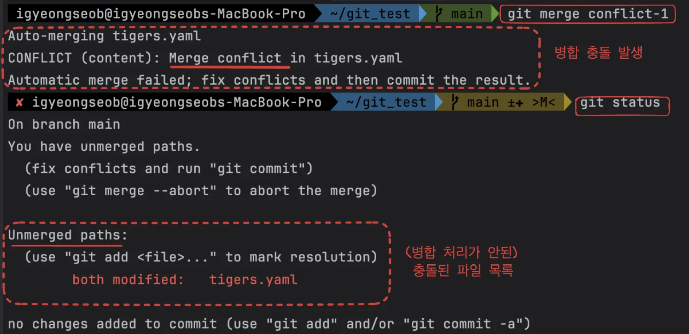

<a id="1c3eda9b0fe1812a967fc466ed84acbb"></a>

또한 <code>git status</code>를 통해 충돌이 발생한 파일 목록을 확인할 수 있다&#46; 

<a id="1c3eda9b0fe181de860ed97983b37834"></a>

위 병합 처리가 안된 목록에 있는 해당 파일을 들어가보면 아래와 같이 충돌된 브랜치 와 내용이 확인되는 것을 알 수 있다&#46;

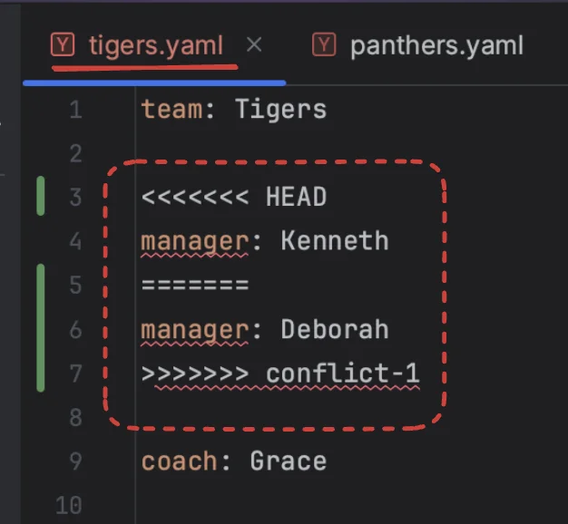

<a id="1c3eda9b0fe181b4ae68c633902ad3db"></a>

<strong>해당 내용을 </strong><strong><u>직접 타이핑해서 수정</u></strong>한 다음<strong> 저장 후 </strong><code>git add &#46;</code> ,<code> git commit</code> 을 하면 된다&#46;

> 이미 commit 메세지가 입력되어 있기 때문에 그냥 저장하면된다&#46; (수정 필요 시 수정하고 저장)

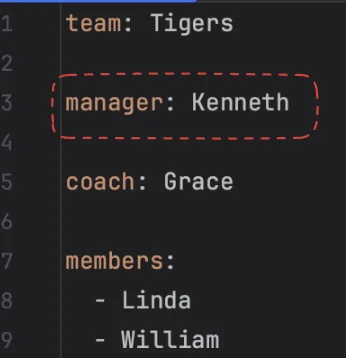

<a id="1c3eda9b0fe1819785d8ceb9835846f0"></a>

### <strong><code>rebase</code></strong><strong>  충돌 해결 방법</strong>

<details>
<summary>당장 충돌 해결이 어려운 경우, 아래의 명령어로 해결</summary>

<a id="1c3eda9b0fe1817f92cffbf822530b8e"></a>

```bash
git rebase --abort
```

</details>

> 📌 <code>rebase</code>는 병합하려는 서브 branch의 모든 커밋 내역 하나하나 마다 <code>rebase</code> 처리되어  메인 브랜치에 하나씩 추가된다&#46; <br>따라서 commit 단위마다  따로따로 conflict를 해결해야 한다&#46; 

<a id="1c3eda9b0fe181aaa271dd79cc31dc52"></a>

<code>rebase</code>는 서브 브랜치로 변경 후 병합 진행

<a id="1c3eda9b0fe1813db3cce52256341541"></a>

```bash
git switch conflict-2
```

<a id="1c3eda9b0fe181d3b0cce6aa86108bd6"></a>

```bash
git rebase main
```

<a id="1c3eda9b0fe181259ba6c44e77d7fa50"></a>

아래와 같이 충돌 발생

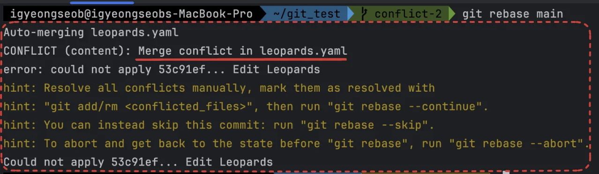

<a id="1c3eda9b0fe181ccbb8ac0b68f8c9156"></a>

위 와 동일하게 충돌(conflict) 내용을 직접 수정 후 저장 및 <code>git add &#46;</code>

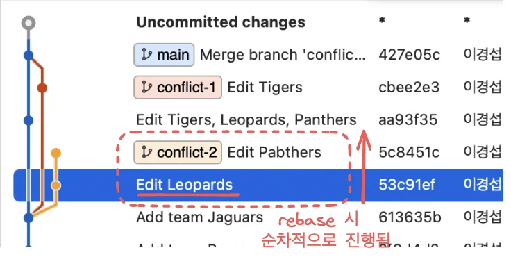

<a id="1c3eda9b0fe1811dac01f12b4b96e50a"></a>

```bash
//  충돌이 모두 해결될 때까지 반복함
git rebase --continue
```

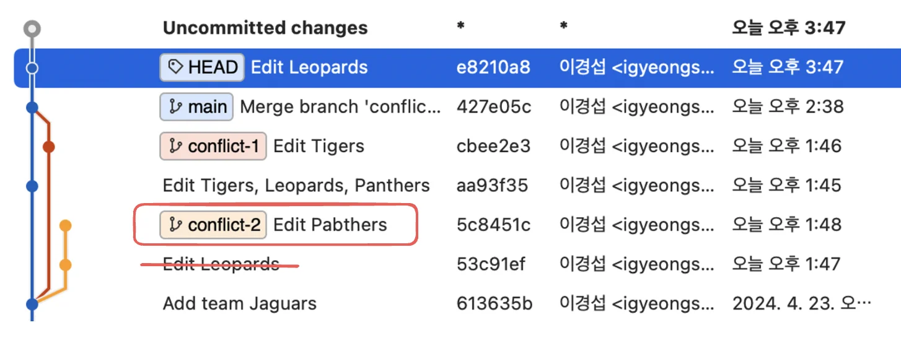

<a id="1c3eda9b0fe181b1b8f9ff2197ffeb09"></a>

소스트리를 통해 <code>conflict&#45;2</code> 첫 <strong>commit</strong>(Edit Leopards) <code>rebase</code> 되어 main 브랜치에 병합된 것을 확인 할 수 있다 &#46;

<a id="1c3eda9b0fe18116b068eebba2445337"></a>

<br>위에서 정리했듯이 <code>rebase</code>는 병합하려는 브랜치의 모든 commit 마다 차례대로 충돌(conflict)을 처리하고  병합처리한다&#46; 

<a id="1c3eda9b0fe181c5b573c13d12f0211b"></a>

<br>따라서 <code>git rebase &#45;&#45;continue</code>를 통해 <code>conflict&#45;2</code> 다음 commit인 <strong><code>Edit Pabthers</code></strong><strong>  </strong>넘어가 충동 처리 및 병합을 진행하면 아래와 같이 main 브랜치에 <code>rebase</code> 되어 히스토리 내역이 깔끔해 진 것을 확인 할 수 있다&#46; 

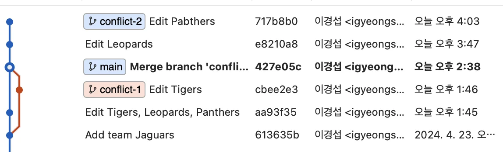

<a id="1c3eda9b0fe18133bf60f8a8f7da9863"></a>

아래와 같이 <code>rebase</code> 되어 히스토리 내역이 깔끔해 진 것을 확인할 수 있다&#46; 

<a id="1c3eda9b0fe181b2a4a4cac2c5089fc5"></a>

병합 후 <code>main</code>의 <strong>HEAD</strong>를 보면 최신이 아닌 것을 확인 할 수 있다&#46;<br>따라서 해당 <strong>HEAD</strong>를 아래와 같은 방법으로 최신 버전으로 갱신 해줘야 한다&#46; 

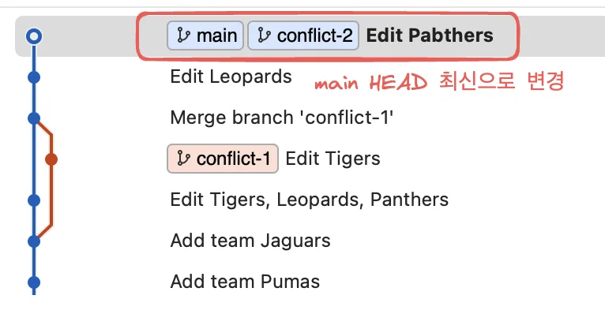

<a id="1c3eda9b0fe181d78a2dfa39561f345d"></a>

```bash
git switch main

git merge conflict-2
```

<a id="1c3eda9b0fe18149a5fcc71486b3938d"></a>

병합이 완료된 브랜치( <code>conflict&#45;1</code>, <code>conflict&#45;2</code> )는 삭제 처리한다&#46;

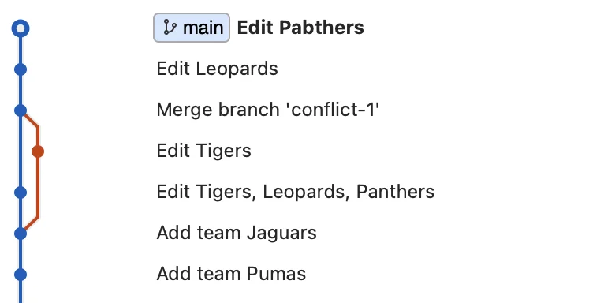

<a id="1c3eda9b0fe181a1ad9bea19fd490f04"></a>

```bash
git commit -d conflict-1

git commit -d conflict-2
```

<details>
<summary>강의 내용 중</summary>

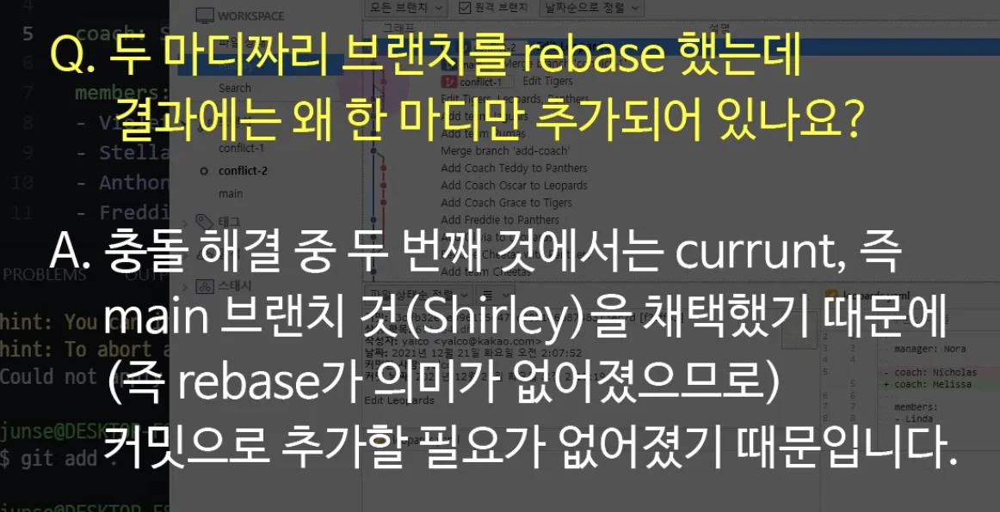

</details>
