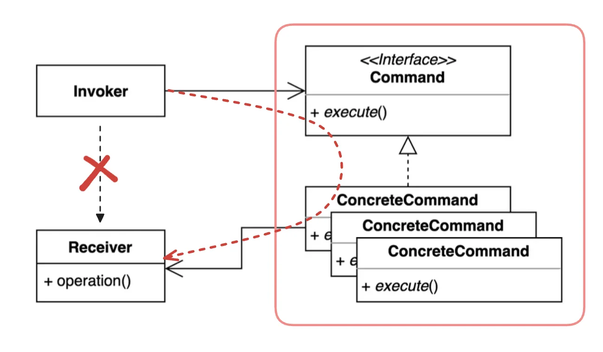
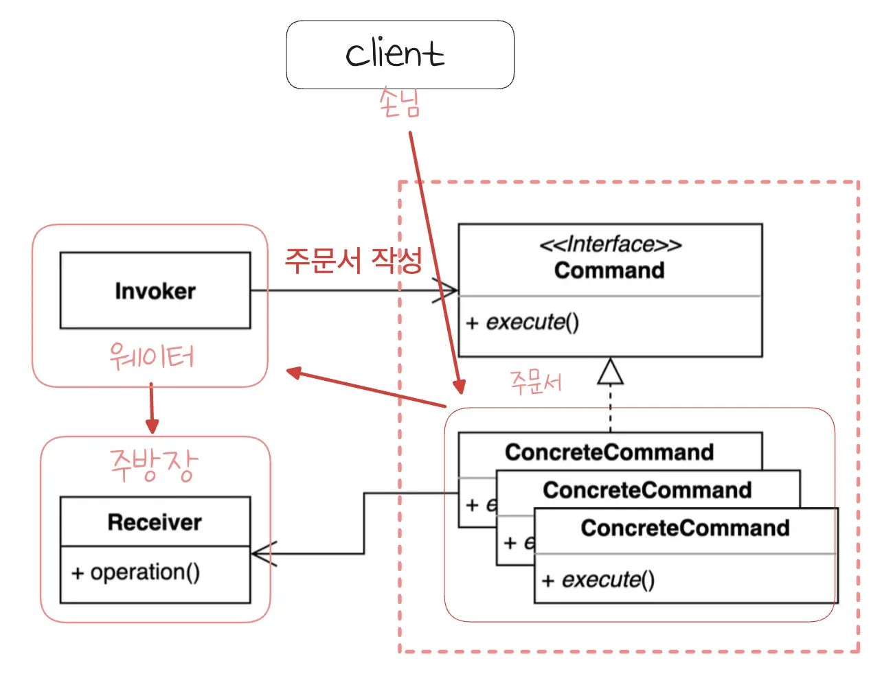
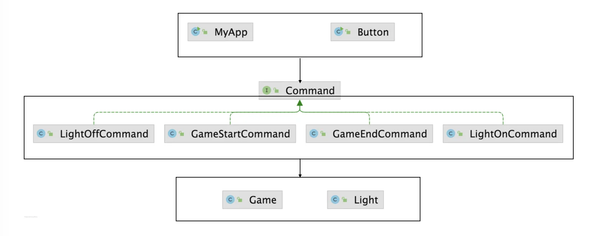

> 📝 
> 
> <a id="1d6eda9b0fe1800cbcfff0c1dfd55648"></a>
> 
> <strong>질문</strong>
> 
> <details>
> <summary>커맨드 패턴이란 무엇인가?</summary>
> 
> 
> 
> </details>
> 
> <details>
> <summary>커맨드 패턴의 이점과 단점은 무엇인가?</summary>
> 
> 
> 
> </details>
> 
> <details>
> <summary>실제 어디에서 활용되는가?</summary>
> 
> 
> 
> </details>

<a id="1d6eda9b0fe180e58004daf3729c91e7"></a>

## 커맨드 ( Command ) 패턴

---

> 📖 
> 
> <a id="1d6eda9b0fe180b7b83ae4de6a8c0073"></a>
> 
> <strong>커맨드 패턴</strong>
> 
> ---
> 
> > 요청을 <strong><u>캡슐화</u></strong>하여 <code>호출자</code>( <code>invoker</code> ) 와 <code>수신자</code>( <code>receiver</code> )를 분리하는 패턴
> 
> - 요청을 처리하는 방법(<code>receiver</code>)이 바뀌더라도, 호출자(<code>invoker</code>)의 코드는 변경되지 않는다&#46; 
> 
> 
> 
> <details>
> <summary>구성 요소</summary>
> 
> - <code>Command</code>
>     - 실행될 기능을 추상화하는 인터페이스(or 추상 클래스)
> 
>     - 일반적으로 <code>execute()</code> 메서드를 갖는다&#46;
> 
> - <code>ConcreteCommand</code>
>     - Command 인터페이스를 구현하며, 실제로 Receiver의 특정 동작을 호출한다&#46; 
> 
> - <code>Receiver</code>
>     - 실제 작업을 수행하는 객체 
> 
> - <code>Invoker</code>
>     - 커멘드 객체를 보관하고 실행
> 
> - <code>Client</code>
>     - <code>ConcreteCommand</code> 와 <code>Receiver</code>를 연결하고, Invoker에 커맨드를 전달한다&#46;
> 
> </details>
> 
> <details>
> <summary>동작 예시&#58; <strong><code>식당 주문</code></strong></summary>
> 
> 
> 
> - 손님(Client)이 주문서를 작성(ConcreteCommand)하여 웨이터(Invoker)에게 전달한다&#46; 
> 
> - 웨이터(Invoker)는 주문서를 주방장(Receiver)에게 전달한다&#46; 
> 
> - 주방장은 주문서에 따라 요리를 만든다 &#46;
> 
> ---
> 
> <a id="1d6eda9b0fe180aebe60d2039431ddab"></a>
> 
> 해당 과정에서 <strong><code>손님(Client)</code></strong><strong>은 </strong><strong><u>요리가 어떻게 만들어지는지(Receiver 내부 동작) </u></strong><strong><u>알 필요가 없</u></strong>고 <strong><code>웨이터(Invoker)</code></strong><strong>와 </strong><strong><code>주방장(Receiver)</code></strong><strong>도 </strong><strong><u>서로 내부 동작을 몰라도 된</u></strong><strong><u>다&#46;</u></strong> 
> 
> - 구성 요소들 사이의 의존성이 낮아진다&#46;
> 
> </details>
> 
> <details>
> <summary>장•단점</summary>
> 
> > ✅ 장점
> 
> - 요청의 <u>발신자</u>와 <u>수신자</u>의 <strong>결합도를 낮</strong>출 수 있다&#46; 
> 
> - 명령을 큐에 저장하거나, 로그로 기록, 실행 취소(Undo) 및 재실행(Redo) 기능을 쉽게 구현할 수 있다&#46; 
> 
> - 새로운 명령을 추가할 때 기존 코드를 수정하지 않고 확장할 수 있다&#46; ( <code>OCP</code> )
> 
> > ❗단점
> 
> - <strong><u>명령마다 별도의 클래스가 필요</u></strong>하므로 클래스 수가 많아질 수 있다&#46;
> 
> - <u>단순한 작업</u>에는 오히려 복잡도가 증가할 수 있다&#46;
> 
> </details>
> 
> <details>
> <summary>활용 예시</summary>
> 
> - GUI 버튼 클릭, 메뉴 선택 등 사용자 인터페이스 이벤트 처리
> 
> - 작업 실행 취소(Undo), 재실행(Redo) 기능
> 
> - 작업 예약, 매크로 기능 등
> 
> </details>

<a id="1d6eda9b0fe1801f98acc3b19fd35c6e"></a>

### 1&#46; 기본 예제

<a id="1d6eda9b0fe180d4b21ec1615efd217d"></a>

### 코드

<details>
<summary>&#91; 코드 &#93; Light</summary>

<a id="1d6eda9b0fe18063a758e9ded6724941"></a>

```java
package _03_behavioral_patterns._14_command._01_before;

public class Light {

    private boolean isOn;

    public Light() {
        this.isOn = false;
    }

    public void on() {
        if (!isOn) {
            System.out.println("불을 켭니다.");
            isOn = true;
        } else {
            System.out.println("이미 불이 켜졌습니다.");
        }
    }

    public void off() {
        if (isOn) {
            System.out.println("불을 끕니다.");
            isOn = false;
        } else {
            System.out.println("이미 불이 꺼졌습니다.");
        }
    }

    public boolean getIsOn() {
        return isOn;
    }

}

```

</details>

<details>
<summary>&#91; 코드 &#93; Button</summary>

<a id="1d6eda9b0fe18002b7d3d15ce0cea46d"></a>

```java
package _03_behavioral_patterns._14_command._01_before;

public class Button {

    private Light light;

    public Button(Light light) {
        this.light = light;
    }

    public void press() {
        if (light.getIsOn()) {
            light.off();
        } else {
            light.on();
        }
    }

    public static void main(String[] args) {
        Button button = new Button(new Light());
        button.press();
        button.press();
        button.press();
        button.press();
    }
}
```

</details>

<details>
<summary>&#91; 코드 &#93; Game</summary>

<a id="1d6eda9b0fe18063b349d008da17ef99"></a>

```java
package _03_behavioral_patterns._14_command._01_before;

public class Game {

    private boolean isStarted;

    public void start() {
        System.out.println("게임 시작");
        this.isStarted = true;
    }

    public void end() {
        System.out.println("게임 종료");
        this.isStarted = false;
    }

    public boolean getIsStarted() {
        return isStarted;
    }
}
```

</details>

<details>
<summary>&#91; 코드 &#93; MyApp</summary>

<a id="1d6eda9b0fe18048aa81f73f3e70ce5f"></a>

```java
package _03_behavioral_patterns._14_command._01_before;

public class MyApp {

    private Game game;

    public MyApp(Game game) {
        this.game = game;
    }

    public void press() {
        if (game.getIsStarted()) {
            game.end();
        } else {
            game.start();
        }
    }

    public static void main(String[] args) {
        MyApp app = new MyApp(new Game());
        app.press();
        app.press();
        app.press();
        app.press();
    }
}

```

</details>

<a id="1d6eda9b0fe180579b59feb0a5227324"></a>

### 문제점 

<a id="1d6eda9b0fe1806ab5bde3fb871035d6"></a>

요청을 호출하는 쪽(invoker)과 받아서 처리하는 수신자(receiver) 사이에 강한 결합이 형성되어 있다&#46; 

- 직접적으로 연결되어 <u>수</u><strong><u>신자(receiver)가 변경</u></strong>되면 <strong>invoker 내부 코드도 변경</strong>된다&#46; 
    - <strong>OCP 위반</strong>

<a id="1d6eda9b0fe1807b9a15f73f1479ded4"></a>

### 2&#46; 패턴 적용

> ✏️ 
> 
> <a id="1d6eda9b0fe1802aa490f1ab66bbd14c"></a>
> 
> Command를 통해 Invoker 와 Receiver 사이에 loosely coupled(느슨한 결합)을 형성시킨다&#46; 
> 
> - OCP 준수
> 
> -  Command 재사용 가능하다&#46;
> 
> - Receiver가 변경되면 Command를 변경된다&#46;

<a id="1d6eda9b0fe180c0b3f8f3d96c0bf816"></a>

### 코드



- <strong>Command</strong>
    <details>
    <summary>&#91; 코드 &#93; &#60; interface &#62; Command</summary>

    <a id="1d6eda9b0fe18056afcde07e741d2ba3"></a>

    ```java
    package _03_behavioral_patterns._14_command._02_after;

    public interface Command {

        void execute();

        void undo();
    }

    ```

    </details>

- <strong>ConcreteCommand</strong>
    <details>
    <summary>&#91; 코드 &#93; GameStartCommand</summary>

    <a id="1d6eda9b0fe180e2a7abff271a3294fc"></a>

    ```java
    package _03_behavioral_patterns._14_command._02_after;

    import _03_behavioral_patterns._14_command._01_before.Game;

    public class GameStartCommand implements Command {

        private Game game;

        public GameStartCommand(Game game) {
            this.game = game;
        }

        @Override
        public void execute() {
            game.start();
        }

        @Override
        public void undo() {
            new GameEndCommand(this.game).execute();
        }
    }

    ```

    </details>

    <details>
    <summary>&#91; 코드 &#93; GameEndCommand</summary>

    <a id="1d6eda9b0fe180668ae8e4fd0d1356b0"></a>

    ```java
    package _03_behavioral_patterns._14_command._02_after;

    import _03_behavioral_patterns._14_command._01_before.Game;

    public class GameEndCommand implements Command {

        private Game game;

        public GameEndCommand(Game game) {
            this.game = game;
        }

        @Override
        public void execute() {
            game.end();
        }

        @Override
        public void undo() {
            new GameStartCommand(this.game).execute();
        }
    }

    ```

    </details>

    <details>
    <summary>&#91; 코드 &#93; LightOnCommand</summary>

    <a id="1d6eda9b0fe1803699c9dfce2194813c"></a>

    ```java
    package _03_behavioral_patterns._14_command._02_after;

    import _03_behavioral_patterns._14_command._01_before.Light;

    public class LightOnCommand implements Command {

        private Light light;

        public LightOnCommand(Light light) {
            this.light = light;
        }

        @Override
        public void execute() {
            light.on();
        }

        @Override
        public void undo() {
            new LightOffCommand(this.light).execute();
        }
    }

    ```

    </details>

    <details>
    <summary>&#91; 코드 &#93; LightOffCommand</summary>

    <a id="1d6eda9b0fe1808cbf93ccd702524b4d"></a>

    ```java
    package _03_behavioral_patterns._14_command._02_after;

    import _03_behavioral_patterns._14_command._01_before.Light;

    public class LightOffCommand implements Command {

        private Light light;

        public LightOffCommand(Light light) {
            this.light = light;
        }

        @Override
        public void execute() {
            light.off();
        }

        @Override
        public void undo() {
            new LightOnCommand(this.light).execute();
        }
    }

    ```

    </details>

- Invoker ( 호출자 )
    <details>
    <summary>&#91; 코드 &#93; Button</summary>

    <a id="1d6eda9b0fe180318564d1c41108d20e"></a>

    ```java
    package _03_behavioral_patterns._14_command._02_after;

    import _03_behavioral_patterns._14_command._01_before.Game;
    import _03_behavioral_patterns._14_command._01_before.Light;

    import java.util.ArrayDeque;
    import java.util.Deque;

    public class Button {

        // NOTES: Stack - 성능상 이점을 위해 Deque 사용
        // private Stack<Command> commands = new Stack<>();  // 강의 코드
        private Deque<Command> commands = new ArrayDeque<>();

        public void press(Command command) {
            command.execute();
            commands.push(command);
        }

        public void undo() {
            if (!commands.isEmpty()) {
                Command command = commands.pop();
                command.undo();
            }
        }

        public static void main(String[] args) {
            Button button = new Button();
            button.press(new GameStartCommand(new Game()));
            button.press(new LightOnCommand(new Light()));
            button.undo();
            button.undo();
        }
    }

    ```

    </details>

    <details>
    <summary>&#91; 코드 &#93; MyApp</summary>

    <a id="1d6eda9b0fe1801caf98c8ae650a4ce8"></a>

    ```java
    package _03_behavioral_patterns._14_command._02_after;

    import _03_behavioral_patterns._14_command._01_before.Game;

    public class MyApp {

        private Command command;

        public MyApp(Command command) {
            this.command = command;
        }

        public void press() {
            command.execute();
        }

        public static void main(String[] args) {
            MyApp myApp = new MyApp(new GameStartCommand(new Game()));
        }
    }

    ```

    </details>

- Receiver ( 수신자 ) 
    <details>
    <summary>&#91; 코드 &#93; Game</summary>

    <a id="1d6eda9b0fe18085b6d0e9be54c52e11"></a>

    ```java
    package _03_behavioral_patterns._14_command._01_before;

    public class Game {

        private boolean isStarted;

        public void start() {
            System.out.println("게임 시작");
            this.isStarted = true;
        }

        public void end() {
            System.out.println("게임 종료");
            this.isStarted = false;
        }

        public boolean getIsStarted() {
            return isStarted;
        }

    }

    ```

    </details>

    <details>
    <summary>&#91; 코드 &#93; Light</summary>

    <a id="1d6eda9b0fe1804c8f08e1ace3854b82"></a>

    ```java
    package _03_behavioral_patterns._14_command._01_before;

    public class Light {

        private boolean isOn;

        public Light() {
            this.isOn = false;
        }

        public void on() {
            if (!isOn) {
                System.out.println("불을 켭니다.");
                isOn = true;
            } else {
                System.out.println("이미 불이 켜졌습니다.");
            }
        }

        public void off() {
            if (isOn) {
                System.out.println("불을 끕니다.");
                isOn = false;
            } else {
                System.out.println("이미 불이 꺼졌습니다.");
            }
        }

        public boolean getIsOn() {
            return isOn;
        }

    }

    ```

    </details>

<a id="1d6eda9b0fe180348297da933530d601"></a>

### 3&#46; 장•단점

- 장점
    - 기존의 코드를 변경하지 않고 새로운 커맨드를 만들 수 있다&#46;

    - 수신자의 코드가 변경되어도 호출자의 코드는 변경되지 않는다&#46; 

    - 커맨드 객체를 로깅, DB에 저장, 네트워크로 전송 하는 등 다양한 방법으로 활용할 수 도 있다&#46; 

- 단점
    - 코드가 복잡하고 클래스가 많아진다&#46; 

<a id="1d6eda9b0fe180d58818cfd682b367cb"></a>

### 4&#46; 실무 활용

> ✏️ 
> 
> > 자바
> 
> - Runnable
> 
> - 람다
> 
> - 메소드 래퍼런스 
> 
> > 스프링
> 
> - SimpleJdbcInsert
> 
> - SimpleJdbcCall

<a id="1d6eda9b0fe180afaae9e9bd84c2a66f"></a>

### 코드

<details>
<summary>&#91; 코드 &#93; CommandInJava</summary>

<a id="1d6eda9b0fe1804fb421e7ec9ba5100a"></a>

```java
package _03_behavioral_patterns._14_command._03_java;

import _03_behavioral_patterns._14_command._01_before.Game;
import _03_behavioral_patterns._14_command._01_before.Light;

import java.util.concurrent.ExecutorService;
import java.util.concurrent.Executors;

public class CommandInJava {

    public static void main(String[] args) {
        Light light = new Light();
        Game game = new Game();
        ExecutorService executorService = Executors.newFixedThreadPool(4);
        executorService.submit(light::on);
        executorService.submit(game::start);
        executorService.submit(game::end);
        executorService.submit(light::off);
        executorService.shutdown();
    }
}

```

</details>

<details>
<summary>&#91; 코드 &#93; CommandInSpring</summary>

<a id="1d6eda9b0fe18006bc2be1efdb5c271d"></a>

```java
package _03_behavioral_patterns._14_command._03_java;

import _03_behavioral_patterns._14_command._02_after.Command;
import org.springframework.jdbc.core.simple.SimpleJdbcInsert;

import javax.sql.DataSource;
import java.time.LocalDateTime;
import java.util.HashMap;
import java.util.Map;

public class CommandInSpring {

    private DataSource dataSource;

    public CommandInSpring(DataSource dataSource) {
        this.dataSource = dataSource;
    }

    public void add(Command command) {
        SimpleJdbcInsert insert = new SimpleJdbcInsert(dataSource)
                .withTableName("command")
                .usingGeneratedKeyColumns("id");

        Map<String, Object> data = new HashMap<>();
        data.put("name", command.getClass().getSimpleName());
        data.put("when", LocalDateTime.now());
        insert.execute(data);
    }
}

```

</details>
