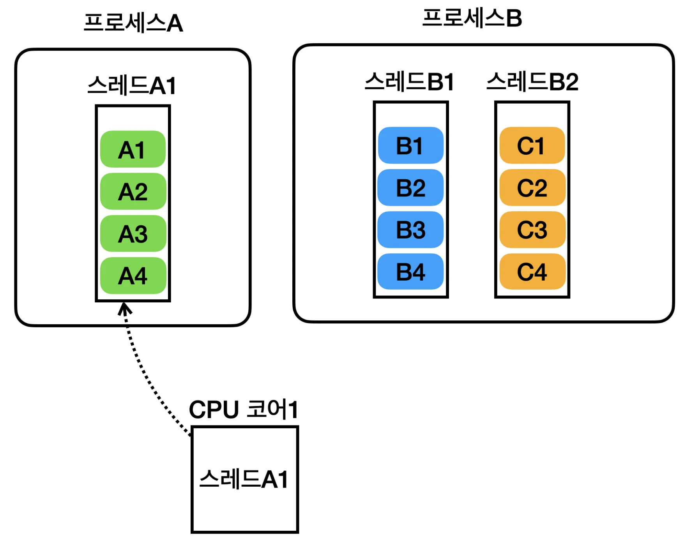
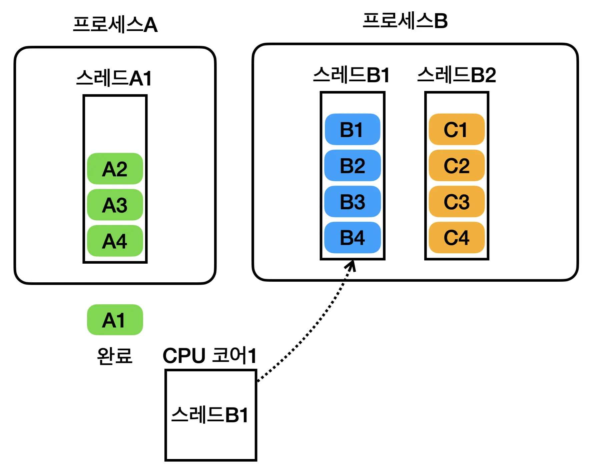
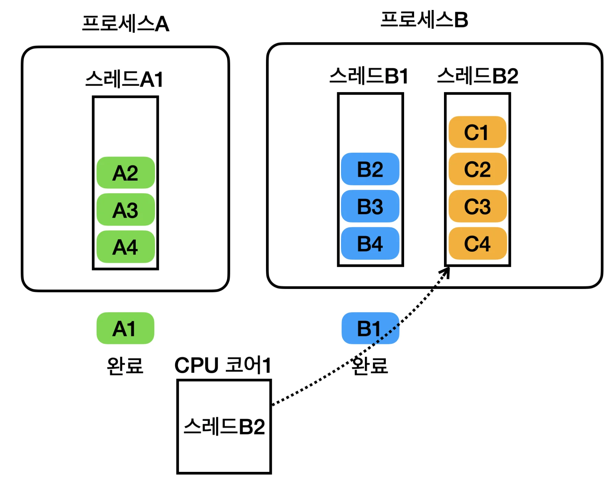
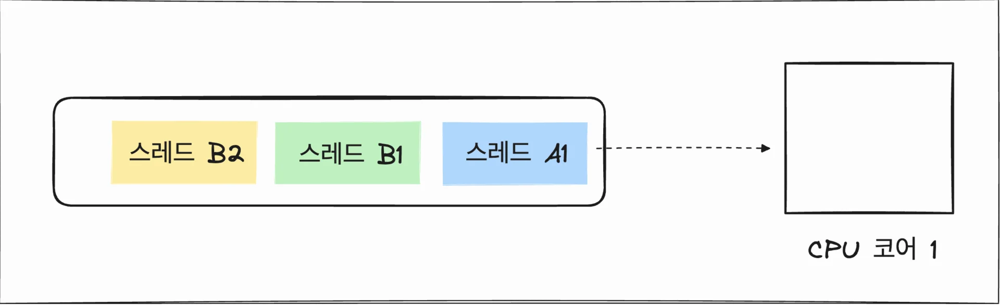
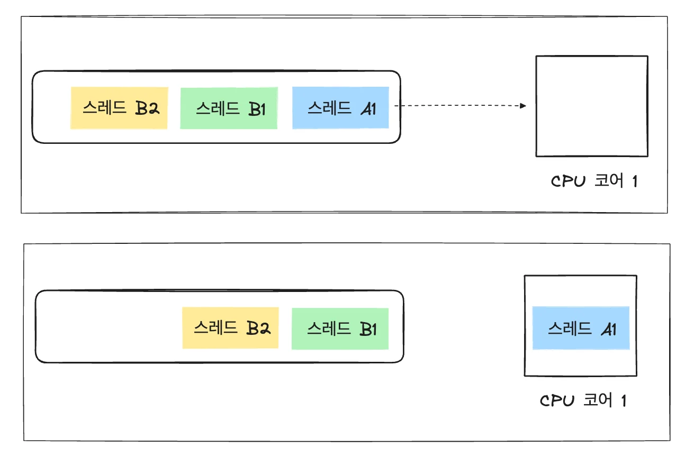
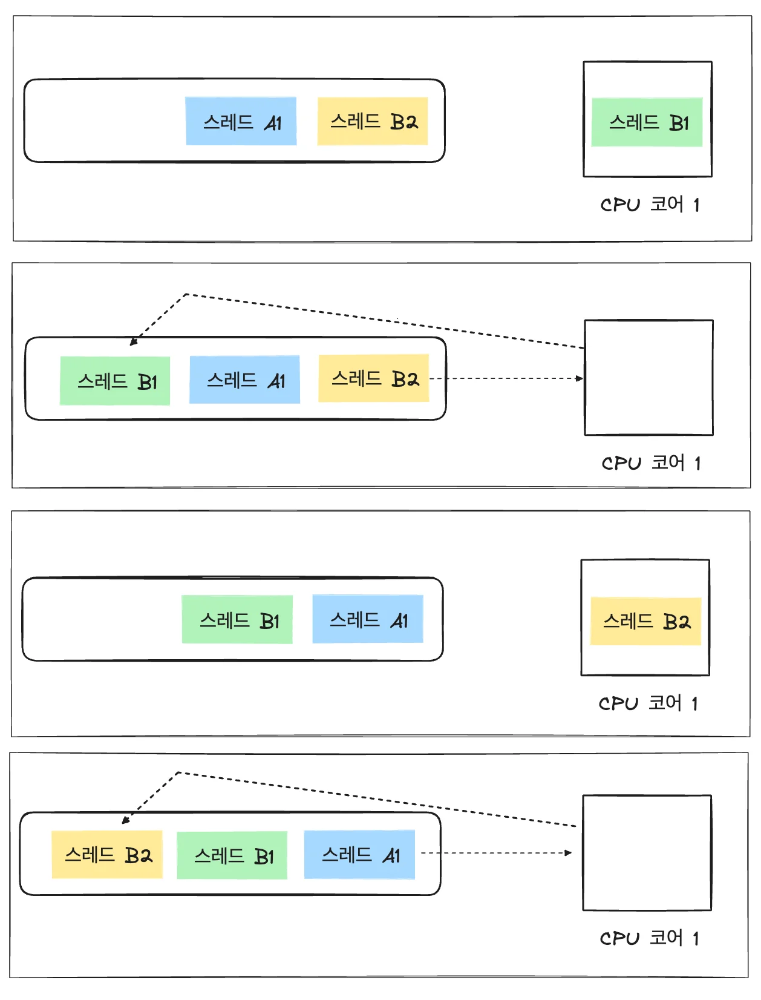
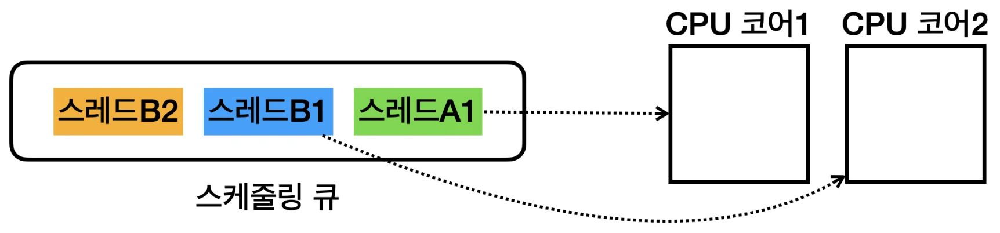
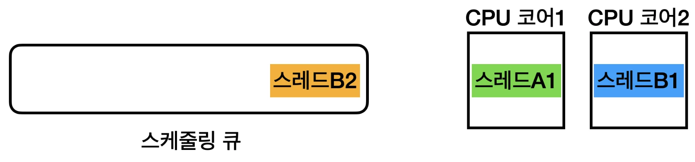
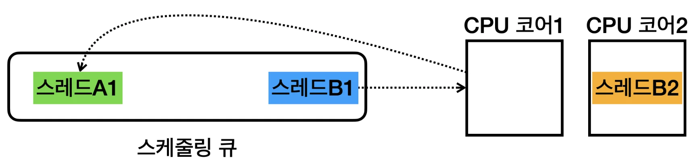
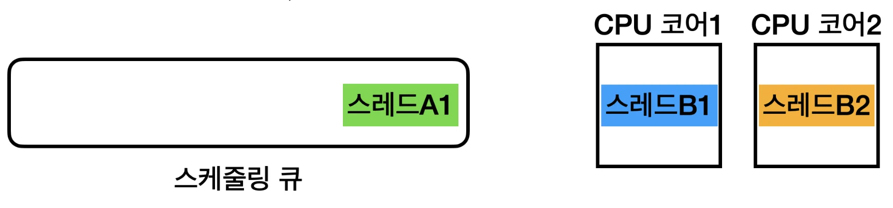

> ✏️ 
> 
> <a id="1c3eda9b0fe181b5916cd6ebbeb083de"></a>
> 
> 해당 챕터서는  앞서 멀티태스킹에서 설명한 운영체제의 스케줄링 과정을 더 자세히 학습한다&#46;

<details>
<summary>🧐 어떻게 프로세스의 스레드를 나누는 기준은? 또한 스레드 내부에서 작업을 나누는 기준은?</summary>

<a id="1c3eda9b0fe181efab9fc09bf524d103"></a>

프로세스에서 스레드를 나누는 기준, 스레드 내부에서 작업을 나누는 기준은 애플리케이션의 특성과 목표에 따라 달라진다&#46; 

<a id="1c3eda9b0fe18189b1cbd1b2a981caa8"></a>

### ✅ 프로세스의 스레드를 나누는 기준

> 🧐 어떤 작업을 병렬로 실행하면 성능이 향샹 되는가?

<details>
<summary>1️⃣ <strong>CPU 집약적인 작업</strong></summary>

<a id="1c3eda9b0fe18192a728dc39d85683d4"></a>

여러 개의 연산을 병렬로 실행하면 성능이 향상되는 경우

- ex) 이미지 처리, 비디오 인코딩, AI 모델 학습 등

<details>
<summary>코드 예시</summary>

<a id="1c3eda9b0fe18191b84bd48208af92db"></a>

```java
ExecutorService executor = Executors.newFixedThreadPool(4);

for (int i = 0; i < 4; i++) {
    executor.submit(() -> {
        // CPU 집약적인 연산 수행
        System.out.println(Thread.currentThread().getName() + " 작업 실행");
    });
}

executor.shutdown();
```

- <code>Executors</code>의 <code>newFixedThreadPool</code>을 통해 쓰레드 풀 개수를 조절할 수 있다&#46; 
    - CPU 코어 개수에 맞춰 FixedThreadPool을 설정하는 것이 일반적이다&#46;

</details>

</details>

<details>
<summary>2️⃣ <strong>I/O 집약적인 작업</strong></summary>

<a id="1c3eda9b0fe181309e27cfb58317a860"></a>

메인 스레드가 블로킹되지 않도록 비동기 처리 활용

- 네트워크 요청, 데이터베이스 쿼리, 파일 읽기/쓰기 등

<details>
<summary>코드 예시)</summary>

<a id="1c3eda9b0fe181e198f6cbffc97c035f"></a>

```java
ExecutorService executor = Executors.newCachedThreadPool();

executor.submit(() -> {
    try {
        String content = Files.readString(Path.of("data.txt"));
        System.out.println("파일 내용: " + content);
    } catch (IOException e) {
        e.printStackTrace();
    }
});

executor.shutdown();
```

- <code>newCachedThreadPool</code>을 통해 기존의 쓰레드 풀 내부에 존재하는 쓰레드를 재활용 할 수 있다&#46; 
    - newCachedThreadPool()을 사용하면 필요할 때마다 새로운 스레드를 생성해 적절한 개수만 유지한다&#46;

</details>

</details>

<details>
<summary>3️⃣ 사용자 요청 처리 ( 웹 서버 )</summary>

<a id="1c3eda9b0fe1819b8b62c60f081dcb39"></a>

웹 애플리케이션에서 여러 사용자의 요청을 동시에 처리해야 하는 경우

- ex) Spring Boot에서 <code>&#64;Async</code>를 사용한 비동기 작업

<details>
<summary>코드 예시</summary>

<a id="1c3eda9b0fe181af9b07e935e553ba48"></a>

```java
@Service
public class AsyncService {
    @Async
    public CompletableFuture<String> processTask() {
        return CompletableFuture.supplyAsync(() -> {
            try { Thread.sleep(1000); } catch (InterruptedException ignored) {}
            return "작업 완료!";
        });
    }
}
```

- <code>&#64;Async</code>를 사용하면 자동으로 별도 스레드에서 실행된다&#46;

</details>

</details>

<a id="1c3eda9b0fe181fabf82ffb00ecfca16"></a>

### ✅ <strong>스레드 내부에서 작업을 나누는 기준</strong>

> 🧐 한 스레드 안에서 작업을 어떻게 나누면 효율적인가?

<details>
<summary>1️⃣ 작업 단위를 독립적으로 나눌 수 있는 경우</summary>

<a id="1c3eda9b0fe1818e91eed9491531f9d8"></a>

동일한 작업을 반복 수행해야 한다면 배치처리

- 데이터 처리를 여러 개의 작은 단위로 분할

<details>
<summary>코드 예제 ( 배치 데이터 처리 )</summary>

<a id="1c3eda9b0fe181609605c3e892b6b0a0"></a>

```java
int[] numbers = {1, 2, 3, 4, 5, 6, 7, 8};

// 2개씩 묶어서 실행
IntStream.range(0, numbers.length / 2).parallel().forEach(i -> {
    System.out.println("스레드: " + Thread.currentThread().getName() + ", 데이터: " + numbers[i * 2] + ", " + numbers[i * 2 + 1]);
});
```

- <code>parallel()</code>을 사용하면 내부적으로 여러 개의 스레드가 사용된다&#46;

</details>

</details>

<details>
<summary>2️⃣ 비동기 작업 실행 ( 콜백 or Future 활용 )</summary>

<a id="1c3eda9b0fe1819da9e7f245bb7b7a47"></a>

한 작업이 끝난 후 다음 작업을 실행해야 한다면, <strong><u>체이닝 방식</u></strong> 사용

<details>
<summary>코드 예제 ( CompletableFuture 체이닝 )</summary>

<a id="1c3eda9b0fe181cc92c4ea20bc5aa286"></a>

```java
CompletableFuture.supplyAsync(() -> {
    System.out.println("1단계 작업 실행");
    return "결과값";
}).thenApply(result -> {
    System.out.println("2단계 작업 실행, 결과: " + result);
    return result.length();
}).thenAccept(length -> System.out.println("최종 길이: " + length));
```

- 비동기적으로 실행 하면서도 결과를 순차적으로 전달 가능

</details>

</details>

<a id="1c3eda9b0fe181a4928bf9d075b7f39e"></a>

### 정리

<a id="1c3eda9b0fe181c4bf52e2c4cf9dcc5a"></a>

🔹 <strong>프로세스에서 스레드를 나눌 때</strong>

- CPU&#45;집약적인 경우 → CPU 코어 개수에 맞춰 스레드 풀 설정

- I/O&#45;집약적인 경우 → 적절한 개수의 스레드를 동적으로 관리

- 사용자 요청 처리 → 비동기 방식(&#64;Async, CompletableFuture) 활용

<a id="1c3eda9b0fe181279343e4271027f90b"></a>

🔹 <strong>스레드 내부에서 작업을 나눌 때</strong>

- 병렬 실행이 가능하면 parallelStream(), ForkJoinPool 사용

- 순차적으로 실행해야 하면 CompletableFuture&#46;thenApply() 활용

<a id="1c3eda9b0fe18198a267e6de68a1ea78"></a>

🔹 실무에서는 <strong>적절한 스레드 개수와 작업 분배 방식</strong>을 고민하는 것이 중요하다&#46;

</details>

<a id="1c3eda9b0fe181a685bff6ba92fde799"></a>

## 스레드, 스케줄링

---

<details>
<summary><code>프로세스</code>는 <strong><u>실행 환경과 자원을 제공</u></strong>하는 <strong><u>컨테이너 역할</u></strong>을 하고, 실제 <u><code>CPU</code></u><u>를 사용</u>해서 <u>코드를 하나하나 실행</u>하는 것은 <code>스레드</code>이다&#46;</summary>

1. 프로세스 A에 있는 스레드 A1을 실행
    

1. 프로세스 A에 있는 스레드 A1의 실행을 잠시 멈추고 프로세스 B에 있는 스레드 B1을 실행
    

1. 프로세스B에 있는 스레드 B1의 실행을 잠시 멈추고 같은 프로세스의 스레드 B2를 실행
    

    <a id="1c3eda9b0fe1810e8403dc6d15c1c780"></a>

    이후에 프로세스A에 있는 스레드A1을 실행하며, 이 과정을 계속 반복한다&#46;

</details>

> ☝🏻 
> 
> <a id="1c3eda9b0fe181ecacb4e31fd7cf0875"></a>
> 
> 운영체제가 스레드를 어떻게 스케줄링하는지, <strong><u>스케줄링 관점</u></strong>으로 알아보자
> 
> <a id="1c3eda9b0fe18153834af6b424044ead"></a>
> 
> 운영체제는<strong> 내부에 </strong><strong><u>스케줄링 큐</u></strong><strong>를 가지고 있</strong>고, <strong><u>각각의 스레드</u></strong>는 <strong><u>스케줄링 큐에서 대기</u></strong>한다&#46; 

<a id="1c3eda9b0fe1811db462e35457fb5f55"></a>

### 단일 코어 스케줄



1. 스레드 A1, 스레드 B1, 스레드 B2가 스케줄링 큐에 대기한다&#46; 

1. 운영체제는 스레드 A1을 큐에서 꺼내고 CPU를 통해 실행한다&#46; 
    - 이때 스레드 A1이 프로그램 코드를 수행하고, CPU를 통한 연산도 일어난다&#46; 

1. 운영체제는 스레드 A1을 잠시 멈추고, 스케줄링 큐에 다시 넣는다&#46; 

1. 운영체제는 스레드 B1을 큐에서 꺼내고 CPU를 통해 실행한다&#46; 

1. 이러한 과정을 반복해서 수행한다&#46;

<details>
<summary>이미지</summary>





</details>

<a id="1c3eda9b0fe1817d964ccdcb57d1bbb8"></a>

### 멀티코어 스케줄링

<a id="1c3eda9b0fe181959640d1c70dc6050e"></a>

CPU 코어가 2개 이상이면 한번에 더 많은 스레드를 물리적으로 진짜 동시에 실행할 수 있다&#46; 



- 스레드 A1, 스레드 B1, 스레드 B2가 스케줄링 큐에 대기한다&#46; 



- 스레드 A1, 스레드 B1을 병렬로 실행한다&#46; 

- 스레드 B2는 스케줄링 큐에 대기한다&#46; 



- 스레드 A1의 수행을 잠시 멈추고, 스레드 A1을 스케줄링 큐에 다시 넣는다&#46; 



- 스케줄링 큐에 대기 중인 스레드 B1을 CPU 코어 1에서 실행한다&#46; 

- 이후 CPU 코어2에서 실행중인 스레드 B2도 수행을 멈추고, 스레드 스케줄링 큐에 있는 다른 스레드가 실행된다&#46; 

- 이 과정을 반복한다&#46; 

> ✏️ 
> 
> <a id="1c3eda9b0fe181c881c0f06f4f52ced6"></a>
> 
> CPU에 어떤 프로그램이 얼마만큼 실행 될지는 운영체제가 결정하는데, 이것을 스케줄링(Scheduling)이라 한다&#46; 
> 
> <a id="1c3eda9b0fe1812c86c0fabd2681cee0"></a>
> 
> 이때 단순히 시간으로만 작업을 분할하지는 않고, <strong><u>CPU를 최대한 활용</u></strong>할 수 있는 <strong><u>다양한 우선순위</u></strong>와 <strong><u>최적화 기법</u></strong>을 사용한다&#46; 
> 
> <a id="1c3eda9b0fe181249d38c5b2c1e9f554"></a>
> 
> → 운영체제가 스케줄링을 수행하고, CPU를 최대한 사용하면서 작업이 골고루 수행될 수 있게 최적화한다&#46; 
> 
> - 자세한 내용은 운영체제 이론 참고

<a id="1c3eda9b0fe181a78250f0e9c53041dc"></a>

### 정리 &#45; 프로세스, 스레드, 스케줄링

---

- <strong><code>멀티태스킹</code></strong><strong>, </strong><strong><code>스케줄링</code></strong>
    - 멀티태스킹이란 동시에 여러 작업을 수행하는 것을 말한다&#46; 

    - 이를 위해 운영체제는 스케줄링이라는 기법을 사용한다&#46; 

    - 스케줄링은 CPU 시간을 여러 작업에 나누어 배분하는 방법이다&#46; 

- <strong>프로세스, 스레드</strong>
    - <strong><code>프로세스</code></strong>
        - 실행 중인 프로그램의 인스턴스

        - 각 프로세스는 독립적인 메모리 공간을 가지며, 운영체제에서 독립된 실행 단위로 취급된다&#46; 

    - <strong><code>스레드</code></strong>
        - 프로세스 내에서 실행되는 작은 단위

        - 여러 스레드는 하나의 프로세스 내에서 자원을 공유하며, 프로세스의 코드, 데이터, 시스템 자원 등을 공유한다&#46; 

        - 실제로 CPU에 의해 실행되는 단위는 스레드이다&#46; 

- <strong><code>프로세스</code></strong><strong>의 역할</strong>
    - 프로세스는 <strong><u>실행 환경을 제공</u></strong>한다&#46; 
        - 여기에는 <u>메모리 공간, 파일 핸들, 시스템 자원(네트워크 연결) 등이 포함</u>된다&#46; 

        - 이는 프로세스가 <strong><u>컨테이너 역할</u></strong>을 한다는 의미이다&#46; 

    - 프로세스 자체는 운영체제의 스케줄러에 의해 직접 실행되지 않으며, <strong><u>프로세스 내의 스레드가 실행</u></strong>된다&#46; 

    - 참고로 <strong><u>1개의 프로세스 안</u></strong>에 <u>하나의 스레드만 실행</u>되는 경우도 있고, 1개의 프로세스 안에 <strong><u>여러 스레드가 실행</u></strong>되는 경우도 있다&#46;
