<a id="1d0eda9b0fe180e4b10dedccf05c90e4"></a>

## 자바가 제공하는 Set

> 📖 
> 
> <a id="1d0eda9b0fe1801e8d3ecca78df20fe7"></a>
> 
> <strong>Set ( 세트, 셋 ) 자료구조</strong>
> 
> ---
> 
> 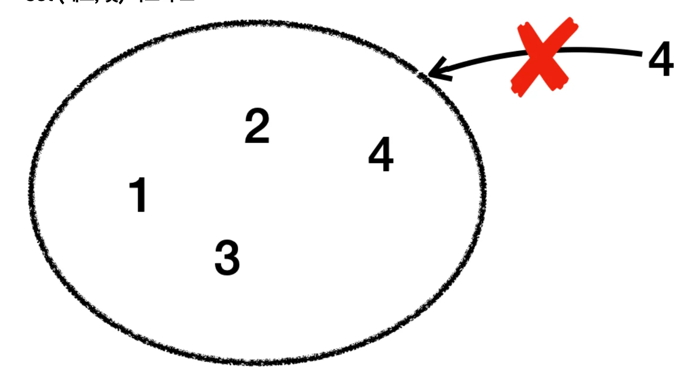
> 
> - 중복, 순서 보장 ❌ 

<a id="1d0eda9b0fe180baaa78f21be202b904"></a>

### 1&#46; HashSet, LinkedHashSet

---

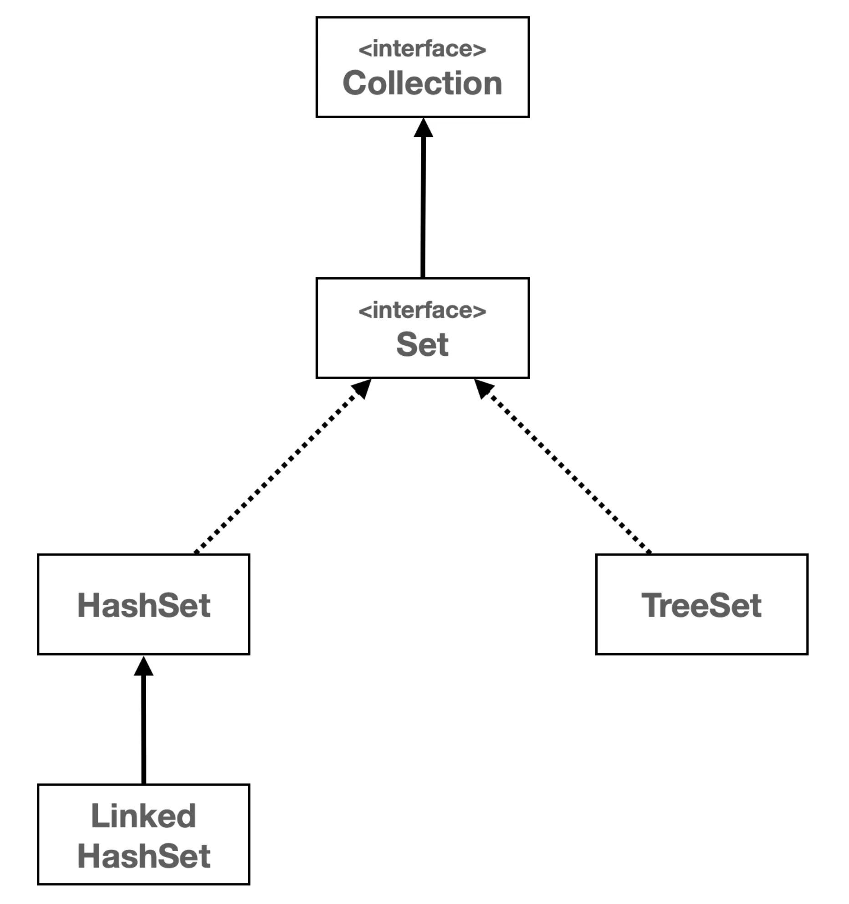

<details>
<summary><strong>Collection 인터페이스</strong></summary>

- Collection 인터페이스는 java&#46;util 패키지의 컬렉션 프레임워크의 핵심 인터페이스 중 하나이다&#46; 

- 해당 인터페이스는 자바에서 다양한 컬렉션, 즉 데이터 그룹을 다루기 위한 메서드를 정의한다&#46; 

- List, Set, Queue와 같은 다양한 하위 인터페이스와 함께 사용되며, 이를 통해 데이터를 리스트, 세트, 큐 등의 형태로 관리할 수 있다&#46;

</details>

<details>
<summary><strong>Set 인터페이스</strong></summary>

> ✏️ 
> 
> - 자바의  <code>Set</code>인터페이스는 <code>java&#46;util</code> 패키지의 컬렉션 프레임워크에 속하는 인터페이스 중 하나이다&#46;
> 
> - <code>Set</code> 인터페이스는 <strong><u>중복을 허용하지 않</u></strong><strong>는 </strong><strong><u>유일한 요소의 집합</u></strong>을 나타낸다&#46;
>     - 즉, 어떤 요소도 같은 <code>Set</code> 내에 두번 이상 나타날 수 없다&#46;
> 
> - <code>Set</code>은 수학적 집학 개념을 구현한 것으로, <strong><u>순서를 보장하지 않</u></strong>으며 <u>특정 요소가 집합에 있는지 여부를 확인</u>하는데 <strong><u>최적화</u></strong>되어 있다&#46;
>     - 요소 탐색 최적화 ( hashIndex ) &#45; <code class="language-math">O(1) </code>
> 
> - <code>Set</code> 인터페이스는 <code>HashSet</code> , <code>LinkedHashSet</code> , <code>TreeSet</code> 등의 여러 구현 클래스를 가지고 있다&#46;
>     - 각 클래스는 <code>Set</code> 인터페이스를 구현하며 각각의 특성을 가지고 있다&#46;

<a id="1d0eda9b0fe180bfa1d9fec4c2e6c20e"></a>

<strong>주요 메서드 </strong>

| 메서드 | 설명 |
| --- | --- |
| <strong><code>add(E e)</code></strong> | 지정된 요소를 세트에 추가한다&#46; <br>( 이미 존재하는 경우 추가하지 않음 ) |
| <strong><code>addAll(Collection&#60;? extends E&#62; c)</code></strong><strong> </strong> | 지정된 컬렉션의 모든 요소를 세트에 추가한다&#46; |
| <strong><code>contains(Object o)</code></strong> | 세트가 지정된 요소를 포함하고 있는지 여부를 반환한다&#46; |
| <strong><code>containsAll(Collection&#60;?&#62; c)</code></strong> | 세트가 지정된 컬렉션의 모든 요소를 포함하고 있는지 여부를 반환한다&#46; |
| <strong><code>remove(Object o)</code></strong> | 지정된 요소를 세트에서 제거한다&#46; |
| <strong><code>removeAll(Collection&#60;?&#62; c)</code></strong> | 지정된 컬렉션에 포함된 요소를 세트에서 모두 제거한다&#46; |
| <strong><code>retainAll(Collection&#60;?&#62; c)</code></strong> | 지정된 컬렉션에 포함된 요소만을 유지하고 나머지 요소는 세트에서 제거한다&#46; |
| <strong><code>clear()</code></strong> | 세트에서 모든 요소를 제거한다&#46; |
| <strong><code>size()</code></strong> | 세트에 있는 요소 수를 반환한다&#46; |
| <strong><code>isEmpty()</code></strong> | 세트가 비어 있는지 여부를 반환한다&#46; |
| <strong><code>iterator()</code></strong> | 세트의 요소에 대한 반복자를 반환한다&#46; |
| <strong><code>toArray()</code></strong> | 세트의 모든 요소를 배열로 반환한다&#46; |
| <strong><code>toArray(T&#91;&#93; a)</code></strong> | 세트의 모든 요소를 지정된 배열로 반환한다&#46; |

</details>

<details>
<summary><strong>HashSet</strong></summary>

> ✏️ 
> 
> <a id="1d0eda9b0fe1809f940eebe5bb7e0132"></a>
> 
> <strong>HashSet</strong>
> 
> ---
> 
> - <code>구현</code>&#58; <strong><u>해시 자료 구조</u></strong>를 사용해서 요소를 저장한다&#46;
> 
> - <code>순서</code>&#58; 요소들은 특정한 <strong><u>순서 없</u></strong>이 저장된다&#46; 즉, 요소를 추가한 <strong>순서를 보장하지 않</strong>는다&#46;
> 
> - <code>시간복잡도</code>&#58; HashSet의  주요 연산( <strong><u>추가, 삭제, 검색</u></strong><strong> </strong>)은 평균적으로 <code class="language-math">O(1)</code>의 시간복잡도를 갖는다&#46;
> 
> - <strong><code>용도</code></strong><strong>&#58; </strong><strong><u>데이터의 유일성</u></strong><strong> 및 </strong><strong><u>순서가 필요없</u></strong><strong>는 경우 경우 적합</strong>

> 이전 챕터에서 구현한 MyHashSet이 바로 HashSet이다&#46;

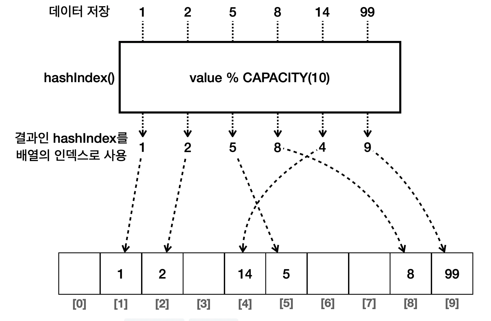

- 그림이 단순화 되었지만 <code>hashCode()</code>, <code>equals()</code> 모두 사용한다&#46; 

</details>

<details>
<summary><strong>LinkedHashSet</strong></summary>

> ✏️ 
> 
> <a id="1d0eda9b0fe18096bfb0cb45bb08d970"></a>
> 
> <strong>LinkedHashSet</strong>
> 
> ---
> 
> - <strong><code>구현</code></strong>&#58; <code>LinkedHashSet</code>은 <code>HashSet</code>에 연결리스트를 추가해서 요소들의 순서를 유지한다&#46;
> 
> - <strong><code>순서</code></strong>&#58; 요소들은 추가된 순서대로 유지된다&#46; 즉, 순서대로 조회 시 요소들이 추가된 순서대로 반환된다&#46;
> 
> - <strong><code>시간복잡도</code></strong>&#58; <code>LinkedHashSet</code>도  <code>HashSet</code>과 마찬가지로 주요 연산에 대해 평균 <code>O(1)</code> 시간복잡도를 가진다&#46;
> 
> - <strong><code>용도</code></strong><strong>&#58; </strong><strong><u>데이터의 유일성</u></strong><strong>  및 </strong><strong><u>삽입 순서를 유지</u></strong><strong>해야 할 때 적합하다&#46;</strong>
> 
> - <code>참고</code>&#58; 연결 링크를 유지해야 하기 때문에 <code>HashSet</code> 보다는 조금 더 무겁다&#46; 

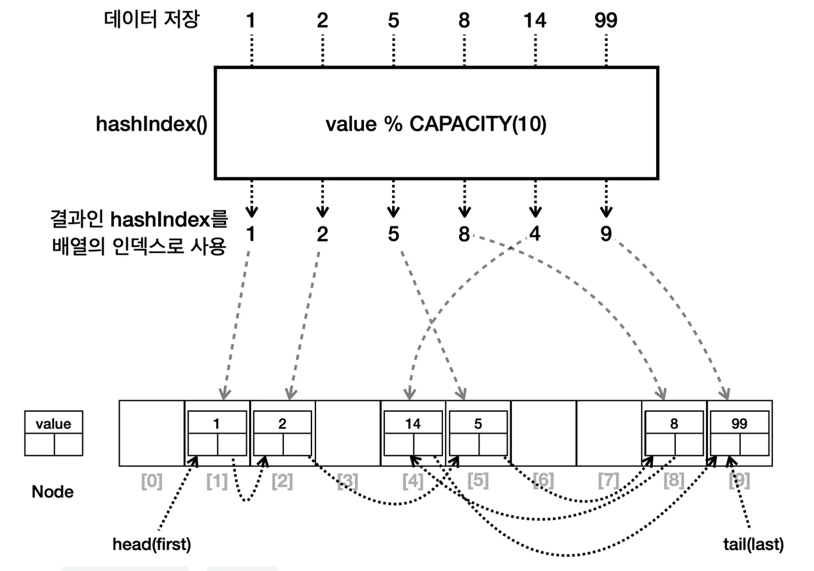

- <code>LinkedHashSet</code>은 <code>HashSet</code>에 <strong><u>연결 링크가 추가</u></strong>된 것이다 
    - <code>HashSet</code>  &#43; <code>LinkedList</code>

- 연결 링크는 데이터를 입력한 순서대로 연결된다&#46; 
    - head(first)부터 순서대로 링크를 따라가며 순회한다&#46; 

    - 그림은 이해를 돕기위해 단방향으로 표시했지만, 실제는 <strong><u>양방향</u></strong>이다&#46; 

<details>
<summary>ex) 1, 2, 5, 8, 14, 99</summary>

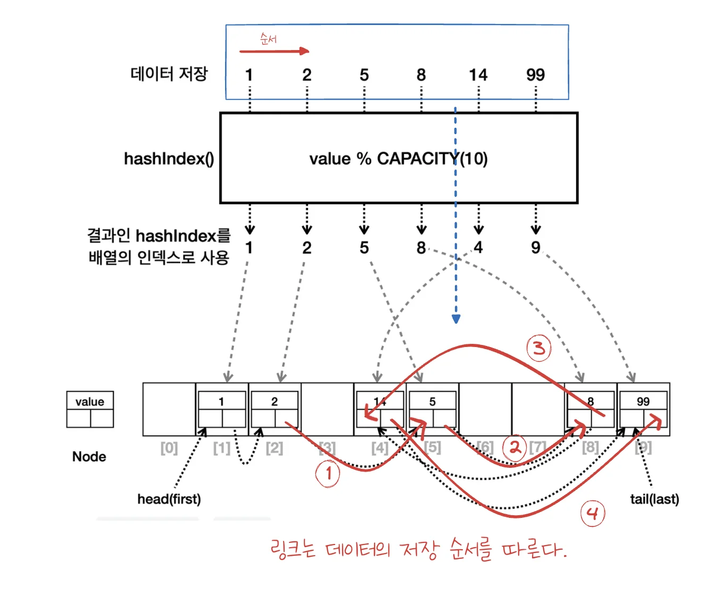

- 데이터가 저장된 순서로 링크가 연결된다&#46;
    - 실제는 양방향 이다&#46;

- head or tail에서부터 차례대로 순서에 따라 순회 가능하다&#46;
    - 선형 탐색&#58; O(n)

</details>

</details>

<a id="1d0eda9b0fe180e19b7ec87ea8f88f6d"></a>

### 2&#46; TreeSet

---

> ✏️ 
> 
> <a id="1d0eda9b0fe180378a22c8f561a9e57f"></a>
> 
> <strong>TreeSet</strong>
> 
> ---
> 
> - <strong><code>구현</code></strong>
>     - <code>TreeSet</code> 은 이진 탐색 트리를 개선한 <strong><u>레드&#45;블랙 트리를 내부에서 사용</u></strong>한다&#46;
> 
> - <strong><code>순서</code></strong>
>     - 요소들은 정렬된 순서로 저장된다&#46; 순서의 기준은 비교자(<code>Comparator</code> )로 변경할 수 있다
> 
> - <strong><code>시간복잡도</code></strong>
>     - 주요 연산들은 <code>O(log n)</code> 의 시간 복잡도를 가진다&#46; 따라서
> 
>     - <code>HashSet</code>보다는 느리다&#46; &#91; HashSet&#58; <code>O(1)</code> &#93;
> 
> - <strong><code>용도</code></strong>
>     -  데이터들을 <strong><u>정렬된 순서로 유지</u></strong>하면서 <strong><u>집합의 특성을 유지</u></strong>해야 할 때 사용한다
> 
>     - 범위 검색이나 정렬된 데이터가 필요한 경우에 유용하다
> 
>     - 입력된 순서가 아니라 데이터 값의 순서이다&#46; 
>         - ex) 3, 1, 2 → 1, 2, 3

<details>
<summary>추가) 레드 &#45; 블랙 트리</summary>

<a id="1d0eda9b0fe180df85b1eb5a599a9cd4"></a>

<a href="#/post/1c3eda9b-0fe1-816c-89f2-edb9db0a3681">페이지</a> 

</details>

<a id="1d0eda9b0fe180e6b387fe8526ad2f0d"></a>

### 트리구조

> TreeSet을 이해하려면 트리 구조를 먼저 알아야 한다&#46;

<details>
<summary>이전 정리</summary>

<a id="1d1eda9b0fe180d3a5d4ffbc66ad07a3"></a>

‣

<a id="1d1eda9b0fe18045bbe6fc8cde8cdcbf"></a>

‣

</details>

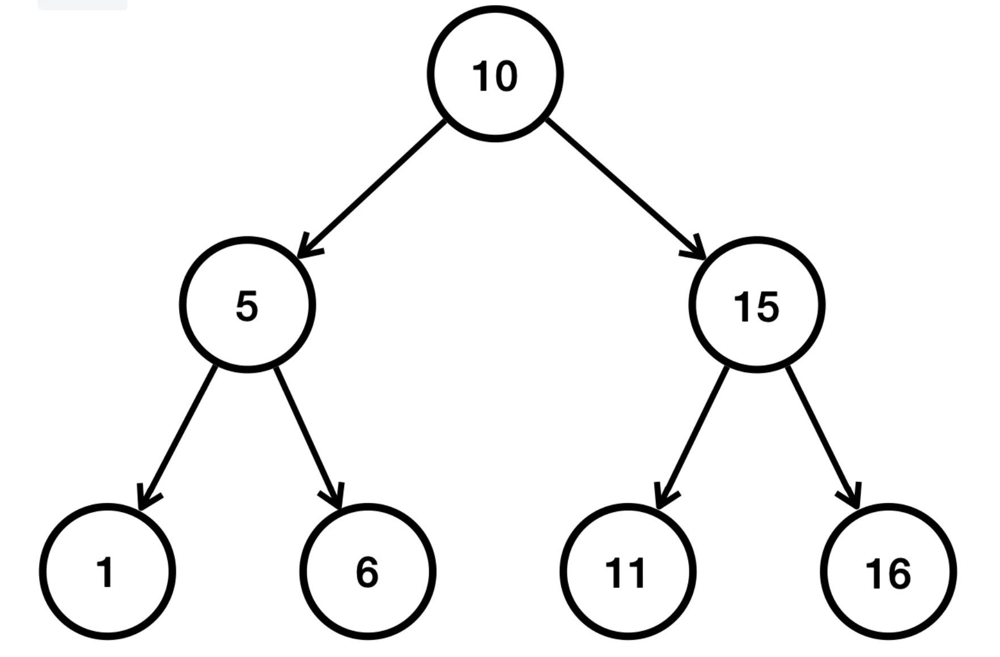

- 트리는 부모 노드와 자식 노드로 구성된다&#46;

- 가장 높은 조상을 루트(root)라 한다&#46;

- 위 그림을 뒤집어보면 나무와 비슷하다&#46; 따라서 트리라 부른다&#46;

- 자식이 2개까지 올 수 있는 트리를 이진 트리라 한다&#46;

- 왼쪽 자손 노드는 더 작은 값을 가지고, 오른쪽 자손 노드는 더 큰 값을 가지는 정렬된 형태를 가지는 것을 이진 탐색 트리라 한다&#46;

<a id="1d1eda9b0fe180e0b967e2a38e39a5fa"></a>

### <strong>트리 구조의 구현</strong>

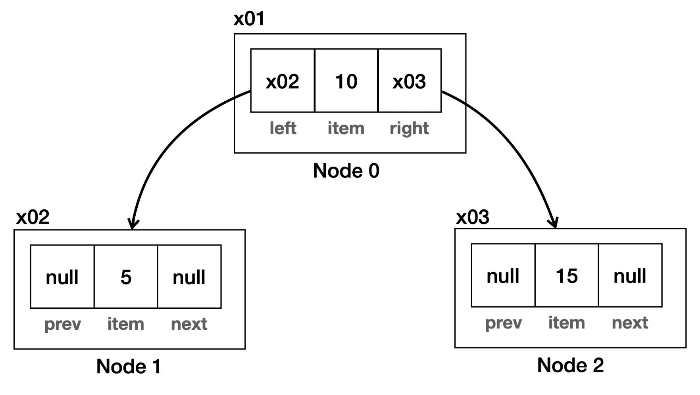

<a id="1d1eda9b0fe1805dab7dcc78463f70f1"></a>

```java
class Node {
		Object item;
		Node left;
		Node right; 
}
```

- 트리 구조는 왼쪽, 오른쪽 노드를 알고 있으면 된다&#46;

<a id="1d1eda9b0fe1801e861ce234e02cf268"></a>

### <strong>이진 탐색 트리</strong>

> ✏️ 
> 
> - 각 노드가 최대 2개의 자식 노드를 가지는 트리
> 
> - 왼쪽 자식 &#45;&#62; 부모 &#45;&#62; 오른쪽 자식 구조를 가지면 이진 탐색 트리(Binary Search Tree)

<details>
<summary>데이터 삽입 &#45; 정렬</summary>

> ✏️ 
> 
> <a id="1d1eda9b0fe18095ac41db2c31bff61c"></a>
> 
> 이진 탐색 트리의 핵심은 <strong><u>데이터를 입력하는 시점에 </u></strong><strong><u>정렬</u></strong><strong><u>해서 보관</u></strong>한다는 점이다&#46; 그리고 작은 값은 왼쪽에 큰 값은 오른쪽에 저장하면 된다&#46;	

- ex)  10, 5, 15, 1, 6, 11, 16 
    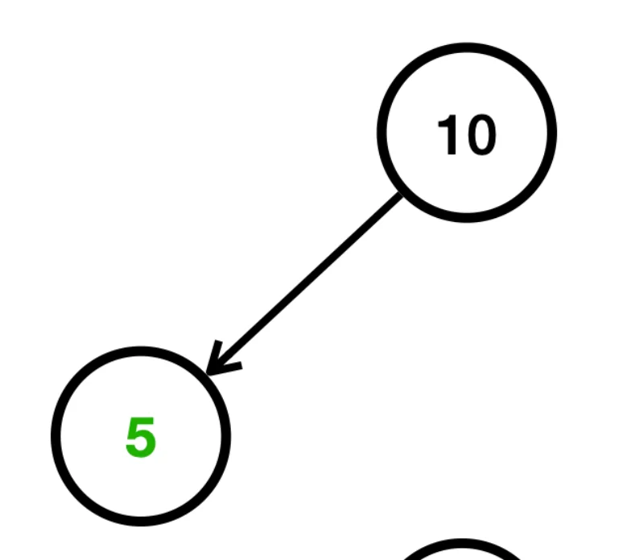

    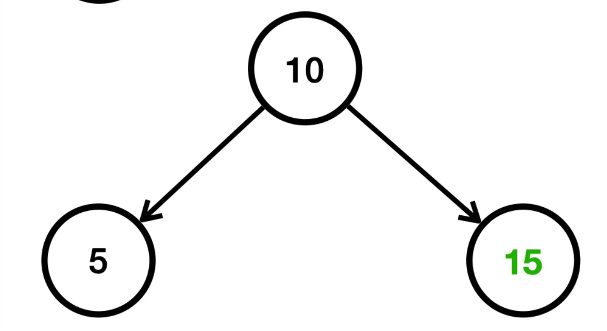

    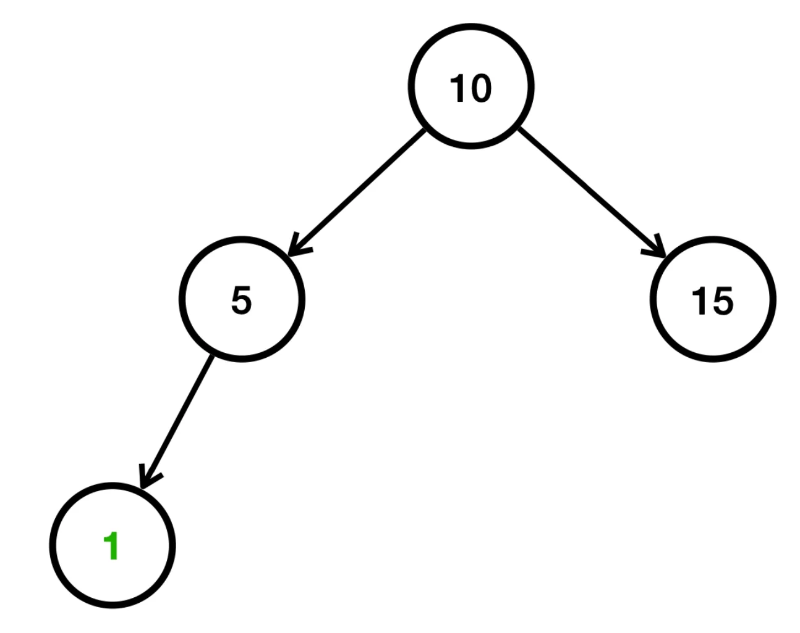

    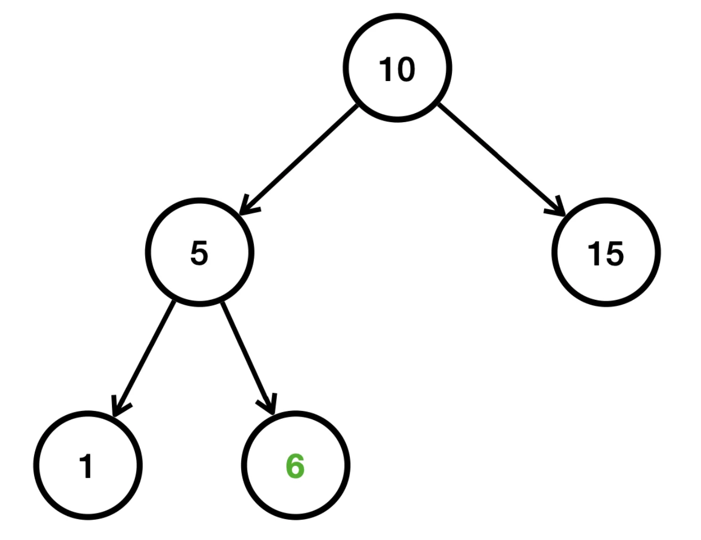

    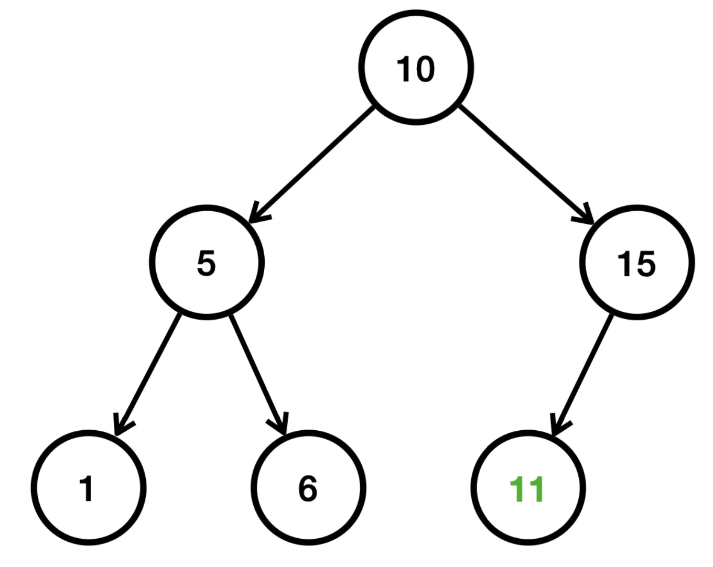

    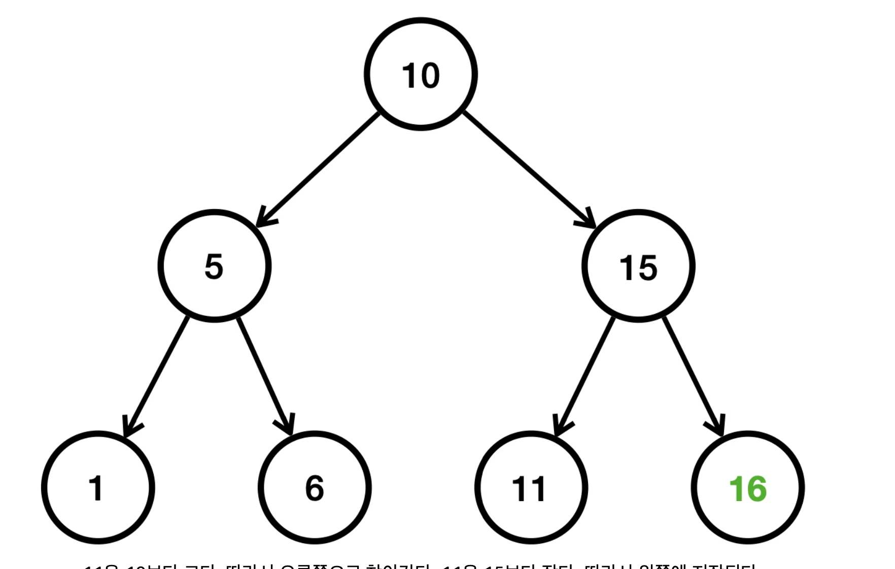

</details>

<details>
<summary>검색</summary>

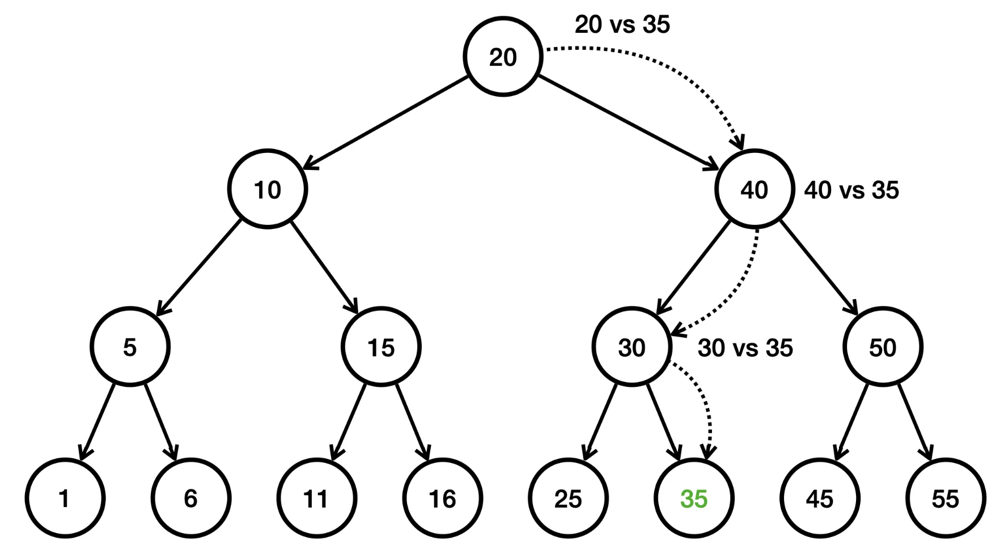

> 숫자 35 검색

1. 루트인 20과 35를 비교한다&#46; 35가 더 크므로 오른쪽으로 찾아간다&#46;

1. 40과 35를 비교한다&#46; 35가 더 작으므로 왼쪽으로 찾아간다&#46;

1. 30과 35를 비교한다&#46; 35가 더 크므로 오른쪽으로 찾아간다&#46;

1.  노드에 있는 값을 비교한다&#46; 35와 같으므로 35를 찾는다&#46;

> ✏️ 
> 
> <a id="1d1eda9b0fe18085a763fd88c86053c1"></a>
> 
> 탐색의 경우 트리의 높이(height)만큼의 연산을 가진다&#46;
> 
> <a id="1d1eda9b0fe18019b893d841cc359e47"></a>
> 
> 데이터가 총 15개인데 4번의 계산으로 필요한 결과를 얻을 수 있다&#46;
> 
> <a id="1d1eda9b0fe180338a73e2b58b9b84bb"></a>
> 
> <strong>⇒ </strong><strong><code>이진 탐색 트리의 빅오</code></strong><strong> &#45; </strong><code class="language-math">O(log n)</code>	
> 
> ---
> 
> - <code>O(n)</code> 인 리스트의 검색보다는 빠르고,
> 
> - <code>O(1</code>)인 해시의 검색 보다는 느리다&#46;

<details>
<summary><strong>비교&#58;</strong> <code class="language-math">O(n)</code> vs<strong> </strong><code class="language-math">O(log n)</code>	 </summary>

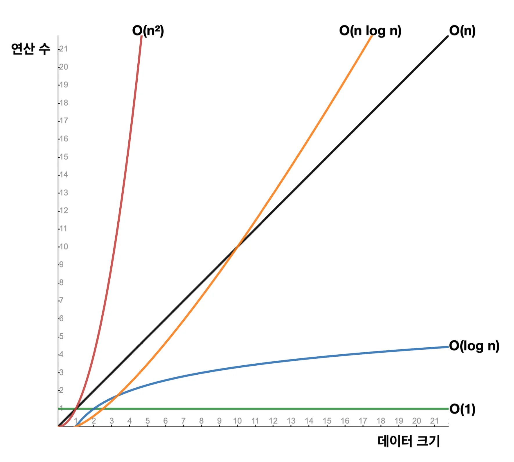

<a id="1d1eda9b0fe1807680b9e59d4ca69c18"></a>

16개의 경우 단 4번의 비교 만으로 최종 노드에 도달할 수 있다&#46; 이것을 정리하면 다음과 같다&#46;

- 2개의 데이터 → 2로 1번 나누기, <code>log2(2)=1</code>

- 4개의 데이터  → 2로 2번 나누기, <code>log2(4)=2</code>

- 8개의 데이터  → 2로 3번 나누기, <code>log2(8)=3</code>

- 16개의 데이터 → 2로 4번 나누기, <code>log2(16)=4</code>

- 32개의 데이터 → 2로 5번 나누기, <code>log2(32)=5</code>

- 64개의 데이터 → 2로 6번 나누기, <code>log2(64)=6</code>

- &#46;&#46;&#46;

- 1024개의 데이터 → 2로 10번 나누기, <code>log2(1024)=10</code><br>  

<a id="1d1eda9b0fe18072a90ad20927f2fcd0"></a>

1024개의 데이터를 단 10번의 계산으로 원하는 결과를 찾을 수 있다&#46;

<a id="1d1eda9b0fe180e49162fb2d3b1af8a7"></a>

데이터의 크기가 늘어나도 늘어난 만큼 한 번의 계산에 절반을 날려버리기 때문에, O(n)과 비교해서 데이터의 크기가 클 수록 효과적이다&#46;

</details>

</details>

<details>
<summary>최악의 경우 성능</summary>

> ☝🏻 
> 
> <a id="1d1eda9b0fe1808f9331ec97b1a8d504"></a>
> 
> 이진 탐색 트리의 검색, 삽입, 삭제의 평균 성능은 <code>O(log n)</code> 이다&#46; 하지만 트리의 <strong><u>균형이 맞지 않으면 최악의 경우 </u></strong><code class="language-math">O(n)</code><strong><u>의 성능</u></strong>이 나온다
> 
> - 연결리스트 와 동일

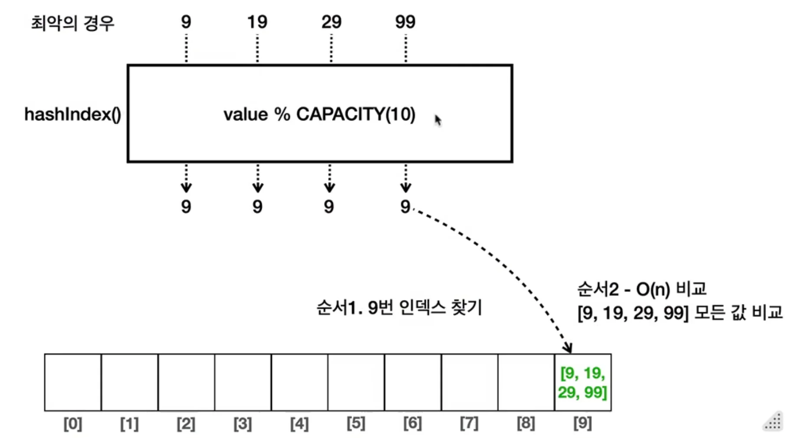

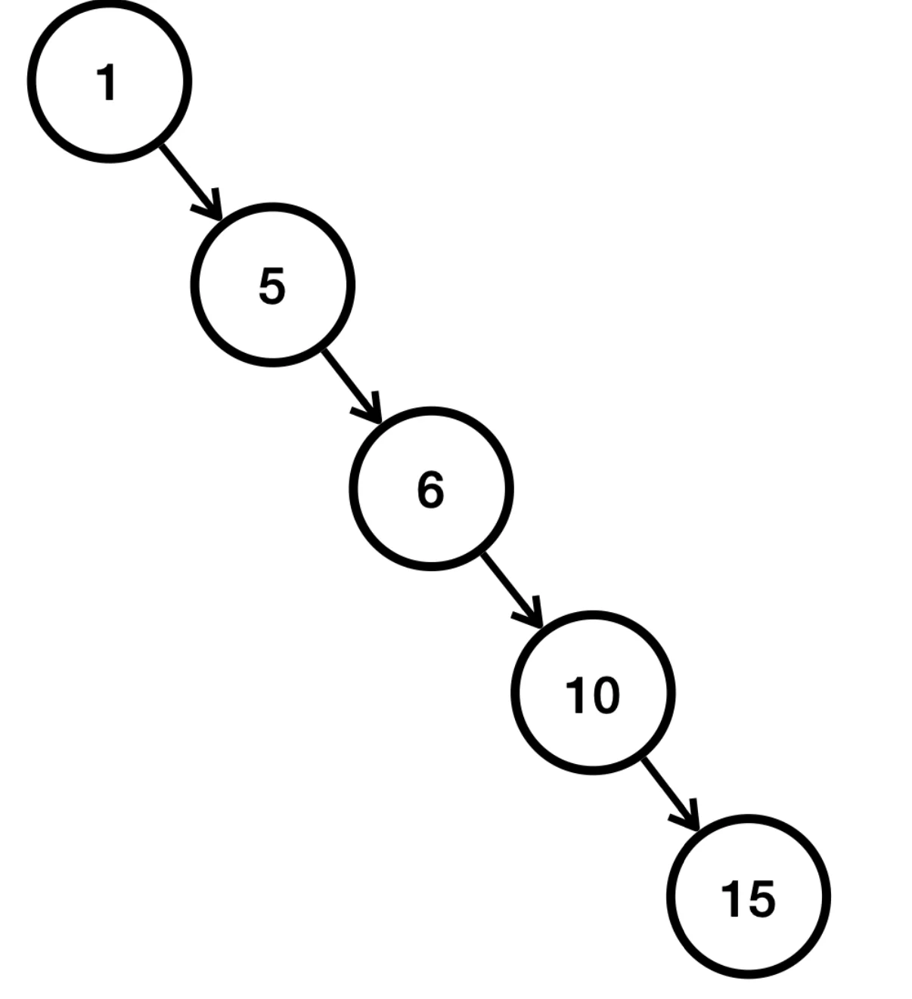

- 이렇게 오른쪽으로 치우치게 되면, 결과적으로 15를 검색 했을 때 데이터의 수인 5만큼 검색을 해야 한다&#46; 따라서 이런 최악의 경우 O(n)이 성능이 나온다&#46;

</details>

<details>
<summary>개선 &#45; 트리 재구조화(재정렬)</summary>

<a id="1d1eda9b0fe180b09b63f29de2455b81"></a>

 트리의 균형이 너무 깨진 경우 동적으로 균형을 다시 맞춘다&#46;

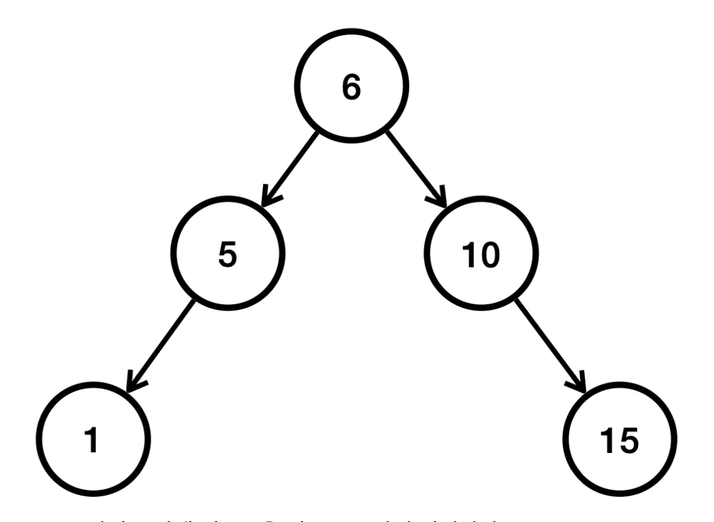

- 앞서 중간에 있는 6을 기준으로 다시 정렬한다&#46;

- AVL 트리, 레드&#45;블랙 트리 같은 균형을 맞추는 다양한 알고리즘이 존재한다

- 자바의 <code>TreeSet</code> 은 레드&#45;블랙 트리를 사용해서 균형을 지속해서 유지한다&#46; 따라서 최악의 경우에도 <code>O(logn)</code> 의 성능을 제공한다&#46;

</details>

<details>
<summary><strong>순회</strong></summary>

> ✏️ 
> 
> - 이진 탐색 트리의 핵심은 입력 순서가 아니라, <strong><u>데이터의 값을 기준으로 정렬</u></strong>해서 보관한다는 점이다&#46;
> 
> - 따라서 <strong><u>정렬된 순서로 데이터를 차례로 조회(순회)</u></strong>할 수 있다&#46;
> 
> - 데이터를 차례로 순회하려면 <strong>중위 순회</strong>라는 방법을 사용하면 된다&#46; 
>     - 왼쪽 서브트리를 방문한 다음, 현재 노드를 처리하고, <br>마지막으로 오른쪽 서브트리를 방문한다&#46; 
> 
> - 이 방식은 이진 탐색 트리의 특성상, 노드를 오름차순(숫자가 점<br>점 커짐)으로 방문한다&#46;

<a id="1d1eda9b0fe180d38f6cfdd1e339b070"></a>

### <strong>중위 순회 순서</strong>

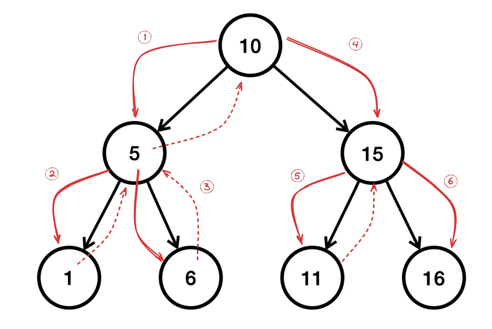

1. 10의 기준에서 왼쪽 서브트리를 방문한다&#46;

1. 5의 기준에서 왼쪽 서브트리를 방문한다&#46;

1. <strong>1을 출력</strong>한다&#46;

1. <strong>5 자신을 출력</strong>한다&#46;

1. 5의 기준으로 오른쪽 서브트리를 방문한다&#46;

1. <strong>6을 출력</strong>한다

1. <strong>10 자신을 출력</strong>한다&#46;

1. 10의 기준에서 오른쪽 서브트리를 방문한다&#46;

1. 15의 기준에서 왼쪽 서브트리를 방문한다&#46;

1. <strong>11을 출력</strong>한다&#46;

1. <strong>15 자신을 출력</strong>한다&#46;

1. 15의 기준으로 오른쪽 서브트리를 방문한다&#46;

1. <strong>16을 출력</strong>한다&#46;

</details>

<a id="1d0eda9b0fe180cea95ad211795137ca"></a>

### 3&#46; 예제

---

<a id="1d0eda9b0fe1800a9f03d7f08d1d0576"></a>

### 코드 

<details>
<summary>&#91; 코드 &#93; JavaSetMain</summary>

<a id="1d0eda9b0fe180f49ff8fca3a40f210d"></a>

```java
package collection.javaset;

import java.util.*;

public class JavaSetMain {
    public static void main(String[] args) {
        run(new HashSet<>());
        run(new LinkedHashSet<>());
        run(new TreeSet<>());
    }
    private static void run(Set<String> set) {
        System.out.println("set = " + set.getClass());
        set.add("C");
        set.add("B");
        set.add("A");
        set.add("1");
        set.add("2");
        Iterator<String> iterator = set.iterator();
        while (iterator.hasNext()) {
            System.out.print(iterator.next() + " ");
        }
        System.out.println();
    }
}
```

</details>

<details>
<summary>실행 결과</summary>

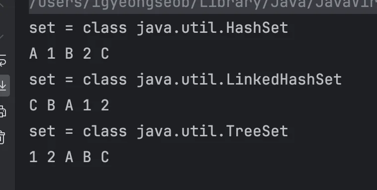

- <code>HashSet</code> &#58; 입력한 순서를 보장하지 않는다&#46; 

- <code>LinkedHashSet</code> &#58; 입력한 순서를 정확히 보장한다&#46;

-  <code>TreeSet</code> &#58; 데이터 값을 기준으로 정렬한다&#46;

</details>

> ☝🏻 
> 
> <a id="1d1eda9b0fe180c1b878ddc472de264a"></a>
> 
> <strong>참고) TreeSet의 정렬 기준</strong>
> 
> ---
> 
> <a id="1d1eda9b0fe180b4b8c7c435c1bc3f51"></a>
> 
> <code>TreeSet</code>을 사용할 때 데이터를 정렬하려면 크다, 작다라는 기준이 필요하다&#46; 
> 
> <a id="1d1eda9b0fe180aca4a8c936d3be16ba"></a>
> 
> 1, 2, 3이나 &#34;A&#34;, &#34;B&#34;, &#34;C&#34; 같은 기본 데이터는 크다 작다라는 기준이 명확하기 때문에 정렬할 수 있다&#46; 
> 
> > 🧐 
> > 
> > <a id="1d1eda9b0fe180559af2f7a358af5f39"></a>
> > 
> > 하지만 우리가 직접 만든 <code>Member</code> 와 같은 객체는 크다 작다는 기준을 어떻게 알 수 있을까? 
> 
> <a id="1d1eda9b0fe1809ab8f1d709e5316e52"></a>
> 
> 이런 기준을 제공하려면 <code>Comparable</code> , <code>Comparator</code> 인터페이스를 구현해야한다&#46; 이 부분은 뒤에서 설명한다&#46;

<a id="1d0eda9b0fe18058b912efbc262a6013"></a>

###  4&#46; 최적화

> 자바의 <code>HashSet</code> 은 우리가 직접 구현한 내용과 거의 같지만 다음과 같은 최적화를 추가로 진행한다&#46;

> ✏️ 
> 
> <a id="1d1eda9b0fe1801b9b4cd362ecfba674"></a>
> 
> <strong>최적화</strong>
> 
> ---
> 
> - 해시 기반 자료 구조를 사용하는 경우 통계적으로 입력한 데이터의 수가 배열의 크기를 75% 정도 넘어가면 해시인덱스가 자주 충돌한다&#46; <br>따라서 75%가 넘어가면 성능이 떨어지기 시작한다&#46;
>     - 해시 충돌로 같은 해시 인덱스에 들어간 데이터를 검색하려면 모두 탐색해야 한다&#46;  따라서 성능이 O(n)으로좋지 않다&#46;
> 
> - 하지만 데이터가 동적으로 계속 추가되기 때문에 적절한 배열의 크기를 정하는 것은 어렵다&#46;
> 
> - 자바의 <code>HashSet</code>은 데이터의 양이<strong><u> 배열 크기의 75%를 넘</u></strong>어가면<u> 배열의 크기를 2배로 늘</u>리고 <strong>2배 늘어난 크기를 기준</strong>으로 <strong><u>모든 요소에 해시 인덱스를 다시 적용</u></strong>한다&#46;
>     - 해시 인덱스를 다시 적용하는 시간이 걸리지만, 결과적으로 해시 충돌이 줄어든다&#46;
> 
> - 자바 <code>HashSet</code> 의 기본 크기는 <code>16</code> 이다&#46;

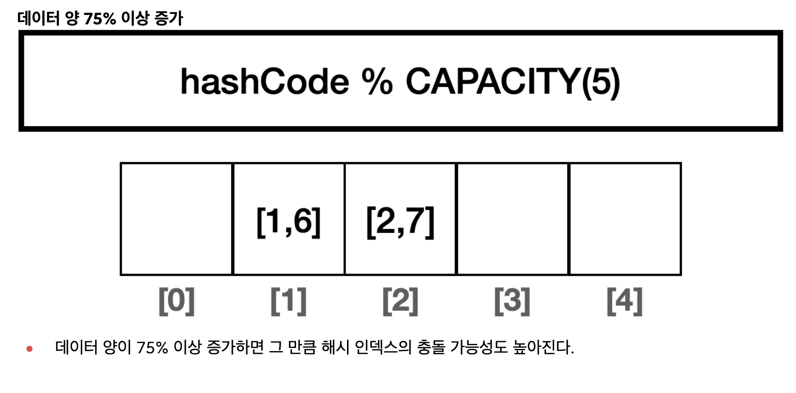

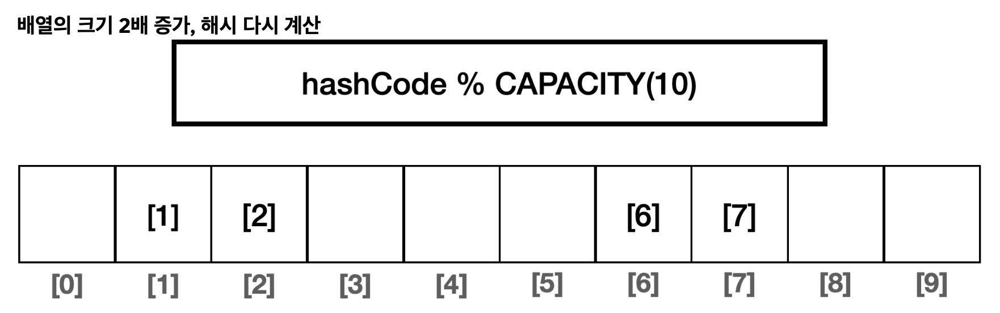

- 데이터양이 75% 이상이면 배열의 크기를 2배로 증가하고, 모든 데이터의 해시 인덱스를 커진 배열에 맞추어 다시 계산한다&#46; 
    - 이 과정을<u> 재해싱(rehashing</u>)이라 한다&#46;

- 인덱스 충돌 가능성이 줄어든다

- 데이터가 다시 75% 이상 증가하면 다시 2배 증가와 재계산을 반복한다&#46;<br>	<br>

> 🗒️ 
> 
> <a id="1d1eda9b0fe1806791f7ca35c4b8cae7"></a>
> 
> <strong>정리</strong>
> 
> ---
> 
> <a id="1d1eda9b0fe18044aa09e71a7d799424"></a>
> 
> 실무에서는 <code>Set</code> 이 필요한 경우 <code>HashSet</code> 을 가장 많이 사용한다&#46; 
> 
> <a id="1d1eda9b0fe180ac86c9eca3747d38aa"></a>
> 
> 그리고 입력 순서 유지, 값 정렬의 필요에 따라서 <code>LinkedHashSet</code> , <code>TreeSet</code> 을 선택하면 된다&#46;

<a id="1d0eda9b0fe180008a1dd7713ffee1eb"></a>

### 문제 풀이

<details>
<summary>배열 → 리스트</summary>

> ✏️ 
> 
> <a id="1d1eda9b0fe18025906adbca242127f2"></a>
> 
> <code>Arrays&#46;asList()</code> 메서드는 자바 1&#46;2부터 존재했다&#46; <br><strong><u>자바 9 이상</u></strong>을 사용한다면 <code>List&#46;of()</code> 를 권장한다&#46;

<a id="1d1eda9b0fe1808685dade59f07376db"></a>

```java
 List<Integer> list = Arrays.asList(inputArr);
 List<Integer> list = List.of(inputArr);
```

</details>

<details>
<summary>1&#46; <strong>중복 제거</strong></summary>

> 💬 
> 
> <a id="1d1eda9b0fe1804cb996e2ec133e8a61"></a>
> 
> <strong>문제 설명</strong>
> 
> ---
> 
> - 여러 정수가 입력된다&#46; 여기서 중복 값을 제거하고 값을 출력해라&#46;
> 
> - 30, 20, 20, 10, 10이 출력되면 중복을 제거하고 출력하면 된다&#46; 출력 순서는 관계없다&#46;
> 
> - ex)&#58; 30, 20, 10 또는 10, 20, 30 또는 20, 10, 30등과 같이 출력 순서는 관계 없다&#46;

<a id="1d1eda9b0fe180258ed0fc3073938cf1"></a>

<strong>문제 코드</strong>

<a id="1d1eda9b0fe180898aa2f8672cf496ba"></a>

```java
package collection.set.test;

import java.util.HashSet;
import java.util.Set;

public class UniqueNamesTest1 {
		public static void main(String[] args) {
				Integer[] inputArr = {30, 20, 20, 10, 10}; 
				
				// 코드 작성
		} 
}
```

<a id="1d1eda9b0fe180568a4bc0e0fc93052a"></a>

<br><strong>실행 결과</strong>

<a id="1d1eda9b0fe180419063d1e060a99bc4"></a>

```plaintext
30
20
10 
```

<details>
<summary>&#91; 정답 &#93;</summary>

<a id="1d1eda9b0fe18054a786d6cbfcb75a38"></a>

```java
package collection.set.test;

import java.util.HashSet;
import java.util.Set;

public class UniqueNamesTest1 {
		public static void main(String[] args) {
				Integer[] inputArr = {30, 20, 20, 10, 10}; 
				
				// 코드 작성
				Set<Integer> set = new HashSet<>(Arrays.asList(inputArr));

        set.forEach(System.out::println);
		} 
}
```

</details>

</details>

<details>
<summary>2&#46; <strong>중복 제거와 입력 순서 유지</strong></summary>

> 💬 
> 
> <a id="1d1eda9b0fe180d5b3dbc59a1f57af8f"></a>
> 
> <strong>문제 설명</strong>
> 
> ---
> 
> - 여러 정수가 입력된다&#46; 여기서 중복 값을 제거하고 값을 출력해라&#46;
> 
> - 30, 20, 20, 10, 10이 출력되면 중복을 제거하고 출력하면 된다&#46;
> 
> - 단 <strong>입력 순서대로 출력</strong>해라&#46;
>     - ex)&#58; 30, 20, 10

<a id="1d1eda9b0fe180ccbc6fdb296c438b59"></a>

<strong>문제 코드</strong>

<a id="1d1eda9b0fe18026afe1e0ef2ec70ea2"></a>

```java
package collection.set.test;

import java.util.HashSet;
import java.util.Set;

public class UniqueNamesTest2 {

		public static void main(String[] args) {
				Integer[] inputArr = {30, 20, 20, 10, 10}; 
				
				// 코드 작성
		} 
}
```

<a id="1d1eda9b0fe18064ae9ada3b390b434b"></a>

<br><strong>실행 결과</strong>

<a id="1d1eda9b0fe1806b9ca4c5ae63c3d92b"></a>

```plaintext
30
20
10 
```

<details>
<summary>&#91; 정답 &#93;</summary>

<a id="1d1eda9b0fe18014a8b7f278010abc0c"></a>

```java
package collection.set.test;

import java.util.HashSet;
import java.util.Set;

public class UniqueNamesTest2 {

		public static void main(String[] args) {
				// 코드 작성
				// Integer[] inputArr = {30, 20, 20, 10, 10}; 
				// TreeSet<Integer> tree = new TreeSet<>(Arrays.asList(inputArr));
				Set<Integer> set = new TreeSet<>(List.of(30, 20, 20, 10, 10));
				
        tree.descendingSet().forEach(System.out::println);
		} 
}
```

</details>

</details>

<details>
<summary>3&#46; <strong>중복 제거와 데이터 순서 유지</strong></summary>

> 💬 
> 
> <a id="1d1eda9b0fe18047bad9ce4a852ea5ff"></a>
> 
> <strong>문제 설명</strong>
> 
> ---
> 
> - 여러 정수가 입력된다&#46; 여기서 중복 값을 제거하고 값을 출력해라&#46;
> 
> - 30, 20, 20, 10, 10이 출력되면 중복을 제거하고 출력하면 된다&#46;
> 
> - 단 <strong>입력 순서대로 출력</strong>해라&#46;
>     - ex)&#58; 10, 20, 30

<a id="1d1eda9b0fe180289edfff22354d57ec"></a>

<strong>문제 코드</strong>

<a id="1d1eda9b0fe1808f87d8ee917c437986"></a>

```java
package collection.set.test;

import java.util.HashSet;
import java.util.Set;

public class UniqueNamesTest3 {

		public static void main(String[] args) {
				Integer[] inputArr = {30, 20, 20, 10, 10}; 
				
				// 코드 작성
		} 
}
```

<a id="1d1eda9b0fe180a6baaff5ae3be7492d"></a>

<br><strong>실행 결과</strong>

<a id="1d1eda9b0fe18020aef1ea8e95ddba0c"></a>

```plaintext
10
20
30
```

<details>
<summary>&#91; 정답 &#93;</summary>

<a id="1d1eda9b0fe18053830fc7a728c4531a"></a>

```java
package collection.set.test;

import java.util.HashSet;
import java.util.Set;

public class UniqueNamesTest2 {

		public static void main(String[] args) {
				Integer[] inputArr = {30, 20, 20, 10, 10}; 
				
				// 코드 작성
				// tree.addAll(inputArr));
        TreeSet<Integer> tree = new TreeSet<>(Arrays.asList(inputArr));

        tree.forEach(System.out::println);
		} 
}
```

</details>

</details>

<details>
<summary>4&#46;  <strong>합집합</strong>, <strong>교집합</strong>, <strong>차집합</strong></summary>

> 💬 
> 
> <a id="1d1eda9b0fe1801d8650cbda89b2325b"></a>
> 
> <strong>문제 설명</strong>
> 
> ---
> 
> - 두 숫자의 집합이 제공된다&#46;
>     - 집합1&#58; <code>1, 2, 3, 4, 5</code>
> 
>     - 집합2&#58; <code>3, 4, 5, 6, 7</code>
> 
> - 두 집합의 합집합, 교집합, 차집합을 구해라&#46; 출력 순서는 관계없다&#46;
>     - <code>합집합</code>&#58; 두 집합의 합이다&#46; 참고로 중복은 제거한다&#46; <code>&#91;1, 2, 3, 4, 5, 6, 7&#93;</code>
> 
>     - <code>교집합</code>&#58; 두 집합의 공통 값이다&#46; 참고로 중복은 제거한다&#46; <code>&#91;3, 4, 5</code>
> 
>     - <code>차집합</code>&#58; 집합1에서 집합2와 같은 값을 뺀 나머지 <code>&#91;1, 2&#93;</code>
> 
> - 다음 실행 결과를 참고하자&#46;
> 
> - <code>Set</code> 인터페이스의 주요 메서드를 참고하자&#46;

<a id="1d1eda9b0fe1801f8d67d84f51fa7cc5"></a>

<strong>문제 코드</strong>

<a id="1d1eda9b0fe180f18dd5c861572ea468"></a>

```java
package collection.set.test;

import java.util.HashSet;
import java.util.List;
import java.util.Set;

public class SetOperationsTest {

		public static void main(String[] args) {
        Set<Integer> set1 = new HashSet<>(List.of(1, 2, 3, 4, 5));
        Set<Integer> set2 = new HashSet<>(List.of(3, 4, 5, 6, 7));
				
				// 코드 작성
		} 
}
```

<a id="1d1eda9b0fe1804f8341e5e50e51416e"></a>

<br><strong>실행 결과</strong>

<a id="1d1eda9b0fe180ef9f80d8fdd6c542f2"></a>

```plaintext
합집합: [1, 2, 3, 4, 5, 6, 7] 
교집합: [3, 4, 5]
차집합: [1, 2]
```

<details>
<summary>&#91; 정답 &#93;</summary>

<a id="1d1eda9b0fe1803abd2ccb8ef0a2d811"></a>

```java
package collection.javaset.test;

import java.util.HashSet;
import java.util.List;
import java.util.Set;

public class SetOperationsTest {
    public static void main(String[] args) {
        Set<Integer> set1 = new HashSet<>(List.of(1, 2, 3, 4, 5));
        Set<Integer> set2 = new HashSet<>(List.of(3, 4, 5, 6, 7));

        Set<Integer> union = new HashSet<>(set1);
        union.addAll(set2);

        Set<Integer> intersection = new HashSet<>(set1);
        intersection.retainAll(set2);

        Set<Integer> difference = new HashSet<>(set1);
        difference.removeAll(set2);
        
        System.out.println("합집합: " + union);
        System.out.println("교집합: " + intersection);
        System.out.println("차집합: " + difference);
    }
}

```

</details>

</details>

<details>
<summary>5&#46; Equals, HashCode</summary>

> 💬 
> 
> <a id="1d1eda9b0fe1809ebba0f7349446f1d4"></a>
> 
> <strong>문제 설명</strong>
> 
> ---
> 
> - <code>RectangleTest</code> , 실행 결과를 참고해서 다음 <code>Rectangle</code> 클래스를 완성하자&#46; 
> 
> - <code>Rectangle</code> 클래스는 <code>width</code> , <code>height</code> 가 모두 같으면 같은 값으로 정의한다&#46;

<a id="1d1eda9b0fe18000adabd62fb24ea2e5"></a>

<strong>문제 코드</strong>

<a id="1d1eda9b0fe1804eb254ff8293d98004"></a>

```java
package collection.set.test;

public class Rectangle {

		private int width;
    private int height;
   
	  // 코드 작성
}
```

<a id="1d1eda9b0fe1805dbd85efb4d85f7875"></a>

```java
package collection.set.test;

import java.util.HashSet;
import java.util.Set;

public class RectangleTest {
		public static void main(String[] args) { 
				Set<Rectangle> rectangleSet = new HashSet<>(); 
				rectangleSet.add(new Rectangle(10, 10)); 
				rectangleSet.add(new Rectangle(20, 20)); 
				rectangleSet.add(new Rectangle(20, 20)); //중복
				for (Rectangle rectangle : rectangleSet) {
						System.out.println("rectangle = " + rectangle);
				} 
		}
}
```

<a id="1d1eda9b0fe180f1b358cb920f87bed0"></a>

<br><strong>실행 결과</strong>

<a id="1d1eda9b0fe1805eb500d0101a9dec12"></a>

```plaintext
rectangle = Rectangle{width=10, height=10}
rectangle = Rectangle{width=20, height=20}
```

<details>
<summary>&#91; 정답 &#93;</summary>

<a id="1d1eda9b0fe180379958f84174b56c5d"></a>

```java
package collection.javaset.test;

import java.util.Objects;

public class Rectangle {

    private int width;
    private int height;

    public Rectangle(int width, int height) {
        this.width = width;
        this.height = height;
    }

    @Override
    public boolean equals(Object object) {
        if (this == object) return true;
        if (object == null || getClass() != object.getClass()) return false;
        Rectangle rectangle = (Rectangle) object;
        return width == rectangle.width && height == rectangle.height;
    }

    @Override
    public int hashCode() {
        return Objects.hash(width, height);
    }

    @Override
    public String toString() {
        return "Rectangle{" +
                "width=" + width +
                ", height=" + height +
                '}';
    }
}

```

</details>

</details>
