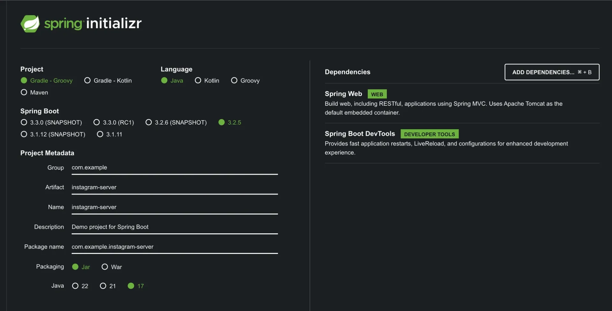
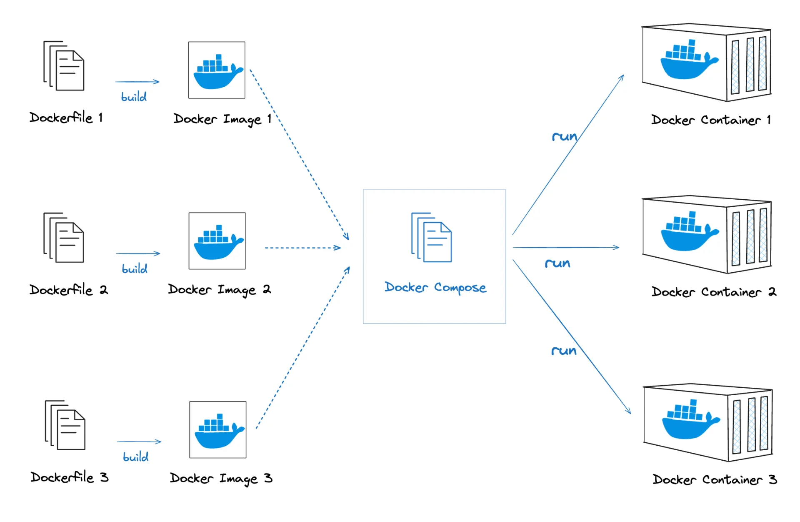
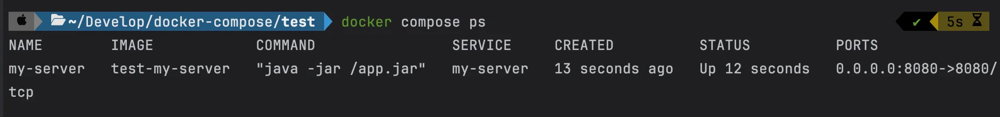
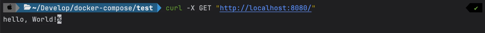
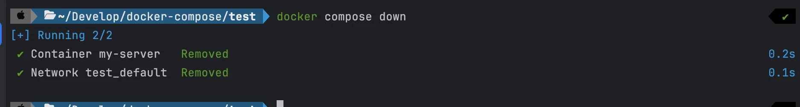

<a id="1c3eda9b0fe18146aa26e2bb8f873510"></a>

## &#91;실습&#93; Dokcer Compose로 SpringBoot 실행

---

<details>
<summary><strong>1&#46; 프로젝트 셋팅</strong></summary>

[start&#46;spring&#46;io]()



- Java 17 버전을 선택

- <strong>간단한 코드 작성</strong>
    <a id="1c3eda9b0fe181798cf8e910857bba87"></a>

    ```java
    @RestController
    public class AppController {
      @GetMapping("/")
      public String home() {
        return "Hello, World!";
      }
    }
    ```

</details>

<details>
<summary><code>🧐 Dockerfile</code> vs <code>Docker Comopse</code></summary>



- <code>Dockerfile</code>은 docker image를 생성하기 위한 정보를 정의하는 것이다 &#46;

- <code>Docker Compose</code>는 cli를 통해 정의하는 컨테이너 실행 정보를 <strong><u>compose 파일(YAML)</u></strong><u>을 통해 정의</u>하는 것이다&#46; 
    - yaml 파일을 통해 여러개의 컨테이너 실행 정보를 설정하고 한번에 실행 및 종료 할 수 있다&#46;

</details>

<details>
<summary>2&#46; Dockerfile 작성</summary>

<a id="1c3eda9b0fe18183b5fdfdddf905c0bb"></a>

```docker
FROM openjdk:17-jdk

COPY build/libs/*SNAPSHOT.jar /app.jar

ENTRYPOINT ["java", "-jar", "/app.jar"]
```

- gradle build

<a id="1c3eda9b0fe181f2bf27faff589c2e0f"></a>

```docker
./gradlew clean build
```

<details>
<summary>🧐 Dockerfile을 정의하는 이유</summary>

<a id="1c3eda9b0fe181099ecbc88c9d726ed1"></a>

컨테이너에서 프로젝트를 실행하는 경우, 소스코드를 build한 <code>jar 파일</code> 복사가 필요하다 

-  Dockerfile →   build한 jar파일을 컨테이너 내부로 copy

</details>

</details>

<details>
<summary>3&#46; compse 파일 작성</summary>

<a id="1c3eda9b0fe181079818d4b1427d3dd2"></a>

<strong>compose&#46;yml</strong>

<details>
<summary>nginx &#43; redis &#43; mysql</summary>

<a id="1c3eda9b0fe1816c829cf5e45e95fec1"></a>

```yaml
services:
  my-web-server:
    container_name: webserver
    image: nginx
    ports:
      - 80:80

  my-cache-server:
    container_name: my-redis
    image: redis
    ports:
      - 6379:6379

  my-db:
    container_name: my-mysql
    image: mysql
    environment:
      MYSQL_ROOT_PASSWORD: pwd1234
    volumes:
      - /Users/igyeongseob/Develop/docker-mysql/mysql_data:/var/lib/mysql
    ports:
      - 3306:3306
```

</details>

<a id="1c3eda9b0fe18123b888d13bf782134f"></a>

```yaml
services:
	my-server:
		build: .
		ports: 
			- 8080:8080
```

- <code>build&#58; &#46;</code>
    - <code>compose&#46;yml</code>이 존재하는 디렉토리(<code>&#46;</code>)에 있는 <code>Dockerfile</code>로 이미지를 생성해 컨테이너를 띄우겠다는 의미

</details>

<details>
<summary>🧐 <code>—build</code> 사용 이유</summary>

<a id="1c3eda9b0fe181e2b76ddf44176a5e0a"></a>

```bash
docker compose up -d --build
```

1. Docker image 강제 재빌드 
    - <code>—build</code> 사용 시, 기존에 이미지가 존재하더라도 새로운 이미지를 빌드한다&#46; 

    - 코드나 설정이 변경 되었을 경우, <strong><u>이전 캐시된 이미지가 사용되지 않</u></strong>도록 한다&#46; 
        - <strong><u>Dockerfile이 변경된</u></strong> 경우, 변경사항이 반영된 새로운 컨테이너가 실행된다&#46; 

    - 이미지 캐시 강제 무시 ( 아래와 동일 )
        <a id="1c3eda9b0fe181bcb3daf12c39c9b98e"></a>

        ```bash
        docker compose build --no-cache
        docker compose up -d
        ```

1. <code>Dockerfile</code> 및 <code>docker&#45;compose&#46;yml</code> 변경 반영 ( 위와 같은 내용 )
    - D<code>ockerfile</code>이나 <code>docker&#45;compose&#46;yml을</code> 수정한 경우, 기존 이미지가 캐싱되어 있으면 변경 사항이 반영되지 않을 수 있다&#46;

    - <code>&#45;&#45;build</code>를 사용하면 변경 사항을 강제로 적용할 수 있다&#46;

1. <strong> 환경 변수 및 의존성 업데이트 반영</strong>
    <a id="1c3eda9b0fe18145bea6df87ba5234e2"></a>

    <code>&#46;env</code> 파일이 변경되었거나 <code>package&#46;json</code>, <code>requirements&#46;txt</code> 같은 <strong>의존성 파일이 변경</strong>되었을 경우, <code>&#45;&#45;build</code>를 사용하면 최신 버전으로 적용할 수 있다&#46;

    <a id="1c3eda9b0fe18100876df0b595f0a53d"></a>

    ```bash
    # 환경 변수 변경 후 반영
    export API_KEY="NEW_KEY"
    docker compose up -d --build
    ```

</details>

<details>
<summary>4&#46; compose 파일 실행</summary>

<a id="1c3eda9b0fe181f2bf1ff464e49d57f4"></a>

```bash
docker compose up -d --build
```

</details>

<details>
<summary>5&#46; compose 실행 현황 보기</summary>

<a id="1c3eda9b0fe181409767e6ffe8357306"></a>

```bash
docker compose ps
docker ps
```



</details>

<details>
<summary>6&#46; <a href="http://localhost:8080">localhost&#58;8080</a> 호출</summary>

<a id="1c3eda9b0fe181888c97c40c1999e2c5"></a>

```bash
curl -X GET "http://localhost:8080/"
# hello, World!
```



</details>

<details>
<summary>7&#46; compose 컨테이너 삭제</summary>

<a id="1c3eda9b0fe1812e957ae5b81a25d70f"></a>

```bash
docker compose down
```



</details>
