> 📢 
> 
> <a id="1c3eda9b0fe18137a21ede617ac1a785"></a>
> 
> <strong>터미널 단축키 </strong>
> 
> - 터미널 맨 앞 이동&#58;  <code>ctrl</code> &#43; <code>a</code>
> 
> - 터미널 맨 끝 이동&#58;  <code>ctrl</code> &#43; <code>e</code>

<a id="1c3eda9b0fe1813db6f7e70c9b1bacb2"></a>

## 1&#46; 🧐 대규모 데이터에서 (게시글) 목록 조회는 왜 복잡한가?

> ☝🏻 
> 
> <a id="1c3eda9b0fe181b2964fd5098ea7e2e6"></a>
> 
> 이전 챕터에서 1200만 건의 더미 데이터를 생성했다&#46; 
> 
> <a id="1c3eda9b0fe181e7a0e0e78b79d7ee0b"></a>
> 
> 만약 이 1200만건의 더미 데이터를 모두 한번에 조회한다고 한다면, <br>해당 조회, 해당 기능 하나만으로도 <strong><u>시스템 병목이 발생</u></strong>될 수 있다&#46;
> 
> - 상상해봐라, 100명의 유저가 한번에 조회를 한다고 한다면, 12억 건을 조회해와야 한다&#46; 만약 유저가 1만명이면? 그 이상이면? 생각만 해도 끔찍하다&#46; 
> 
> <a id="1c3eda9b0fe1814388cbd2d5f46e185c"></a>
> 
> 비용적으로도 말도 안되지만, 기능의 실용성으로 봐도 말도 안된다&#46;

<a id="1c3eda9b0fe1819bae65e5ef6c9f863f"></a>

 DB에 저장된 대규모의 데이터를 한번에 모두 보여줄 수는 없다&#46; 

- 메모리, 네트워크,성능 등의 제약

<a id="1c3eda9b0fe18147bda3c3b38c480e7c"></a>

이를 <code>페이징</code>을 적용하며, <strong><u>부분적으로 데이터를 잘</u></strong>라서 가져온다&#46; 

- <u>한번에 가</u>져올 수 있는 <strong><u>데이터 개수(size)를 설정</u></strong>하고 , <br>이를 <strong><u>페이지 번호</u></strong>를 통해, <strong><u>나눠진 부분적인 데이터군을 효율적으로 조회</u></strong> 해올 수 있다&#46; 

<a id="1c3eda9b0fe1816ebe7fd1eed41414eb"></a>

## 2&#46; 페이징 처리

<a id="1c3eda9b0fe181a48b97d8582816d3f7"></a>

### 2&#46;1  페이징 처리 방식

<a id="1c3eda9b0fe181c39efefded8d9e4436"></a>

페이징 처리를 위해서는 아래 2가지 방식을 생각해볼 수 있다&#46; 

1. <strong><u>DB </u></strong><strong>에서 </strong><strong><u>모든 데이터를 조회</u></strong>한 뒤, <u>서버에서 특정 페이지 데이터 추출</u>

1. <strong><u>DB </u></strong><strong>에서 </strong><strong><u>바로 특정 페이지의 데이터</u></strong><strong>를 추출</strong>

<a id="1c3eda9b0fe181888b5bff61f29d354d"></a>

1번 처럼 모든 데이터를 가져와 서버에서 추출하는 것은 광장히 <u>비효율적</u>이며, <u>오류</u>를 내포하고 있다&#46;

- <code>비효율성</code>&#58; 디스크 접근(디스크 I/O) 비용은 메모리 접근 비용보다 느리다&#46; 

- <code>오류</code>&#58; 디스크에 저장된 데이터가 메모리 용량을 초과할 수 있다&#46; 
    <a id="1c3eda9b0fe18113be7eff212b034300"></a>

    → Out of Memory ( OCM )

<a id="1c3eda9b0fe1818c9fe1cdf97862889a"></a>

따라서 2번처럼 <strong><u>특정 데이터를 DB에서 계산하여 바로 추출</u></strong>하는 것이 페이징을 처리하는 올바른 방법이다&#46; 

<a id="1c3eda9b0fe1815a9243e84c2251de45"></a>

### 2&#46;2  페이징 구현 방식

<a id="1c3eda9b0fe181d08536cf9ee29494be"></a>

페이징 방식은 클라이언트나 서비스 특성에 따라서 크게 2가지로 나뉜다&#46;

<details>
<summary>1&#46; 페이지 번호</summary>


- 이동한 페이지 번호가 명시적으로 지정된다&#46; 

- 원하는 페이지로 즉시 이동 가능

</details>

<details>
<summary>2&#46; 무한 스크롤</summary>

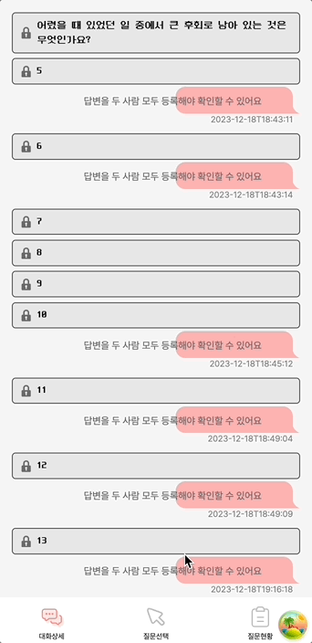

- 스크롤을 내리면 다음 데이터가 조회된다&#46; 
    - 더보기

- 주로 모바일 환경에서 사용한다&#46;

</details>

<a id="1c3eda9b0fe181adbc95c69bb2508303"></a>

## 3&#46;  페이징 &#45; 페이지 번호 

<a id="1c3eda9b0fe18184b61ce05a1041902f"></a>

### 3&#46;1  필요 정보&#58; <code>페이지 번호</code>, <code>페이징 사이즈</code>

<a id="1c3eda9b0fe1813cb337ed60612e74cb"></a>

페이지 번호 방식에서는 아래 2가지 정보가 필요하다&#46; 

1. <code>페이지 번호</code>

1. <code>페이징 사이즈(개수)</code>

- ex) 총 게시글&#58; <code>94</code>, 페이지 사이즈&#58; <code>30</code>
    - 사용자는 클라이언트 화면 4번 페이지까지 이동가능

    - 페이지 번호 활성화 

<a id="1c3eda9b0fe1810ba3d8c278ed0e4e70"></a>

### 3&#46;2  SQL&#58; <code>LIMIT</code>, <code>OFFSET</code>

> ✏️ 
> 
> <a id="1c3eda9b0fe1814d8152f50e76cc451c"></a>
> 
> <strong><code>N</code></strong><strong>번 페이지에서 </strong><strong><code>M</code></strong><strong>개의 게시글 조회</strong>
> 
> - SQL &#45; <code>offset</code>, <code>limit</code> 활용
> 
> - offset 지점부터 limit 개의 데이터 조회

<a id="1c3eda9b0fe181938b68eadd0119cd30"></a>

<strong>게시판 별 게시글 목록 최신순 조회</strong>

<a id="1c3eda9b0fe181a7871cc439c6bca813"></a>

```sql
SELECT * FROM article           // 게시글 테이블
WHERE board_id = {board_id}     // 게시판 별
ORDER BY created_at DESC        // 최신순
LIMIT {limit} OFFSET {offset};  // N번 페이지에서 M개 
```

- <code>shard key</code> = board&#95;id
    - 샤드 키를 board&#95;id로 설정했기 때문에, 단일 샤드에서 조회 가능하다&#46; 

- <code>limit</code> = M 개의 게시글

- <code>offset</code>  = ( N번 페이지 &#45; 1 ) &#42; M   &#91; N &#62; 0 &#93;

<a id="1c3eda9b0fe1817bae1bdb96efe01cef"></a>

### 3&#46;3  테스트

<a id="1c3eda9b0fe181c38fb9cbe615c0f8b5"></a>

```sql
# board_id = 1, limit = 30, offset = 90
SELECT * FROM article 
		WHERE board_id=1 
		ORDER BY created_at DESC 
		LIMIT 30 OFFSET 90;
```

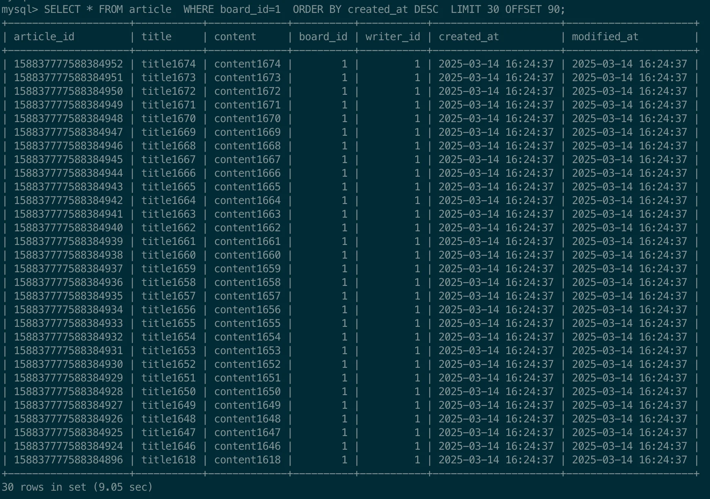

- <strong>1200만 건의 데이터에서 30개의 게시글을 조회</strong>하는데도 <strong><u>약 9초</u></strong><strong><u>의 시간이 소요</u></strong>된다&#46; 실제 서비스를 한다면, 해당 스펙으로는<strong> 정상적인 서비스 운영이 어렵다&#46;</strong> 
    <details>
    <summary>테스트한 컴퓨터 하드웨어 스펙</summary>

    

    </details>

    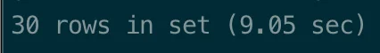

<a id="1c3eda9b0fe1817f89d3c14eed8530b7"></a>

### 3&#46;4  SQL &#45; <code>Query Plan</code>  확인

> ✏️ 
> 
> <a id="1c3eda9b0fe181d89912d88ecb575363"></a>
> 
> SQL의 Query Plan은 해당 SQL 앞에 <code>explain</code> 키워드를 넣어 가능하다&#46;
> 
> <details>
> <summary>ex) </summary>
> 
> <a id="1c3eda9b0fe1815584d2dadd04fc9698"></a>
> 
> ```sql
> EXPLAIN SELECT ... FROM ... 
> ```
> 
> </details>

<a id="1c3eda9b0fe181f4b432df450c05e3ca"></a>

```sql
# EXPLAIN SELECT * FROM article  WHERE board_id=1  ORDER BY created_at DESC  LIMIT 30 OFFSET 90;
EXPLAIN SELECT * FROM article  
	WHERE board_id=1  
	ORDER BY created_at DESC  
	LIMIT 30 OFFSET 90;
```

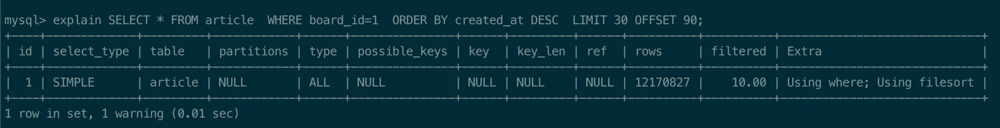

> ✏️ 
> 
> <a id="1c3eda9b0fe18179b585e088edde1141"></a>
> 
> Query Plan&#58; <code>type</code>, <code>Extra</code>
> 
> 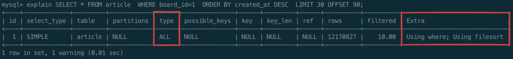
> 
> - type = <code>ALL</code>
>     - 테이블 전체를 읽는다&#46; ( <code>FULL SCAN</code> ) 
> 
> - Extra = <code>Using where; Using filesort</code>
>     - where 절로 조건에 대해 필터링
> 
>     - 데이터가 많기 떄문에 메모리에서 정렬을 진행할 수 없어, 파일 디스크에서 데이터를 정렬하는 filesort 수행

<a id="1c3eda9b0fe1810daf35f72e377e4405"></a>

해당 SQL의  Query Plan을 보면<code> full scan</code>을 하고, 메모리에 실행되지 못하고 파일디스크에 실행돼, 성능이 떨어지는 것을 확인할 수 있다&#46; 

<a id="1c3eda9b0fe181afb21dfffe00a7044b"></a>

따라서 전체 데이터에 대해 필터링 및 실행을 하기 때문에 큰 비용이 든다&#46; 

<a id="1c3eda9b0fe181c296b3d5e8a2afc312"></a>

     ⇒ 이는 <strong>index 적용</strong>을 통해 해결 가능하다&#46;

<a id="1c3eda9b0fe18125a33dd745ccfd5f2e"></a>

### 3&#46;5  <code>인덱스</code>를 통한  개선

> ✏️ 
> 
> <a id="1c3eda9b0fe18160bbccfffacd8d3558"></a>
> 
> <strong>인덱스 </strong>
> 
> <a id="1c3eda9b0fe181d7931ee92880f52ba8"></a>
> 
> 데이터를 <strong><u>빠르게 찾</u></strong>기 위한 방법으로 인덱스 관리를 위해 <strong><u>부가적인 쓰기 작업, 공간 필요</u></strong>하다&#46; 또한 다양한 데이터 자료구조를 지원한다&#46; 
> 
> <details>
> <summary>지원되는 자료구조 </summary>
> 
> - <strong><u>B &#43; tree</u></strong>
> 
> - Hash
> 
> - LSM tree
> 
> - R tree
> 
> - Bitmap
> 
> </details>
> 
> ---
> 
> <a id="1c3eda9b0fe1812a9727d2a999321be2"></a>
> 
> Relational Database 에서는 주로 <code>B &#43; tree</code> ( Balanced Tree )를 사용한다&#46; 
> 
> - 데이터가 정렬된 상태로 저장된다&#46; 
> 
> - <u>검색, 삽입, 삭제 연산</u>을 <strong>로그 시간(</strong><strong><code>O(logn)</code></strong><strong>)에 수행</strong> 가능하다&#46; 
> 
> - 트리 구조에서 <u><code>leaf node</code></u><u> 간 연결</u>되기 때문에 <strong><u>범위 검색 효율</u></strong>적

<a id="1c3eda9b0fe1810e97d1e1e5afa318d2"></a>

<strong>article 테이블에 인덱스 적용</strong>

> ☝🏻 
> 
> <a id="1c3eda9b0fe1813f931bc8f6941e4093"></a>
> 
> 인덱스 순서 중요
> 
> > 게시판 별로 <strong><u>생성 시간 순</u></strong><strong>으로 </strong><strong><u>정렬</u></strong><strong>된 상태의 데이터가 만</strong>들어진다&#46; 
> 
> 1. <code>board&#95;id</code>&#58;  오름차순(ASC) 정렬
> 
> 1. <code>article&#95;id</code>&#58; 내림차순 정렬

<a id="1c3eda9b0fe181989c60f41ce9523e8b"></a>

```sql
CREATE INDEX idx_baord_id_article_id          // 생성하는 인덱스 명칭 
ON article(board_id ASC, article_id DESC);    // 인덱스 설정: 알고리즘[ASC, DESC]
```

<a id="1c3eda9b0fe181579aa1fd3f5178a390"></a>

<strong>적용 확인</strong>

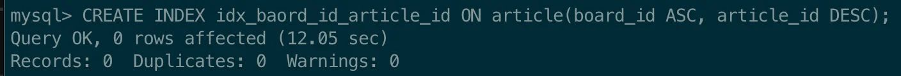

<a id="1c3eda9b0fe1817bb1f3c07d8617f3db"></a>

인덱스를 추가하면<u> 쓰기 시점</u>에 <code>B&#43; tree</code> 구조의 정렬된 상태의 데이터가 생성된다&#46; 

<a id="1c3eda9b0fe181e0a0b7e6ee4dc58ef8"></a>

<strong><u>이미</u></strong> 인덱스로 지정된 컬럼에 대해 <strong><u>정렬된 상태</u></strong><strong>를 가지고 있</strong>기 때문에, 

- <strong><u>조회 시점</u></strong>에 전체 데이터를 <strong><u>정렬</u></strong>하고 <strong><u>필터링</u></strong> 할 <strong>필요가 없</strong>다&#46; 

- 따라서 <strong><u>조회 쿼리를 빠르게 수행</u></strong>할 수 있다&#46; 

> 🧐 
> 
> <a id="1c3eda9b0fe18172bb17cc881a55e539"></a>
> 
> <strong>왜 최신순을 위한 인덱스인데, 생성 시간(</strong><strong><code>created&#95;at</code></strong><strong>)이 아닌 </strong><strong><code>article&#95;id</code></strong><strong> 가 사용되었는가?</strong>
> 
> <a id="1c3eda9b0fe18152bf14fa81d8d86e10"></a>
> 
> 현재 시스템은 <u>대규모 트래픽을 처리</u>하기 위해 <u>분산 환경</u><u>으로 설계</u>되었다&#46; 
> 
> - 게시글 서비스의 각 애플리케이션은 <strong><u>여러 서버로 분산</u></strong>되어 <strong><u>동시에 </u></strong>처리될 수 있다&#46; 
> 
> <a id="1c3eda9b0fe18189a777c094940abd7e"></a>
> 
> 따라서  <u>게시글이 동시에 생성</u>될 수 있다&#46; 즉, <strong>동일 시간을 가지는 데이터가 존재</strong><strong>할 수 있</strong>다&#46; 
> 
> <details>
> <summary>ex) 게시글 데이터 동시 생성</summary>
> 
> 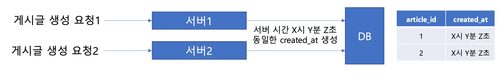
> 
> - 두 개의 서버에서 동시에 요청을 받아, 생성 시점(created&#95;at)이 동일한 게시글 컬럼이 생성됨
> 
> </details>
> 
> <a id="1c3eda9b0fe1818abb45e6ea3d2f8f29"></a>
> 
> 동시 요청 시 생성 시간을 충돌 될수 있기 때문에,  <code>created&#95;at</code>을 정렬 조건으로 사용한다면, <strong><u>동일한 생성 시간 간</u></strong><strong>에 </strong><strong><u>순서가 명확하지 않</u></strong>다&#46; 
> 
> - 목록 조회에 대한 결과 값이 달리질 수 있고, 데이터 중복 또는 누락 가능성이 있다&#46; 
> 
> - 밀리/나노초 단위의 정밀 데이터 타입을 가져도 확률상으로 개선될 수 있으나 여전히 충돌 문제가 발생되며 더 많은 비용(저장 공간)이 든다&#46;
> 
> <a id="1c3eda9b0fe18114aae2f92ca415e888"></a>
> 
> aticle&#95;id는 분산 시스템에서 고유한 오름차순을 위해 고안된 Snowflake 알고리즘을 사용한다&#46; 
> 
> - 충돌 확률이 완전히 0은 아니지만, 생성 시간(created&#95;at) 보다 현저히 낮다&#46; 
> 
> - 오름차순이기 때문에 생성 시간에 의해 정렬된 상태를 가지고 있다&#46; 
> 
> <a id="1c3eda9b0fe18127be7de0cd5dd9db87"></a>
> 
> 따라서 article&#95;id를 최신순 정렬 용으로 사용하는 것이 적합하다&#46;

<a id="1c3eda9b0fe18121b7f5cdce8d0e1195"></a>

### 3&#46;6  <u>정렬(ORDER BY) 조건</u>에 따른 인덱싱 <u>조회 성능 비교</u>&#58; <strong>약 2217배</strong><strong> 속도 향상</strong>

<details>
<summary>테이블에 적용된 index 확인하기&#58; <code>show index from {테이블명};</code></summary>

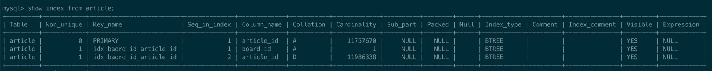

</details>

> ☝🏻 
> 
> <a id="1c3eda9b0fe181c88182ed87c2f37bce"></a>
> 
> 처음부터 article&#95;id를 정렬 조건으로 사용해도 됐지만, 성능 비교를 위해 created&#95;at에서 article&#95;id로 나중에 변경했다&#46; 
> 
> - Primary Key(article&#95;id)는 자동으로 인덱스가 생성된다&#46; <br>따라서 생성 시간(created&#95;at)으로 적용하여 속도를 비교를 진행

<details>
<summary>조건1) <strong><code>ORDER BY</code></strong>&#58; <code>created&#95;at</code> ⇒ 22&#46;17s</summary>

<a id="1c3eda9b0fe1812eb038c321b4ba4460"></a>

```sql
SELECT * FROM article 
WHERE board_id = {board_id}
ORDER BY created_at DESC
LIMIT {limit} OFFSET {offset};

# SELECT * FROM article WHERE board_id = 1 ORDER BY created_at DESC LIMIT 30 OFFSET 90;
```

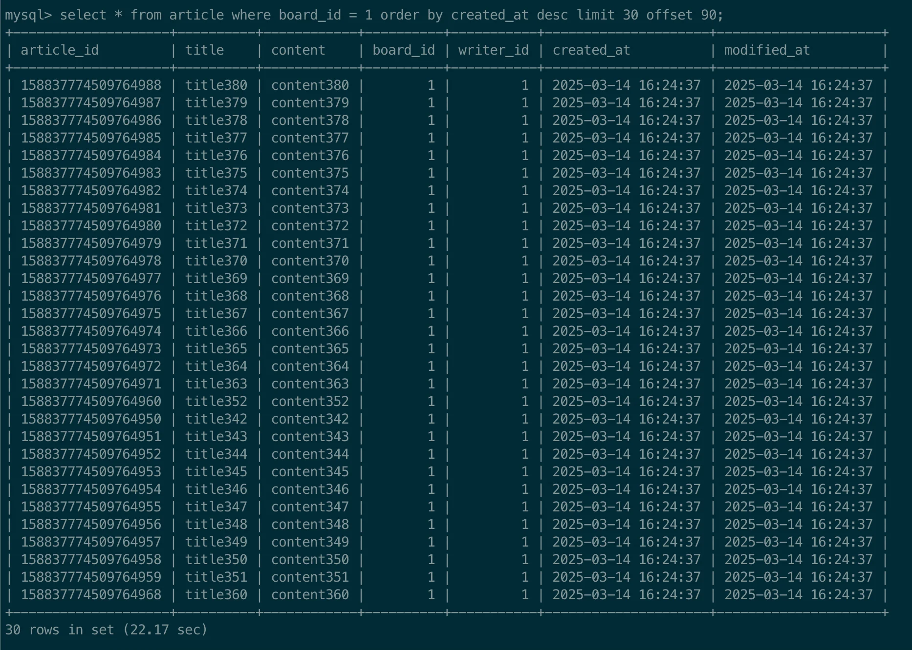

</details>

<details>
<summary>조건2) <strong><code>ORDER BY</code></strong>&#58; <code>article&#95;id</code> &#45; <strong>0&#46;01s</strong><strong> (약 2217배 속도 향상 ) </strong></summary>

<a id="1c3eda9b0fe1816799dad4d4f09eb9d4"></a>

```sql
SELECT * FROM article
WHERE board_id = {board_id}
ORDER BY article_id DESC
LIMIT {limit} OFFSET {offset};

# SELECT * FROM article WHERE board_id = 1 ORDER BY article_id DESC LIMIT 30 OFFSET 90;
```

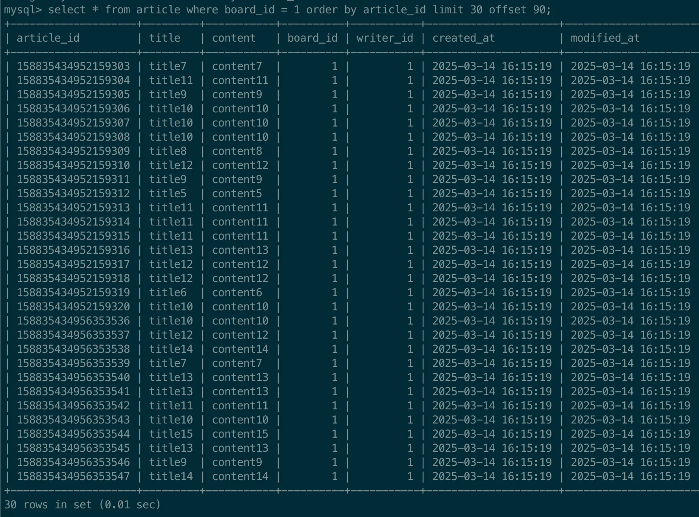

<a id="1c3eda9b0fe18176a18de77f291992b3"></a>

<strong>Query Plan</strong>

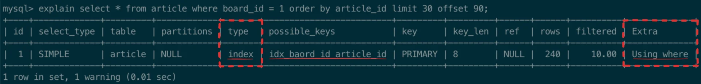

- type&#58; index

- Extras&#58; Using where

</details>

<a id="1c3eda9b0fe181f48414f1ace0baaf31"></a>

<strong>정리</strong>

<a id="1c3eda9b0fe181128b7de85e013044f2"></a>

인덱싱이 적용된 컬럼을 기준으로 조회 시, 굉장히 빠른 속도로 조회가 가능하지만,

<details>
<summary>인덱싱 기준 컬럼&#58; <code>board&#95;id</code>, <code>article&#95;id</code></summary>

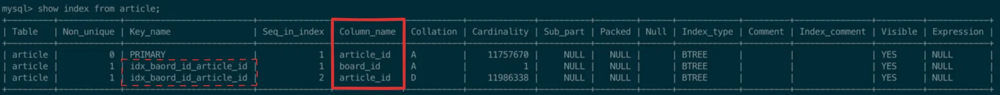

</details>

<a id="1c3eda9b0fe1811cb33bcee889fad22a"></a>

 그렇지 않은 컬럼을 정렬 기준으로 조회 시, <strong>오히려 인덱싱 적용 전보다 </strong><strong><u>속도가 떨</u></strong>어졌다&#46; 

- <code>order by</code> = <code>created&#95;at</code>

<a id="1c3eda9b0fe18164bc5ddbdeb38c2707"></a>

따라서 인덱싱을 통한 조회 쿼리 속도 개선 시, 기준 키를 잘 정하고, 그에 맞는 쿼리로 작성하는 것이 매우 중요하다&#46; 

<a id="1c3eda9b0fe18195be6ced06326e4650"></a>

### 3&#46;7  50000 페이지 조회

<a id="1c3eda9b0fe181eeac4de7bf1e5630bd"></a>

<strong>쿼리</strong>

<a id="1c3eda9b0fe1816e82b3d33065cde207"></a>

```sql
SELECT * FROM article
WHERE board_id = 1
ORDER BY article_id DESC
LIMIT 30 OFFSET 1499970;

# SELECT * FROM article WHERE board_id = 1 ORDER BY article_id DESC LIMIT 30 OFFSET 1499970;
```

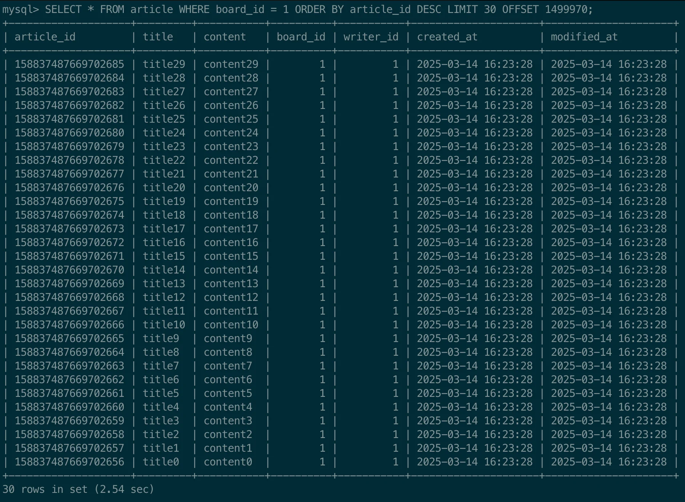

<a id="1c3eda9b0fe181c79d53cd647c80070c"></a>

50000 번쨰 페이지 조회 결과를 확인해보면 <code>2&#46;54s</code> 시간이 걸리는 것을 확인할 수 있따&#46; 

<a id="1c3eda9b0fe1811d8165da69107deb13"></a>

```sql
EXPLAIN SELECT * FROM article WHERE board_id = 1 ORDER BY article_id DESC LIMIT 30 OFFSET 1499970;
```

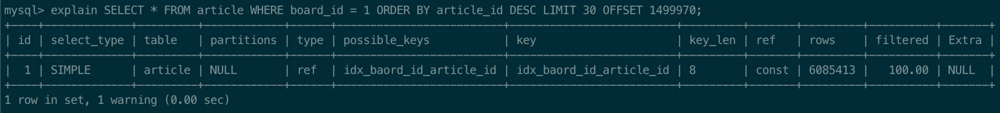

<a id="1c3eda9b0fe18197acb2f7170c5d8e1e"></a>

Query Plan을 확인하면 정상적으로 index를 사용하는 것을 확인할 수 있다&#46; 

<a id="1c3eda9b0fe181868b21de5fcd096118"></a>

### 🧐 그렇다면 왜 속도가 다시 느려졌는가?

<a id="1c3eda9b0fe1816882dacae75533ae26"></a>

쿼리에서 변경된 것은 <code>offset</code> 뿐이다&#46; 즉, <u>뒷페이지로 갈수록 성능이 느려진다&#46; </u>

<a id="1c3eda9b0fe1819d9420e8e93f039a81"></a>

왜 그런 것인가? 이를 이해하기 위해서는 인덱스 종류 및 그 개념을 먼저 알아야한다&#46; 

- <code>Clustered Index</code>

- <code>Secondary Index</code>

<details>
<summary>1&#46; Clustered Index </summary>


</details>

<details>
<summary>2&#46; Secondary Index를 통해 데이터가 조회되는 과정</summary>

<details>
<summary>1&#46; <code>board&#95;id</code>, <code>article&#95;id</code> 만 조회</summary>

<a id="1c3eda9b0fe1810f8e69c468757148af"></a>

```sql
select board_id, article_id from article where board_id =1 order by article_id desc limit 30 offset 1499930;
```

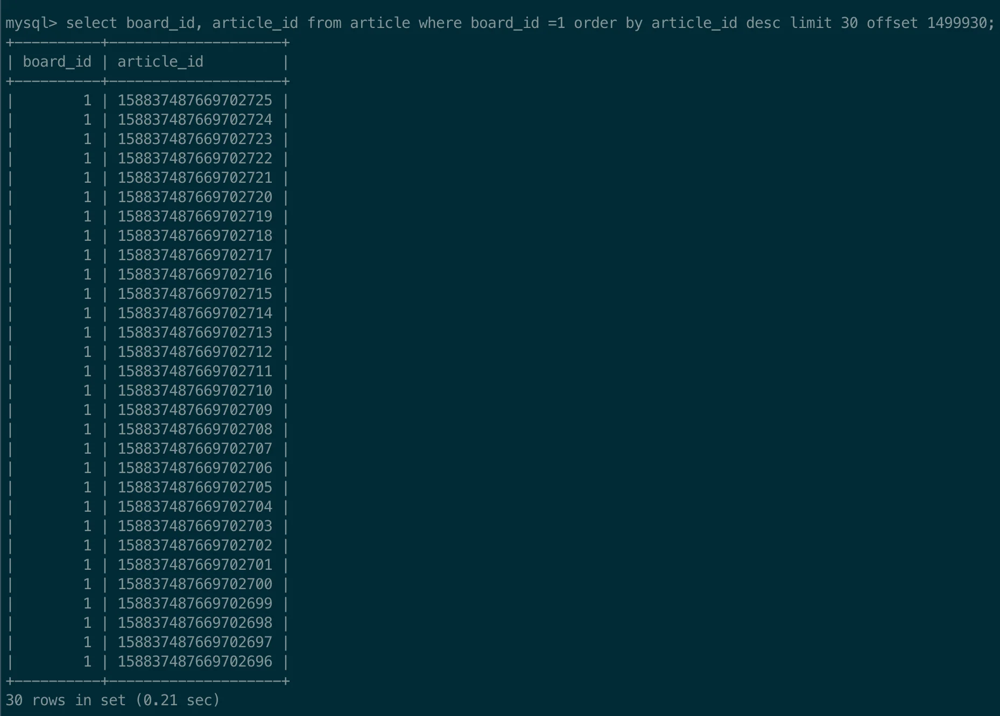

</details>

<details>
<summary>2&#46; <code>article&#95;id</code> 만 조회</summary>

<a id="1c3eda9b0fe181bca6d9e53600db5da6"></a>

```sql
select article_id from article where board_id =1 order by article_id desc limit 30 offset 1499930;
```

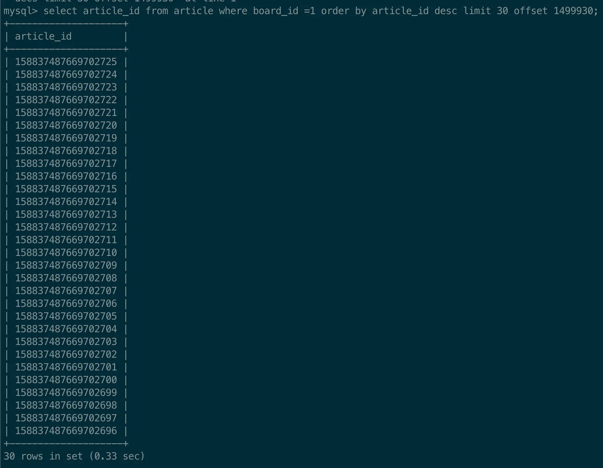

</details>

<a id="1c3eda9b0fe181709182cda7c46f390a"></a>

<strong>Query Plan </strong>

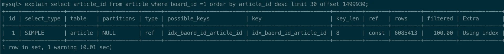

- type = ref

- Extra = Using index

</details>

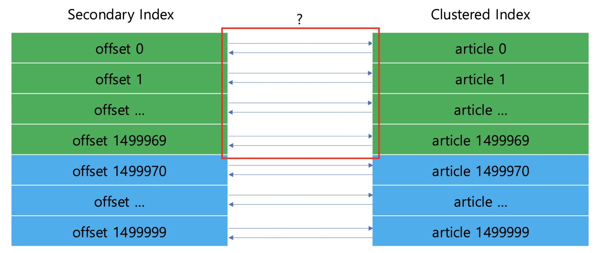

<a id="1c3eda9b0fe181d38d80c2f2c70a84f9"></a>

### Convering Index

- 인덱스만으로 쿼리의 모든 데이터를 처리할 수 있는 인덱스

- 데이터(Clustered Index)를 읽지 않고, 인덱스(Secondary Index) 포함된 정보만으로 쿼리 가능한 인덱스

<a id="1c3eda9b0fe181e5b481c935a294b4a8"></a>

```sql
SELECT * FROM (
	SELECT article_id FROM article
	WHERE board_id = 1
	ORDER BY article_id DESC
	LIMIT 30 OFFSET 1499970
) t LEFT JOIN article a ON t.article_id = a.article_id;
```

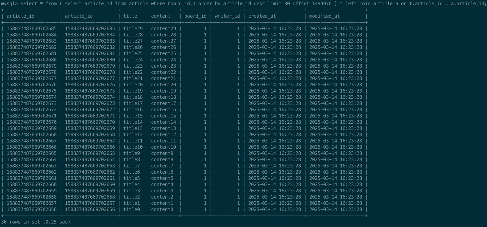


<a id="1c3eda9b0fe181d99fe5c0e2a397c13f"></a>

약 3 초의 시간이 걸리던 조회 쿼리를 0&#46;25 초로 <u><code>약 10배</code></u><u>의 속도가 개선</u>됨

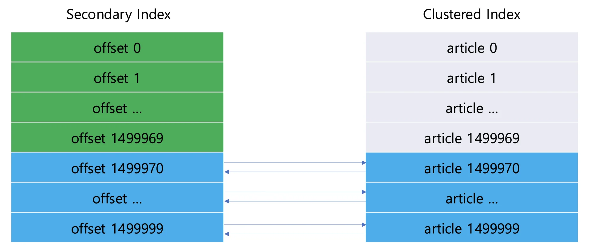

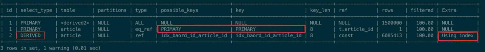
