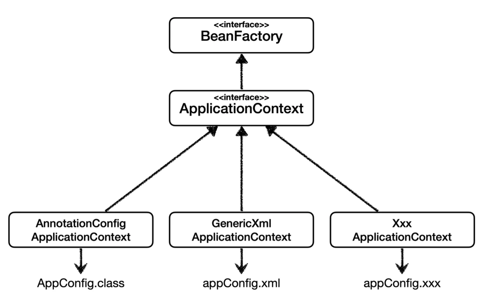
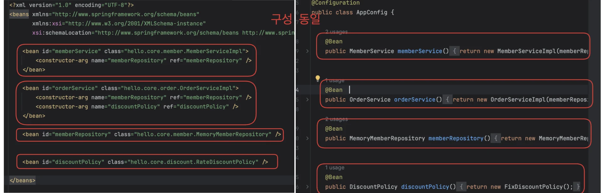

<a id="1c3eda9b0fe181839d55f6d3626e4b8d"></a>

스프링 컨테이너는 다양한 형식의 설정 정보를 받을 수 있게 설계됨 → 자바 코드, XML, Groovy 등

<a id="1c3eda9b0fe181dcb19bd91e0746236d"></a>

### Annotation 기반 자바 코드 설정

- <code>new AnnotationConfigApplicationContext(AppConfig&#46;class)</code>

- <code>AnnotationConfigApplicationContext</code> 클래스를 사용해 <strong><u>자바 코드로 된 설정정보(</u></strong><u><code>AppConfig</code></u><strong><u>)</u></strong>를 넘김 (이전까지 작성한 내용)


<a id="1c3eda9b0fe1811b83d3c75dec254240"></a>

### XML 설정 사용

<a id="1c3eda9b0fe1818da21eca456010c592"></a>

최근에는 스프링 부트를 많이 사용하면서 XML기반 설정은 잘 사용하지 않는다&#46;<br>그러나 아직 많은 레거시 프로젝트들이 XML로 되어 있고, <br>또한  XML을 사용하면 컴파일 없이 빈 설정 정보를 변경 수 있다&#46;

<a id="1c3eda9b0fe1815baf67d39e516f94ef"></a>

→ <code>GenericXmlApplicationContext</code> ← <strong><u>xml 파일 </u></strong>넘김

> xml 과 자바 기반 설정 모두 구성은 동일함



<a id="1c3eda9b0fe18108b0d3e58892d6a329"></a>

### XmlAppConfig 

> test&#46;xml&#46;XmlAppContext

<a id="1c3eda9b0fe181bfb21eefd93587e723"></a>

```java
package hello.core.xml;

import hello.core.member.Member;
import hello.core.service.MemberService;
import org.assertj.core.api.Assertions;
import org.junit.jupiter.api.Test;
import org.springframework.context.ApplicationContext;
import org.springframework.context.support.GenericXmlApplicationContext;

import static org.assertj.core.api.Assertions.*;

public class XmlAppContext {

    @Test
    void xmlAppConfig(){
        ApplicationContext ac = new GenericXmlApplicationContext("appConfig.xml");
        MemberService memberService = ac.getBean("memberService", MemberService.class);
        assertThat(memberService).isInstanceOf(MemberService.class);
    }

}
```

<a id="1c3eda9b0fe181488e67e62e45c0ed97"></a>

### appConfig&#46;xml

> main&#46;resource&#46;appConfig&#46;xml

<a id="1c3eda9b0fe1814d98cff7bd513dbe00"></a>

```xml
<?xml version="1.0" encoding="UTF-8"?>
<beans xmlns="http://www.springframework.org/schema/beans"
       xmlns:xsi="http://www.w3.org/2001/XMLSchema-instance"
       xsi:schemaLocation="http://www.springframework.org/schema/beans http://www.springframework.org/schema/beans/spring-beans.xsd">

    <bean id="memberService" class="hello.core.service.MemberServiceImpl">
        <constructor-arg name="memberRepository" ref="memberRepository" />
    </bean>

    <bean id="orderService" class="hello.core.order.OrderServiceImpl">
        <constructor-arg name="memberRepository" ref="memberRepository" />
        <constructor-arg name="discountPolicy" ref="discountPolicy" />
    </bean>

    <bean id="memberRepository" class="hello.core.repository.MemoryMemberRepository" />


    <bean id="discountPolicy" class="hello.core.discount.RateDiscountPolicy" />

</beans>
```
