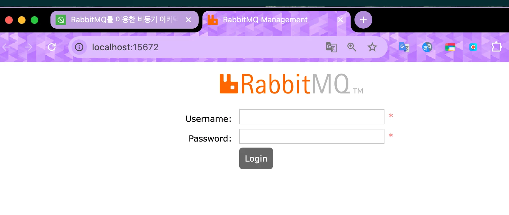
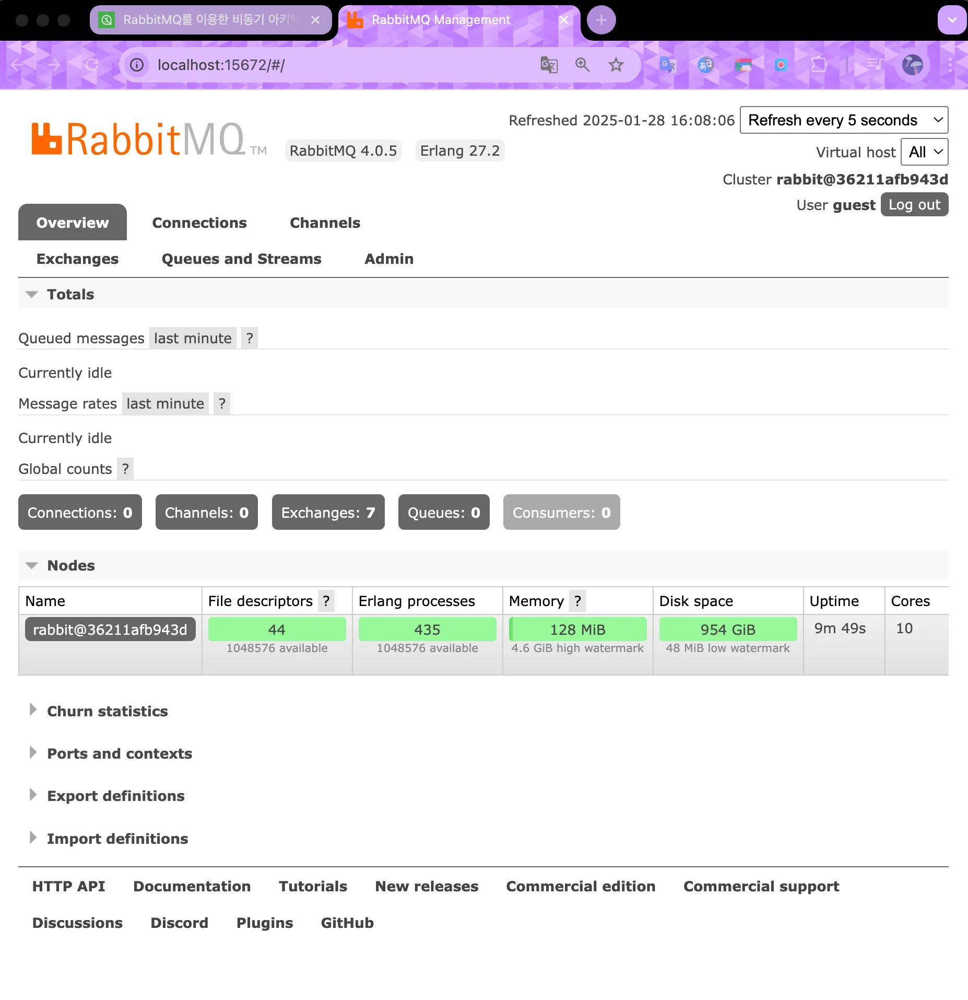
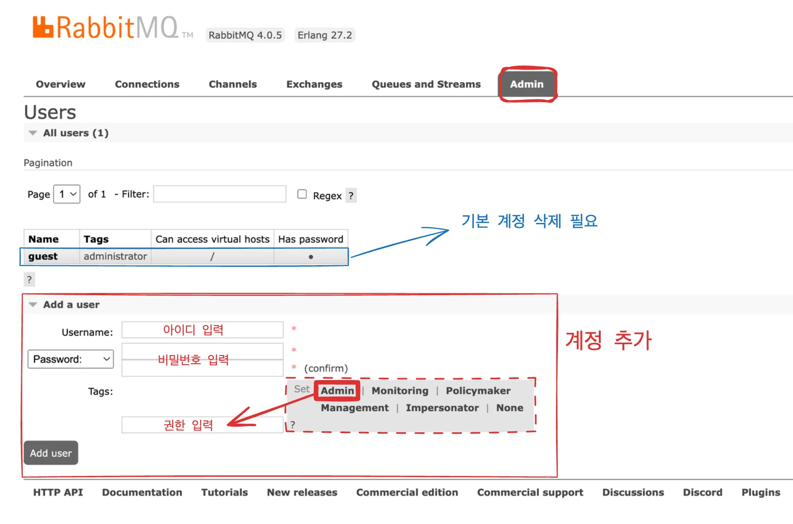
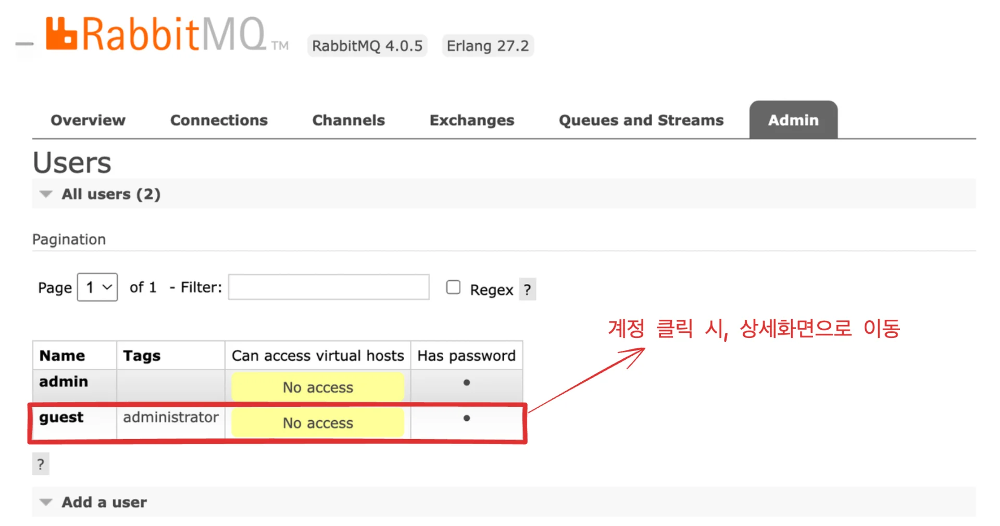
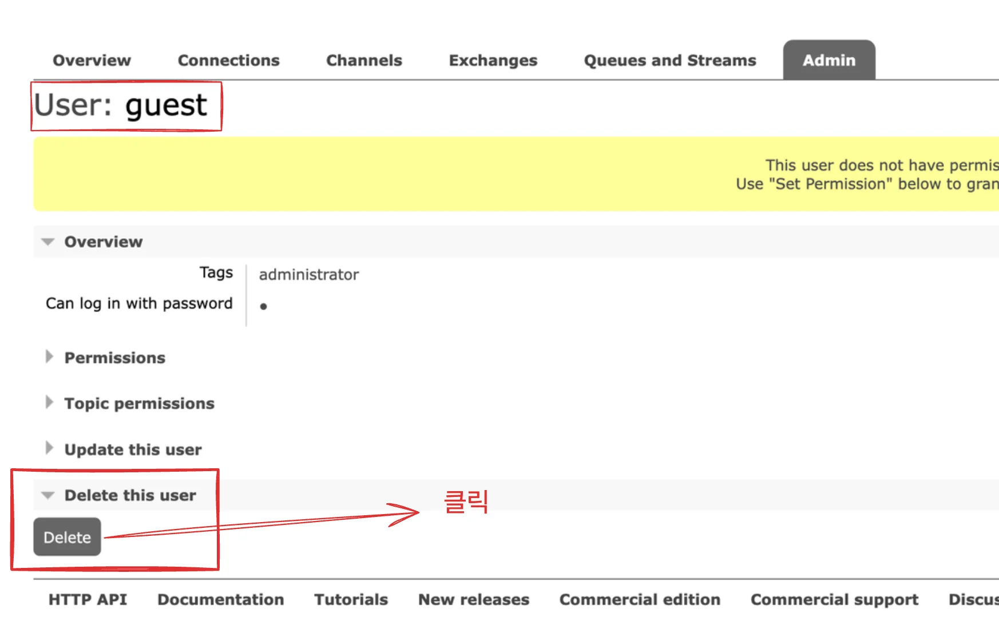

<a id="1c3eda9b0fe181a68c3ff3af433de623"></a>

### 도커 

<a id="1c3eda9b0fe18125a693d189cd1ccc5b"></a>

<strong>CLI</strong>

<a id="1c3eda9b0fe181508f71e235a6ad72a9"></a>

```bash
docker run -it --rm --name rabbitmq -p 5672:5672 -p 15672:15672 rabbitmq:4.0-management
```

<a id="1c3eda9b0fe18191aee7cdb27c5d4edd"></a>

```bash
docker run -it --name rabbitmq -p 5672:5672 -p 15672:15672 rabbitmq:4.0-management
```

<a id="1c3eda9b0fe181879e95e2965171093f"></a>

<strong>Compose</strong> 

<details>
<summary>reference</summary>

<a id="1c3eda9b0fe181719d1fc2c87d2ec5d3"></a>

‣

[docker-compose.yml](https://github.com/riotu-lab/rabbitmq-docker/blob/main/docker-compose.yml)

</details>

<a id="1c3eda9b0fe181639262fbfdf4ad8d1e"></a>

```yaml
services:
	rabbitmq:
		image: rabbitmq:4.0-management
		container_name: rabbitmq
		ports:
			- 5672:5672
			- 15672:15672  # Remove if not using management
		volumes:
			- ~/datas/rabbitmq_data/:/var/lib/rabbitmq/
			- ~/logs/rabbitmq_log:/var/log/rabbitmq
		restart: unless-stopped
		enviroment:
			- RABBITMQ_DEFAULT_USER=admin
			- RABBITMQ_DEFAULT_PASS=admin	
			
```

<details>
<summary>Ports</summary>

- AMQP&#58; <code>5672</code>

- 관리 UI(management&#45;console)&#58; <code>15672</code>

</details>

<details>
<summary>Volume</summary>

> 데이터 지속성을 위한 볼륨을 생성

- <strong>메시지 데이터 저장</strong>
    <a id="1c3eda9b0fe18176b3ceeb235f9be038"></a>

    ```yaml
      volumes:
        - ~/datas/rabbitmq_data/:/var/lib/rabbitmq/
    ```

    - 큐에 저장된 메시지, Exchange, Queue 정보 등이 저장

- <strong>로그 저장</strong>
    <a id="1c3eda9b0fe18162a059e891709a6632"></a>

    ```yaml
    volumes:
      - ~/logs/rabbitmq_log:/var/log/rabbitmq
    ```

    - RabbitMQ의 실행 로그, 에러 로그 등 저장

</details>

<a id="1c3eda9b0fe181f9b5b1fa09c479f38e"></a>

<strong>실행</strong>

<a id="1c3eda9b0fe18182b4f0f405082f59dc"></a>

```bash
docker compose up -d [--build]
```

<a id="1c3eda9b0fe181fe832ac08ecdbf39ea"></a>

<strong>종료</strong>

<a id="1c3eda9b0fe181158c29ea84c8aeac67"></a>

```bash
docker compose down
```

<a id="1c3eda9b0fe181f684a9f52d1bd00826"></a>

### Mac &#45; homebrew를 사용하여 local 환경에 설치

<a id="1c3eda9b0fe18137aa85ec7278fab5a5"></a>

```bash
brew install rabbitmq
```

<a id="1c3eda9b0fe1816d8306e600ce2b55d6"></a>

### 기본 명령어 ( homebrew )

- 시작
    <a id="1c3eda9b0fe18119ab0cff12ed2033b7"></a>

    ```bash
    # rabbitmq 시작
    brew services start rabbitmq
    ```

- 중단
    <a id="1c3eda9b0fe181e8a39cf2e11c80db27"></a>

    ```bash
    # rabbitmq 중단
    brew services stop rabbitmq
    ```

- 삭제
    <a id="1c3eda9b0fe181bcb16ae10b83f66fa0"></a>

    ```bash
    brew uninstall rabbitmq
    ```

    - 삭제 이후, 관련 디렉토리도 삭제해야 한다&#46;
        <a id="1c3eda9b0fe18119a1b1df61b1f95ebe"></a>

        ```bash
        rm -r /opt/homebrew/etc/rabbitmq
        rm -r /opt/homebrew/var/lib/rabbitmq
        rm -r /opt/homebrew/var/log/rabbitmq
        ```

---

<a id="1c3eda9b0fe181ebb278dc5050b0757a"></a>

### RabbitMQ 콘솔 접속

> rabbitMQ 실행 이후, 아래 주소로 접속

- <a href="http://localhost:15672/">http&#58;//localhost&#58;15672/</a>
    - localhost&#58; local 컴퓨터 환경

    - <code>15672</code>&#58; addmin 주소 ( &#45;p 15672&#58;15672, 권장되는 기본 주소)

- 접속 화면
    

- 로그인 이후 화면
    

> ☝🏻 
> 
> <a id="1c3eda9b0fe181548de5dd743e2ac239"></a>
> 
> admin 권한을 갖는 다른 계정을 추가하고, default user는 삭제 해주는 것이 보안상 권고된다&#46;

> 최조 계정

- <code>username</code>&#58; guest

- <code>password</code>&#58; guest

> admin 계정 생성 및 default 계정 삭제 

<details>
<summary>admin 계정 추가</summary>



</details>

<details>
<summary>기본 계정 삭제</summary>





</details>

<details>
<summary>🤬 오류) default 계정 삭제 후, 새로 만든 admin 계정으로 로그인 안됨</summary>

- 계정 생성 권한 설정을 하지않아 오류가 발생됨
    - admin 권한 추가 필요

</details>
