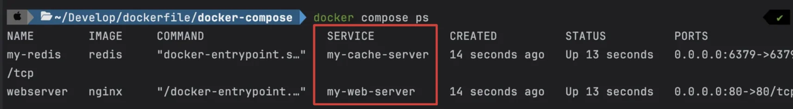
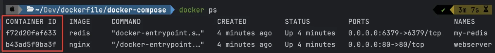
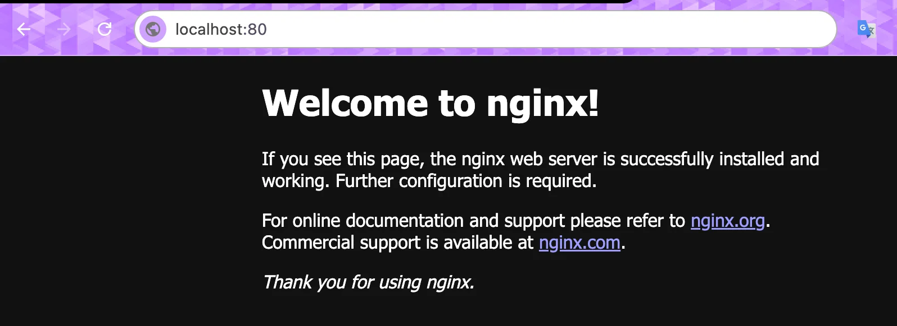

<a id="1c3eda9b0fe1819ba949d268414ca1cb"></a>

## Docker Compose 를 활용하여 컨테이너 관리

---

> 📖 
> 
> <a id="1c3eda9b0fe1812f9276f8ac5f4650f1"></a>
> 
> <code>Docker Compose</code> 란, 여러 개의 Docker 컨테이너들을 하나의 서비스로 정의하고, 구성하여 하나의 묶음으로 관리할 수 있게 도와주는 툴이다&#46; 
> 
> 

<details>
<summary><code>Docker Compose</code> 사용 이유</summary>

1. 여러 개의 컨테이너를 관리하는 용이
    <a id="1c3eda9b0fe181e3bb87d1783b1e5e54"></a>

    실제 앱 서비스 시, 도커를 활용하여 환경구성 시 여러 개의 컨테이너가 필요하다&#46;

    - MySLQ ( DB )

    - Redis 

    - RabbitMQ ( 메세징 …)

    - …

    <a id="1c3eda9b0fe1818daa19e353a2336d26"></a>

    이를 Docker Compose를 사용하면, <strong><u>여러 컨테이너를 하나의 환경에서 실행하고 관리</u></strong>할 수 있다&#46;

1. <strong>복잡한 명령어  → 간소화 가능</strong>
    <a id="1c3eda9b0fe18163b458f2c6ada8a8fe"></a>

    ```bash
    $ docker run -e MYSQL_ROOT_PASSWORD=password123 -p 3306:3306 -v /Users/jaeseong/Documents/Develop/docker-mysql/mysql_data:/var/lib/mysql -d mysql
    ```

    <a id="1c3eda9b0fe1814ebca6c70be2bb8745"></a>

    <code>Docker Compose</code>를 사용하면 위와 같이 컨테이너를 실행시킬 때마다 복잡한 명령어를 입력하지 않아도 된다

    <a id="1c3eda9b0fe181369586d8b165743934"></a>

    → 단순히 <u><code>docker compose up</code></u>  명령어만 실행하면 된다&#46; 

</details>

<details>
<summary>자주 사용하는 Docker Compose CLI</summary>

<details>
<summary>compose 파일 작성&#58; <code>&#46;yml</code></summary>

<a id="1c3eda9b0fe181c5bc5af3e97bd7f79a"></a>

```bash
services:
	websever:
		container_name: webserver
		image: nginx
		ports: 
			- 80:80
```

- <code>services&#58; webserver</code>
    - Docker Compose에서 하나의 컨테이너를 <strong><u>서비스(service)</u></strong><strong>라고 부른다&#46; </strong>

    - <strong>이 옵션은 서비스에 이름을 붙이는 기능이다&#46; </strong>

- <code>container&#95;name&#58; webserver</code> 
    - 컨테이너를 띄울 때 붙이는 별칭

    - CLI에서 <code>&#45;&#45;name web&#45;server</code> 역할과 동일

- <code>image&#58; nginx</code>
    - 컨테이너를 실행시킬 때 <u>어떤 이미지를 사용</u>할 지 정의하는 명령어

    - <code>docker run &#91;이미지명&#93;</code>와 동일

- <code>ports</code>
    - 포트 매핑 설정

    - CLI에서 <code>&#45;p 80&#58;80</code> 역할과 동일

</details>

<details>
<summary><code>compose&#46;yml</code>에서 정의한 컨테이너 실행&#58; <code>docker compose up &#91;&#45;d&#93;</code></summary>

<a id="1c3eda9b0fe181a3870ef04ef953abc3"></a>

```bash
docker compose up    # 포그라운드에서 실행
docker compose up -d # 백그라운드에서 실행
```

- <code>&#45;d</code>&#58; 백그라운드 실행

</details>

<details>
<summary>Docker Compose로 <u>실행시킨 컨테이너 확인</u>&#58; <code>docker compose ps &#91;&#45;a&#93;</code></summary>

<a id="1c3eda9b0fe1817c9ce2dbd631d404be"></a>

```bash
# compose.yml에 정의된 컨테이너 중 실행 중인 컨테이너만 보여준다. 
$ docker compose ps 

# compose.yml에 정의된 모든 컨테이너를 보여준다.
$ docker compose ps -a
```

> ❓ 
> 
> <a id="1c3eda9b0fe181bbb6e6c766ec940b23"></a>
> 
> <code>docker compose up</code> vs <code>docker ps</code>
> 
> > 동일&#58; <code>NAME(s)</code>, <code>IMAGE</code>, <code>COMMAND</code>,  <code>CREATED</code>, <code>STATUS</code>, <code>PORTS</code>
> 
> <a id="1c3eda9b0fe18147a95ff6ce9f41f11a"></a>
> 
> 대부분의 내용은 동일하나 아래와 같은 차이점이 있다&#46; 
> 
> - docker compose ps&#58; <code>SERVICE</code>
>     
> 
> - docker ps&#58; <code>CONTAINER ID</code>
>     

</details>

<details>
<summary>Docker Compose <u>로그 확인</u>&#58;  <code>docker compose logs</code></summary>

<a id="1c3eda9b0fe18113a391eb2bf35e7447"></a>

```bash
# compose.yml에 정의된 모든 컨테이너의 로그를 모아서 출력한다.
$ docker compose logs
```

</details>

<details>
<summary>컨테이너를 실행하기 전에 이미지 재빌드&#58; <code>docker compose up —build &#91;&#45;d&#93;</code></summary>

<a id="1c3eda9b0fe181ee80aef7d6505318dd"></a>

```bash
docker compose up --build # 포그라운드에서 실행

docker compose up --build -d # 백그라운드에서 실행
```

- <code>compose&#46;yml</code>에서 정의한 이미지 파일에서 코드가 변경 됐을 경우, 이미지를 다시 빌드해서 컨테이너를 실행시켜야 코드 변경된 부분이 적용된다&#46; 

- 이때, <code>&#45;&#45;build</code> 옵션을 사용한다&#46;

> ☝🏻 
> 
> <a id="1c3eda9b0fe181ce9c28ee32c24b6a9d"></a>
> 
> <code>docker compose up</code> vs <code>docker compose up &#45;&#45;build</code>
> 
> - <code>docker compose up</code> 
>     - 이미지가 없을 때만 빌드해서 컨테이너를 실행시킨다&#46; 
> 
>     - 이미지가 이미 존재하는 경우 이미지를 빌드하지 않고 컨테이너를 실행시킨다&#46; 
> 
> - <code>docker compose up &#45;&#45;build</code> 
>     - 이미지가 있건 없건 무조건 빌드를 다시해서 컨테이너를 실행시킨다&#46;

</details>

<details>
<summary> 이미지 다운 / 업데이트&#58; <code>docker compose pull</code></summary>

<a id="1c3eda9b0fe181878876f36acab75d75"></a>

```bash
docker compose pull
```

- <code>compose&#46;yml</code>에서 정의된 이미지를 다운 받거나 업데이트 한다&#46;
    - 로컬 환경에 이미지가 없다면 이미지를 다운 

    - 로컬 환경에 이미 이미지가 있는데, Dockerhub의 이미지와 다른 이미지일 경우 이미지를 업데이트

</details>

<details>
<summary>Docker Compose에서 이용한 컨테이너 종료&#58; <code>docker compose down</code></summary>

<a id="1c3eda9b0fe18118837ff421525a1995"></a>

```bash
docker compose down
```

</details>

</details>

<details>
<summary>&#91; 실습 &#93; Docker Compose를 통한 Nginx 설치 및 실행</summary>

<details>
<summary>이전) Docker CLI로 컨테이너 실행시킬 떄</summary>

<a id="1c3eda9b0fe1810b96c3c9f09b8c493d"></a>

```bash
docker run --name webserver -d -p 80:80 nginx
```

</details>

<details>
<summary>1&#46; <code>compose&#46;yml</code> 파일 작성</summary>

<a id="1c3eda9b0fe18174a59fef1b6abacfa4"></a>

```bash
services:
	my-web-server:
		container_name: webserver
		image: nginx
		ports: 
			- 80:80
```

- <code>services&#58; my&#45;web&#45;server</code>
    - Docker Compose에서 하나의 컨테이너를 <strong><u>서비스(service)</u></strong><strong>라고 부른다&#46; </strong>

    - <strong>이 옵션은 서비스에 이름을 붙이는 기능이다&#46; </strong>

- <code>container&#95;name&#58; web&#45;server</code> 
    - 컨테이너를 띄울 때 붙이는 별칭

    - CLI에서 <code>&#45;&#45;name web&#45;server</code> 역할과 동일

- <code>image&#58; nginx</code>
    - 컨테이너를 실행시킬 때 <u>어떤 이미지를 사용</u>할 지 정의하는 명령어

    - <code>docker run &#91;이미지명&#93;</code>와 동일

- <code>ports</code>
    - 포트 매핑 설정

    - CLI에서 <code>&#45;p 80&#58;80</code> 역할과 동일

</details>

<details>
<summary>2&#46; <strong>compose 파일 실행 및 확인</strong></summary>

<a id="1c3eda9b0fe1819683f7c6cbf63a0a18"></a>

```bash
docker compose up -d


docker compose ps
docker ps
```

</details>

<details>
<summary>3&#46; <a href="http://localhost:80">localhost&#58;80</a>  호출 </summary>



</details>

<details>
<summary>4&#46; compose로 실행된 컨테이너 삭제</summary>

<a id="1c3eda9b0fe181fda7f8d4d6f0d3d75b"></a>

```bash
docker compose down
```

</details>

</details>
