> 📌 <strong>연관관계 매핑 &#45; 다중성</strong>
> 
> - <strong>다대일 &#91;</strong><strong><code> N&#58;1</code></strong><strong> &#93; &#45; 연관관계의 주인(양방향)</strong>
> 
> - <strong>일대다 &#91; </strong><strong><code>1&#58;N </code></strong><strong>&#93; &#45; 역방향 참조  (테이블 반영 X)</strong>
> 
> - 일대일 &#91; <code>1&#58;1</code> &#93;
> 
> - 다대다 &#91; <code>N&#58;M</code>&#93;  ⇒   <code>1&#58;N</code> , <code>M&#58;1</code>

<details>
<summary><strong>복습 &#45; 테이블, 객체 매커니즘 차이</strong></summary>

- 테이블
    - <strong>외래키</strong> 하나로 <strong>양쪽 조인 가능</strong>

    - 실질적으로<strong> 방향 개념</strong> ❌

- 객체 
    - 참조용 필드가 있는 쪽으로만 참조 가능

    - <strong><u>한쪽</u></strong><strong>만 참조</strong>하면 <strong>단방향</strong>

    - <strong><u>양쪽</u></strong><strong>이 서로 참조</strong>하면<strong> 양방향</strong> 

</details>

<a id="1c3eda9b0fe18129b121e9a4ff0b7972"></a>

### 🧐 <code>&#64;JoinColum</code>&#58; 연관관계 형성의 주체(엔티티) 지정 

> 📌 <code>&#64;JoinColumn(name= “외래 키(Foreign key”)</code>
> 
> - 외래 키(Foreign key)
>     - 연관관계를 형성하는 엔티티 id 값  <br>즉, join 되는 테이블의 <code>pk 값</code>을 말한다&#46;

- 각 테이블은 id 값을 통해 구분된다&#46;

- 테이블 join 시(참조하는 경우), 참조하려는 테이블을 id 값으로 테이블을 구분하여 가져온다&#46; 해당하는 id 값을 외래 키(Foreign key) 라한다&#46;

- 비지니스는 각 도메인들 즉, 엔티티 간의 유기적인 관계를 형성하여 표현한다&#46; 
    >  자세한 내용은 위 ‘연관관계 매핑’ 분석 참조 → <a href="#/post/1c3eda9b-0fe1-8187-9853-d8afc2f3c113">페이지</a> 

    <a id="1c3eda9b0fe18175a733f62f8e57ffa8"></a>

    그리고 이러한 관계를 JPA를 통해 객체지향적 관점으로 표현할 수 있다&#46;

- JPA에서는 연관관계를 형성하는 주체(엔티티)를 &#64;JoinColumn을 통해 지정하며, <br>테이블 join과 같이 해당하는 엔티티의 id(PK 명) 구분하여 참조한다&#46; 
    <a id="1c3eda9b0fe181bf8ffcfe6b92f3c5da"></a>

    그리고 JPA가  테이블에 반영 시 해당하는 PK 값으로 join하여 처리한다&#46; 

<details>
<summary>예시)  Member &#58; Order = <code>1 &#58; N</code></summary>

- 연관관계의 매핑이 테이블의 Join 과 유사한 방식으로 동작하기 위해서는 <br><u><code>N</code></u><u> 관계를 가지는 엔티티</u>를<strong><u> 연관관계의 주인</u></strong>으로 설정해야 한다&#46; 
    > 참조&#58; <code>&#64;OneToMany</code> &#95;<code>1=연관관계의 주인</code>

- 즉, <u><code>N</code></u><u> 관계를 가지는 엔티티</u>에 <code>&#64;JoinColumn</code>을 사용하여 연관관계를 형성할 다른 주체(엔티티)를 지정해줘야 한다&#46;

- 지정하려는 엔티티는<code> id 값(PK)</code>으로 구분되며 해당하는 id 값은 테<strong><u>이블 반영 시 </u></strong><code>외래 키(Foreign key)</code>로 생성되어 <strong><u>두 테이블을 join 처리</u></strong>한다&#46; 

</details>

<details>
<summary>🧐 <strong>연관관계 주인 필드명</strong></summary>

<a id="1c3eda9b0fe1814d924fe633e9a77fb4"></a>

‘연관관계 주인 필드명’은 말 그대로 연관관계의 주인의 필드 명을 말한다&#46;

<a id="1c3eda9b0fe18160bb6cf752ecd1c4f2"></a>

아래의 예시에서는 OrderItem에서의 <code>&#64;ManyToOne</code> Anotation을 가진, 연관관계의 주인인 필드의 이름 즉, order를 말한다&#46; 

- OrderItem
    <a id="1c3eda9b0fe1815a961de579b538e7a8"></a>

    ```java
    public class OrderItem {

        @Id @GeneratedValue(strategy = GenerationType.IDENTITY)
        @Column(name="order_item_id")
        private Long id;

        @ManyToOne
        @JoinColumn(name="order_id")
        private Order order;
    ```

<a id="1c3eda9b0fe181fe8a66ea98e484d9c0"></a>

해당하는 <strong><u>연관관계의 주인 필드명</u></strong>인 <code>order</code>를 <code>&#64;OneToMany</code>의 <code>mappedBy</code> 속성에 명시하여 양방향 연관관계를 형성시킬 수 있다&#46;

- Order
    <a id="1c3eda9b0fe1814ca777f8039287f6fd"></a>

    ```java
    public class Order {

    		.  .  .

    		@OneToMany(mappedBy = "order")
        private List<OrderItem> orderItems = new ArrayList<>();
    ```

</details>

<a id="1c3eda9b0fe181d584d9ea3a81fbd168"></a>

## 다대일(N&#58;1)&#58; <code>&#64;ManyToOne</code>

<a id="1c3eda9b0fe18102b4e0e171ee63149c"></a>

### 단방향

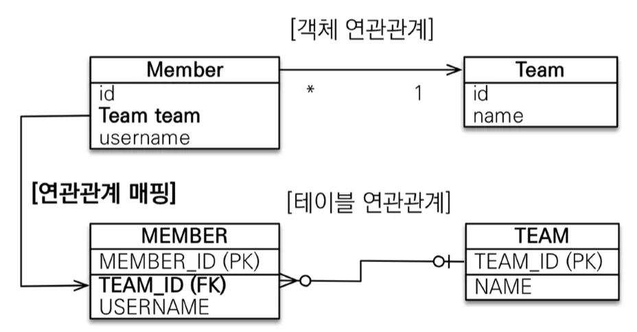

> 👉🏻 <strong>외래키와 매핑되는 필드</strong>에 아래 <strong>Anotation</strong>을 설정하면 단방향 연관관계가 형성된다&#46;
> 
> - <code>&#64;ManyToOne</code>
> 
> <details>
> <summary><code>&#64;JoinColumn(name = { </code><strong><u><code>외래 키(Foreign Key)</code></u></strong><code>})</code></summary>
> 
> - <code>&#64;JoinColumn</code>은<strong> </strong><strong><u>외래 키(Foreign Key)</u></strong>를 지정하는 어노테이션이다&#46;
> 
> - 쉽게 말해<strong>, MEMBER </strong>테이블에서 <strong>TEAM </strong>테이블을 참조하기 위한 열(Column)이 무엇인지를 지정합니다&#46;  
> 
> </details>

- <strong>예시</strong>

<a id="1c3eda9b0fe181d2af83d17cd7477636"></a>

```java
// 단방향 연관관계 
@ManyToOne
@JoinColumn(name = "TEAM_ID")
private Team team;
```

<a id="1c3eda9b0fe1817cbd8cfb815a60f275"></a>

### 양방향

> 🔥 <strong>중요&#46;  연관관계의 주인은 </strong><strong><u>외래키 </u></strong><strong><u>와 매핑</u></strong><strong><u>되는 필드</u></strong><strong>로 설정한다&#46;</strong>

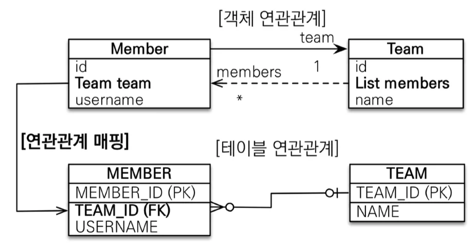

> 👉🏻 <strong>양방향 연관관계&#58; 연관관계 주인(Owner)</strong><br>테이블의 <strong>외래키</strong>와 <strong><u>매핑되는 필드</u></strong>에 설정
> 
> > 테이블에는 ‘방향’이라는 개념이 존재하지 않는다&#46; 즉, 양방향 관계는 JPA에서 객체지향의 컨셉을 사용하기 위한 개념이다&#46;
> 
> - <code>&#64;ManyToOne</code>
> 
> - <code>&#64;JoinColumn(name={매핑되는 컬럼 명})</code>
> 
> <a id="1c3eda9b0fe181158daee6dde6c09f63"></a>
> 
> <strong>※ 단방향을 기본 설계로 하며 필요 시에만 역으로 참조할 수 있는 양방향 설계로 바꾼다&#46;</strong>

<a id="1c3eda9b0fe18185b4dfd05e78c3d735"></a>

## 일대다(1&#58;N)&#58; <code>&#64;OneToMany</code>

<a id="1c3eda9b0fe18145bea8eecf9767e130"></a>

### <strong>⚠️  일대다(1&#58;N) 매핑</strong>,  <strong>일(1) = 연관관계 주인</strong>  ⇒<strong> </strong><strong>쓰지마라</strong>

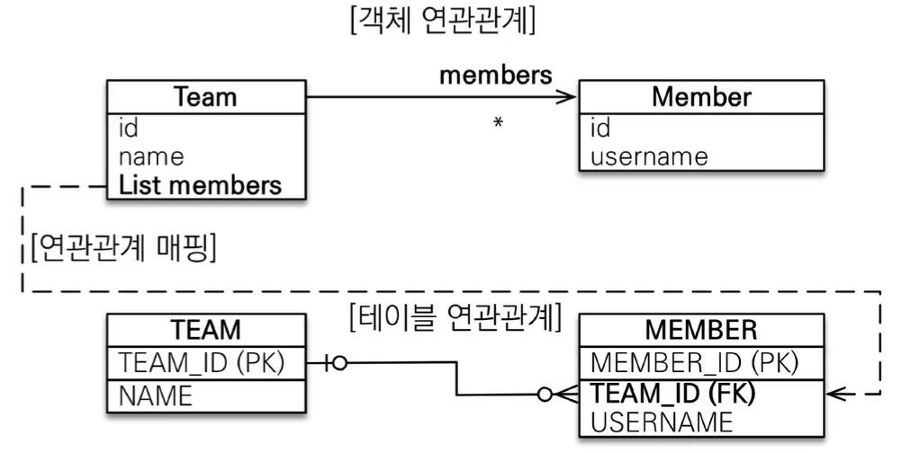

<a id="1c3eda9b0fe181b0bea6d34b1c3ecf82"></a>

테이블의 일대다 관계는 항상 <strong>다(N)  </strong>쪽에 <strong>외래키</strong>가 있다&#46;

<a id="1c3eda9b0fe1815e83dde836ea128bf3"></a>

여기서 <strong>일(1) </strong>을 <strong>주인(Owner)</strong>으로 설정하면 위 구조와 같이 반대편 테이블에서 외래키를 관리하는 이상한 구조가 형성된다&#46;<br>

<a id="1c3eda9b0fe181efb502d2154f4796ed"></a>

```java
@OneToMany
@JoinColumn(name="TEAM_ID")
private List<Member> members = new ArrayList<>();
```

<a id="1c3eda9b0fe1814ea42ed3e3db6aae9f"></a>

<code>Team&#46;members</code>에 값을 추가에서 JPA에서 쿼리는 날리는 경우, DB에서는 TEAM&#95;ID 값이 업데이트 되어야 하여 update가 추가로 발생한다&#46;  (값이 어거지로 나오긴 함)<br>

<a id="1c3eda9b0fe181db9618ec481429f36e"></a>

실제 실무에선 테이블이 수십개에서 많으면 수백 개이다&#46;  이렇게 이상하게 설계하면 어디가 어떻게 꼬여서 문제가 발생할지 안봐도 비디오다&#46;&#46; 

<a id="1c3eda9b0fe18166a162e511febc35bb"></a>

그냥 외래키를 기준으로 주인설정하자

<a id="1c3eda9b0fe1817eb307e4770c977993"></a>

### 양방향 &#45; 역방향 참조  <code>mappedBy</code>

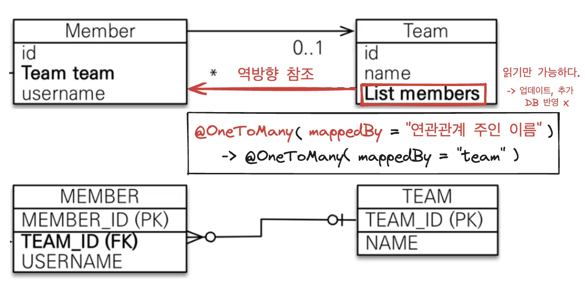

> 👉🏻 <strong>양방향 연관관계&#58; 역방향 참조 </strong><strong><code>mappedBy</code></strong>
> 
> <a id="1c3eda9b0fe18145be8de03c93ddbc12"></a>
> 
> 읽기만 가능 ( 해당 엔티티가 수정되어도 DB에 적용되지 않음 )
> 
> - <strong><code>&#64;OneToMany( mappedBy = {연관관계 주인 필드 명})</code></strong>

<a id="1c3eda9b0fe181abb988d836ace37a4e"></a>

## 일대일(1&#58;1)&#58; <code>&#64;OneToOne</code>

<a id="1c3eda9b0fe181239eb6dcdc6a08c7ab"></a>

### <strong><code>일대일(1&#58;1)</code></strong><strong> 관계는 대칭구조로써 </strong>DB에서 연관관계를 형성하는 2<strong>개의 테이블 </strong> 중  <strong><u>아무대나 한 곳을 골라 외래키(FK) 설정할 수 있다&#46;</u></strong>

-  <code>연관관계의 주인(외래키)</code>&#58; <strong>Locker</strong>
    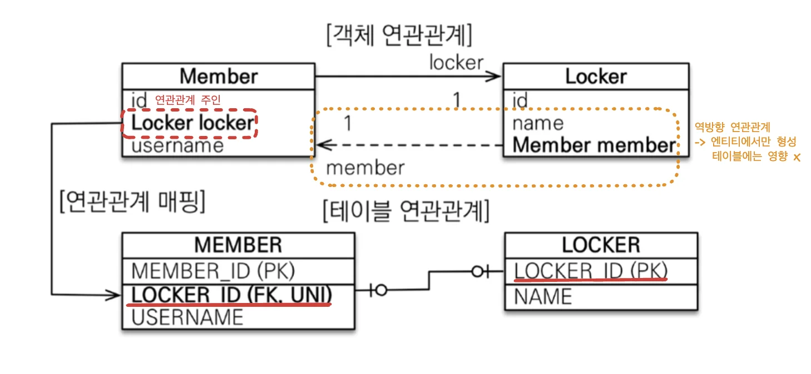

<a id="1c3eda9b0fe1810d8c08fada06c62ed0"></a>

 

- <code>연관관계의 주인(외래키)</code>&#58; <strong>Member</strong>
    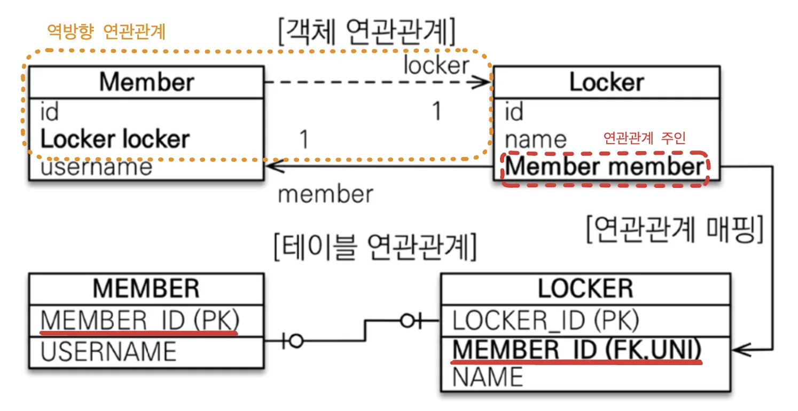

<a id="1c3eda9b0fe181aa9757c4e9549da00c"></a>

### <strong>대상 테이블에 연관관계 매핑</strong>

- 단방향 관계는 지원하지 않는다&#46;
    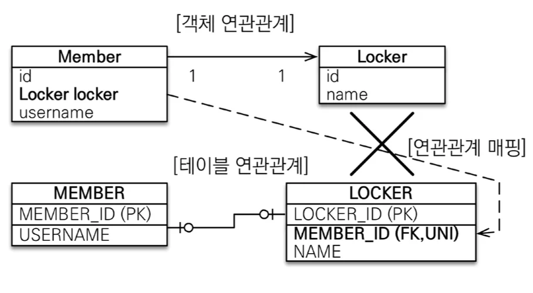

- 양방향은 지원
    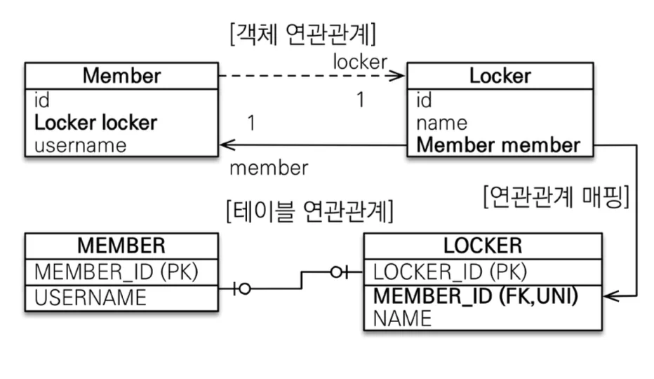

<a id="1c3eda9b0fe181e8a5b6eb01ec0477cf"></a>

### <strong>단방향</strong>

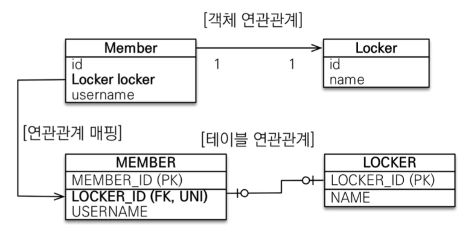

- <code>&#64;OneToOne</code>, <code>&#64;joinColumn(name={매핑할 컬럼명})</code>

<a id="1c3eda9b0fe18198b0dddc56c8bca74a"></a>

### <strong>양방향</strong>

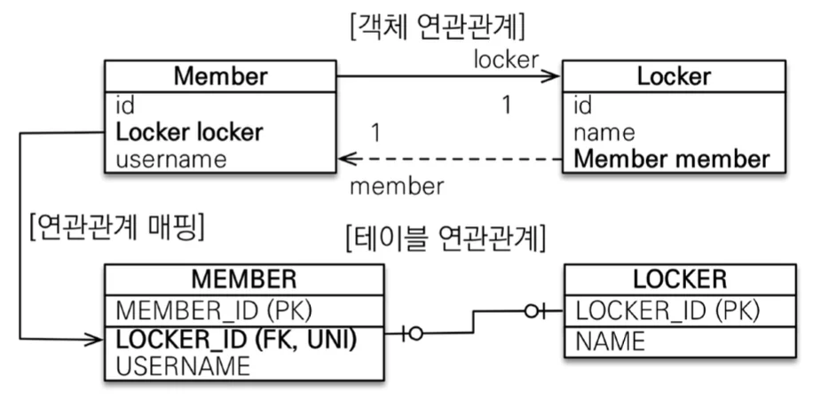

- <code>&#64;OneToOne</code>, <code>&#64;joinColumn(name={매핑할 컬럼명})</code>

- <code>&#64;OneToOne(mappedBy={주인 필드명})</code>

<a id="1c3eda9b0fe181b2b7ade0f9ba64464a"></a>

## 다대다(N&#58;M)&#58; <del>&#64;ManyToMany</del> ⇒ <code>&#64;ManyToOne</code> x 2

<details>
<summary>다대다 방법 → 사용 ❌</summary>

- <strong>&#64;ManyToMany</strong> 

- <strong>&#64;JoinTable</strong>로 연결 테이블 지정

- 단방향, 양방향 둘다 가능함

</details>

> ☝🏻 <strong><code>N&#58;M</code></strong><strong> 매핑은 실무에선 </strong><strong><u>사용하지 않</u></strong><strong>는다</strong>&#46; <br>⇒ <strong>연결 테이블용 엔티티</strong><strong>를</strong><strong> 추가</strong>하여<strong> &#91; </strong><strong><code>일대다(1&#58;N)</code></strong><strong> &#60;&#45;&#62; </strong><strong><code>다대일(M&#58;1)</code></strong><strong> &#93; </strong>매핑으로 구조 변경

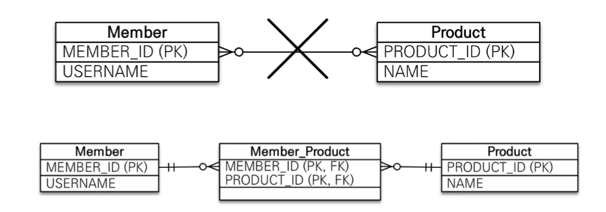

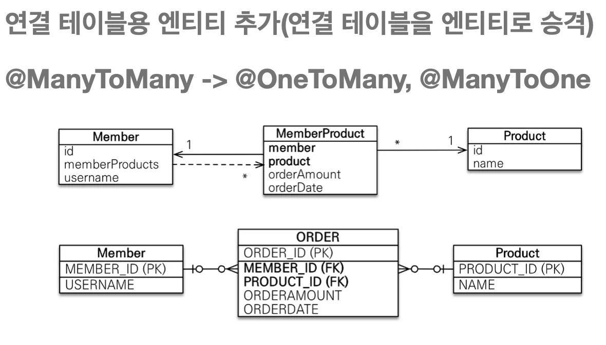

> 자세한 내용은 아래 &#91;실전 예제3&#93; 참조

<a id="1c3eda9b0fe18162aa3ad028d6c91cd3"></a>

## 속성 정리 

<a id="1c3eda9b0fe1815991c2ee1330d97f28"></a>

### 외래키 매핑 &#45; &#64;JoinColumn 

| 속성 | 설명 | 기본값 |
| --- | --- | --- |
| name | 매핑할 외래 키 이름 | 필드명 &#43; &#95; &#43; 참조하는 테<br>이블의 기본 키 컬럼명 |
| referenceColumnName |  외래 키가 참조하는 대상 테이블의 컬럼명 | 참조하는 테이블의 기본<br>키 컬럼명 |
| foreignKey(DDL) | 외래 키 제약조건을 직접 지정할 수 있다&#46;<br>이 속성은 테이블을 생성할 때만 사용한다&#46; |  |
| unique<br>nullable insertable<br>updatable<br>columnDefinition<br>table | &#64;Column의 속성과 같다&#46; |  |

<a id="1c3eda9b0fe18115a49ff3464e5c09a7"></a>

### 다대일  연관관계 &#45; &#64;ManyToOne

| 속성 | 설명 | 기본값 |
| --- | --- | --- |
| optional | false로 설정하면 연관된 엔티티가 항상 있어야 한다&#46;  | TRUE |
| fetch | 글로벌 페치 전략을 설정 | &#64;ManyToOne=FetchType&#46;EAGER<br>&#64;OneToMany=FetchType&#46;LAZY |
| cascade(DDL) | 영속성 전이 기능을 사용 |  |
| targetEntity | 연관된 엔티티의 타입 정보를 설정<br>→ 사용 X, 컬렉션, 제네릭 사용 |  |

<a id="1c3eda9b0fe18145bf9ac177dffde421"></a>

### 일대다 연관관계 &#45; &#64;OneToMany

| 속성 | 설명 | 기본값 |
| --- | --- | --- |
| <code>mappedBy</code> | <strong><u>연관관계의 주인 필드</u></strong>를<strong><u> 선택</u></strong> |  |
| fetch | 글로벌 페치 전략을 설정 | &#64;ManyToOne=FetchType&#46;EAGER<br>&#64;OneToMany=FetchType&#46;LAZY |
| cascade | 영속성 전이 기능을 사용 |  |
| targetEntity | 연관된 엔티티의 타입 정보를 설정<br>→ 사용 X, 컬렉션, 제네릭 사용 |  |

<a id="1c3eda9b0fe181a4bb2bfd93867fad5f"></a>

## 실전 예제 3 &#45; 연관관계 매핑&#58; 다중성

> 이전 <strong>실전 예제2 설계에서 </strong> <strong><u>배송, 카테고리</u></strong>를 추가 

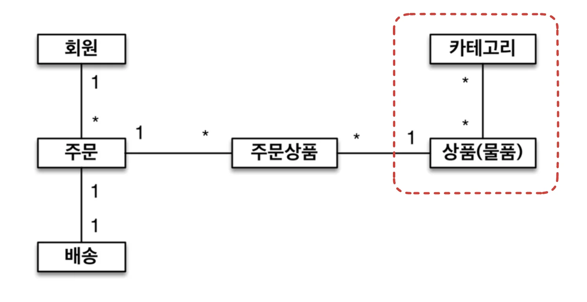

<details>
<summary><strong>테이블 설계</strong></summary>

> <strong>주테이블(ORDERS)</strong>에 <strong>FK(외래 키)</strong> 값 설정
> 
> 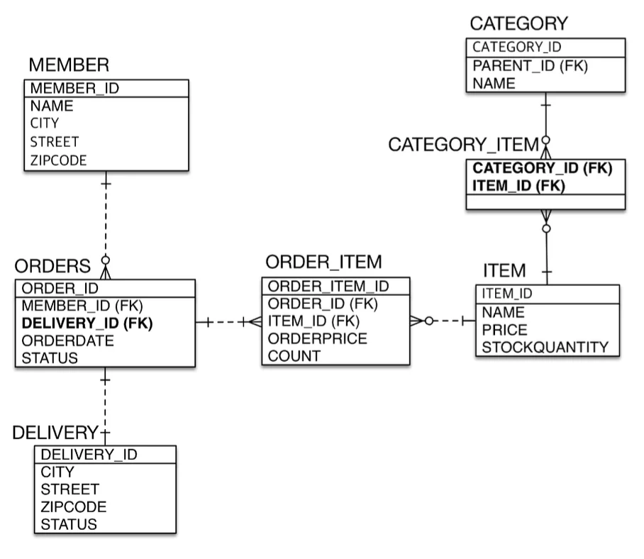

</details>

<details>
<summary><strong>엔티티 설계</strong></summary>

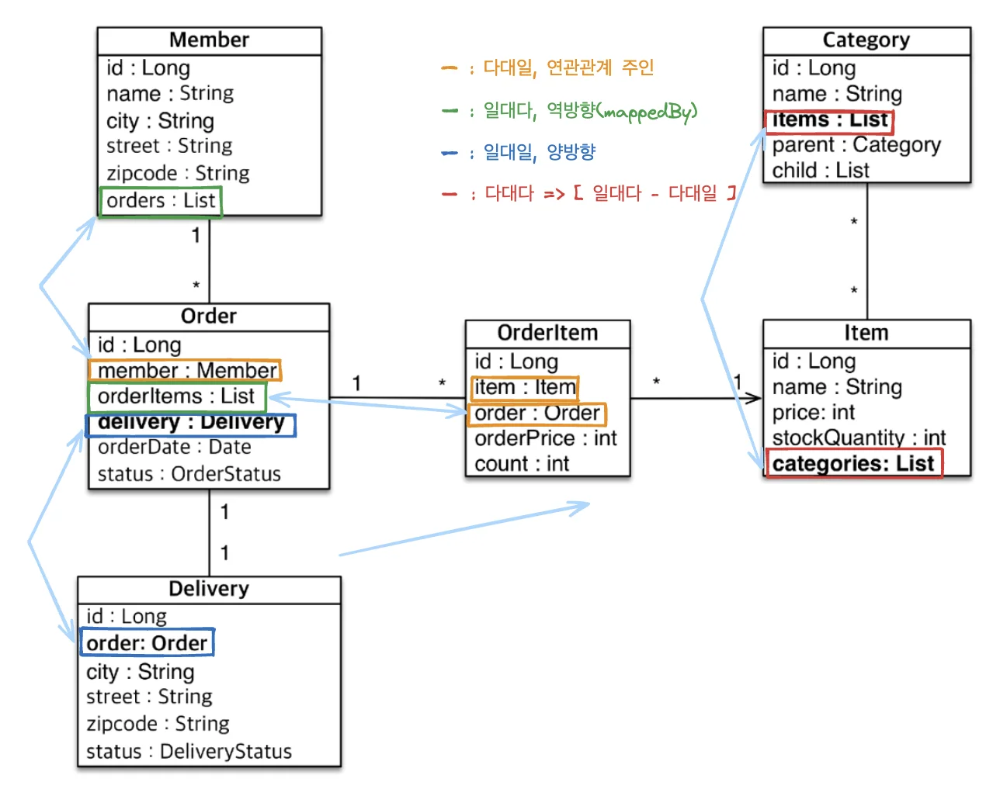

</details>

<details>
<summary>🤔<strong> &#91; 다대다 &#93; ⇒ </strong><strong>&#91; </strong><strong><code>N&#58;1</code></strong><strong> ↔ </strong><strong><code>1&#58;M</code></strong><strong>&#93; </strong><strong>or </strong><strong>&#91; </strong><strong><code>1&#58;N</code></strong><strong>↔</strong><strong><code>M&#58;1</code></strong><strong>&#93;</strong><strong> </strong></summary>

> 반대로 설계됨… 오류인가? 
> 
> 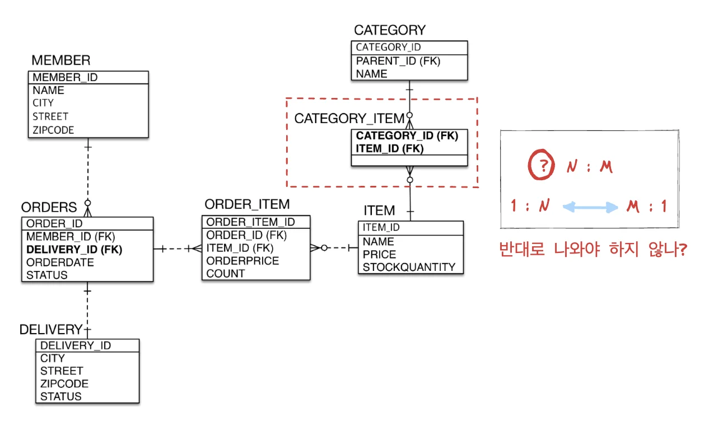

<a id="1c3eda9b0fe1817f8680d6e8013601c6"></a>

<strong>⇒ &#91; 다대다 &#93; ⇒ </strong><strong><u>&#91; 일대다 &#93; &#45; &#91; 다대일 &#93;</u></strong>

<a id="1c3eda9b0fe18173a1e8c8514be57aa9"></a>

<strong>하나의 상품</strong>에 <strong>여러 개의 카테고리</strong>가 들어갈 수 있다&#46;

<a id="1c3eda9b0fe18119b4d5da7892f461a5"></a>

<strong>하나의 카테고리</strong>에 <strong>여러 개의 상품들</strong>이 해당될 수 있다&#46;

<a id="1c3eda9b0fe181e1b0e7f0fc1c3871a3"></a>

따라서 둘은<strong> 다대다</strong> 연관관계를 형성한다 &#46;

<a id="1c3eda9b0fe181e993f1edbb67760594"></a>

여기서 둘사이에 하나의 테이블을 형성하여 값을 저장한다고 할때, 

<a id="1c3eda9b0fe18137b3dbfdd07983d63a"></a>

해당 테이블에는 <strong>하나의 상품</strong>에 대한 <strong>여러 개의 카테고리들</strong>이 담긴다&#46; <strong>&#91;일대다&#93;</strong>

<a id="1c3eda9b0fe1818888e2e7918c753977"></a>

또한 <strong>하나의 카테고리</strong>에 대한<strong> 여러 개의 해당 상품들을 담</strong>는다&#46;  <strong>&#91;일대다&#93;</strong>

<a id="1c3eda9b0fe1813ea9c7c919a97320e8"></a>

따라서 아래와 같이 <strong><u>&#91; 일대다 &#93; &#45; &#91; 다대일 &#93;</u></strong> 연관관계를 형성한다&#46;

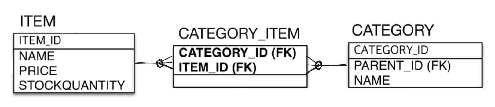

> 결론&#46; 다대일 일대다 연관관계는 잘못된 이해를 하여 생긴 오류로 <u>일대다 다대일 연관관계</u>가 <u>올바른 재설계 </u>방식이다&#46; 

</details>

<details>
<summary>🧐 Setter  → <code>생성자</code>, <code>빌드 패턴</code></summary>

- 실무에선 <strong>setter</strong>가 아닌 <code>생성자</code>와 <code>빌드 패턴</code>을 합쳐서 사용한다고 한다&#46; 
    > 

</details>

<details>
<summary>🧐 왜 <strong>Item</strong>, <strong>Category </strong>둘다 <code>List</code> 로 설계했는가? </summary>

> <strong><code>다대다</code></strong> 연관관계 그대로 사용

<a id="1c3eda9b0fe1818d8d25d3d37411c120"></a>

<code>다대다</code> 연관관계 실제 사용 방법에 예시를 보여주기 위해  재설계 없이 그대로 사용<br>  ⇒ <strong><u>실제 실무에서는 </u></strong><strong><u><code>일대다</code></u></strong><strong><u> &#45; </u></strong><strong><u><code>다대일</code></u></strong><strong><u> 로 재설계</u></strong>하여 사용해야함&#46;<br>

</details>

<details>
<summary>⭐️ 다대다 (<code>N&#58;M) </code>연관관계 재설계 </summary>

<details>
<summary><strong>Case1)</strong> <code>N&#58;M</code> &#91;Order ↔ Item&#93;  ⇒ <code>1&#58;N</code> , <code>M&#58;1</code>  <strong><u>&#91;Order ↔ </u></strong><strong><u>OrderItem</u></strong><strong><u> ↔ Item &#93;</u></strong></summary>

- <strong>&#91; Order ↔ Item &#93;  </strong><code>N&#58;M</code><strong>  → </strong><code>1&#58;N</code> , <code>M&#58;1</code>
    - <strong><u>중간</u></strong>에 <strong><u>OrderItem </u></strong><strong><u>엔티티 추가</u></strong>
        <a id="1c3eda9b0fe181fcab01c912d719ae6a"></a>

        <strong>  ⇒ </strong><code>1&#58;N</code> , <code>M&#58;1</code>&#58; &#91; <strong><u>Order ↔ OrderItem ↔ Item</u></strong><strong> </strong><strong><u>&#93;</u></strong>

</details>

<details>
<summary>Case2)<code>N&#58;M</code> &#91;Item ↔ Category&#93; ⇒ <code>1&#58;N</code>, <code>M&#58;1</code> &#91;Item ↔ &#91; ??? &#93; ↔Category&#93; </summary>

<a id="1c3eda9b0fe18175bdffcedcddb3d654"></a>

중간에 <strong>가상 테이블을 만</strong>들어 매핑

<details>
<summary><strong>Category</strong></summary>

<a id="1c3eda9b0fe1811c9641ca5505f2fbe7"></a>

```java
@ManyToMany
@JoinTable(name = "CATEGORY_ITEM",
        // 가상 중간 테이블 생성, 매핑 및 조인
        joinColumns = @JoinColumn(name = "CATEGORY_ID"),
        inverseJoinColumns = @JoinColumn(name = "ITEM_ID")
)
private List<Item> items = new ArrayList<>();
```

</details>

<details>
<summary><strong>Item</strong></summary>

<a id="1c3eda9b0fe181de9233d7b0bbeb659d"></a>

```java
@ManyToMany(mappedBy = "items")
private List<Category> categories = new ArrayList<>();
```

</details>

<details>
<summary><strong>쿼리</strong></summary>

<a id="1c3eda9b0fe1810dbb5bd28bf9a5d2de"></a>

```java
Hibernate: 
create table CATEGORY_ITEM (
    CATEGORY_ID bigint not null,
    ITEM_ID bigint not null
)
```

</details>

</details>

</details>

<a id="1c3eda9b0fe1815fb771d7a79147bb28"></a>

### <strong>코드</strong>

<details>
<summary>jpabook&#46;jpashop</summary>

<details>
<summary>domain</summary>

<details>
<summary>enums</summary>

<details>
<summary><strong>DeliveryStatus</strong></summary>

<a id="1c3eda9b0fe181a1afc8ff943a2a1d96"></a>

```java
package jpabook.jpashop.domain.enums;

public enum DeliveryStatus {
    DELIVERY, COMPLETE
}
```

</details>

<details>
<summary><strong>OrderStatus</strong></summary>

<a id="1c3eda9b0fe181158c4fda095a473055"></a>

```java
package jpabook.jpashop.domain.enums;

public enum OrderStatus {
    ORDER, CANCEL
}
```

</details>

</details>

<details>
<summary><strong>Member</strong></summary>

<a id="1c3eda9b0fe181338dbfc1cd76813184"></a>

```java
package jpabook.jpashop.domain;

import jakarta.persistence.*;

import java.util.ArrayList;
import java.util.List;

@Entity
public class Member {

    @Id
    @GeneratedValue
    @Column(name = "MEMBER_ID")
    private Long id;
    private String name;
    private String city;
    private String street;
    private String zipcode;
    @OneToMany(mappedBy = "member")
    private List<Order> orders = new ArrayList<>();


    // Constructor
    public Member() {
    }

    public Member(String name, String city, String street, String zipcode) {
        this.name = name;
        this.city = city;
        this.street = street;
        this.zipcode = zipcode;
    }

    // 연관관계 편의 메서드
//    public void addOder(Order order){
//        order.setMember(this);
//        this.getOrders().add(order);
//    }


    // Getter
    public Long getId() {
        return id;
    }

    public String getName() {
        return name;
    }

    public String getCity() {
        return city;
    }

    public String getStreet() {
        return street;
    }

    public String getZipcode() {
        return zipcode;
    }

    public List<Order> getOrders() {
        return orders;
    }


}

```

</details>

<details>
<summary><strong>Order</strong></summary>

<a id="1c3eda9b0fe1818b8815c0611eb6d52d"></a>

```java
package jpabook.jpashop.domain;

import jakarta.persistence.*;
import jpabook.jpashop.domain.enums.OrderStatus;

import java.util.ArrayList;
import java.util.Date;
import java.util.List;

@Entity
@Table(name = "ORDERS")
public class Order {
    @Id
    @GeneratedValue
    @Column(name="ORDER_ID")
    private Long id;

    @ManyToOne
    @JoinColumn(name = "MEMBER_ID")
    private Member member;

    @OneToOne
    @JoinColumn(name = "DELIVERY_ID")
    private Delivery delivery;

    @OneToMany(mappedBy = "order")
    private List<OrderItem> orderItems = new ArrayList<>();

    @Enumerated(EnumType.STRING)
    private OrderStatus status;

    private Date oderDate;


    // Constructor
    public Order() {
    }

    public Order(OrderStatus status, Date oderDate) {
        this.status = status;
        this.oderDate = oderDate;
    }

    // 연관관계 편의 메서드: 양방향 연관관계
    public void changeDelivery (Delivery Delivery){
        this.setDelivery(Delivery);
        delivery.setOrder(this);
    }

    public void changeMember(Member member) {
        this.setMember(member);
        member.getOrders().add(this);
    }

//    public void addOrderItems(OrderItem orderItem){
//        this.getOrderItems().add(orderItem);
//        orderItem.setOrder(this);
//    }


    // setter
    public void setMember(Member member) {
        this.member = member;
    }

    public void setDelivery(Delivery delivery) {
        this.delivery = delivery;
    }

    // getter
    public Long getId() {
        return id;
    }

    public Member getMember() {
        return member;
    }

    public Delivery getDelivery() {
        return delivery;
    }

    public List<OrderItem> getOrderItems() {
        return orderItems;
    }

    public OrderStatus getStatus() {
        return status;
    }

    public Date getOderDate() {
        return oderDate;
    }
}

```

</details>

<details>
<summary><strong>Delivery</strong></summary>

<a id="1c3eda9b0fe18194a9bef1d94817ff96"></a>

```java
package jpabook.jpashop.domain;

import jakarta.persistence.*;
import jpabook.jpashop.domain.enums.DeliveryStatus;

@Entity
public class Delivery {
    @Id
    @GeneratedValue
    @Column(name="DELIVERY_ID")
    private Long id;

    @OneToOne(mappedBy = "delivery")
    private Order order;

    @Enumerated(EnumType.STRING)
    private DeliveryStatus status;

    private String city;
    private String street;
    private String zipcode;


    // Constructor
    public Delivery() {
    }

    public Delivery(String city, String street, String zipcode, DeliveryStatus status) {
        this.city = city;
        this.street = street;
        this.zipcode = zipcode;
        this.status = status;
    }

    // 연관관계 편의 메서드: 양방향
//    public void addOrder(Order order){
//        this.setOrder(order);
//        order.setDelivery(this);
//    }

    // Setter
    public void setOrder(Order order) {
        this.order = order;
    }

    // Getter
    public Long getId() {
        return id;
    }

    public Order getOrder() {
        return order;
    }

    public String getCity() {
        return city;
    }

    public String getStreet() {
        return street;
    }

    public String getZipcode() {
        return zipcode;
    }

    public DeliveryStatus getStatus() {
        return status;
    }
}

```

</details>

<details>
<summary><strong>OrderItems</strong></summary>

<a id="1c3eda9b0fe1812c9bfeee2442bc0aee"></a>

```java
package jpabook.jpashop.domain;

import jakarta.persistence.*;

@Entity
@Table(name = "ORDER_ITEM")
public class OrderItem {
    @Id
    @GeneratedValue
    @Column(name = "ORDER_ITEM_ID")
    private Long id;

    @ManyToOne
    @JoinColumn(name="ITEM_ID")
    private Item item;

    @ManyToOne
    @JoinColumn(name="ORDER_ID")
    private Order order;

    private int orderPrice;
    private int count;

    // Constructor
    public OrderItem() {
    }

    public OrderItem(int orderPrice, int count) {
        this.orderPrice = orderPrice;
        this.count = count;
    }


    // 연관관계 편의 메서드
    public void changeOrder(Order order) {
        this.setOrder(order);
        order.getOrderItems().add(this);
    }


    // Setter
    public void setItem(Item item) {
        this.item = item;
    }

    public void setOrder(Order order) {
        this.order = order;
    }


    // Getter
    public Long getId() {
        return id;
    }

    public Item getItem() {
        return item;
    }

    public Order getOrder() {
        return order;
    }

    public int getOrderPrice() {
        return orderPrice;
    }

    public int getCount() {
        return count;
    }
}

```

</details>

<details>
<summary><strong>Item</strong></summary>

<a id="1c3eda9b0fe181aaa9e6ea7acb02c8f0"></a>

```java
package jpabook.jpashop.domain;

import jakarta.persistence.*;

import java.util.ArrayList;
import java.util.List;

@Entity
public class Item {
    @Id
    @GeneratedValue
    @Column(name = "ITEM_ID")
    private Long id;

    private String name;
    private int price;
    private int stockQuanity;

    // 왜 둘다 List로 값을 저장하자?
    //  => 다대다 관계 표현, 실무 사용 X
    @ManyToMany(mappedBy = "items")
    private List<Category> categories = new ArrayList<>();

    // Setter
    public void setName(String name) {
        this.name = name;
    }

    public void setPrice(int price) {
        this.price = price;
    }

    public void setStockQuanity(int stockQuanity) {
        this.stockQuanity = stockQuanity;
    }

    public void setCategories(List<Category> categories) {
        this.categories = categories;
    }


    // Getter
    public Long getId() {
        return id;
    }

    public String getName() {
        return name;
    }

    public int getPrice() {
        return price;
    }

    public int getStockQuanity() {
        return stockQuanity;
    }

    public List<Category> getCategories() {
        return categories;
    }
}

```

</details>

<details>
<summary><strong>Category</strong></summary>

<details>
<summary>🧐<strong> 트리구조? 어떻게 설계하지?</strong></summary>

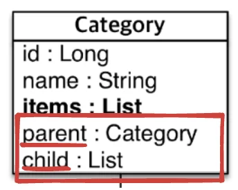

<a id="1c3eda9b0fe18183b66feeece59affa9"></a>

아래와 같이 내부에서 연관관계를 만들어 설계<br>→ 뒤chapter 에서 학습

> 🧐  왜 부모노드가 여러개 ‘<strong>다(N)’ </strong>이지?<strong> </strong> 

<a id="1c3eda9b0fe1811ba196cece43e44bc7"></a>

```java
@ManyToOne
@JoinColumn(name = "PARENT_ID")
private Category parent;

@OneToMany(mappedBy = "parent")
private List<Category> child  = new ArrayList<>();
```

</details>

<a id="1c3eda9b0fe1810c9270f287a848d050"></a>

```java
package jpabook.jpashop.domain;

import jakarta.persistence.*;

import java.util.ArrayList;
import java.util.List;

@Entity
public class Category {
    @Id
    @GeneratedValue
    @Column(name = "CATEGORY_ID")
    private Long id;

    private String name;

    // 트리 구조?? -> 이후 배움
    @ManyToOne
    @JoinColumn(name = "PARENT_ID")
    private Category parent;

    @OneToMany(mappedBy = "parent")
    private List<Category> child  = new ArrayList<>();

    // 다대다 매핑, 예시로써 한번 사용, 실무에선 사용 X
    @ManyToMany
    @JoinTable(name = "CATEGORY_ITEM",
            // 가상 중간 테이블 생성, 매핑 및 조인
            joinColumns = @JoinColumn(name = "CATEGORY_ID"),
            inverseJoinColumns = @JoinColumn(name = "ITEM_ID")
    )
    private List<Item> items = new ArrayList<>();


}

```

</details>

</details>

<details>
<summary><strong>JpaMain</strong></summary>

<a id="1c3eda9b0fe181b98a2edae57a254c7f"></a>

```java

```

</details>

</details>
