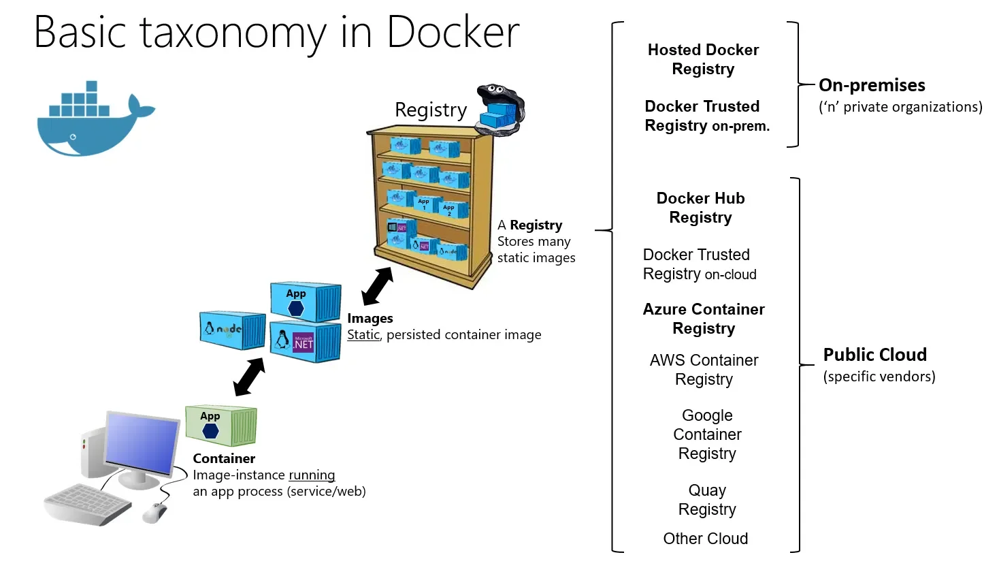
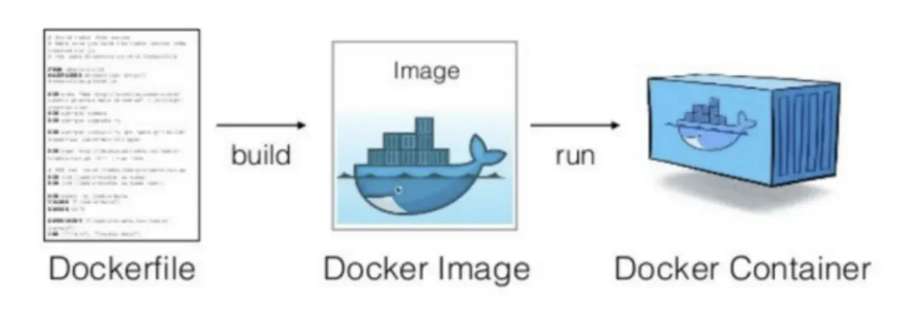

<a id="1c3eda9b0fe1810386b3cbc2312317c3"></a>

## Dockerfile

---

> 📖 
> 
> <a id="1c3eda9b0fe181c09aeed80346ccdb46"></a>
> 
> <strong><u>Dockerfile</u></strong>을 통해 Image를 생성(<code>build</code>)하고 <br>생성된 Image를 통해 Container를 실행(<code>run</code>) 할 수 있다&#46; 
> 
> - <strong><u>애플리케이션을 간편하게 build</u></strong> 가능하다
> 
> - 어디서든 동일한 환경으로 실행 

<details>
<summary>Docker 이미지 공유</summary>

- Docker 이미지는 Docker 레지스트리를 사용하여 다른 사용자와 공유 가능
    - 다른 사용자가 이미지를 다운로드하여 사용할 수 있다&#46;

    

</details>

<details>
<summary>Dockerfile</summary>



<details>
<summary>Dockerfile 이란?</summary>

- Docker image의 설정 정보

- 정의된 <code>Dockerfile</code>의 정보를 바탕으로 Image를  build 한다&#46;

- <code>Dockerfile</code>은 <u>앱을 만</u>들기 위한 <u>레시피</u>와 같다&#46;
    - 레시피를 통해 음식을 만들 수 있듯이

    - <code>Dockerfile</code>을 통해 <code>Docker Image</code>를 <u>만들 수 있</u>다&#46; (build)

</details>

<details>
<summary>Dockerfile의 사용 이유</summary>

- 앱을 컨테이너로 만들 때, 이미지를 만드는 용도로 Dockerfile을 사용한다&#46; 
    - 이를 통해 앱의 필요로 하는 의존성들을 하나의 Dockerfile로 관리할 수 있다&#46; 

- 앱을 컨테이너 환경으로 실행하려고 할 때
    - 앱에 필요한 프로그램들을 내 컴퓨터에 실행하지 않고,  이미지를 통해 os 위 컨테이너 환경에서 해당하는 프로그램들을 실행할 수 있다&#46;

- Docker file에 프로그램들의 버전까지 명시할 수 있어, 누구나 해당 Dockefile을 통해  동일한 환경을 만들 수 있다&#46; 

- Dockerfile을 통해 <strong><u>앱을 만드는 과정</u></strong>을 자동화 할 수 있다&#46; <br>이를 통해, <u>매번 같은 방식으로 앱을 만들고 베포</u>할 수 있다&#46; 

</details>

<details>
<summary>ex) Dockerfile</summary>

- Ubuntu 최신 버전을 기반으로 Nginx를 설치,<br>index&#46;html 파일을 Nginx의 HTML 디렉토리에 복사
    <a id="1c3eda9b0fe181db93cdcee3c9d94d95"></a>

    ```docker
    FROM ubuntu:latest
    MAINTAINER Your Name <your-email@example.com>
    RUN apt-get update && apt-get install -y nginx
    COPY index.html /usr/share/nginx/html
    EXPOSE 80
    CMD ["nginx", "-g", "daemon off;"]
    ```

    <details>
    <summary>사용한 Dockerfile 명령어</summary>

    > 아래에서 더 자세히 다룸

    - <code>FROM</code>&#58; 베이스 이미지 선택

    - <code>MAINTAINER</code>&#58; 이미지를 만든 사람의 정보를 입력

    - <code>RUN</code>&#58; 이미지에 명령을 실행, 파일을 추가하거나 삭제

    - <code>COPY</code>&#58; 파일을 이미지에 복사

    - <code>EXPOSE</code>&#58; 컨테이너가 노출할 포트를 설정

    - <code>CMD</code>&#58;  컨테이너가 실행될 때, 실행할 명령을 설정

    </details>

</details>

</details>

<details>
<summary><code>CLI</code> &#45; Docker 이미지 생성, 컨테이너 실행 및 종료</summary>

<details>
<summary>이미지 생성&#58; <code>build</code></summary>

<a id="1c3eda9b0fe181829170c0be65fbb276"></a>

```bash
docker buildx build -t my-nginx:latest .
docker build -t my-nginx:latest . # 위 명령이 실행되지 않는 경우 실행
```

-  현재 디렉토리에서 Dockerfile을 기반으로 <code>my&#45;nginx&#58;latest</code> 이름의 Docker 이미지 생성

</details>

<details>
<summary>컨테이너 실행&#58; <code>run</code></summary>

<a id="1c3eda9b0fe181ee900ef893808f3a94"></a>

```bash
docker run -d -p 80:80 my-nginx:latest

docker ps
```

- <code>my&#45;nginx&#58;lates</code>t 이미지를 기반으로 컨테이너를 실행

- <code>&#45;p 80&#58;80</code>&#58; 컨테이너 80번 포트와 호스트 컴퓨터의 80번 포트를 매핑한다&#46; 

</details>

<details>
<summary>컨테이너 중지&#58; <code>stop</code></summary>

<a id="1c3eda9b0fe181eaaf5be83a9f88672f"></a>

```bash
docker stop my-nginx
```

</details>

<details>
<summary>컨테이너 삭제&#58; <code>rm</code></summary>

<a id="1c3eda9b0fe181ed97f1ed13b062cd82"></a>

```bash
docker rm my-nginx

docker ps -a
```

</details>

</details>

<details>
<summary>Dockerfile 명령어</summary>

<details>
<summary><code>FROM</code>&#58; 베이스 이미지 지정</summary>

- ex) <code>FROM ubuntu&#58;22&#46;04</code>

</details>

<details>
<summary><code>RUN</code>&#58; <strong><u>이미지를 생성 시</u></strong> 실행될 명령어를 입력</summary>

- 사용자를 지정하지 않은 상태라면 root로 실행

- ex) <code>RUN apt update &#38;&#38; apt upgrade &#45;y &#38;&#38; apt autoremove &#38;&#38; apt autoclean</code>

- ex) <code>RUN apt install openjdk&#45;21&#45;jdk</code>

</details>

<details>
<summary><code>CMD</code>&#58; <strong><u>컨테이너를 생성</u></strong>할 때, 실행할 명령어를 입력</summary>

- 컨테이너를 생성할 때만 실행

- 추가적인 명령어에 따라 설정한 해당 명령어 수정 가능

- ex) <code>CMD &#91;”nginx”, “&#45;g”, “daemon off;”&#93;</code>

</details>

<details>
<summary><code>ENTRYPOINT</code>&#58; <strong><u>컨테이너 시직</u></strong>할 때, 실행할 명령어 입력</summary>

- 컨테이너를 시작할 때마다 실행

- 추가적인 명령어 존재 여부와 상관없이 무조건 실행

- ex) <code>ENTRYPOINT &#91;”npm”, “start”&#93;</code>

</details>

<details>
<summary><code>ENV</code>&#58; 환경 변수 설정</summary>

- 이미지 안에 각종 환경 변수 지정

- ex) <code>ENV STAGE staging</code>

- ex) <code>ENV JAVA&#95;HOME /usr/lib/jvm/java&#45;8&#45;oracle</code>

</details>

<details>
<summary><code>WORKDIR</code>&#58; 작업 디렉터리 지정</summary>

- ex) <code>WORKDIR /app</code>

</details>

<details>
<summary><code>COPY</code>&#58; 파일 복사</summary>

- 호스트 파일이나 디렉토리를 이미지 안에 복사

- Docker Context, 즉 빌드 작업 디렉토리 내 파일만 복사 가능

- ex) <code>COPY index&#46;html /usr/share/nginx/html</code>

</details>

<details>
<summary><code>MAINTAINER</code>&#58; Dockerfile을 작성한 사람의 정보 입력</summary>

- ex) <code>MAINTAINER naebaecaem &#60;nbcamp&#64;spartacoding&#46;co&#62;</code>

</details>

<details>
<summary><code>LABEL</code>&#58; 이미지에 메타데이터 추가</summary>

- ex) <code>LABEL purpose=’nginx test’</code>

</details>

<details>
<summary><code>USER</code>&#58; 사용자 설정</summary>

- Container의 기본 사용자&#58; root

- root 권한이 필요없는  application이라면 다른 사용자로 변경
    <a id="1c3eda9b0fe181c284baf9dcb84121ca"></a>

    ```bash
    RUN ["useradd", "user"]
    USER user
    RUN ["/bin/bash, "-c", "ls"]
    ```

</details>

<details>
<summary><code>EXPOSE</code>&#58; 컨테이너에서 노출할 포트 명시</summary>

- ex) <code>EXPOSE 80</code>

- ex) <code>EXPOSE 443</code>

</details>

</details>

<details>
<summary>Docker파일 예제</summary>

<details>
<summary>ex1 )  FastAPI 앱을 실행</summary>

<a id="1c3eda9b0fe18173a23cd79a1989a2ad"></a>

```docker
FROM python:3.11

RUN pip install pipenv

WORKDIR /app

ADD . /app/

RUN pipenv --python 3.11
RUN pipenv run pip install poetry
RUN pipenv sync
RUN pipenv run pip install certifi

ARG STAGE

RUN sh -c 'echo "STAGE=$STAGE" > .env'
RUN sh -c 'echo "PYTHONPATH=." >> .env'
RUN chmod +x ./scripts/run.sh
RUN chmod +x ./scripts/run-worker.sh

CMD ["./scripts/run.sh"]
```

</details>

<details>
<summary>ex1 )  nginx 이미지를 생성</summary>

> 실제로는 <code>nginx&#58;latest</code> 이미지를 사용하여 간편하게 사용 가능

<a id="1c3eda9b0fe181a0a936cf03c55c5e7c"></a>

```docker
# Dockerfile
FROM ubuntu:22.04
MAINTAINER your-name <your-email@example.com>
LABEL purpose=Web Server

# nginx 패키지 설치
RUN apt-get update && apt-get install -y nginx

# nginx 설정 파일 복사
COPY nginx.conf /etc/nginx/nginx.conf

# Nginx 실행
CMD ["nginx", "-g", "daemon off;"]
```

- nginx&#46;conf
    <a id="1c3eda9b0fe18197baf7eb3d69a3dd80"></a>

    ```bash
    user  nginx;
    worker_processes  1;

    error_log  /var/log/nginx/error.log warn;
    pid        /var/run/nginx.pid;

    events {
        worker_connections  1024;
    }

    http {
        include       /etc/nginx/mime.types;
        default_type  application/octet-stream;

        log_format  main  '$remote_addr - $remote_user [$time_local] "$request" '
                          '$status $body_bytes_sent "$http_referer" '
                          '"$http_user_agent" "$http_x_forwarded_for"';

        access_log  /var/log/nginx/access.log  main;

        sendfile        on;
        #tcp_nopush     on;

        keepalive_timeout  65;

        gzip  on;
        gzip_disable "msie6";

        include /etc/nginx/conf.d/*.conf;
    }
    ```

</details>

</details>
