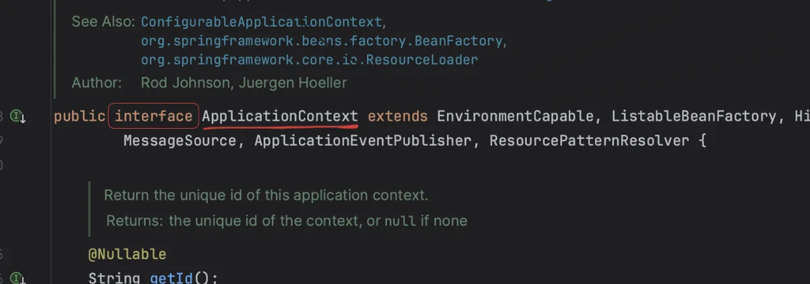
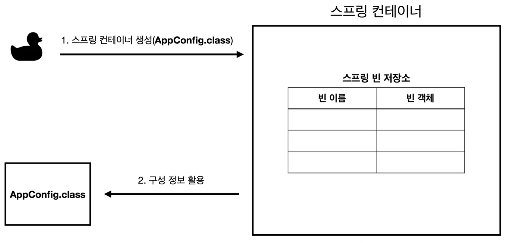
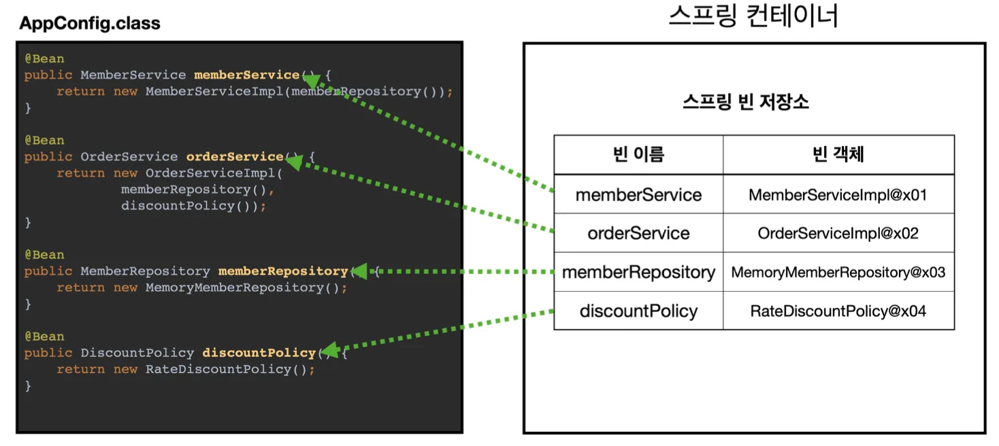
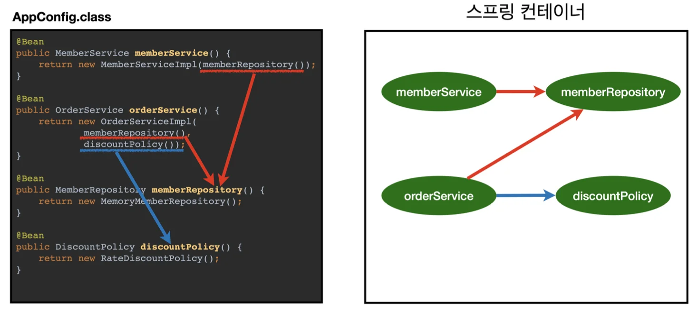

> 실무에선 헷갈리게 만들면 안된다&#33;&#33;<br>→ 단순, 정확<br>애매하면 하면 안된다&#46;

<a id="1c3eda9b0fe18122b46ec746836a3fc0"></a>

## 스프링 컨테이너  생성 ( ApplicationContext )

---

<a id="1c3eda9b0fe1818daa86e1cc344c230b"></a>

```java
// 스프링 컨테이너 생성
ApplicationContext applicationContext = new AnnotationConfigApplicationContext(AppConfig.class);
```

> <strong>• </strong><code>ApplicationContext</code>를 스프링 컨테이너라 한다(<strong>interface</strong>)
> 
> > 클래스 검색(<code>cmd</code> &#43; <code>o</code>)&#58; ApplicationContext
> > 
> > 
> 
> <a id="1c3eda9b0fe1817dad10fb1ebfe7ce9f"></a>
> 
> <strong>• </strong><strong><u>스프링 컨테이너</u></strong><strong> 생성 방식</strong>
> 
> - XML 기반(잘 안씀) 
> 
> - <strong><u>애노테이션 기반의 자바 설정 클래스</u></strong><strong> </strong>(<code>AppConfig</code>를 사용한 방식)<br>
> 
> <a id="1c3eda9b0fe1818c8e63c12c95bd93d4"></a>
> 
> <strong>• ApplicationContext 인터페이스의 구현체<br></strong><code>new AnnotationConfigApplicationContext(AppConfig&#46;class)</code> 

> ⚠️ <strong>참고<br></strong> 더 정확히는 스프링 컨테이너를 부를 때, <code>BeanFactory</code>, <code>ApplicationContext</code> 로 구분한다&#46;<br>(<code>BeanFactory</code> 를 직접 사용하는 경우는 거의 없으므로 일반적으로 <code>ApplicationContext</code>를 스프링 컨테이너라 함&#46;)

<a id="1c3eda9b0fe181db981fd60c24a1b06d"></a>

## 스프링 컨테이너 생성 과정

---

<a id="1c3eda9b0fe181a1a563d7c7df457dec"></a>

### 1&#46; 스프링 컨테이너 생성



> <strong>• </strong><code>new AnnotationConfigApplicationContext(AppConfig&#46;class)</code><br><strong>•  스프링 컨테이너 생성 시, 구성 정보 지정 해주어야 한다&#46;<br>  → 구성정보&#58;  </strong><strong><code>AppConfig&#46;class</code></strong>

<a id="1c3eda9b0fe181179d54e389cfc8bf3d"></a>

### 2&#46; 스프링 빈 등록



> 스프링 컨테이너는 <strong>파라미터로 넘어온 설정 클래스 정보를 사용</strong>하여 <strong>스프링 빈을 등록</strong>한다&#46;

> <strong>빈 이름<br>• </strong>빈 이름은 메서드 이름을 사용함&#46;<strong><br>•  </strong>직접 부여 할 수도 있음  →<strong> </strong> <strong>&#64;Bean(name=&#34;memberService2&#34;)</strong>

> ⚠️ <strong>주의</strong>
> 
> <a id="1c3eda9b0fe181169be2d404cf9232c7"></a>
> 
> <strong>빈 이름은 항상 다른 이름을 부여</strong>해야 한다&#46;<br>같은 이름을 부여하면, <strong>다른 빈이 무시</strong>되거나, <strong>기존 빈을 덮어</strong>버려 <u>설정 오류가 발생</u>한다&#46; 

<a id="1c3eda9b0fe181708c36d4d46f74298d"></a>

### 3&#46;  스프링 빈 의존관계 설정



<a id="1c3eda9b0fe181799679d083197a7998"></a>

스프링 컨테이너는 설정 정보를 참고하여 의존관계를 주입(DI)한다&#46;<br>단순히 자바 코드를 호출하는 것 같지만, 차이가 있음 <u>(이후 챕터,</u><strong><u> 싱글톤 컨테이너 </u></strong><u>에서 확인)</u>

> 📌 <strong>참고</strong><br>스프링은 빈을 생성하고, 의존관계를 주입하는 단계가 나누어져 있다&#46; <br>그런데 자바 코드를 통해 스프링 빈을 등록하면 생성자를 호출하면서 의존관계 주입도 한번에 처리된다&#46; <br>이후, 학습에서 자세히 다룸
