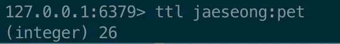
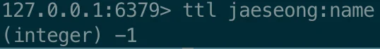
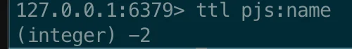

> 📖 
> 
> <a id="1c3eda9b0fe1814b892aed601fa3d96c"></a>
> 
> Redis는 여러가지 자료 구조(string, list, hash, Set, sorted Set 등)나 수없이 많은 명령어(SET, GET, EXISTS, DEL, HSET 등) 가 있다&#46;
> 
> <a id="1c3eda9b0fe181a7a28df9511b4f9f74"></a>
> 
> 그러나 해당 챕터에서는  <code>파레토 법칙</code> 에 입각하여  <strong><u>가장 중요한 개념 7가지</u></strong>만 빠르게 학습을 진행한다&#46;

<a id="1c3eda9b0fe181c2a026f0471a775b02"></a>

## Redis 기본 명령어 

---

<details>
<summary>1&#46; 데이터 ( Key, Value ) 저장&#58; <code>set</code> &#91;  key &#93; &#91; value &#93;</summary>

<a id="1c3eda9b0fe18131b8d2fa9e3b914e62"></a>

```bash
# 데이터 저장: set [key] [value]
set jaeseong:name "jaeseong park" # 띄워쓰기 해서 저장하려면 쌍따옴표로 묶어주면 됨

set jaeseong:hobby soccer
```

</details>

<details>
<summary>2&#46; 데이터 조회&#58; <code>keys</code>, <code>get</code> &#91; key &#93; </summary>

<a id="1c3eda9b0fe181928a68ed59e44ed9de"></a>

```bash
# 전체 key 조회
keys *
	# 1) "jaeseong:hobby"
  # 2) "jaeseong:name"
  

# 특정 데이터 조회: get [key 이름]
get jaeseong:name 
  # "jaeseong park"

get jaeseong:hobby 
  # "soccer"
  

get pjs:name # 없는 데이터를 조회할 경우 (nil)이라고 출력됨
```

</details>

<details>
<summary>3&#46; 데이터 삭제&#58; <code>del</code> &#91; key &#93;</summary>

<a id="1c3eda9b0fe181e4b7c7ffc6ba5286b4"></a>

```bash
# 특정 데이터 삭제: del [key 이름]
$ del jaeseong:hobby

# 삭제확인
$ get jaeseong:hobby 
  # (nil)
```

</details>

<details>
<summary>4&#46; 데이터 저장 시, 만료시간 ( TTL )  설정</summary>

> ✏️ 
> 
> <a id="1c3eda9b0fe181bda098ef1125b3b1c8"></a>
> 
> Redis는 RDBNS와 다르게 <strong><u>데이터 저장 시 만료시간을 설정</u></strong>할 수있다&#46;
> 
> - 영구적으로 데이터를 저장하지 않고 <strong><u>일정 시간이 되면 데이터가 삭제</u></strong>된다&#46; 
> 
> <a id="1c3eda9b0fe181b4a28fdefedec51184"></a>
> 
> <br>Redis의 특성상 <strong><u>메모리 공간이 한정</u></strong> 되어 있기 때문에, <strong><u>모든 데이터를 레디스에 저장할 수 없</u></strong>다&#46; 
> 
> - <strong><u>만료 시간(TTL)을 활용</u></strong>해  <strong><u>자주 사용되는 데이터만 Redis에 저장</u></strong>하여 사용한다&#46; 

<a id="1c3eda9b0fe1813182fbdff42392af92"></a>

```bash
# 저장 시 만료시간 설정: set [key 이름] [value] ex [만료 시간(초)]
set jaeseong:pet dog ex 30
```

</details>

<details>
<summary>5&#46; 만료시간(TTL) 확인&#58; <code>ttl</code> &#91; key &#93;</summary>

<a id="1c3eda9b0fe1811d998be66098c80c45"></a>

```bash
# ttl [key 이름]
	# 1) 남은 시간 반환
	# 2) 키가 없는 경우: -2 반환
	# 3) 만료시간이 설정되지 않은 경우: -1 반환

ttl jaeseong:pet 

ttl jaeseong:name

ttl pjs:name
```

- 남은 만료시간 조회
    

- 만료시간 설정 X, <code>&#45;1</code> 반환
    

- key 존재 X, <code>&#45;2</code> 반환
    

</details>

<details>
<summary>6&#46; 모든 데이터 삭제&#58; <code>flushall</code></summary>

<a id="1c3eda9b0fe181099a4af9d84a890a29"></a>

```bash
flushall
```

</details>
