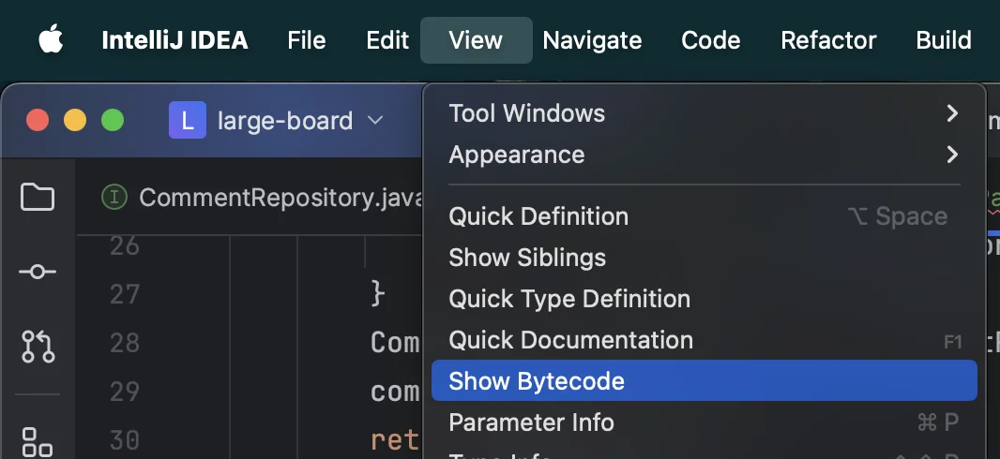
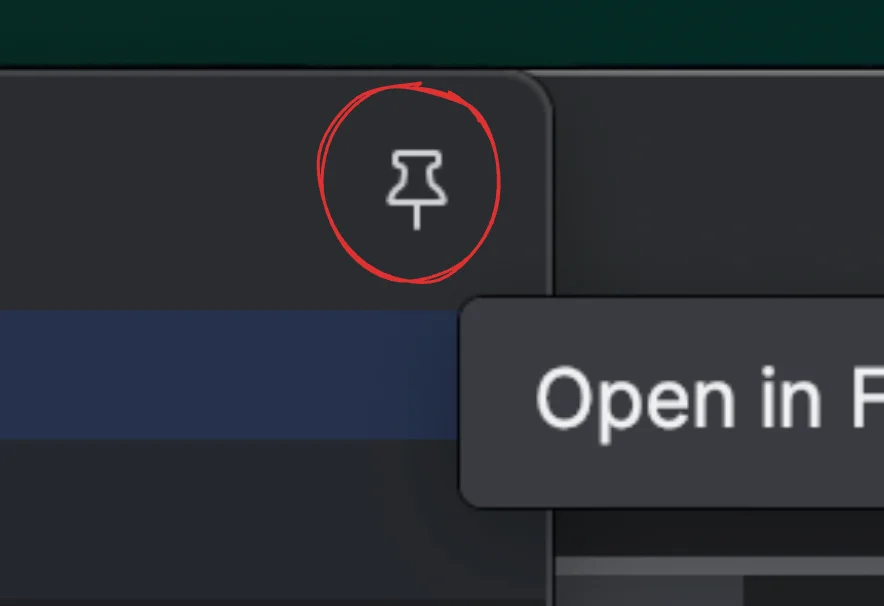
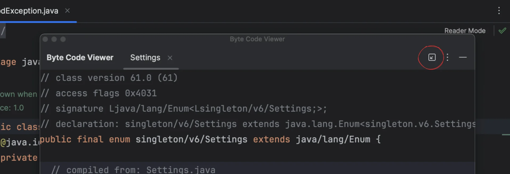
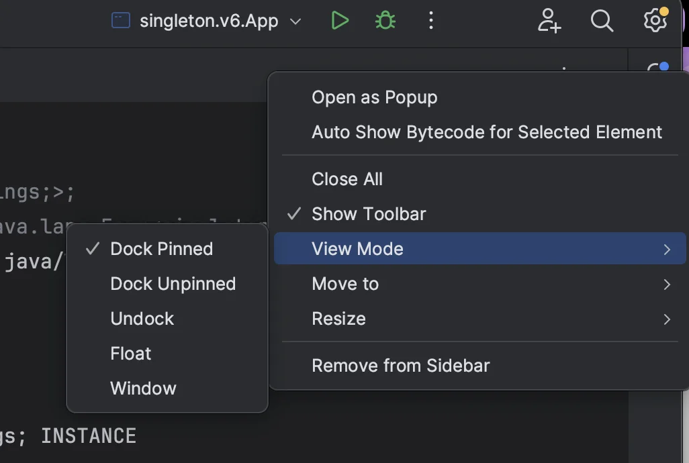

### 바이트 코드 확인

- 방법 1 
    1. <code>shift</code> x 2

    1. <code>show byte code</code>

- 방법 2
    1. view &#45; show byte code  클릭
        

### 뷰 모드 &#45; Dock pinned

- pin 아이콘 클릭
    

    

    해당 아이콘을 클릭해야 메뉴 아이콘이 보인다&#46; 

    

- 메뉴(…) &#45; View Mode &#45; Dock Pinned
    
