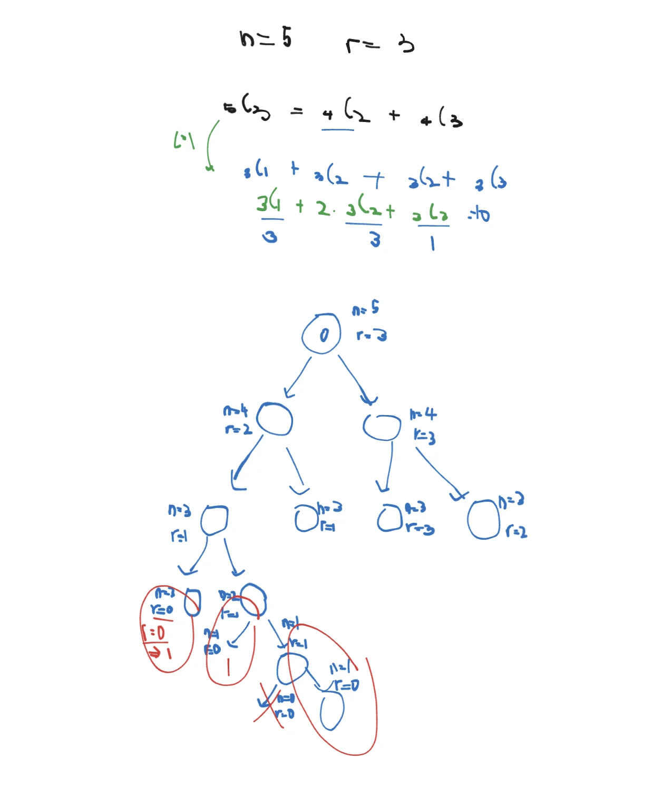
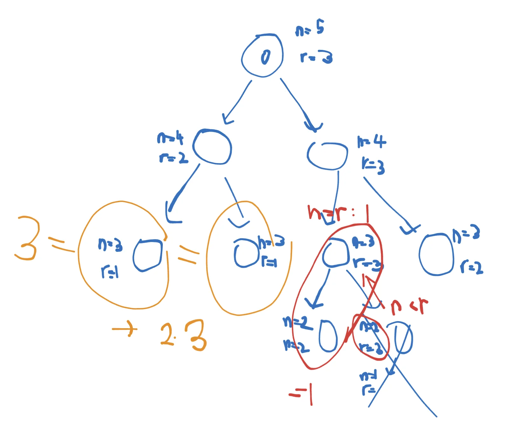

<a id="1c3eda9b0fe1817ba042d56f71affe4a"></a>

# 문제

<a id="1c3eda9b0fe18104a5e2d097a7f1f711"></a>

## <strong>7&#46; 조합의 경우수(메모이제이션)</strong>

---

<a id="1c3eda9b0fe18192bde7c2c45184dcf0"></a>

### 설명


<a id="1c3eda9b0fe1815592aac2767d322f06"></a>

로 계산합니다&#46;

<a id="1c3eda9b0fe181538e37d4c495104b1b"></a>

하지만 여러분은 이 공식을 쓰지않고 다음 공식을 사용하여 재귀를 이용해 조합수를 구해주는 프로그램을 작성하세요&#46;


<a id="1c3eda9b0fe18149abc5c2471cd99d82"></a>

### 입력

<a id="1c3eda9b0fe181748825d4dfc112128f"></a>

첫째 줄에 자연수 n(3&#60;=n&#60;=33)과 r(0&#60;=r&#60;=n)이 입력됩니다&#46;

<a id="1c3eda9b0fe181faa6ade41e856963e6"></a>

### 출력

<a id="1c3eda9b0fe1819ab2c4fc44fd888202"></a>

첫째 줄에 조합수를 출력합니다&#46;

---

<a id="1c3eda9b0fe1811d821ee58d47f3fe5f"></a>

### 예시 입력 1

<a id="1c3eda9b0fe18180ac2df9d375cff9ac"></a>

```plaintext
5 3
```

<a id="1c3eda9b0fe181bfad92f4e01642f821"></a>

### 예시 출력 1

<a id="1c3eda9b0fe181ab92c0ee2e821fe78f"></a>

```plaintext
10
```

---

<a id="1c3eda9b0fe1811c9cd2f13d0b4d92fa"></a>

### 예시 입력 2

<a id="1c3eda9b0fe1815682b8dd55fde3e6de"></a>

```plaintext
33 19
```

<a id="1c3eda9b0fe181188233e87f1e6edd8a"></a>

### 예시 출력 2

<a id="1c3eda9b0fe181f8a3fed78ffd469627"></a>

```plaintext
818809200
```

<a id="1c3eda9b0fe181cbb25eccdbe8f93b33"></a>

# 풀이

<a id="1c3eda9b0fe18102b3ece477920a40e3"></a>

## 풀이1) <code>내풀이</code>  DFS, 백트래킹

<a id="1c3eda9b0fe18170a15bf2f2f9ad10ec"></a>

### 1) 1차 풀이 

<a id="1c3eda9b0fe18108bee3dbe0f64cecb0"></a>

&#91; <strong>예제 입력 1 &#93;</strong>을 기준으로 구현



<a id="1c3eda9b0fe181b1ac78db6256cd99cd"></a>

```java
public class Main {
    static int cnt;
    public void DFS(int n, int m){
        if(n<0) return;
        if(m==0) cnt++;
        else {
            DFS(n-1, m-1);
            DFS(n-1, m);
        }
    }

    public static void main(String args[]) {
        Main T=new Main();
        Scanner sc=new Scanner(System.in);
        int n=sc.nextInt();
        int m=sc.nextInt();
        T.DFS(n, m);
        System.out.println(cnt);
    }
}
```

<a id="1c3eda9b0fe1815e8f5ce8d2d9755183"></a>

### 2) 2차 풀이

<a id="1c3eda9b0fe18127ae61fcbba71e44c9"></a>

```java
import java.util.*;

public class Main {
    static int cnt;
    public void DFS(int n, int m){
        if(n<=0) return;
        if(m==1) cnt+=n;
        else {
            DFS(n-1, m-1);
            DFS(n-1, m);
        }
    }

    public static void main(String args[]) {
        Main T=new Main();
        Scanner sc=new Scanner(System.in);
        int n=sc.nextInt();
        int m=sc.nextInt();
        T.DFS(n, m);
        System.out.println(cnt);
    }
}
```

<a id="1c3eda9b0fe181b884f3e9a581cce587"></a>

### 3) 3차 풀이, 백트래킹 개선



<a id="1c3eda9b0fe181efbe19daaf35cfc36a"></a>

```java
import java.util.*;

public class Main {
    static int cnt;
    public void DFS(int n, int m){
        if(n<m) return;
        if(n==m) {
            cnt++;
            return;
        }
        if(m==1) cnt+=n;
        else {
            DFS(n-1, m-1);
            DFS(n-1, m);
        }
    }

    public static void main(String args[]) {
        Main T=new Main();
        Scanner sc=new Scanner(System.in);
        int n=sc.nextInt();
        int m=sc.nextInt();
        T.DFS(n, m);
        System.out.println(cnt);
    }
}
```

<a id="1c3eda9b0fe181919c1bf222229d12b5"></a>

## 풀이2 )<code>강의풀이</code>  DFS, 메모제이션

<a id="1c3eda9b0fe1815f9962d9b49600b495"></a>

```java
import java.util.*;

public class Main {
    //  n값 범위: 3 <= n <= 33
    int[][] dy=new int[35][35];
    public int DFS(int n, int r){
        if(dy[n][r]>0) return dy[n][r]; // 메모제이션
        if(n==r || r==0) return 1;
        else return dy[n][r]=dy[n][n-r]=DFS(n-1, r-1) + DFS(n-1, r);
    }

    public static void main(String args[]) {
        Main T=new Main();
        Scanner sc=new Scanner(System.in);
        int n=sc.nextInt();
        int r=sc.nextInt();
        System.out.println(T.DFS(n, r));
    }
}
```

<a id="1c3eda9b0fe181ceaea0cbe134963d91"></a>

## 풀이3) 2차 풀이(복습)

<a id="1c3eda9b0fe1819782c2ee551e4928d0"></a>

```java
import java.util.*;

public class Main {
    static int[][] memo;

    // combi = combination(조합)
    public int combi(int n, int r) {
        if(memo[n][r]>0) return memo[n][r];
        if(n==r || r==0) return 1;
        else return memo[n][r]=memo[n][n-r]=combi(n-1, r-1)+combi(n-1, r);
    }

    public static void main(String args[]) {
        Main T=new Main();
        Scanner sc=new Scanner(System.in);
        int n=sc.nextInt();
        int r=sc.nextInt();
        memo=new int[n+1][n+1];
        System.out.println(T.combi(n, r));
    }
}
```
