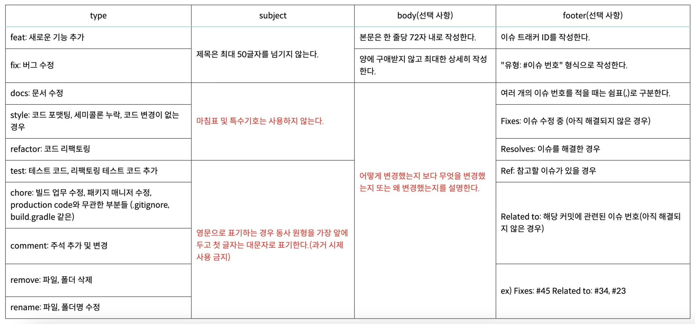

<a id="1c3eda9b0fe1814c9c7adad0ad79a3b4"></a>

### <strong>Github Commit Rules</strong>

<details>
<summary>reference</summary>

[docs.google.com](https://docs.google.com/document/d/1e_MQc_VRJFc8p-1dJQQNS58CU7XM6rteLJFxMfTcj0c/edit?tab=t.0)

<a id="1c3eda9b0fe18163bb77de36b8cf8426"></a>

‣<br>

</details>

<a id="1c3eda9b0fe18124aa9cdf97a3a88bd9"></a>

### git emoji convention 1

|  |  |  |  |
| --- | --- | --- | --- |
| 아이콘 | 코드 | 설명 | 원문 |
| 🎨 | &#58;art&#58; | 코드의 구조/형태 개선 | Improve structure / format of the code&#46; |
| ⚡️ | &#58;zap&#58; | 성능 개선 | Improve performance&#46; |
| 🔥 | &#58;fire&#58; | 코드/파일 삭제 | Remove code or files&#46; |
| 🐛 | &#58;bug&#58; | 버그 수정 | Fix a bug&#46; |
| 🚑 | &#58;ambulance&#58; | 긴급 수정 | Critical hotfix&#46; |
| ✨ | &#58;sparkles&#58; | 새 기능 | Introduce new features&#46; |
| 📝 | &#58;memo&#58; | 문서 추가/수정 | Add or update documentation&#46; |
| 💄 | &#58;lipstick&#58; | UI/스타일 파일 추가/수정 | Add or update the UI and style files&#46; |
| 🎉 | &#58;tada&#58; | 프로젝트 시작 | Begin a project&#46; |
| ✅ | &#58;white&#95;check&#95;mark&#58; | 테스트 추가/수정 | Add or update tests&#46; |
| 🔒 | &#58;lock&#58; | 보안 이슈 수정 | Fix security issues&#46; |
| 🔖 | &#58;bookmark&#58; | 릴리즈/버전 태그 | Release / Version tags&#46; |
| 💚 | &#58;green&#95;heart&#58; | CI 빌드 수정 | Fix CI Build&#46; |
| 📌 | &#58;pushpin&#58; | 특정 버전 의존성 고정 | Pin dependencies to specific versions&#46; |
| 👷 | &#58;construction&#95;worker&#58; | CI 빌드 시스템 추가/수정 | Add or update CI build system&#46; |
| 📈 | &#58;chart&#95;with&#95;upwards&#95;trend&#58; | 분석, 추적 코드 추가/수정 | Add or update analytics or track code&#46; |
| ♻️ | &#58;recycle&#58; | 코드 리팩토링 | Refactor code&#46; |
| ➕ | &#58;heavy&#95;plus&#95;sign&#58; | 의존성 추가 | Add a dependency&#46; |
| ➖ | &#58;heavy&#95;minus&#95;sign&#58; | 의존성 제거 | Remove a dependency&#46; |
| 🔧 | &#58;wrench&#58; | 구성 파일 추가/삭제 | Add or update configuration files&#46; |
| 🔨 | &#58;hammer&#58; | 개발 스크립트 추가/수정 | Add or update development scripts&#46; |
| 🌐 | &#58;globe&#95;with&#95;meridians&#58; | 국제화/현지화 | Internationalization and localization&#46; |
| 💩 | &#58;poop&#58; | 똥싼 코드 | Write bad code that needs to be improved&#46; |
| ⏪ | &#58;rewind&#58; | 변경 내용 되돌리기 | Revert changes&#46; |
| 🔀 | &#58;twisted&#95;rightwards&#95;arrows&#58; | 브랜치 합병 | Merge branches&#46; |
| 📦 | &#58;package&#58; | 컴파일된 파일 추가/수정 | Add or update compiled files or packages&#46; |
| 👽 | &#58;alien&#58; | 외부 API 변화로 인한 수정 | Update code due to external API changes&#46; |
| 🚚 | &#58;truck&#58; | 리소스 이동, 이름 변경 | Move or rename resources (e&#46;g&#46;&#58; files paths routes)&#46; |
| 📄 | &#58;page&#95;facing&#95;up&#58; | 라이센스 추가/수정 | Add or update license&#46; |
| 💡 | &#58;bulb&#58; | 주석 추가/수정 | Add or update comments in source code&#46; |
| 🍻 | &#58;beers&#58; | 술 취해서 쓴 코드 | Write code drunkenly&#46; |
| 🗃 | &#58;card&#95;file&#95;box&#58; | 데이터베이스 관련 수정 | Perform database related changes&#46; |
| 🔊 | &#58;loud&#95;sound&#58; | 로그 추가/수정 | Add or update logs&#46; |
| 🙈 | &#58;see&#95;no&#95;evil&#58; | &#46;gitignore 추가/수정 | Add or update a &#46;gitignore file&#46; |

<a id="1c3eda9b0fe181d2b3d6cef0246330d7"></a>

### git emoji convention 2

|  |  |
| --- | --- |
| <strong>작업 타입</strong> | <strong>작업내용</strong> |
| ✨ update | 해당 파일에 새로운 기능이 생김 |
| 🎉 add | 없던 파일을 생성함, 초기 세팅 |
| 🐛 bugfix | 버그 수정 |
| ♻️ refactor | 코드 리팩토링 |
| 🩹 fix | 코드 수정 |
| 🚚 move | 파일 옮김/정리 |
| 🔥 del | 기능/파일을 삭제 |
| 🍻 test | 테스트 코드를 작성 |
| 💄 style | css |
| 🙈 gitfix | gitignore 수정 |
| 🔨script | package&#46;json 변경(npm 설치 등) |
| 🧤chore | 기타 잡무 |

<a id="1c3eda9b0fe18121b7d8e7bb010910bb"></a>

### git commit message



<a id="1c3eda9b0fe181e0a03efd03ab47aa84"></a>

```plaintext
type: subject

body

footer
```

<details>
<summary>subject</summary>

<a id="1c3eda9b0fe181aca6e7db53c4824497"></a>

```plaintext
# Add : 추가
# Remove : 삭제
# Simplify : 단순화
# Update : 보완
# Implement : 구현
# Prevent : 방지
# Move : 이동
# Rename : 이름 변경
```

</details>

<details>
<summary>body</summary>


</details>

<details>
<summary>ex) </summary>

- ex 1)
    <a id="1c3eda9b0fe181c5a2b2f60e4f497b1a"></a>

    ```plaintext
    feat: "로그인 기능 구현"

    로그인 시 JWT 발급

    Resolves: #111
    Ref: #122
    related to: #30, #50
    ```

- ex 2)
    <a id="1c3eda9b0fe181d488def2048d3af022"></a>

    ```plaintext
    fix: Update Login Logic
    ```

- ex 3)
    <a id="1c3eda9b0fe18187a854ddb3a48a3512"></a>

    ```plaintext
    chore: Update git.ignore

    database 관련 중요 정보 변경 감추기 위해 
    .gitignore에 application-database.properties 추가
    ```

</details>

<a id="1c3eda9b0fe18192a8deeddcca1e21ec"></a>

### git commit message template

<details>
<summary>template</summary>

<a id="1c3eda9b0fe181c79ec8f627c1be802a"></a>

```plaintext
# my commit message template
# 본문과 푸터는 선택 사항입니다.
##################
# type: Subject (아래에 작성)

# Body(아래에 작성)

# Footer(아래에 작성)
##################
# feat: 새로운 기능 추가
# fix: 버그 수정
# docs: 문서 수정
# style: 코드 포맷팅, 세미콜론 누락, 코드 변경이 없는 경우
# refactor: 코드 리팩토링
# test: 테스트 코드, 리팩토링 테스트 코드 추가
# chore: 빌드 업무 수정, 패키지 매니저 수정, production code와 무관한 부분들 (.gitignore, build.gradle 같은)
# comment: 주석 추가 및 변경
# remove: 파일, 폴더 삭제
# rename: 파일, 폴더명 수정
##################
# 영어로 Subject 작성 시
# Add : 추가
# Remove : 삭제
# Simplify : 단순화
# Update : 보완
# Implement : 구현
# Prevent : 방지
# Move : 이동
# Rename : 이름 변경
##################
# 예시
# feat: "로그인 기능 구현"

# 로그인 시 JWT 발급

# Resolves: #111
# Ref: #122
# related to: #30, #50
```

</details>

- 템플릿 적용
    - <code>—local</code>&#58; 특정 프로젝트에만 사용한 템플릿인 경우 적용 

    <a id="1c3eda9b0fe181f9bd7dc6712c58ae2f"></a>

    ```plaintext
    git config --global commit.template <.gitmessage.txt 경로>
    ```
