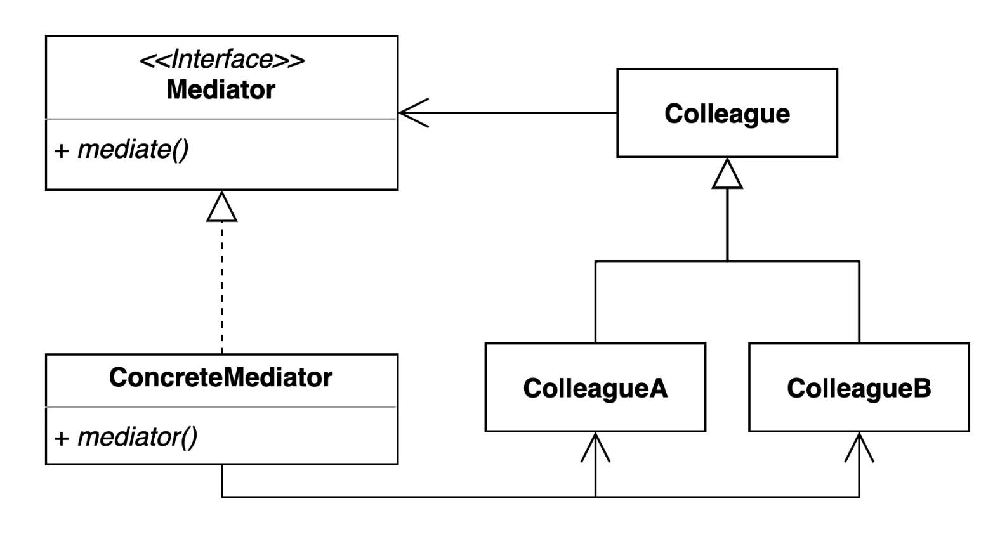
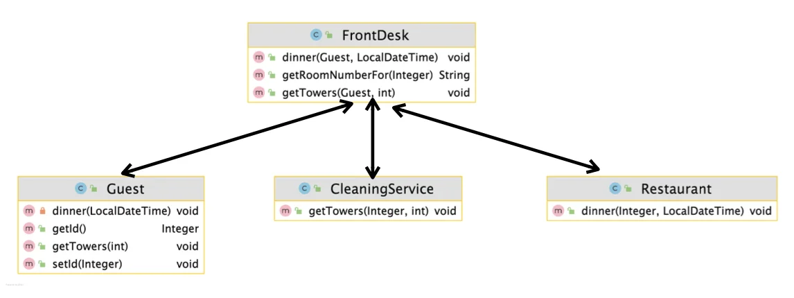
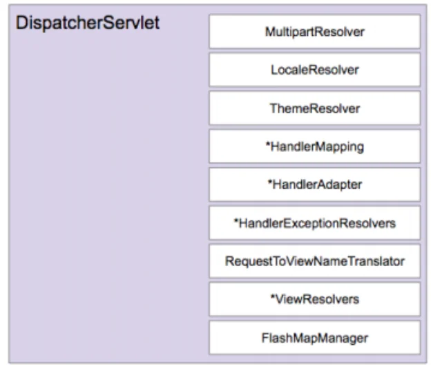

> 📝 
> 
> <a id="1dbeda9b0fe1803ca7abdd671a4010f2"></a>
> 
> <strong>질문</strong>
> 
> <details>
> <summary>중재자 패턴이란 무엇인가?</summary>
> 
> 
> 
> </details>
> 
> <details>
> <summary>중재자 패턴의 장단점은 </summary>
> 
> 
> 
> </details>
> 
> <details>
> <summary>실무 활용 예제는?</summary>
> 
> 
> 
> </details>

<a id="1dbeda9b0fe180439e64e7d89ea804e5"></a>

## 중재자 패턴

---

> 📖 
> 
> <a id="1dbeda9b0fe1807fbcd4dad46d496113"></a>
> 
> 중재자 패턴 
> 
> ---
> 
> > <strong><u>객체들 간의 복잡한 상호작용</u></strong><strong>을 </strong><strong><u>하나의 중재자 객체(Mediator)로 캡슐화</u></strong><strong>하여,</strong><strong><u> 객체들 간의 </u></strong><strong><u>직접적인 의존성을 제거</u></strong><strong>하는 패턴</strong>
> 
> <a id="1dbeda9b0fe18027bd50f15ed5fdb60b"></a>
> 
> → 여러 컴포넌트 간의 결합도를 중재자를 통해 낮춘다&#46;
> 
> 
> 
> <details>
> <summary>주요 특징</summary>
> 
> - 객체들 간의 직접적인 상호작용을 제거하고, <strong><u>중재자 객체가 모든 통신을 담당</u></strong>한다&#46; 
> 
> - <strong><u>복잡한 M&#58;N 관계</u></strong>를 <u>단순한 M&#58;1 관계</u>로 바꿔준다&#46; 
> 
> - <strong><u>각 객체는 중재자만 알</u></strong><strong>면 되므로 </strong><strong><u>느슨한 결합(loose coupling)을 유지</u></strong>할 수 있다&#46;
> 
> - 프로그램의 <strong>실행 행위를 유연하게 변경</strong>할 수 있다&#46;
> 
> </details>
> 
> <details>
> <summary>구성 요소</summary>
> 
> - <strong><code>Mediator</code></strong> ( 중재자 )
>     - 여러 객체(동료 객체) 사이의 상호작용을 조정하는 역할
> 
> - <strong><code>ConcreteMediator</code></strong><strong> ( 중재자 구현체 )</strong>
>     - 실제 동료들의 요청을 받아서 필요한 동료(객체)에게 전달
> 
> - <strong><code>Colleague</code></strong> ( 동료 객체 )
>     - 중재자에 의해 관리되는 객체로, 직접 다른 객체와 통신하지 않고 중재자를 통해서만 메시지를 주고 받는다&#46; 
> 
> > ✏️ 
> > 
> > <a id="1dbeda9b0fe180719e41f8ed53b18577"></a>
> > 
> > <strong>동작 흐름</strong>
> > 
> > ---
> > 
> > 1. <code>Colleague</code> 객체는 어떤 이벤트가 발생하면 <code>Mediator</code>에게 알린다&#46;
> > 
> > 1. <code>Mediatort</code>는 어떤 <code>Colleague</code> 객체가 어떤 요청을 했는지 판단한다&#46; 
> > 
> > 1. 필요에 따라 다른 <code>Colleague</code>에게 메세지를 전달하거나, 작업을 지시한다&#46;
> 
> </details>
> 
> <details>
> <summary>장•단점</summary>
> 
> > 장점
> 
> - 객체 사이의 결합도를 낮춰 확장 및 재사용, 유지보수를 용이하게 한다&#46; 
>     - OCP, SRP 준수
> 
> > 단점
> 
> - Mediator에 <strong>모든 로직이 몰리면</strong>, Mediator가 과도하게 비대해질 수 있음
>     - 따라서 적절한 분산 및 관리가 필요함
> 
> - Colleague가 Mediator 없이 독립적으로 움직이지 않으므로, 의존도가 Mediator로 몰림
> 
> </details>
> 
> <details>
> <summary>활용 예제</summary>
> 
> - 채팅방 시스템 ( 여러 유저가 대화할 때 중앙 서버가 메세지 전달 )
> 
> - GUI 버튼 클릭 시 이벤트 전달
> 
> - 항공기 이착륙 관제 (여러 비행기가 서로 직접 통신하는 대신, 관제탑이 중재)
> 
> </details>
> 
> <details>
> <summary>정리 </summary>
> 
> | <strong>항목</strong> | <strong>내용</strong> |
> | --- | --- |
> | 목적 | 객체 간 복잡한 연결 제거 |
> | 구성요소 | <code>Mediator</code>, <code>ConcreteMediator</code>, <code>Colleague</code> |
> | 장점 | 구조 단순화, 객체 간 결합도 감소 |
> | 단점 | Mediator가 너무 커질 위험 |
> | 실전 예시 | 채팅 서버, 이벤트 시스템, 항공 관제탑 등 |
> 
> </details>

<details>
<summary>🧐 DIP 적용 만으로 의존성을 낮출 수 있지 않는가??</summary>

<a id="1dbeda9b0fe18051a862df26a1b6de85"></a>

<strong>문제 코드</strong>

<a id="1dbeda9b0fe1803382f8c759e97f4de1"></a>

```java
// Gym
public class Gym {
    private CleaningService cleaningService = new CleaningService();


// Restaurant
public class Restaurant {
    private CleaningService cleaningService = new CleaningService();

// Guest
public class Guest {
		private Restaurant restaurant = new Restaurant();
    private CleaningService cleaningService = new CleaningService();
```

<a id="1dbeda9b0fe1801cafb8f3ad52525fdf"></a>

DIP 적용

<a id="1dbeda9b0fe180858030d7e3ba17d70c"></a>

```java
// DIP 적용: 생성자 주입
public class Gym {
    private CleaningService cleaningService;
    
    public Gym(CleaningService cleaningService) {
				this.cleaningService = cleaningService;
    }

// 나머지 로직도 동일
```

- DIP &#45; 생성자 주입을 통해 객체 내부의 직접적인 인스턴스 생성(의존성)을 제거했다&#46; 

- 그러나 여전히 <strong>객체들 간 관계 자체의 복잡성</strong>은 그대로이다&#46;
    - <code>Guest</code>가 <code>CleaningService</code>를 직접 호출

    - <code>Guest</code>가 <code>Restaurant</code>를 직접 호출

    - <code>Restaurant</code>도 <code>CleaningService</code>를 직접 호출

- 따라서 <strong>하나의 객체가 변경</strong>되면 연관 모든 객체들에게 영향을 준다&#46;
    <a id="1dbeda9b0fe180699cc4fc37f559dbf8"></a>

    → <strong>확장성 및 재사용성, 유지보수성이 떨</strong><strong>어진다&#46; </strong><br>

</details>

<details>
<summary>🧐 <code>프론트 컨트롤러 패턴</code>과 차이점은?</summary>

<a id="1dbeda9b0fe18016aa01f6e3ad75740c"></a>

<strong><u>둘다 </u></strong><strong><u>중앙 집중화</u></strong><strong><u>는 맞</u></strong>지만, ‘<strong><u>어떤 관점(목적)에서 중앙 집중화를 하느냐’</u></strong>가 다르다&#46;

- <code>중재자 패턴</code>&#58; <u>객체 간 상호작용 조정</u>,

-  <code>프론트 컨트롤러 패턴</code>&#58; <strong><u>요청(Request) 흐름 제어 </u></strong>

| &#45; | 목적 | 대상 | 역할 |
| --- | --- | --- | --- |
| <code>중재자 패턴</code><br>( <code>Mediator Pattern</code> )  | <strong><u>객체들 간의 통신 복잡성을 줄</u></strong>이기 위한 중앙 집중화 | 서로 대화하는 여러 객체들(Colleague) | <strong><u>객체 간 상호작용 조정</u></strong>에 초점 |
| <code>프론트 컨트롤러 패턴</code><br>( <code>Front Controller Pattern</code> )  | <strong><u>요청(Request) 흐름을 통제하고 일관성 있게 관리</u></strong>하기 위한 중앙 집중화  | &#91; 클라이언트 → 서버 &#93; 들어오는 요청(Request)  | <strong><u>요청 분배 및 흐름 제어</u></strong>에 초점<br> |

<details>
<summary>테이블 2</summary>

|  |  |  |
| --- | --- | --- |
| <strong>구분</strong> | <strong>중재자 패턴</strong> | <strong>프론트 컨트롤러 패턴</strong> |
| 목적 | 객체 간 통신 복잡성 감소 | 웹 요청 흐름 통합 관리 |
| 중심이 되는 대상 | 여러 객체(Colleague) | 클라이언트 요청(Request) |
| 하는 역할 | 객체들 간 메시지 라우팅 | 요청 라우팅 &#43; 공통 처리 (ex&#46; 인증, 로깅) |
| 주로 사용하는 곳 | 어플리케이션 내부 비즈니스 로직 | 웹 서버, MVC 프레임워크(서블릿) |
| 예시 | 채팅앱 사용자 간 통신 조정 | Spring MVC DispatcherServlet |

</details>

> ✏️ 
> 
> <a id="1dbeda9b0fe18090b26cc7c32e070355"></a>
> 
> 비유
> 
> - <strong><code>중재자 패턴</code></strong> &#58; 회사 부서들끼리 직접 연락하지 않고, <strong>비서실(Mediator)</strong>을 통해 연락
> 
> - <strong><code>프론트 컨트롤러 패턴</code></strong> &#58; 고객이 회사에 전화하면 <strong>대표전화(Front Controller)</strong>가 받아서, 필요한 부서로 연결

</details>

<a id="1dbeda9b0fe180d986e6ef38f5fbb345"></a>

### 1&#46; 기본 예제

<a id="1dbeda9b0fe180b1a87be88fe672bcd6"></a>

### 코드

<details>
<summary>&#91; 코드 &#93; CleaningService</summary>

<a id="1dbeda9b0fe1808f8792f9007fd8ccdd"></a>

```java
package _03_behavioral_patterns._17_mediator._01_before;

public class CleaningService {

    public void clean(Gym gym) {
        System.out.println("clean " + gym);
    }

    public void getTower(Guest guest, int numberOfTower) {
        System.out.println(numberOfTower + " towers to " + guest);
    }

    public void clean(Restaurant restaurant) {
        System.out.println("clean " + restaurant);
    }
}

```

</details>

<details>
<summary>&#91; 코드 &#93; Gym</summary>

<a id="1dbeda9b0fe180199780dae8c678ef73"></a>

```java
package _03_behavioral_patterns._17_mediator._01_before;

public class Gym {

    private CleaningService cleaningService = new CleaningService();

    public void clean() {
        cleaningService.clean(this);
    }
}
```

</details>

<details>
<summary>&#91; 코드 &#93; Restaurant</summary>

<a id="1dbeda9b0fe180b0ac1afdeb6c5d1c39"></a>

```java
package _03_behavioral_patterns._17_mediator._01_before;

public class Restaurant {

    private CleaningService cleaningService = new CleaningService();

    public void dinner(Guest guest) {
        System.out.println("dinner " + guest);
    }

    public void clean() {
        cleaningService.clean(this);
    }
}

```

</details>

<details>
<summary>&#91; 코드 &#93; Guest</summary>

<a id="1dbeda9b0fe1808f8a0ecc7a12c0097e"></a>

```java
package _03_behavioral_patterns._17_mediator._01_before;

public class Guest {

    private Restaurant restaurant = new Restaurant();

    private CleaningService cleaningService = new CleaningService();

    public void dinner() {
        restaurant.dinner(this);
    }

    public void getTower(int numberOfTower) {
        cleaningService.getTower(this, numberOfTower);
    }
}
```

</details>

<details>
<summary>&#91; 코드 &#93; Hotel</summary>

<a id="1dbeda9b0fe180eebb25efaa06e198ae"></a>

```java
package _03_behavioral_patterns._17_mediator._01_before;

public class Hotel {

    public static void main(String[] args) {
        Guest guest = new Guest();
        guest.getTower(3);
        guest.dinner();

        Restaurant restaurant = new Restaurant();
        restaurant.clean();
    }
}

```

</details>

<a id="1dbeda9b0fe180a3b5e0ef9fd1a92221"></a>

### 문제점

> ❗ 
> 
> <a id="1dbeda9b0fe18094aa41cf0370a1c9d0"></a>
> 
> <strong>강한 결합 ( tight coupling )</strong>
> 
> > <strong>객체 간 직접적인 의존성이 너무 강하다</strong>
> 
> - <strong><code>Guest</code></strong>는 <strong><code>Restaurant</code></strong>, <strong><code>CleaningService</code></strong>를 직접 생성(new)하고 직접 호출한다&#46; 
> 
> - <strong><code>Restaurant</code></strong>에서 <strong><code>CleaningService</code></strong>를 직접 사용
> 
> - <strong><code>Gym</code></strong>도 <strong><code>CleaningService</code></strong>를 직접 사용

<a id="1dbeda9b0fe180e1bda2d8e54c3853f2"></a>

서로 직접 연결(direct dependency) 되어 있어 하나라도 수정되면 연관된 다른 객체들도 모두 수정해야 할 수 있다&#46;

<a id="1dbeda9b0fe18020a7f0dbacfc6275f5"></a>

⇒ <strong>강한 결합 ( tight coupling )</strong> 상태<br>⇒ 코드의 확장 및 변경이 어렵다, 유지보수 ↓

<a id="1dbeda9b0fe1808ca5aedb87bcea438b"></a>

### 2&#46; 패턴 적용

<a id="1dbeda9b0fe18046a821e8b12211ae06"></a>

### 코드



<details>
<summary>&#91; 코드 &#93; FrontDesk</summary>

<a id="1dbeda9b0fe1800a822fd3a503a7a0f8"></a>

```java
package _03_behavioral_patterns._17_mediator._02_after;

import java.time.LocalDateTime;

// 중재자 - Mediator
public class FrontDesk {

    private CleaningService cleaningService = new CleaningService();

    private Restaurant restaurant = new Restaurant();

    public void getTowers(Guest guest, int numberOfTowers) {
        cleaningService.getTowers(guest.getId(), numberOfTowers);
    }

    public String getRoomNumberFor(Integer guestId) {
        return "1111";
    }

    public void dinner(Guest guest, LocalDateTime dateTime) {
        restaurant.dinner(guest.getId(), dateTime);
    }
}
```

</details>

<details>
<summary>&#91; 코드 &#93; CleaningService</summary>

<a id="1dbeda9b0fe180538eaedea133bc65b8"></a>

```java
package _03_behavioral_patterns._17_mediator._02_after;

public class CleaningService {

    private FrontDesk frontDesk = new FrontDesk();

    public void getTowers(Integer guestId, int numberOfTowers) {
        String roomNumber = this.frontDesk.getRoomNumberFor(guestId);
        System.out.println("provide " + numberOfTowers + " to " + roomNumber);
    }
}

```

</details>

<details>
<summary>&#91; 코드 &#93; Guest</summary>

<a id="1dbeda9b0fe180e39555d2c76baf2a38"></a>

```java
package _03_behavioral_patterns._17_mediator._02_after;

import java.time.LocalDateTime;

public class Guest {
    private Integer id;
    private FrontDesk frontDest = new FrontDesk();

    public void getTowers(int numberOfTowers) {
        this.frontDest.getTowers(this, numberOfTowers);
    }

    private void dinner(LocalDateTime dateTime) {
        this.frontDest.dinner(this, dateTime);
    }

    public Integer getId() {
        return id;
    }

    public void setId(Integer id) {
        this.id = id;
    }
}

```

</details>

<details>
<summary>&#91; 코드 &#93; Restaurant</summary>

<a id="1dbeda9b0fe18049ace9db294693c5ce"></a>

```java
package _03_behavioral_patterns._17_mediator._02_after;

import java.time.LocalDateTime;

public class Restaurant {
    public void dinner(Integer id, LocalDateTime dataaTime) {

    }
}

```

</details>

<a id="1dbeda9b0fe18016ba20ca912dcb88ac"></a>

### NOTES

<a id="1dbeda9b0fe18066b44be0d34def86f7"></a>

중재자(FrontDest)를 통해서 객체 간의 의존성을 낮추고<br>객체의 상호작용을 중재자(<code>Mediator</code>)를 통하 중앙 집중적으로 관리 가능하다&#46;

<a id="1dbeda9b0fe1801b9cb7e2e9cb4e51fe"></a>

### 3&#46; 장•단점

- 장점
    - 컴포넌트 코드를 변경하지 않고 새로운 중재자를 만들어 사용할 수 있다&#46;

    - 각각의 컴포넌트 코드를 보다 간결하게 유지할 수 있다&#46;

- 단점
    - 중재자 역할을 하는 클래스의 복잡도와 결합도가 증가한다&#46;

<a id="1dbeda9b0fe180ceba0fe92807429722"></a>

### 4&#46; 실무 활용

> ✏️ 
> 
> > 자바
> 
> - ExecutorService
> 
> - Executor
> 
> > 스프링
> 
> <details>
> <summary>DispatcherServlet</summary>
> 
> 
> 
> </details>

<a id="1dbeda9b0fe180849582dd9395fde5f3"></a>

### 코드

<details>
<summary>&#91; 코드 &#93; HelloController</summary>

<a id="1dbeda9b0fe18068ba31dcde62a6492d"></a>

```java
package _03_behavioral_patterns._17_mediator._03_java;

import org.springframework.stereotype.Controller;
import org.springframework.web.bind.annotation.GetMapping;

@Controller
public class HelloController {

    @GetMapping("/hello")
    public String hello() {
        return "hello";
    }
}

```

</details>

<details>
<summary>&#91; 코드 &#93; MediatorInSpring</summary>

<a id="1dbeda9b0fe180af9750f3940fa203dc"></a>

```java
package _03_behavioral_patterns._17_mediator._03_java;

import org.springframework.web.servlet.DispatcherServlet;

public class MediatorInSpring {

    public static void main(String[] args) {
        DispatcherServlet dispatcherServlet;
    }
}

```

</details>
