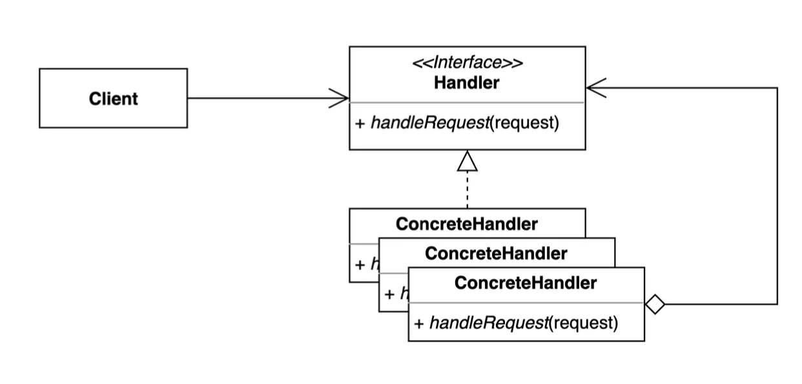
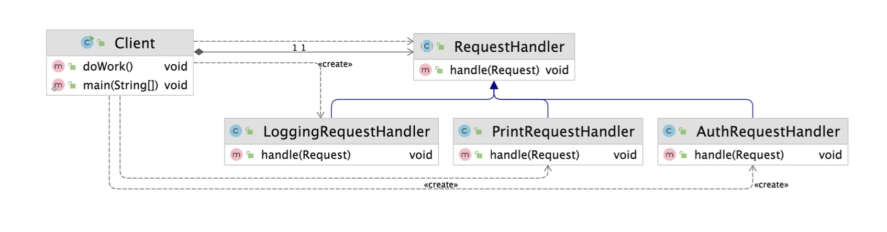
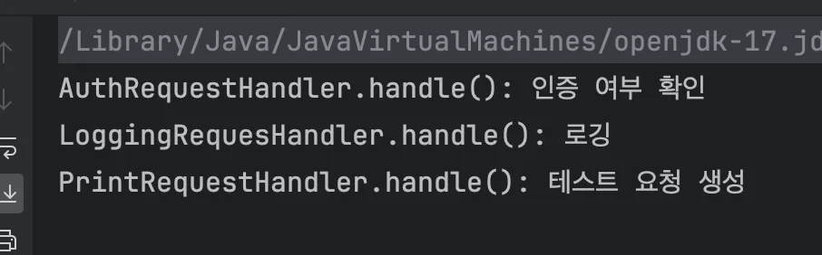
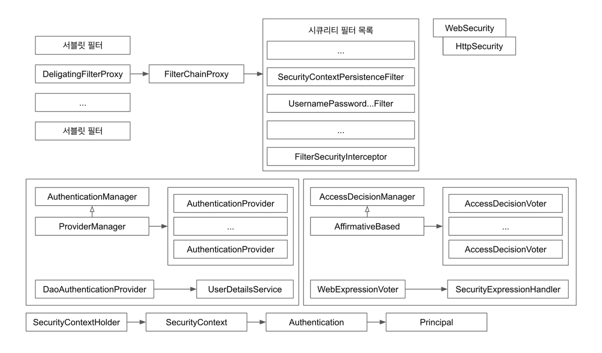

> 📝 
> 
> <a id="1d5eda9b0fe1809d8788d57aec1f226a"></a>
> 
> <strong>질문</strong>

<a id="1d5eda9b0fe180bab488fe53f5908bf7"></a>

## 책임 연쇄 패턴 ( Chain of Responsibility )

---

> 📖 
> 
> <a id="1d5eda9b0fe1804196f8c15f30c72c05"></a>
> 
> <strong>책임 연쇄 패턴 ( Chain of Responsibility )</strong>
> 
> ---
> 
> > <strong><u>요청을 보내는 쪽</u></strong>(<strong><code>sender</code></strong>) 과 <strong><u>요청을 처리하는 쪽</u></strong><strong>(</strong><strong><code>receiver</code></strong>) <strong>분리</strong>하는 패턴
> > 
> > - 핸들러 체인을 사용해 요청을 처리한다&#46;
> 
> 
> 
> <details>
> <summary>주요 특징</summary>
> 
> - <code>연쇄적 요청 처리</code>&#58; 요청을 처리할 수 없는 객체는 다음 객체로 책임을 전달하며, 체인의 끝까지 반복된다&#46; 
> 
> - <code>결합도 감소</code>&#58; 요청 발신자와 수신자 간의 결합을 느슨하게 만들어 유지보수를 용이하게 한다&#46; 
> 
> - <code>동적 구성 가능</code>&#58; 핸들러 체인은 런타임 시 동적으로 구성될 수 있다&#46; 
> 
> </details>
> 
> <details>
> <summary>구성 요소</summary>
> 
> - <code>Handler</code>&#58; 요청을 처리하거나 다음 핸들러로 전달하는 인터페이스 
> 
> - <code>ConcreteHandler</code>&#58;  실제로 요청을 처리하거나 전달하는 구체적인 핸들러
> 
> - <code>Client</code>&#58;  요청을 생성하고 체인의 첫 번째 핸들러에 전달
> 
> </details>
> 
> <details>
> <summary>사용 사례</summary>
> 
> - <code>게임 개발</code>&#58; 다양한 아이템 유형 별로 처리 로직을 구현할 때, 책임 연쇄 패턴으로 각 아이템의 처리를 위임 가능하다&#46; 
> 
> - <code>XML 파싱</code>&#58; 명령이 처리되거나 트리가 탐색될 때까지 재귀적으로 실행되는 경우
> 
> - <code>필터 체인 및 이벤트 처리</code>&#58; 여러 객체가 순차적으로 요청을 처리하는 시스템에서 유용
> 
> </details>
> 
> <details>
> <summary>장•단점</summary>
> 
> > 장점
> 
> - 객체 간 결합도 감소
> 
> - 새로운 핸들러 추가 시 기존 코드 수정 불필요
> 
> - 요청 처리 로직의  유연성 증가
> 
> > 단점
> 
> - 디버깅 어려움&#58; 체인이 길어질 경우 추적이 복잡해질 수 있음
> 
> - 성능 문제&#58; 체인의 길이에 따라 성능 저하 가능
> 
> </details>

<a id="1d5eda9b0fe180799714c3784cf3740c"></a>

### 1&#46; 기본 예제

<a id="1d5eda9b0fe18063bca7d632a7d8aac6"></a>

### 코드

<details>
<summary>&#91; 코드 &#93; Request</summary>

<a id="1d5eda9b0fe1800183c3f6cdbacf1219"></a>

```java
package _03_behavioral_patterns._13_chain_of_responsibilities._01_before;

public class Request {

    private String body;

    public Request(String body) {
        this.body = body;
    }

    public String getBody() {
        return body;
    }

    public void setBody(String body) {
        this.body = body;
    }
}

```

</details>

<details>
<summary>&#91; 코드 &#93; RequestHandler</summary>

<a id="1d5eda9b0fe1802aa1d9d3e8e22ee1fe"></a>

```java
package _03_behavioral_patterns._13_chain_of_responsibilities._01_before;

public class RequestHandler {

    public void handler(Request request) {
        System.out.println(request.getBody());
    }
}

```

</details>

<details>
<summary>&#91; 코드 &#93; AuthRequestHandler</summary>

<a id="1d5eda9b0fe180df99d7cd133425b5f2"></a>

```java
package _03_behavioral_patterns._13_chain_of_responsibilities._01_before;

public class AuthRequestHandler extends RequestHandler {

    public void handler(Request request) {
        System.out.println("인증이 되었나?");
        System.out.println("이 핸들러를 사용할 수 있는 유저인가?");
        super.handler(request);
    }
}

```

</details>

<details>
<summary>&#91; 코드 &#93; LoggingRequestHandler</summary>

<a id="1d5eda9b0fe1804aaa52e1557e691972"></a>

```java
package _03_behavioral_patterns._13_chain_of_responsibilities._01_before;

public class LoggingRequestHandler extends RequestHandler {

    @Override
    public void handler(Request request) {
        System.out.println("로깅");
        super.handler(request);
    }
}
```

</details>

<details>
<summary>&#91; 코드 &#93; Client</summary>

<a id="1d5eda9b0fe18088974bd2ddb680ce4a"></a>

```java
package _03_behavioral_patterns._13_chain_of_responsibilities._01_before;

public class Client {

    public static void main(String[] args) {
        Request request = new Request("테스트용 문구");
        LoggingRequestHandler requestHandler = new LoggingRequestHandler();
        requestHandler.handler(request);
    }
}
```

</details>

<a id="1d5eda9b0fe18085a582d85a22260309"></a>

### 2&#46; 패턴 적용

> ✏️ 
> 
> <a id="1d5eda9b0fe1809b87def596f88bc08f"></a>
> 
> <code>구성(composition)</code> 및 <code>상속(extends)</code>을 활용하여 연속적으로 처리할 객체를 정의하고 ( 래핑 구조 ) <br><code>super 메서드 호출 </code>(<code>super&#46;handle()</code>)을 통해 <strong><u>메서드 체이닝 (method chaining)</u></strong><u> 구조</u>를 만들어 책임을 연쇄적으로 처리할 수 있는 프로세싱을 만들 수 있다&#46;
> 
> <details>
> <summary>ex) <code>Handler</code> → <code>ConcretHandler</code> </summary>
> 
> <details>
> <summary>&#91; 코드 &#93; Handler</summary>
> 
> <a id="1d5eda9b0fe180bf9c55dd3b90276dca"></a>
> 
> ```java
> // Handler
> public abstract class RequestHandler {
> 	
> 		// Composition
>     private RequestHandler nextHandler;
> 		
> 		// DIP
>     public RequestHandler(RequestHandler nextHandler) {
>         this.nextHandler = nextHandler;
>     }
> 		
> 		// ConcretHandler들에서 연쇄적으로 처리될 체이닝 메서드
>     public void handle(Request request) {
>         if (nextHandler != null) {
>             nextHandler.handle(request);
>         }
>     }
> }
> ```
> 
> - Handler 내부에 구성(composition)을 활용할 필드를 정의하고 생성자 주입(DIP)를 통해 연쇄(래핑) 구조를 만든다&#46;
> 
> - 공통적(추상적) 처리되는 handle 메서드를 통해 연속 구조가 형성되는 경우, 즉, nextHandler가 있는 경우 해당 hanlder로 넘어가 handle 메서드가 호출된다&#46; 
> 
> </details>
> 
> <details>
> <summary>&#91; 코드 &#93; ConcretHandler</summary>
> 
> <a id="1d5eda9b0fe18065986decbf8e8471aa"></a>
> 
> ```java
> // ConcretHandler
> public class PrintRequestHandler extends RequestHandler {
> 
>     public PrintRequestHandler(RequestHandler nextHandler) {
>         super(nextHandler);
>     }
> 
>     @Override
>     public void handle(Request request) {
>         System.out.println(request.getBody());
>         super.handle(request);
>     }
> }
> ```
> 
> - super 키워드를 통해 상위 handler의 handle 메서드를 호출한다&#46; 
>     - 이를 통해 nextHandler가 있는지 확인하고 존재하면 다음 handler로 넘겨 처리한다&#46;
> 
> </details>
> 
> </details>



<a id="1d5eda9b0fe180429a5bc1e51a12f08f"></a>

### 코드

<details>
<summary>&#91; 코드 &#93; &#60; abstract &#62; RequestHandler</summary>

<a id="1d5eda9b0fe180159c2fd13b0badc992"></a>

```java
package _03_behavioral_patterns._13_chain_of_responsibilities._02_after;

import _03_behavioral_patterns._13_chain_of_responsibilities._01_before.Request;

public abstract class RequestHandler {

    private RequestHandler nextHandler;

    public RequestHandler(RequestHandler nextHandler) {
        this.nextHandler = nextHandler;
    }

    public void handle(Request request) {
        if (nextHandler != null) {
            nextHandler.handle(request);
        }
    }
}

```

</details>

<details>
<summary>&#91; 코드 &#93; AuthRequestHandler</summary>

<a id="1d5eda9b0fe180c9a97ddadb525c30f5"></a>

```java
package _03_behavioral_patterns._13_chain_of_responsibilities._02_after;

import _03_behavioral_patterns._13_chain_of_responsibilities._01_before.Request;

public class AuthRequestHandler extends RequestHandler{

    public AuthRequestHandler(RequestHandler nextHandler) {
        super(nextHandler);
    }

    @Override
    public void handle(Request request) {
        System.out.println("AuthRequestHandler.handle(): 인증 여부 확인");
        super.handle(request);
    }
}

```

</details>

<details>
<summary>&#91; 코드 &#93; LoggingRequestHandler</summary>

<a id="1d5eda9b0fe180a4a179d1bcaee30e12"></a>

```java
package _03_behavioral_patterns._13_chain_of_responsibilities._02_after;

import _03_behavioral_patterns._13_chain_of_responsibilities._01_before.Request;

public class LoggingRequesHandler extends RequestHandler {

    public LoggingRequesHandler(RequestHandler nextHandler) {
        super(nextHandler);
    }

    @Override
    public void handle(Request request) {
        System.out.println("LoggingRequesHandler.handle(): 로깅");
        super.handle(request);
    }
}

```

</details>

<details>
<summary>&#91; 코드 &#93; PrintRequestHandler</summary>

<a id="1d5eda9b0fe180328f90caf5803dfdb2"></a>

```java
package _03_behavioral_patterns._13_chain_of_responsibilities._02_after;

import _03_behavioral_patterns._13_chain_of_responsibilities._01_before.Request;

public class PrintRequestHandler extends RequestHandler {

    public PrintRequestHandler(RequestHandler nextHandler) {
        super(nextHandler);
    }

    @Override
    public void handle(Request request) {
        System.out.println("PrintRequestHandler.handle(): " + request.getBody());
        super.handle(request);
    }
}

```

</details>

<details>
<summary>&#91; 코드 &#93; Client</summary>

<a id="1d5eda9b0fe180cfaceff6e268b03454"></a>

```java
package _03_behavioral_patterns._13_chain_of_responsibilities._02_after;

import _03_behavioral_patterns._13_chain_of_responsibilities._01_before.Request;

public class Client {

    private RequestHandler requestHandler;

    public Client(RequestHandler requestHandler) {
        this.requestHandler = requestHandler;
    }

    public void doWork() {
        Request request = new Request("테스트 요청 생성");
        requestHandler.handle(request);
    }

    public static void main(String[] args) {
        RequestHandler chain = new AuthRequestHandler(new LoggingRequesHandler(new PrintRequestHandler(null)));
        Client client = new Client(chain);
        client.doWork();
    }
}

```

</details>

<details>
<summary>실행 결과</summary>



</details>

<a id="1d5eda9b0fe180cf86a3ecc7733caa3e"></a>

### 3&#46; 장•단점

- 장점
    - 클라이언트 코드를 변경하지 않고 새로운 핸들러를 체인에 추가할 수 있다&#46; ( OCP )

    - 각각의 체인은 자신이 해야하는 일만 한다&#46; 

    - 체인을 다양한 방법으로 구성할 수 있다&#46;

- 단점
    - 디버깅이 조금 어렵다&#46; 

<a id="1d5eda9b0fe1809c8583ca3d103970d8"></a>

### 4&#46; 실무 활용

> ✏️ 
> 
> > <strong>자바</strong>
> 
> - <strong>서블릿 필터</strong>
> 
> > <strong>스프링</strong>
> 
> - <strong>스프링 시큐리티 필터</strong>



<a id="1d5eda9b0fe180cb81d5dad6c2d26067"></a>

### 코드

<details>
<summary>&#91; 코드 &#93; CoRInJava &#45; <code>jakarta&#46;servlet&#46;Filter</code></summary>

<a id="1d5eda9b0fe180ecbe73f66d1e2cdd61"></a>

```java
package me.whiteship.designpatterns._03_behavioral_patterns._13_chain_of_responsibilities._03_java;

import javax.servlet.*;
import java.io.IOException;

public class CoRInJava {

    public static void main(String[] args) {
        Filter filter = new Filter() {
            @Override
            public void doFilter(ServletRequest request, ServletResponse response, FilterChain chain) throws IOException, ServletException {
                // TODO 전처리
                chain.doFilter(request, response);
                // TODO 후처리
            }
        };
    }
}

```

</details>

<details>
<summary>&#91; 코드 &#93; App</summary>

<a id="1d5eda9b0fe1802cba35e46604bc0d4a"></a>

```java
package _03_behavioral_patterns._13_chain_of_responsibilities._03_java;

import org.springframework.boot.SpringApplication;
import org.springframework.boot.autoconfigure.SpringBootApplication;
import org.springframework.boot.web.servlet.ServletComponentScan;

@ServletComponentScan
@SpringBootApplication
public class App {

    public static void main(String[] args) {
        SpringApplication.run(App.class, args);
    }
}

```

</details>

<details>
<summary>&#91; 코드 &#93; HelloController</summary>

<a id="1d5eda9b0fe180ca8d79e6ac24e900dd"></a>

```java
package _03_behavioral_patterns._13_chain_of_responsibilities._03_java;

import org.springframework.web.bind.annotation.GetMapping;
import org.springframework.web.bind.annotation.RestController;

@RestController
public class HelloController {

    @GetMapping("/hello")
    public String hellog() {
        return "hello";
    }
}

```

</details>

<details>
<summary>&#91; 코드 &#93; MyFilter &#45; Filter 구현</summary>

<a id="1d5eda9b0fe180cfb957d034ccac3915"></a>

```java
package _03_behavioral_patterns._13_chain_of_responsibilities._03_java;

import jakarta.servlet.*;
import jakarta.servlet.annotation.WebFilter;

import java.io.IOException;

@WebFilter(urlPatterns = "/hello")
public class MyFilter implements Filter {

    @Override
    public void doFilter(ServletRequest request, ServletResponse response, FilterChain chain) throws IOException, ServletException {
        System.out.println("게임에 참하신 여러분 모두 진심으로 환영합니다.");
        chain.doFilter(request, response);
        System.out.println("꽝!");
    }
}

```

</details>

<details>
<summary>&#91; 코드 &#93; SecurityConfig</summary>

<details>
<summary>&#91; 레거시 &#93; <code>WebSecurityConfigurerAdapter</code></summary>

<a id="1d5eda9b0fe180778f9de6fcca448ecc"></a>

```java
package me.whiteship.designpatterns._03_behavioral_patterns._13_chain_of_responsibilities._03_java;

import org.springframework.context.annotation.Configuration;
import org.springframework.security.config.annotation.web.builders.HttpSecurity;
import org.springframework.security.config.annotation.web.configuration.WebSecurityConfigurerAdapter;

@Configuration
public class SecurityConfig extends WebSecurityConfigurerAdapter {

    @Override
    protected void configure(HttpSecurity http) throws Exception {
        http.authorizeRequests().anyRequest().permitAll().and();
    }

}
```

</details>

> ✏️ 
> 
> <a id="1d5eda9b0fe1808ea1eff9a885b91aa0"></a>
> 
> <strong>&#91; Note &#93;</strong> <code>WebSecurityConfigurerAdapter</code>
> 
> ---
> 
> - Spring Security 5&#46;7부터 Deprecated
> 
> - Spring Security 6&#46;0에서는 완전히 제거됨

<a id="1d5eda9b0fe1806aa707da0002b3fe24"></a>

```java
package _03_behavioral_patterns._13_chain_of_responsibilities._03_java;

import demo.beanContainer.annotation.Bean;
import demo.beanContainer.annotation.Configuration;
import org.springframework.security.config.Customizer;
import org.springframework.security.config.annotation.web.builders.HttpSecurity;
import org.springframework.security.config.annotation.web.configuration.EnableWebSecurity;
import org.springframework.security.web.SecurityFilterChain;

@Configuration
@EnableWebSecurity
public class SecurityConfig{
    @Bean
    public SecurityFilterChain securityFilterChain(HttpSecurity http) throws Exception {
        http
                .authorizeHttpRequests(auth ->
                        auth.anyRequest().authenticated()
                )
                .formLogin(Customizer.withDefaults());

        return http.build();
    }
}

```

</details>
