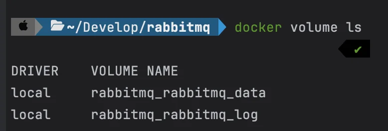
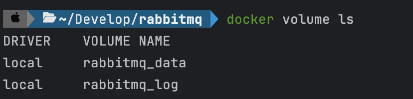
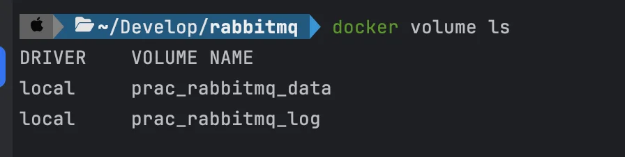

<a id="1c3eda9b0fe181929571cca6801b4824"></a>

## Named Volume

---

> 📖 
> 
> <a id="1c3eda9b0fe1813aad2ce3d3779d9d33"></a>
> 
> Docker의 <code>Named Volume</code>을 사용하면 호스트 경로를 직접 지정할 필요가 없다&#46; 
> 
> - Docker가 내부적으로 볼륨을 생성하고 관리한다&#46;
>     - <strong>경로&#58; </strong><strong><code>/var/lib/docker/volumes/</code></strong>

<details>
<summary><code>Named Volume</code>과 <code>Bind Mount</code> 차이</summary>

| <strong>방법</strong> | <strong>설정 예시</strong> | <strong>데이터 저장 위치</strong> |
| --- | --- | --- |
| <strong>Named Volume</strong> | <code>&#45; rabbitmq&#95;data&#58;/var/lib/rabbitmq/</code> | <strong>Docker가 자동 관리 </strong><br>• <strong><code>/var/lib/docker/volumes/</code></strong> |
| <strong>Bind Mount</strong> | <code>&#45; </code><strong><code>&#46;/data/rabbitmq&#95;data/</code></strong><code>&#58;/var/lib/rabbitmq/</code> | 사용자가 직접 지정 <br>•  <strong><code>&#46;/data/rabbitmq&#95;data/</code></strong> |

<a id="1c3eda9b0fe1818f8d28c49cc6237d23"></a>

	

<a id="1c3eda9b0fe18162b802db1d2d6b9f97"></a>

		

<a id="1c3eda9b0fe181eba230e59121f8512f"></a>

		

</details>

- &#91; 실습 &#93; RabbiMQ &#45; data, log 볼륨 
    > ☝🏻 
    > 
    > <a id="1c3eda9b0fe1814bb010c4a5b853a8df"></a>
    > 
    > <strong> </strong><strong><u>Docker가 자동으로 경로를 관리</u></strong>하므로 별도로 <strong><u>호스트 경로를 지정할 필요가 없</u></strong>다&#46;
    > 
    > - 경로&#58; <code>/var/lib/docker/volumes/&#46;&#46;&#46;</code>

    <details>
    <summary><strong>docker&#45;compose&#46;yml</strong></summary>

    <a id="1c3eda9b0fe181f08901d4aea4cb62ac"></a>

    ```yaml
    volumes:
      rabbitmq_data:
      rabbitmq_log:

    services:
      my-rabbitmq:
        image: rabbitmq:3-management
        container_name: rabbitmq
        ports:
          - 5672:5672
          - 15672:15672
        volumes:
          - rabbitmq_data:/var/lib/rabbitmq/
          - rabbitmq_log:/var/log/rabbitmq/
        restart: unless-stopped
    ```

    </details>

    <details>
    <summary>Named Volume 목록 확인&#58; <strong><code>volume ls</code></strong></summary>

    <a id="1c3eda9b0fe18189ad3dc0d13121a649"></a>

    ```bash
    docker volume ls
    ```

    </details>

    <details>
    <summary> Named Volume 경로 확인&#58;<strong><code>volume inspect &#91;볼륨 명&#93;</code></strong></summary>

    <a id="1c3eda9b0fe181c994a8e53dea2e16d8"></a>

    ```bash
    docker volume inspect rabbitmq_data
    ```

    - 출력
        <a id="1c3eda9b0fe181b485bfe81d3e9abe87"></a>

        ```json
        [
          {
            "Name": "rabbitmq_data",
            "Driver": "local",
            "Mountpoint": "/var/lib/docker/volumes/rabbitmq_data/_data",
            "CreatedAt": "2025-02-25T10:00:00Z",
            "Scope": "local"
          }
        ]
        ```

        - <code>Mountpoint</code>&#58; <strong><u>D</u></strong><strong><u>ocker가 자동으로 할당한 경로</u></strong>
            - 데이터는 <code>/var/lib/docker/volumes/rabbitmq&#95;data/&#95;data/</code>에 저장된다&#46; 

    </details>

    <details>
    <summary>사용하지 않는 볼륨 확인&#58; <strong><code>docker volume ls &#45;f dangling=true</code></strong></summary>

    <a id="1c3eda9b0fe1818692afdb6da7abbccd"></a>

    ```bash
    docker volume ls -f dangling=true
    ```

    - <code>dangling=true</code> 옵션을 주면<u> </u><strong><u>사용되지 않는(고아 상태) 볼륨</u></strong>만 필터링 해서 보여준다&#46; 

    </details>

    <details>
    <summary>사용하지 않는 Docker 볼륨 전체 삭제&#58;<strong> </strong><strong><code>volume prune</code></strong></summary>

    - <strong>사용되지 않는 볼륨만 삭제</strong>
        <a id="1c3eda9b0fe18198a4cfec34a8fe3f47"></a>

        ```bash
        docker volume prune
        ```

    - 자동 승인,  <code>&#45;f</code> 옵션을 추가
        <a id="1c3eda9b0fe18192b759f80c063d3a68"></a>

        ```bash
        docker volume prune -f
        ```

    </details>

<details>
<summary>&#91; 🤬 오류 &#93; 볼륨 명칭 &#45; prefix 중첩</summary>



<a id="1c3eda9b0fe1819185a2eb900f675124"></a>

rabbitmq <code>prefix</code>가 두번 중첩되어 생성됨

<a id="1c3eda9b0fe181c7b7d1c8307e2985cc"></a>

### 원인

> <strong>Docker Compose가 자동으로 네임스페이스(prefix)를 추가한다&#46;</strong>

<a id="1c3eda9b0fe18115a9c8e445f4b29ad2"></a>

Docker Compose는 <strong><u>각 서비스에 대한 리소스를 격리</u></strong>하기 위해 <strong>프로젝트 이름(디렉터리명 or COMPOSE&#95;PROJECT&#95;NAME)을 prefix(접두사)로 추가</strong><strong>한다&#46;</strong>

<details>
<summary>ex) 프로젝트 폴더 이름&#58; <code>rabbitmq</code></summary>

<a id="1c3eda9b0fe181c1ba30eb4374ccf8aa"></a>

```yaml
volumes:
  rabbitmq_data:
  rabbitmq_log: 
```

- <code>rabbitmq&#95;data</code> → <code>rabbitmq&#95;rabbitmq&#95;data</code>

- <code>rabbitmq&#95;log</code> → <code>rabbitmq&#95;rabbitmq&#95;log</code>

</details>

<a id="1c3eda9b0fe181a9956ae3c5a8e45c49"></a>

### <strong>해결</strong>

<a id="1c3eda9b0fe1810ab4ffc037f25164b0"></a>

<strong> 1&#46; Prefix 제거 (고정된 볼륨 이름 사용)</strong>

<a id="1c3eda9b0fe181148e60f556a6f02bca"></a>

```yaml
volumes:
  rabbitmq_data:
    name: rabbitmq_data
  rabbitmq_log:
    name: rabbitmq_log
```



1. <strong>COMPOSE&#95;PROJECT&#95;NAME 설정 ( 접두사 변경 )</strong>
    <a id="1c3eda9b0fe181819b47e6d2565b496d"></a>

    ```typescript
    COMPOSE_PROJECT_NAME=prac
    ```

    - <strong>docker&#45;compose&#46;yml이 실행될 때 자동으로 &#46;env 파일을 읽어 적용한다&#46;</strong>

    <a id="1c3eda9b0fe181968ffec6604e67850d"></a>

    ```bash
    docker volumes ls 
    ```

    

</details>
