<details>
<summary>🧐<strong> 상한, 하한</strong></summary>

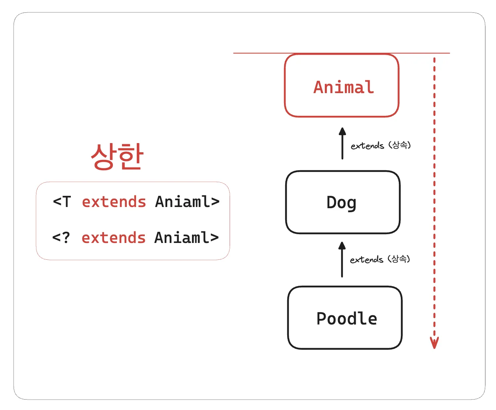

- Dog, Cat, Poodle 등 Animal 하위 타입만 할당 가능

- 상위 타입인 Object 나, 관련없는 Integer 등이 할당되면 컴파일 오류 발생

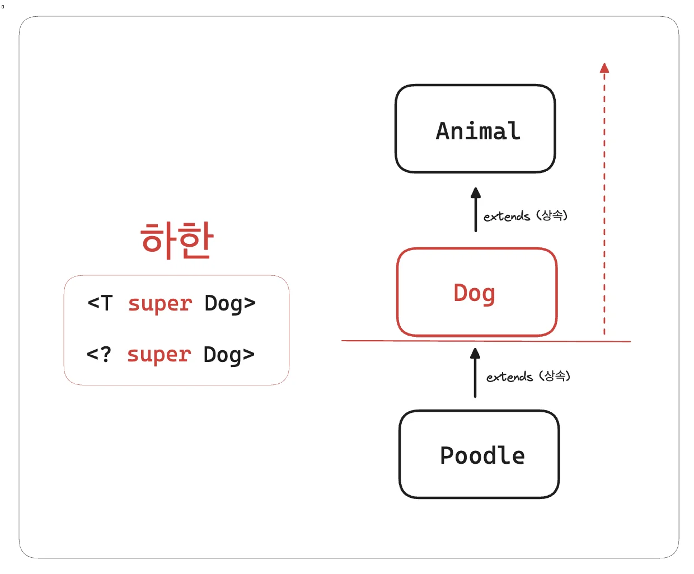

- 상위 타입만 할당 가능
    - Dog, Animal, Object 

- 하위 타입인 Poodle이 들어갈 시 컴파일 오류 발생

</details>

<a id="1c3eda9b0fe181c58ac0ec0418480c2b"></a>

## 타입 매개변수 제한&#58;  &#91; 상한 <code>extends</code> &#93;

<a id="1c3eda9b0fe18119a45dc3a2bcd5f73f"></a>

### 2&#46;1  타입 매개변수 제한 &#45; 제네릭 적용 전 (시작)

> ✏️ 
> 
> - <code>타입 안정성</code>&#58; <strong>O</strong>
> 
> - <code>코드 재사용성</code>&#58; ❌ 

<a id="1c7eda9b0fe180fa9939c555f73b15aa"></a>

### 코드

[2.2 - 다형성 활용한 해결](https://github.com/gyungsubLee/inflearn_java-mid2/commit/341b8caed5998fd455dae79f46c66b0a06a49b75)

<details>
<summary>&#91; 코드 &#93; DogHospital</summary>

<a id="1c3eda9b0fe181e8a3eae253989fc924"></a>

```java
package generic.ex3;

import generic.animal.Dog;

public class DogHospital {

    private Dog animal;  // 구성 ( Composition )

    public void set(Dog animal) {
        this.animal = animal;
    }

    public void checkup() {
        System.out.println("동물 이름: " + animal.getName());
        System.out.println("동물 크기: " + animal.getSize());
        animal.sound();
    }

    public Dog bigger(Dog target){
        return animal.getSize() > target.getSize() ? animal : target;
    }
}
```

</details>

<details>
<summary>&#91; 코드 &#93; CatHospital</summary>

<a id="1c3eda9b0fe181b9b9edc2ed00b35208"></a>

```java
package generic.ex3;

import generic.animal.Cat;

public class CatHospital {

    private Cat animal;  // 구성 ( Composition )

    public void set(Cat animal) {
        this.animal = animal;
    }

    public void checkup() {
        System.out.println("동물 이름: " + animal.getName());
        System.out.println("동물 크기: " + animal.getSize());
        animal.sound();
    }

    public Cat bigger(Cat target){
        return animal.getSize() > target.getSize() ? animal : target;
    }
}

```

</details>

<details>
<summary>&#91; 코드 &#93; AnimalHospitalMainV0</summary>

<a id="1c3eda9b0fe1816ba26fde44a15e8375"></a>

```java
package generic.ex3;

import generic.animal.Cat;
import generic.animal.Dog;

public class AnimalHospitalMainV0 {
    public static void main(String[] args) {
        DogHospital dogHospital = new DogHospital();
        CatHospital catHospital = new CatHospital();

        Dog dog = new Dog("멍멍이1", 100);
        Cat cat = new Cat("냐옹이1", 300);

        // 강아지 병원
        dogHospital.set(dog);
        dogHospital.checkup();

        // 고양이 병원
        catHospital.set(cat);
        catHospital.checkup();

         // 문제1: 강아지 병원 -> 고양이 전달
         //dogHospital.set(cat);   // 다른 타입 입력: 컴파일 오류

        // 문제2: 강아지 타입 반환
        dogHospital.set(dog);
        Dog biigerDog = dogHospital.bigger(new Dog("멍멍2", 200));
        System.out.println("biigerDog = " + biigerDog);
    }
}

```

</details>

<details>
<summary>실행 결과 </summary>

<a id="1c3eda9b0fe1811c8fdbf7c515c69c12"></a>

```plaintext
동물 이름: 멍멍이1
동물 크기: 100
멍멍
동물 이름: 냐옹이1
동물 크기: 300
냐옹
biigerDog = Animal{name='멍멍2', size=200}
```

</details>

<a id="1c7eda9b0fe1809aabd0c1d86bb8f071"></a>

### 문제점

<a id="1c7eda9b0fe180a9930bca2313a4712a"></a>

각 동물 타입마다 중복으로 <code>xxxHospital</code> 이라는 클래스를 생성한다&#46;

<a id="1c7eda9b0fe180cabe24f9f71a868164"></a>

이는 코드의 확장성 과 유지보수성을 낮은 안 좋은 설계이다&#46;

<a id="1c3eda9b0fe1810bb60ce2553a771298"></a>

### 2&#46;2 &#91; 🤬 Bad Case &#93; 타입 매개변수 제한&#58; <code>다형성</code>

> ✏️ 
> 
> - <code>타입 안정성</code>&#58; ❌ 
> 
> - <code>코드 재사용성</code>&#58; <strong>O </strong>

<a id="1c7eda9b0fe180c78c46d012a82180b8"></a>

### 코드

[2.2 - 다형성 활용한 해결](https://github.com/gyungsubLee/inflearn_java-mid2/commit/341b8caed5998fd455dae79f46c66b0a06a49b75)

<details>
<summary>&#91; 코드 &#93; AnimalHospitalV1</summary>

<a id="1c3eda9b0fe18138aaadda77bdc9bc5b"></a>

```java
public class AnimalHospitalV1 {

    private Animal animal;

    public void set(Animal animal) {
        this.animal = animal;
    }

    public void checkup() {
        System.out.println("동물 이름: " + animal.getName());
        System.out.println("동물 크기: " + animal.getSize());
        animal.sound();
    }

    public Animal getBigger(Animal target) {
        return animal.getSize() > target.getSize() ? animal : target;
    }
}
```

</details>

<details>
<summary>&#91; 코드 &#93; AnimalHospitalMainV1</summary>

<a id="1c3eda9b0fe181d6bb76f0c68e3b1192"></a>

```java
public class AnimalHospitalMainV1 {
    public static void main(String[] args) {
        AnimalHospitalV1 dogHospital = new AnimalHospitalV1();
        AnimalHospitalV1 catHospital = new AnimalHospitalV1();

        Dog dog = new Dog("멍멍이1", 100);
        Cat cat = new Cat("냐옹이1", 300);

        // 강아지 병원
        dogHospital.set(dog);
        dogHospital.checkup();

        // 고양이 병원
        catHospital.set(cat);
        catHospital.checkup();

        // 문제1: 개 병원에 고양이 전달
        dogHospital.set(cat);  // 매개변수 체크 실패 - 컴파일 오류가 발생되지 않음

        // 문제2: dog 타입 변환, 캐스팅 필요
        dogHospital.set(dog);
        Dog biggerDog = (Dog) dogHospital.getBigger(new Dog("멍멍이2", 200));
        System.out.println("biggerDog = " + biggerDog);
    }
}
```

</details>

<details>
<summary>실행 결과 </summary>

<a id="1c3eda9b0fe18135bdb0c99d09861160"></a>

```plaintext
동물 이름: 멍멍이1
동물 크기: 100
멍멍
동물 이름: 냐옹이1
동물 크기: 300
냐옹
biggerDog = Animal{name='멍멍이2', size=200}
```

</details>

<a id="1c7eda9b0fe180549e81c9c8f3edc0d0"></a>

### 문제점

<a id="1c7eda9b0fe1802a848fe98db8024033"></a>

<code>다형성</code>을 통한 방법은  코드를 재사용하여 확정성과 유지 보수성을 개선할 수 있었지만 ( OCP 만족 )<br> <u>타입 안정성에서 문</u><u>제</u>가 발생된다&#46;

> ✏️ 
> 
> <a id="1c7eda9b0fe1805bbf69d1f3d21dabfe"></a>
> 
> <strong>다형성</strong>
> 
> - <code>Animal</code> → <code>Dog</code>, <code>Cat</code>

- 매개변수의 타입 체크가 이뤄지지 않는다&#46; 
    > <code>DogHospital</code>  ← <code>Cat</code> &#91; <strong>타입 오류가 발생되지 않</strong>음 &#93;

    - Dog 타입만을 처리 해야하는<strong><u> DogHospital 클래스에서  Cat타입의 인자가 들어가도 컴파일 오류가 발생되지 않</u></strong>는다&#46;

    - 다형성을 활용하여 <u>부모 클래스인 Animal 타입으로 타입 체크</u>를 한다&#46; <br>따라서  <strong><u>Animal 타입에 속한 Cat 클래스가 할당되어도 타입 오류가 발생되지 않</u></strong>는다&#46; 

<a id="1c3eda9b0fe181268c0fea1fc2e5921b"></a>

### 2&#46;3 &#91; 🤬 오류 &#93;  타입 매개변수 제한&#58; <code>제네릭</code> 범위 지정 X 

> ✏️ 
> 
> <a id="1c7eda9b0fe1806bb0b2db1f86e9cfe0"></a>
> 
> <strong><code>제네릭</code></strong>을 <u>타입 매개변수를 사용</u>하면 <u>어떤 타입이든 들어올 수 있</u>다&#46;
> 
> - <u>자바 컴파일러</u>는 <u>타입 매개변수</u>를 어떤 타입이든 수용할 수 있는 <u><code>Object</code></u><u> 로 가정</u>한다&#46; 
> 
> - Object는 모든 클래스의 부모 타입이다&#46;
> 
> - 

<a id="1c7eda9b0fe18002832ee7b72c9b6c5b"></a>

### 코드

[2.3 - 제네릭 사용, 오류](https://github.com/gyungsubLee/inflearn_java-mid2/commit/31d59d24a08a44831c4f45bc48b91195fab70630)

<details>
<summary>&#91; 코드 &#93; AnimalHospitalV2</summary>

<a id="1c3eda9b0fe18111a695e3eb32503412"></a>

```java
package generic.ex3;

public class AnimalHospitalV2<T> {

    private T animal;

    public void set(T animal) {
        this.animal = animal;
    }

    public void checkup() {
        // T의 타입을 메서드를 정의하는 시점에는 알 수 없음, Object 기능만 사용 가능
        
        // 컴파일 오류
        // System.out.println("동물 이름: " + animal.getName());
        // animal.sound();
        
        // Object 기능
        animal.toString();
        animal.equals(null);
    }

    public T getBigger(T target) {
        // 컴파일 오류
//         return animal.getSize() > target.getSize() ? animal : target;
        return null;
    }
}

```

</details>

<details>
<summary>&#91; 코드 &#93; AnimalHospitalMainV2</summary>

<a id="1c3eda9b0fe181e4a4f4cee4bb3ce6c8"></a>

```java
public class AnimalHospitalMainV2 {
    public static void main(String[] args) {
        AnimalHospitalV2<Dog> dogAnimalHospitalV2 = new AnimalHospitalV2<>();
        AnimalHospitalV2<Cat> catAnimalHospitalV2 = new AnimalHospitalV2<>();
        AnimalHospitalV2<Integer> integerAnimalHospitalV2 = new AnimalHospitalV2<>();
        AnimalHospitalV2<Object> objectAnimalHospitalV2 = new AnimalHospitalV2<>();
    }
}
```

</details>

<a id="1c7eda9b0fe180fd818de581508109f3"></a>

### 문제점

---

<details>
<summary><strong>🤬 문제1)</strong> Animal 클래스의 메서드 사용 시 아래와 같이 <strong><u>컴파일 오류</u></strong>가 발생된다&#46; </summary>

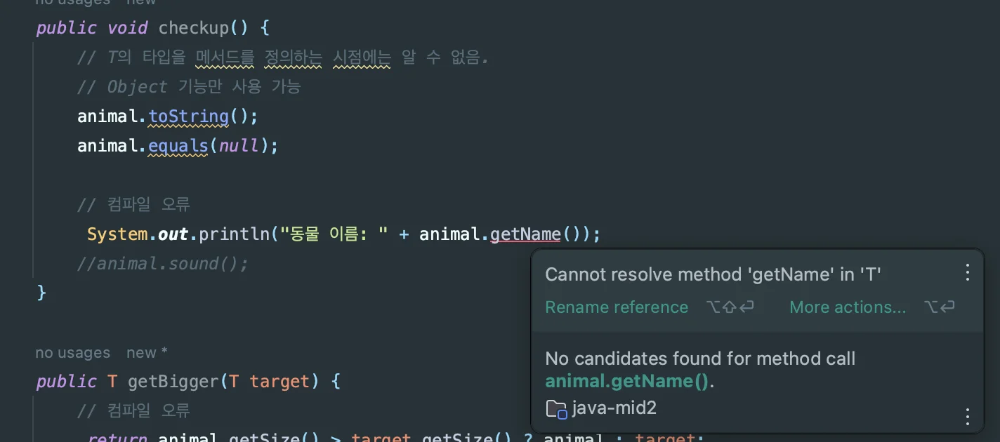

<a id="1c3eda9b0fe18197a237d9180ea5efb1"></a>

제네릭 타입을 선언하면 자바 컴파일러 입장에서는 <code>T</code>에 어떤 값이 들어올지 예측할 수 없다&#46;

<a id="1c3eda9b0fe181cfa82fe9783dda7ba0"></a>

<code>AnimalHospitalV2</code> 클래스에 <code>Animal</code> 타입의 자식이 들어오기를 기대했지만, 해당 클래스 어디에도 <code>Animal</code> 타입에 대한 정보가 없다&#46; 

<a id="1c3eda9b0fe181fca598dfdc579381e1"></a>

<code>T</code>에는 타입인자로 <code>Integer</code>가 들어올수도 있고, <code>Dog</code>가 들어올 수 있으며, <code>Object</code>가 들어올 수 있다&#46;

<a id="1c3eda9b0fe181e6ad2ed239a7a24772"></a>

따라서 자바 컴파일러는 모든 객체의 최종 부모인 <code>Object</code>를 타입으로 가정하여 처리한다&#46;

-  <code>Object</code>의 기능만 사용 가능

</details>

<details>
<summary><strong>🤬 문제2) </strong>다양한 타입 인자</summary>

<a id="1c3eda9b0fe181bb82f2c8f57304591f"></a>

```java
// AnimalHospitalMainV2
AnimalHospitalV2<Dog> dogAnimalHospitalV2 = new AnimalHospitalV2<>();
AnimalHospitalV2<Cat> catAnimalHospitalV2 = new AnimalHospitalV2<>();
AnimalHospitalV2<Integer> integerAnimalHospitalV2 = new AnimalHospitalV2<>();
AnimalHospitalV2<Object> objectAnimalHospitalV2 = new AnimalHospitalV2<>();
```

<a id="1c3eda9b0fe18120a0a5d20c8a4c66d8"></a>

위와 같이 제네릭 타입에 대한 <strong><u>범위의 제한이 없</u></strong>기 때문에, <code>AnimalHostpital</code>의 설계 의도와 전혀 다른 <code>Integer</code> 타입, <code>Object</code> 타입 등이 위와 같이<strong><u> 타입인자로 넘겨 생성될 수 있</u></strong>다&#46;

</details>

<a id="1c3eda9b0fe181ae8a79f684ba5bde2c"></a>

### 2&#46;4 &#91; 🍀 해결 &#93;  타입 매개변수 제한&#58;  제네릭 범위 제한

> ✏️ 
> 
> <a id="1c3eda9b0fe1819fa112f2777dabd547"></a>
> 
> <strong>타입 매개변수의 </strong><strong><u>상한 범위 지정</u></strong> &#58; <strong><code>extends</code></strong>
> 
> <details>
> <summary><code>&#60;T </code><strong><code>extends</code></strong><strong><code> </code></strong><strong><code>Anima</code></strong><strong><code>l</code></strong><code>&#62;</code></summary>
> 
> > ☝🏻 
> > 
> > <a id="1c7eda9b0fe180e2b830cf78204dd1b1"></a>
> > 
> > <code>AnimalHospitalV3&#60;Integer&#62;</code> 와 같이 <u>동물과 전혀 관계없는 타입 인자</u>를 <strong><u>컴파일 시점에 막</u></strong>는다&#46;
> > 
> > <a id="1c7eda9b0fe180b5b64fdcaa850dc574"></a>
> > 
> > <u>제네릭 클래스 안</u>에서 <code>Animal</code> 의 기능을 사용할 수 있다&#46;
> 
> 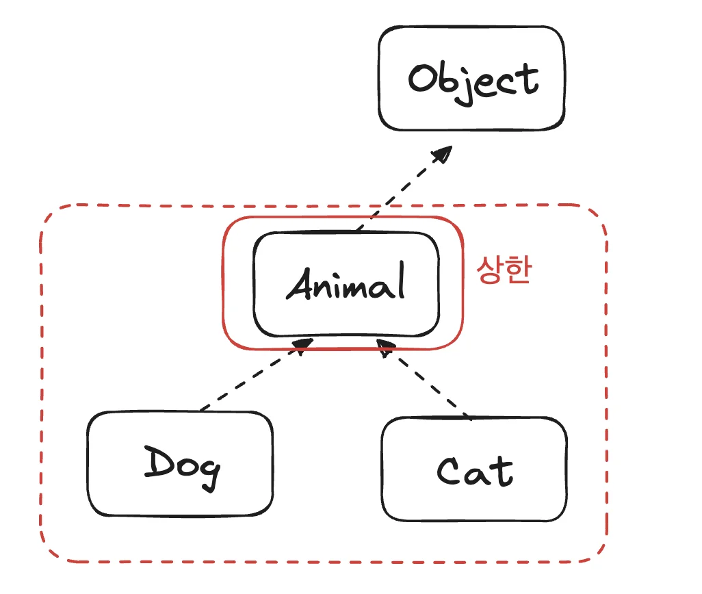
> 
> - 타입 매개변수 <code>T</code>를 <u><code>Animal</code></u><u>과 </u><u>그 자식만</u> 받을 수 있도록 제한한다&#46;<br>즉, <code>T</code>의 <u>상한 ( </u><strong><u>가장 높은(위쪽) 제한 )</u></strong>이 <code>Animal</code>이 된다&#46;
>     <a id="1c3eda9b0fe1812c87dec26d139a292c"></a>
> 
>     ```java
>     // <T extends Animal>
>     AnimalHospitalV3<Animal>
>     AnimalHospitalV3<Dog>
>     AnimalHospitalV3<Cat>
>     ```
> 
> - 자바 컴파일러는 <code>T</code> 에 입력될 수 있는 값의 범위를 예측할 수 있다&#46;
>     - 타입 매개변수 <code>T</code> 에는 <u>타입 인자</u>로 <code>Animal</code> , <code>Dog</code> , <code>Cat</code> 만 들어올 수 있다&#46;<br>따라서 컴파일러는  이를 <u>모두 수용할 수 있</u>는 <u><code>Animal</code></u>을 <u><code>T</code></u><u>의 타입</u>으로 <u>가정</u>한다
>         <a id="1c3eda9b0fe1816e8a67d945d3505bc1"></a>
> 
>         ⇒ <code>Animal</code>이 제공하는 <code>getName()</code>, <code>getSize()</code> 같은 기능을 사용할 수 있음
> 
> </details>
> 
> <details>
> <summary>이전 &#91; 1, 2, 3 &#93; 의 문제점 해결</summary>
> 
> > <strong>타입 안정성 문제</strong>
> 
> - DogHospital에 Dog 타입 외<u> Cat 타입 전달</u>됨 ⇒ <strong><u>컴파일 오류</u></strong>
> 
> - Animal 타입을 반환하기 때문에 <u>다운 캐스팅</u>을 해야함  
> 
> - 실수로 Cat 타입을 입력했는데, Dog 타입을 반환하는 상황, 캐스팅 예외가 발생 
>     <a id="1c3eda9b0fe181a8ba22dea5a0644b39"></a>
> 
>      ⇒ <strong>🌞 해결 </strong>
> 
> > <strong>제네릭 도입 문제</strong>
> 
> - 제네릭에서 타<strong>입 매개변수를 사용</strong>하면 <strong><u>어떤 타입이든 들어올 수 있</u></strong>음 
> 
> - 어떤 타입이든 수용할 수 있는<u> </u><strong><u>Object</u></strong><strong><u>로 가정</u></strong>하고, <strong><u>Object</u></strong> <strong><u>의 기능 만 사용</u></strong> 가능
>     <a id="1c7eda9b0fe180988adcc04f37811ca7"></a>
> 
>     ⇒  <strong>범위 제한(상한)</strong><strong><br>          </strong>• Animal <strong><u>하위 구현체만 할당</u></strong> 가능
> 
>     <a id="1c7eda9b0fe18093967ecd8468391cef"></a>
> 
>         •  <code>Animal</code>의 <u>기능을 사용</u> 가능<br><br>
> 
> </details>

<a id="1c7eda9b0fe1807caa7fd13beb83434a"></a>

### 코드 

[2.4 - 타입 매개변수 범위 제한](https://github.com/gyungsubLee/inflearn_java-mid2/commit/c6d99a86beb7ac36feb584598e3ad36c0b1780bb)

<details>
<summary>&#91; 코드 &#93; AnimalHospitalV3</summary>

<a id="1c3eda9b0fe18153b89bfa24da60d5bb"></a>

```java
public class AnimalHospitalV3<T extends Animal> {

    private T animal;

    public void set(T animal) {
        this.animal = animal;
    }

    public void checkup() {
        System.out.println("동물 이름: " + animal.getName()); System.out.println("동물 크기: " + animal.getSize()); animal.sound();
    }

    public T getBigger(T target) {
        return animal.getSize() > target.getSize() ? animal : target;
    }
}

```

</details>

<details>
<summary>&#91; 코드 &#93; AnimalHospitalMainV3</summary>

<a id="1c3eda9b0fe181b69128fe3c8bf0ae90"></a>

```java
package generic.ex3;

import generic.animal.Cat;
import generic.animal.Dog;

public class AnimalHospitalMainV3 {
    public static void main(String[] args) {
        AnimalHospitalV3<Dog> dogHospital = new AnimalHospitalV3<>();
        AnimalHospitalV3<Cat> catHospital = new AnimalHospitalV3<>();
        Dog dog = new Dog("멍멍이1", 100);
        Cat cat = new Cat("냐옹이1", 300);

        // 강아지 병원
        dogHospital.set(dog);
        dogHospital.checkup();

        //고양이 병원
        catHospital.set(cat);
        catHospital.checkup();
        
        /**
	        타입 안정성 O
        */
				// [ DogHospital<Dog> <- Cat ]: 컴파일 오류 
        dogHospital.set(cat); 

        // [ DogHospital<Dog> <- Dog ]: 정상 실행
        dogHospital.set(dog);
        
        Dog biggerDog = dogHospital.getBigger(new Dog("멍멍이2", 200));
        
        System.out.println("biggerDog = " + biggerDog);
    }
}
```

</details>

<details>
<summary>실행 결과 </summary>

<a id="1c3eda9b0fe18172a3e0dee36e4097ea"></a>

```plaintext
동물 이름: 멍멍이1
동물 크기: 100 
멍멍
동물 이름: 냐옹이1
동물 크기: 300 
냐옹
biggerDog = Animal{name='멍멍이2', size=200}
```

</details>

<a id="1c7eda9b0fe1800dac4bfbfeed313713"></a>

### NOTES

<a id="1c7eda9b0fe18072af58ed3352c487e6"></a>

‣

<details>
<summary>🧐 <code>extends</code> 키워드는 클래스 간의 상속 관계를 나타낼 때 사용한다&#46; 그렇다면 제네릭에서는 어떤 의미를 갖는가?</summary>

> ✏️ 
> 
> <a id="1c7eda9b0fe18014922df58793d13108"></a>
> 
> <strong><code>제네릭</code></strong>에서 <code>extends</code> 키워드는 <strong><u>상속 또는 구현 관계를 제한</u></strong><strong><u>하는 “</u></strong><strong><u>상한(bound)</u></strong><strong><u>”</u></strong><u> 역할</u>을 한다&#46;

- 문법적으로는 상속과 비슷하지만, 타입 제한을 걸기위해 사용된다&#46; 

<details>
<summary>제네릭에서 <code>extends</code>는  <code>implements</code>도 포함한다&#46; </summary>

<a id="1c7eda9b0fe180a6ba69eb37821e6184"></a>

```java
<T extends Animal & Serializable>
```

- <strong><u>Animal을 상속</u></strong><strong>하고 </strong><strong><u>Serializable을 구현</u></strong>한 <strong><u>타입만 제네릭의 타입으로써 할당 가능</u></strong>하다는 뜻이다&#46;

<details>
<summary>ex)</summary>

- 예제 코드
    <details>
    <summary>&#91; 코드 &#93; ComplexBox</summary>

    <a id="1c7eda9b0fe180c58a9afe64fcfbb1ee"></a>

    ```java
    package generic.ex4;

    import generic.animal.Animal;

    import java.io.Serializable;

    public class ComplexBox<T extends Animal & Serializable> {
        
        private T animal;

        public void set(T animal) {
            this.animal = animal;
        }
        
        public <T> T printAndReturn(T t){
            System.out.println("animal.className: " + animal.getClass().getName());
            System.out.println("t.className: " + t.getClass().getName());
            // t.getName();  // 호출 불가 -> 범위 지정 X

            return t;
        }
    }
    ```

    </details>

    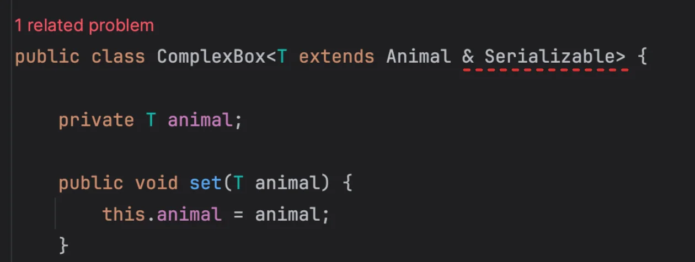

    - 위와 같이 예시 클래스의  제네릭에 <code>Serializable</code> 인터페이스를 상한으로 포함하니,  아래와 같이 컴파일 오류가 발생되는 것을 확인할 수 있다&#46;

- 컴파일 오류 
    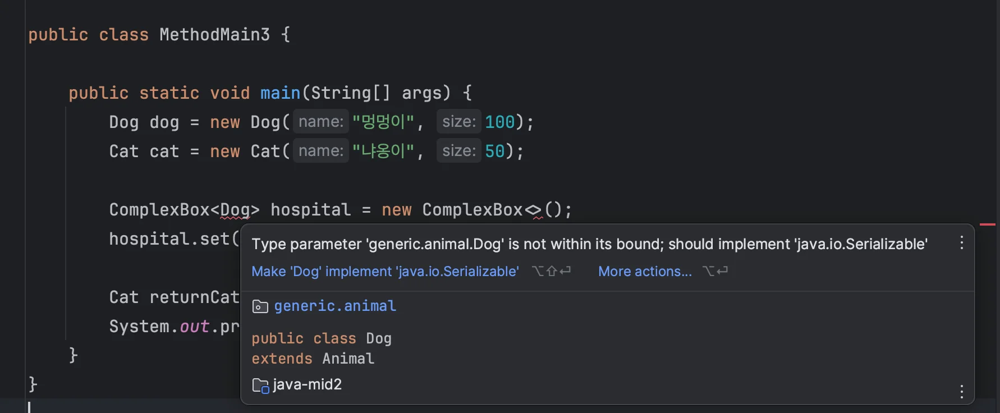

- Serializable 구현
    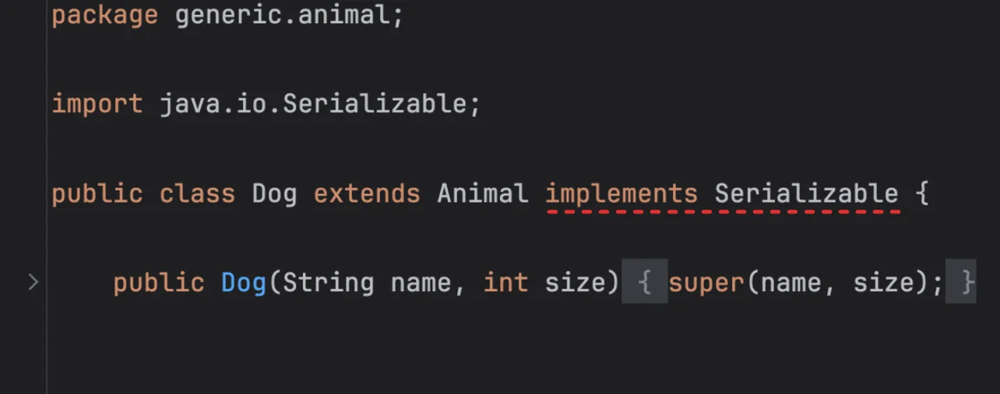

    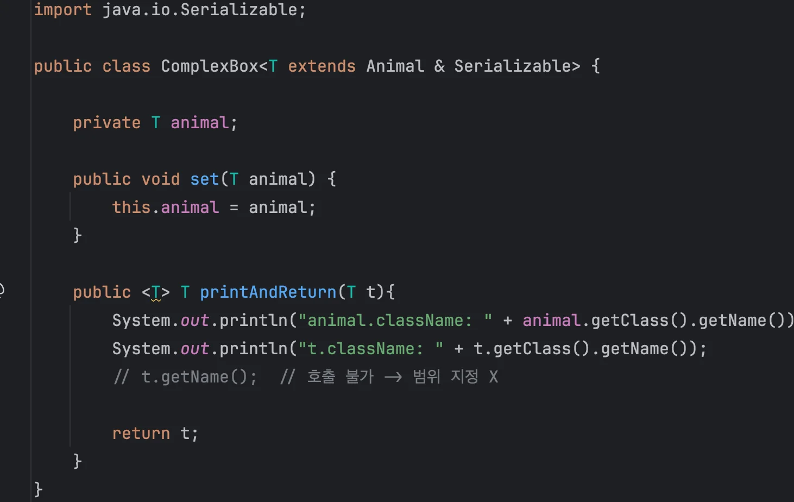

    - 컴파일 오류 해결됨

</details>

</details>

</details>

<details>
<summary>🧐 <strong><code>Lgeneric/animal/Animal</code></strong><strong> </strong>에서 <code>L</code>의 의미는?</summary>

> ✏️ 
> 
> <a id="1c7eda9b0fe180488485f924aa7530e9"></a>
> 
> <code>L</code>&#58; 참조 타입(Object 타입)이라는 뜻이다&#46;
> 
> - <code>L&#46;&#46;&#46;;</code>는 JVM에서 객체 타입을 나타낸다&#46;
> 
> <details>
> <summary>ex)</summary>
> 
> <a id="1c7eda9b0fe180b2aacbc271ea3ecbb8"></a>
> 
> <strong><code>Lgeneric/animal/Animal</code></strong>
> 
> - <code>L</code>&#58; 참조 타입(Object 타입) 의미
> 
> - <code>generic/ex4/AnimalMethod</code>&#58;  패키지 경로
> 
> </details>

<details>
<summary><strong> JVM 타입 표현 요약</strong></summary>

| 타입 표현 | <strong>의미</strong> |
| --- | --- |
| <code>I</code> | int |
| <code>Z</code> | boolean |
| <code>D</code> | double |
| <code>B</code> | byte |
| <code>C</code> | char |
| <code>F</code> | float |
| <code>J</code> | long |
| <code>S</code> | short |
| <code>V</code> | void |
| <code>L&#46;&#46;&#46;;</code> | 객체(참조) 타입 (예&#58; Ljava/lang/String;) |
| <code>&#91;I</code> | int 배열 |
| <code>&#91;Ljava/lang/String;</code> | String 배열 |

</details>

<details>
<summary>왜 <code>reference type</code>을 <code>L</code>로 표현하는가?</summary>

<a id="1c7eda9b0fe180cc9366f623792c85f3"></a>

L은 <strong><u>“Object를 참조한다(Load from reference)”</u></strong>에서 유래하여 <code>L</code>로 표기한다&#46; 

</details>

</details>

<details>
<summary><strong>타입 소거</strong><strong> ( </strong><strong>Type Erasure</strong><strong> )</strong></summary>

> ✏️ 
> 
> <a id="1c7eda9b0fe1809d8c42f6ca4193672f"></a>
> 
> 제네릭은 카피
> 
> <a id="1c7eda9b0fe1809ea0b5e516215f7cdb"></a>
> 
> Java의 제네릭은 <strong><u>컴파일 타임에만 존재하고, 런타임에는 사라지는</u></strong> 특성을 가진다&#46;<br>이를  <strong><code>타입 소거(Type Erasure)</code></strong>라고 부른다&#46;
> 
> - 리플랙션 사용 불가

<details>
<summary>ex) </summary>

- 컴파일 전
    <a id="1c7eda9b0fe1809182cfd505e11938fd"></a>

    ```java
    public class Cage<T extends Animal> {
        private T animal;

        public void setAnimal(T animal) {
            this.animal = animal;
        }

        public T getAnimal() {
            return animal;
        }
    }
    ```

- 컴파일 이후 ( 의사코드 )
    <a id="1c7eda9b0fe1800fa643ffa8ae2ba38c"></a>

    ```java
    public class Cage {
        private Animal animal;

        public void setAnimal(Animal animal) {
            this.animal = animal;
        }

        public Animal getAnimal() {
            return animal;
        }
    }
    ```

    - 제네릭 ( <code>T</code> )이 컴파일 타임에서 상한의 최대 범위인 <code>Animal</code> 클래스로  변경됨

    - 이해하기 쉽게 기존 코드와 동일한 형태로 표현 → 의사코드 <br>실제는 bytecode로 변환됨&#46; ( 자세한 내용은 아래 예시 참조 )

</details>

<details>
<summary>ex) 바이트 코드 비교 </summary>

> ✏️ 
> 
> <a id="1c7eda9b0fe18083b4b3ed74e724730c"></a>
> 
> 제네릭( <code>T</code> )이 <u>상한</u><strong><u>( extends )</u></strong><u>으로 지정한</u> <u> </u><strong><u>Animal</u></strong><u> 클래스로 변경</u>되는 것을 확인할 수 있다&#46;
> 
> - <code>T</code> → <code>Lgeneric/animal/Animal</code>

<details>
<summary>&#91; Java (<code>&#46;java</code>) &#93;</summary>

<a id="1c7eda9b0fe18028aa46ff15951cb83f"></a>

```java
package generic.ex4;

import generic.animal.Animal;

public class ComplexBox<T extends Animal> {
    
    private T animal;

    public void set(T animal) {
        this.animal = animal;
    }
    
    public <T> T printAndReturn(T t){
        System.out.println("animal.className: " + animal.getClass().getName());
        System.out.println("t.className: " + t.getClass().getName());
        // t.getName();  // 호출 불가 -> 범위 지정 X

        return t;
    }
}

```

</details>

<details>
<summary>&#91; byte code (<code>&#46;class</code>) &#93;</summary>

<a id="1c7eda9b0fe180e68115e7540c8591fc"></a>

```java
// class version 67.0 (67)
// access flags 0x21
// signature <T:Lgeneric/animal/Animal;>Ljava/lang/Object;
// declaration: generic/ex4/ComplexBox<T extends generic.animal.Animal>
public class generic/ex4/ComplexBox {

  // compiled from: ComplexBox.java
  // access flags 0x19
  public final static INNERCLASS java/lang/invoke/MethodHandles$Lookup java/lang/invoke/MethodHandles Lookup

  // access flags 0x2
  // signature TT;
  // declaration: animal extends T
  private Lgeneric/animal/Animal; animal

  // access flags 0x1
  public <init>()V
   L0
    LINENUMBER 5 L0
    ALOAD 0
    INVOKESPECIAL java/lang/Object.<init> ()V
    RETURN
   L1
    LOCALVARIABLE this Lgeneric/ex4/ComplexBox; L0 L1 0
    // signature Lgeneric/ex4/ComplexBox<TT;>;
    // declaration: this extends generic.ex4.ComplexBox<T>
    MAXSTACK = 1
    MAXLOCALS = 1

  // access flags 0x1
  // signature (TT;)V
  // declaration: void set(T)
  public set(Lgeneric/animal/Animal;)V
   L0
    LINENUMBER 10 L0
    ALOAD 0
    ALOAD 1
    PUTFIELD generic/ex4/ComplexBox.animal : Lgeneric/animal/Animal;
   L1
    LINENUMBER 11 L1
    RETURN
   L2
    LOCALVARIABLE this Lgeneric/ex4/ComplexBox; L0 L2 0
    // signature Lgeneric/ex4/ComplexBox<TT;>;
    // declaration: this extends generic.ex4.ComplexBox<T>
    LOCALVARIABLE animal Lgeneric/animal/Animal; L0 L2 1
    // signature TT;
    // declaration: animal extends T
    MAXSTACK = 2
    MAXLOCALS = 2

  // access flags 0x1
  // signature <T:Ljava/lang/Object;>(TT;)TT;
  // declaration: T printAndReturn<T>(T)
  public printAndReturn(Ljava/lang/Object;)Ljava/lang/Object;
   L0
    LINENUMBER 14 L0
    GETSTATIC java/lang/System.out : Ljava/io/PrintStream;
    ALOAD 0
    GETFIELD generic/ex4/ComplexBox.animal : Lgeneric/animal/Animal;
    INVOKEVIRTUAL java/lang/Object.getClass ()Ljava/lang/Class;
    INVOKEVIRTUAL java/lang/Class.getName ()Ljava/lang/String;
    INVOKEDYNAMIC makeConcatWithConstants(Ljava/lang/String;)Ljava/lang/String; [
      // handle kind 0x6 : INVOKESTATIC
      java/lang/invoke/StringConcatFactory.makeConcatWithConstants(Ljava/lang/invoke/MethodHandles$Lookup;Ljava/lang/String;Ljava/lang/invoke/MethodType;Ljava/lang/String;[Ljava/lang/Object;)Ljava/lang/invoke/CallSite;
      // arguments:
      "animal.className: \u0001"
    ]
    INVOKEVIRTUAL java/io/PrintStream.println (Ljava/lang/String;)V
   L1
    LINENUMBER 15 L1
    GETSTATIC java/lang/System.out : Ljava/io/PrintStream;
    ALOAD 1
    INVOKEVIRTUAL java/lang/Object.getClass ()Ljava/lang/Class;
    INVOKEVIRTUAL java/lang/Class.getName ()Ljava/lang/String;
    INVOKEDYNAMIC makeConcatWithConstants(Ljava/lang/String;)Ljava/lang/String; [
      // handle kind 0x6 : INVOKESTATIC
      java/lang/invoke/StringConcatFactory.makeConcatWithConstants(Ljava/lang/invoke/MethodHandles$Lookup;Ljava/lang/String;Ljava/lang/invoke/MethodType;Ljava/lang/String;[Ljava/lang/Object;)Ljava/lang/invoke/CallSite;
      // arguments:
      "t.className: \u0001"
    ]
    INVOKEVIRTUAL java/io/PrintStream.println (Ljava/lang/String;)V
   L2
    LINENUMBER 18 L2
    ALOAD 1
    ARETURN
   L3
    LOCALVARIABLE this Lgeneric/ex4/ComplexBox; L0 L3 0
    // signature Lgeneric/ex4/ComplexBox<TT;>;
    // declaration: this extends generic.ex4.ComplexBox<T>
    LOCALVARIABLE t Ljava/lang/Object; L0 L3 1
    // signature TT;
    // declaration: t extends T
    MAXSTACK = 2
    MAXLOCALS = 2
}
```

</details>

</details>

</details>

<a id="1c3eda9b0fe1817fb51ef9cf0e2d2be9"></a>

## 제네릭 메서드

<a id="1c3eda9b0fe181dcb4f1f78bd3cf1571"></a>

### 2&#46;5 &#45; 제네릭 메서드

> ✏️ 
> 
> <a id="1c7eda9b0fe18042ab94f1e139dacb67"></a>
> 
> 제네릭 메서드는 <u>메서드 호출 시점에 </u><strong><u>타입 인자를 전달</u></strong>해 <strong><u>타입을 지정</u></strong>한다&#46; 
> 
> - 클래스 전체가 아닌 <strong><u>특정 메서드 단위</u></strong><strong><u>로 제네릭을 도입</u></strong>할 때 사용
> 
> > 정의
> 
> 
> 
> <details>
> <summary><strong><u>메서드의 반환 타입 왼쪽</u></strong>에 <u>다이아몬드</u>를 사용하여<u> 타입 매개변수</u>를 적음</summary>
> 
> <a id="1c3eda9b0fe1819ab968dffd2da09c05"></a>
> 
> ```java
> <T> T genericMethod(T t)
> ```
> 
> </details>
> 
> > 호출 
> 
> 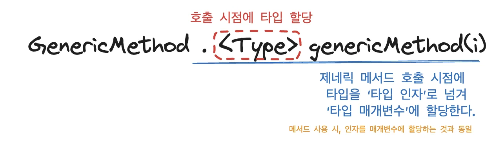
> 
> <details>
> <summary><u>메서드를 실제 호출하는 시점</u>에 <u>다이아몬드</u>를 사용해서 <code>&#60;Integer&#62;</code> 와 같이 <u>타입을 정</u>하고 호출한다&#46;</summary>
> 
> <a id="1c3eda9b0fe18111a570c7263f32c7ab"></a>
> 
> ```java
> GenericMethod.<Integer>genericMethod(i)
> ```
> 
> </details>

<a id="1c7eda9b0fe18090b34bc745d338c380"></a>

### 코드 

[2.5 - 제네릭 메서드](https://github.com/gyungsubLee/inflearn_java-mid2/commit/231e0da1d406909be7aa06605a49e76c5c690b20)

<details>
<summary>&#91; 코드 &#93; GenericMethod</summary>

<a id="1c3eda9b0fe1816dabc8d00c9e05e8b8"></a>

```java
package generic.ex4;

public class GenericMethod {

    public static Object objMethod(Object obj) {
        System.out.println("object print: " + obj);
        return obj;
    }

    public static <T> T genericMethod(T t){
        System.out.println("generic: " + t);
        return t;
    }

    public static <T extends Number> T numberMethod(T t){
        System.out.println("bound print: " + t);
        return t;
    }
}

```

</details>

<details>
<summary>&#91; 코드 &#93; MethodMain1</summary>

<a id="1c3eda9b0fe181338832db692ecf3ed5"></a>

```java
package generic.ex4;

public class MethodMain1 {
    public static void main(String[] args) {
        Integer i = 10;
        Object object = GenericMethod.objMethod(i);
        
        // 타입 인자(Type Argument) 명시적 전달
        System.out.println("명시적 타입 인자 전달");
        Integer result = GenericMethod.<Integer>genericMethod(i);
        Integer integerValue = GenericMethod.<Integer>numberMethod(10);
        Double doubleValue = GenericMethod.<Double>numberMethod(20.0);
    }
}

```

</details>

<details>
<summary>실행 결과 </summary>

<a id="1c3eda9b0fe181dc9eb0fe98cdea80de"></a>

```plaintext
object print: 10
명시적 타입 인자 전달
generic: 10
bound print: 10
bound print: 20.0
```

</details>

<a id="1c7eda9b0fe18071b97ac43ca0701986"></a>

### NOTES

<details>
<summary>✎  <code>제네릭 메서드</code> <strong>상한</strong></summary>

<a id="1c3eda9b0fe181c2adaace23043a4b5d"></a>

제네릭 메서드도 제네릭 타입과 마찬가지로 타입 매개변수를 제한할 수 있다&#46; 

<a id="1c3eda9b0fe1819bb159fdc6ca7ca256"></a>

```java
public static <T extends Number> T numberMethod(T t) {}
```

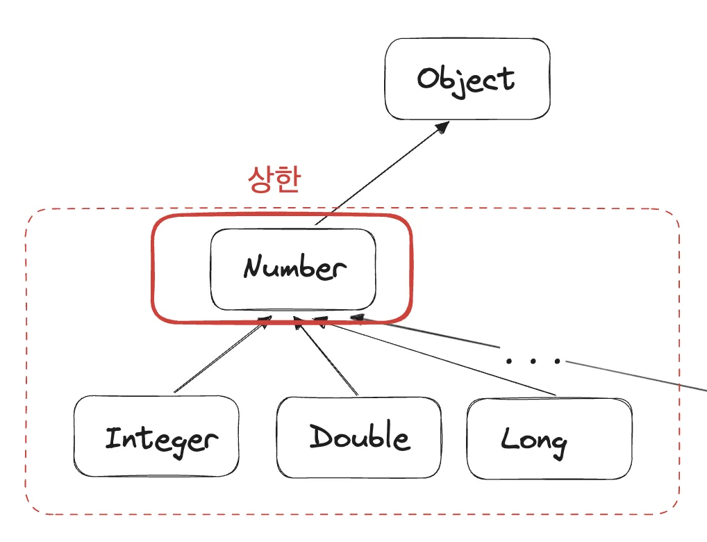

</details>

<details>
<summary>🧐 <code>제네릭 타입</code>, <code>제네릭 메서드</code> 차이점</summary>

<details>
<summary>제네릭 타입 ( 클래스 )</summary>

- 정의&#58; <code>GenericClass&#60;T&#62;</code>

- 타입 인자 전달&#58; <strong><u>인스턴스</u></strong><u> 생성</u> 시점
    <a id="1c3eda9b0fe181f6aeb0c7dfb159c47a"></a>

    ```java
    new GenericClass<String>
    ```

</details>

<details>
<summary>제네릭 메서드</summary>

- 정의&#58; <code>&#60;T&#62; T genricMethod(T t)</code>

- 타입 인자 전달&#58; <u>메서드를 호출</u>하는 시점
    <a id="1c3eda9b0fe181b78e5bf3a9631fdf2f"></a>

    ```java
    // static 메서드
    GenericMethod.<Integer>genericMethod(i)
    ```

</details>

</details>

<details>
<summary><strong>🧐 제네릭 메서드는 </strong><strong><u>인스턴스 메서드</u></strong>, <strong><u>static 메서드</u></strong> 둘다 적용 가능하다&#46;</summary>

<a id="1c3eda9b0fe18103832ae4f579f3b96a"></a>

```java
class Box<T> { //제네릭 타입
		static <V> V staticMethod2(V t) {}  // 정적(static) 메서드 - 제네릭
		<Z> Z instanceMethod2(Z z) {}       // 인스턴스 메서드 - 제네릭
}
```

</details>

<details>
<summary>☝🏻<strong> </strong><strong><code>제네릭 타입(클래스)</code></strong><strong> &#45; </strong> <strong><code>static 메서드</code></strong><strong> ❌</strong></summary>

<a id="1c3eda9b0fe1813a91eaf1fc3df7dafc"></a>

<strong><code>제네릭 타입</code></strong>은 <strong><u>인스턴스 생성 시점</u></strong><strong>에 </strong><strong><u>타입이 정</u></strong>해진다&#46; 

<a id="1c3eda9b0fe181ca92f5e3615cfcc229"></a>

그런데 <strong><code>static 메서드</code></strong>는 인스턴스 단위가 아닌 <strong><u>클래스 단위로 작동</u></strong>하기 때문에 <u>제네릭 타입과는 무관</u>하다&#46; 

- static 메서드는 인스턴스 생성 없이 호출이 가능하다&#46; 그러나 제네릭 타입은 인스턴스 생성 시점에 타입 인자를 넘겨 

<a id="1c3eda9b0fe181b8848be4b7ee885d29"></a>

따라서 <strong><code>static 메서드</code></strong>에 <strong><u>제네릭을 도입</u></strong><strong>하려면</strong><strong><u> 제네릭 메서드</u></strong><strong><u>를 사용</u></strong>해야 한다&#46; 

<a id="1c3eda9b0fe181eeae30c00cb486dee6"></a>

```java
class Box<T> {
		T instanceMethod(T t) {} //가능
		static T staticMethod1(T t) {} //제네릭 타입의 T 사용 불가능
}
```

</details>

<details>
<summary>🧐<strong> 제네릭 메서드</strong>의 <strong>타입 추론</strong></summary>

<a id="1c3eda9b0fe181b58432c59b1b11cbb1"></a>

제네릭 메서드 호출 시, <code>&#60;Integer&#62;</code> 와 같이 타입 인자를 계속 전달하는 것은 매우 불편하다&#46; 

<a id="1c3eda9b0fe1811b96aeda90da90fa0c"></a>

```java
Integer i = 10;
Integer result = GenericMethod.<Integer>genericMethod(i);
```

<a id="1c3eda9b0fe18189be8fdfe4c391391e"></a>

위 코드를 보면, 자바 컴파일러는 <code>genericMethod()</code>에 전달되는 인자 <code>i</code>의 타입이 <code>Integer</code> 라는 것을 알 수 있다&#46; 

<a id="1c3eda9b0fe181258dcfdd5eeb53a9ad"></a>

또한 반환 타입이 <code>Interger</code>(<code>Integer result</code>)라는 것도 알수 있다&#46; 

<a id="1c3eda9b0fe1812caf15fb00f7491191"></a>

이런 정보를 통해 자바 컴파일러는 타입 인자를 추론할 수 있다&#46; 

<details>
<summary>&#91; 코드 &#93;  MethodMain1</summary>

<a id="1c3eda9b0fe18137ae85ff7b83784f9e"></a>

```java
public class MethodMain1 {
    public static void main(String[] args) {
		    Integer i = 10;
        Object object = GenericMethod.objMethod(i);
    
				System.out.println("타입 추론");
		    Integer result2 = GenericMethod.genericMethod(i);
		    Integer integerValue2 = GenericMethod.numberMethod(10);
		    Double doubleValue2 = GenericMethod.numberMethod(20.0);
}
```

</details>

<details>
<summary>실행 결과 </summary>

<a id="1c3eda9b0fe18129b811d390fd470b5f"></a>

```plaintext
타입 추론
generic: 10
bound print: 10
bound print: 20.0
```

</details>

<a id="1c3eda9b0fe18198af73c662f05802a2"></a>

 위 코드와 실행 결과를 통해, <u>타입 인자에 타입을 할당하지 않</u>아도 자바 컴파일러가 제네릭 메서드의<strong><u> </u></strong><u>매개변수 타입</u>과 <u>반환 타입</u>을 통해 <strong><u>타입을 추론</u></strong>하여 처리하는 것을 확인할 수있다&#46; 

</details>

<a id="1c3eda9b0fe181b9aa61d2664dfd8f0d"></a>

### 2&#46;6 &#45; 제네릭 메서드 활용

<a id="1c7eda9b0fe180c8b354d7ab5c969035"></a>

### 코드 

[2.6 - 제네릭 메서드 활용](https://github.com/gyungsubLee/inflearn_java-mid2/commit/c1f0da7cc8ff350069f57e73ca40a0426981ffa9)

<details>
<summary>&#91; 코드 &#93; 제네릭 메서드 &#45; AnimalMethod</summary>

<a id="1c3eda9b0fe18178ad2ae71723f8aae0"></a>

```java
package generic.ex4;

import generic.animal.Animal;

public class AnimalMethod {

    public static <T extends Animal> void checkup(T t){
        System.out.println("동물 이름: " + t.getName());
        System.out.println("동물 크기: " + t.getSize());
        t.sound();
    }

    public static <T extends Animal> T getBigger(T t1, T t2){
        return t1.getSize() > t2.getSize() ? t1 : t2;
    }
}

```

</details>

<details>
<summary>&#91; 코드 &#93; 테스트 &#45; MethodMain2</summary>

<a id="1c3eda9b0fe181f7ae0ef9992c249bc3"></a>

```java
package generic.ex4;

import generic.animal.Cat;
import generic.animal.Dog;

public class MethodMain2 {
    public static void main(String[] args) {
        Dog dog = new Dog("멍멍이", 100);
        Cat cat = new Cat("냐옹이", 100);

				// 타입 추론
        AnimalMethod.checkup(dog);
        AnimalMethod.checkup(cat);

        Dog targetDog = new Dog("큰 멍멍이", 200);
        Dog bigger = AnimalMethod.getBigger(dog, targetDog);
        System.out.println("bigger = " + bigger);
    }
}

```

</details>

<details>
<summary>실행 결과 </summary>

<a id="1c3eda9b0fe1814288cef15e30d77901"></a>

```plaintext
동물 이름: 멍멍이
동물 크기: 100 
멍멍
동물 이름: 냐옹이
동물 크기: 100 
냐옹
bigger = Animal{name='큰 멍멍이', size=200}
```

</details>

<a id="1c3eda9b0fe18133a12efd2857da40f1"></a>

###  <code>제네릭 타입</code>, <code>제네릭 메서드</code> 우선순위 

> ✏️ 
> 
> <a id="1c8eda9b0fe18095af90ed625541c9c8"></a>
> 
> <strong><code>정적(static) 메서드</code></strong>&#58; <code>제네릭 메서드</code>
> 
> <a id="1c8eda9b0fe180b784f2f58e8e3e1491"></a>
> 
> <strong><code>인스턴스 메서드</code></strong>&#58;  <code>제네릭 타입(클래스)</code>, <code>제네릭 메서드</code>

> 🧐 
> 
> <a id="1c8eda9b0fe1801a961fc2e943e8366b"></a>
> 
> 그럼 만약 <strong><code>제네릭 타입</code></strong>과 <strong><code>제네릭 메서드</code></strong>의 <strong><u>타입 매개변수 명이 같</u></strong>으면 어떻게 되는가?

<a id="1c8eda9b0fe180a086e9ed26b3d2b4f4"></a>

### 예시 코드

<details>
<summary>&#91; 코드 &#93; ComplexBox</summary>

<a id="1c3eda9b0fe1819fa5fdc78b9b1ca0fc"></a>

```java
package generic.ex4;

import generic.animal.Animal;

public class ComplexBox<T extends Animal> {
    
    private T animal;

    public void set(T animal) {
        this.animal = animal;
    }
    
    public <T> T printAndReturn(T t){
        System.out.println("animal.className: " + animal.getClass().getName());
        System.out.println("t.className: " + t.getClass().getName());
        // t.getName();  // 호출 불가 -> 범위 지정 X

        return t;
    }
}
```

- 제네릭 타입과 제네릭 메서드의 타입 매개변수가 동일하다&#46;  → <code>T</code>

</details>

<details>
<summary>&#91; 코드 &#93; MethodMain3</summary>

<a id="1c3eda9b0fe181cebfc7e658046ca48d"></a>

```java
package generic.ex4;

import generic.animal.Cat;
import generic.animal.Dog;

public class MethodMain3 {

    public static void main(String[] args) {
        Dog dog = new Dog("멍멍이", 100);
        Cat cat = new Cat("냐옹이", 50);

        ComplexBox<Dog> hospital = new ComplexBox<>();
        hospital.set(dog);

        Cat returnCat = hospital.printAndReturn(cat);  // 타입 추론, T: Cat
        System.out.println("returnCat = " + returnCat);
    }
}

```

</details>

<details>
<summary>실행 결과 </summary>

<a id="1c3eda9b0fe181de887fdb263f086647"></a>

```plaintext
animal.className: generic.animal.Dog
t.className: generic.animal.Cat
returnCat = Animal{name='냐옹이', size=50}
```

</details>

<a id="1c8eda9b0fe180a8b703d8057fdaffa9"></a>

### <u>제네릭 메서드의 우선순위가 더 높</u>아 제네릭 타입을 덮어씌운다&#46;

<a id="1c3eda9b0fe18177917cefb6e30de627"></a>

```java
ComplexBox<Dog> hospital = new ComplexBox<>();

Cat returnCat = hospital.printAndReturn(cat); // 타입 추론, T: Cat

System.out.println("returnCat = " + returnCat);
// returnCat = Animal{name='냐옹이', size=50} 
```

<a id="1c3eda9b0fe181e884fcfc3a1623e7ae"></a>

위 출력 결과 값을 보면, <strong><u>제네릭 타입(클래스)</u></strong><strong>에</strong><strong> </strong><strong><u>Dog 타입이 할당</u></strong> 되었음에도 불구하고 <code>printAndReturn</code> 메서드에 <strong><u>Cat 타입을 객체를 인자로 넘</u></strong>기면 컴파일 오류 없이 정상적으로 출력이 된다&#46; 

<a id="1c8eda9b0fe180869fe7d4ec2aa998c6"></a>

→ 정상적인 타입 체크가 이뤄지지 않는다&#46; 타입 안정성 ↓

<a id="1c3eda9b0fe1818f9b26f78eba49e202"></a>

```java
// ComplexBox
public class ComplexBox<T extends Animal> {
    private T animal;

		  .  .  .
    
    public <T> T printAndReturn(T t){
        System.out.println("animal.className: " + animal.getClass().getName());
        System.out.println("t.className: " + t.getClass().getName());
				return t;
    }
}


// MethodMain3
Cat returnCat = hospital.printAndReturn(cat)

=> animal.getClass().getName())  // animal.className: generic.animal.Dog
=> t.getClass().getName())       // t.className: generic.animal.Cat
```

<a id="1c3eda9b0fe181718463d461f15d0c4d"></a>

또한 <code>printAndReturn</code> 메서드에서 <strong><u>클래스의 타입 값</u></strong><strong>을 출력</strong>해보면 아래와 같이 <code>Dog</code>이 나오지만 <code>printAndReturn</code> <u>메서드의 타입 값</u>을 출력해보면 <code>Cat</code>이 나오는 것을 확인할 수 있다&#46;

<a id="1c3eda9b0fe181798410c533e00a594d"></a>

 

<a id="1c3eda9b0fe1814ea022c5b877821683"></a>

제네릭 타입 과 제네릭 메서드에서 동일한 타입 매개변수가 할당되는 경우,

<a id="1c3eda9b0fe1818dab50f5bb7f0f1b0a"></a>

<strong><u>제네릭 메서드</u></strong><strong>의 </strong><strong><u>우선순위가 더 높</u></strong>아 <strong><u>제네릭 타입을 덮</u></strong><strong>어씌운다&#46;</strong> 

<a id="1c3eda9b0fe18132bcbfc1e493f6148c"></a>

따라서 위와 같이 제네릭 클래스의 타입과 다른 타입이 제네릭 메세드에 할당 되어도<strong><u> 컴파일 오류 없이 실</u></strong>행될 수 있는 것이다&#46; 

> ⚠️ 
> 
> <a id="1c8eda9b0fe18075a6a5f4c8544bcb67"></a>
> 
> 그러나  예상치 못한 버그가 발생될 수 있기 때문에, <strong><u>둘의 이름이 겹</u></strong>치면 다음과 같이 <strong><u>둘 중 하나를 다른 이름으로 변경</u></strong>하는 것이 좋다&#46; 
> 
> <a id="1c3eda9b0fe1818fadb7cdee92aed920"></a>
> 
> ```java
>  public class ComplexBox<T extends Animal> {
>      private T animal;
>      public void set(T animal) {
>          this.animal = animal;
> }
>      public <Z> Z printAndReturn(Z z) {
>          //...
> } }
> 
> ```

<a id="1c3eda9b0fe18153b9bfe48a502f7402"></a>

## 와일드 카드 

<a id="1c3eda9b0fe181bda8e6e275beac014c"></a>

### 와일드 카드 

> ✏️ 
> 
> <a id="1c7eda9b0fe180a0be05cc8dc07483bb"></a>
> 
> <strong><code>와일드카드</code></strong><strong>는  </strong><strong><code>&#42;</code></strong><strong>, </strong><strong><code>?</code></strong><strong> </strong>와  같이 하나 이상의 문자들을 상징하는 특수 문자를 뜻한다&#46; 
> 
> - 와일드 카드&#58; <strong><u>제네릭을 쉽게 사용 할 수 있는 도구</u></strong>이다
>     - 와일드카드는 제네릭 타입이나 제네릭 메서드를 정의할 때 사용하는 것이 아닌<br><strong><u>타입 인자가 정해진 제네릭 타입</u></strong>을 <strong><u>전달 받아 활용</u></strong>할 때 사용한다&#46; 

<a id="1c7eda9b0fe1807f9e5bc94e969d7e78"></a>

### 코드

[2.7 - 와일드카드 1](https://github.com/gyungsubLee/inflearn_java-mid2/commit/d4de49023824aeae7691bd2d63d1a6be73d808c1)

<details>
<summary>&#91; 코드 &#93; Box</summary>

<a id="1c3eda9b0fe18133ab7cce21b33bcbb2"></a>

```java
package generic.ex5;

public class Box<T>{

    private T value;

    public void set(T value) {
        this.value = value;
    }

    public T get(){
        return value;
    }
}

```

</details>

<details>
<summary>&#91; 코드 &#93; WildcardEx</summary>

<a id="1c3eda9b0fe1819795ced622c46db1fe"></a>

```java
package generic.ex5;

import generic.animal.Animal;

public class WildcardEx {

    static <T> void printGenericV1(Box<T> box) {
        System.out.println("T = " + box.get());
    }

    static void printWildcardV1(Box<?> box) {
        System.out.println("? = " + box.get());
    }

    static <T extends Animal> void printGenericV2(Box<T> box) {
        T t = box.get();
        System.out.println("이름 = " + t.getName());
    }

    static void printWildcardV2(Box<? extends Animal> box) {
        Animal animal = box.get();
        System.out.println("이름 = " + animal.getName());
    }

    static <T extends Animal> T printAndReturnGeneric(Box<T> box) {
        T t = box.get();
        System.out.println("이름 = " + t.getName());
        return t;
    }

    static Animal printAndReturnWildcard(Box<? extends Animal> box) {
        Animal animal = box.get();
        System.out.println("이름 = " + animal.getName());
        return animal;
    }
}

```

</details>

<details>
<summary>&#91; 코드 &#93; WildcardMain1</summary>

<a id="1c3eda9b0fe18175bb10ee981fcd5f4b"></a>

```java
package generic.ex5;

import generic.animal.Animal;
import generic.animal.Cat;
import generic.animal.Dog;

public class WildcardMain1 {

    public static void main(String[] args) {
        Box<Object> objectBox = new Box<>();
        Box<Dog> dogBox = new Box<>();
        Box<Cat> catBox = new Box<>();
        dogBox.set(new Dog("멍멍이", 100));

        WildcardEx.printGenericV1(dogBox);
        WildcardEx.printWildcardV1(dogBox);

        WildcardEx.printGenericV2(dogBox);
        WildcardEx.printWildcardV2(dogBox);


        Dog dog = WildcardEx.printAndReturnGeneric(dogBox);
        Animal animal = WildcardEx.printAndReturnWildcard(dogBox);
    }
}
```

</details>

<details>
<summary>실행 결과</summary>

<a id="1c3eda9b0fe1818399e9ec15e25037a5"></a>

```plaintext
T = Animal{name='멍멍이', size=100}
? = Animal{name='멍멍이', size=100}
이름 = 멍멍이
이름 = 멍멍이
이름 = 멍멍이
이름 = 멍멍이
```

</details>

<a id="1c7eda9b0fe180278550d4727afaee82"></a>

### NOTES 

<details>
<summary><strong>비제한 와일드카드</strong></summary>

> ✏️ 
> 
> <a id="1c7eda9b0fe1805a8a9cdd9185b1b2dd"></a>
> 
> 아래 두 메서드는 비슷한 기능을 한다&#46; 
> 
> - <code>제네릭 메서드</code>  <strong>≒</strong>  <code>일반 메서드 &#45; 와일드 카드 </code>
> 
> <a id="1c7eda9b0fe1808c87a3e78482ff3ce0"></a>
> 
> 와일드카드는 모든 인자를 받을 수 있기 떄문에 <code>Object</code>와 동일하게 해석된다&#46; 
> 
> -  <code>?</code> == <code>&#60;? extends Object&#62;</code>
> 
> <a id="1c7eda9b0fe180efbc92fc68bed9e8c3"></a>
> 
> 따라서 <u>이미 타입 인자가 정해진 제네릭 타입</u>을 인자로 전달 받을 경우, 사용해야 한다&#46; 
> 
> <a id="1c7eda9b0fe180e0a07ecce639bf2158"></a>
> 
> 이렇게 <code>?</code> 만 사용해서 제한없이 모든 타입을 다 받을 수 있는 와일드카드를 <strong><u>비제한 와일드카드</u></strong>라 한다&#46;
> 
> - 인자 가능 &#58; <code>Box&#60;Dog&#62;</code>,<code>Box&#60;Cat&#62;</code>,<code>Box&#60;Object&#62;</code> 

<details>
<summary>&#91; 코드 &#93; <code>제네릭 메서드</code>, <code>일반 메서드 &#45; 와일드 카드</code> 비교</summary>

<a id="1c7eda9b0fe1802782a2c2c685cf0048"></a>

```java
// 제네릭 메서드
// args: Box<Dog>
		// 타입 추론에 의해 타입 T가 Dog가 된다.
static <T> void printGenericV1(Box<T> box) {
     System.out.println("T = " + box.get());
}

// 일반 메서드 - 와일드 카드
// args: Box<Dog>
		// 와일드카드 ?는 모든 타입을 받을 수 있기 때문에 제네릭과 유사한 동작을 한다. 
static void printWildcardV1(Box<?> box) {
     System.out.println("? = " + box.get());
 }
```

</details>

</details>

<details>
<summary>🧐 <strong><code>제네릭 메서드</code></strong><strong> vs </strong><strong><code>와일드 카드</code></strong></summary>

> ✏️ 
> 
> <a id="1c7eda9b0fe180619cebea6c2980dbb5"></a>
> 
> <code>제네릭 메서드</code>에는 <u>타입 매개변수가 존재</u>한다&#46; <br>그리고<u> </u><u>특정 시점에 타입 매개변수에 타입 인자를 전달</u>해서 <strong><u>타입을 결정</u></strong>해야 한다&#46; <br>이런 과정은 <strong><u>매우 복잡</u></strong>하다&#46;
> 
> <a id="1c7eda9b0fe180b8ae8af91fac2a1ba7"></a>
> 
> 반면에, <code>와일드카드</code>는 <strong><u>일반적인 메서드에 사용</u></strong> 할 수 있고, 단순히 <u>매개변수로 제네릭 타입을 받을 수 있</u>는 것 뿐이다
> 
> <a id="1c7eda9b0fe180888db4c0fdca0d6383"></a>
> 
>  제네릭 메서드처럼 <strong><u>타입을 결정</u></strong>하거나 <strong><u>복잡하게 작동</u></strong><strong>하지</strong> <strong><u>않</u></strong>는다&#46;
> 
> <a id="1c7eda9b0fe18046939ff996fc11e96c"></a>
> 
> 단순히 <strong><u>일반 메서드</u></strong><u>에 </u><strong><u>제네릭 타입을 받을 수 있는 매개변수</u></strong><strong><u>가 하나 있는 것 </u></strong>뿐이다&#46;
> 
> <a id="1c7eda9b0fe180e28100fc6c45369479"></a>
> 
> <br>따라서 제네릭 타입이나 제네릭 메서드를 정의하는게 꼭 필요한 상황이 아니라면, <br>더 단순한 <strong><u>와일드카드 사용</u></strong>을 <strong><u>권장</u></strong>한다&#46;

<details>
<summary>ex) 제네릭 메서드 실행 과정</summary>

<a id="1c7eda9b0fe180ddbe78cf67eddc041a"></a>

```java
//1. 전달 printGenericV1(dogBox)
//2. 제네릭 타입 결정 dogBox는 Box<Dog> 타입, 타입 추론 -> T의 타입은 Dog 
static <T> void printGenericV1(Box<T> box) {
     System.out.println("T = " + box.get());
 }

//3. 타입 인자 결정
static <Dog> void printGenericV1(Box<Dog> box) {
    System.out.println("T = " + box.get());
}
//4. 최종 실행 메서드
static void printGenericV1(Box<Dog> box) {
    System.out.println("T = " + box.get());
}
```

</details>

<details>
<summary>ex) 와일드 카드 실행 과정</summary>

<a id="1c7eda9b0fe180bea1e9e65562bde897"></a>

```java
//1. 전달 
	// args: Box<Dog> dogBox
printWildcardV1(dogBox)

//2. 일반메서드 - 와일드 카드
	// 와일드카드 ?는 모든 타입을 받을 수 있다. 
static void printWildcardV1(Box<?> box) {
   System.out.println("? = " + box.get());
}
```

- 제네릭 메서드와 달리 복잡한 타입 추론 과정이 없으며, 일반 메서드에서 사용 가능하다&#46; 

</details>

</details>

<details>
<summary><strong>🧐 </strong><strong><code>와일드 카드</code></strong><strong> vs </strong><strong><code>Object</code></strong></summary>

> ✏️ 
> 
> <a id="1c7eda9b0fe1809ea01bfd5ff7cddb39"></a>
> 
> Java에서 <strong>와일드카드 (?) ,</strong> <strong>Object 타입은</strong> 비슷하게 보일 수 있지만, <strong><u>타입 안정성(type safety)</u></strong><u> 측면에서는 </u><strong><u>명확한 차이점</u></strong>이 있다&#46;

<details>
<summary><strong><code>Object</code></strong></summary>

<a id="1c7eda9b0fe18085bbe8f6df734dbbc6"></a>

```java
List<Object> list = new ArrayList<String>(); // ❌ 컴파일 에러
```

- List&#60;Object&#62;는 <strong>Object 타입을 요소로 가지는 리스트이다&#46;</strong>

- <strong><u>List&#60;String&#62;은 List&#60;Object&#62;의 </u></strong><strong><u>서브타입이 아니다</u></strong><strong><u>&#46;</u></strong>
    - 아래 &#91; 제네릭 불공변 참조 &#93;

- 즉, <strong>List는 </strong><strong><u>공변(covariant)이 아니다</u></strong><strong>&#46;</strong>

</details>

<details>
<summary><strong>와일드카드, </strong><strong><code>?</code></strong></summary>

<a id="1c7eda9b0fe18010b0fff83f4df23eca"></a>

```java
List<?> list = new ArrayList<String>(); // ✅ OK
```

- List&#60;?&#62;는 <strong>어떤 타입이든 받을 수 있는 리스트이다&#46;</strong>

- List&#60;String&#62;, List&#60;Integer&#62;, List&#60;Object&#62; 모두 대입 가능

- <code>list&#46;add(&#46;&#46;&#46;)</code>는 불가능하다&#46; → <strong><u>타입 안정성을 지키는 핵심</u></strong>

</details>

<details>
<summary>어떻게 타입 안정성을 지키는가?</summary>

- <strong>List&#60;Object&#62;는 어떤 타입이든 넣을 수 있어서 위험하다&#46;</strong>
    <a id="1c7eda9b0fe1801186abf6b0e11af93d"></a>

    ```java
    List<Object> list = new ArrayList<>();
    list.add("string");  // 가능
    list.add(123);       // 가능

    // → Object니까 아무거나 넣을 수 있음
    ```

- <strong>List&#60;?&#62;는 읽기 전용처럼 제한됨 → 타입 안전</strong>
    <a id="1c7eda9b0fe180ed9efada57f769d48d"></a>

    ```java
    List<?> list = new ArrayList<String>();
    Object o = list.get(0);  // ✅ 읽기는 가능 (Object로)
    list.add("test");        // ❌ 컴파일 에러
    ```

    - ?가 어떤 타입인지 모르기 때문에, 아무것도 add()할 수 없음&#46;

    - 따라서 <strong>컴파일 타임에 잘못된 타입 추가를 방지</strong>할 수 있음&#46;

</details>

- <strong>결론) 와일드카드는 </strong><strong><u>읽기 전용 제약</u></strong><strong>을 통해 </strong><strong><u>타입 안정성을 유지</u></strong>
    | <strong>표현</strong> | <strong>설명</strong> |
    | --- | --- |
    | <code>List&#60;Object&#62;</code> | 어떤 타입이든 넣을 수 있음&#46; <br>대신 List&#60;String&#62;은 대입 불가 |
    | <code>List&#60;?&#62;</code> | 어떤 타입이든 읽을 수 있음&#46; <br>대신 <strong>넣을 수 없</strong><strong>음</strong>  ( 쓰기 ❌ )<br> → 타입 안전성 확보 |
    | <code>List&#60;? extends T&#62;</code> | T나 그 하위 타입이면 OK&#46;<br>읽기는 가능, 쓰기는 제한적 |
    | <code>List&#60;? super T&#62;</code> | T나 그 상위 타입이면 OK&#46; <br>읽기는 Object로, 쓰기는 T 가능 |

</details>

<details>
<summary>🧐 <code>공변</code>, <code>반공변</code>, <code>불공변</code></summary>

| <strong>표현</strong> | <strong>의미</strong> |
| --- | --- |
| <code>공변 (covariant)</code> | <strong><u>읽기 전용</u></strong>&#46; <br>자식 타입을 부모로 대입 가능 &#91; 자식 → 부모 &#93;<br><code>List&#60;? extends T&#62;</code> |
| <code>반공변 (contravariant)</code> | <u>쓰기 가능</u>&#46; <br>부모 타입을 자식으로 대입 가능 &#91; 부모 → 자식 &#93;  <br><code>List&#60;? super T&#62;</code> |
| <code>불공변 (invariant)</code> | 대입 불가&#46;<br><strong><code>List&#60;String&#62;</code></strong><strong> ≠ </strong><strong><code>List&#60;Object&#62;</code></strong> |

</details>

<details>
<summary>🧐 <strong>제네릭의 타입 불공변(invariant)</strong></summary>

<details>
<summary><strong><code>List&#60;String&#62;</code></strong><strong> ≠ </strong><strong><code>List&#60;Object&#62;</code></strong></summary>

> ☝🏻 
> 
> <a id="1c7eda9b0fe180bda5a8c2479cdb5c82"></a>
> 
> <strong>제네릭 타입은 기본적으로 </strong><strong><u>“불공변(invariant)”</u></strong><strong>이다&#46;</strong>
> 
> <a id="1c7eda9b0fe18002a1f5c3503e097c0a"></a>
> 
> 즉, 즉, <strong>A가 B의 하위 타입이라도, </strong><strong>List&#60;A&#62;는 List&#60;B&#62;의 하위 타입이 아니다&#46;</strong>

<details>
<summary><strong>일반 상속 → 정상 동작</strong></summary>

<a id="1c7eda9b0fe180b9ae57e061fd1cadd2"></a>

```java
Object obj = "hello"; // ✅ String은 Object의 서브타입이니까 가능
```

</details>

<details>
<summary><strong>제네릭 → </strong><strong>🤬 </strong><strong>컴파일 오류</strong></summary>

<a id="1c7eda9b0fe180bc8c20fc1905c982df"></a>

```java
List<Object> list = new ArrayList<String>(); // ❌ 컴파일 오류
```

</details>

</details>

<details>
<summary>왜 제네릭은 <code>공변</code>이 아닌가?</summary>

> ✏️ 
> 
> <a id="1c7eda9b0fe18054a8d6d946ca11d632"></a>
> 
> 공변이 아니라는 건, <strong>“쓰기(write)“가 위험할 수 있다는 걸 의미한다&#46;</strong>
> 
> - 공변&#58; 자식 타입을 부모 타입에 대입

<a id="1c7eda9b0fe18079a4c1ea843afcb625"></a>

```java
List<Object> list = new ArrayList<String>(); // 컴파일러가 허용한다고 가정

list.add(123); // int를 추가

String s = (String) list.get(0); // ❌ ClassCastException 발생
```

- list가 ArrayList&#60;String&#62;인데, Integer를 할당한다면, 나중에 꺼낼 때 String으로 캐스팅이 발생되고  <strong>런타임 오류(</strong><code>ClassCastException</code>)가 된다&#46; 

- 이를 막기 위해 컴파일러는 List&#60;Object&#62;에 List&#60;String&#62;을 대입하지 못하게 막는다&#46; 

</details>

</details>

<a id="1c7eda9b0fe1800fb950c49fba8f20e9"></a>

### 타입 매개변수가 꼭 필요한 경우

> ☝🏻 
> 
> <a id="1c7eda9b0fe18052b607c8f3dc1c2692"></a>
> 
> <strong><code>와일드카드</code></strong>는 제네릭을 정의할 때 사용하는 것이 아닌, <strong><u>타입 인자가 전달된 제네릭 타입을  활용할 때 사용</u></strong>한다&#46; 즉, 타입을 받아오기만 한다&#46; ( 읽기 전용 ) 
> 
> - ex) <code>Box&#60;Dog&#62;</code>, <code>Box&#60;Cat&#62;</code> → <code>Box&#60;?&#62;</code> , <code>?</code>를 통해 받아옴
> 
> - <strong><u>메서드의 타입</u></strong><u>들</u>을 <strong><u>타입 인자를 통해 변경할 수 없</u></strong>다
> 
> <a id="1c7eda9b0fe180ab9694c4ade573a920"></a>
> 
> 따라서 타입을 세부적으로 컨트롤하고 싶은 경우, <code>제네릭 타입</code>, <code>제네릭 메세드</code>를 통해 타입 인자를 직접 넘겨 사용해야 한다&#46; 
> 
> - 메서드의 타입들을 특정 시점에 변경하려면 제네릭 타입이나, 제네릭 메서드를 사용해야 한다&#46;

<details>
<summary>&#91; 코드 &#93; <code>상한 제네릭 메서드</code> vs <code>상한 와일드카드 일반 메서드</code></summary>

<a id="1c7eda9b0fe18082a729df73f363f867"></a>

```java
// 상한 제네릭 메서드
static <T extends Animal> T printAndReturnGeneric(Box<T> box) {
		T t = box.get();
		System.out.println("이름 = " + t.getName());
		return t;
}

// 상한 와일드카드 일반 메서드 
static Animal printAndReturnWildcard(Box<? extends Animal> box) {
		Animal animal = box.get();
		System.out.println("이름 = " + animal.getName());
		return animal;
}
```

<details>
<summary><code>제네릭 메서드</code>는 <strong><u>전달한 타입을</u></strong><strong> </strong><strong><u>명확하게 반환</u></strong> 가능하다&#46; </summary>

<a id="1c7eda9b0fe1807e8b85dc32e7fe94a2"></a>

```java
Dog dog = WildcardEx.printAndReturnGeneric(dogBox)
```

</details>

<details>
<summary><code>와일드카드</code>는 부모 타입을 반환하다&#46; 즉, <strong>전달한 타입</strong>을 <strong><u>명확하게 반환할 수 없</u></strong>다&#46; </summary>

<a id="1c7eda9b0fe180eeb60efa1d36c434f2"></a>

```java
Animal animal = WildcardEx.printAndReturnWildcard(dogBox)
```

</details>

</details>

> ✏️ 
> 
> <a id="1c7eda9b0fe18036a83de4f9d06dd090"></a>
> 
> <strong>정리</strong>
> 
> - <strong><code>제네릭 메서드</code></strong><strong>, </strong><code>&#60;T&#62;</code><strong>&#58; </strong><strong>타입 생성/지정</strong>
>     - 호출 시 타입을 정해서 <strong>쓰기와 읽기 모두 가능</strong>
> 
> - <code>와일드카드</code>,<code>?</code>&#58; <strong>타입 소비</strong>
>     - 이미 만들어진 타입을 외부에서 받아서 <u>읽기 전용으로만 사용</u>

<a id="1c3eda9b0fe18172baadd10b2098fd54"></a>

### 상한 와일드카드

> ✏️ 
> 
> <a id="1c7eda9b0fe180ed8a90d86c51028eed"></a>
> 
> 제네릭 메서드와 마찬가지로 와일드카드에도 상한 제한을 둘 수 있다&#46; 
> 
> - 가장 상위 타입 지정

<a id="1c7eda9b0fe18001bda7f89911f8f574"></a>

```java
// 제네릭 메서드 - 상한
static <T extends Animal> void printGenericV2(Box<T> box) {
		T t = box.get();
		System.out.println("이름 = " + t.getName()); 
}

// 일반 메서드 - 상한 와일드카드
static void printWildcardV2(Box<? extends Animal> box) {
		Animal animal = box.get();
		System.out.println("이름 = " + animal.getName());
}
```

- <code>? extends Aniaml</code>
    - Animal을 상속 받는 하위 타입들만 입력 받을 수 있다 ( Animal 포함 )
        - 다른 타입 입력 시, 컴파일 오류 발생

    - <code>box&#46;get()</code>을 통해 꺼낼 수 있는 타입의 최대 부모는 Aniamal 이기 때문에<br> Animal 타입을 할당시킨다&#46;  ( 다형성 )

<a id="1c3eda9b0fe181388a7cde2ff906bb40"></a>

### 하한 와일드 카드

> ✏️ 
> 
> <a id="1c7eda9b0fe180dd87a6e161b5e0d9b4"></a>
> 
> 와일드 카드는 상한 뿐만 아니라 하한도 지정 가능하다&#46; 
> 
> - 가장 하위 타입 지정

<a id="1c7eda9b0fe180249d16e05baf88ab15"></a>

```java
package generic.ex5;
import generic.animal.Animal;
import generic.animal.Cat;
import generic.animal.Dog;

public class WildcardMain2 {
		public static void main(String[] args) {
				Box<Object> objBox = new Box<>();
				Box<Animal> animalBox = new Box<>();
				Box<Dog> dogBox = new Box<>();
				Box<Cat> catBox = new Box<>();
				
				// Animal 포함 상위 타입 전달 가능
				writeBox(objBox); 
				writeBox(animalBox); 
				//writeBox(dogBox); // 하한이 Animal 
				//writeBox(catBox); // 하한이 Animal
				Animal animal = animalBox.get();
				System.out.println("animal = " + animal);
		}

		static void writeBox(Box<? super Animal> box) { 
				box.set(new Dog("멍멍이", 100));
		} 
}
```

- <code>&#60;? </code><strong><code>super</code></strong><code> Animal&#62;</code> 
    > Animal 상위 타입 받아올 수 있다&#46;

    - &#91; <strong>O </strong><strong>&#93;</strong><strong> </strong><code>O</code><strong><code>bject</code></strong>

    - &#91; <strong>O</strong> &#93; <strong><code>Animal</code></strong>

    - &#91; <strong>X </strong><strong>&#93; </strong><code>Dog</code>

    - &#91; <strong>X</strong> &#93; <code>Cat</code>

    <a id="1c7eda9b0fe180e6bea0c80183c25a56"></a>

    ⇒ 하한을 Animal로 정했기 때문에 Animal의 하위 타입인 Dog, Cat은 할당될 수 없다&#46;

<a id="1c3eda9b0fe1815396a8cd38bbf99a5d"></a>

## 타입 이레이저 

> ✏️ 
> 
> <a id="1c7eda9b0fe180afa94fcc29696721f2"></a>
> 
> 제네릭은 자바 컴파일 단계에서만 사용되고, 컴파일 이후에는 제네릭 정보가 삭제된다&#46; 
> 
> - 컴파일 이후, 자바 바이트코드(<code>&#46;class</code> )에 타입 매개변수 모두 사라진다&#46; 
> 
> <a id="1c8eda9b0fe1804784c4d2794742bc42"></a>
> 
> <br> 개발자가 직접 캐스팅 하는 코드를 컴파일러가 대신 처리해주는 것이다&#46;  자바는 <strong><u>컴파일 시점에 제네릭을 사용한 코드에 문제가 없는지 완벽하게 검증</u></strong>하기 때문에 <strong><u>자</u></strong><strong><u>바 컴파일러가 추가하는 다운 캐스팅 에는 문제가 발생하지 않</u></strong>는다&#46;
> 
> - 어떻게 동작되는가?

<a id="1c8eda9b0fe1803c8072c72f0a2142d8"></a>

### 예시 1) 제네릭 (T) &#45;  Integer

<details>
<summary>1&#46; 제네릭 타입 선언</summary>

<a id="1c8eda9b0fe1807aab49cf701cc0cfe7"></a>

```java
// GenericBox.java
public class GenericBox<T> {
		private T value;
		
		public void set(T value) {
				this.value = value;
		}
		
		public T get() {
				return value;
		}
}
```

</details>

<details>
<summary>2&#46; 타입 인자로 Integer 넘김</summary>

<a id="1c8eda9b0fe180fc9ae4d5b9b5e98197"></a>

```java
// Main.java
void main() {
		GenericBox<Integer> box = new GenericBox<Integer>();
		box.set(10);
		Integer result = box.get();
}
```

</details>

<details>
<summary>3&#46; <strong><code>new</code></strong><strong><code> GenericBox&#60;</code></strong><strong><code>Integer</code></strong><strong><code>&#62;()</code></strong> 컴파일 시점</summary>

> ✏️ 
> 
> <a id="1c8eda9b0fe180f98405f3cab2d01fce"></a>
> 
> 자바 컴파일러는 <u>컴파일 시점</u>에 ( 타입 매개변수와 타입 인자를 포함한 ) <strong><u>제네릭 정보를 활용</u></strong>하여 <strong><code>new GenericBox&#60;Integer&#62;()</code></strong><strong>를 </strong>아래와 같이 이해한다&#46; 

<a id="1c8eda9b0fe18075885cd81486d3988d"></a>

```java
// 제네릭 타입 - 타입 인자로 받은 값을 인식함
public class GenericBox<Integer> {
		
		private Integer value;
		
		public void set(Integer value) {
				this.value = value;
		}
		
		public Integer get() {
				return value;
		}
}
```

</details>

<details>
<summary>4&#46; 컴파일 후</summary>

> ✏️ 
> 
> <a id="1c8eda9b0fe1804695ebf3d99575b436"></a>
> 
> 컴파일이 모두 끝나면 자바는 제네릭 관련 정보를 삭제한다&#46; <br>이때 <code>&#46;class</code> 에 생성된 정보는 다음과 같다&#46;

<a id="1c8eda9b0fe180e3a348cfe951ae15fc"></a>

```java
// GenericBox.class  ( 의사 코드 )
public class GenericBox {

		private Object value;
		
		public void set(Object value) {
				return value;
		}
		
		public Object get() {
				return value;
		}
}
```

<a id="1c8eda9b0fe180018f84fec721ad0175"></a>

```java
// Main.class 
void main() {
		GenericBox box = new GenericBox();
		box.set(10);
		Integer result = (Integer) box.get(); // 컴파일러가 캐스팅 추가
}
```

- 제네릭 정보는 Object로 변환되지만, <strong><u>컴파일러가 내부적</u></strong>으로 캐스팅을 추가하기 때문에 <br>타입 인자로 받은 타입으로 변환된다&#46; 

</details>

<a id="1c8eda9b0fe180ff9f9dd358778b3aaf"></a>

### 예시 2) 타입 매개변수 제한 &#45; 상한 제네릭

<details>
<summary>1&#46; 컴파일 전</summary>

<a id="1c8eda9b0fe1801c8894e83e8236b7a1"></a>

```java
// AnimalHospitalV3.java
public class AnimalHospitalV3<T extends Animal> {
		private T animal;
		
		public void set(T animal) {
		   this.animal = animal;
		}
		
		public void checkup() {
				System.out.println("동물 이름: " + animal.getName()); System.out.println("동물 크기: " + animal.getSize()); animal.sound();
		}
		
		public T getBigger(T target) {
		   return animal.getSize() > target.getSize() ? animal : target;
		} 
}
```

</details>

<details>
<summary>2&#46; 컴파일 후</summary>

> ✏️ 
> 
> <a id="1c8eda9b0fe1800fa5d5dc776fe51c61"></a>
> 
> <code>T</code> 의 타입 정보가 제거 되어도 상한으로 지정한 <code>Animal</code> 타입으로 대체되기 때문에 <code>Animal</code> 타입의 메서드를 사용하는데는 아무런 문제가 없다&#46;

<a id="1c8eda9b0fe1804b9c5ee66ce117c3e3"></a>

```java
// AnimalHospitalV3.class  ( 의사 코드 )
public class AnimalHospitalV3 {
		private Animal animal;
		
		public void set(Animal animal) {
		   this.animal = animal;
		}
		
		public void checkup() {
				System.out.println("동물 이름: " + animal.getName()); System.out.println("동물 크기: " + animal.getSize()); animal.sound();
		}
		
		public Animal getBigger(Animal target) {
		   return animal.getSize() > target.getSize() ? animal : target;
		} 
}
```

<a id="1c8eda9b0fe180fbbff6cf5ef6874f48"></a>

```java
//사용 코드 예시
 AnimalHospitalV3 hospital = new AnimalHospitalV3();
...
Dog dog = (Dog) animalHospitalV3.getBigger(new Dog());
```

- 반환 받는 부분을 <code>Animal</code> 로 받으면 안되기 때문에 <u>자바 컴파일러</u>가 <u>타입 인자로 지정한 </u><u><code>Dog</code></u> <u>로 </u><strong><u>캐스팅하는 코드를 넣</u></strong>어준다&#46;

</details>

<a id="1c8eda9b0fe18079a300c0d7db46ccaf"></a>

###  🤬 타입 이레이저 방식의 한계 

> ❗ 
> 
> <a id="1c8eda9b0fe18078a177c958e5c98567"></a>
> 
> 컴파일 이후에는 제네릭의 타입 정보가 존재하지 않는다&#46;<br>따라서 런타임에 타입을 활용 코드에서는 오류가 발생된다&#46; 

<details>
<summary><code>instanceof</code>  ❌</summary>

<a id="1c8eda9b0fe180fba3bfcb07a6a677f0"></a>

<strong>소스 코드</strong>

<a id="1c8eda9b0fe180b9b54bdf7c60eebd62"></a>

```java
class EraserBox<T> {
		public boolean instanceCheck(Object param) {
				return param instanceof T; // 오류
		}
		
		public void create() { 
				return new T(); // 오류
		} 
}
```

<a id="1c8eda9b0fe1804daa32ca955efe8653"></a>

<strong>런타임</strong>

<a id="1c8eda9b0fe18034a2bcd54775c61fca"></a>

```java
class EraserBox {
		public boolean instanceCheck(Object param) { 
				return param instanceof Object; // 오류
		}
		
		public void create() {
				return new Object(); // 오류
		}
}
```

- <code>instanceof</code> 는 항상 <code>Object</code> 와 비교하게 된다&#46; 이렇게 되면 항상 참이반환되는 문제가 발생한다&#46;

-  자바는 이런 문제 때문에 타입 매개변수에 <code>instanceof</code> 를 <strong><u>허용하지 않</u></strong>는다&#46;

</details>

<details>
<summary><strong><code>new T()</code></strong><strong> </strong>❌</summary>

<a id="1c7eda9b0fe180099d42d388053276ad"></a>

```java
public class Box<T> {
    // T item = new T(); // ❌ 컴파일 에러
}
```

- 인스턴스 생성은 런타임 시점에 이뤄진다&#46; 

- 따라서 컴파일 시점에 T가 뭔지 몰라서 생성자 호출 불가하다&#46; 

<details>
<summary>✅ 해결 방법&#58; <strong>생성자를 파라미터로 전달하거나 리플렉션 사용</strong></summary>

<a id="1c7eda9b0fe180f8b616fc4c257a25a5"></a>

```java
public class Box<T> {
    private final Class<T> clazz;

    public Box(Class<T> clazz) {
        this.clazz = clazz;
    }

    public T create() throws Exception {
        return clazz.getDeclaredConstructor().newInstance();
    }
}
```

</details>

</details>

<details>
<summary><strong> 배열 생성 </strong>❌</summary>

<a id="1c7eda9b0fe180e28273cf64de510a20"></a>

```java
T[] arr = new T[10]; // ❌ 컴파일 에러
```

- 배열은 <strong>런타임 타입 유지</strong>를 요구하지만, 제네릭은 런타임 타입 정보 없음

</details>

<details>
<summary><strong>타입 캐스팅 </strong>❌</summary>

<a id="1c7eda9b0fe18045864acef69de09235"></a>

```java
List<String> list = new ArrayList<>();
List<Object> objList = (List<Object>) list; // ❌ 컴파일 에러
```

- 이유&#58; 제네릭 타입은 <strong>런타임에 동일한 타입</strong>으로 취급되어 위험한 캐스팅이 됨

</details>

> 🧐 
> 
> <a id="1c8eda9b0fe1806ebcc9ceadf93122b2"></a>
> 
> 질문) <code>GenericBox&#60;Integer&#62;</code>를 사용했는데 &#46;class 파일에서는 전부 Object로 바뀐다면,<br>실제로 Integer는 어디서 처리되는가?  런타임에 강제 형변환을 하는 건가?
> 
> ---
> 
> <a id="1c8eda9b0fe1804b8988c78dad9069a5"></a>
> 
> 맞다&#46; <strong><u>컴파일러가 자동으로 타입 캐스팅 코드를 삽입</u></strong>해서 처리한다&#46;
> 
> <a id="1c8eda9b0fe1802ab6afe7fe2e5c364b"></a>
> 
> ```java
> // 컴파일 전
> GenericBox<Integer> box = new GenericBox<>();
> box.set(10);
> Integer result = box.get();
> 
> // 컴파일 이후
> GenericBox box = new GenericBox();     // 실제로는 GenericBox<Object>
> box.set((Object)10);                   // Integer → Object로 자동 업캐스팅
> Integer result = (Integer) box.get();  // Object → Integer로 강제 형변환
> ```

> 🧐 
> 
> <a id="1c8eda9b0fe180529b37e8a016d1483c"></a>
> 
>  추가 질문) 왜 이렇게 동작하는가? 
> 
> ---
> 
> <a id="1c8eda9b0fe180a7be14e30bfcf61aad"></a>
> 
> 자바는 제네릭을 Java 5 버전에 했다&#46; 따라서 기존 JVM과 호환성을 유지하기 위해 바이트코드 수준에서는 제네릭 정보를 남기 않기로 결정했다&#46; <br>즉, JVM은 제네릭을 모른다&#46; 모든 제네릭 컴파일러가 처리한다&#46; 
> 
> - 추가 설명&#58; ‣

> 🧐 
> 
> <a id="1c8eda9b0fe18034949cc0e55955a124"></a>
> 
> 질문) 컴파일러가 내부적으로 진행하는 캐스팅과 Object를 사용하여 개발자가 수동 캐스팅을 진행하는 것과 어떤 점이 다른 것인가?
> 
> ---
> 
> <a id="1c8eda9b0fe1807fb07ae4843dc16ac3"></a>
> 
> 컴파일러가 내부적으로 <strong><u>자동 캐스팅(implicit casting)</u></strong> 을 해주는 것과, 개발자가 <strong>수동으로 </strong><strong><u>명시적 캐스팅(explicit casting)</u></strong> 을 하는 것 사이에는 <strong>중요한 차이</strong>가 있다&#46;
> 
> <details>
> <summary><strong>자동 캐스팅 (컴파일러가 내부적으로 해주는 캐스팅)</strong></summary>
> 
> <a id="1c8eda9b0fe1809980c7fa209e5f87f6"></a>
> 
> ```java
> int num = 10;
> long bigNum = num;  // 자동 캐스팅 (int → long)
> ```
> 
> - <strong>컴파일러가 타입 변환을 자동으로 해줌</strong>
> 
> - <strong>데이터 손실이 없다고 판단되는 경우에만 허용됨</strong>
> 
> - <strong>컴파일 시 타입 체크가 완전히 이루어짐</strong>
> 
> </details>
> 
> <details>
> <summary><strong>수동 캐스팅 (개발자가 명시적으로 형변환)</strong></summary>
> 
> <a id="1c8eda9b0fe180bdbd3af01c988f0c66"></a>
> 
> ```java
> long bigNum = 1000L;
> int num = (int) bigNum;  // 명시적 캐스팅 필요 (long → int)
> ```
> 
> - <strong>개발자가 직접 (타입)을 써서 변환을 명시함</strong>
> 
> - <strong>데이터 손실 가능성이 있음</strong> (예&#58; long → int)
> 
> - <strong>컴파일러에서는 오류가 없지만 런타임 결과는 잘못될 수 있음</strong>
> 
> </details>
> 
> <details>
> <summary>정리</summary>
> 
> 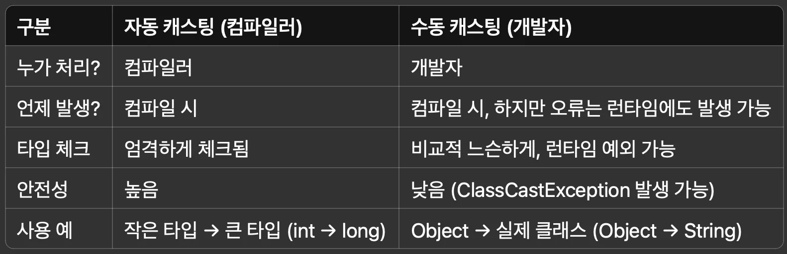
> 
> </details>
> 
> ---
> 
> <details>
> <summary>추가 팁&#58; <strong> </strong><strong><code>instanceof</code></strong><strong> ← 안전한 캐스팅</strong></summary>
> 
> <a id="1c8eda9b0fe1801ba598da8834103e41"></a>
> 
> ```java
> if (obj instanceof String) {
>     String str = (String) obj;  // 안전한 캐스팅
> }
> ```
> 
> - <code>instanceof</code>를 사용하여 캐스팅 시,  <strong>런타임 에러를 방지할 수 있다&#46;</strong>
> 
> </details>

> 🧐 
> 
> <a id="1c8eda9b0fe180d58880f433f0a162cb"></a>
> 
> 추가 질문) 자동 캐스팅과 수동 캐스팅은 결국 JVM이 타입을 바꾸는 거 아닌가? 그럼 <strong>같은 동작 아닌가? 왜 자동 캐스팅은 안정하고, 수동 캐스팅은 안전하지 않은가?</strong>
> 
> ---
> 
> <a id="1c8eda9b0fe18087baf8fe56ef36defd"></a>
> 
> 우선 보류
> 
> - 참조&#58; ‣

<a id="1c3eda9b0fe181e1b572ca7d166ef4b4"></a>

## 문제와 풀이

<a id="1c8eda9b0fe180d0875dd2cead995529"></a>

### 예시 코드

<details>
<summary>&#91; 코드 &#93; BioUnit</summary>

<a id="1c8eda9b0fe1809d9cf5c28ae47a142e"></a>

```java
package generic.test.ex3.unit;

public class BioUnit {

    private String name;
    private int hp;
    
    public BioUnit(String name, int hp) {
        this.name = name;
        this.hp = hp;
		}
		
    public String getName() {
        return name;
		}
		
    public int getHp() {
        return hp;
		}
		
    @Override
    public String toString() {
        return "BioUnit{" +
                "name='" + name + '\'' +
                ", hp=" + hp +
								'}';
		}
}
```

</details>

<details>
<summary>&#91; 코드 &#93; Marine</summary>

<a id="1c8eda9b0fe180eca64efb9040e1d4ab"></a>

```java
package generic.test.ex3.unit;
 
public class Marine extends BioUnit {

		public Marine(String name, int hp) {
		   super(name, hp);
		} 
}
```

</details>

<details>
<summary>&#91; 코드 &#93; Zealot</summary>

<a id="1c8eda9b0fe1802e88e5e05141707a38"></a>

```java
package generic.test.ex3.unit;

public class Zealot extends BioUnit {

		public Zealot(String name, int hp) {
				super(name, hp);
		} 
}
```

</details>

<details>
<summary>&#91; 코드 &#93; Zergling</summary>

<a id="1c8eda9b0fe180c7b2dff8b1917a52a1"></a>

```java
package generic.test.ex3.unit;

public class Zergling extends BioUnit {

		public Zergling(String name, int hp) {
				super(name, hp);
		} 
}
```

</details>

---

<a id="1c8eda9b0fe180e381cfc9a88b866a5c"></a>

### 문제 1

> ❗ 
> 
> <a id="1c8eda9b0fe180bba56df2f5afbbdd32"></a>
> 
> 다음 코드와 실행 결과를 참고해서 <code>UnitUtil</code> 클래스를 만들어라&#46;
> 
> <a id="1c8eda9b0fe180d6a2c3dbd3b5f96bf8"></a>
> 
> <code>UnitUtil&#46;maxHp()</code> 메서드의 조건은 다음과 같다&#46;
> 
> - 두 유닛을 입력 받아서 체력이 높은 유닛을 반환한다&#46; 
> 
> - 체력이 같은 경우 둘 중 아무나 반환해도 된다&#46;
> 
> - 제네릭 메서드를 사용해야 한다&#46;
> 
> - 입력하는 유닛의 타입과 반환하는 유닛의 타입이 같아야 한다&#46;

<a id="1c3eda9b0fe181ee83f0e0de842975a7"></a>

```java
package generic.test.ex3;

import generic.test.ex3.unit.Marine;
import generic.test.ex3.unit.Zealot;


public class UnitUtilTest {

    public static void main(String[] args) {
        Marine m1 = new Marine("마린1", 40);
        Marine m2 = new Marine("마린2", 50);
        Marine resultMarine = UnitUtil.maxHp(m1, m2); 
        System.out.println("resultMarine = " + resultMarine);
        
        Zealot z1 = new Zealot("질럿1", 100);
        Zealot z2 = new Zealot("질럿2", 150);
        Zealot resultZealot = UnitUtil.maxHp(z1, z2); 
        System.out.println("resultZealot = " + resultZealot);
    } 
}
```

<a id="1c3eda9b0fe181fea145d47c7f48b90a"></a>

실행 결과 

<a id="1c3eda9b0fe1816d90e9c34c0ae04e77"></a>

```plaintext
resultMarine = BioUnit{name='마린2', hp=50}
resultZealot = BioUnit{name='질럿2', hp=150}
```

<details>
<summary>&#91; 정답 &#93;</summary>

<a id="1c8eda9b0fe180fd85e4e095a41be85c"></a>

```java
public class UnitUil {

		public static <T extends BioUnit> T maxHp(T m1, T m2) {
				return m1.getHp() > m2.getHp() ? m1 : m2;
		}
}
```

</details>

<a id="1c8eda9b0fe18008a300fd7f54540535"></a>

### 문제 2

> ❗ 
> 
> <a id="1c8eda9b0fe1803c91ade86e0084773f"></a>
> 
> 다음 코드와 실행 결과를 참고해서 <code>Shuttle</code> 클래스를 만들어라&#46;
> 
> <a id="1c8eda9b0fe180978db0e669f4aaa716"></a>
> 
> <code>Shuttle</code> 클래스의 조건은 다음과 같다&#46;
> 
> - 제네릭 타입을 사용해야 한다&#46;
> 
> - <code>showInfo()</code> 메서드를 통해 탑승한 유닛의 정보를 출력한다&#46;

<a id="1c8eda9b0fe180bd967df1c6ae21051e"></a>

```java
package generic.test.ex3;

import generic.test.ex3.unit.Marine;
import generic.test.ex3.unit.Zealot;
import generic.test.ex3.unit.Zergling;


public class ShuttleTest {

    public static void main(String[] args) {
        Shuttle<Marine> shuttle1 = new Shuttle<>(); 
        shuttle1.in(new Marine("마린", 40)); 
        shuttle1.showInfo();
        
				Shuttle<Zergling> shuttle2 = new Shuttle<>();
				shuttle2.in(new Zergling("저글링", 35)); 
				shuttle2.showInfo();
				
				Shuttle<Zealot> shuttle3 = new Shuttle<>();
				shuttle3.in(new Zealot("질럿", 100));
				shuttle3.showInfo();
    } 
}
```

<a id="1c8eda9b0fe18011b6f4cd073d9da28b"></a>

실행 결과 

<a id="1c8eda9b0fe1802980e2f6ed90940584"></a>

```plaintext

이름: 마린, HP: 40 
이름: 저글링, HP: 35
이름: 질럿, HP: 100
```

<details>
<summary>&#91; 정답 &#93;</summary>

<a id="1c8eda9b0fe180b4a7afc82454489148"></a>

내 풀이) 상한 와일드 카드

<a id="1c8eda9b0fe1808c82dadf90a939e589"></a>

```java
public class Shuttle {

		private BioUnit unit
		
		public void in(<? extends BioUnit> unit) {
				this.unit = unit;
		}
		
 		public BioUnit out() {
		 		if (unit != null) {
						return unit;
				}
				
				thorow new NullPointException("unit 값이 존재하지 않습니다. ");
		}
		
		public BioUnit showInfo() {
				System.out.println("이름: " + unit.getName() + ", HP: " + unit.getHp());
		}
}
```

<a id="1c8eda9b0fe180ac83d8fe3d1a89545d"></a>

강의 풀이) 제네릭 타입

<a id="1c8eda9b0fe1809d8999ddde6c880905"></a>

```java
public class Shuttle<T extends BioUnit> {
 
		private T unit;
		 
 		public void in(T unit) {
				this.unit = unit;
		}
		
 		public T out() {
				return unit;
		}
		
		public T showInfo() {
				System.out.println("이름: " + unit.getName() + ", HP: " + unit.getHp());
		}
 }
```

</details>

<a id="1c8eda9b0fe180a4ac3fc9c354220a58"></a>

### 문제 3

> ❗ 
> 
> <a id="1c8eda9b0fe1803ea960e1d998343885"></a>
> 
> 앞서 문제에서 만든 <code>Shuttle</code> 을 활용한다&#46;<br>다음 코드와 실행 결과를 참고해서 <code>UnitPrinter</code> 클래스를 만들어라&#46;
> 
> <a id="1c8eda9b0fe18090b9a2c602144a2f15"></a>
> 
> <code>UnitPrinter</code> 클래스의 조건은 다음과 같다&#46;
> 
> - <code>UnitPrinter&#46;printV1()</code>은 제네릭 메서드로 구현해야 한다&#46;
> 
> - <code>UnitPrinter&#46;printV2()</code> 는 와일드카드로 구현해야 한다&#46;
> 
> - 이 두 메서드는 셔틀에 들어있는 유닛의 정보를 출력한다&#46;

<a id="1c8eda9b0fe18096b83bcd178d28bdc6"></a>

```java
package generic.test.ex3;

import generic.test.ex3.unit.Marine;
import generic.test.ex3.unit.Zealot;
import generic.test.ex3.unit.Zergling;


public class ShuttleTest {

    public static void main(String[] args) {
        Shuttle<Marine> shuttle1 = new Shuttle<>(); 
        shuttle1.in(new Marine("마린", 40)); 
        
				Shuttle<Zergling> shuttle2 = new Shuttle<>();
				shuttle2.in(new Zergling("저글링", 35)); 
				
				Shuttle<Zealot> shuttle3 = new Shuttle<>();
				shuttle3.in(new Zealot("질럿", 100));
				
				UnitPrinter.printV1(shuttle1);
        UnitPrinter.printV2(shuttle1);
    } 
}
```

<a id="1c8eda9b0fe1801a8477f2c3fa5bc017"></a>

실행 결과 

<a id="1c8eda9b0fe1803fb453cef3e64fa0e2"></a>

```plaintext
이름: 마린, HP: 40 
이름: 마린, HP: 40
```

<details>
<summary>&#91; 정답 &#93;</summary>

<a id="1c8eda9b0fe180babfbbc31cc5162f4b"></a>

내 풀이) 

<a id="1c8eda9b0fe180029a39c931453845d0"></a>

```java
public class  UnitPrinter {

		static <T extends BioUnit> void printV1(Shuttle<T> unit) {
				T unit = t1.out();
				System.out.println("이름: " + unit.getName() + ", HP: " + unit.getHp());		
		}
		
		static void printV2(Shuttle<? extends BioUint> unit) {
				BioUnit unit = t1.out();
				System.out.println("이름: " + unit.getName() + ", HP: " + unit.getHp());
		}		
}


// printV2): 와일드카드
```

</details>

> ✏️ 
> 
> <a id="1c8eda9b0fe1809589d1c77d759b7358"></a>
> 
> <strong>정리</strong>
> 
> ---
> 
> <a id="1c8eda9b0fe1807fbc09c7ebc744f6c8"></a>
> 
> 실무에서 직접 제네릭을 사용해서 무언가를 설계하거나 만드는 일은 드물다&#46; 
> 
> <a id="1c8eda9b0fe1806b986aca565a2d63a8"></a>
> 
> 그것보다는 대부분 이미 제네릭을 통해 만들어진 프레임워크나 라이브러리들을 가져다 사용하는 경우가 훨씬 많다&#46; 
> 
> <a id="1c8eda9b0fe1805cb22dc6a2f55f82cd"></a>
> 
> 그래서 이미 만들어진 코드의 제네릭을 읽고 이해하는 정도면 충분하다&#46; 
> 
> <a id="1c8eda9b0fe180f6afd0dab2e8b99bb6"></a>
> 
> <strong><u>실무</u></strong>에서 직접 제네릭을 사용하더라도 어렵고 복잡하게 사용하기 보다는 <strong><u>보통 단순하게 사용</u></strong>한다&#46;
> 
> <a id="1c8eda9b0fe180cca756f981453c3db0"></a>
> 
> 지금까지 학습한 정도면 실무에 필요한 제네릭은 충분히 이해했다고 볼 수 있다&#46;
> 
> <a id="1c8eda9b0fe18099ac15e052d396c990"></a>
> 
> 제네릭은 지금까지 설명한 내용보다 더 복잡하고 어려운 개념들도 있다&#46; 
> 
> <a id="1c8eda9b0fe1808786a0fd9cf2de3be4"></a>
> 
> 특히 <strong><u>공변(covariant), 반공변(contravariant)과 같은 개념들</u></strong>이 그러하다&#46; 
> 
> <a id="1c8eda9b0fe180de9a13d07273d11876"></a>
> 
> 이런 개념들을 이해하면 와일드카드가 존재하는 이유도 더 깊이있게 알 수있다&#46;
> 
> <a id="1c8eda9b0fe180ffb18be613bfc8b600"></a>
> 
> 하지만 제네릭을 사용해서 매우 복잡한 라이브러나 프레임워크를 직접 설계하지 않는 이상 이런 개념들을 꼭 이해할 필요는 없다&#46; 
> 
> <a id="1c8eda9b0fe18022be70fe8af76db7f4"></a>
> 
> 이런 부분은 실무에서 많은 경험을 쌓고 본인이 필요하다고 느껴질 때 따로 공부하는 것을 권장한다&#46;
> 
> <a id="1c8eda9b0fe180229de8d490f3560546"></a>
> 
> 제네릭은 이후에 설명하는 컬렉션 프레임워크에서 가장 많이 사용된다&#46; 
> 
> <a id="1c8eda9b0fe180dd927ae80994bf1069"></a>
> 
> 따라서 컬렉션 프레임워크를 통해서 제네릭이 어떻게 활용되는지 자연스럽게 학습할 수 있다&#46;

<details>
<summary><strong>🧐 </strong><strong><code>&#60;? extends T&#62;</code></strong><strong> vs </strong><strong><code>&#60;? super T&#62;</code></strong><strong> 비교</strong></summary>

| <strong>특징</strong> | <code>? extends T</code>  | <code>? super T</code> |
| --- | --- | --- |
| 의미 | T 또는 T의 하위 타입 | T 또는 T의 상위 타입 |
| <strong>읽기</strong> | 가능 (T로 읽기 가능) | 불가능 (Object로만 읽기 가능) |
| <strong>쓰기</strong> | 불가능 (추상적 타입이므로) | 가능 (T 및 그 하위 타입만 가능) |
| 실무 용도 | 읽기 전용 | 쓰기 전용 |

</details>

<details>
<summary>🧐 공변성(Covariance) &#38; 반공변성(Contravariance)</summary>

<details>
<summary><strong> 공변성  (</strong><strong><code>? extends T</code></strong><strong>)</strong></summary>

<a id="1c7eda9b0fe180bd9f05f1282e28526a"></a>

<strong>읽기 전용 / 안전한 하위 타입 허용</strong>

<a id="1c7eda9b0fe1802092c7ce26656935fb"></a>

```java
List<? extends Animal> animals = new ArrayList<Dog>();
Animal a = animals.get(0); // ✅ 가능
animals.add(new Cat()); // ❌ 에러
```

- 공변성&#58; <code>Dog is&#45;a Animal</code> 
    - 하위 타입을 상위로 취급 가능

- 쓰기 제한 있음

</details>

<details>
<summary><strong>반공변성 (</strong><strong><code>? super T</code></strong><strong>)</strong></summary>

<a id="1c7eda9b0fe180639413dec7ac6ad49b"></a>

<strong>쓰기 전용 / 안전한 상위 타입 허용</strong>

<a id="1c7eda9b0fe180db8dc9c54b6f3e08ac"></a>

```java
List<? super Dog> dogs = new ArrayList<Animal>();
dogs.add(new Dog()); // ✅ 가능
Object o = dogs.get(0); // ✅ 읽기 시 Object로만
```

- 반공변성&#58; Animal is&#45;a supertype of Dog
    - Dog를 넣어도 문제 없음

- 읽기 제한 있음

</details>

| <strong>문법</strong> | <strong>읽기</strong> | <strong>쓰기</strong> | <strong>주로 쓰는 상황</strong> |
| --- | --- | --- | --- |
| <code>List&#60;T&#62;</code> | <strong>○</strong> | <strong>○</strong> | 타입 고정 (일반적인 상황) |
| <code>List&#60;? extends T&#62;</code> | <strong>○</strong> | <strong>X</strong> | 읽기 전용이 필요한 경우 |
| <code>List&#60;? super T&#62;</code> | <strong>X</strong> | <strong>○</strong> | 쓰기 전용이 필요한 경우 |

</details>

<details>
<summary><strong><code>PECS</code></strong><strong> 패턴 (  Producer Extends, Consumer Super )</strong></summary>


</details>
