<a id="1c3eda9b0fe1818a8184e069737ce7d5"></a>

### Routing 모델

---

> 📖 
> 
> <a id="1c3eda9b0fe1816293e0d40ec25942c3"></a>
> 
> <strong><code>Routing 모델</code></strong>은 <strong><u>메세지</u></strong><u>를</u> <strong><code>Routing Key</code></strong><u>에 따라</u> <strong><u>특정 큐</u></strong>에 <strong><u>전달</u></strong>하는 기능이다&#46;
> 
> - <code>종류</code>&#58; <code>Direct Exchange</code>, <code>Topic Exchange</code>
> 
> - Fanout Exchange 와 함께 사용되는 가장 일반적인 모델이다&#46; 

<details>
<summary><strong>Direct Exchange, Topic Exchange 비교</strong></summary>

|              &#45;  | <code>Direct Exchange</code> | <code>Topic Exchange</code> |
| --- | --- | --- |
| 라우팅 키 매칭 방식 | 정확히 일치  | 패턴 기반 ( <code>&#42;</code> , <code>&#35;</code> 지원 ) |
| 특징 | 매칭 <strong><u>제한</u></strong>적 | 매우 유연<br>(다양한 패턴 매칭 가능) |
| 사용 사례 | <strong><u>단순</u></strong>하고 <strong><u>명확</u></strong>한 목적의 라우팅 | <strong><u>복잡</u></strong>하고 <strong><u>동적</u></strong>인 라우팅 |

> ✏️ 
> 
> <a id="1c3eda9b0fe1817db246ca6693044e1d"></a>
> 
> Topic의 경우, 패턴 매칭 기반 라우링으로 binding key와 매칭되는 메세지만 수신한다&#46; 
> 
> - <code>&#42;</code>&#58; 한 단어에 해당되는 모든 단어 수신
> 
> - <code>&#35;</code>&#58; 0개 이상의 단어 ( 와일드 카드 )

</details>

<details>
<summary><strong>주요 특징</strong></summary>

- 고성능
    - 메세지를 필요한 곳에만 전달하기 때문에 <strong><u>네트워크 부하 감소 효과</u></strong>가 있다&#46;

    - <strong><u>브로드캐스트 보다 자원을 효율적으로 사용</u></strong>한다&#46; 

- 라우팅 키 기반 메세지 분배
    > ☝🏻 
    > 
    > <a id="1c3eda9b0fe1812d937aeeb7f7bb4dfb"></a>
    > 
    > <strong><code>Direct Exchange</code></strong>의 경우, <strong><u>라우팅 키가 정확하게 일치</u></strong>해야 해당되는 큐로 메세지가 전송된다&#46; 
    > 
    > <a id="1c3eda9b0fe181ac92bac772b6194fed"></a>
    > 
    > 그러나<strong> 동일한 라우팅 키를 여러 큐에 바인딩 처리가 가능</strong>하기 때문에 Direct Exchange의 경우도 <strong><u><code>1&#58;N</code></u></strong><strong><u>으로 동작 가능</u></strong>하다&#46; 

    - 각 큐는 하나 이상의 라우팅 키와 매칭

    - Fanout 방식과 달리, <strong>메세지가 </strong><strong><u>특정 큐</u></strong><strong>로만 전달</strong>된다&#46;

- 바인딩 설정
    - <code>Direct Exchange</code>&#58; 설정한 <strong><u>라우팅 키와 동일한 경우</u></strong>에만 1&#58;1 메세지 라우팅 

    - <code>Topic Exchange</code>&#58; <strong><u>패턴 기반 매</u></strong><u>칭</u>으로 다양한 방식으로 유연하게 라우팅 가능하다&#46;

    - <strong><u>Exchange</u></strong><strong> 와 </strong><strong><u>큐</u></strong><strong> 사이의 관계</strong>를 <strong><code>바인딩 키(binding key)</code></strong>를 식별하여 메세지를  전달한다&#46;

</details>

<a id="1c3eda9b0fe1811595d9eab27aa98acf"></a>

### <code>Direct Exchange</code>를 통한 Log 수집

---

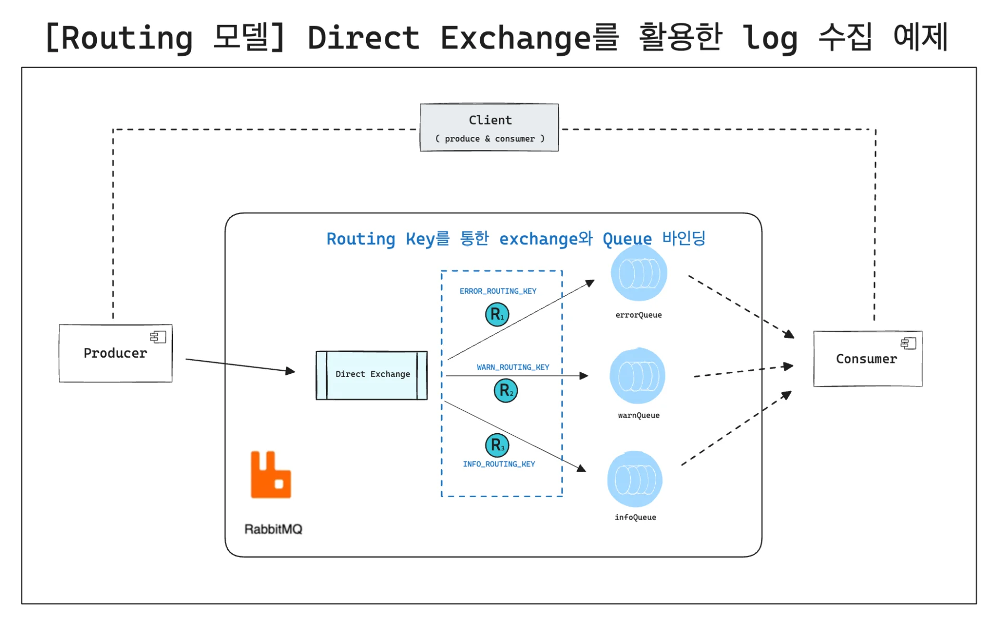

[step5: Routing 모델 - Direct Exchange를 활용한 log 수집 예제](https://github.com/gyungsubLee/RabbitMQ_prac/commit/d16e4e08598e0a5b694ab4e8dc1154921fe0e189)

<details>
<summary><code>ExceptionHandler</code>&#58; CustomExceptionHandler</summary>

<a id="1c3eda9b0fe181008a16d09146966b7c"></a>

```java
package com.prac.rabbimq.step5;

import org.springframework.stereotype.Component;

@Component
public class CustomExceptionHandler {

    private final LogPublisher logPublisher;

    public CustomExceptionHandler(LogPublisher logPublisher) {
        this.logPublisher = logPublisher;
    }

    // 에러 로그 처리
    public void handleException(Exception e) {
        String message = e.getMessage();

        String routingKey;

        if (e instanceof NullPointerException) {
            routingKey = RabbitMQConfig.ERROR_ROUTING_KEYR;
        } else if (e instanceof IllegalArgumentException) {
            routingKey = RabbitMQConfig.WARN_ROUTING_KEYR;
        } else {
            routingKey = RabbitMQConfig.ERROR_ROUTING_KEYR;
        }

        logPublisher.publish(routingKey, "Exception 발생: " + message);
    }

    // 메세지 처리
    public void handleMessage(String message) {
        String routingKey = RabbitMQConfig.INFO_ROUTING_KEYR;
        logPublisher.publish(routingKey, "Info log: " + message);
    }
}

```

</details>

<details>
<summary><code>config</code>&#58; RabbitMQConfig</summary>

<a id="1c3eda9b0fe1810fbff3ec3568211bfb"></a>

```java
package com.prac.rabbimq.step5;

import org.springframework.amqp.core.Binding;
import org.springframework.amqp.core.BindingBuilder;
import org.springframework.amqp.core.DirectExchange;
import org.springframework.amqp.core.Queue;
import org.springframework.context.annotation.Bean;
import org.springframework.context.annotation.Configuration;

@Configuration
public class RabbitMQConfig {

    public static final String ERROR_QUEUE = "error_queue";
    public static final String WARN_QUEUE = "warn_queue";
    public static final String INFO_QUEUE = "info_queue";

    public static final String DIRECT_EXCHANGE = "direct_exchange";

    public static final String ERROR_ROUTING_KEYR = "error";
    public static final String WARN_ROUTING_KEYR = "warn";
    public static final String INFO_ROUTING_KEYR = "info";
		
		// Direct Exchange 생성
    @Bean
    public DirectExchange directExchange() {
        return new DirectExchange(DIRECT_EXCHANGE);
    }
		
		// Queue 정의
    @Bean
    public Queue errorQueue() {
        return new Queue(ERROR_QUEUE, false);
    }

    @Bean
    public Queue warnQueue() {
        return new Queue(WARN_QUEUE, false);
    }

    @Bean
    public Queue infoQueue() {
        return new Queue(INFO_QUEUE, false);
    }
		
		// 바인딩 처리
    @Bean
    public Binding errorBinding() {
        return BindingBuilder.bind(errorQueue()).to(directExchange()).with(ERROR_ROUTING_KEYR);
    }

    @Bean
    public Binding warnBinding() {
        return BindingBuilder.bind(warnQueue()).to(directExchange()).with(WARN_ROUTING_KEYR);
    }

    @Bean
    public Binding infoBinding() {
        return BindingBuilder.bind(infoQueue()).to(directExchange()).with(INFO_ROUTING_KEYR);
    }
}

```

</details>

<details>
<summary><code>publisher</code>&#58; LogPublisher</summary>

<a id="1c3eda9b0fe1815eae90f1b141c3a25c"></a>

```java
package com.prac.rabbimq.step5;

import org.springframework.amqp.rabbit.core.RabbitTemplate;
import org.springframework.stereotype.Component;

@Component
public class LogPublisher {

    private final RabbitTemplate rabbitTemplate;

    public LogPublisher(RabbitTemplate rabbitTemplate) {
        this.rabbitTemplate = rabbitTemplate;
    }

    public void publish(String routingKey, String message) {
        rabbitTemplate.convertAndSend(RabbitMQConfig.DIRECT_EXCHANGE, routingKey, message);
        System.out.println("message published: " + routingKey + ", " + message);
    }
}

```

</details>

<details>
<summary><code>consumer</code>&#58; LogConsumer</summary>

<a id="1c3eda9b0fe18131bd1ada59920c166c"></a>

```java
package com.prac.rabbimq.step5;

import org.springframework.amqp.rabbit.annotation.RabbitListener;
import org.springframework.stereotype.Component;

@Component
public class LogConsumer {

    @RabbitListener(queues = RabbitMQConfig.ERROR_QUEUE)
    public void consumeError(String message) {
        System.out.println("[ERROR] 수신: " + message);
    }

    @RabbitListener(queues = RabbitMQConfig.WARN_QUEUE)
    public void consumeWarn(String message) {
        System.out.println("[WARN] 수신: " + message);
    }

    @RabbitListener(queues = RabbitMQConfig.INFO_QUEUE)
    public void consumeInfo(String message) {
        System.out.println("[INFO] 수신: " + message);
    }
}

```

</details>

<details>
<summary><code>controller</code>&#58; LogController</summary>

<a id="1c3eda9b0fe181e9a096da9bd6983f5a"></a>

```java
package com.prac.rabbimq.step5;

import org.springframework.http.ResponseEntity;
import org.springframework.web.bind.annotation.*;

@RestController
@RequestMapping("/api/logs")
public class LogController {

    private final CustomExceptionHandler exceptionHandler;

    public LogController(CustomExceptionHandler exceptionHandler) {
        this.exceptionHandler = exceptionHandler;
    }

    @GetMapping("/error")
    public ResponseEntity<String> errorAPI() {
        try {
            String value  = null;
            value.getBytes(); // null pointer
        } catch (Exception e) {
            exceptionHandler.handleException(e);
        }
        return ResponseEntity.ok("Controller Null pointer Exception 처리");
    }

    @GetMapping("/warn")
    public ResponseEntity<String> warnAPI() {
        try {
            throw new IllegalArgumentException("invalid argument!");
        } catch (Exception e) {
            exceptionHandler.handleException(e);
        }
        return ResponseEntity.ok("Controller IllegalArgument Exception 처리");
    }

    @PostMapping("/info")
    public ResponseEntity<String> infoAPI(@RequestBody String message) {
        exceptionHandler.handleMessage(message);
        return ResponseEntity.ok("Controller Info log 발송 처리");
    }
}

```

</details>

---

<details>
<summary>curl 호출</summary>

<details>
<summary>ERROR</summary>

<a id="1c3eda9b0fe181fe8b9dfebcc44467ab"></a>

```java
curl -X GET "http://localhost:8080/api/logs/error"
```

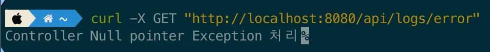

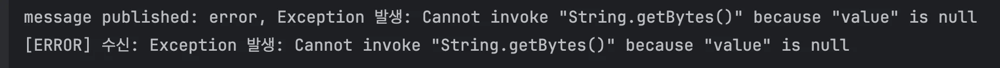

</details>

<details>
<summary>WARN</summary>

<a id="1c3eda9b0fe181ba9003da695dab4f56"></a>

```java
 curl -X GET "http://localhost:8080/api/logs/warn"
```

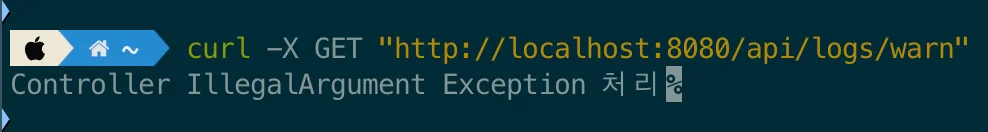

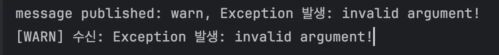

</details>

<details>
<summary>INFO</summary>

<details>
<summary>파일 전송</summary>

<a id="1c3eda9b0fe1816c9abce327bb43d575"></a>

```java
curl -X POST "http://localhost:8080/api/logs/info" \
     -H "Content-Type: application/json" \
     -d @data.json
```

<details>
<summary>data&#46;json</summary>

<a id="1c3eda9b0fe181a897bbff1b95b3e00e"></a>

```java
{
  "message": "파일에서 전송된 로그 메시지"
}
```

</details>

</details>

<details>
<summary><strong>폼 데이터(application/x&#45;www&#45;form&#45;urlencoded)</strong></summary>

<a id="1c3eda9b0fe18155bc4af0cf5de5799b"></a>

```java
curl -X POST "http://localhost:8080/api/logs/info" \
     -H "Content-Type: application/x-www-form-urlencoded" \
     -d "message=로그 메시지"
```

</details>

- <strong>JSON</strong>
    <a id="1c3eda9b0fe18183896ac52a8e5590bc"></a>

    ```java
    curl -X POST "http://localhost:8080/api/logs/info" \
         -H "Content-Type: application/json" \
         -d '{"message": "로그 메시지"}'
    ```

    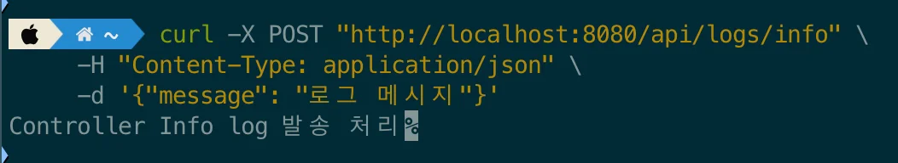

    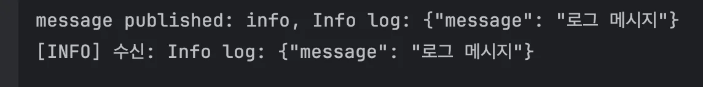

</details>

</details>

<a id="1c3eda9b0fe1811ead1ce1fdac60298e"></a>

### <code>Topic Exchange</code>를 통한 Log 수집

---

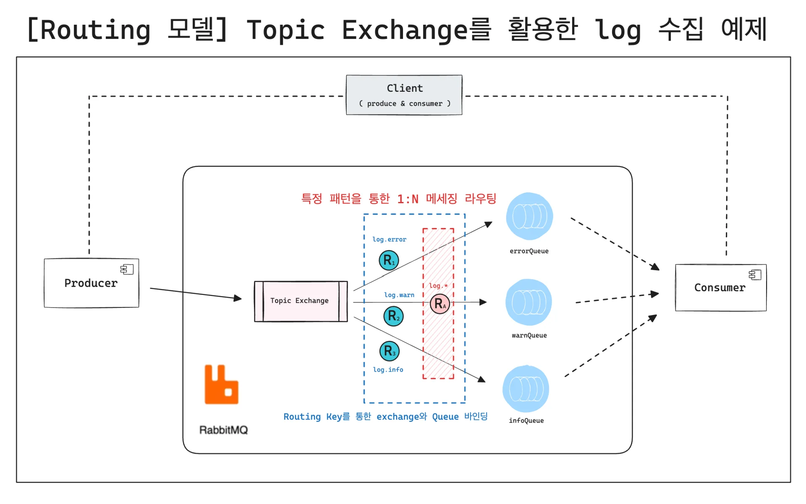

[step6: Routing 모델 - Topic Exchange를 활용한 log 수집 예제](https://github.com/gyungsubLee/RabbitMQ_prac/commit/8cd317af406d20e975cac93e8b168fca3bedb336)

<details>
<summary><code>ExceptionHandler</code>&#58; CustomExceptionHandler</summary>

> 위 예시 코드와 동일

<a id="1c3eda9b0fe1816d9d78fff81c60f349"></a>

```java
package com.prac.rabbimq.step6;

import org.springframework.stereotype.Component;

@Component
public class CustomExceptionHandler {

    private final LogPublisher logPublisher;

    public CustomExceptionHandler(LogPublisher logPublisher) {
        this.logPublisher = logPublisher;
    }

    // 에러 로그 처리
    public void handleException(Exception e) {
        String message = e.getMessage();

        String routingKey;

        if (e instanceof NullPointerException) {
            routingKey = RabbitMQConfig.ERROR_ROUTING_KEYR;
        } else if (e instanceof IllegalArgumentException) {
            routingKey = RabbitMQConfig.WARN_ROUTING_KEYR;
        } else {
            routingKey = RabbitMQConfig.ERROR_ROUTING_KEYR;
        }

        logPublisher.publish(routingKey, "Exception 발생: " + message);
    }

    // 메세지 처린
    public void handleMessage(String message) {
        String routingKey = RabbitMQConfig.INFO_ROUTING_KEYR;
        logPublisher.publish(routingKey, "Info log: " + message);
    }
}

```

</details>

<details>
<summary><code>config</code>&#58; RabbitMQConfig</summary>

<a id="1c3eda9b0fe181fcb62ff2b62d3088ec"></a>

```java
package com.prac.rabbimq.step6;

import org.springframework.amqp.core.*;
import org.springframework.context.annotation.Bean;
import org.springframework.context.annotation.Configuration;

@Configuration
public class RabbitMQConfig {

    public static final String ERROR_QUEUE = "error_queue";
    public static final String WARN_QUEUE = "warn_queue";
    public static final String INFO_QUEUE = "info_queue";
    
    // ALL LOG Queue 이름 정의
    public static final String ALL_LOG__QUEUE = "all_log_queue";
		
		// Exchange 유형 'Topic' 으로 변경
    public static final String TOPIC_EXCHANGE = "topic_exchange";
		
		// Routing KEY 추가 내용) 
		// prefix: 'log.'
		// ALL LOG 타입 추가 정의
    public static final String ERROR_ROUTING_KEYR = "log.error";
    public static final String WARN_ROUTING_KEYR = "log.warn";
    public static final String INFO_ROUTING_KEYR = "log.info";
    public static final String ALL_LOG_ROUTING_KEY = "log.*";

		
		// Topic Exchange 생성
    @Bean
    public TopicExchange topicExchange() {
        return new TopicExchange(TOPIC_EXCHANGE);
    }

    @Bean
    public Queue errorQueue() {
        return new Queue(ERROR_QUEUE, false);
    }

    @Bean
    public Queue warnQueue() {
        return new Queue(WARN_QUEUE, false);
    }

    @Bean
    public Queue infoQueue() {
        return new Queue(INFO_QUEUE, false);
    }
		
		// ALL LOG 큐 정의
    @Bean
    public Queue allLogQueue() {
        return new Queue(ALL_LOG__QUEUE, false);
    }

    @Bean
    public Binding errorBinding() {
        return BindingBuilder.bind(errorQueue()).to(topicExchange()).with(ERROR_ROUTING_KEYR);
    }

    @Bean
    public Binding warnBinding() {
        return BindingBuilder.bind(warnQueue()).to(topicExchange()).with(WARN_ROUTING_KEYR);
    }

    @Bean
    public Binding infoBinding() {
        return BindingBuilder.bind(infoQueue()).to(topicExchange()).with(INFO_ROUTING_KEYR);
    }
		
		// ALL LOG 타입 바인딩 처리
    @Bean
    public Binding allLogBinding() {
        return BindingBuilder.bind(allLogQueue()).to(topicExchange()).with(ALL_LOG_ROUTING_KEY);
    }
}

```

</details>

<details>
<summary><code>publisher</code>&#58; LogPublisher</summary>

> 위 예시와 코드 동일

<a id="1c3eda9b0fe18156add5f04861786819"></a>

```java
package com.prac.rabbimq.step5;

import org.springframework.amqp.rabbit.core.RabbitTemplate;
import org.springframework.stereotype.Component;

@Component
public class LogPublisher {

    private final RabbitTemplate rabbitTemplate;

    public LogPublisher(RabbitTemplate rabbitTemplate) {
        this.rabbitTemplate = rabbitTemplate;
    }

    public void publish(String routingKey, String message) {
        rabbitTemplate.convertAndSend(RabbitMQConfig.DIRECT_EXCHANGE, routingKey, message);
        System.out.println("message published: " + routingKey + ", " + message);
    }
}
```

</details>

<details>
<summary><code>consumer</code>&#58; LogConsumer</summary>

<a id="1c3eda9b0fe18171ba1ec0c58a90ff91"></a>

```java

@Component
public class LogConsumer {

    @RabbitListener(queues = RabbitMQConfig.ERROR_QUEUE)
    public void consumeError(String message) {
        System.out.println("[ERROR] 수신: " + message);
    }

    @RabbitListener(queues = RabbitMQConfig.WARN_QUEUE)
    public void consumeWarn(String message) {
        System.out.println("[WARN] 수신: " + message);
    }

    @RabbitListener(queues = RabbitMQConfig.INFO_QUEUE)
    public void consumeInfo(String message) {
        System.out.println("[INFO] 수신: " + message);
    }
		
		// 해당 코드 추가
    @RabbitListener(queues = RabbitMQConfig.ALL_LOG__QUEUE)
    public void consumeAllLogs(String message) {
        System.out.println("[ALL LOGS] 수신: " + message);
    }
}
```

</details>

<details>
<summary><code>controller</code>&#58; LogController</summary>

> 위 예시 코드와 동일

<a id="1c3eda9b0fe18159a29ad1af5119ac22"></a>

```java
package com.prac.rabbimq.step5;

import org.springframework.http.ResponseEntity;
import org.springframework.web.bind.annotation.*;

@RestController
@RequestMapping("/api/logs")
public class LogController {

    private final CustomExceptionHandler exceptionHandler;

    public LogController(CustomExceptionHandler exceptionHandler) {
        this.exceptionHandler = exceptionHandler;
    }

    @GetMapping("/error")
    public ResponseEntity<String> errorAPI() {
        try {
            String value  = null;
            value.getBytes(); // null pointer
        } catch (Exception e) {
            exceptionHandler.handleException(e);
        }
        return ResponseEntity.ok("Controller Null pointer Exception 처리");
    }

    @GetMapping("/warn")
    public ResponseEntity<String> warnAPI() {
        try {
            throw new IllegalArgumentException("invalid argument!");
        } catch (Exception e) {
            exceptionHandler.handleException(e);
        }
        return ResponseEntity.ok("Controller IllegalArgument Exception 처리");
    }

    @PostMapping("/info")
    public ResponseEntity<String> infoAPI(@RequestBody String message) {
        exceptionHandler.handleMessage(message);
        return ResponseEntity.ok("Controller Info log 발송 처리");
    }
}

```

</details>

---

<details>
<summary>postman 호출</summary>

<details>
<summary>ERROR</summary>

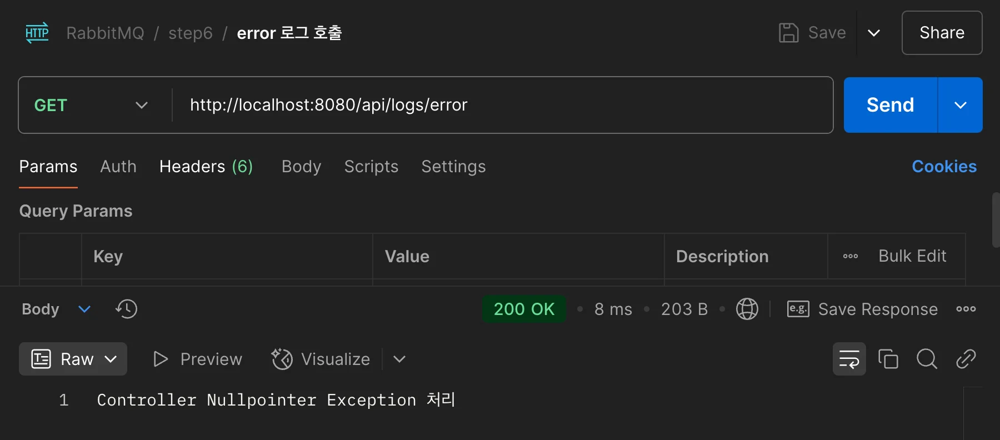

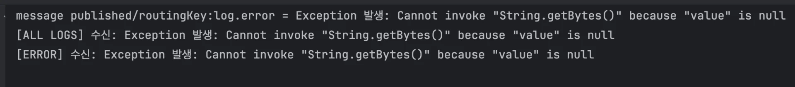

</details>

<details>
<summary>WARN</summary>

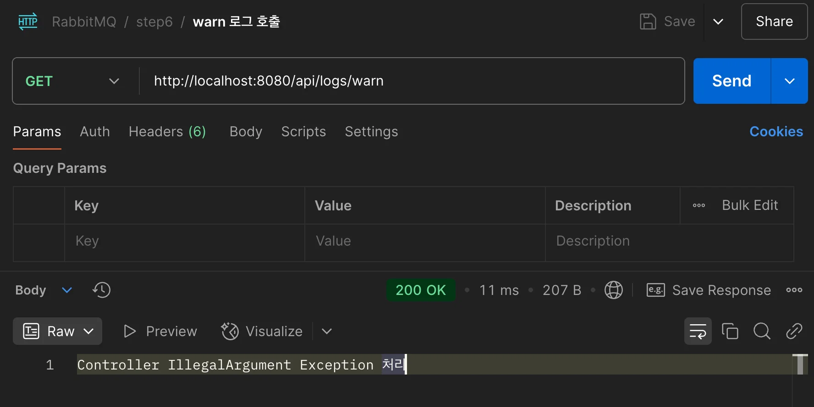

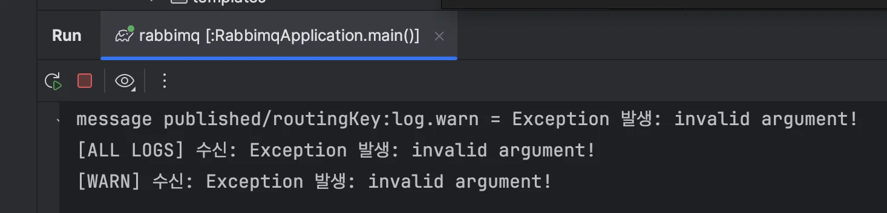

</details>

<details>
<summary>INFO</summary>

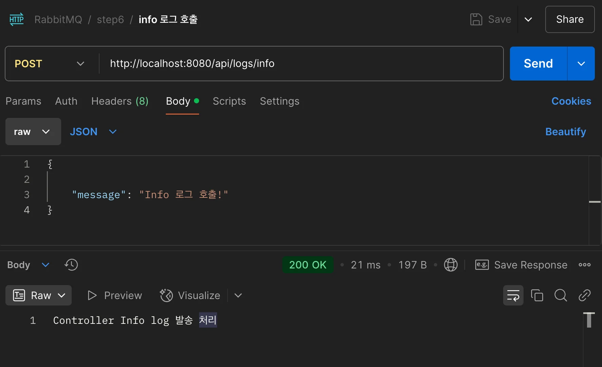

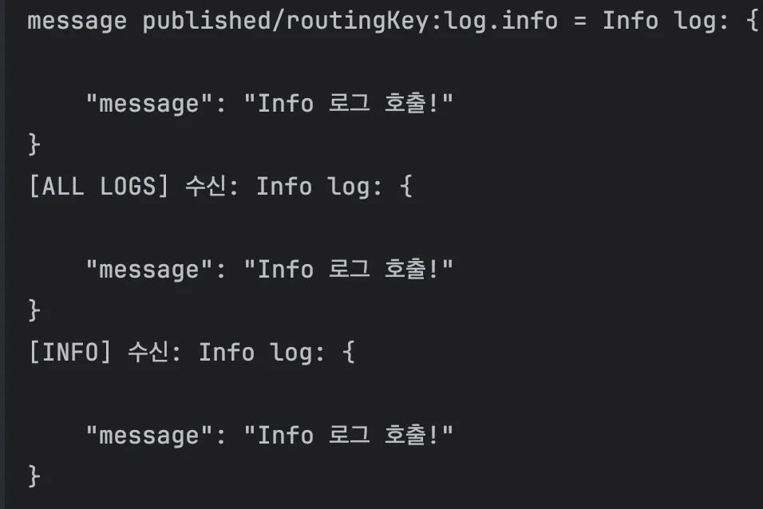

</details>

---

<a id="1c3eda9b0fe18125a2f9da28745ec0db"></a>

각 type의 log 호출 시, <code>all log</code>타입이 같이 호출되는 것을 확인할 수 있다&#46; 

</details>
