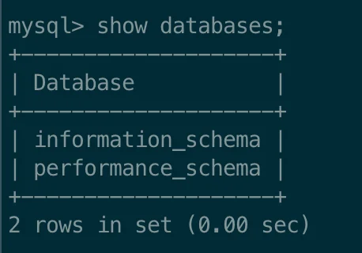
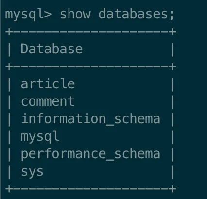
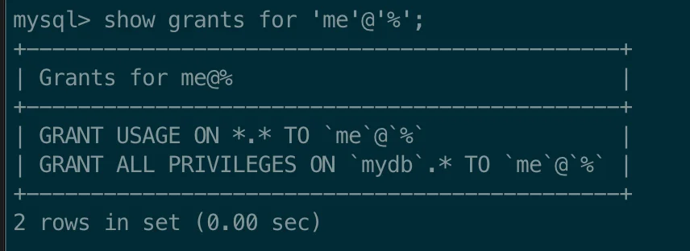
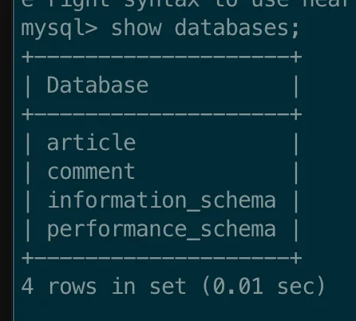

<a id="1c3eda9b0fe181cf878ffe540580d3f8"></a>

<a href="#/post/1c3eda9b-0fe1-810c-b1ea-febed1ea81af">페이지</a> 

<a id="1c3eda9b0fe181d390ebf2977ab64ed0"></a>

<a href="#/post/1c3eda9b-0fe1-81f0-8060-ff97c9868066">페이지</a> 

<a id="1c3eda9b0fe181a8859fd02a60396cb7"></a>

##  &#91; 🤬 오류 &#93; 새로 생성된 DB 내역이 하위 계정에서 확인 되지 않음

---

<a id="1c3eda9b0fe1813a91bce149d030a5f8"></a>

### DB 각 모듈에 맞게 나눠 분리

<a id="1c3eda9b0fe18139b8c4f8d0c6db9cc0"></a>

docker를 통해서 mysql를 실행했다&#46; 

<a id="1c3eda9b0fe181808d3bd25c95d1848e"></a>

그때 하나의 DB(mydb)만  생성하고 게시글(artilce) 과 댓글(comment)에 대한 테이블을 같이 생성하고 사용했다&#46; 

<a id="1c3eda9b0fe181dbb535de1d586b7b46"></a>

그러나 강의에서는 db를 각 모듈에 맞게 분리해서 사용하여, 그에 맞게 마이그레이션을 했다&#46; 

- 각 모듈에 맞게 db 분리하여 생성
    - mydb → article, comment

<details>
<summary> 내부 테이블을 복사한 뒤,이전 db를 삭제 처리했다&#46; </summary>

- <a href="#/post/1c3eda9b-0fe1-810c-b1ea-febed1ea81af">페이지</a> 

<a id="1c3eda9b0fe18189a4afe3fd54169eca"></a>

```sql
# DB 생성
CREATE DATABASE article;
CREATE DATABASE comment;

# 테이블 스키마 및 데이터 복사
RENAME TABLE mydb.article TO article.article;
RENAME TABLE mydb.comment TO comment.comment;

# 확인
use article
select count(1) cnt from article;

# 이전 db 삭제 
DROP DATABASE mydb;s
```

</details>

<a id="1c3eda9b0fe181a1a5fbe720915e2e54"></a>

그리고 root 계정이 아닌, 기존에 사용한 계정(me)에서 DB를 조회하였더니  아래와 같이 새로 생성한 DB가 조회되지 않았다&#46;



<a id="1c3eda9b0fe181969906e56615d53368"></a>

혹시 오류인가 싶어서 root 계정으로 확인해보았더니 아래와 같이 잘 조회되는 것을 확인할 수 있었다&#46; 



<a id="1c3eda9b0fe18186a794fa04299e5d69"></a>

찾아본 결과 하위 계정에 권한 설정을 추가하지 않아 발생된 오류 였다&#46;

<a id="1c3eda9b0fe1811b874ad0b6b9378482"></a>

이를 해결하고, 그 내용을 정리한다&#46; 

<a id="1c3eda9b0fe181a5bcddc3d257550ae6"></a>

## &#91; 😎 해결 &#93; 하위 계정에 권한 부여 

---

> <a href="#/post/1c3eda9b-0fe1-81f0-8060-ff97c9868066">페이지</a> 

<a id="1c3eda9b0fe1815cbe6ecf8b30bd5376"></a>

### 1&#46; 우선 하위 계정(me)에 부여된 권한 정보를 확인

<a id="1c3eda9b0fe1810d8787d87e47e943ca"></a>

```sql
show grants for 'me'@'%';
```

<a id="1c3eda9b0fe181038e9bf85043edaf40"></a>

<strong>출력 결과</strong>



<details>
<summary>1&#46; <code>GRANT USAGE ON </code><em><code>&#46;</code></em><code> TO &#96;me&#96;&#64;&#96;%&#96;</code></summary>

<details>
<summary><code>USAGE</code></summary>

- <code>USAGE</code> 권한은<strong><u> 특별한 권한이 없음</u></strong><strong>을 의미한다&#46;</strong>

- MySQL에서 사용자를 생성하면 <strong><u>기본적으로 USAGE 권한이 자동으로 부여</u></strong>되며, 이는 <code>“존재하는 사용자”</code>라는 의미만 가진다&#46;

</details>

<details>
<summary><code>&#42;&#46;&#42;</code></summary>

- 모든 데이터베이스 및 모든 테이블에 대한 의미지만,<br>실제로는 아무 권한도 없다&#46; 

</details>

<a id="1c3eda9b0fe1817ebf83dbc59a1a5079"></a>

⇒  me라는 사용자가 존재하지만 기본적으로 아무 권한도 없다

</details>

<details>
<summary>2&#46; <code>GRANT ALL PRIVILEGES ON mydb&#46;&#42; TO &#39;me&#39;&#64;&#39;%&#39;</code></summary>

<details>
<summary><code>ALL PRIVILEGES</code></summary>

- mydb 데이터베이스에 대해 <strong>모든 권한</strong>을 가짐

- <code>SELECT</code>, <code>INSERT</code>, <code>UPDATE</code>, <code>DELETE</code>, <code>CREATE</code>, <code>DROP</code>, <code>ALTER</code>, etc&#46;

</details>

<details>
<summary><code>mydb&#46;&#42;</code></summary>

-  mydb 데이터베이스 내의 <strong>모든 테이블</strong>에 적용됨

</details>

<details>
<summary><code>&#39;me&#39;&#64;&#39;%’</code></summary>

- me 사용자는 <strong>어디서든 접속 가능</strong> ( <code>%</code>는 <strong><u>모든 IP 허용</u></strong><strong> </strong>)

</details>

</details>

<a id="1c3eda9b0fe181cf9350ece308d91d9d"></a>

정보를 확인한 결과 docker로 생성할 때 설정한 mydb에 대한 모든 권한만 있다는 것을 알 수 있었다&#46;

<a id="1c3eda9b0fe181e38797d05b0520a969"></a>

즉, 새로 생성된 DB들(article, comment)에 대해서는 아무런 권한이 없다&#46;

<a id="1c3eda9b0fe1815ea607c39ab7f64c29"></a>

따라서 DB 조회 시 해당하는 DB들을 접근할 권한이 존재하지 않아 조회가 되지 않았던 것이다&#46;


<a id="1c3eda9b0fe181539882ce7135a053b5"></a>

### 2&#46; 계정(me)에 권한 설정 추가하기

<a id="1c3eda9b0fe1819483bddab69c584036"></a>

기존에 사용한 하위 계정 <code>me</code>에 <strong><u>해당하는 DB들에 대한 권한 설정을 추가</u></strong>하였다&#46;

<a id="1c3eda9b0fe181b2a668c7221a6c226f"></a>

```sql
# 유저 me에게 article DB에 대한 모든 권한 부여
GRANT ALL PRIVILEGES ON article.* TO 'me'@'%';

# 수정 내용 반영
FLUSH PRIVILEGES;
```

<a id="1c3eda9b0fe181bbb034d5672b56219c"></a>

```sql
# 유저 me에게 comment DB에 대한 모든 권한 부여
GRANT ALL PRIVILEGES ON comment.* TO 'me'@'%';

# 수정 내용 반영
FLUSH PRIVILEGES;
```

<a id="1c3eda9b0fe1810d9c10c653a9a0cf14"></a>

그 뒤 db 조회를 한 결과 아래와 같이 정상적으로 조회되었다&#46;


