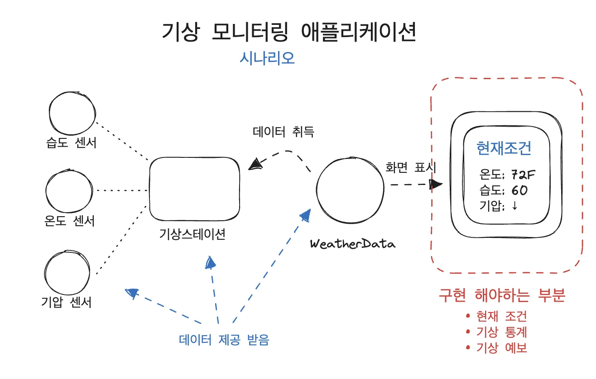
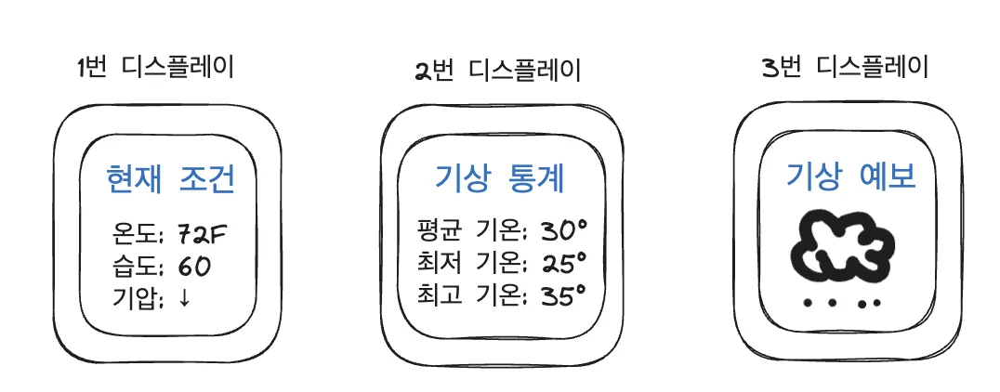
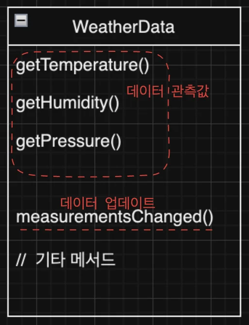
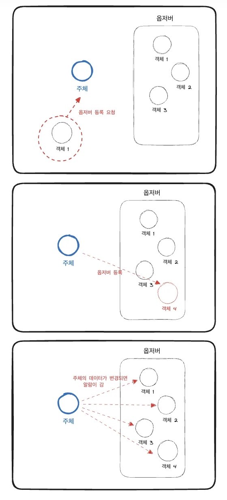
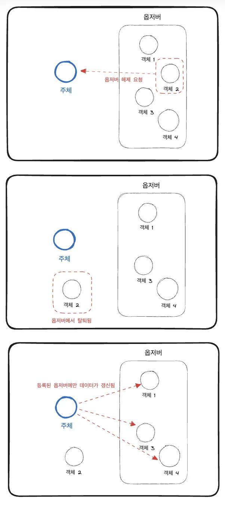
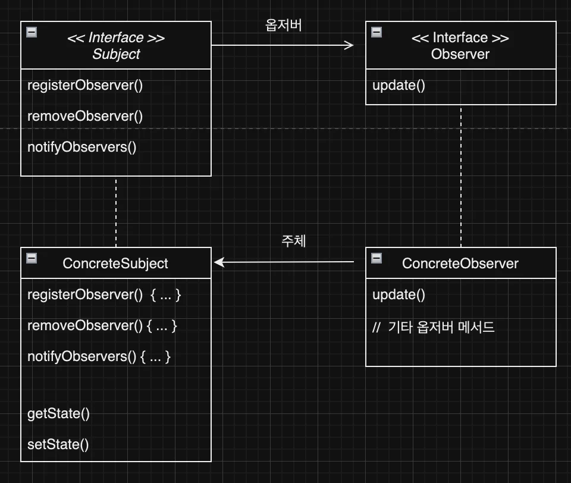
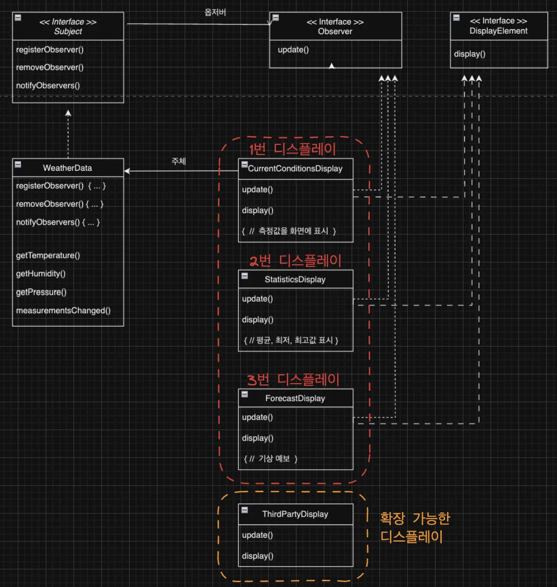

<a id="1c3eda9b0fe1819f8d55cdefec35b7b1"></a>

## ex) 기상 모니터링 애플리케이션 





<details>
<summary><strong>WeatherData</strong></summary>



<a id="1c3eda9b0fe18144932dfd16cd294964"></a>

```java
public class WeatherData {
	
	// 인스턴스 변수 선언
	
	public void measurementsChanged() {
	
		// getter를 통해 관측값 가져옴
		float temp = getTemperature();
		float humidity = getHumidity();
		float pressure = getPressure();
		
		// 각 디스플레이스 갱신
		currentConditionsDisplay.update(temp, humidity, pressure);
		statisticDisplay.update(temp, humdity, pressure);
		forecastDisplay.update(temp, humidity, pressure);
	}
	
	// 기타 메서드
	
}			
```

</details>

> <strong>WeatherData</strong> 코드의 문제점

- 다른 디스플레이 항목을 업데이트 할 수 없음

- 공통된 인자를 사용함

- 캡슐화 가능

<a id="1c3eda9b0fe181959b7ded74aa77351e"></a>

### <strong>위 문제점들을 </strong><strong>옵저버 패턴</strong><strong>을 사용함으로써 해결할 수 있다&#46;</strong>

<a id="1c3eda9b0fe181a3b756f7140f32cd88"></a>

## 옵저버 패턴

> 📌 <strong>옵저버 패턴(Observer Pattern)</strong><strong><br></strong><strong>한 객체(주체)의 상태</strong>가 바뀌면 <strong>그 객체에 의존하는 다른 객체에게 연락이 가고 자동으로 내용이 갱신</strong>되는 방식<br><strong><u>일대다(one&#45;to&#45;many) </u></strong>의존성
> 
> > 유튜브의 구독, SNS의 팔로우 와 같이 특정 주체에 옵저버가 되어 갱신된 데이터를 지속적으로 받을 수 있다&#46; 
> 
> <details>
> <summary>라이브러리 속 옵저버 패턴</summary>
> 
> > 옵저버 패턴은 흔히 사용되는 패턴 중 하나로, 쉽게 라이브러리나 프레임워크에서 찾아볼 수 있다&#46;<br>→ 스윙(Swing), 자바빈(JavaBean) 
> 
> </details>

<a id="1c3eda9b0fe18127a75df5584af59fab"></a>

### 옵저버 패턴 작동원리

<details>
<summary>옵저버 등록</summary>



</details>

<details>
<summary>옵저버 탈퇴</summary>



</details>

<a id="1c3eda9b0fe181bfbab5f7fce01328c7"></a>

### 옵저버 패턴 구현

> 옵저버 패턴은 여러가지 방법으로 구현할 수 있지만, 보통 주체의 인터페이스와 옵저버 인터페이스가 들어있는 클래스 디자인으로 구현한다&#46; 



<details>
<summary><strong>&#60; interface &#62; Subject</strong></summary>

<a id="1c3eda9b0fe181698c88ffb306a9df9b"></a>

```java
public interface Subject {
	public void registerObserver(Observer o);
	public void removeObserver(Observer o);
	public void notifyObservers();
}
```

</details>

<details>
<summary><strong>&#60; interface &#62; Observer</strong></summary>

<a id="1c3eda9b0fe1818684d7f4b5a47772bb"></a>

```java
public interface Observer {
	public void update(int value);
}
```

</details>

<details>
<summary>ConcreteSubject</summary>


</details>

<details>
<summary>ConcreteObserver</summary>


</details>

<details>
<summary><strong>🧐 </strong><strong><u>느슨한 결합</u></strong>이란? </summary>

> <strong>상호작용하는 객체 사이에는 가능하면 느슨한 결합을 사용해야한다&#46; </strong>

<a id="1c3eda9b0fe181dfab5cd20fd49ff060"></a>

<strong>느슨한 결합(Loose Coupling)</strong>은 <strong>객체들이 상호작용할 수는 있</strong>지만, <strong><u>서로를 잘 모르는 관계</u></strong>를 의미한다&#46;

<a id="1c3eda9b0fe181e385aec0d702f89cc0"></a>

이를 활용하면, 객체간의 <strong><u>유연성이 좋</u></strong>아진다&#46;  <br>유연성이 좋으면 객체사이의 상호작용을 최소화 할 수 있기 때문에 변경사항이 생겨도  쉽게 확장 가능한 유연한 객체지향 시스템을 구축할 수 있다&#46;

<a id="1c3eda9b0fe181d992f4ee789b24c7fc"></a>

옵저버 패턴이 이런 느슨한 결합을 보여주는 좋은 예이다&#46;

<a id="1c3eda9b0fe181bf90adda2a88f5dbcd"></a>

<br>옵저버 패턴에서, 주체는 옵저버가 특정 인터페이스(Observer 인터페이스)구현한다는 사실만 안다&#46; 이는 주체가 옵저버의 구상 클래스가 무엇이고, 옵저버가 무슨 일을 하지는 알지 못한다는 뜻이며 <strong><u>주체는 옵저버 인터페이스를 구현하는 객체의 목록에만 의존</u></strong>하여<strong><u> 언제든지 새로운 옵저버를 추가하고 제거할 수 있</u></strong>다&#46; 

<a id="1c3eda9b0fe181298c55e20f389ba850"></a>

이러한 느슨한 결합을 통해 주체와 옵저버는 서로 독립적으로 존재할 수 있다&#46;

<a id="1c3eda9b0fe181ecafd8fdc2222281b6"></a>

이는 주체와 옵저버가 각각 변하거나 재사용 되어도 서로 영향을 주지 않으며 새로운 형식의 옵저버가 추가되어도 Observer 인터페이스만 구현한다면 어떤 객체도 연락 가능하다&#46; 

</details>

<a id="1c3eda9b0fe181f783e5e79b524af838"></a>

### 기상 모니터링 앱  &#45; 옵저버 패턴 적용



<details>
<summary><strong>&#60; interface &#62;  Subject </strong></summary>

<a id="1c3eda9b0fe181aba26eddeb991ac068"></a>

```java
public interface Subject {
	public void registerObserver(Observer o);
	public void removeObserver(Observer o);
	public void notifyObservers();
}
```

</details>

<details>
<summary><strong>&#60; interface &#62;  Observer </strong></summary>

<a id="1c3eda9b0fe1814292b2c3b0e0fe74a5"></a>

```java
public interface Observer {
	public void update(float temp, float humidity, float pressure);
}
```

</details>

<details>
<summary><strong>&#60; interface &#62;  DisplayElement </strong></summary>

<a id="1c3eda9b0fe181058f59fed4ad041b56"></a>

```java
public interface DisplayElement {
	public void display();
}
```

</details>

<details>
<summary><strong>WeatherData  ( Subject 인터페이스 구현 )</strong></summary>

<a id="1c3eda9b0fe1814888ccedaaf529cb95"></a>

```java
public class WeatherData implements Subject {
	private List<Observer> observers;
	private float temperature;
	private float humidity;
	private float pressure;
	
	public WeatherData() {
		observers = new ArrayList<Observer>();
	}
	
	public void registerObserver(Observer o) {
		observers.add(o);
	}
	
	public void removeObserver(Observer o) {
		observers.remove(o);
	}
	
	public void notifyObservers() {
		for (Observer observer : observers) {
			observer.update(temperature, humidity, pressure);
		}
	}
	
	public void measurementsChanged() {
		notifyObservers();
	}
	
	public void setMeasurements(float temperature, float humidity, float pressure) {
		this.temperature = temperature;
		this.humidity = humidity;
		this.pressure = pressure;
		measurementsChanged();
	}
	
	// getter
	// 해당 
	public float getTemperature() {
		return temperature;
	}
	
	public float getHumidity() {
		return humidity;
	}
	
	public float getPressure() {
		return pressure;
	}

}


```

</details>

<details>
<summary><strong>CurrentConditionsDisplay  </strong></summary>

<a id="1c3eda9b0fe181508738ce445b51450c"></a>

```java
public class CurrentConditionsDisplay implements Observer, DisplayElement {
	private float temperature;
	private float humidity;
	private WeatherData weatherData;
	
	public CurrentConditionsDisplay(WeatherData weatherData) {
		this.weatherData = weatherData;
		weatherData.registerObserver(this);
	}
	
	public void update(float temperature, float humidity, float pressure) {
		this.temperature = temperature;
		this.humidity = humidity;
		display();
	}
	
	public void display() {
		System.out.println("현재 상태: 온도 " + temperature
			+ "F, 습도 " + humidity + "%");
	}
}
```

> 🤔 <code>update()</code>에서 <code>display()</code>를 호출<br>→  <a href="#/post/1c3eda9b-0fe1-81af-a636-c5830e90e860">페이지</a> 으로 리펙토리을 통해 개선 

</details>

<details>
<summary><strong>ForecastDisplay</strong></summary>

<a id="1c3eda9b0fe181a7b8eec898eb9890b2"></a>

```java
public class ForecastDisplay implements Observer, DisplayElement {
	private float currentPressure = 29.92f;  
	private float lastPressure;
	private WeatherData weatherData;

	public ForecastDisplay(WeatherData weatherData) {
		this.weatherData = weatherData;
		weatherData.registerObserver(this);
	}

	public void update() {
    lastPressure = currentPressure;
		currentPressure = weatherData.getPressure();

		display();
	}

	public void display() {
		System.out.print("Forecast: ");
		if (currentPressure > lastPressure) {
			System.out.println("Improving weather on the way!");
		} else if (currentPressure == lastPressure) {
			System.out.println("More of the same");
		} else if (currentPressure < lastPressure) {
			System.out.println("Watch out for cooler, rainy weather");
		}
	}
}

```

</details>

<details>
<summary><strong>&#91;Test &#93; WeatherStation</strong></summary>

<a id="1c3eda9b0fe181caae9dc288a443c03d"></a>

```java
public class WeatherStation {

	public static void main(String[] args) {
		WeatherData weatherData = new WeatherData();
	
		CurrentConditionsDisplay currentDisplay = 
			new CurrentConditionsDisplay(weatherData);
		StatisticsDisplay statisticsDisplay = new StatisticsDisplay(weatherData);
		ForecastDisplay forecastDisplay = new ForecastDisplay(weatherData);

		weatherData.setMeasurements(80, 65, 30.4f);
		weatherData.setMeasurements(82, 70, 29.2f);
		weatherData.setMeasurements(78, 90, 29.2f);
		
		weatherData.removeObserver(forecastDisplay);
		weatherData.setMeasurements(62, 90, 28.1f);
	}
}

```

</details>

<a id="1c3eda9b0fe1816c8b18d0d8d5a7cecb"></a>

### 풀(pull) 방식으로 코드 개선

> 👉🏻 
> 
> <a id="1c3eda9b0fe18147b83fc67b815cb20c"></a>
> 
> <strong><u>풀(pull)</u></strong> 방식이란 <strong>옵저버</strong>가 <strong>주제</strong>로부터 <strong>필요한 데이터를 당겨오는(pull) </strong>형태이다<br>시간이 지남에 따라 애플리케이션은 계속 변경되고 복잡해진다&#46; <br>따라서 풀

- <strong>주제에서 알림 보내기</strong>
    <a id="1c3eda9b0fe18112a8e1d332f934d27f"></a>

    옵저버의 update()를 인자없이 호출 

    <a id="1c3eda9b0fe1812d9688f7c29a045e67"></a>

    ```java
    // WeatherData
    public void notifyObservers() {
    		for (Observer observer : observers) {
    				// notifyObserver() -> observer.update()
    				observer.update();
    		}
    }
    ```

- <strong>옵저버에서 알림 받기</strong>
    <a id="1c3eda9b0fe181ccbd24fff9dcbdfd8f"></a>

    Observer 인터페이스에서 update() 매개변수 제거

    <a id="1c3eda9b0fe181cf8544e004e1cfcd88"></a>

    ```java
    public interface Observer {
    		// 인자 제거
    		public void update();
    }
    ```

    <a id="1c3eda9b0fe18100b5cfc3723b2da86b"></a>

    각 디스플레이스 인스턴스에서 update() 메서드의 parameter를 제거하고 WeatherData의 getter 메서드로 주제의 날씨 데이터를 가져오도록 수정한다&#46;

    <a id="1c3eda9b0fe1819ea6f5cab7f50192da"></a>

    ```java
    // CurrentConditionsDisplay
    public void update() {
    		this.temperature = weatherData.getTemperature();
    		this.humidity = weatherData,getHumidity();
    		display();
    }
    ```

> ☝🏻 자바에 옵저버 패턴용 Observable 클래스(subject 클래스), Observer 인터페이스가 존재한다&#46;  그러나 해당 클래스들은 자바 9 이후로는 쓰이지 않는다&#46; <br>기본적입 옵저버 패턴 및 더 강력한 기능을 추가하여 스스로 구현하는 것이 더 낫겠다고 생각하는 사람들이 늘어나면서 해당 클래스들은 사용되지 않아 사라졌다&#46;
