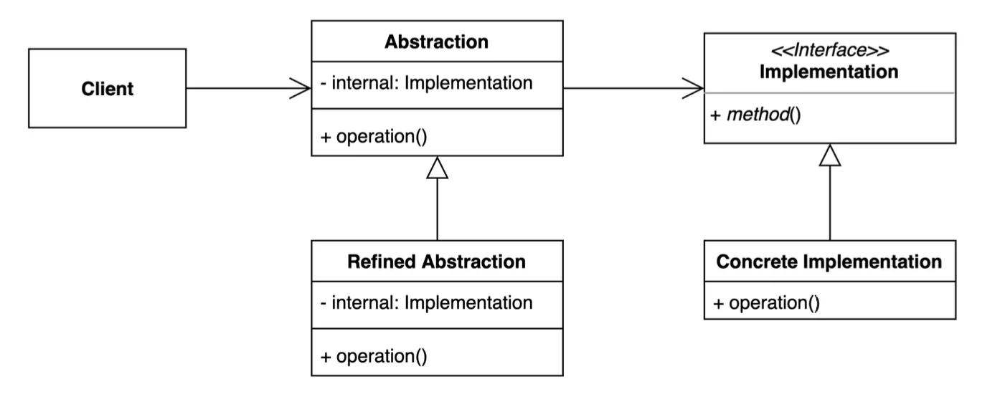
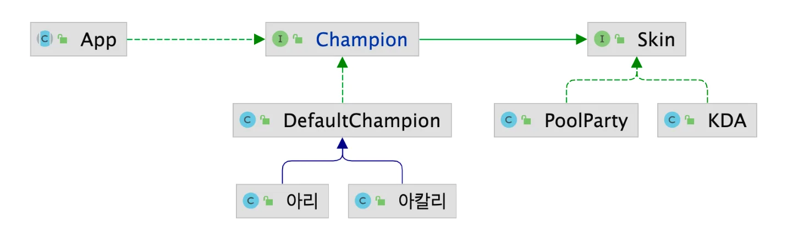
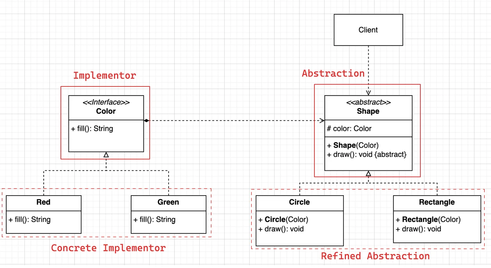
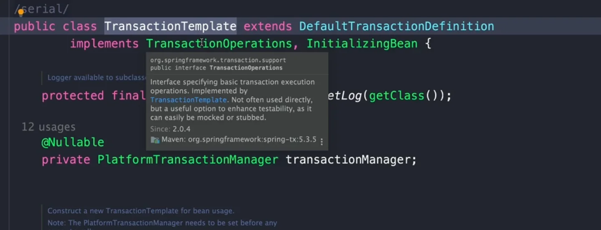

<a id="1c6eda9b0fe1800ba0c9c4d7c19716ac"></a>

## 브릿지 패턴

---

> ✏️ 
> 
> 
> 
> <a id="1c6eda9b0fe18029b1d5de451e338838"></a>
> 
> 브릿지 패턴 ( Bridge Pattern )은 <strong><u>추상화(abstraction)</u></strong>와 <strong><u>구현(implementation)</u></strong> 을 <strong><u>분리</u></strong>하여 <strong><u>각각 독립적으로 변경</u></strong>할 수 있도록 만드는 방법을 말한다&#46; 
> 
> - <strong><u>두 개의 서로 독립적인 계층 구조(추상화와 구현)를 ‘다리’와 같이 연결</u></strong><strong>한다하여 </strong><strong><u>‘브릿지’</u></strong><strong>라 부른다&#46;</strong>
> 
> ---
> 
> <details>
> <summary>구성 요소 </summary>
> 
> - <code>추상화(Abstraction)</code>&#58; 클라이언트가 사용하는 고수준 인터페이스를 정의, 구현 객체를 참조한다&#46; 
> 
> - <code>정제된 추상화(Refined Abstraction)</code>&#58; 추상화를 확장하여 구체적인 동작을 추가하는 클래스
> 
> - <code>구현자(Implementor)</code>&#58; 구현 클래스가 따라할 인터페이스를 정의함
> 
> - <code>구체 구현자(Concrete Implementor)</code>&#58; 실제 구현을 제공하는 클래스
> 
> </details>
> 
> <details>
> <summary>장•단점</summary>
> 
> > ✅ 장점
> 
> 1. <code>유연성</code>&#58; 추상화 와 구현을 분리하여 시스템 확장성을 높인다&#46; 
> 
> 1. <code>코드 재사용성</code>&#58; 동일한 추상화를 여러 구현체와 함께 사용할 수 있어 중복 코드 감소
> 
> 1. <code>캡슐화</code>&#58; 클라이언트 코드가 구현 세부사항에 의존하지 않도록 설ㄱ{
> 
> > ❗단점
> 
> - 설계가 초기 단계에서 복잡해질 수 있음
> 
> - 새로운 구조를 이해하고 적용하는데 시간이 든다&#46;
> 
> </details>
> 
> <details>
> <summary>적용 사례</summary>
> 
> - <code>다중 플랫폼 지원</code>
>     - GUI 컴포넌트를 Windows와 MacOS 같은 여러 플랫폼에서 사용할 때, 플랫폼별 코드를 분리하여 관리
> 
> - <code>전자제품 제어 시스템</code>
>     - TV와 라디오 같은 다양한 디바이스를 기본 및 고급 리모컨으로 제어할 때, 리모컨과 디바이스를 독립적으로 확장 가능
> 
> - <code>색상 및 도형 처리</code>
>     - 도형(예&#58; 원, 사각형)과 색상(예&#58; 빨강, 초록)을 조합하여 다양한 결과를 생성하는 시스템에서 사용
> 
> </details>

<a id="1c6eda9b0fe18094ba2eeddfa6c7095f"></a>

### 1&#46; 기본 예제

> ❗ 
> 
> <a id="1c6eda9b0fe180baa5f1e27a0393ad93"></a>
> 
> <strong>문제점</strong>
> 
> <a id="1c6eda9b0fe1805295b9c0b37ae401ee"></a>
> 
> 공통된 속성들이 <strong><u>중복</u></strong>으로 클래스에 적용되었다&#46;

<a id="1c6eda9b0fe180179322d53abdd59b7e"></a>

### 코드

[DesignPattern&#95;with&#95;jave/src/main/java/&#95;02&#95;structural&#95;patterns/&#95;07&#95;bridge/&#95;01&#95;before at main · gyungsubLee/DesignPattern&#95;with&#95;jave]()

<details>
<summary>&#91; 코드 &#93; &#60; interface &#62;</summary>

<a id="1c6eda9b0fe180749465e6090b0c9017"></a>

```java

```

</details>

<details>
<summary>&#91; 코드 &#93;</summary>

<a id="1c6eda9b0fe18086b0e3eb909b811362"></a>

```java

```

</details>

<a id="1c6eda9b0fe180be820ec6a5a3a15c2a"></a>

### 2&#46; 브릿지 패턴 적용



<a id="1c6eda9b0fe180448b5dca2fd3f2f5d7"></a>

### 코드

[DesignPattern&#95;with&#95;jave/src/main/java/&#95;02&#95;structural&#95;patterns/&#95;07&#95;bridge/&#95;02&#95;after at main · gyungsubLee/DesignPattern&#95;with&#95;jave]()

<details>
<summary>champion</summary>

<details>
<summary>&#91; 코드 &#93; &#60; interface &#62; Champion</summary>

<a id="1c6eda9b0fe180f1b90fca8751320837"></a>

```java
package _02_structural_patterns._07_bridge._02_after.champion;

import _02_structural_patterns._07_bridge._02_after.skin.Skin;

public interface Champion extends Skin {
    void move();
    void skillQ();
    void skillW();
    void skillE();
    void skillR();
}
```

</details>

<details>
<summary>&#91; 코드 &#93; DefaultChampion</summary>

<a id="1c6eda9b0fe180d0b776f64e34557c78"></a>

```java
package _02_structural_patterns._07_bridge._02_after.champion;

import _02_structural_patterns._07_bridge._02_after.skin.Skin;

public class DefaultChampion implements Champion{
    private Skin skin;
    private String name;

    public DefaultChampion(Skin skin, String name) {
        this.skin = skin;
        this.name = name;
    }

    @Override
    public void move() {
        System.out.printf("%s %s move\n", skin.getName(), this.name);
    }

    @Override
    public void skillQ() {
        System.out.printf("%s %s Q\n", skin.getName(), this.name);
    }

    @Override
    public void skillW() {
        System.out.printf("%s %s W\n", skin.getName(), this.name);
    }

    @Override
    public void skillE() {
        System.out.printf("%s %s E\n", skin.getName(), this.name);
    }

    @Override
    public void skillR() {
        System.out.printf("%s %s R\n", skin.getName(), this.name);
    }

    @Override
    public String getName() {
        return null;
    }
}

```

</details>

<details>
<summary>&#91; 코드 &#93; 아리</summary>

<a id="1c6eda9b0fe1804b9c76d8cd24356879"></a>

```java
package _02_structural_patterns._07_bridge._02_after.champion;

import _02_structural_patterns._07_bridge._02_after.skin.Skin;

public class 아리 extends DefaultChampion{

    public 아리(Skin skin) {
        super(skin, "아리");
    }
}
```

</details>

<details>
<summary>&#91; 코드 &#93; 아칼리</summary>

<a id="1c6eda9b0fe180e481a3dafab150ff93"></a>

```java
package _02_structural_patterns._07_bridge._02_after.champion;

import _02_structural_patterns._07_bridge._02_after.skin.Skin;

public class 아칼리 extends DefaultChampion {

    public 아칼리(Skin skin) {
        super(skin, "아칼리");
    }
}
```

</details>

</details>

<details>
<summary>skin</summary>

<details>
<summary>&#91; 코드 &#93; &#60; interface &#62; Skin</summary>

<a id="1c6eda9b0fe180ccaa07d78527dfc2ed"></a>

```java
package _02_structural_patterns._07_bridge._02_after.skin;

public interface Skin {
    String getName();
}
```

</details>

<details>
<summary>&#91; 코드 &#93; KDA</summary>

<a id="1c6eda9b0fe180d49b4ec3da4ad7fb86"></a>

```java
package _02_structural_patterns._07_bridge._02_after.skin;

public class KDA implements Skin{

    @Override
    public String getName() {
        return "KDA";
    }
}
```

</details>

<details>
<summary>&#91; 코드 &#93; PoolParty</summary>

<a id="1c6eda9b0fe18048adcff79630ec6303"></a>

```java
package _02_structural_patterns._07_bridge._02_after.skin;

public class PoolParty implements Skin {

    @Override
    public String getName() {
        return "PoolParty";
    }
}
```

</details>

</details>

<details>
<summary>&#91; 코드 &#93; App ( 클라이언트 )</summary>

<a id="1c6eda9b0fe180dca1d6de3fbb3de566"></a>

```java
package _02_structural_patterns._07_bridge._02_after;

public class App {
    public static void main(String[] args) {
        Champion kda아리 = new 아리(new KDA());
        kda아리.skillQ();
        kda아리.skillW();

        Champion poolParty아리 = new 아리(new PoolParty());
        poolParty아리.skillR();
        poolParty아리.skillW();
    }
}
```

</details>

<a id="1c6eda9b0fe180969902fe750cf1584f"></a>

### 2&#46;2 &#91; 추가 예제 &#93; Shape, Color

<a id="1c6eda9b0fe18066bad0e9550e08f9b0"></a>

‣

<a id="1c6eda9b0fe180039174c542ff31f393"></a>

‣



<a id="1c6eda9b0fe180b0963cddf66b1e83c8"></a>

### 코드

<details>
<summary>&#91; 코드 &#93; &#60; interface &#62; Color</summary>

<a id="1c6eda9b0fe1804388cef032f0b946e3"></a>

```java
// Implementor
public interface Color {
    String fill();
}
```

</details>

<details>
<summary>&#91; 코드 &#93; Red</summary>

<a id="1c6eda9b0fe18007a3d5feda96743fc8"></a>

```java
public class Red implements Color {
		
		@Override
		public String fill() {
				return "red";
		}
}
```

</details>

<details>
<summary>&#91; 코드 &#93; Green</summary>

<a id="1c6eda9b0fe18078bcf2d5c3134aa5d8"></a>

```java
public class Green implements Color {
		
		@Override
		public String fill() {
				return "green";
		}
}
```

</details>

<details>
<summary>&#91; 코드 &#93; &#60; abstract class &#62; Shape</summary>

<a id="1c6eda9b0fe180389444d849b26a338e"></a>

```java
// Abstraction
public abstract class Shape {
    protected Color color;
    
    public Shape(Color color) {
        this.color = color;
    }
    
    public abstract void draw();
}
```

</details>

<details>
<summary>&#91; 코드 &#93; Circle</summary>

<a id="1c6eda9b0fe18081880bef8304a50b1a"></a>

```java
public class Circle extends Shape {
    public Circle(Color color) {
        super(color);
    }
    
    public void draw() {
        System.out.println("Circle filled with " + color.fill());
    }
}
```

</details>

<details>
<summary>&#91; 코드 &#93; Rectangle</summary>

<a id="1c6eda9b0fe1808aab2feee5f44528a1"></a>

```java
public class Rectangle extends Shape {
    public Rectangle(Color color) {
        super(color);
    }
    
    public void draw() {
        System.out.println("Rectangle filled with " + color.fill());
    }
}
```

</details>

<details>
<summary>&#91; 코드 &#93; Main</summary>

<a id="1c6eda9b0fe18075a6a8c85ef10af10f"></a>

```java
// Client
public class Main {
    public static void main(String[] args) {
        Shape circle = new Circle(new Red());
        circle.draw(); // 출력: Circle filled with Red
        
        Shape rectangle = new Rectangle(new Green());
        rectangle.draw(); // 출력: Rectangle filled with Green
    }
}
```

</details>

<a id="1cdeda9b0fe180c78e65c62a088a5457"></a>

### 3&#46; 브릿지 패턴의 장• 단점

- 장점
    1. 추상적인 것과 구체적인 것을 분리함으로써 추상적인 코드를 그대로 유지한 채 구체적인 코드만 변경하거나 확장할 수 있다&#46;
        - 구체적인 코드가 변하더라도 추상적인 코드는 변경되지 않는다&#46; 

        - OCP 원칙 만족

    1. 추상적인 코드와 구체적인 코드를 분리했기 때문에 각각 본인이 해야할 일만 관리하면 된다&#46; 
        - SRP 원칙 만족

    1. 위와 같은 점들을 통해 코드의 재사용성과, 중복 코드를 줄일 수 있다&#46; 

- 단점
    1. 계층 구조가 늘어나 복잡도가 증가할 수 있다&#46;
        - 해당 패턴을 안다면, 큰 단점이 아니다&#46;

<a id="1c6eda9b0fe180949ff1c65db1cccb96"></a>

### 4&#46; 실무 활용 예제

[DesignPattern&#95;with&#95;jave/src/main/java/&#95;02&#95;structural&#95;patterns/&#95;07&#95;bridge/&#95;03&#95;java at main · gyungsubLee/DesignPattern&#95;with&#95;jave]()

<details>
<summary>&#91; 코드 &#93; JdbcExample</summary>

<a id="1c6eda9b0fe1806caa24cb7f8d8f8448"></a>

```java
package me.whiteship.designpatterns._02_structural_patterns._07_bridge._03_java;

import java.sql.*;

public class JdbcExample {

    public static void main(String[] args) throws ClassNotFoundException {
        Class.forName ("org.h2.Driver");

        try (Connection conn = DriverManager.getConnection ("jdbc:h2:mem:~/test", "sa","")) {

            String sql =  "CREATE TABLE  ACCOUNT " +
                    "(id INTEGER not NULL, " +
                    " email VARCHAR(255), " +
                    " password VARCHAR(255), " +
                    " PRIMARY KEY ( id ))";

            Statement statement = conn.createStatement();
            statement.execute(sql);

//            PreparedStatement statement1 = conn.prepareStatement(sql);
//            ResultSet resultSet = statement.executeQuery(sql);
        } catch (SQLException e) {
            throw new RuntimeException(e);
        }
    }
}

```

</details>

<details>
<summary>&#91; 코드 &#93; Slf4jExample</summary>

<a id="1c6eda9b0fe18075a9effd1103129873"></a>

```java
package me.whiteship.designpatterns._02_structural_patterns._07_bridge._03_java;

import org.slf4j.Logger;
import org.slf4j.LoggerFactory;

public class Slf4jExample {

    private static Logger logger = LoggerFactory.getLogger(Slf4jExample.class);

    public static void main(String[] args) {
        logger.info("hello logger");
    }
}
```

</details>

<details>
<summary>&#91; 코드 &#93; BridgeInSpring</summary>

<a id="1c6eda9b0fe18015b4dafb9d313dccf4"></a>

```java
package me.whiteship.designpatterns._02_structural_patterns._07_bridge._03_java;

import org.springframework.jdbc.support.JdbcTransactionManager;
import org.springframework.mail.MailSender;
import org.springframework.mail.javamail.JavaMailSenderImpl;
import org.springframework.transaction.PlatformTransactionManager;

public class BridgeInSpring {

    public static void main(String[] args) {
        MailSender mailSender = new JavaMailSenderImpl();

        PlatformTransactionManager platformTransactionManager = new JdbcTransactionManager();
    }
}
```

</details>

<details>
<summary>1&#46; JDBC</summary>

<a id="1cdeda9b0fe180e982e7fda37003fe11"></a>

브릿지 패턴이 적용된 자바 코드의 가장 대표적인 예제로 JDBC를 들 수 있다&#46;

<a id="1cdeda9b0fe1806b9abfe8fb63de0a58"></a>

```java
package me.whiteship.designpatterns._02_structural_patterns._07_bridge._03_java;

import java.sql.*;

public class JdbcExample {

    public static void main(String[] args) throws ClassNotFoundException {
        Class.forName ("org.h2.Driver");   // 구현체 

        try (Connection conn = DriverManager.getConnection ("jdbc:h2:mem:~/test", "sa","")) {

            String sql =  "CREATE TABLE  ACCOUNT " +
                    "(id INTEGER not NULL, " +
                    " email VARCHAR(255), " +
                    " password VARCHAR(255), " +
                    " PRIMARY KEY ( id ))";

            Statement statement = conn.createStatement();
            statement.execute(sql);

//            PreparedStatement statement1 = conn.prepareStatement(sql);
//            ResultSet resultSet = statement.executeQuery(sql);
        } catch (SQLException e) {
            throw new RuntimeException(e);
        }
    }
}
```

<a id="1cdeda9b0fe1807a80add294750cd2fd"></a>

위 코드는 브릿지 패턴에서의 추상화에 해당된다&#46; 

</details>

<details>
<summary>2&#46; logging</summary>

<a id="1cdeda9b0fe18064aeedda8114177064"></a>

```java
package me.whiteship.designpatterns._02_structural_patterns._07_bridge._03_java;

import org.slf4j.Logger;
import org.slf4j.LoggerFactory;

public class Slf4jExample {

    private static Logger logger = LoggerFactory.getLogger(Slf4jExample.class);

    public static void main(String[] args) {
        logger.info("hello logger");
    }
}
```

<a id="1cdeda9b0fe180c293c2e0f3f7f4d706"></a>

하위 구현체가 변경되어도 추상화된  LoggerFactory는 변하지 않는다&#46;

<a id="1cdeda9b0fe180dcbea9c9f3f5603491"></a>

보통 로깅 퍼사드라 많이 명칭하지만 ( 퍼사드 패턴 ) 

<a id="1cdeda9b0fe180b29b96ee3a4dc1eecb"></a>

추상화와 구현을 분리 했다는 관점에서 본다면 브릿지 패턴에도 속한다&#46;

</details>

<details>
<summary>3&#46;  TransactionTemplate</summary>



- abstraction&#58; <code>TransactionTemplate</code>

- implementor&#58; <code>PlatformTransactionManager</code>

- concrete implementor&#58; <code>HibernateTransactionManager</code>

</details>
