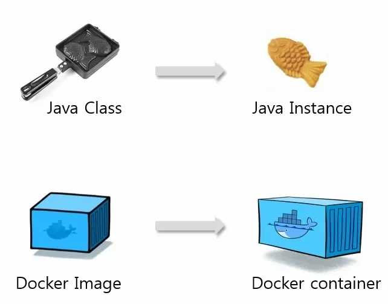
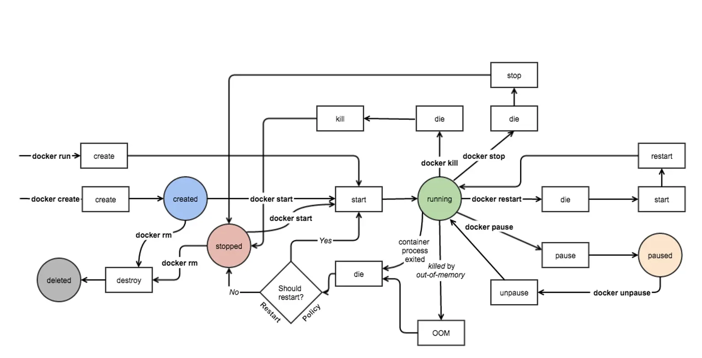
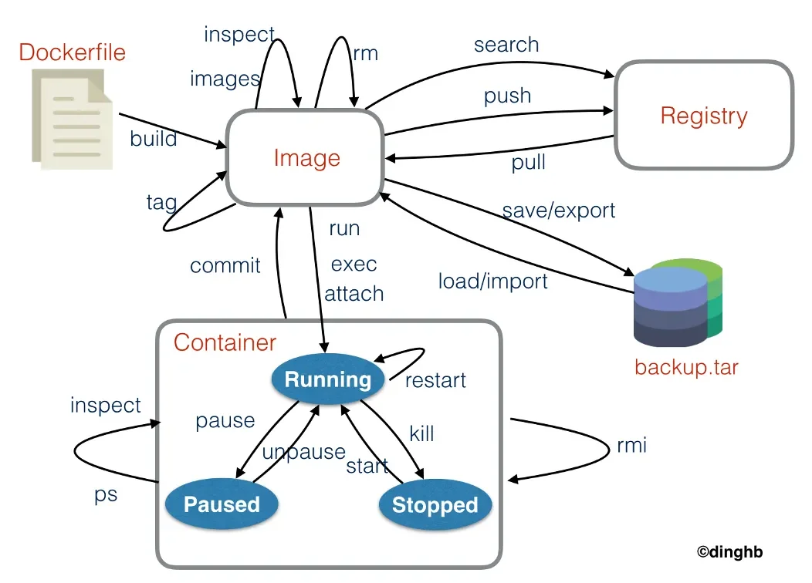
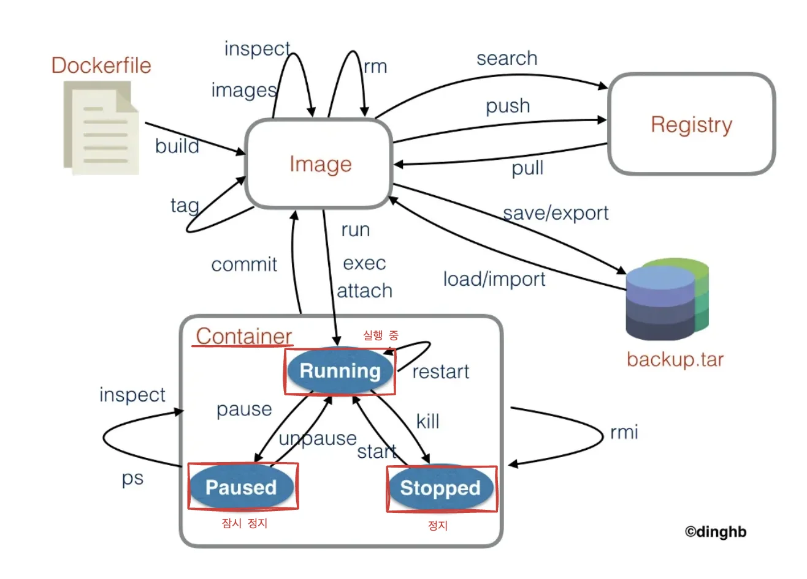
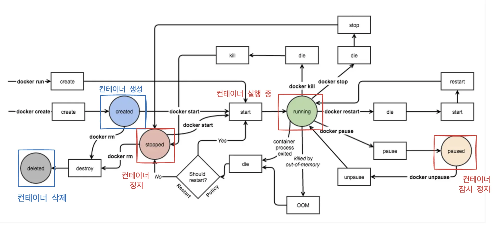

<a id="1c3eda9b0fe181a8bdefc08a48e05946"></a>

## Docker Container

---

> 📖 
> 
> <a id="1c3eda9b0fe181b3abeefb25cf1afac1"></a>
> 
> Docker에서 Image와 Container는 Class 와 Instance 의 관계와 같다&#46; 
> 
> <a id="1c3eda9b0fe1816db278d86eda704caf"></a>
> 
> Container는 Image에 정의된 정보를 바탕으로 실행한 상태를 말하며
> 
> <a id="1c3eda9b0fe181c4bae2dc2fc1b26aab"></a>
> 
> 하나의 Image로 여러개의 Container를 실행할 수 있다&#46; 
> 
> <details>
> <summary>Docker  &#45; <code>Image</code>, <code>Container</code>의 관계</summary>
> 
> 
> 
> - <code>Image</code>
>     - 컨테이너에 대한 OS, Application, Library 등등의 정보를 담고 있다&#46;
> 
> - <code>Container</code>
>     - Image를 실행한 상태
> 
>     - 1개의 Image로 부터 N개의 Container를 생성할 수 있다 ( <code>1 &#58; N</code> )
> 
> </details>

<details>
<summary>Docker Life Cycle</summary>



</details>

<details>
<summary>Docker 이미지/Container 관련 명령어</summary>



</details>

<details>
<summary>컨테이너 상태 3가지 </summary>





- 컨테이너는 3개의 상태가 존재한다&#46;
    - 실행 중, <code>running</code>

    - 잠깐 정지, <code>paused</code>

    - 중지, <code>stopped</code>

</details>

> /icons/checkmark-line_red.svg 
> 
> <a id="1c3eda9b0fe1818daf1bf4e72e2bbea8"></a>
> 
> <strong>Container CLI </strong>

<details>
<summary>Docker Container  ⇒ <code>프로세스</code></summary>

<a id="1c3eda9b0fe181f99833c1cb2af947c0"></a>

```bash
docker run -ti --name=ubuntu2204test3 ubuntu:22.04 /bin/bash
root@1cd125b32870:/#


----- * 다른 터미널 창에서 실행 * ----

# 실행 중인 프로세스 중 'ubuntu2204test3' 검색
ps -ef | grep ubuntu2204test3
user   9710  7637  0 17:17 pts/4    00:00:00 docker run -ti --name=ubuntu2204test3 ubuntu:22.04 /bin/bash
user   9921  9377  0 17:17 pts/5    00:00:00 grep --color=auto ubuntu2204test3
```

</details>

<details>
<summary>🧐 <code>attach</code>  vs <code>exec &#45;it</code></summary>

| 비교 항목 | <code>docker attach</code> | <code>docker exec &#45;it</code> |
| --- | --- | --- |
| <strong>연결 방식</strong> | 기존 프로세스에 연결 | 새 프로세스를 실행 |
| <strong>로그 출력</strong> | 컨테이너 표준출력(stdout, stderr) 확인 | X |
| <strong>명령어 실행</strong> | 불가능 | 가능 |
| <strong>종료 영향</strong> | <code>exit</code> 시 컨테이너 종료될 수 있음 | <code>exit</code> 시 컨테이너는 계속 실행됨 |
| <strong>사용 목적</strong> | 실행 중인 프로세스와 직접 상호작용 | 컨테이너 내부에서 새 명령 실행 |

</details>

<details>
<summary>Docker Container 수동 생성 &#45; <code>create</code>, <code>start</code>, <code>attach</code> ⇒ <code>run</code></summary>

<a id="1c3eda9b0fe18198aedbfd772a50c3cb"></a>

```bash
docker pull ubuntu:22.04
docker images

# docker create 은 실제 실행하지 않고 컨테이너 생성만
docker create –it --name ubuntu2204test ubuntu:22.04

# 모든 컨테이너 조회
docker ps –a

# 생성된 컨테이너 실행
docker start ubuntu2204test

# 실행 중인 컨테이너에 접속
docker attach ubuntu2204test

# docker run 은 create/start/attach 를 순차적으로 한 번에 실행하는 것과 같음 
docker run -it --name=ubuntu2204test2 ubuntu:22.04 /bin/bash
```

</details>

<details>
<summary><code>docker run</code>에서  자주 사용하는 <strong><u>옵션</u></strong></summary>

- <code>&#45;d</code>&#58; detached mode; 백그라운드 모드

- <code>&#45;p</code>&#58; 호스트와 컨테이너의 포트를 연결(포워딩)

- <code>&#45;v</code>&#58; 호스트와 컨테이너의 디렉토리를 연결(마운트)

- <code>&#45;e</code>&#58; 컨테이너 내에서 사용할 환경변수 설정

- <code>&#45;name</code>&#58; 컨테이너 이름 설정

- <code>&#45;rm</code>&#58; 프로세스 종료 시 컨테이너 자동 삭제

- <code>&#45;it</code>&#58; <code>&#45;i</code> 와 <code>&#45;t</code> 를 동시에 사용한 것으로 터미널 입력을 위한 옵션

</details>

<details>
<summary>실행 중인 컨테이너 정보&#58;  <code>top</code>, <code>port</code>,  <code>stats &#91;&#45;&#45;no&#45;stream&#93;</code></summary>

<a id="1c3eda9b0fe18113b9f8c64c674f7265"></a>

```bash
# 컨테이너에서 실행 중인 프로세스 조회
docker top node-test 
	# UID                 PID                 PPID                C                   STIME               TTY                 TIME                CMD
	# root                2398                2378                0                   08:37               ?                   00:00:00            /sbin/tini -- node runapp.js
	# root                2421                2398                0                   08:37               ?                   00:00:00            node runapp.js


# 컨테이너에 매핑된 포트 조회
docker port node-test
	# 8080/tcp -> 0.0.0.0:8080


# 컨테이너 리소스 통계 출력 (1회)
docker stats node-test --no-stream
	# CONTAINER ID   NAME        CPU %     MEM USAGE / LIMIT     MEM %     NET I/O        BLOCK I/O   PIDS
	# 14c475f7ac09   node-test   0.01%     9.035MiB / 15.45GiB   0.06%     1.5kB / 518B   0B / 0B     11


# 컨테이너 리소스 통계 출력 (스트림)
docker stats node-test
```

</details>

<details>
<summary>컨테이너 로그 확인&#58; <code>docker logs</code></summary>

<a id="1c3eda9b0fe18149b1c4dc4ab2f8d0be"></a>

```bash
# 표준 출력(stdout), 표준에러(stderr) 출력
docker logs node-test 

# 로그를 계속 출력
docker logs –f node-test

# 출력된 로그는 파일로 관리되기 때문에 HostOS 의 disk 를 사용
docker info | grep -i log
```

</details>

<details>
<summary>컨테이너 내부 확인&#58; <code>docker inspect &#91;container ID, 명&#93;</code></summary>

<a id="1c3eda9b0fe1818d9976f1fbdf46a3d4"></a>

```bash
# 컨테이너 내부 확인
docker inspect node-test      
```

<a id="1c3eda9b0fe18162bb88fcadb0f0960d"></a>

```bash
# 출력 
[
    {
        "Id": "2ccc1b2a114495e2d0b67f84e55c9c21e79c6bfff6355ae1fc2caa5225698bba",
        "Created": "2023-10-29T08:04:36.295616146Z",
        "Path": "/bin/bash",
        "Args": [],
        "State": {
            "Status": "running",
            "Running": true,
            "Paused": false,
            "Restarting": false,
            "OOMKilled": false,
            "Dead": false,
            "Pid": 1814,
            "ExitCode": 0,
            "Error": "",
            "StartedAt": "2023-10-29T08:05:15.974255879Z",
            "FinishedAt": "0001-01-01T00:00:00Z"
        },
        "Image": "sha256:e4c58958181a5925816faa528ce959e487632f4cfd192f8132f71b32df2744b4",
        "ResolvConfPath": "/var/lib/docker/containers/2ccc1b2a114495e2d0b67f84e55c9c21e79c6bfff6355ae1fc2caa5225698bba/resolv.conf",
        "HostnamePath": "/var/lib/docker/containers/2ccc1b2a114495e2d0b67f84e55c9c21e79c6bfff6355ae1fc2caa5225698bba/hostname",

   .  .  .
```

</details>

<details>
<summary>그외&#58; <code>status</code>, <code>events</code>, <code>stop</code>, <code>start</code>, <code>pause</code>, <code>unpause</code></summary>

<a id="1c3eda9b0fe181c09dabe9520223bb55"></a>

```bash
# 터미널1, 도커 상태 확인
docker stats

# 터미널2, 도커 프로세스 이벤트 확인
docker events

# 터미널3, docker start
docker stop node-test
docker ps –a
docker start node-test

# 
docker pause node-test
docker unpause node-test
docker ps -a
```

</details>

> /icons/checkmark-line_red.svg 
> 
> <a id="1c3eda9b0fe1817e8894c267f25ed80c"></a>
> 
> <strong>Docker Container 정리</strong>

<details>
<summary>실행 중이 아닌 모든 컨테이너를 삭제 &#45; <code>docker container prune</code></summary>

<a id="1c3eda9b0fe1814e8612e4248ba89bfd"></a>

```bash
# 중지된 컨테이너를 포함하여 모든 컨테이너 리스트
docker container ls -a

# 실행 중이 아닌 모든 컨테이너를 삭제
docker container prune
```

</details>

<details>
<summary>태그가 붙지 않은(dangling) 모든 이미지 삭제 &#45; <code>docker image prune</code></summary>

<a id="1c3eda9b0fe1816fa039d257ab04dbf3"></a>

```bash
# 태그가 붙지 않은(dangling) 모든 이미지 삭제
docker image prune

# 남아 있는 이미지 리스트 확인 – 실행 중인 컨테이너의 이미지 등
docker image ls
```

</details>

<details>
<summary>모든 도커 리소스를 일괄적으로 삭제 &#45; <code>docker system prune</code></summary>

- 사용하지 않는 <strong><u>도커 이미지, 컨테이너, 볼륨, 네트워크 등 모든 도커 리소스</u></strong>를 일괄적으로 삭제

<a id="1c3eda9b0fe181fdad83f922100fbe5d"></a>

```bash
docker system prune
```

</details>

<details>
<summary>실습 1)  node 실행</summary>

<details>
<summary>app&#46;js</summary>

<a id="1c3eda9b0fe181a78143c600d0c45c74"></a>

```javascript
const http = require('http');
const server = http.createServer().listen(6060);

server.on('request', (req, res) => {
	console.log('요청 처리중');
	res.write("HostName: " + process.env.HOSTNAME + "\n");
	res.end();
});

server.on('connection', (socket) => {
	console.log("연결 완료.");
});
```

</details>

<details>
<summary>Dockerfile</summary>

<a id="1c3eda9b0fe181f1b465fa3cd0436d2f"></a>

```docker
FROM node:20-alpine
RUN apk add --no-cache tini curl
WORKDIR /app
COPY app.js .
EXPOSE 6060
ENTRYPOINT ["/sbin/tini", "--"]
CMD ["node", "app.js"]
```

</details>

---

- CLI
    <a id="1c3eda9b0fe18108a19efad3d7279c1c"></a>

    ```bash
    # 1.0 태그를 추가하여 node-test라는 이미지를 빌드 
    docker buildx build -t node-test:1.0 . 

    # 빌드 완료한 이미지 보기
    docker images | grep node-test

    # 1.0으로 태그 추가한 이미지의 Dockerfile history
    docker image history node-test:1.0 

    docker run -itd -p 6060:6060 --name=node-test -h node-test node-test:1.0

    # 컨테이너 실행 확인
    docker ps | grep node-test

    # curl http://localhost:6060
    curl -X GET "http://localhost:6060"
    ```

</details>
