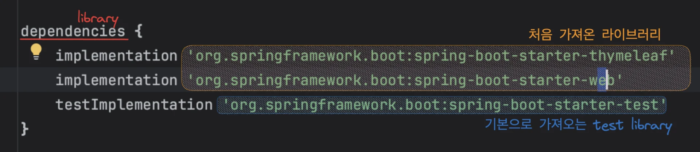
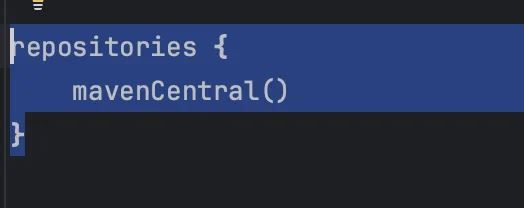
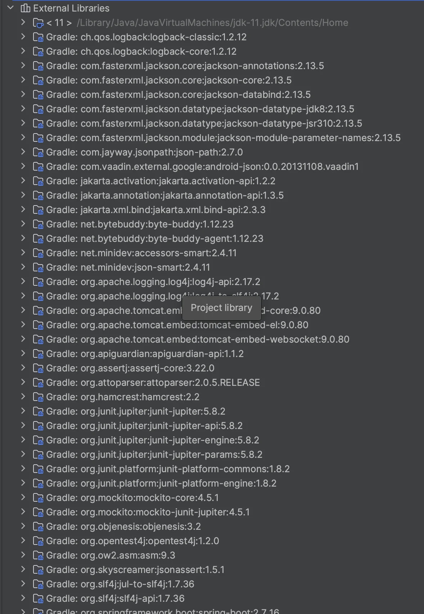
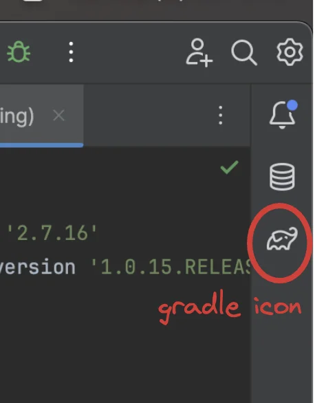
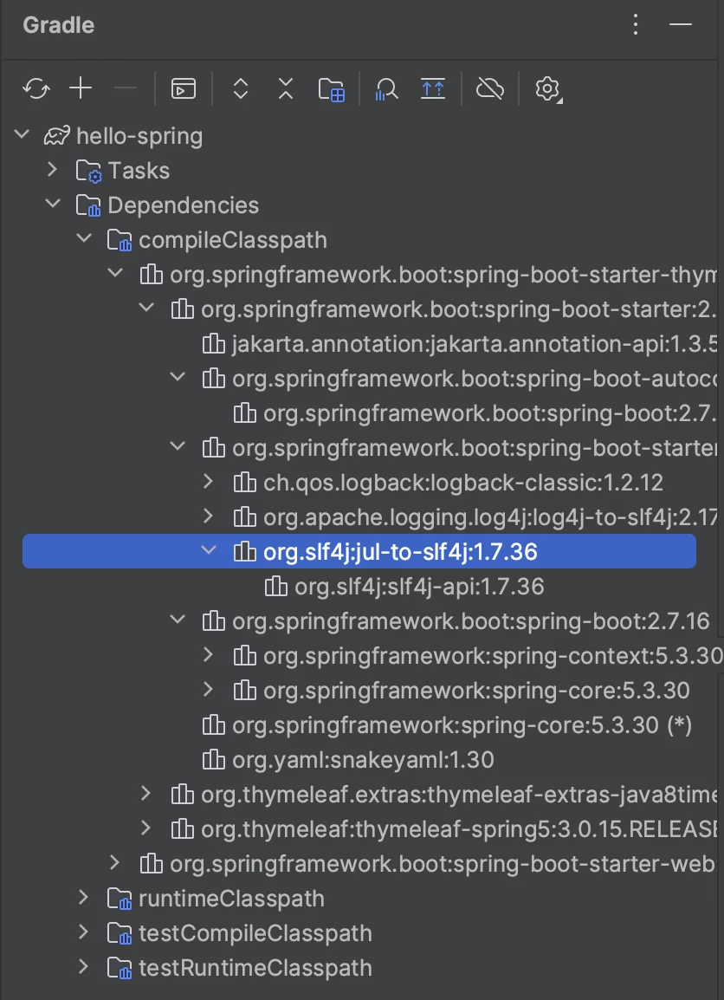
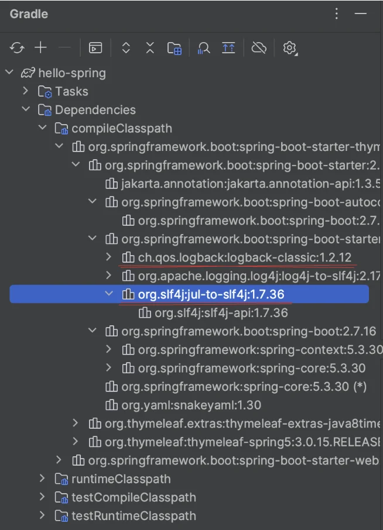
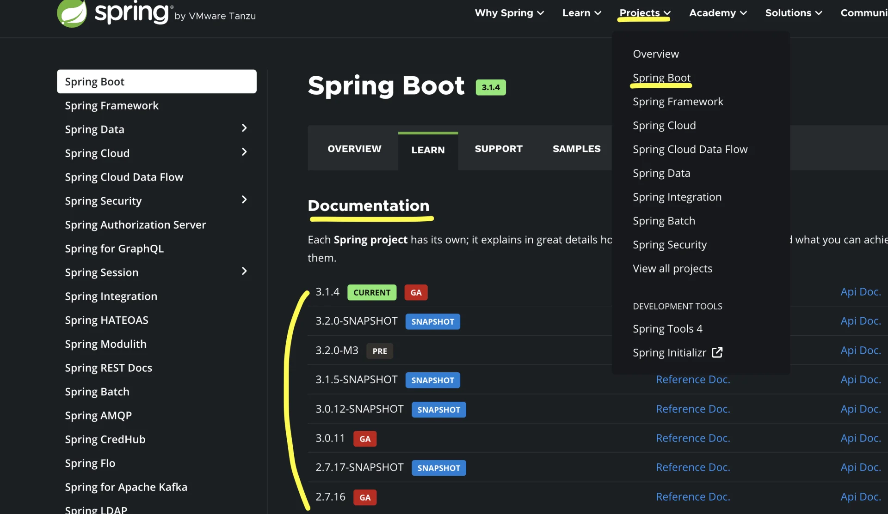
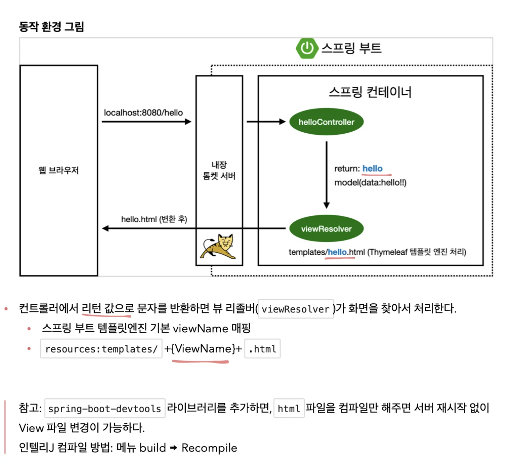
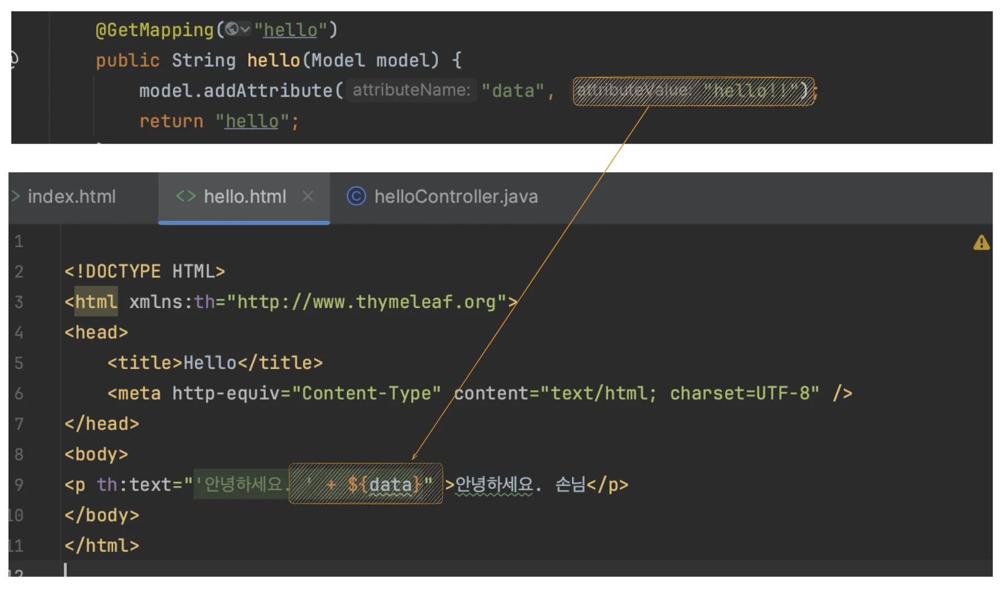

<a id="1c3eda9b0fe1813386d1eba9a1c9fa5a"></a>

# 1&#45;1) 프로젝트 세팅

<a id="1c3eda9b0fe181ee9236db3272177245"></a>

## 1&#46; 프로젝트 initializer

<a id="1c3eda9b0fe181d8b807d5eef0813c66"></a>

스프링 initializer&#58; <a href="https://start.spring.io/">https&#58;//start&#46;spring&#46;io/</a> 

> Project&#58; <strong>Gradle &#45; Groovy </strong>Project<br>Spring Boot&#58; 2&#46;3&#46;x<br>Language&#58; Java<br>Packaging&#58; Jar<br>
> 
> <a id="1c3eda9b0fe18141b3acd9e2f34fe5dc"></a>
> 
> Java&#58; 11<br>Project Metadata
> 
> <a id="1c3eda9b0fe18190b55fdebe47b6d769"></a>
> 
> groupId&#58; hello
> 
> <a id="1c3eda9b0fe181a68f7bcdb5c0f0765c"></a>
> 
> artifactId&#58; hello&#45;spring
> 
> <a id="1c3eda9b0fe181999f60fc31ca87d808"></a>
> 
> <br>Dependencies&#58; Spring Web, Thymeleaf ← 가져오는 라이브러리 ( web 프로젝트)

<a id="1c3eda9b0fe181ae8e0fef46fdcb83bf"></a>

### 2&#46; 폴더, 파일 , 라이브러리

> main &#45; java, resources, test  

- java&#58; 작성할 java 파일들 

- test&#58; 테스트 관련 코드들 ( 요즘 개발 트렌드에서 테스트 코드 매우 중요)

- resources&#58; java 파일을 제외한 나머지 잡다한 것들…(template 파일들도 포함&#46;)

<details>
<summary>build&#46;grable&#58; 설정 파일 (node의 package&#46;json ), 라이브러리 목록, 버전 등…</summary>

- dependencies



- 라이브러리 다운 받는 곳  ← 기본 값으로 적용 ( 필요 시 특정 사이트 URL 입력 가능)
    

</details>

- &#46;gitignore 기본 설정 제공 (요건 좀 편리한 듯)

- gradlew, gradlew&#46;bat → 후에 build 시 정리&#46;

<a id="1c3eda9b0fe1814f86a6f1b8d4e31693"></a>

# 1&#45;2) 라이브러리 살펴보기 

> <code>External Libraries</code> 를 통해 라이러브 목록 확인 

<a id="1c3eda9b0fe181d9b5bac7f2cebb2744"></a>

실제 설치된 라이브러리는 3개(thymeleaf, spring&#45;boot&#45;starter&#45;web,  spring&#45;boot&#45;starter&#45;test),이지만 


<a id="1c3eda9b0fe1819c8704c58f78bc3ddc"></a>

실제 설치된 라이브러리 목록을 보면 엄청 많다&#46;

<a id="1c3eda9b0fe1817ab2ecf837732fae28"></a>

그 이유는 기본으로 설치되는 라이브러리와, 처음 가져온 라이브러리에 의존성을 가지는(해당 라이브러리에 사용된) 모든 라이브러리를 가져오기 때문이다&#46; 

<a id="1c3eda9b0fe181878bbce9dcc23c0b4b"></a>

(gradle, maven 과 같은 빌드 툴들 의존 관계를 관리해줌)



<a id="1c3eda9b0fe18114bd1dc1db9caf0ec4"></a>

### 2) gradle 살펴보기 



- Dependencies



<a id="1c3eda9b0fe1815584b3ee76bb4c6fe7"></a>

위 와 같이 관련된 라이브러리를 전부 다 가져오는 것을 알 수 있음

<a id="1c3eda9b0fe18197b528ddcf4bbb69ff"></a>

( <code>&#42;</code> 는 중복된 라이브러리,  다시 표시 X)

<details>
<summary>예전 개발 이야기</summary>

<a id="1c3eda9b0fe181c19e98c2afeac65246"></a>

예전 개발은 웹서버(와스)를 직접 서버에 설치(tomcat&#46;&#46;)하여 자바 코드를 넣었다&#46; (되게 힘든 작업이었다고 함&#46;)

<a id="1c3eda9b0fe181e7b092ebffff7e1916"></a>

요즘은  소스 라이브러리에서 웹서버(tomcat)를 들고 있음&#46; ← 인베디드(embed, 내장)

<a id="1c3eda9b0fe18148b221fa74b1843589"></a>

따라서 자바 메인 메서드만 실행해도 8080 포트가 자동으로 뜬다&#46; 

<a id="1c3eda9b0fe18124973dcffd9b414e41"></a>

톰캣 서버를 깔고 하는 번거로운 작업이 자동화 되었음/

</details>

<a id="1c3eda9b0fe1814da593cc9866f9421a"></a>

### 결론)

<a id="1c3eda9b0fe18163a887d56353d0afa9"></a>

 스프링 부트와 관련된 라이브러리를 쓰면 스프링 코어까지 다 떙겨와 스프링과 관련된 모든 것이 다 세팅이 되어 돌아간다&#46;

<a id="1c3eda9b0fe181a482eace9083e7ea44"></a>

→ 매우 편리하게 코딩 작업 가능&#46;

<a id="1c3eda9b0fe181b1bbbef90b7f67c8e1"></a>

### 3) logging

> 현업에서는 <code>System&#46;out&#46;printerln</code> 으로 출력하면 안된다&#46;  ← <code>로그</code>  출력 사용



<a id="1c3eda9b0fe18150b871ca75df0efe53"></a>

시대에 따라 트렌드가 바뀌지만, 요즘?에는 logback 주로 씀&#46;

<a id="1c3eda9b0fe18122baaafc1f543cd1cd"></a>

(강의가 찍힐 시점이 좀 오래됐다&#46; 요즘은 다를 수도 있을 듯? 해당 내용 찾아볼 필요 있음&#46;)

<a id="1c3eda9b0fe181da9477c82deef7b403"></a>

→ 동일 Lombok ‘&#64;Slf4j‘ 로 간편하게 사용가능

> slf4j&#58; 인터페이스 <br>logback(&#42;)&#58; 로그 출력 구현체 지원,  성능도 빠르고 여러가지 지원되는 것도 많다&#46; 

<a id="1c3eda9b0fe181bd833ae661e5c3e823"></a>

### 4) test 라이브러리

<a id="1c3eda9b0fe18158aa92e65bcef62d68"></a>

JUnit 5 버전  → 2023년에 주로 쓰는 버전 거

<a id="1c3eda9b0fe181cca817fdb3aa943135"></a>

Assert

<a id="1c3eda9b0fe181f39e86e7861b0e38f1"></a>

sprint&#45;test&#58; 스프링과 통합해서 테스트해줌&#46;

<a id="1c3eda9b0fe181e0b620d783e373041f"></a>

# 1&#45; 3) view 환경설정

> 학습 내용<br>&#45; 정적 페이지 동작<br>&#45; 템플릿 엔진 동작

<a id="1c3eda9b0fe18187beb0dc0418fbc93c"></a>

## 1) welecome page

<a id="1c3eda9b0fe18190bbc8e95bd6f2e948"></a>

resources &#45; static &#45; index&#46;html(생성)

<a id="1c3eda9b0fe1810fb594f35e6d6c175b"></a>

→ main method 실행 시 <code>index&#46;html</code>  보여줌&#46;

<a id="1c3eda9b0fe181de81ade0dafcb09ffa"></a>

## 2) spring Dos

> 스프링은 2003년에 첫 릴리즈 되어, 그 이후 엄청 많은 기능들이 추가 되었다&#46;
> 
> <a id="1c3eda9b0fe181299912c7df2f3fc637"></a>
> 
> (스프링 부트는 그 스프링 생태계를 감싸서 되게 편리하게 사용하도록 도와준다&#46;)
> 
> <a id="1c3eda9b0fe181f6a141d1d5cd96f84d"></a>
> 
> 따라서 스프링이 거의 자바 엔터프라이즈 웹 에플리케이션 개발과 관련된 전반의 생태계를 다 제공한다&#46;
> 
> <a id="1c3eda9b0fe181e28dc3d06501136a60"></a>
> 
> 엄청 많은 기능이 있기 때문에, 다 머리 속에 담을 수 없다&#46; 따라서 필요한 것을 찾는 방법이 매우 중요&#33;

<a id="1c3eda9b0fe181618782dc9022719921"></a>

 

- 버전 별 dos &#91; spring&#46;io &#45; project &#45; Spring Boot &#45; LEARN &#45; Documentation &#93; 
    

<a id="1c3eda9b0fe181bcbdadcd50636a10f6"></a>

Dos →<code> cmd &#43; f</code> 로 keyword로 쉽게 검색 가능 (이건 겁나 잘 만든 듯 → 어케 만들었지?)

<a id="1c3eda9b0fe181838302c4ad9cd10f55"></a>

## 3) 템플릿 엔진 동작  &#91; MVC ( model &#45; view &#45; controller ) &#93;

<a id="1c3eda9b0fe181b4ba56fc8e55a38fd5"></a>

### Controller

- &#91; hello&#46;hellospring &#45; controller(package) &#45; <a href="http://helloController.java">helloController&#46;java</a> &#93;

<a id="1c3eda9b0fe1815faa4ef82c7fc361ad"></a>

```java
package hello.hellospring.controller;

import org.springframework.stereotype.Controller;
import org.springframework.ui.Model;
import org.springframework.web.bind.annotation.GetMapping;

@Controller
public class helloController {
    @GetMapping("hello")
    public String hello(Model model) {
        model.addAttribute("data", "hello!!");
        return "hello";
    }
}
```

<a id="1c3eda9b0fe181e79096c6014eed3afe"></a>

## template page

- &#91; resoures &#45; templates &#45; hello&#46;html &#93;

<a id="1c3eda9b0fe18102b4ebc0ac6fc54033"></a>

```html
<!DOCTYPE HTML>
<html xmlns:th="http://www.thymeleaf.org">
<head>
    <title>Hello</title>
    <meta http-equiv="Content-Type" content="text/html; charset=UTF-8" />
</head>
<body>
<p th:text="'안녕하세요. ' + ${data}" >안녕하세요. 손님</p>
</body>
</html>
```

<a id="1c3eda9b0fe1812b9855dbf29a5d0f4b"></a>

### 템플릿 엔진 동작 



> <em>getMapping&#58; </em><em><code>get</code></em><em> method(HTTP)</em>

- model의 value  → &#91;hello&#46;html&#93;  &#36;{data} 



<a id="1c3eda9b0fe181f6be5cfb44b8ecc20c"></a>

# 1&#45; 4) 빌드, 실행

> ls  옵션&#58; &#91; &#45;l  &#93;,  &#91; &#45;arlth &#93;

<a id="1c3eda9b0fe1810fb6f1fc4619216ce3"></a>

## 프로젝트 빌드, 실행 

---

<a id="1c3eda9b0fe181afb36fea5c457b9163"></a>

### 빌드

<a id="1c3eda9b0fe181e99eb2f0f630c474d8"></a>

<code>&#46;/gradlew build</code> &#58; build 폴더 생성

<a id="1c3eda9b0fe1814a9b7adce9d0c6f88e"></a>

<code>&#46;/gradlew clean</code> &#58; build 폴더 삭제

<a id="1c3eda9b0fe1815fab3bd2bd6203a722"></a>

→ <code>&#46;/gradlew clean build</code> &#58; build 폴더 재생성(삭제&#45;생성)

<a id="1c3eda9b0fe181bfaf4bc437b7ee69ab"></a>

### 실행

<a id="1c3eda9b0fe1819b9134e159f0c7c941"></a>

 <code>cd build/libs</code><br><code> java &#45;jar hello&#45;spring&#45;0&#46;0&#46;1&#45;SNAPSHOT&#46;jar</code>

<a id="1c3eda9b0fe18103a69afd496e27bf4e"></a>

서버 베포 시 해당 파일(<code>hello&#45;spring&#45;0&#46;0&#46;1&#45;SNAPSHOT&#46;jar</code> ) 만 복사 후 실행

<a id="1c3eda9b0fe18185934bec850607492d"></a>

### 서버 실행 종료

<a id="1c3eda9b0fe18159946bcf74b1f5915c"></a>

<code>control &#43; z</code>
