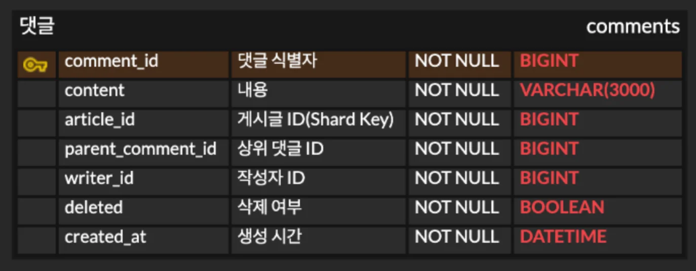
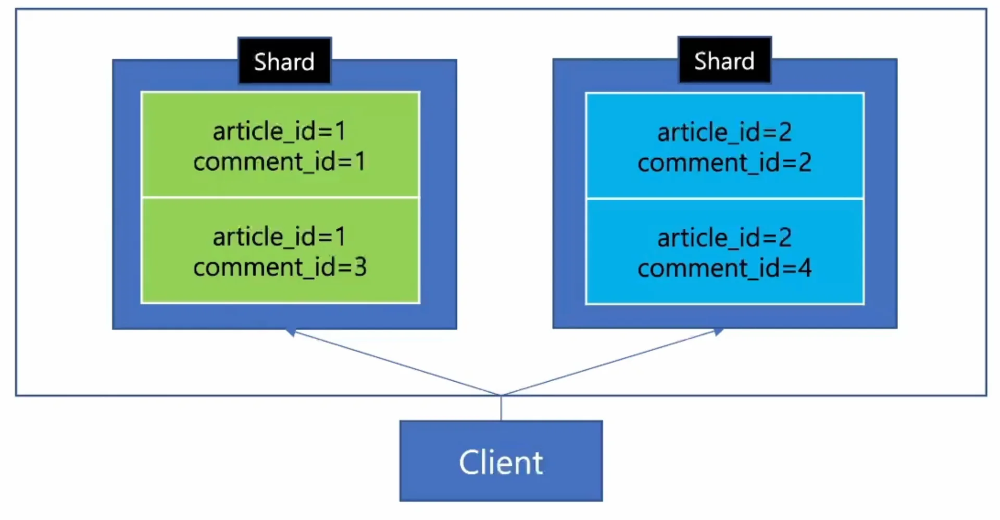

<a id="1c3eda9b0fe181d1bacef957a2d9731b"></a>

‣

<a id="1c3eda9b0fe181e29760f163a3ed767b"></a>

### 댓글 ERD

---

<a id="1c3eda9b0fe18134808bed5cd3e6c5cb"></a>

<strong>스키마</strong>



- <code>parent&#95;comment&#95;id</code> 
    - 상위 댓글 ID,  최상위(root) 댓글인 경우, 본인 ID로 설정

- <code>article&#95;id</code> ( Shartd Key )
    - 댓글 상위 계층인 <code>article&#95;id</code>를  샤드 키로 설정

    - 내용은 게시글(article)에서 샤드 키를 <code>board&#95;id</code>로 설정하는 것과 동일하다&#46;

- <code>deleted</code>
    - 삭제는 하위 댓글이 존재하는 경우, deleted 컬럼을 <code>true</code>로 변경한다&#46; 

    - 하위 댓글이 존재하지 않는 경우, 바로 DB에서 삭제한다&#46; 

<a id="1c3eda9b0fe1818b933cd8e4f72376d5"></a>

<strong>DDL </strong>

<a id="1c3eda9b0fe18151adb6ea1588a65b18"></a>

```sql
CREATE TABLE comment (
   comment_id BIGINT NOT NULL PRIMARY KEY,
   content VARCHAR(3000) NOT NULL,
   article_id BIGINT NOT NULL,
   parent_comment_id BIGINT NOT NULL,
   writer_id BIGINT NOT NULL,
   deleted BOOLEAN NOT NULL,
   created_at DATETIME NOT NULL
);
```

<a id="1c3eda9b0fe18187bf42f5cd035c46fc"></a>

### 샤드 키 가 article&#95;id 인 이유 

---



<a id="1c3eda9b0fe181219927e8433c19d928"></a>

샤드 키를 <code>article&#95;id</code>로 설정하면,  위 그림과 같이 <strong><u>댓글 상위 계층인 게시글(article)에 따라 댓글을 나눠 저장</u></strong>할 수 있다&#46;
