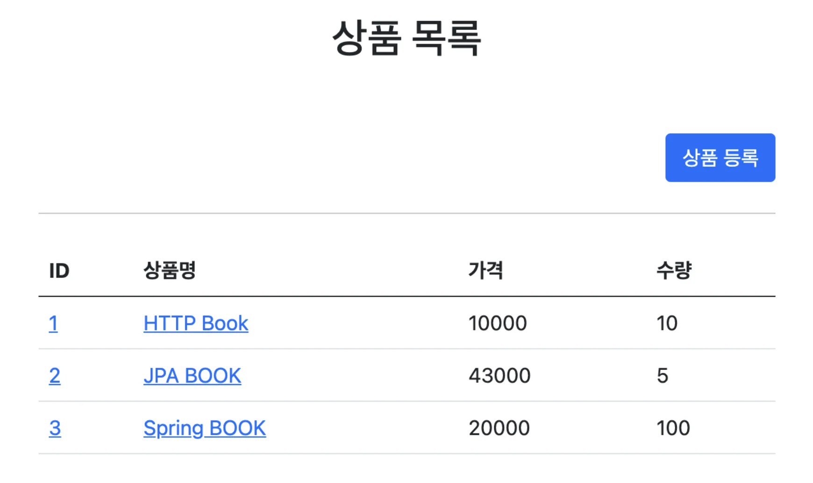
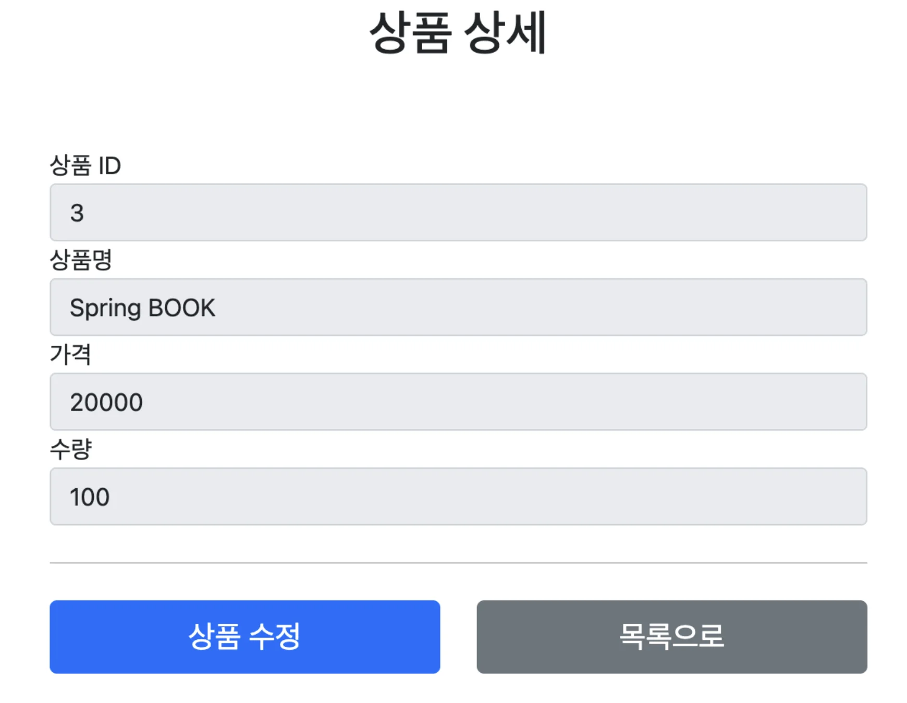
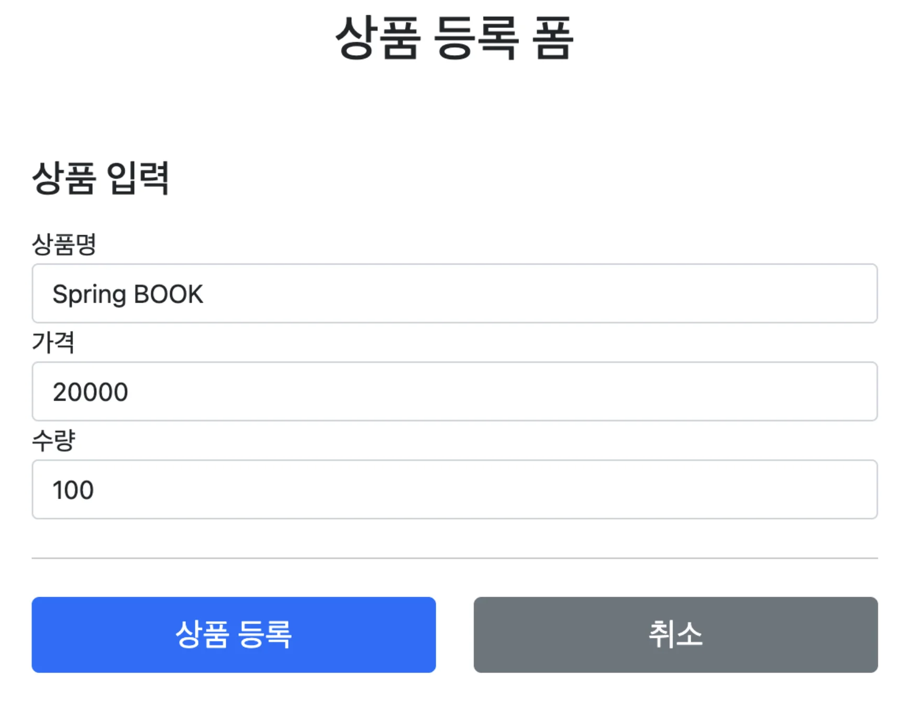
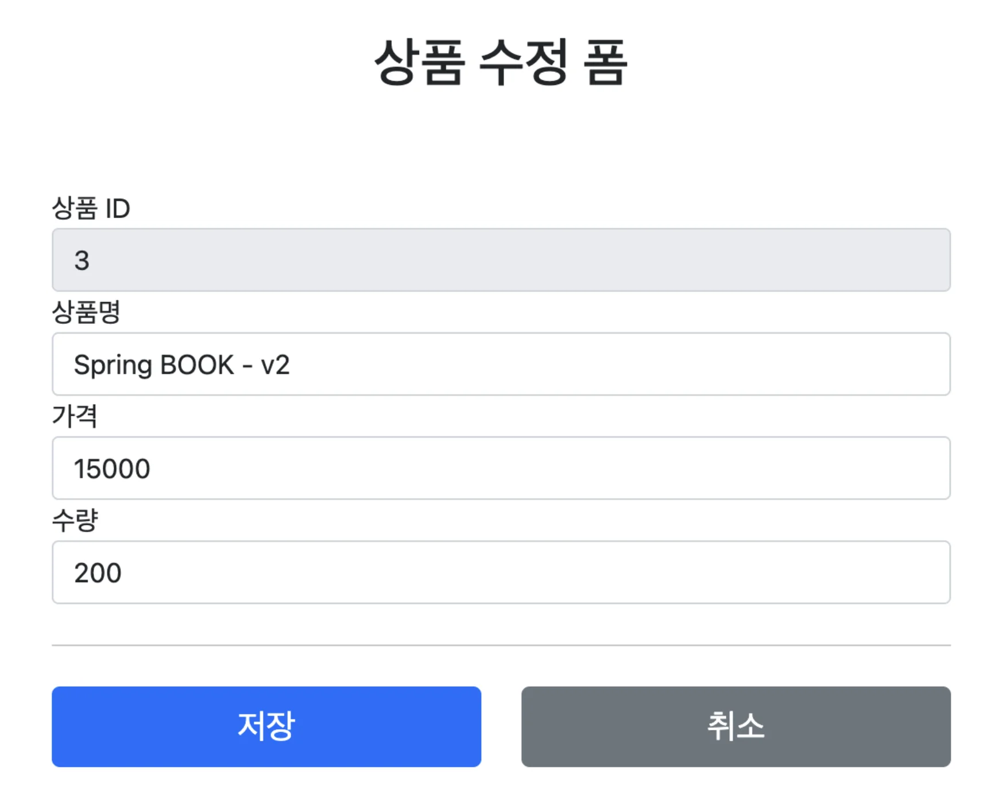
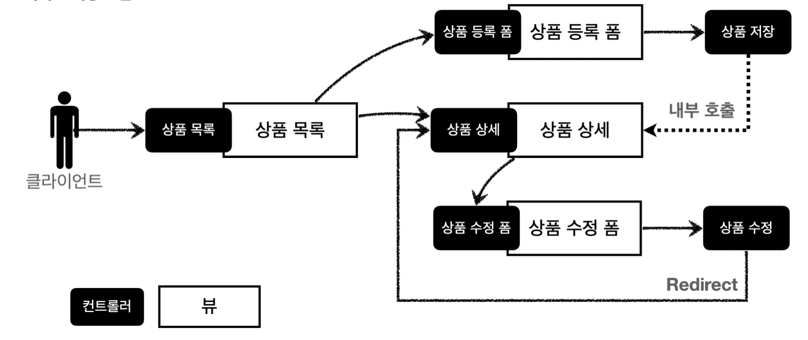
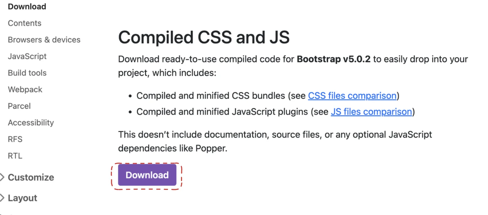
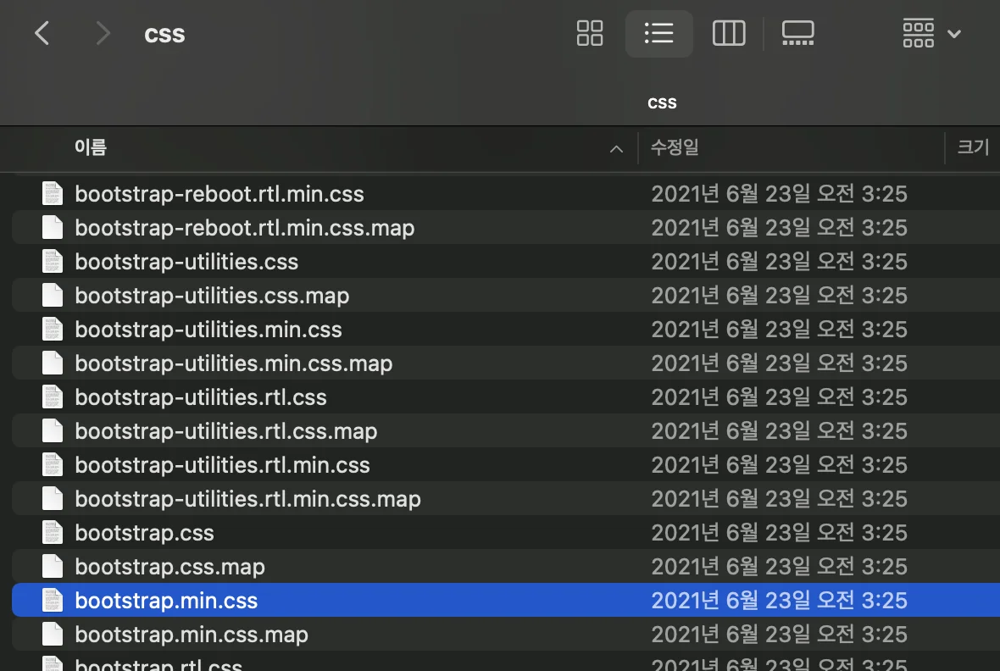

[외부 링크](https://github.com/gyungsubLee/---MVC1/commits/07-springMVC/create_WebPage)

<details>
<summary>프로젝트 세팅 </summary>

<details>
<summary><strong>🧐 Error)</strong> <strong><u>Gradle</u></strong>에서 <strong><u>providedRuntime()</u></strong> 메소드는 존재하지 않음</summary>

<a id="1c3eda9b0fe1817e99d7fb7c74278569"></a>

war로 생성한 프로젝트를 jar로 변경 시에 발생한 오류

<a id="1c3eda9b0fe18183a75edf5a3fccbdaf"></a>

아래와 같이 <code>providedRuntime</code>를 <code>runtimeOnly</code>로 변경하여 해결함

<a id="1c3eda9b0fe181f09775fb703c6a115f"></a>

```groovy
providedRuntime 'org.springframework.boot:spring-boot-starter-tomcat'

-> 

runtimeOnly 'org.springframework.boot:spring-boot-starter-tomcat'
```

</details>

<details>
<summary>🧐 <code>resources/static/index&#46;html</code> 파일 생성 후 서버 실행 시  해당되는 html 파일이 기본 시작페이가 된다&#46;</summary>

<a id="1c3eda9b0fe181e5b020de72e6b41be4"></a>

<em><u>Spring Boot의 자동 구성(Autoconfiguration) </u></em>으로 인해 <br><code>src/main/resources/static</code>폴더를 <strong>정적 자원(static resources) 디렉터리</strong>로 인식한다&#46;

<a id="1c3eda9b0fe181c1af21dad691c439bb"></a>

<br><code>index&#46;html</code>은 웹 서버에서<strong> 기본 시작 페이지로 인식</strong>되며&#46; Spring Boot는 <em><u>static 디렉터리 내에서 index&#46;html 파일을 찾</u></em>고, 이 파일을 <strong><u>기본 루트 경로(/)의 응답으로 사용</u></strong>한다&#46;<br><br>그래서 <code>src/main/resources/static/index&#46;html</code> 파일이 있다면, 브라우저에서 <u>http&#58;//localhost&#58;8080을 요청</u>할 때 해당 파일이 자동으로 반환된다&#46;<br>

</details>

<details>
<summary><strong>build&#46;gradle</strong> (war → jar)</summary>

<a id="1c3eda9b0fe18153826ee4e5c9bcb5f0"></a>

```groovy
plugins {
    id 'java'
    id 'org.springframework.boot' version '3.3.1'
    id 'io.spring.dependency-management' version '1.1.5'
}

group = 'com.example'
version = '0.0.1-SNAPSHOT'

java {
    toolchain {
        languageVersion = JavaLanguageVersion.of(17)
    }
}

configurations {
    compileOnly {
        extendsFrom annotationProcessor
    }
}

repositories {
    mavenCentral()
}

dependencies {
    implementation 'org.springframework.boot:spring-boot-starter-thymeleaf'
    implementation 'org.springframework.boot:spring-boot-starter-web'
    compileOnly 'org.projectlombok:lombok'
    annotationProcessor 'org.projectlombok:lombok'
    runtimeOnly 'org.springframework.boot:spring-boot-starter-tomcat'
    testImplementation 'org.springframework.boot:spring-boot-starter-test'
    testRuntimeOnly 'org.junit.platform:junit-platform-launcher'
//    runtimeOnly 'com.mysql:mysql-connector-j'
}

tasks.named('test') {
    useJUnitPlatform()
}

```

</details>

<details>
<summary><strong>시작페이지 </strong></summary>

> resources/static/index&#46;html

<a id="1c3eda9b0fe181189c86e6bb0a014562"></a>

```html
<!DOCTYPE html>
<html>
<head>
    <meta charset="UTF-8">
    <title>Title</title>
</head>
<body> <ul>
    <li>상품 관리 <ul>
        <li><a href="/basic/items">상품 관리 - 기본</a></li> </ul>
    </li> </ul>
</body>
</html>
```

</details>

</details>

<a id="1c3eda9b0fe181819df9e95d422a7e63"></a>

### 요구사항 분석

> 상품을 관리할 수 있는 서비스 만들기

<details>
<summary><strong>상품 도메인 모델</strong></summary>

- 상품 ID

- 상품명

- 가격

- 수량

</details>

<details>
<summary><strong>상품 관리 기능</strong></summary>

- 상품 목록

- 상품 상세

- 상품 등록

- 상품 수정

</details>

<details>
<summary><strong>view</strong></summary>

<details>
<summary>서비스 화면 </summary>



</details>

<details>
<summary>상품 상세 </summary>



</details>

<details>
<summary>상품 등록</summary>



</details>

<details>
<summary>상품 수정</summary>



</details>

</details>

<details>
<summary><strong>서비스 제공 흐름</strong><br></summary>



</details>

<a id="1c3eda9b0fe18179a952d3e70ebb89e7"></a>

## 상품관리 서비스 개발

<a id="1c3eda9b0fe1814387fef41ef6cb1d56"></a>

### 상품 도메인 개발

<details>
<summary>🧐 lombok &#45; <code>&#64;Data</code></summary>


</details>

<details>
<summary>🧐 핵심 도메인 모델에 <code>&#64;Data</code> 사용</summary>

<a id="1c3eda9b0fe181d08bffeebdf3f5a0df"></a>

 <code>&#64;Data</code>는 예측하지 못하게 동작할 수 있어  핵심 도메인 모델이 사용하기 위험하다&#46; 

<a id="1c3eda9b0fe181699233ec01a044ae08"></a>

<code>&#64;Getter</code>, <code>&#64;Setter</code> 정도 사용하는 것이 괜찮고 <br>

<a id="1c3eda9b0fe1814a8187dec78dbcdca8"></a>

Dto를 사용하는 경우  <code>&#64;Data</code>를 사용해도 괜찮지만 약간의 주의가 필요하다&#46;<br>

</details>

<details>
<summary><strong>Item &#45; 상품 객체</strong></summary>

<details>
<summary><strong>Integer </strong></summary>

- int &#45; null 불가, 0 값 할당해야 함

- Interger &#45; null 가능

</details>

<a id="1c3eda9b0fe181568a83c98f2830ad51"></a>

```java
package com.example.springmvc1.domain.item;

import lombok.Data;
import lombok.Getter;
import lombok.NoArgsConstructor;
import lombok.Setter;

@NoArgsConstructor
@Getter
@Setter
public class Item {

    private Long id;
    private String itemName;
    private Integer price;
    private Integer quantity;

    public Item(String itemName, Integer price, Integer quantity) {
        this.itemName = itemName;
        this.price = price;
        this.quantity = quantity;
    }
}
```

</details>

<details>
<summary><strong>ItemRepository &#45; 상품 저장소</strong></summary>

> ☝🏻 실무에선 <strong><u>동시성 이슈 문제</u></strong> 때문에 아래와 같이 사용해야 한다&#46;
> 
> - HashMap → <code>ConcurrentHashMap</code>
> 
> - long → atomic long

<details>
<summary><strong>🧐 </strong><strong><code>findAll()</code></strong><strong>메서드에서 ArrayList로 store 데이터를 감싸 반환하는 이유</strong></summary>

<a id="1c3eda9b0fe181ae8e77dc4bcfab270f"></a>

아래와 같이 ArrayList에 store 값을 넣어 반환<br><code>ArrayList</code>의 값이 변경되어도 <code>store</code>는 영향을 받지 않기 때문에 아래와 같이 안전하게 한번 감싸서 처리<br>

<a id="1c3eda9b0fe181209ad3f3a147b90ff6"></a>

```java
public List<Item> findAll() {
    return new ArrayList<>(store.values());
}
```

</details>

<details>
<summary><strong>🧐 Dto를 통한 update 로직 수정</strong></summary>

<a id="1c3eda9b0fe181e8a4d3f54e211034f8"></a>

간단한 앱이라 아래와 같이 작성하였으나 정석으로는 <strong><u>Dto 객체를 따로 만들고 가져와 업데이트 처리</u></strong>해야 한다&#46;

<a id="1c3eda9b0fe1814fa2f6d3f16fc76cd3"></a>

아래와 같이 Dto를 만들어 업데이트 하는 것이<strong><u> 설계상으로 더 명확</u></strong>하다&#46; 

<a id="1c3eda9b0fe181b7a074fa5a9b761600"></a>

중복 필드를 가지는 클래스를 생성한다 것에 의문점이 생길 수 있으나, 중복보다는 명확성하게 표현하는 것이 더 중요하다&#46;

<details>
<summary><strong>dto/ReqeustItemDto</strong></summary>

<a id="1c3eda9b0fe181b19c59f238df012793"></a>

```java
@Getter
@Setter
public class ReqeustItemDto {
    private String itemName;
    private Integer price;
    private Integer quantity;

    public Item(String itemName, Integer price, Integer quantity) {
        this.itemName = itemName;
        this.price = price;
        this.quantity = quantity;
    }
}
```

</details>

<details>
<summary><strong>ItemRepository &#45; update</strong></summary>

<a id="1c3eda9b0fe181c586aedc36ec9bb44a"></a>

```java
public void update(Long itemId,  ReqeustItemDto requestItemDto){
    Item findItem = findById(itemId);
    findItem.setItemName(requestItemDto.getItemName());
    findItem.setPrice(requestItemDto.getPrice());
    findItem.setQuantity(requestItemDto.getQuantity());
}
```

</details>

</details>

<a id="1c3eda9b0fe181e6bb6ac59eb3e642e5"></a>

```java
package com.example.springmvc1.domain.item;

import org.springframework.stereotype.Repository;

import java.util.ArrayList;
import java.util.HashMap;
import java.util.List;
import java.util.Map;

@Repository
public class ItemRepository {

    // 실무에서는 HashMap 사용 X, ConcurrentHashMap
    private static Map<Long, Item> store = new HashMap<>(); // static

    // 실무에선 atomic long 사용
    private static long sequence = 0L; // static

    public Item save(Item item) {
        item.setId(++sequence);
        store.put(item.getId(), item);
        return item;
    }

    public Item findById(Long id){
        return store.get(id);
    }

    public List<Item> findAll() {
        return new ArrayList<>(store.values());
    }

    public void update(Long itemId, Item updateParam){
        Item findItem = findById(itemId);
        findItem.setItemName(updateParam.getItemName());
        findItem.setPrice(updateParam.getPrice());
        findItem.setQuantity(updateParam.getQuantity());

    }
}
```

</details>

<details>
<summary><strong>ItemRepositoryTest &#45; 상품 저장소 테스트</strong></summary>

> 스프링을 사용하지 않고 순수 자바로 테스트 작성

<a id="1c3eda9b0fe181de9cbefa67e7b11344"></a>

```java
package com.example.springmvc1.domain.item;

import org.assertj.core.api.Assertions;
import org.junit.jupiter.api.AfterEach;
import org.junit.jupiter.api.DisplayName;
import org.junit.jupiter.api.Test;

import java.util.List;

import static org.assertj.core.api.Assertions.assertThat;
import static org.junit.jupiter.api.Assertions.*;

class ItemRepositoryTest {

    ItemRepository itemRepository = new ItemRepository();

    @AfterEach
    void afterEach(){
        itemRepository.clearStore();
    }
    
    @Test
    @DisplayName("상품 저장")
    void save(){
        // given
        Item item = new Item("itemA", 10000, 10);

        // when
        Item savedItem = itemRepository.save(item);
        
        // then
        Item findItem = itemRepository.findById(item.getId());

        assertThat(item).isEqualTo(findItem);
    }

    @Test
    @DisplayName("상품 전체 조회")
    void findAll() {
        // given
        Item item1 = new Item("itemA", 10000, 10);
        Item item2 = new Item("itemB", 20000, 12);

        itemRepository.save(item1);
        itemRepository.save(item2);

        // when
        List<Item> result = itemRepository.findAll();

        // then
        assertThat(result.size()).isEqualTo(2);
        assertThat(result).contains(item1, item2);
    }

    
    @Test
    @DisplayName("상품 조회")
    void findById(){
        // given
        Item item1 = new Item("itemA", 10000, 10);
        Item item2 = new Item("itemB", 20000, 12);

        itemRepository.save(item1);
        itemRepository.save(item2);

        // when
        Item findItem1 = itemRepository.findById(item1.getId());
        Item findItem2 = itemRepository.findById(item2.getId());


        // then
        assertThat(findItem1).isEqualTo(item1);
        assertThat(findItem2).isEqualTo(item2);
    }
    
    @Test
    @DisplayName("상품 수정")
    void update(){
        // given
        Item item = new Item("itemA", 10000, 10);
        Item savedItem = itemRepository.save(item);
        Long itemId = savedItem.getId();

        // when
        Item updateParm = new Item("item2", 20000, 30);
        itemRepository.update(itemId, updateParm);
        
        // then
        Item findItem = itemRepository.findById(itemId);

        assertThat(findItem.getItemName()).isEqualTo(updateParm.getItemName());
        assertThat(findItem.getPrice()).isEqualTo(updateParm.getPrice());
        assertThat(findItem.getQuantity()).isEqualTo(updateParm.getQuantity());

    }
}
```

</details>

<a id="1c3eda9b0fe18174b4f1f7a627b3156a"></a>

### 상품 서비스 HTML

<details>
<summary>부트스트랩</summary>

> 웹사이트를 쉽게 만들 수 있게 도와주는 HTML, CSS, JS 프레임워크

<a id="1c3eda9b0fe18112b24ff75721f40d1d"></a>

<a href="https://getbootstrap.com/docs/5.0/getting-started/download/">해당 doc 링크</a> 로 들어가 아래와 같이 파일을 다운로드한다



<a id="1c3eda9b0fe181d195f6cd3055786edd"></a>

다운 받은 파일에서 <code>css/bootstrap&#46;min&#46;css</code>를 <strong>resources/static/css</strong>에 저장한다&#46;



<a id="1c3eda9b0fe181589e75ce3c041cf1d3"></a>

서버 실행 후 <a href="http://localhost:8080/css/bootstrap.min.css">localhost&#58;8080/css/bootstrap&#46;min&#46;css</a> 에 접속 후 파일이 정상적으로 열린다면 적용된 것이다&#46; 

</details>

> ☝🏻 <strong>주의<br></strong>이렇게 정적 리소스가 공개되는 <code>/resources/static</code> 폴더에 HTML을 넣어두면, 실제 서비스에서도 공개된다&#46; <br>따라서 서비스 운영 시 아래의 예시처럼<strong><u> 공개할 필요가 없는  HTML을 static 파일에 두는 것은 주의</u></strong>해야 한다&#46;

<details>
<summary><strong>상품 목록 &#45; items&#46;html</strong></summary>

<a id="1c3eda9b0fe181d6b62fc2f822499dbd"></a>

```html
<!DOCTYPE HTML>
<html>
<head>
    <meta charset="utf-8">
    <link href="../css/bootstrap.min.css" rel="stylesheet">
</head>
<body>
<div class="container" style="max-width: 600px">
    <div class="py-5 text-center">
        <h2>상품 목록</h2> </div>
    <div class="row">
        <div class="col">
            <button class="btn btn-primary float-end" onclick="location.href='addForm.html'" type="button">상품 등록
            </button>
        </div>
    </div>
    <hr class="my-4">
    <div>
        <table class="table">
            <thead>
            <tr>
                <th>ID</th>
                <th>상품명</th> <th>가격</th> <th>수량</th>
            </tr>
            </thead>
            <tbody>
            <tr>
                <td><a href="item.html">1</a></td>
                <td><a href="item.html">테스트 상품1</a></td> <td>10000</td>
                <td>10</td>
            </tr> <tr>
                <td><a href="item.html">2</a></td>
                <td><a href="item.html">테스트 상품2</a></td> <td>20000</td>
                <td>20</td>
            </tr>
            </tbody>
        </table>
    </div>
</div> <!-- /container -->
</body>
</html>
```

</details>

<details>
<summary><strong>상품 상세 &#45; item&#46;html</strong></summary>

<a id="1c3eda9b0fe181849c9ed0db9cd9150a"></a>

```html
<!DOCTYPE HTML>
<html>
<head>
    <meta charset="utf-8">
    <link href="../css/bootstrap.min.css" rel="stylesheet">
    <style>
        .container {
            max-width: 560px;
        } </style>
</head>
<body>
<div class="container">
    <div class="py-5 text-center"> <h2>상품 상세</h2>
    </div>
    <div>
        <label for="itemId">상품 ID</label>
        <input type="text" id="itemId" name="itemId" class="form-control"
               value="1" readonly>
    </div>
    <div>
        <label for="itemName">상품명</label>
        <input type="text" id="itemName" name="itemName" class="form-control"
               value="상품A" readonly> </div>
    <div>
        <label for="price">가격</label>
        <input type="text" id="price" name="price" class="form-control"
               value="10000" readonly>
    </div>
    <div>
        <label for="quantity">수량</label>
        <input type="text" id="quantity" name="quantity" class="form-control"
               value="10" readonly>
    </div>
    <hr class="my-4">
    <div class="row">
        <div class="col">
            <button class="w-100 btn btn-primary btn-lg" onclick="location.href='editForm.html'" type="button">상품 수정</button>
        </div>
        <div class="col">
            <button class="w-100 btn btn-secondary btn-lg" onclick="location.href='items.html'" type="button">목록으로</button>
        </div>
    </div>
</div> <!-- /container -->
</body>
</html>
```

</details>

<details>
<summary><strong>상품 등록 &#45; addForm&#46;html</strong></summary>

<a id="1c3eda9b0fe181609927e823866bbbc2"></a>

```html
<!DOCTYPE HTML>
<html>
<head>
    <meta charset="utf-8">
    <link href="../css/bootstrap.min.css" rel="stylesheet">
    <style>
        .container {
            max-width: 560px;
        } </style>
</head>
<body>
    <div class="container">
        <div class="py-5 text-center"> <h2>상품 등록 폼</h2>
        </div>
        <h4 class="mb-3">상품 입력</h4>
        <form action="item.html" method="post">
            <div>
                <label for="itemName">상품명</label>
                <input type="text" id="itemName" name="itemName" class="form- control" placeholder="이름을 입력하세요">
            </div>
            <div>
                <label for="price">가격</label>
                <input type="text" id="price" name="price" class="form-control" placeholder="가격을 입력하세요">
            </div>
            <div>
                <label for="quantity">수량</label>
                <input type="text" id="quantity" name="quantity" class="form- control" placeholder="수량을 입력하세요">
            </div>
            <hr class="my-4">
            <div class="row">
                <div class="col">
                    <button class="w-100 btn btn-primary btn-lg" type="submit">상품 등록</button>
                </div>
                <div class="col">
                    <button class="w-100 btn btn-secondary btn-lg" onclick="location.href='items.html'" type="button">취소</button>
                </div>
            </div>
        </form>
    </div> <!-- /container -->
</body>
</html>
```

</details>

<details>
<summary><strong>상품 수정 &#45; editForm&#46;html</strong></summary>

<a id="1c3eda9b0fe181759778c9580b8d3563"></a>

````html
<!DOCTYPE HTML>
<html>
<head>
    <meta charset="utf-8">
    <link href="../css/bootstrap.min.css" rel="stylesheet">
    <style>
        .container {
            max-width: 560px;
        } </style>
</head>
<body>
<div class="container">
    <div class="py-5 text-center"> <h2>상품 수정 폼</h2>
    </div>
    <form action="item.html" method="post">
        <div>
            <label for="id">상품 ID</label>
            <input type="text" id="id" name="id" class="form-control" value="1"
                   readonly>
        </div>
        <div>
            <label for="itemName">상품명</label>
            <input type="text" id="itemName" name="itemName" class="form-control" value="상품A">
        </div>
        <div>
            <label for="price">가격</label>
            <input type="text" id="price" name="price" class="form-control" value="10000">
        </div>
        <div>
            <label for="quantity">수량</label>
            <input type="text" id="quantity" name="quantity" class="form-control" value="10">
        </div>
        <hr class="my-4">
        <div class="row">
            <div class="col">
                <button class="w-100 btn btn-primary btn-lg" type="submit">저장</button>
            </div>
            <div class="col">
                <button class="w-100 btn btn-secondary btn-lg"
                        onclick="location.href='item.html'" type="button">취소</button>
            </div>
        </div>
    </form>
</div> <!-- /container -->
</body>
</html> ```

````

</details>

<a id="1c3eda9b0fe181beb44eefb53b6a17cf"></a>

### 상품 목록 &#45; 타임리프

<details>
<summary>타입리프 옵션 추가</summary>

<a id="1c3eda9b0fe181779ebaeb087556da4b"></a>

```html
<html xmlns:th="http://www.thymeleaf.org">
```

</details>

<details>
<summary>css 링크 설정</summary>

<a id="1c3eda9b0fe1818ea29dc35cbb34037c"></a>

```html
<link th:href="@{/css/bootstrap.min.css}"
         href="../css/bootstrap.min.css" rel="stylesheet">
```

</details>

<details>
<summary>버튼 하이퍼링크 설정</summary>

<a id="1c3eda9b0fe1818eade2c9ef9a4b621f"></a>

```html
<button class="btn btn-primary float-end"
		onclick="location.href='addForm.html'"
		th:onclick="|location.herf='@{/basic/items/add}'|"
		type="button">상품 등록</button>
```

</details>

<details>
<summary>루프문을 통한 목록 생성</summary>

<details>
<summary>🧐 <code>/</code> 생략</summary>

<a id="1c3eda9b0fe181afa3ccd4113212cc6e"></a>

실수로 <code>/</code>를 생략 했더니 상대 경로로 나옴

<a id="1c3eda9b0fe1816197c1cbafe1ef7ef9"></a>

```html
<td>
	<a 
	  href="item.html" 
	  th:href="@{basic/items/{itemId}(itemId=${item.id})}" 
	  th:text="${item.id}">
	   회원id
	</a>
</td>

```

- <strong>예상한 url</strong>&#58; localhost&#58;8080/basic/items

- <strong>실제 나온 url</strong>&#58; <code>localhost&#58;8080</code><strong><u><code>/basic/basic/</code></u></strong><code>items</code>
    - basic 경로가 두번 들어가는 오류 발생함

<a id="1c3eda9b0fe181d0a85ede00889b9ebc"></a>

아래와 같이 <code>/</code>를 추가하여 절대 경로로 변경 후 해결 

<a id="1c3eda9b0fe18103b875c97a38e0b476"></a>

```html
<td>
	<a 
	  href="item.html" 
	  th:href="@{/basic/items/{itemId}(itemId=${item.id})}" 
	  th:text="${item.id}">
	   회원id
	</a>
</td>
```

</details>

<a id="1c3eda9b0fe181089a4bf3f870192b10"></a>

```html
 <tbody>
    <tr th:each="item : ${items}">
        <td><a href="item.html" th:href="@{/basic/items/{itemId}(itemId=${item.id})}" th:text="${item.id}">회원id</a></td>
        <td><a href="items.html"  th:href="@{/basic/items/{itemId}(itemId=${item.id})}" th:text="${item.itemName}" >싱픔명</a></td>
        <td th:text="${item.price}": >10000</td>
        <td th:text="${item.quantity}": >10</td>
    </tr>
</tbody>
```

</details>

---

<a id="1f8eda9b0fe1803a94d4e1814cdeda6b"></a>

여기서부터 시작

<a id="1c3eda9b0fe1814cbf78c212ccd665ed"></a>

### 타임리프를 사용한 동적 데이터 바인딩

<a id="1c3eda9b0fe181a692fcf70f85c97f3f"></a>

### PRG 패턴 ( Post/Redirect/Get )

<a id="1c3eda9b0fe1816dbc39f68c722e2bb2"></a>

### RedirectAttributes
