<a id="1c3eda9b0fe181b28b50cf41c97a3631"></a>

### 📌 Chapter

[1. 인터넷 네트워크](#/post/1c3eda9b-0fe1-8146-8719-de62a56fe12a)

[2. URI, 웹 브라우저 요청 흐름](#/post/1c3eda9b-0fe1-810f-bee0-d47bc13f50dc)

[3. HTTP 기본](#/post/1c3eda9b-0fe1-81e6-b17e-fbfeeb23a0d2)

[4. URI, HTTP 메서드](#/post/1c3eda9b-0fe1-810d-a48e-d17771c587b5)

[5. HTTP 메서드 활용](#/post/1c3eda9b-0fe1-81ed-be99-c90234388e57)

[6.  HTTP 상태코드](#/post/1c3eda9b-0fe1-810c-b142-f1639de54e14)

[7. HTTP 헤더1 - 일반 헤더](#/post/1c3eda9b-0fe1-81ad-9113-e0a2274acfb8)

[8. HTTP 헤더2  - 캐시, 조건부 요청](#/post/1c3eda9b-0fe1-8159-9ac8-e0edcb073fa5)

<a id="1c3eda9b0fe181eeac50cb7b10da797b"></a>

# 정리

<a id="1c3eda9b0fe18106ae33f32ddb387d90"></a>

### URL 문법


<a id="1c3eda9b0fe181e7b42be377ff9bacc6"></a>

### 웹 브라우저 통신 및 TCP/IP 통신 전체 흐름


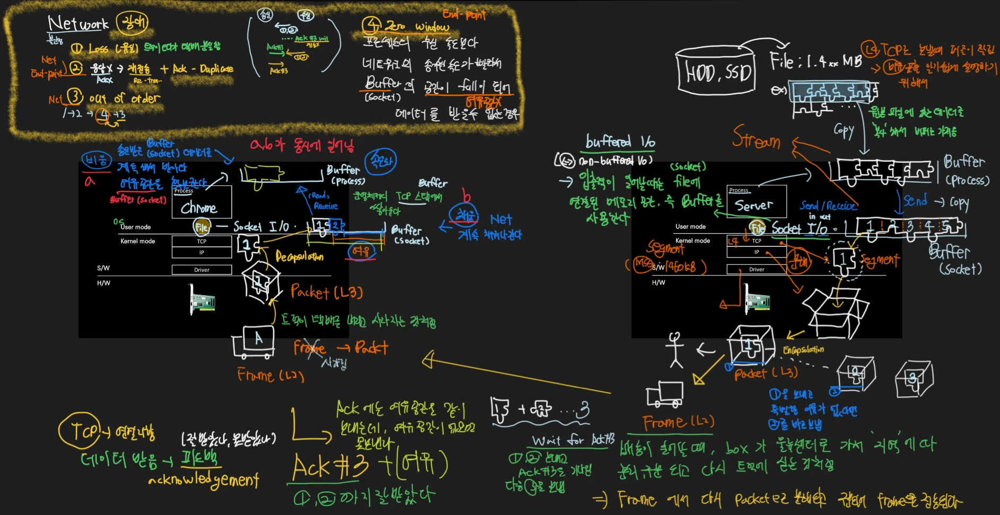

<a id="1c3eda9b0fe18134b52dfa2aa9896139"></a>

### 송•수신

<a id="1c3eda9b0fe18112b106e07bcb2c3ef8"></a>

하드디스크의 데이터를 프로세서의 Buffer에서 copy  (Stream, 데이터 덩어리)

<a id="1c3eda9b0fe181078040f49826873e45"></a>

→ Socket Buffer에서 Copy(Send) 

<a id="1c3eda9b0fe1814da0e9c200dd0d07b9"></a>

→ &#91; L4 &#93; Segment로 분해 &#91; MSS&#58; 1460Byte &#93; 

<a id="1c3eda9b0fe181109aeff4a3bd4e8cfd"></a>

→ &#91; L3 &#93; Packet으로 Encaptulation  &#91;MTU&#58; 1500Byte&#93;

<a id="1c3eda9b0fe181cf8b91feea813eed37"></a>

→ &#91; L2 &#93; Frame으로 Encaptulation

<a id="1c3eda9b0fe181419552c56fa92f650e"></a>

→ 목적지 MAC 주소를 통해 GateWay로 이동<br>→ 목적지 IP주소를 통해 인터넷(라우터들), 게이트웨이를 거쳐 수신받는 컴퓨터로 이동

<a id="1c3eda9b0fe181d1869bf85d11030021"></a>

→ &#91; L2 &#93; Frame → Packet Decaptulation

<a id="1c3eda9b0fe1810ca637f63de04596f7"></a>

→ &#91; L3 &#93; Packet → Segment Decaptulation

<a id="1c3eda9b0fe18162828ce0df01af3288"></a>

→  포트 번호를 통해 해당 프로세스Socket Buffer에 Segment 전달

<a id="1c3eda9b0fe181d698bae96471c1130a"></a>

→ 프로세스 Buffer에서 데이터 가져옴 

<a id="1c3eda9b0fe18187931ff924ad9b2279"></a>

→ ACK 응답 받은 후, 다음 데이터 전송 (ACK 응답 X → 다시 데이터 전송)

<a id="1c3eda9b0fe181af9d52e06202cc60e5"></a>

##  HTTP 특성

<a id="1c3eda9b0fe18133aea9ec3a4d3990a2"></a>

### Stateless(무상태)

> /icons/checkmark-line_pink.svg <strong>무상태(stateless) 프로토콜</strong><br>서버 &#45; 클라이언트 상태 보존X<br>→ <u>서버 확장성 높</u>으나, <u>추가 데이터(상태) 전송이 필요</u>하다는 단점이 있음 

- Stateless, Stateful 비교


<a id="1c3eda9b0fe181dead49d5d11bc14905"></a>

### 서버 설계  시 어떻게서든지 <code>Stateless</code> 하게 설계해야한다&#46;

> 서비스의 이벤트로 인해<strong><u> </u></strong><strong><u><code>같은 시간</code></u></strong><strong><u>에 순간적으로 증가되는 </u></strong><strong><u><code>대용량 트래픽</code></u></strong><strong><u>을  받</u></strong>아야할 때, Stateless 하게 설계한 경우<strong><code>서버 확장</code></strong>을 통해 간단하게? 해결 가능하다&#46; 

<details>
<summary>정확히 같은 시간에 맞춰 발생되는 대용량 트래픽</summary>

<a id="1c3eda9b0fe181a18d83d08a9171135e"></a>

ex) 선착순 이벤트, 명절 KTX 예약,  학과 수업 등록 등

<a id="1c3eda9b0fe1812f91bcd4d6c21bc865"></a>

ex) 저녁 6&#58;00 선착순 1000명 치킨 할인 이벤트 → 수만명 동시 요청

</details>

<a id="1c3eda9b0fe181568ebbf593bcbeca2f"></a>

### 비연결성 ( Connectionless )

> 📌  HTTP&#58; 기본 연결을 유지 하지 않는 비연결성 모델<br>따라서 서버의 자원을 매우 효율적으로 사용할 수 있음<br><br> 1시간 동안 수천명이 서비스를 사용해도, 실제 서버에서 동시에 처리하는 요청은 수십개 이하로 매우 작음  <br>   ex) 웹 브라우저에서 계속 연속해서 검색 버튼을 누르지 않음  

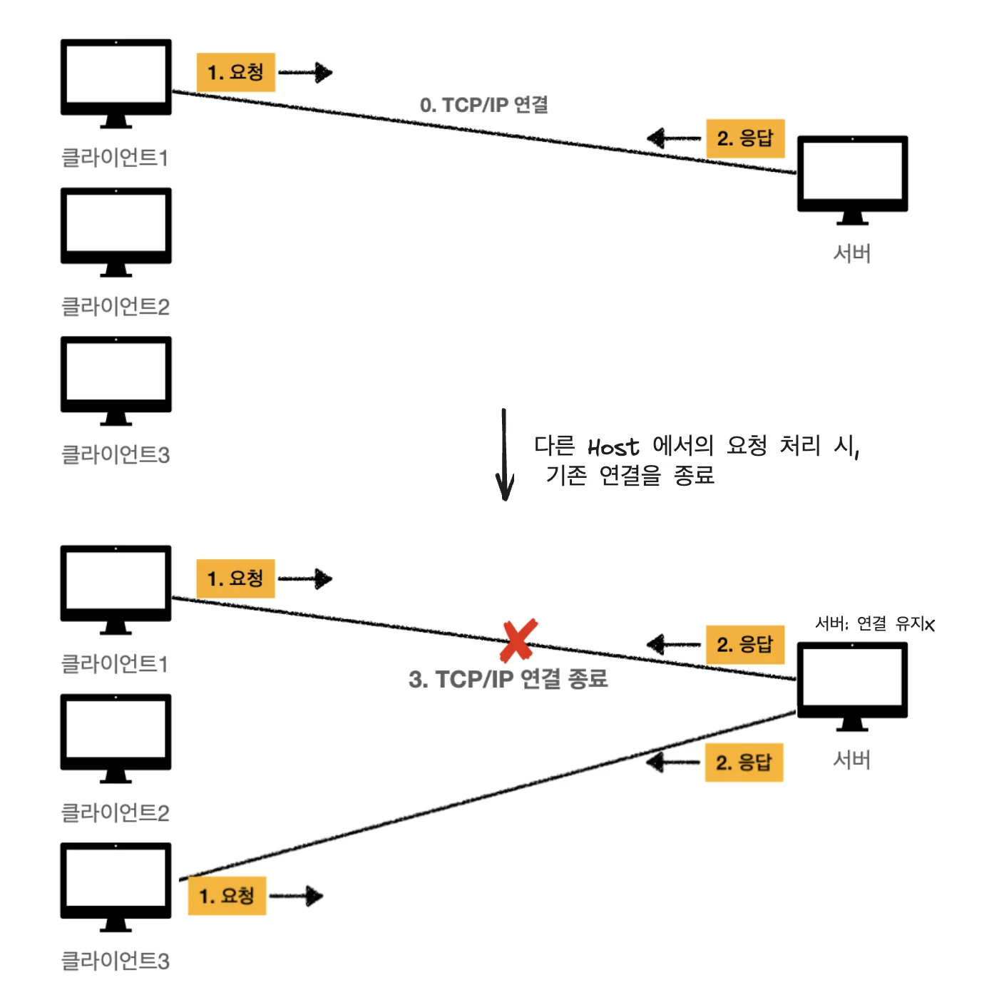

<details>
<summary>비연결성의 한계 </summary>

> 📌 TCP/IP 연결을 새로 맺어야 함&#46; → <code>3 Way handshake</code>  시간 소요
> 
> <a id="1c3eda9b0fe181f79cb6ed3aca79db13"></a>
> 
> 다시 웹 브라우저 접속 시  → HTML &#43; CSS, JS, 추가 이미지 등 수 많은 자원 다시 다운로드 → 비용이 너무 큼


</details>

<details>
<summary>해결) HTTP 지속 연결 ( Persistent Connections )  </summary>

> <code>HTTP 지속 연결(Persistent Connections)</code>로 동작 방식을 변경하여 이전 비연결성 문제 해결<br> →  HTTP/2 &#46;&#46;/3 더 많이 최적화됨 


</details>

<a id="1c3eda9b0fe18102b27ced3aef760211"></a>

# HTTP 메세지 

<a id="1c3eda9b0fe18177b801d3f4f4b5ddd1"></a>

HTTP 메세지에 모든 자원들을 전송한다&#46; (서버간에 데이터를 주고 받을 떄도 사용)


<a id="1c3eda9b0fe18162b62df2751228ae2c"></a>

## 요청 메세지


<a id="1c3eda9b0fe1812fa1f0ee11623afb06"></a>

### Start&#45;line (시작 라인)


<a id="1c3eda9b0fe18188ad72c0b9aa8fa5a0"></a>

## 응답 메세지


<a id="1c3eda9b0fe181748c13c0ecfdec5fda"></a>

### Start&#45;line (시작 라인)

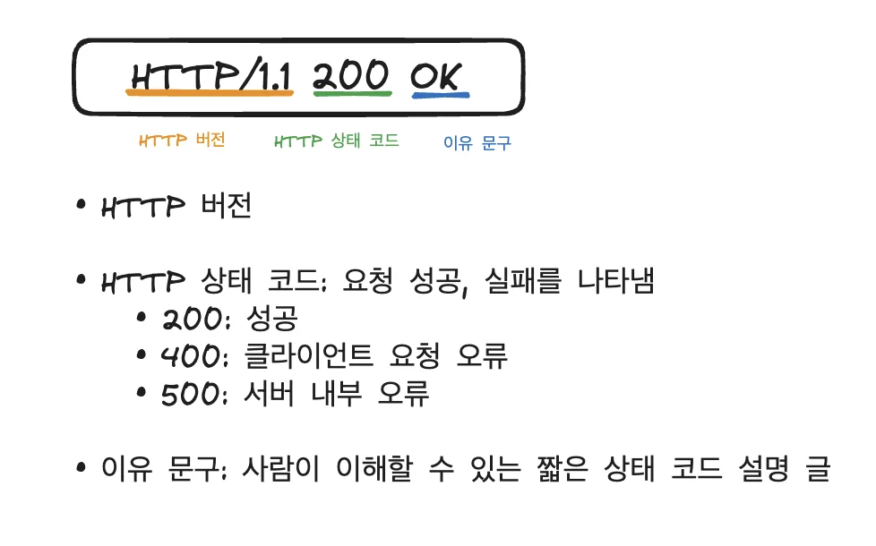

<a id="1c3eda9b0fe181f4b08cf8dca21599ca"></a>

### Header

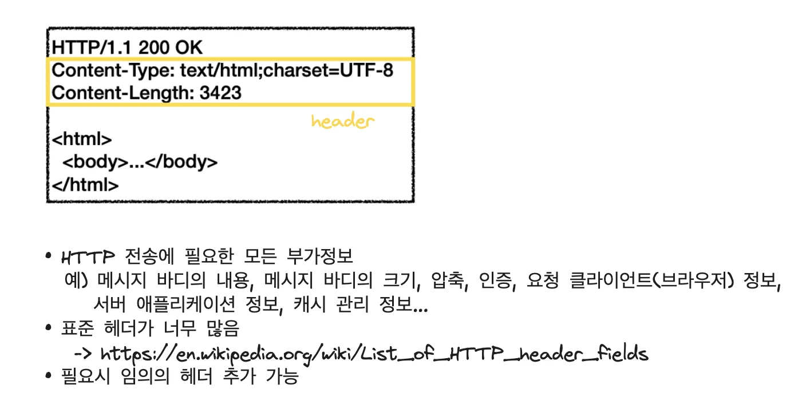

<a id="1c3eda9b0fe181f8b8cfc9b6b7cd819b"></a>

### message body

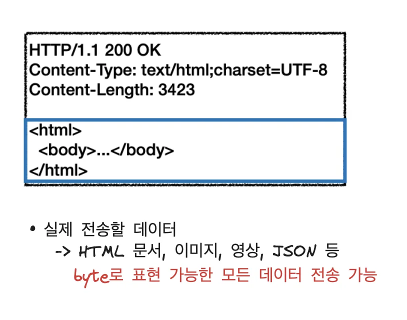

<a id="1c3eda9b0fe181ddb8a9e0a95258f026"></a>

# API URI 설계

> 📌 <strong>회원 정보 관련 API 만들기</strong>
> 
> - 회원 목록 조회
> 
> -  회원 조회
> 
> -  회원 등록
> 
> -  회원 수정
> 
> -  회원 삭제 

<a id="1c3eda9b0fe181d3b922fb241ea771c1"></a>

### URI 설계 시 가장 중요한 것은 리소스의 식별이다&#46; 

<details>
<summary>🧐 ’리소스’의 의미란?</summary>

<a id="1c3eda9b0fe1815e8a7cdcd15b83679f"></a>

회원을 등록하고, 수정하고, 조회하는 것이 리소스가 아닌<br>’<strong>회원</strong>’이라는 개념 자체가 <strong>리소스</strong>이다&#46; 

<a id="1c3eda9b0fe18107a992c8e5f7048f29"></a>

ex)  돈을 벌다, 돈을 쓰다&#46;  → ‘돈’  즉, 행위의 주체(명사) 

<a id="1c3eda9b0fe18134a9a1f98631c6e817"></a>

ex) 스타크래프트&#45;scv&#58; 미네랄을 캐다 → ‘미네랄’

</details>

<a id="1c3eda9b0fe181deb83bc3dadde2a788"></a>

회원이라는 리소스만 식별도록, <strong>회원 리소스(명사)</strong>를 <strong>URI 매핑</strong>하여 설계해야 한다&#46;

<details>
<summary>ex) 잘못된 API URL 설계 </summary>

- 회원 목록 조회&#58;  /read&#45;member&#45;list

- 회원 조회&#58;  /read&#45;member&#45;by&#45;id

-  회원 등록&#58;  /create&#45;member

- 회원 수정&#58;  /update&#45;member

- 회원 삭제&#58;  /delete&#45;member

</details>

<a id="1c3eda9b0fe181429120ffacc42572ec"></a>

### 회원 리소스 식별하여 API URI 설계 

- <strong>회원</strong> 목록 조회&#58; /<strong>members</strong>

- <strong>회원</strong> 조회&#58; /<strong>members </strong>/ {id}       

- <strong>회원</strong> 등록&#58; /<strong>members </strong>/ {id}   

- <strong>회원</strong> 수정&#58; /<strong>members </strong>/ {id}   

- <strong>회원</strong> 삭제&#58;  /<strong>members </strong>/ {id}  

<a id="1c3eda9b0fe1819bbdeee2ce8f6b3b26"></a>

             &#58; 어떻<strong>게 구분할 것인가? </strong>

> URI가 회원 리소스만을 식별하게 설계<br>그러나 <strong>조회, 등록, 수정, 삭제</strong> 등 행위(동사)에 대한 <strong><u>구분이 되지 않</u></strong>는다&#46; <br>여기서 <strong><u>HTTP 메서드</u></strong>를 사용하여 행위를 식별한다&#46; 

<a id="1c3eda9b0fe181eba2c7c37bf92f7d84"></a>

# HTTP 메서드

---

<a id="1c3eda9b0fe18167ac91e4cfb23b58c0"></a>

### 주요 메서드 

- <strong>GET</strong>&#58; 리소스 조회

- <strong>POST</strong>&#58; 요청 데이터 처리, 주로 등록에 사용

- PUT&#58; 리소스를 대체, 해당 리소스가 없으면 생성

- PATCH&#58; 리소스 부분 변경

- DELETE&#58; 리소스 삭제

<details>
<summary>기타 메서드</summary>

- <strong>HEAD&#58;</strong> GET과 동일하지만 메시지 부분을 제외하고, 상태 줄과 헤더만 반환

- <strong>OPTIONS&#58;</strong> 대상 리소스에 대한 통신 가능 옵션(메서드)을 설명(주로 CORS에서 사용)

- <strong>CONNECT&#58;</strong> 대상 리소스로 식별되는 서버에 대한 터널을 설정

- <strong>TRACE&#58;</strong> 대상 리소스에 대한 경로를 따라 메시지 루프백 테스트를 수행

</details>

<a id="1c3eda9b0fe1817593b1ee188985f050"></a>

## GET


<a id="1c3eda9b0fe18146991dca5e5c4ce3c5"></a>

## POST

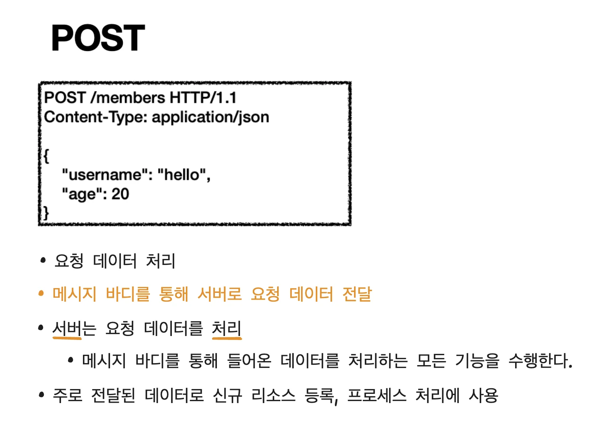


<a id="1c3eda9b0fe1816a9fcdcf7a2df44473"></a>

## PUT

> 📌 <strong>정리</strong>
> 
> <a id="1c3eda9b0fe18100bb2bc681f8345fdc"></a>
> 
> ### 리소스 대체 
> 
> <a id="1c3eda9b0fe181b69c2bfd0899b961de"></a>
> 
> 리소스가 있으면 대체(덮어쓰기), 리소스가 없으면 생성 
> 
> <a id="1c3eda9b0fe181eb8fcfd578d59b542e"></a>
> 
> ### 클라이언트가 리소스 식별
> 
> <a id="1c3eda9b0fe181b884b5d91f6603b36f"></a>
> 
> 클라이언트가 리소스 위치를 알고 URI 지정

> ⚠️ <strong>POST 와 PUT 차이</strong>
> 
> <a id="1c3eda9b0fe181c4bbbaf0d7e64552d9"></a>
> 
> <code>POST</code>의 경우, 서버에서 해당 리소스의 path를 직접 할당하고 관리하지만, <br><code>PUT</code> 의 경우, <strong><u>클라이언트에서  직접  PATH를 부여</u></strong>하여 서버에 전달한다&#46;<br>  즉,  <strong>클라이언트에서 리소스를 식별하여 관리</strong>한다&#46; 

<a id="1c3eda9b0fe1812f99a6f769a39b2d9a"></a>

### <strong>1) 리소스가 있는 경우</strong>

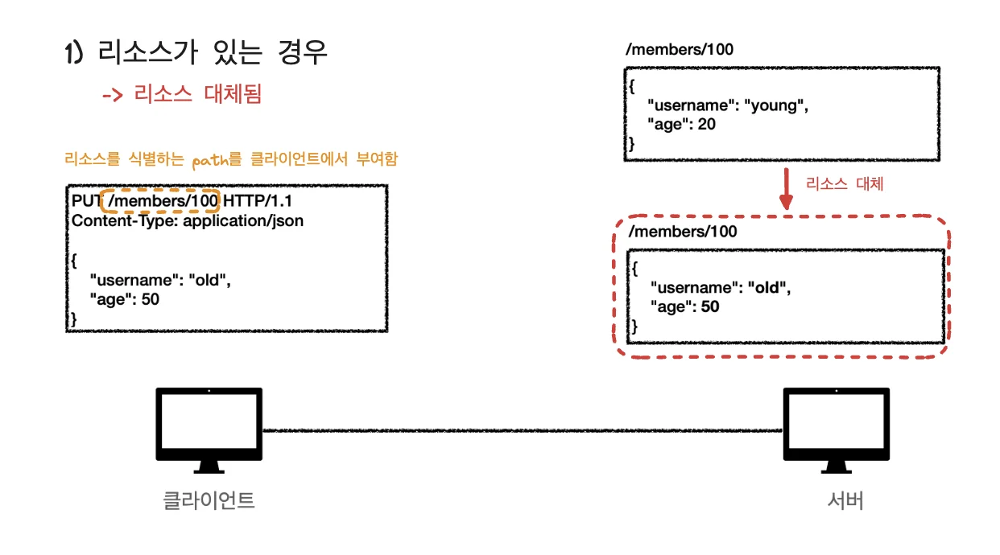

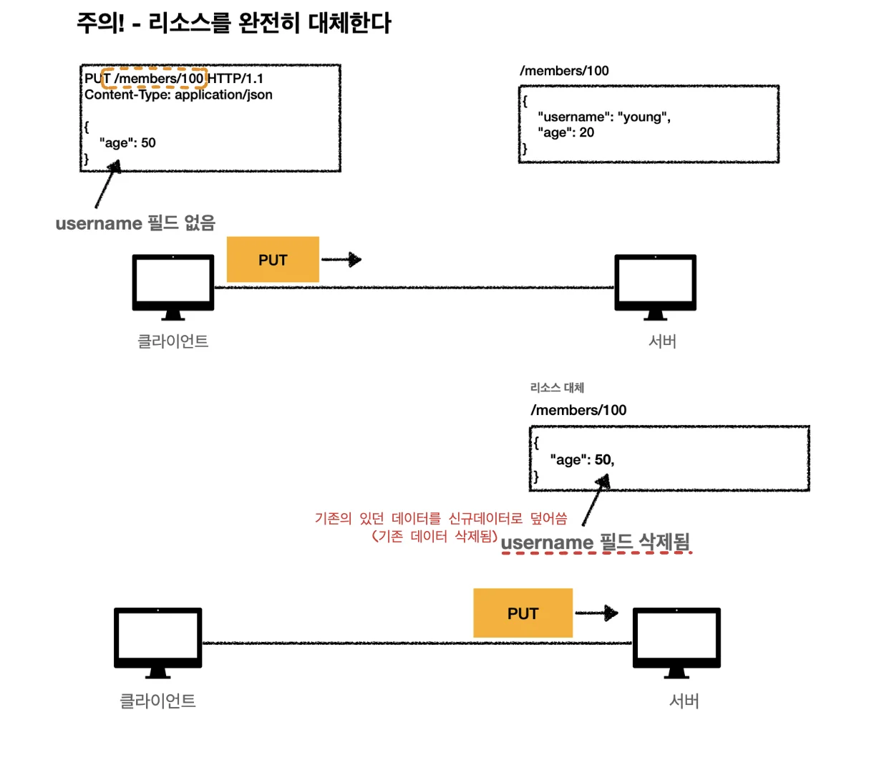

<a id="1c3eda9b0fe181c2ad6cc86795c820fc"></a>

### 2) 리소스가 없는 경우 (POST 동일)

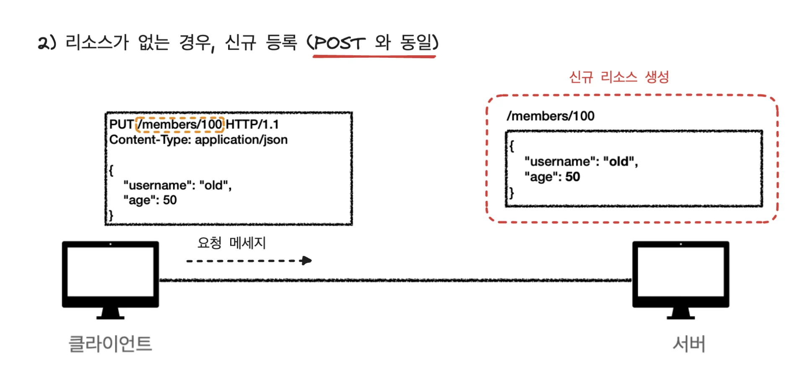

<a id="1c3eda9b0fe1811d93bff3fc5002e619"></a>

## PATCH

>  ● 리소스 부분 변경

<a id="1c3eda9b0fe181a49d5ef67afad54445"></a>

따라서 리소스를 식별할 path 필요

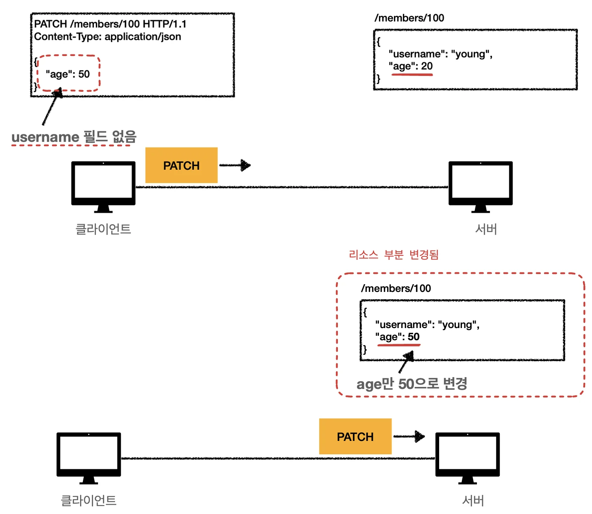

<a id="1c3eda9b0fe18170b480c808dda176ef"></a>

## DELETE

> ● 리소스 제거

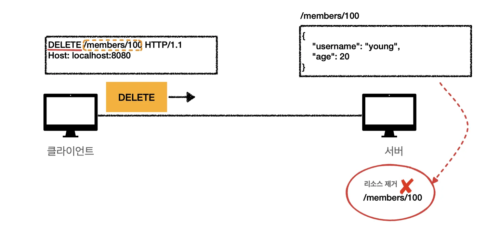

<a id="1c3eda9b0fe181498446e2b0b8b6fde3"></a>

## HTTP 메서드 속성

>  •    안전(Safe Methods)
> 
> - 멱등(Idempotent Methods)
> 
> - 캐시가능(Cacheable Methods)


<a id="1c3eda9b0fe18173a422fd46f078635f"></a>

### 안전 ( Safe )

> 호출 시, 서버에서 로그가 쌓임

<details>
<summary>🧐  계속 호출하여, 로그 같은게 쌓여서 장애가 발생하면?</summary>

<a id="1c3eda9b0fe18169bf59efcfc607213f"></a>

안전은 해당 리소스만 고려한 판단이다&#46; 리소스의 외부 요소들(로그 등)은 고려하지 않음

</details>

<a id="1c3eda9b0fe181afbbffd0788939e4d0"></a>

### 멱등 ( Idempotent )

> f(f(x)) = f(x) 

<a id="1c3eda9b0fe1814b9b68d2c14fb4a1fd"></a>

→ 몇번을 실행해도 항상 같은 결과를 도출한다&#46; (입력 조건이 같은 경우) 

<a id="1c3eda9b0fe18188b147f536644baaf2"></a>

→ 기존함수가 역함수와 동일한 경우

<a id="1c3eda9b0fe181edad74c6a0c7401ddb"></a>

### 멱등 메서드

- <strong>GET</strong>&#58; 한 번 조회하든, 두 번 조회하든 같은 결과가 조회된다&#46;

- <strong>PUT</strong>&#58; 결과를 대체한다&#46; 따라서 같은 요청을 여러번 해도 최종 결과는 같다&#46;

- <strong>DELETE</strong>&#58; 결과를 삭제한다&#46; 같은 요청을 여러번 해도 삭제된 결과는 똑같다&#46;

- <strong>POST</strong>&#58; <strong>멱등이 아님</strong><strong>, </strong>두 번 호출하면 같은 결제가 중복해서 발생할 수 있다&#46;

<a id="1c3eda9b0fe18136a0c0eb5977c98f54"></a>

### <strong>활용</strong>

- 자동 복구 메커니즘

<a id="1c3eda9b0fe1817eaf43e8a1d8193d3d"></a>

        ex) <code>DELTE</code>호출, 서버 응답 X → 다시 <code>DELTE</code> 호출, 멱등 메서드이기 때문에, 재호출해도 결과 동일

- 서버가 TIMEOUT 등으로 정상 응답을 못주었을 때, 클라이언트가 같은 요청을 다시 해도 되는가? 판단 근거

<a id="1c3eda9b0fe181358847f929b4f924e8"></a>

### <strong>멱등은 외부 요인으로 중간에 리소스가 변경되는 것 까지는 고려하지는 않는다&#46;</strong>

<a id="1c3eda9b0fe1812e8743de29e5903a19"></a>

```java
사용자1: GET -> username:A, age:20
사용자2: PUT -> username:A, age:30
사용자1: GET -> username:A, age:30 -> 사용자2의 영향으로 바뀐 데이터 조회
```

> <strong>재요청 중간에 외부에서 리소스를 변경 시, 변경된 데이터가 조회됨 → 멱등 X</strong>

<a id="1c3eda9b0fe1819094a9c5f3f253e861"></a>

### <strong>캐시가능 ( Cacheable ) </strong><strong><code>중요</code></strong>

<details>
<summary>🧐 캐시란?</summary>

<a id="1c3eda9b0fe181f6a758d9b0f0cac6ff"></a>

리소스 파일들의 <strong>임시 저장소</strong><br>웹 브라우저가 동일한 주소로 연속으로 요청하는 경우, 첫번째 요청 결과를 로컬 PC의 캐시에 저장해두고, 두번째 요청 시 서버에서 접근하는 것 대신에 로컬 PC 캐시를 가져오는 방식<br>  ⇒ <a href="https://readinggeneral.tistory.com/39">추가 정리 reference</a>

</details>

>  Q&#58; 응답 결과 리소스를 캐시해서 사용 가능한가?

<a id="1c3eda9b0fe1812eb866d6e4991deeea"></a>

웹 서버에 크기가 큰 리소스를 다운 받고, 다시 해당 요청을 하는 것은 너무 cost가 큰 행위이다&#46;<br>따라서 캐시를 통해 이전 리소스를 저장하여 다시 재사용한다&#46;

<a id="1c3eda9b0fe1817bb6becb05f5ef1e13"></a>

<code>GET</code>, HEAD, <code>POST</code>, PATCH 캐시가능

> 실제로는 <code>GET</code>, <code>HEAD</code> 정도만 캐시로 사용

> POST, PATCH는 본문(Body) 내용까지 캐시 키로 고려해야 하는데, 구현이 쉽지 않음

<details>
<summary>🧐 why?) </summary>

<a id="1c3eda9b0fe181d3b277e638f00bb6fd"></a>

동일한 리소스 캐시로 저장 시,  http Message를  key로 두고 캐시에 저장하여 사용한다&#46; 따라서 POST, PATCH 같은 경우 body의 내용까지 key로 고려해야 하기 때문에, 구현 및 식별이 어렵다 따라서  GET, HEAD 만 캐쉬 사용을 고려한다&#46; 

</details>

<a id="1c3eda9b0fe18129aeaccf4ea371c43d"></a>

<strong>→ 실무에서는 거의 </strong><strong><code>get</code></strong><strong>만 캐시로 사용함</strong>

<a id="1c3eda9b0fe18193bf9afb5ac887a084"></a>

# 클라이언트에서 서버로 데이터 전송

<a id="1c3eda9b0fe1817e93dde627af2d682a"></a>

## 전송 방식(<code>쿼리파라미터</code>, <code>메세지 바디</code>)


<a id="1c3eda9b0fe181799ffdf55fec6ff47c"></a>

### <u>쿼리 파라미터</u>를 통한 데이터 전송

- <code>GET</code>

-  주로 정렬 필터(검색어)

> 검색어, 정렬 조건 과 같은 특정 데이터에 대한 state를 클라이언트에 받아<br>서버에서 해당하는 데이터를 찾을 떄

<a id="1c3eda9b0fe18106a57dc3416452d66a"></a>

### <u>메세지 바디</u>를 통한 데이터 전송

- <code>POST</code>, <code>PUT</code>, <code>PATCH</code>

- 회원 가입, 상품 주문, 리소스 등록, 리소스 변경

<a id="1c3eda9b0fe181d78901cbaa4c862632"></a>

## 정적 데이터 조회 (조회&#58; <code>GET</code>)

<a id="1c3eda9b0fe1815292c0dc77add14c2e"></a>

이미지, 정적 텍스트 문서 

<a id="1c3eda9b0fe181e6ab7dddaa1961df68"></a>

정적 데이터는 일반적으로 쿼리 파라미터 없이 <strong><u>리소스 경로로 단순하게 조회 가능</u></strong>

<a id="1c3eda9b0fe1811e83b7d5a2677a9001"></a>

## 동적 데이터 조회 (조회&#58; <code>GET</code>)

> <code>GET</code>은 <code>쿼리 파라미터</code>를 사용해서 데이터를 전달함 

<a id="1c3eda9b0fe181529d85df04e73cecc4"></a>

검색, 게시판 목록에서 정렬 필터(검색어)

<a id="1c3eda9b0fe18168a4aaddf0450a6441"></a>

조회 조건을 줄여주는 필터, 조회 결과를 정렬하는 정렬 조건에 주로 사용 


<a id="1c3eda9b0fe18150af7ac8b0e1c965b7"></a>

## HTML Form을 통한 데이터 전송 (<code>GET</code>, <code>POST</code>, multipart/form&#45;data)

> ⚠️  HTML Form 전송은 <strong>GET, POST만 지원</strong>

<a id="1c3eda9b0fe18177bdbcfec0d55e5f69"></a>

### HTML Form submit시 POST 전송

-  예) 회원 가입, 상품 주문, 데이터 변경


> 📌 Content&#45;Type&#58; application/x&#45;www&#45;form&#45;urlencoded 
> 
> <a id="1c3eda9b0fe181bfb7abfcedb50c0c4c"></a>
> 
> form의 내용을 메시지 바디를 통해서 전송(key=value, 쿼리 파라미터 형식)
> 
> <a id="1c3eda9b0fe1817591bed4a5e31710cd"></a>
> 
> 전송 데이터를 url encoding 처리
> 
> <a id="1c3eda9b0fe1817e9196c8b86f245483"></a>
> 
> 예) abc김 &#45;&#62; abc%EA%B9%80

<a id="1c3eda9b0fe181b3af54ccb273126484"></a>

### HTML Form GET 전송 

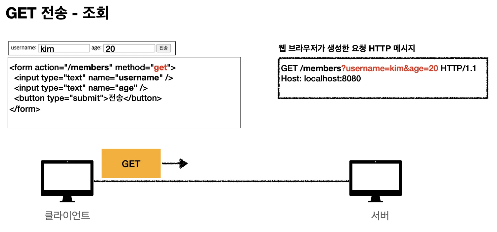

> ⚠️ GET &#45; 저장&#58; 사용 ❌
> 
> 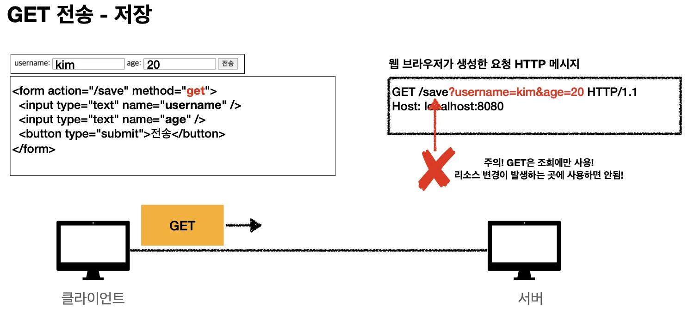

<a id="1c3eda9b0fe1816e8a41e70f9f4711b3"></a>

### Content&#45;Type&#58; multipart/form&#45;data

> 📌 파일 업로드 같은 바이너리 데이터 전송시 사용<br>다른 종류의 여러 파일과 폼의 내용 함께 전송 가능(그래서 이름이 multipart 임)

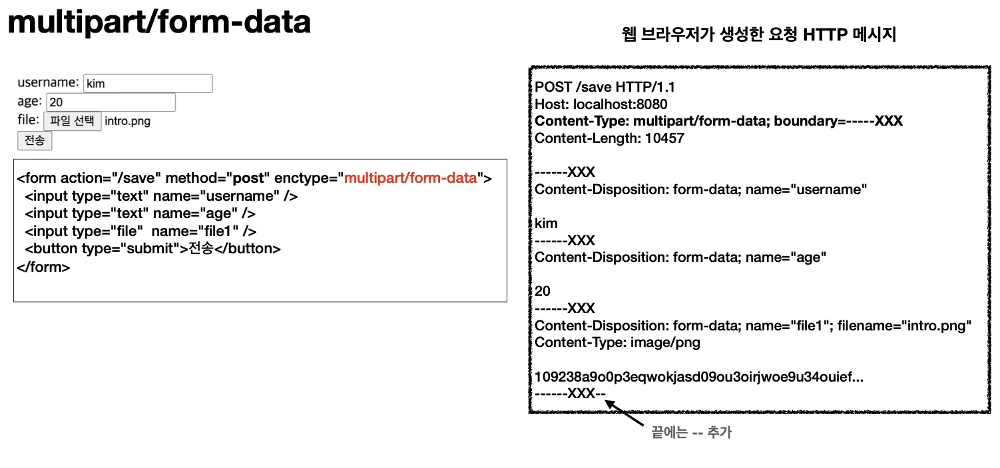

<a id="1c3eda9b0fe181c2ab84e4735a0e67a7"></a>

## HTTP API를 통한 데이터 전송

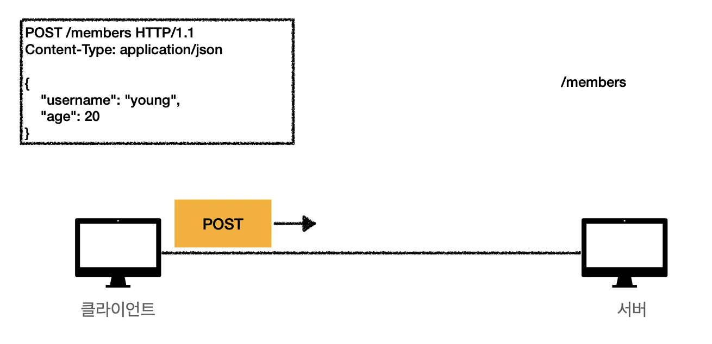

> 형식에 맞게 만들어서 넘기면 된다&#46; (보통 형식에 맞는 라이브러리들 이미 존재함, 가져다 쓰기)

- 서버 to 서버
    - 백엔드 시스템 통신

-  앱 클라이언트<br>• 아이폰, 안드로이드

-  웹 클라이언트<br>• HTML에서 Form 전송 대신 자바 스크립트를 통한 통신에 사용(AJAX)<br>• 예) React, VueJs 같은 웹 클라이언트와 API 통신

-  POST, PUT, PATCH&#58; 메시지 바디를 통해 데이터 전송

- GET&#58; 조회, 쿼리 파라미터로 데이터 전달

- Content&#45;Type&#58; application/json을 주로 사용 (사실상 표준)<br>• TEXT, XML, JSON 등등

<a id="1c3eda9b0fe181b88e0cc060c02dfc54"></a>

# HTTP API 설계 예시 

> ⚠️ 중요&#33;<br>대부분 POST 기반 컬렉션 형식을 많이 쓴다&#46; <br>PUT 기반 스토어는 거의 없다&#46; <br>( 진짜 파일 업로드 비슷한 서버는 스토어(PUT) 형식으로 제공한다고 함 )

<a id="1c3eda9b0fe1818bbcc0c8567265cad4"></a>

## HTTP API &#45; 컬렉션

> 📌 <strong>정리</strong>
> 
> ---
> 
> <a id="1c3eda9b0fe181309777d6088685b826"></a>
> 
> <code>POST</code> 기반 파일을 등록하는 형식<br>서버에서 리소스를 URI를 생성하고 관리한다&#46;<br>아래의 예시에서의 컬렉션&#58; /members
> 
> <a id="1c3eda9b0fe18117b004ebff06b0457a"></a>
> 
> ex) 회원 관리 API 제공


> PUT은 기존의 데이터를 완전히 덮어쓰기 때문에,  PUT을 사용하려면 클라이언트에서 기존 회원 데이터와  수정할 회원 데이터를 모조리 보내서 완전히 바꿔야 한다&#46; → 너무 큰 낭비임<br>⇒ 완전히 교체하는 게시판 수정 같은 경우 사용함

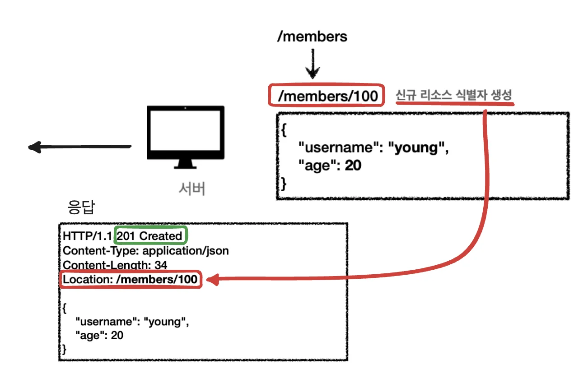

> 📌 <strong>복습</strong>
> 
> <a id="1c3eda9b0fe18179980cf36feadbf67e"></a>
> 
> 클라이언트에서 요청 받은 리소스를 서버에서 신규 리스소 식별자 생성하여 넣어두고 해당 리소스 식별자(path)를 응답의 Location에 담아 클라이언트에게 알려준다&#46; 

<a id="1c3eda9b0fe181ae8b75f7f97e4ea943"></a>

## HTTP API &#45; 스토어

> 📌 <strong>정리</strong>
> 
> ---
> 
> <a id="1c3eda9b0fe18165986ed6a7682b55ce"></a>
> 
> <code>PUT</code> 기반으로 파일을 등록하는 형식<br>클라이언트에서 관리하는 리소스 저장소<br>아래의 예시에서 스토어&#58; <strong> </strong><strong>/files</strong>
> 
> <a id="1c3eda9b0fe18174be26dd9ea2a208a2"></a>
> 
> ex) 정적 컨텐츠 관리, 원격 파일 관리

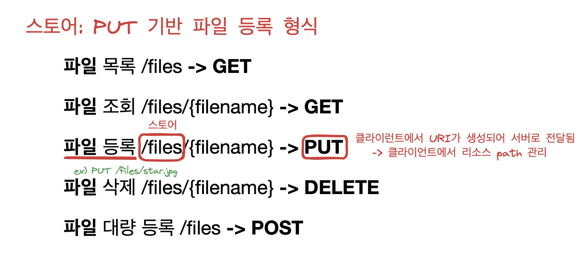


> put을 가지고 파일을 등록하고 있기 때문에, ‘/files’ 에 있는 post의 의미를 임의로 정할 수 있다&#46; <br>위 경우, 임의로 대량의 파일을 등록하는 것으로 지정함

<a id="1c3eda9b0fe1812fbe96ca4571f0cf69"></a>

## HTML FORM  

> ⚠️ <strong>해당 내용은 </strong><strong><u>순수한 HTML FORM</u></strong><strong> 만 사용하여 이야기한다&#46;<br>따라서 GET, POST 만 지원됨<br>실제 사용 시, AJAX 나  JavaScript 가지고 API 통신 가능함 </strong>

> 📌 <strong>정리<br></strong><strong><code>GET</code></strong><strong>, </strong><strong><code>POST</code></strong><strong>만 지원 </strong>
> 
> <a id="1c3eda9b0fe181aeb413d70f79784843"></a>
> 
> <strong> → 제약 있음 </strong>
> 
> <a id="1c3eda9b0fe181f9921df200b0fd61ee"></a>
> 
> <strong>→ </strong><strong>Control URI(동사)</strong><strong>를 사용하여 해결함 </strong>
> 
> <a id="1c3eda9b0fe181cc9060cad30525db5e"></a>
> 
> ex) 웹 페이지 회원 관리 


> 📌 <strong>Control URI ( Controller )<br></strong>GET, POST만 지원하여 생기는 제약을 해결하기 위해<strong><br></strong><strong>동사로 된 리소스 경로(Control URI)</strong>를 사용한다&#46;<br>→ Control URI&#58; POST <code>/new</code>, <code>/edit</code>, <code>/delete</code> <br><br>또한 HTTP API 사용 시, HTTP 메서드로 해결하기 애매한 경우도 사용한다&#46; 
> 
> > 실무에선 많이 쓴다고 함 그러나 무식하게 쓰면 안됨 <br><strong>최대한 리소스 라는 개념을 가지고 URI를 설계</strong>하고 <strong>안될 경우, Control URI</strong>를 대체제로 싸야함

<a id="1c3eda9b0fe18149b33bcb586f282e9c"></a>

##  참고 정리하면 좋은 URI 설계 개념

> 👉🏻 좋은 practice들의 모아서 정리한 개념들 ( 정답은 아니라고 하심 )

<a id="1c3eda9b0fe18194beecf03e848bc8e9"></a>

### <strong>문서(document)</strong>

- 단일 개념(파일 하나, 객체 인스턴스, 데이터베이스 row)
    <a id="1c3eda9b0fe18183ab2cc39797885fc0"></a>

    예) /members/100, /files/star&#46;jpg

<a id="1c3eda9b0fe181bd9f8ae3e778c1696b"></a>

### <strong>컬렉션(collection)</strong>

> 실제 개발 시, 대부분 컬렉션을 씀

- 서버가 관리하는 리소스 디렉터리

- 서버가 리소스의 URI를 생성하고 관리
    <a id="1c3eda9b0fe181578bc5de3dad2a2fbc"></a>

    예) /members

<a id="1c3eda9b0fe1814b8477ebd8394469aa"></a>

### <strong>스토어(store)</strong>

- 클라이언트가 관리하는 자원 저장소

- 클라이언트가 리소스의 URI를 알고 관리
    <a id="1c3eda9b0fe18165868bd3b97eaef026"></a>

    예) /files

<a id="1c3eda9b0fe18181961ee8e5f3b26654"></a>

### <strong>컨트롤러(controller), 컨트롤 URI</strong>

- 문서, 컬렉션, 스토어로 해결하기 어려운 추가 프로세스 실행<br>HTTP FORM이나 HTTP API에서도 굉장히 많이 사용함

- 동사를 직접 사용
    <a id="1c3eda9b0fe18198b504ec72f6f8a23d"></a>

    예) /members/{id}/delete

> 주문의 상태를 다음 상태로 진행 → 애매함<br>⇒ Post /orders/{id}/delivery

> 📌 good practive reference) <a href="https://restfulapi.net/resource-naming/">https&#58;//restfulapi&#46;net/resource&#45;naming/</a>

<a id="1c3eda9b0fe181a99928f7c7d6647d3d"></a>

# HTTP 상태 코드 

> 📌 1xx ( Informational )&#58; 요청이 수신되어 처리중
> 
> <a id="1c3eda9b0fe181639d64c5efc7d66b7c"></a>
> 
> 2xx ( Successful )&#58; 요청 정상 처리 
> 
> <a id="1c3eda9b0fe181c5adbbf32b79e1d28c"></a>
> 
> 3xx ( Redirection )&#58; 요청을 완료하려면 추가 행동이 필요
> 
> <a id="1c3eda9b0fe181078526dbcbfac58522"></a>
> 
> 4xx ( Client Error )&#58; 클라이언트 오류, 잘못된 문법 등으로 서버가 요청을 수행할 수 없음
> 
> <a id="1c3eda9b0fe18105b8aecfc9ace08317"></a>
> 
> 5xx ( Server Error )&#58; 서버 오류, 서버가 정상 요청 처리하지 못함

<a id="1c3eda9b0fe18146b64efa351da9aeff"></a>

# 2xx &#45; 성공

<a id="1c3eda9b0fe1817fa012df4dd27a6efe"></a>

### 200  OK  

> 요청 성공 


<a id="1c3eda9b0fe18153a1bbc86e9083aedd"></a>

### 201 Created

> 요청 성공해서 새로운 리소스가 생성됨

<a id="1c3eda9b0fe1811ebab7fd3b3a129004"></a>

 POST 메시지 → 서버에서 리소스 위치(path) 생성 및 관리 

<a id="1c3eda9b0fe181a1abcaf7b011ebbe11"></a>

    → 응답 메서지의 Location 헤더 필드로 식별함


<a id="1c3eda9b0fe181e989c2f28d385db498"></a>

### 202 Accepted   → 거의 안씀

> 요청이 접수되었으나 처리가 완료되지 않았음 → 잘 사용 X

<a id="1c3eda9b0fe1813ca9ead056d398f5a5"></a>

특정 시간에, 나중에 실행되어야 하는 경우 

<a id="1c3eda9b0fe18129b154fff7a53443ea"></a>

배치 처리 같은 곳에서 사용

<a id="1c3eda9b0fe1816b89decc5d4d4f1809"></a>

ex) 요청 접수 후 1시간 뒤에 배치 프로세스가 요청을 처리함 

<a id="1c3eda9b0fe18156b357d157c0186bfc"></a>

### 204 No Content

> 서버가 요청을 성공적으로 수행 했지만, 응답 페이로드 본문에 보낼 데이터가 없음

<a id="1c3eda9b0fe18106ba5dda47c2d58faf"></a>

ex) 웹 문서 편집기에서  저장 시

<a id="1c3eda9b0fe1814bbc39c5427f2a4445"></a>

데이터가 POST로 서버로 넘어감 

<a id="1c3eda9b0fe181a0be55e8df5197c639"></a>

→ 응답에 <strong><u>정상 응답</u></strong><code>(204)</code> 상태만 있어도 됨, 본문 내용 전송할 필요 없음

<a id="1c3eda9b0fe18132812afebaadedea0b"></a>

이때 사용함, <code>204 메시지(2xx)</code>만으로 <strong><u>성공을 인식</u></strong>할 수 있다&#46;

<a id="1c3eda9b0fe1819cb2b2f5c6d364a600"></a>

# 3xx &#45; 리다이렉션 

<a id="1c3eda9b0fe181e3b016cb32e7a057fc"></a>

## 영구 리다이렉션 ( 301, 308 )

> 리소스의 URI가 완전히(영구적으로) 바뀜<br>→ 이전 URL 사용 X (검색 엔진 등에서도 변경 인지) 

<a id="1c3eda9b0fe1818abc43d75380b833a5"></a>

### 301 Moved Permanently

> 리다이렉트 시 요청 메서드가 GET으로 변하고, 본문 제거 될 수 있음<strong>(MAY)</strong>

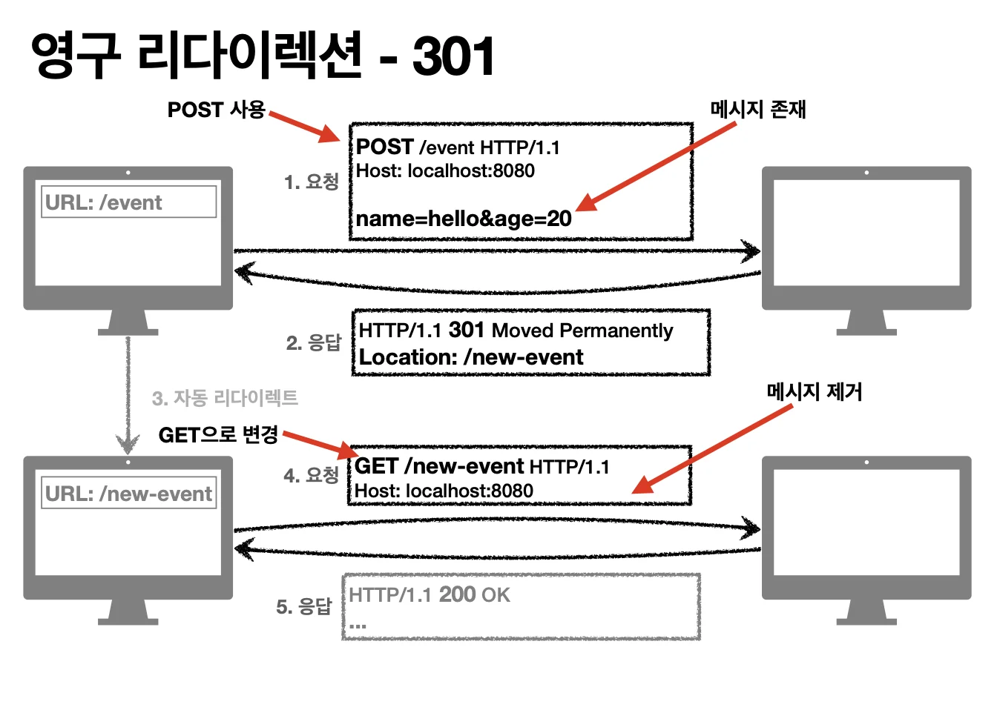

<a id="1c3eda9b0fe181b98c56ccb45cca79bf"></a>

### 308 Permanent Redirect

> 리다이텍트 시 <strong><u>요청 메서드</u></strong>와 <strong><u>본문 </u></strong><code>유지</code>(처음 POST를 보내면 리다이렉트도 POST 유지)

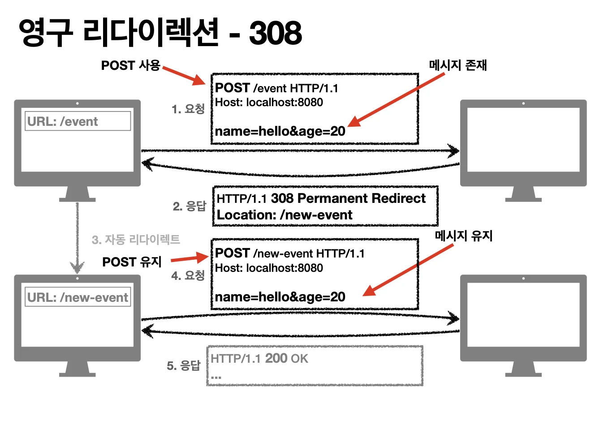

<a id="1c3eda9b0fe18109a640e68f9c5f5b0f"></a>

## 일시적인 리다이렉션 (302, 307, 303 )

> 리소스의 URI가 일시적으로 변경됨 (검색 엔진 등에서 URL 변경 X )

<a id="1c3eda9b0fe181d08f62f6082e79583f"></a>

## PRG&#58; Post/Redirect/Get

> <strong>Error)</strong><strong> </strong>POST 사용으로 인한 중복 주문 

<a id="1c3eda9b0fe181a39d37c82c019db507"></a>

POST로 주문후에 웹 브라우저를 새로고침하면?

<a id="1c3eda9b0fe18130b9cdfd9401134aac"></a>

→ 새로고침은 다시 요청<br>→ 중복 주문이 될 수 있다&#46;


> <code>POST</code>로 주문 후에 <strong><u>새로 고침으로 인한 중복 주문 방지</u></strong>

<a id="1c3eda9b0fe181b99e93d2517aae8452"></a>

POST로 주문후에 <strong><u>주문 결과 화면을 </u></strong><strong><u><code>GET</code></u></strong><strong><u> 메서드로 리다이렉트</u></strong><br><strong>새로고침해도 결과 화면을 </strong><strong><code>GET</code></strong><strong>으로 조회</strong><br>중복 주문 대신에 <strong><u>결과 화면만 GET으로 다시 요청</u></strong>


<a id="1c3eda9b0fe1814a9ac2fb4409df76f9"></a>

### 302 Found 

> 리다이텍트 시 요청 메서드가 <strong><u>GET으로 변</u></strong>하고, 본문이 제거될 수 있음<strong>(MAY)</strong>
> 
> <a id="1c3eda9b0fe181f185f4e560ea173255"></a>
> 
> ( 307, 303 더 적절한 사용이나, 여전히 302도 실무에서 많이 사용됨 )

<a id="1c3eda9b0fe1811c9d4ece1abdf04d8e"></a>

### 307 Temporary Redirect

> <strong>리다이렉트시 </strong><strong><code>요청 메서드</code></strong><strong>와 </strong><strong><code>본문</code></strong><strong> </strong><strong>유지</strong><strong>(요청 메서드를 변경하면 안된다&#46; MUST NOT)</strong>

<a id="1c3eda9b0fe1819a9d67f873292bf092"></a>

### 303 See Other

> 리다이렉트 시, 요청 메서드가 GET으로 변경 

<a id="1c3eda9b0fe181bd980dc61b258ce9e0"></a>

### 🤔 무엇을 쓰는 것이 올바른가?

> 302 Found &#45;&#62; GET으로 변할 수 있음<br>307 Temporary Redirect &#45;&#62; 메서드가 변하면 안됨<br>303 See Other &#45;&#62; 메서드가 GET으로 변경

<a id="1c3eda9b0fe1815e8e5cf609bc14bc6e"></a>

처음 302 스펙의 의도는 HTTP 메서드를 유지하는 것이었다&#46;

<a id="1c3eda9b0fe181c1a158c779f3bde47b"></a>

그런데 대부분 웹 브라우저들이 동작하면서 GET으로 변경되었다&#46;(일부는 다르게 동작)

<a id="1c3eda9b0fe181199723cb0aa56dea7f"></a>

그래서 모호한 302를 대신하는 명확한 307, 303이 나오게 되었다&#46; (이와 유사하게 301 대응으로 308도 등장힘)

<a id="1c3eda9b0fe181839e86c999dce51e1c"></a>

307, 303을 권장하지만 현실적으로 이미 많은 애플리케이션 라이브러리들이 302를 기본값으로 사용하고 있다&#46;따라서 302도 그냥 사용<br>( 자동 리다이렉션시 에 GET으로 변해도 되면 그냥 302를 사용해도 큰 문제 없음 )

<a id="1c3eda9b0fe181aea08ac8ed41af5454"></a>

## 기타 리다이렉션 ( 304 )

- 300 Muptiple Choices → 안씀

<a id="1c3eda9b0fe18136b5d7e508c6a2f023"></a>

### 304 Not Modifled

<a id="1c3eda9b0fe18133ad17fee717fcdbac"></a>

캐시를 목적으로 사용<br>클라이언트에게 리소스가 수정되지 않았음을 알려준다&#46; 따라서 클라이언트 로컬PC에 저장된 캐시를 재사용한다&#46; (캐시로 리다이텍트 한다&#46;) 

<a id="1c3eda9b0fe1812ba1e6e36bfe7365a6"></a>

304 응답은 응답에 메세지 바디를 포함하면 안된다&#46; (로컬 캐시를 사용해야 하므로)

<a id="1c3eda9b0fe181e18f33fb62ca1c2493"></a>

조건부 GET, HEAD 요청 시 사용

<a id="1c3eda9b0fe181b1a60fc11c48967e09"></a>

# 4xx &#45; Client Error

> 클라이언트의 요청에 잘못된 문법 등으로 서버가 요청을 수행할 수 없음

<a id="1c3eda9b0fe18178a166ea741d1ea807"></a>

⇒ <strong>클라이언트가 이미 잘못된 요청, 데이터를 보내고 있기 때문에, 똑같은 요청 재시도 시 </strong>→ <code>실패</code> 

<a id="1c3eda9b0fe18112b664e267bb71dba7"></a>

## 400 Bad Request

> 클라이언트가 잘못된 요청 보냄 → 서버가 요청을 처리 못함

<a id="1c3eda9b0fe18199b959f3684b273922"></a>

요청 구문, 메시지 등등 오류

<a id="1c3eda9b0fe1814eb291ca6a1fbe3668"></a>

→  클라이언트는 요청 내용을 다시 검토하고, 보내야함<br>→ 예) 요청 파라미터가 잘못되거나, API 스펙이 맞지 않을 때

<a id="1c3eda9b0fe181b281ffecb1c4e3dff1"></a>

## 401 Unauthorized

> 클라이언트가 해당 리소스에 대한 인증이 필요함

<a id="1c3eda9b0fe181eaa62dfbea5f84ced3"></a>

인증(Authentication) 되지 않음

<a id="1c3eda9b0fe18168a877d5f804038a45"></a>

401 오류 발생 시 응답에 <code>WWW&#45;Authenticate</code> 헤더와 함께 인증 방법을 설명

> ⚠️ <strong>참고</strong><strong><br></strong>인증(Authentication)&#58; 본인이 누구인지 확인, (로그인)<br>인가(Authorization)&#58; 권한부여 (ADMIN 권한처럼 특정 리소스에 접근할 수 있는 권한, 인증이 있어야 인가가 있음)
> 
> > 오류 메시지가 Unauthorized 이지만 인증 되지 않음 (이름이 아쉬움)

<a id="1c3eda9b0fe181b28af7d44ff313c8ba"></a>

## 403 Forbidden

> 서버가 요청을 이해했지만 승인을 거부함

<a id="1c3eda9b0fe1817c8578ecebe741bbd6"></a>

주로 인증 자격 증명은 있지만, 접근 권한이 불충분한 경우<br>ex) 어드민 등급이 아닌 사용자가 로그인은 했지만, 어드민 등급의 리소스에 접근하는 경우

<a id="1c3eda9b0fe1817c957cf06217fc0a3a"></a>

## 404 Not Found

> 요청 리소스를 찾을 수 없음 

<a id="1c3eda9b0fe18109840af85b30e2215d"></a>

요청 리소스가 서버에 없거나 

<a id="1c3eda9b0fe181798ffed68557f8a978"></a>

클라이언트가 권한이 부족한 리소스에 접근하여 해당 리소스를 숨기고 싶을 때 발생됨

<a id="1c3eda9b0fe181aea4ddfe2d5d7a2a8d"></a>

# 5xx &#45; Server Error

> 서버 문제로 오류 발생<br>서버에 문제가 있기 때문에 재시도 하면 성공할 수도 있음 (복구 등) 

<a id="1c3eda9b0fe18188b856cb905c1adb42"></a>

## 500  Internal Server Error

> 서버 문제로 오류 발생 ( 애매 → 500 오류 )

<a id="1c3eda9b0fe181588841c36e007a2b61"></a>

##  503  Service Unavailable

> 서비스 이용 불가

<a id="1c3eda9b0fe1817ea30ad3d5f1cb59c1"></a>

서버가 일시적인 과부하 또는 예정된 작업으로 잠시 요청을 처리할 수 없음

<a id="1c3eda9b0fe18171869dc6fc47c64990"></a>

Retry&#45;After 헤더 필드로 얼마 뒤에 복구되는지 보낼 수도 있음

<a id="1c3eda9b0fe18199aa1ee8e3d6431718"></a>

## 캐시 (cache)

<a id="1c3eda9b0fe18115b276c36542a38eb0"></a>

캐시를 통해 동일 데이터 재요청 시 소모되는 불필요한 비용들을 제거했다&#46;<br>서버로부터 받아오는 데이터를 캐시에 저장하여, 해당 데이터의 캐시 유효기간이 유효할 경우, 서버 요청 없이 캐시에서 데이터를 불러온다&#46;

<a id="1c3eda9b0fe1810696deecbaf4f217dd"></a>

이를 통해, 브라우저 로딩 속도 향상 및 빠른 사용자 경험, 비싼 네트워크 사용량 감소 등의 이점을 가진다&#46;

<a id="1c3eda9b0fe181b5a538dfe3ba4434b4"></a>

### 유효 기간 내 요청


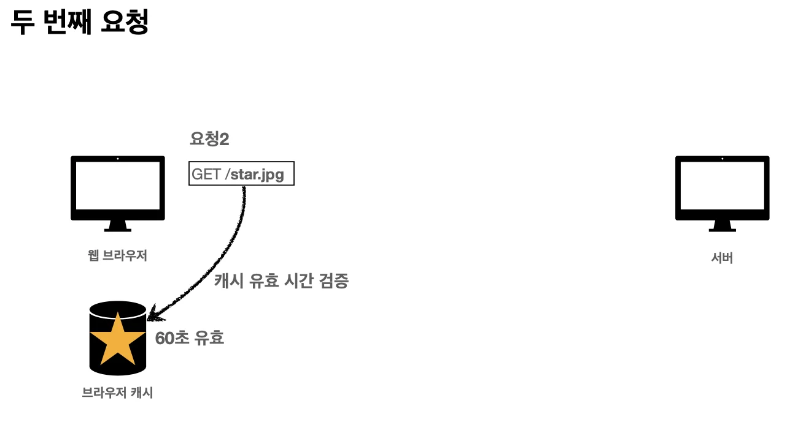


> 동일한 데이터 두번째 요청 시, <br>캐시 유효 시간 검증하고  기간이 유효하다면, 캐시에 있는 데이터 불러옴

<a id="1c3eda9b0fe18118bb0de7564c7e3bd0"></a>

### 유효 기간 외 요청

> 캐시 유효 시간이 초과되면, 서버에 해당 데이터를 요청 및 검증하여, 해당 캐시를 갱신 or 다운로드  한다&#46;<br>⇒ 마지막 수정일(Last&#45;Modified) 가 변경되었으면 재다운<br>     아니면 유효기간 재갱신 후 캐쉬 데이터 사용

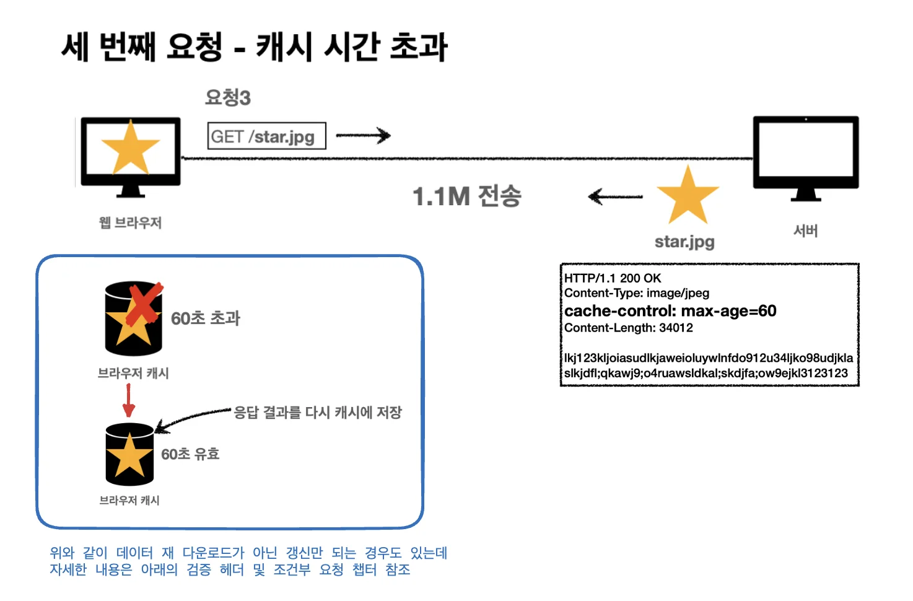

<a id="1c3eda9b0fe1812eafb8cdadf220922e"></a>

# 검증 헤더와 조건부 요청

> 📌 <strong>검증 헤더</strong>
> 
> | 클라이언트   | 서버 |
> | --- | --- |
> | <code>Last&#45;Modified</code> | <code>Last&#45;Modified</code> |
> | <code>ETag</code> | <code>ETag</code> |

<a id="1c3eda9b0fe1818fab62f1972fe40ac0"></a>

## <code>if&#45;Modified&#45;Since</code>, <code>Last&#45;Modified</code>

> 데이터의 최종 수정 날짜 정보가 담긴 헤더

- 클라이언트&#58; <code>if&#45;Modified&#45;Since</code>

- 서버&#58; <code>Last&#45;Modified</code>

> 📌 
> 
> <a id="1c3eda9b0fe18161a93af19bc1985bea"></a>
> 
> <strong>1) Last&#45;Modified(클라&#46;&#46;) == Last&#45;Modified(서버)&#58;  데이터 최종 수정일 동일 (If&#45;Modified&#45;Since)</strong>
> 
> <a id="1c3eda9b0fe1817abff7f7b044a99b1c"></a>
> 
> → 상태코드(304 Not Modified) &#43; 헤더만(바디X) 보내 캐시의 유효기간만 갱신
> 
> <a id="1c3eda9b0fe181b782fdd55246142979"></a>
> 
> → 클라이언트는 갱신된 캐시 데이터 재활용
> 
> <a id="1c3eda9b0fe1814e984ff36cdd69b898"></a>
> 
> ⇒ 네트워크 다운로드가 발생하지만, 용량이 적은 헤더만 다운 받아 매우 효율적이다&#46;

> 📌 <strong>2)</strong> <strong>Last&#45;Modified(클라&#46;&#46;) &#33;= Last&#45;Modified(서버)</strong>&#58; 데이터 최종 수정일 다름(If&#45;Unmodified&#45;Since)
> 
> <a id="1c3eda9b0fe181478b53f93c0c9b1c51"></a>
> 
> → 데이터 다운로드
> 
> <a id="1c3eda9b0fe18143afb7d540238f91e4"></a>
> 
> →  정상 다운 (200 OK)

> ☝🏻 <strong>단점)</strong>
> 
> - <strong>1초 미만(0&#46;X 초) 단위로 캐시 조정 불가능</strong>
> 
> - <strong>날짜 기반의 로직  사용</strong>
>     - <strong>데이터를 수정하여 날짜가 다르지만, 같은 데이터를 수정해 결과가 같은 경우, 다른 데이터로 판단하여 재다운로드 발생</strong>
> 
> - <strong>서버에서 별도의캐시 로직을 관리하고 싶은 경우</strong>
>     - ex) 스페이스, 주석 처럼 크게 영향이 없는 변경에서 캐시를 유지하고 싶은 경우

<a id="1c3eda9b0fe181a8aa02e0598eb9d754"></a>

## <code>ETag(Entity Tag)</code>

> 📌 캐시용 데이터에 임의의 고유한 명을 부여하여 구분
> 
> <a id="1c3eda9b0fe181e7bf4ae99c07970a14"></a>
> 
>      ex) ETag&#58; “v1&#46;0”, ETag&#58; “a2jiodwjeljl3
> 
> <a id="1c3eda9b0fe181108ddcdf7bcc8985be"></a>
> 
> 데이터가 변경되면, 이름을 변경하여 새로 생성된다(Hash 다시 생성)
> 
> <a id="1c3eda9b0fe1813e81d1d1ed95cf8a32"></a>
> 
> ex)  예) ETag&#58; “aaaaa” → ETag&#58; “bbbbb”

<a id="1c3eda9b0fe1819a9232eea20a62b619"></a>

단순하게 ETag value(이름)를 클라이언트와 서버끼리  Match 하여 갱신 및 다운로드 여부를 판단한다&#46;

> 동작은 I<code>f&#45;Modified&#45;Since, Last&#45;Modified</code> 와 동일

<a id="1c3eda9b0fe1812bb556f88841b52a66"></a>

### 1) ETag(클라이언트) == ETag(서버)

<a id="1c3eda9b0fe181f79213dfc6fcc284a7"></a>

→ 상태코드&#91; 304 Not Modified &#93; &#43; 헤더 ( 캐시 갱신 )

<a id="1c3eda9b0fe1817db9cfd0790b84f1eb"></a>

→ 클라이언트에서 갱신된 캐시 불러서 사용

<a id="1c3eda9b0fe181d9ba4ef0e1c13caa74"></a>

2) ETag(클라이언트) &#33;= ETag(서버)

<a id="1c3eda9b0fe181ac82c4e30f95afa773"></a>

→ 재 다운로드 요청

<a id="1c3eda9b0fe181a2a278fd0ab4d352e3"></a>

→ 정상 다운, 상태코드 &#91; 200 OK &#93;

> 캐시 제어 로직을 서버에서 완전히 관리한다&#46;<br>클라이언트는 단순히 서버에서 받아오고 매치시 보내주기만 함(클라이언트는 캐시 메커니즘을 모름) 

<a id="1c3eda9b0fe181a09fdffa6cc4f67c2b"></a>

ex) 서버는 배타 오픈 기간인 3일 동안 파일이 변경되어도 ETag를 동일하게 유지 (약간 어거지 예시라고 하심)

<a id="1c3eda9b0fe1814f9895e4115e4008cd"></a>

ex) 애플리케이션 배포 주기에 맞추어 ETag 모두 갱신

<a id="1c3eda9b0fe1813a8212fe584918fcc4"></a>

## 캐시 제어 헤더

> 📌 <strong>Cache&#45;Control&#58; 캐시 제어</strong>
> 
> <a id="1c3eda9b0fe181179a85e8bc60e0a3c1"></a>
> 
> Pragma&#58; 캐시 제어(하위 호환)<br> Expires&#58; 캐시 유효 기간(하위 호환)

<a id="1c3eda9b0fe1811ca07cc10437dbf02b"></a>

### Cache&#45;Control 

> <strong>캐시 지시어(directives)</strong>

- Cache&#45;Control&#58; max&#45;age
    <a id="1c3eda9b0fe18157a94cf0c9bfcf9423"></a>

    캐시 유효 시간, 초 단위

- Cache&#45;Control&#58; no&#45;cache
    <a id="1c3eda9b0fe18158a1b3c280b0886550"></a>

    데이터는 캐시해도 되지만, 항상 원(origin) 서버에 검증하고 사용

- Cache&#45;Control&#58; no&#45;store
    <a id="1c3eda9b0fe18128abc1d02a0473d034"></a>

    민감한 데이터 정보 캐시로 저장 ❌ 

<details>
<summary>Pragma( 있다는 거 정도만 )</summary>

> <strong>캐시 제어(하위 호환)</strong>

- Pragma&#58; no&#45;cache

- HTTP 1&#46;0 하위 호환

</details>

<details>
<summary><strong>Expires( </strong>있다는 거 정도만)</summary>

> <strong>캐시 만료일 지정(하위 호환)</strong>

- expires&#58; Mon, 01 Jan 1990 00&#58;00&#58;00 GMT

- 캐시 만료일을 정확한 날짜로 지정

-  HTTP 1&#46;0 부터 사용

- 지금은 더 유연한 Cache&#45;Control&#58; max&#45;age 권장

- Cache&#45;Control&#58; max&#45;age와 함께 사용하면 Expires는 무시

</details>

<a id="1c3eda9b0fe1819cb5bad1b357dd4720"></a>

# 프록시 캐시

> DNS 서버의 root 형태 처럼(CDN 서비스), 해당 지역 사용자들의 <u>빠른</u> 요청 처리 및 응답을 위한,  하위 서버에 저장되는 캐시들을 말한다&#46; (상위 서버에서 받아옴)

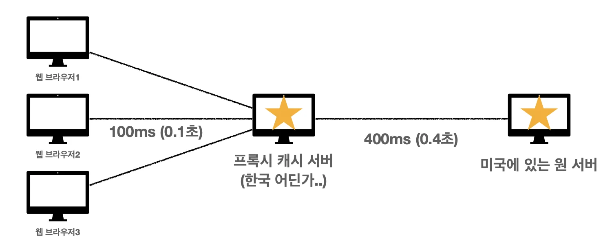

<a id="1c3eda9b0fe181798a83e2cc7fc5876e"></a>

ex) 인기있는 유튜브 영상의 경우 빠르게 재생되지만, 사람들이 잘 안보는 기술관련 영상들은 원서버에서 받아오기 때문에, 시청까지(다운로드) 시간이 매우 길다&#46;

> 최초의 요청에는 캐시가 생성되지 않았기 때문에 origin 서버에서 데이터를 받아야 해서 느림

<a id="1c3eda9b0fe18164bcbeda7311e8188c"></a>

### <strong>Cache&#45;Control</strong>

> <strong>캐시 지시어(directives) &#45; 기타</strong>


- <strong>Cache&#45;Control&#58; public</strong>
    <a id="1c3eda9b0fe18182a0c3f1048b291e78"></a>

    응답이 public 캐시에 저장되어도 됨

- <strong>Cache&#45;Control&#58; private (</strong>기본값)
    <a id="1c3eda9b0fe1810ba4bfd433d6414965"></a>

    응답이 해당 사용자만을 위한 것임, private 캐시에 저장해야 함<br>   → 중간 서버에 프록시 캐시로 저장 ❌

- <strong>Cache&#45;Control&#58; s&#45;maxage</strong>
    <a id="1c3eda9b0fe18110bb86edaef53ca9cf"></a>

    프록시 캐시에만 적용(중간 서버에서만 사용)되는 max&#45;age

- <strong>Age&#58; 60</strong> (HTTP 헤더)
    <a id="1c3eda9b0fe181698265df114601e055"></a>

    오리진 서버에서 응답 후 프록시 캐시 내에 머문 시간(초)

<a id="1c3eda9b0fe181b5a02bf61ce4301f4f"></a>

# 캐시 무효화

<a id="1c3eda9b0fe1815198ffd834fa3cf1b5"></a>

### 확실한 캐시 무효화 응답

> 웹브라우저들이 GET요청인 경우, 임의로 캐시를 처리함(휴리스틱)<br>따라서 캐시 처리를 하면 안되는 부분은 아래의 헤더 및 값 모두 적용해야 함

> /icons/checkmark-line_red.svg <strong>Cache&#45;Control&#58; no&#45;cache, no&#45;store, must&#45;revalidate</strong>
> 
> <a id="1c3eda9b0fe181c7a0d6e2bba1d7973b"></a>
> 
> <strong>Pragma&#58; no&#45;cache  (HTTP 1&#46;0 하위 호환)</strong>

<a id="1c3eda9b0fe181cd93eef04afd70b9b9"></a>

ex) 현재 사용자의 통장 잔고 등 → 계속 갱신되기 떄문

<a id="1c3eda9b0fe181cea712edc4f9c4fe89"></a>

### 캐시 지시어(directives)  &#45; 확실한 캐시 무효화

- <strong>Cache&#45;Control&#58; no&#45;cache</strong>
    <a id="1c3eda9b0fe181d4b59cf59c26a2d614"></a>

    데이터는 캐시해도 되지만, <strong><u>항상 원 서버에 검증</u></strong>하고 사용해야 함 ( ※ 이름 주의)

- <strong>Cache&#45;Control&#58; no&#45;store</strong>
    <a id="1c3eda9b0fe181489b58f1c181a65168"></a>

    <strong><u>민감한 정보의 데이터  캐시 저장  ❌ </u></strong><br>→ 메모링서 사용하고 최대한 빨리 삭제 처리

- <strong>Cache&#45;Control&#58; must&#45;revalidate</strong>
    <a id="1c3eda9b0fe181389117c38af82a86a0"></a>

    <strong>캐시 만료 후 </strong><strong><u>최초 조회</u></strong><u> </u>시 <strong><u>원 서버에 검증</u></strong>해야하며

    <a id="1c3eda9b0fe18120a3c0d213a6d22ff8"></a>

    원 서버 접근 실패 시, 반드시 오류가 발생되어야 한다&#46;  

    <a id="1c3eda9b0fe1817e9704fc2114829f7a"></a>

    → 504 (Gateway Timeout)

    <a id="1c3eda9b0fe1811fb4f2ed7dae3caed0"></a>

    (유효 시간 내는 캐시 사용함)

- <strong>Pragma&#58; no&#45;cache</strong>
    <a id="1c3eda9b0fe1815c970ffb8a279d4df1"></a>

     HTTP 1&#46;0 하위 호환 

    > 네이버의 경우 위 까지 지원함<br>구글의 경우는 글로벌하게 지원해야 하기 때문에, 엄청 오래된 브라우저들도 지원하기 위해  구닥다리 스펙들이 많이 들어가 있다고 함 <br>  ex) max&#45;age=0 등

<a id="1c3eda9b0fe18187843ae4dfcd400ab8"></a>

### no&#45;cache 동작

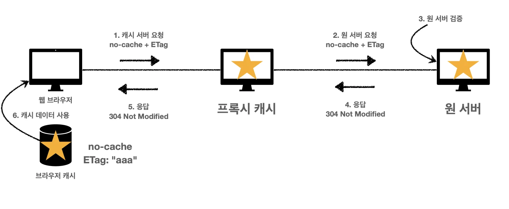

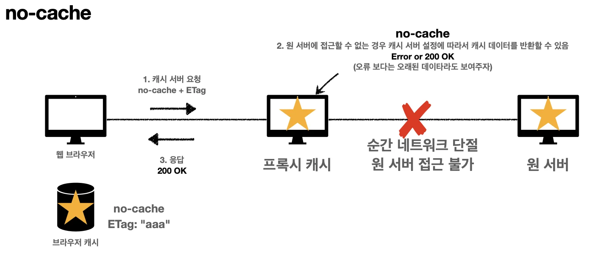

> 원 서버에 접근할 수 없는 경우, 저장된 이전 캐시 데이터를 반환하여 오래된 정보를 보여줌 <br> 통장 잔고 등 이전 데이터를 보내면 안되는 case들이 존재<br>→ must&#45;revalidate를 통해 무조건 <code>오류</code>만  발생되도록 동작 변경

<a id="1c3eda9b0fe181cbaee4c6c4c05f90bf"></a>

### must&#45;revalidate 동작


