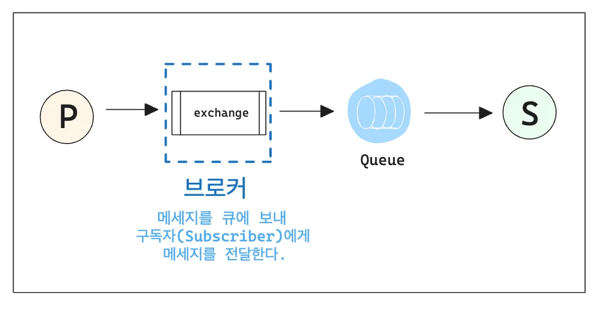

## Publish / Subscribe 모델 

---

<strong><code>Pub/Sub</code></strong>은 <strong><u>메세지 발행(Publish)</u></strong><strong>과 </strong><strong><u>구독(Subscribe)</u></strong><strong>의 개념을 기반으로 하는 </strong><strong><u>메세징 패턴</u></strong>이다&#46;  

<strong><u>중간 브로커(Exchagne)</u></strong>를 두고 이를 통해, <strong><u>구독자들(Subscriber</u></strong><strong>)에게 </strong><strong><u>메세지를 전달</u></strong>한다&#46; 

<strong><code>Queue</code></strong>와 <strong><code>exchange</code></strong>를 <code>Binding</code> 한 뒤, <strong><code>publisher</code></strong>에서 <strong><u>메세지</u></strong>를 <strong><u>exchange 명칭(식별자)</u></strong>과 함께 보내면, 이를 rabbitMQ에서 받아 <strong><u>Binding 된 큐로 전송</u></strong>한다&#46;  해당 큐는 <u>구독된 </u><strong><u><code>subsriber</code></u></strong><u>에게 메세지를 전달</u>하고, 이를 <strong><code>subscriber</code></strong>가 <u>클라이언트로 전송</u>한다&#46; 

- <strong><code>Bindin</code></strong><code>g</code>&#58; <code>exchange</code>와 <code>Queue</code>와의 관계를 정의한 <strong><u>일종의 라우팅 테이블</u></strong>

- RabbitMQ에서는 <code>Fanout Exchange</code>를 통해 <u>연결된 모든 Queue에게 메세지를 전달</u>한다&#46;  ⇒ <strong>브로드캐스트</strong>

### 주요 특징

| 특징 | 설명 |
| --- | --- |
| <strong><code>유연성</code></strong><strong>, </strong><strong><code>확장성</code></strong> | &#45; Subscriber를 쉽게 추가 가능 &#45; 각 Subscriber들은 서로 독립적으로 동작 가능 |
| <strong><code>다대다(N&#58;M) 메세징</code></strong> | &#45; 하나의 메세지가 여러 Subscriber에게 전달됨 |
| <strong><code>구독자 독립성</code></strong> | &#45; 하나의 메세지가 어떤 Subscriber에게 전달될지 알 필요 없음 &#45; 메세지 전달을 브로커가 처리함 |
| <strong><code>비동기 메세징</code></strong> | &#45; Publisher와 Subscriber는 서로 독립적으로 동작하며, 동시에 실행될 필요 없음 |
| <strong><code>확장성</code></strong> | &#45; 여러 Subscriber를 추가하거나 제거해도 시스템이 영향을 받지 않음 |
| <strong><code>구독 제어</code></strong> | &#45; 구독자는 특정 조건(<code>routing key</code>, <code>topic</code> …)을 기반으로 메세지를 필터링하여 수신 가능 &#45; <strong><code>Fanout Exchange </code></strong>모든 구독자에게 메세지를 브로드캐스트<code>Routing Key</code>는 필요하지 않음 &#45; <strong><code>Topic Exchange</code></strong><strong>,  &#45; </strong><strong><code>Direct Exchange</code></strong><strong> </strong>메세지를 선택적으로 전달 가능 |
