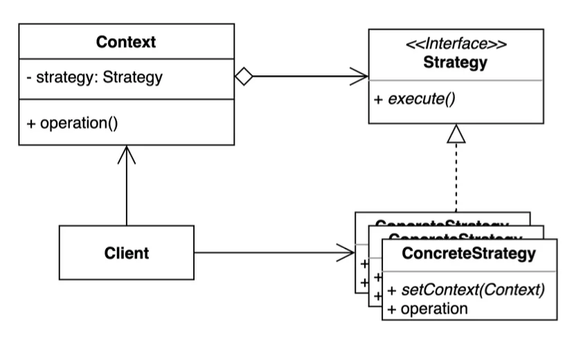
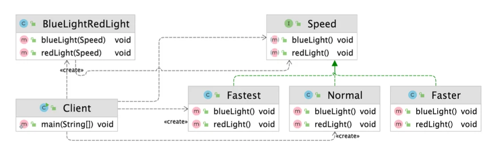

> 📝 
> 
> <a id="1e0eda9b0fe180b3ab0ecadf94706646"></a>
> 
> <strong>질문</strong>
> 
> <details>
> <summary>전략 패턴은 무엇인가?</summary>
> 
> <a id="1e0eda9b0fe18031b814ff52f1ce187c"></a>
> 
> 전략 패턴은 실행(런타임) 중에 알고리즘을 선택하거나 변경할 수 있게 해주는 행위(Behavioral) 디자인 패턴이다&#46; 
> 
> <a id="1e0eda9b0fe180908a2be40804bdd2d7"></a>
> 
> 즉, 객체가 수행할 수 있는<u> 여러 행위(알고리즘)</u>를<u> 각각 별도의 전략(클래스)으로 분리</u>하고, 이 전략들을 필요에 따라 교체할 수 있도록 한다&#46;
> 
> <a id="1e0eda9b0fe18059825ed5ea1fc6d43c"></a>
> 
> 이를 통해 코드의 유연성, 확장성, 재사용성을 증가시킨다&#46;
> 
> </details>
> 
> <details>
> <summary>전략 패턴의 장단점은?</summary>
> 
> - 장점
>     - 유연성&#58; 실행 중 알고리즘 교체 가능
> 
>     - 확장성&#58; 새로운 알고리즘 추가 시, 상위 전략 인터페이스를 구현하는 구현 전략 클래스만 정의하면 됨
> 
>     - 재사용성&#58; 알고리즘을 별도의 클래스로 분리하기 때문에 여러 곳에서 재사용 가능
> 
>     - 테스트 용이성&#58; 각 전략을 독립적으로 테스트 가능함
> 
> - 단점
>     - 클래스 수 증가&#58; 각 전략마다 별도의 클래스로 구현 해야하기 때문에  클래스 수가 많아질 수 있음
> 
>     - 구현 복잡성&#58; 간단한 경우, 오히려 과한 설계가 됨
> 
> </details>
> 
> <details>
> <summary>전략 패턴의 실무 활용 예제는?</summary>
> 
> 
> 
> </details>

<a id="1e0eda9b0fe18031916bf32406264e5a"></a>

## 전략 ( strategy ) 패턴

---

> 📖 
> 
> <a id="1e0eda9b0fe180a295d0e98f984390ed"></a>
> 
> <strong>전략 패턴</strong>
> 
> ---
> 
> > 여러 알고리즘을 캡슐화하고 상호 교환 가능하게 만드는 패턴
> 
> - 컨텍스트에서 사용할 알고리즘을 클라이언트에서 선택(주입)한다
> 
> 
> 
> <details>
> <summary>구성 요소</summary>
> 
> - <code>Strategy Interface</code> ( 전략 인터페이스 )
>     - 알고리즘을 캡슐화하는 인터페이스
> 
>     - 다양한 하위(구체) 전략 클래스들이 구현하는 상위  인터페이스이다&#46;
> 
> - <code>Concrete Strategy</code> ( 구체 전략 클래스 )
>     - 전략 인터페이스를 구현하여 실제 알고리즘을 정의하는 클래스
> 
> - <code>Context</code> ( 컨텍스트 )
>     - 전략 객체를 포함하며, 전략 객체를 통해 알고리즘을 실행한다&#46;  
> 
>     - 클라이언트는 <code>Context</code>에 전략 객체를 주입하거나 변경할 수 있다&#46;
>         - <code>composition</code>(위임)
> 
> </details>
> 
> <details>
> <summary>장•단점</summary>
> 
> > <strong>장점</strong>
> 
> - <code>유연성</code>&#58; 실행 중 알고리즘을 자유롭게 교체 가능
> 
> - <code>확장성</code>&#58; 새로운 전략(알고리즘) 추가가 쉽고, 기존 코드를 수정하지 않아도 된다&#46;
> 
> - <code>재사용성</code>&#58; 알고리즘을 별도의 클래스로 분리하여 여러 곳에서 재사용할 수 있다&#46;
> 
> - <code>테스트 용이성</code>&#58; 각 전략 독립적으로 테스트 가능
> 
> > <strong>단점</strong>
> 
> - <code>클래스 수 증가</code>&#58; 전략마다 별도의 클래스를 만들어야 하므로 클래스가 많아질 수 있다&#46;
> 
> - <code>구현 복잡성</code>&#58; 간단한 경우 오히려 설계가 복잡해 질  수 있다&#46;
> 
> </details>
> 
> <details>
> <summary>실무 활용 예시</summary>
> 
> - <code>결제 시스템</code>
>     > 결제 전략&#58;  카드 / 포인트 / 쿠폰 등 
> 
>     - 쇼핑몰 결제 시스템에서 결제 방식(카드, 포인트, 쿠폰 등)이 다양할 때, 각 결제 방식을 전략 클래스로 분리하여 런타임에서 선택한다&#46;
> 
> - <code>다양한 기준을 가지거나 자주 변경되는 비지니스 로직</code>
>     - 점수 계산, 추천 알고리즘 등
> 
>     - 상품 점수 계산, 추천 알고리즘 등 <strong><u>다양한 기준</u></strong><u>이</u>나 <strong><u>정책이 자주 변경</u></strong>되는 <strong><u>비지니스 로직</u></strong>에 전략 패턴을 적용한다&#46; 
> 
>     -  각 기준별로 전략 클래스를 만들어, 새로운 정책이 추가될 때 기존 코드 수정 없이 전략만 추가
> 
> - <code>스프링 시큐리티 인증/인가</code>, <code>저장소(Repository) 교체</code> 등
>     - 스프링 시큐리티의 인증(AuthenticationProvider) 구현이나, 서비스에서 데이터 저장소(예&#58; DB, 파일 등)를 런타임에 교체할 때 전략 패턴이 활용된다&#46; 
> 
> </details>

<a id="1e0eda9b0fe1803fa492df0bbafdddf8"></a>

### 1&#46; 기본 예제

<a id="1e0eda9b0fe18042aa20c93e3e287a48"></a>

### 코드

<details>
<summary>&#91; 코드 &#93; BlueLightRedLight</summary>

<a id="1e0eda9b0fe1806f943bdbdae1608e71"></a>

```java
package _03_behavioral_patterns._21_strategy._01_before;

public class BlueLightRedLight {

    private final int speed;

    public BlueLightRedLight(int speed) {
        this.speed = speed;
    }

    public void blueLight() {
        if (speed == 1) {
            System.out.println("무 궁 화    꽃   이");
        } else if (speed == 2) {
            System.out.println("무궁화꽃이");
        } else {
            System.out.println("무광꼬치");
        }
    }

    public void redLight() {
        if (speed == 1) {
            System.out.println("피 었 습 니  다.");
        } else if (speed == 2) {
            System.out.println("피었습니다.");
        } else {
            System.out.println("피어씀다");
        }
    }
}

```

</details>

<details>
<summary>&#91; 코드 &#93; Client</summary>

<a id="1e0eda9b0fe180878bbcc6f0a7ea0cf5"></a>

```java
package _03_behavioral_patterns._21_strategy._01_before;

public class Client {

    public static void main(String[] args) {
        BlueLightRedLight blueLightRedLight = new BlueLightRedLight(3);
        blueLightRedLight.blueLight();
        blueLightRedLight.redLight();
    }
}
```

</details>

<a id="1e0eda9b0fe180379c2af611f8218a7a"></a>

### 문제점

<a id="1e0eda9b0fe1803bbbfac776b1647f48"></a>

각 케이스(전략)을 <code>if/else 문</code>으로 구분한다&#46;

<a id="1e0eda9b0fe18067853bf71f5cb44b4f"></a>

케이스가 많아 질수록 <code>if 문</code>이 증가되고 가독성이 떨어지며, 유자보수 하기에도 어렵다&#46; 

<a id="1e0eda9b0fe180a59763cdb265a49b89"></a>

### 2&#46; 패턴 적용

<a id="1e0eda9b0fe180f9af1bcf083e04cefc"></a>

### 코드



> Strategy ( 전략 )

<details>
<summary>&#91; 코드 &#93; &#60; interface &#62; Speed &#45; <code>Strategy</code></summary>

<a id="1e0eda9b0fe18037991ad054e1991ea6"></a>

```java
package _03_behavioral_patterns._21_strategy._02_after;

public interface Speed {

    void blueLight();

    void redLight();
}

```

</details>

<details>
<summary>&#91; 코드 &#93; Fastest</summary>

<a id="1e0eda9b0fe18055b3e0df5f31d6ba29"></a>

```java
package _03_behavioral_patterns._21_strategy._02_after;

public class Fastest implements Speed {

    @Override
    public void blueLight() {
        System.out.println("무광꼬치");
    }

    @Override
    public void redLight() {
        System.out.println("피어씀다.");
    }
}

```

</details>

<details>
<summary>&#91; 코드 &#93; Faster</summary>

<a id="1e0eda9b0fe18098af2fd9d20aace0e6"></a>

```java
package _03_behavioral_patterns._21_strategy._02_after;

public class Faster implements Speed {
    @Override
    public void blueLight() {
        System.out.println("무궁화꽃이");
    }

    @Override
    public void redLight() {
        System.out.println("피었습니다.");
    }
}
```

</details>

<details>
<summary>&#91; 코드 &#93; Normal</summary>

<a id="1e0eda9b0fe180a1919df236cbf06f1b"></a>

```java
package _03_behavioral_patterns._21_strategy._02_after;

public class Normal implements Speed {

    @Override
    public void blueLight() {
        System.out.println("무 궁 화    꽃   이");
    }

    @Override
    public void redLight() {
        System.out.println("피 었 습 니  다.");
    }
}
```

</details>

---

<details>
<summary>&#91; 코드 &#93; BlueLightRedLights</summary>

<a id="1e0eda9b0fe180289c88e32c75c1c0f6"></a>

```java
package _03_behavioral_patterns._21_strategy._02_after;

public class BlueLightRedLight {

    public void blueLight(Speed speed) {
        speed.blueLight();
    }

    public void redLight(Speed speed) {
        speed.redLight();
    }
}
```

</details>

<details>
<summary>&#91; 코드 &#93; Client</summary>

> ✏️ 
> 
> <a id="1e0eda9b0fe1801bb149d604b84ec494"></a>
> 
> 구체적인 전략 클래스를 클라이언트에서 
> 
> <a id="1e0eda9b0fe1808ca7b5cacca039ee33"></a>
> 
> <code>Context</code>(<code>BlueLightRedLights</code>)에 동적으로 할당한다&#46;

<a id="1e0eda9b0fe1804ea3f5f73a17c9561f"></a>

```java
package _03_behavioral_patterns._21_strategy._02_after;

public class Client {

    public static void main(String[] args) {
        BlueLightRedLight game = new BlueLightRedLight();
        game.blueLight(new Normal());
        game.redLight(new Fastest());
        game.blueLight(new Speed() {
            @Override
            public void blueLight() {
                System.out.println("blue light");
            }

            @Override
            public void redLight() {
                System.out.println("red light");
            }
        });
    }
}

```

</details>

<a id="1e0eda9b0fe180b6a8bbebba246453a6"></a>

### 3&#46; 장•단점

- 장점
    - 새로운 전략을 추가하더라도 기존 코드를 변경하지 않는다&#46; 

    - 상속 대신 위임을 사용할 수 있다&#46;

    - 런타임에 전략을 변경할 수 있다&#46;

- 단점
    - 복잡도가 증가한다&#46;

    - 클라이언트 코드가 구체적인 전략을 알아야 한다&#46;

<a id="1e0eda9b0fe180f5bc84da68fdee05b3"></a>

### 4&#46; 실무 활용

> ✏️ 
> 
> > 자바
> 
> - Comparator
> 
> > 스프링
> 
> - ApplicationContext
> 
> - PlatformTransactionManager

<a id="1e0eda9b0fe180df86e0d282e220be99"></a>

### 코드

<details>
<summary>&#91; 코드 &#93; StrategyInJava</summary>

<a id="1e0eda9b0fe180f89177fe06d4490ec0"></a>

```java
package _03_behavioral_patterns._21_strategy._03_java;

import java.util.ArrayList;
import java.util.Collections;
import java.util.Comparator;
import java.util.List;

public class StrategyInJava {

    public static void main(String[] args) {
        List<Integer> numbers = new ArrayList<>();
        numbers.add(10);
        numbers.add(5);

        System.out.println(numbers);

        Collections.sort(numbers, Comparator.naturalOrder());
        
        System.out.println(numbers);
    }
}

```

</details>

<details>
<summary>&#91; 코드 &#93; StrategyInJava</summary>

<a id="1e0eda9b0fe180d6b33dda5c85800580"></a>

```java
package _03_behavioral_patterns._21_strategy._03_java;

import org.springframework.beans.factory.xml.BeanDefinitionParser;
import org.springframework.cache.CacheManager;
import org.springframework.context.ApplicationContext;
import org.springframework.context.annotation.AnnotationConfigApplicationContext;
import org.springframework.context.support.ClassPathXmlApplicationContext;
import org.springframework.context.support.FileSystemXmlApplicationContext;
import org.springframework.transaction.PlatformTransactionManager;

public class StrategyInSpring {

    public static void main(String[] args) {
        ApplicationContext applicationContext = new ClassPathXmlApplicationContext();
        ApplicationContext applicationContext1 = new FileSystemXmlApplicationContext();
        ApplicationContext applicationContext2 = new AnnotationConfigApplicationContext();

        BeanDefinitionParser parser;

        PlatformTransactionManager platformTransactionManager;

        CacheManager cacheManager;
    }
}


```

</details>

<a id="1e0eda9b0fe180bb8ec3ce6db20244a2"></a>

스프링에서 전략 패턴이 적용된 예제는 너무 많다&#46;

<a id="1e0eda9b0fe18007b50ec948b76564e9"></a>

interface를 제공하는 대부분의 패턴이 전략 패턴이다&#46;
