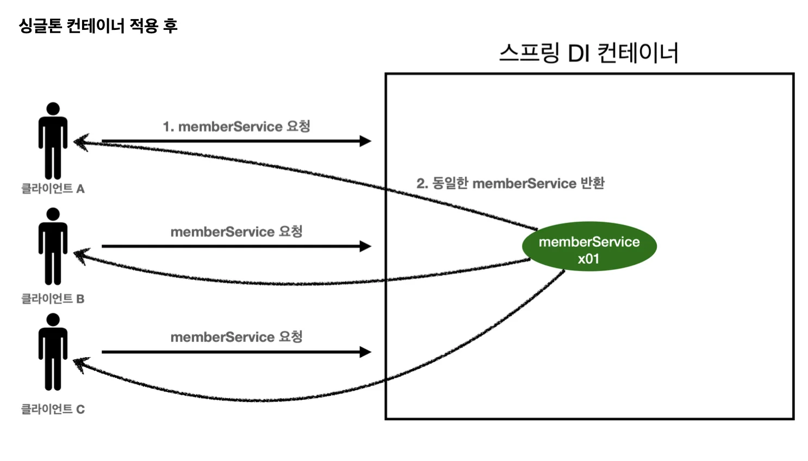

> 스프링 컨테이너는 싱글톤 패턴의 문제점을 해결하면서, 객체 인스턴스를 싱글톤(1개만 생성)으로 관리한다&#46; <br>→ 스프링 빈 =  <strong>싱글톤</strong>으로 관리되는 빈

<a id="1c3eda9b0fe181ce9083e6218f9bf413"></a>

### 싱글톤 컨테이너

<a id="1c3eda9b0fe1811282d0dc944999a1cf"></a>

<strong><u>스프링 컨테이너</u></strong>는 <strong>싱글톤 패턴을 적용하지 않아도, 객체 인스턴스를 싱글톤으로 관리</strong>한다&#46; → 컨테이너는 객체를 하나만 생성해서 관리함&#46;

<a id="1c3eda9b0fe18139a725d86cfdbac728"></a>

스프링 컨테이너는 <strong>싱글톤 컨테이너</strong> 역할을 한다&#46; 이렇게 <strong>싱글톤 객체를 생성하고 관리하는 기능을 싱글톤 레지스트리 </strong>라 한다&#46;

<a id="1c3eda9b0fe18118be36ec409ebb85a7"></a>

이런 기능 때문에, 스프링 컨테이너는 싱글톤 패턴의 모든 단점을 해결하면서 객체를 싱글톤으로 유지할 수 있다&#46; <br>→ 싱글톤 패턴을 위한 지저분한 코드 X

<a id="1c3eda9b0fe18165b301d1666fb5abdd"></a>

→ <strong>DIP, OCP, 테스트, private</strong>의 제약없이 싱글톤 사용  

<a id="1c3eda9b0fe181d0a002f9571b732d75"></a>

### 스프링 컨테이너를 사용한 참조값 조회 테스트

<a id="1c3eda9b0fe18166a1abfc3ed1491f89"></a>

```java
package hello.core.singleton;

import hello.core.AppConfig;
import hello.core.service.MemberService;
import org.junit.jupiter.api.DisplayName;
import org.junit.jupiter.api.Test;
import org.springframework.context.ApplicationContext;
import org.springframework.context.annotation.AnnotationConfigApplicationContext;

import static org.assertj.core.api.Assertions.assertThat;

public class SpringContainer {
    @DisplayName("스프링 컨테이너와 싱글톤")
    @Test
    void springContainer() {

        ApplicationContext ac = new AnnotationConfigApplicationContext(AppConfig.class);

        // 1. 조회: 호출할 때 마다 같은 객체 반환
        MemberService memberService1 = ac.getBean("memberService", MemberService.class);


        // 2. 조회: 호출할 때 마다 같은 객체 반환
        MemberService memberService2 = ac.getBean("memberService", MemberService.class);

        // 참조값이 같은 것을 확인
        System.out.println("memberService1 = " + memberService1);
        System.out.println("memberService2 = " + memberService2);

        // memberService1 == memberService2
        assertThat(memberService1).isSameAs(memberService2);

    }
}
```

<a id="1c3eda9b0fe181c9b26efb7b40c7f271"></a>

 



> 스프링 컨테이너 덕분에 고객 요청이 올 때마다  객체를 생성하는  것이 아닌, <strong>이미 만들어진 객체를 공유(싱글톤)</strong>하여 효율적으로 재사용 가능

> ⚠️ <strong>참고</strong><br>스프링 기본 빈 등록 방식은 싱글톤이지만, 다른 방식도 지원한다&#46;<br>요청할 때 마다 새로운 객체를 생성해서 반환하는 것도 가능하다&#46;<br>( 자세한 내용은 뒤 빈 스코프에서 설명함 )
