<a id="1c3eda9b0fe1813c93cbe8f6c1b8af1e"></a>

## Github Actions CI

---

> 📖 
> 
> <a id="1c3eda9b0fe1816a8e39d1a4826bf2e1"></a>
> 
> Github Actions CI  실습

> ✏️ 
> 
> <a id="1c3eda9b0fe181f3b034ebba98150e91"></a>
> 
> <u>main에 병합되기 전</u>에<strong> 테스트를 진행</strong>하고 <u>결과에 따라 병합을 진행할지 말지를 판단하</u>는 과정들을 자<strong><u>동화</u></strong> 하는 것이 CI 이다 

<details>
<summary>프로젝트 세팅</summary>

1. github 저장소 생성
    <a id="1c3eda9b0fe1815ebf80cf89ba4ba7c0"></a>

    ‣

1. 샘플  프로젝트에 remote 연결
    - git 초기화
        <a id="1c3eda9b0fe181d59eddca0f295a2687"></a>

        ```bash
        git init
        ```

    - remote 지정
        <a id="1c3eda9b0fe181b6a3a5ee53c44ba03b"></a>

        ```bash
        git remote add origin [ github 저장소 url ]
        ```

    - project init
        <a id="1c3eda9b0fe1810392d5d5334075598e"></a>

        ```bash
        git add .

        git commit -m "project init"

        git push
        ```

1. 브랜치 생성 &#45; <code>develop</code>, <code>feature/add&#45;workflow</code>
    <a id="1c3eda9b0fe18148893cd46b8692a105"></a>

    ```bash
    # develop 브런치 생성 및 해당 브랜치로 변경
    git switch -c develop

    # feature/add-worlflow 브런치 생성 및 해당 브랜치로 변경
    git switch -c feature/add-worlflow
    ```

</details>

<details>
<summary>실습 1 &#45; github actions CI </summary>

> Actions은 branch 단위로 관리된다&#46; 

<details>
<summary>🤬<strong> 오류 </strong>&#45; github actions 동작  ❌</summary>

- 아래와 같이 폴더명을 잘못 적어서  action이 동작하지 않았음
    > ☝🏻 
    > 
    > <a id="1c3eda9b0fe1810998d0f51fc24cc864"></a>
    > 
    > 이름 중요&#33; <code>workflows</code> 복수형임

    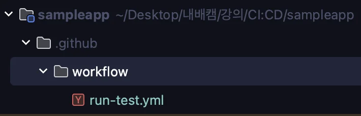

- 아래와 같이 <code>workflow</code>를  <code>workflows</code>로 변경함  → 정상 동작
    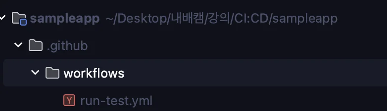

</details>

<details>
<summary>🤬 오류  &#45; feature branch에서의 커밋을 push 후, PR 오류</summary>

<a id="1c3eda9b0fe181a19de9e23ef1fd7d4d"></a>

### 오류

- <code>main</code> 브랜치  commit log
    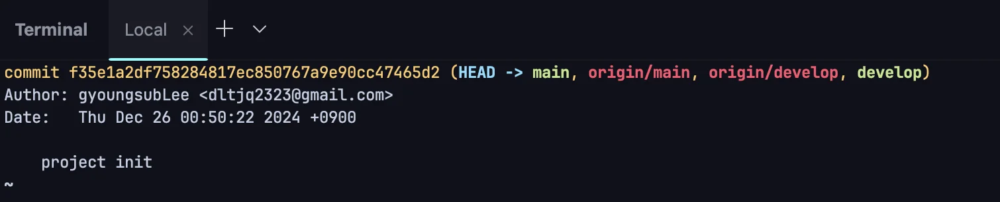

- <code>feature</code> 브랜치 commit log
    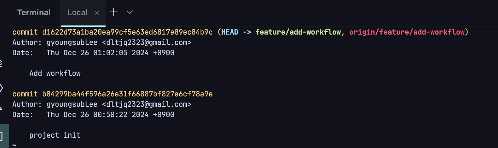

<a id="1c3eda9b0fe18187811bccfb8f174ba3"></a>

위와 같이 feature 브랜치에서 작업한 내용을 push하여 pr을 날리려고 하니 아래의 화면이 발생되면서 pr이 생성되지 않는 오류가 발생되었다&#46; 

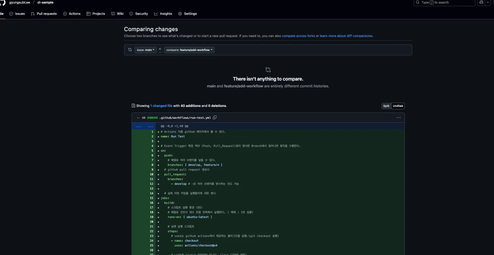

<a id="1c3eda9b0fe181da96d2d780b1b556e7"></a>

There isn’t anything to compare&#46;<br>main and feature/add&#45;workflow are entirely different commit histories&#46;

<a id="1c3eda9b0fe181dbb341d63d35274eb9"></a>

### 원인

<a id="1c3eda9b0fe1810d96a4f6e5643900f9"></a>

<code>main</code> 브랜치와 <code>feature/add&#45;workflow </code>브랜치가 <strong><u>서로 완전히 독립된(commit history가 다른) 커밋 히스토리</u></strong>를 가지고 있어 발생한 오류이다&#46; 

- 커밋 히스토리 확인&#58; <code>git log &#45;&#45;oneline &#45;&#45;graph &#45;&#45;all</code>
    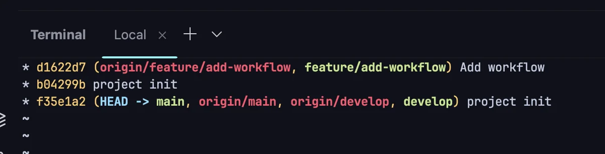

    <a id="1c3eda9b0fe181ee828bd333a5253888"></a>

    project 초기화 커밋이 main 과, feature 브랜치에 독립적으로 설정되었다&#46; 

<a id="1c3eda9b0fe181049859ed58717659d8"></a>

### 해결

<a id="1c3eda9b0fe181528774e7d063643a94"></a>

이것 저것 하다가 안되서 그냥 브랜치 삭제하고 다시 진행함… 

<details>
<summary>local 브랜치 삭제</summary>

- 브랜치 스왑 후, 삭제
    <a id="1c3eda9b0fe181bc8526d5babf987286"></a>

    ```bash
    git switch main

    git branch -D feature/add-workflow
    ```

</details>

<details>
<summary>remote 브랜치 삭제</summary>

- view all branches 클릭 
    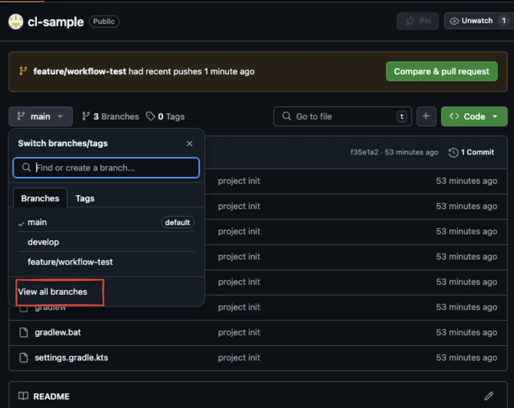

- 삭제 버튼 클릭 시, 해당 브랜치 삭제 가능하다&#46;
    > default 브랜치는 불가능 

    

</details>

</details>

<details>
<summary>1&#46; 프로젝트 root 경로에 <code>&#46;github/workflows</code> 폴더 생성 및 CI 설정할  <code>yaml</code> 파일 생성</summary>


<details>
<summary>yaml 파일 내용</summary>

<a id="1c3eda9b0fe181c9b3afca593765e9c4"></a>

```bash
# Actions 이름 github 페이지에서 볼 수 있다.
name: Run Test

# Event Trigger 특정 액션 (Push, Pull_Request)등이 명시한 Branch에서 일어나면 동작을 수행한다.
on: 
    push:
        # 배열로 여러 브랜치를 넣을 수 있다.
        branches: [ develop, feature/* ]
    # github pull request 생성시
    pull_request:
        branches: 
            - develop # -로 여러 브랜치를 명시하는 것도 가능

    # 실제 어떤 작업을 실행할지에 대한 명시
jobs:
  build:
  # 스크립트 실행 환경 (OS)
  # 배열로 선언시 개수 만큼 반복해서 실행한다. ( 예제 : 1번 실행)
    runs-on: [ ubuntu-latest ] 

    # 실제 실행 스크립트
    steps: 
      # uses는 github actions에서 제공하는 플러그인을 실행.(git checkout 실행)
      - name: checkout
        uses: actions/checkout@v4

      # with은 plugin 파라미터 입니다. (java 17버전 셋업)
      - name: java setup
        uses: actions/setup-java@v2
        with:
          distribution: 'adopt' # See 'Supported distributions' for available options
          java-version: '17'

      - name: make executable gradlew
        run: chmod +x ./gradlew

      # run은 사용자 지정 스크립트 실행
      - name: run unittest
        run: |
          ./gradlew clean test
```

</details>

</details>

<details>
<summary>2&#46; commit 생성 및 remote에 push</summary>

- 생성한 <code>yaml</code> 파일 remote에 push
    <a id="1c3eda9b0fe1812d9cc6dbf54e14e3db"></a>

    ```bash
    git add .

    git commit -m "add workflow"

    git push -u origin feature/add-workflow
    ```

</details>

<details>
<summary>3&#46; remote에 Push 되면 자동으로 ation이 실행</summary>

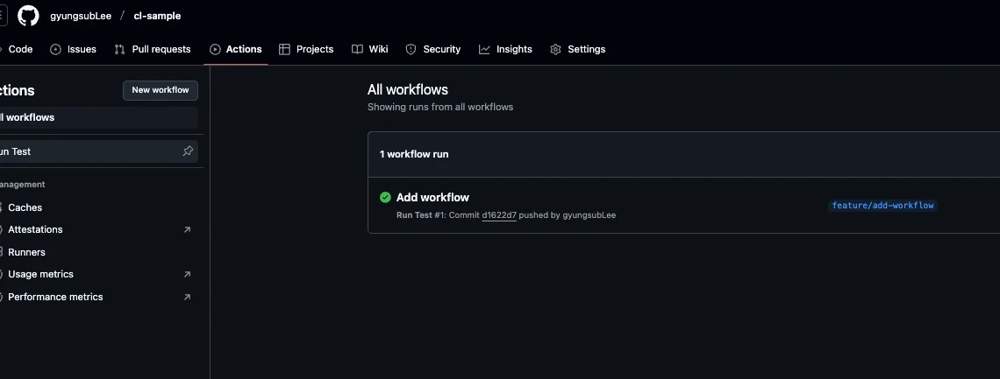

<details>
<summary>Action 상세 과정 확인</summary>

1. checkout
    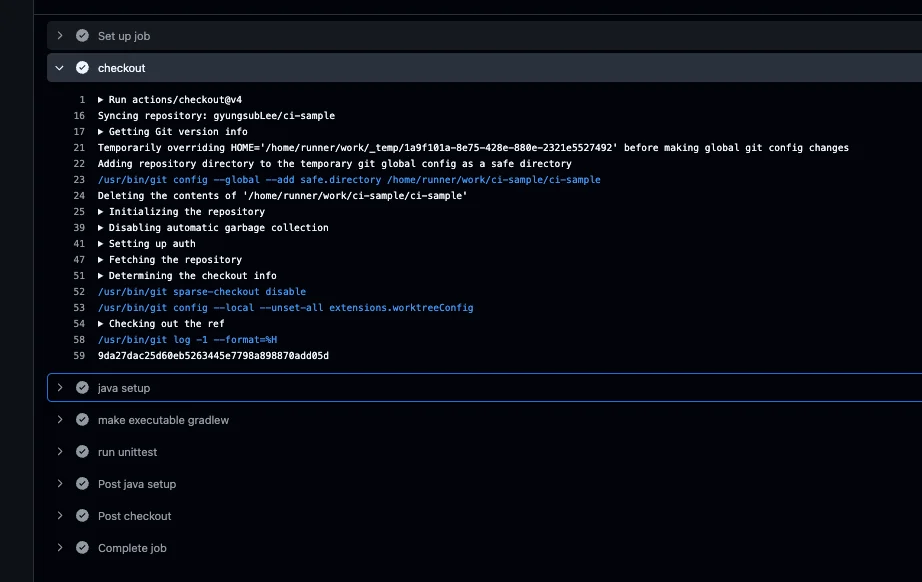

1. Java JDK 실행
    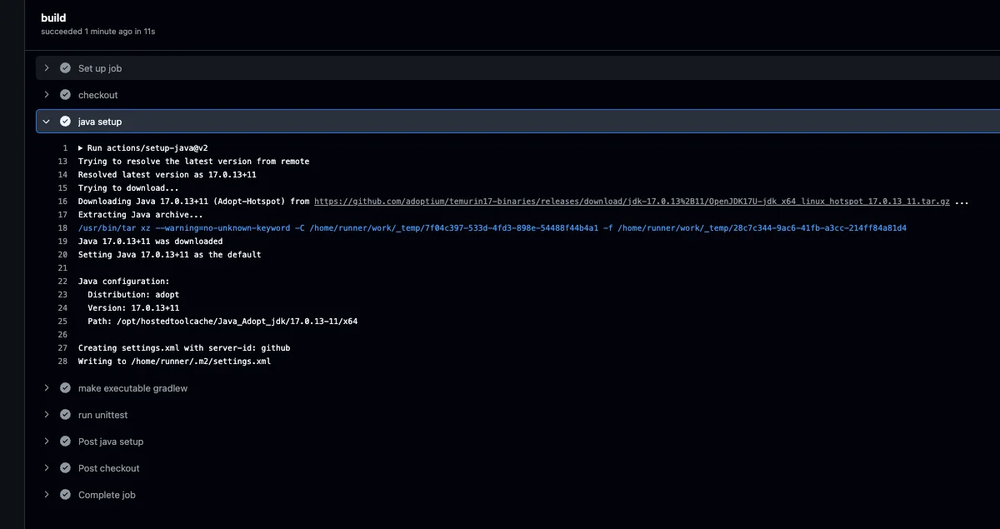

1. Gradle 단계적으로 실행
    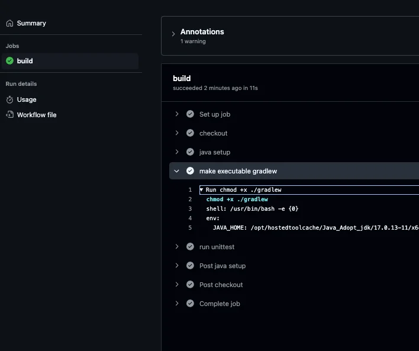

1. Unit Test 실행
    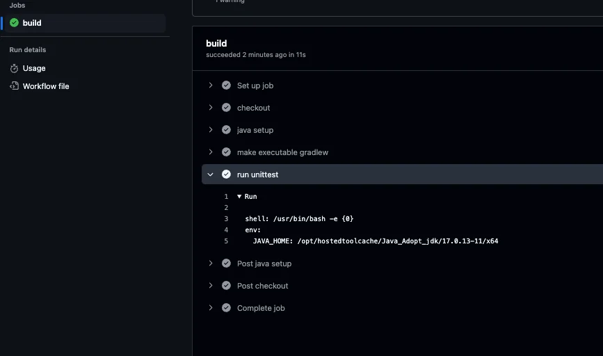

1. 이후 작업 성공 여부 판단
    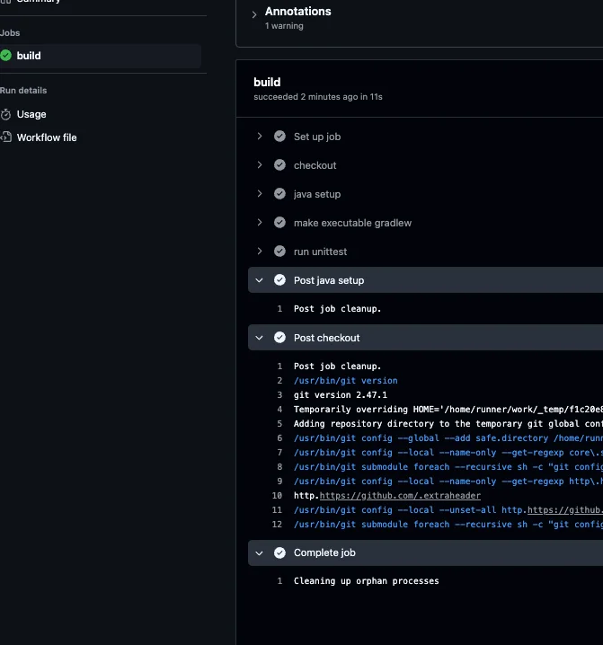

</details>

</details>

<details>
<summary>4&#46; action이 성공적으로 수행된 것을 확인 후, pr 진행</summary>

1. <code>remote</code> &#45;  feature 브랜치 → develop 브랜치로  PR

1. <code>Local</code>   develop 브랜치, PR된 최신 소스코드 받아오고, 작업이 끝난 브랜치를 삭제
    <a id="1c3eda9b0fe181889bbed683bfa0c295"></a>

    ```bash
    # develop 브랜치로 변경
    git switch develop

    # 소스 최신화
    git pull --prune

    # 작업이 완료된 feature 브랜치 삭제
    git branch -D feature/add-workflow
    ```

1. develop 브랜치에서 새로 작업할 feature 브랜치 생성 후 작업 진행

</details>

</details>

<details>
<summary>실습 2 &#45;  설정한 테스트코드의 실패/성공 케이스 </summary>

<details>
<summary>실패 케이스 </summary>

<details>
<summary>코드 수정 &#45; 설정한 테스트 코드 실패 케이스 </summary>

<details>
<summary>&#91; 코드 &#93;  SampleController</summary>

<a id="1c3eda9b0fe181fd8eb8d9a310765b42"></a>

```kotlin
@CrossOrigin
@RestController
class SampleController {

    val items = listOf<String>("item1", "item2", "item3") //item3 추가 


    @GetMapping("/")
    fun home() = "hello"

    @GetMapping("/items")
    fun findItems() = items
}
```

</details>

<details>
<summary>&#91; 테스트코드 &#93; SampleappApplicationTests</summary>

<a id="1c3eda9b0fe181009b47eb78861e5176"></a>

```java
@SpringBootTest(webEnvironment = SpringBootTest.WebEnvironment.RANDOM_PORT)
class SampleappApplicationTests(@Autowired private val restTemplate: TestRestTemplate) {

    @Test
    fun contextLoads() {
    }

    @Test
    fun findAll() {
        val content = """["item1","item2"]"""
        assertEquals(content, restTemplate.getForObject<String>("/items"))
    }
}
```

</details>

</details>

<details>
<summary>변경된 코드를 테스트 없이 바로 commit 후 push 진행</summary>

<a id="1c3eda9b0fe181f5840bc825e04a0b70"></a>

```kotlin
git add .

git commit -m "수정된 코드 테스트없이 Push 진행"

git push
```

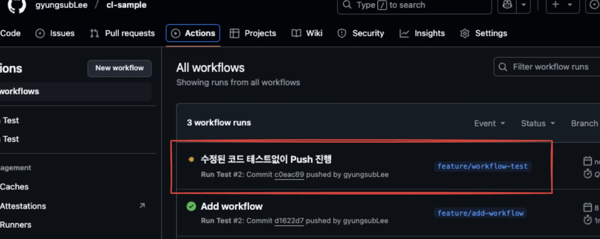

</details>

<details>
<summary>action 결과 &#45; 실패 </summary>

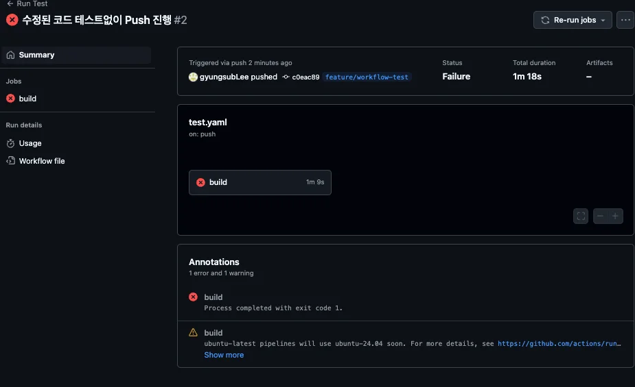

- 작성한 테스트를 yaml 파일에 설정

-  yaml에 설정된 테스트를  자동화해서 실행

- 수정된 코드가 작성한 테스트 코드에서 실패하기 떄문에, 위와 같이 action 도 fail이 나오는 것을 확인할 수 있다&#46; 

</details>

<details>
<summary>commit 내역에 action의 실패 유무가 표시된다&#46;  </summary>

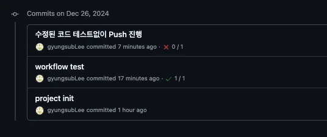

</details>

<details>
<summary>이메일 알람 </summary>

- fail 시, 아래와 같이 자동으로 이메일 알람이 간다&#46; 

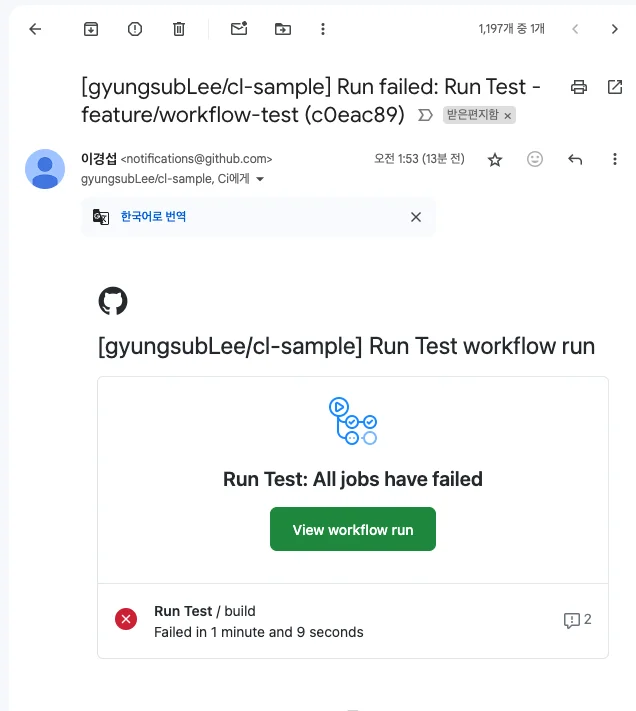

</details>

</details>

<details>
<summary>성공 케이스 </summary>

> 테스트코드 수정(success) 후, 다시 Push 진행

<details>
<summary>1&#46;  테스트코드 성공 케이스로 수정</summary>

<details>
<summary>&#91; 테스트 코드 &#93; SampleappApplicationTests</summary>

<a id="1c3eda9b0fe1810daaa6d20675d1fbb9"></a>

```kotlin
@SpringBootTest(webEnvironment = SpringBootTest.WebEnvironment.RANDOM_PORT)
class SampleappApplicationTests(@Autowired private val restTemplate: TestRestTemplate) {

    @Test
    fun contextLoads() {
    }

    @Test
    fun findAll() {
        val content = """["item1","item2","item3"]"""
        assertEquals(content, restTemplate.getForObject<String>("/items"))
    }
}
```

</details>

</details>

<details>
<summary>2&#46; action 성공 확인</summary>

- 아래와 같이 action이 성공하는 것을 확인할 수 있다&#46; 
    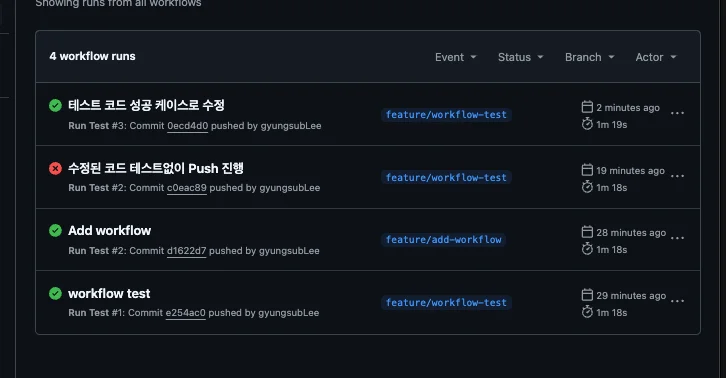

</details>

<details>
<summary>3&#46; pr 진행 후, feature 브랜치 삭제 </summary>

<details>
<summary>develop 브랜치로 pr </summary>

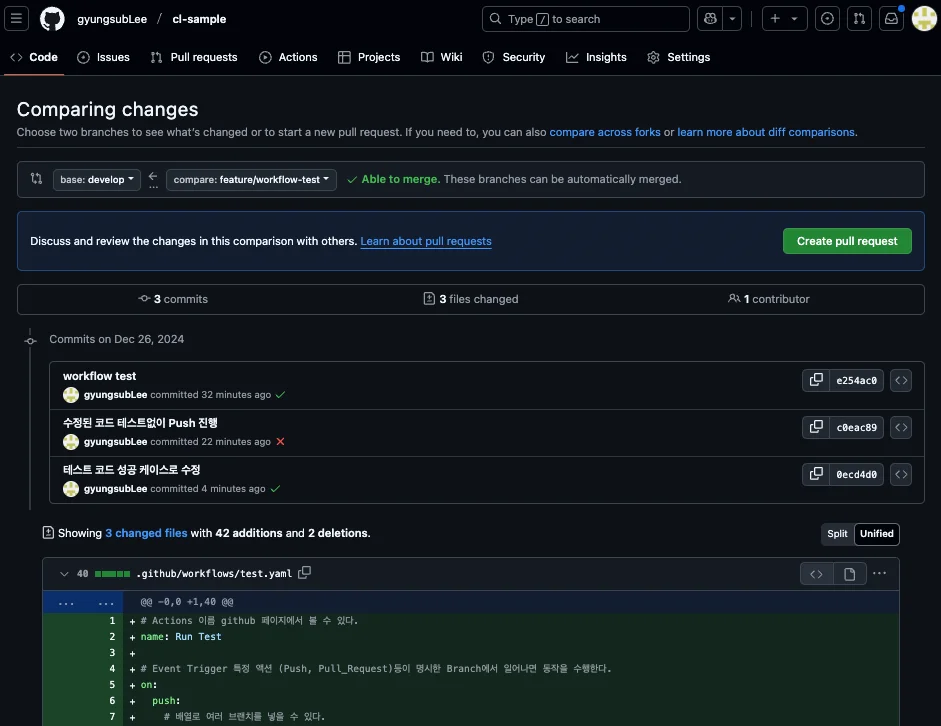

</details>

<details>
<summary>pr 생성  시,  브랜치에 대한 gradle 테스트를 진행한다&#46;  → 다시 action 진행됨</summary>

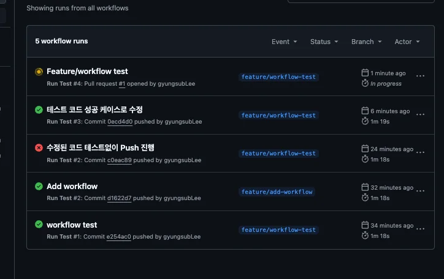

</details>

<details>
<summary>merge 하기</summary>

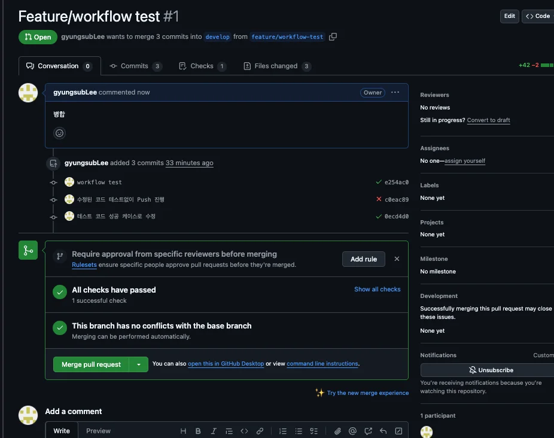

</details>

<details>
<summary>머지 완료 후 아래 브런치 삭제 버튼을 클릭하여 remote에서 작업이 끝난 feature 브런치 삭제 </summary>

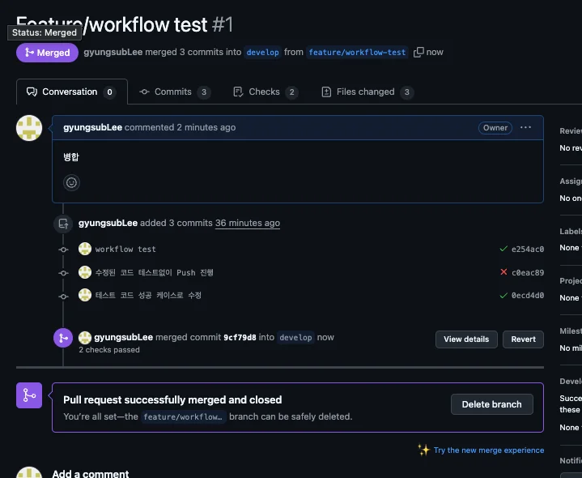

- 해당 브런치가 삭제된 것을 확인 가능함
    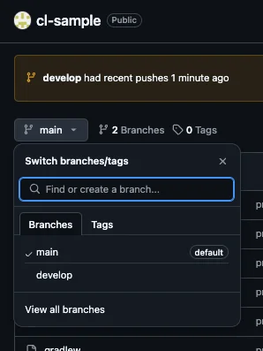

</details>

<details>
<summary>로컬에서 작업이 끝난 feature 브런치 삭제 </summary>

> ✏️ 
> 
> <a id="1c3eda9b0fe181e8be0afc133f643ab1"></a>
> 
> 위 과정을 통해 원격 remote에서 삭제했다면, <code>—prune</code> 옵션을 통해 remote와  브랜치 동기화까지 같이 진행한다&#46; 따라서 브런치를 따로 삭제하지 않아도 된다&#46; 
> 
> <a id="1c3eda9b0fe181ed89ebd208912a8f6f"></a>
> 
> ```java
> git pull --prune
> ```

<a id="1c3eda9b0fe18141a4ebced6a55b7f25"></a>

```bash
# 개발 브런치로 스위칭
git switch develop(main)

# 작업이 끝난 feature 브런치 삭제
git branch -d  feature/workflow-test # 삭제할 feature 브런치 명칭

# 브런치 삭제 되었는지 확인
git branch 

# 최초 pull 시 설정
	# 현재 브랜치(develop)를 원격 브랜치(origin/develop)와 연결
git branch --set-upstream-to=origin/develop develop

# 최신 소스코드 받아옴
git pull [--prune]
# --prune: 
	# 로컬 브랜치와 원격 브랜치를 동기화하면서, 
	# 삭제된 원격 브랜치를 로컬에서도 정리 
	# 해당 옵션 사용 시, feature 일일이 삭제하지 않아도 됨.

# 받아온 commit 내역 확인	
git log 
```

</details>

</details>

</details>

> ✏️ 
> 
> <a id="1c3eda9b0fe1813aabdbed8b3518ff93"></a>
> 
> 이렇게 테스트코드를 <code>remote</code>(<code>github repository</code>)에 <code>push</code>하면서<u> 자동화 처리</u>를 할 수 있고, <br>해당 결과를 보고 main(develop) 브런치에 <strong><u>병협 유무</u></strong>를 손쉽게 판단할 수 있다&#46;

</details>
