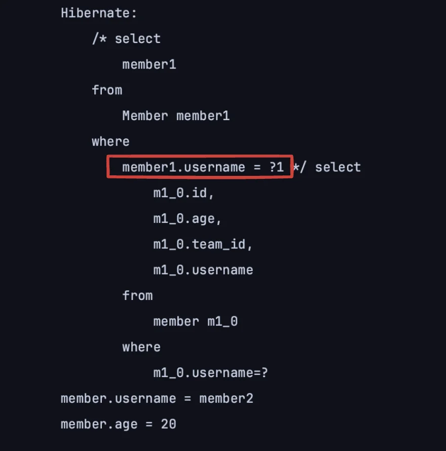
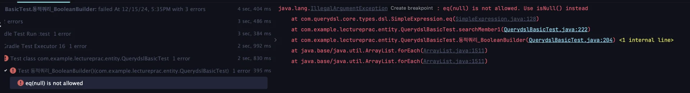
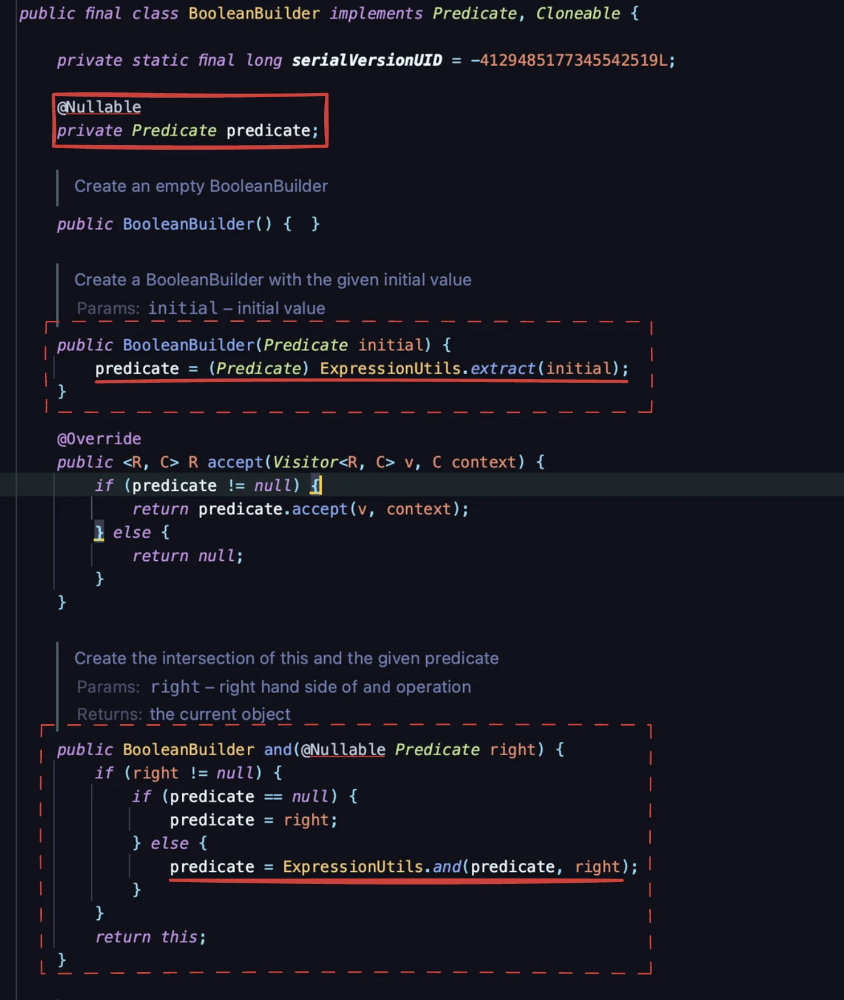
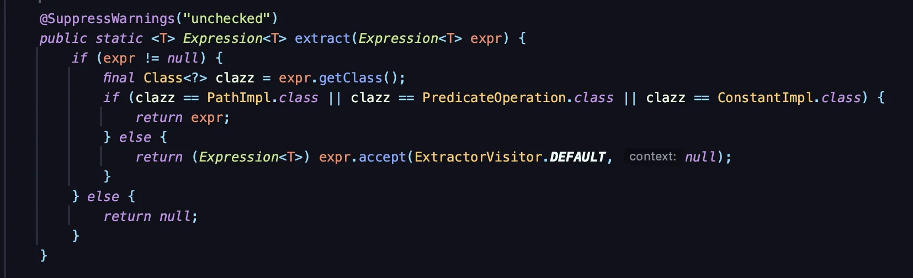
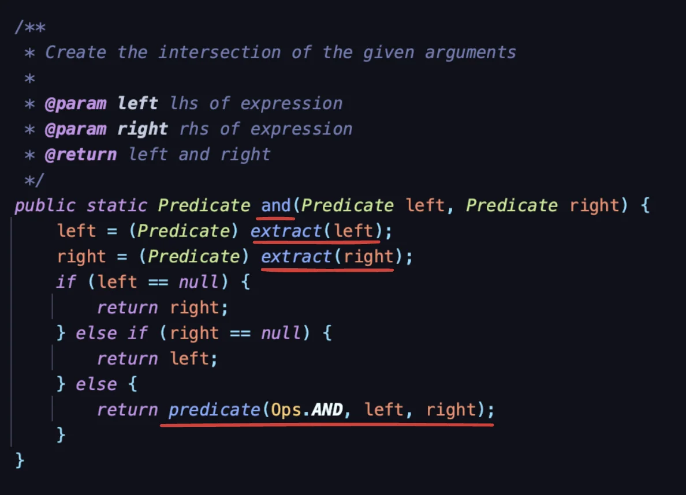

> ✏️ 
> 
> <a id="1c3eda9b0fe181ba918cfce850249831"></a>
> 
> 동적 쿼리 처리 시, 아래의 2가지 방법으로 해결할 수 있다&#46; 
> 
> - <code>BooleanBuilder</code>
> 
> - <code>Where 다중 파라미터</code> 

<a id="1c3eda9b0fe18122b1f1d947372819e6"></a>

## 동적 쿼리 &#45; BooleanBuilder

---

> 📖 
> 
> <a id="1c3eda9b0fe1818aa76acf2f8509c03b"></a>
> 
> BooleanBuilder를 사용하여 동적 쿼리를 처리할 수 있다&#46; 
> 
> - BooleanBuilder 인스턴스 생성
>     - ex) <code>BooleanBuilder builder = new BooleanBuilder()</code>
> 
> - 생성된 인스턴스에 조건 추가하기
>     - <code>&#46;and(</code><u><code>Q&#95;타입&#95;엔티티&#46;필드&#46;eq(동적 조회 인자</code></u><code>))</code>
>         - ex) <code>builder&#46;and(member&#46;age&#46;eq(ageCond))</code>
> 
> - 인자가 필수 값인 경우
>     - 생성자에서 조건을 넘겨서 처리 가능하다&#46; 
> 
>     - <code>new BooleanBuilder(</code><u><code>Q&#95;타입&#95;엔티티&#46;필드&#46;eq(동적 조회 인자</code></u><code>))</code>

<details>
<summary> BooleanBuilder를 사용한 동적 쿼리 조회</summary>

<details>
<summary>ex 1) BooleanBuilder를 사용하여 where에 조건 값을 넘기기</summary>

- 테스트 
    <a id="1c3eda9b0fe181cb8b95cf23f7cfa852"></a>

    ```java
    @Test
    public void 동적쿼리_BooleanBuilder() throws Exception {

        String usernameParam = "member1";
        Integer ageParam = 10;
    		
        List<Member> results = searchMember1(usernameParam, ageParam);
        
        // 출력값 확인
        for (Member result : results) {
            System.out.println("member.username = " + result.getUsername());
            System.out.println("member.age = " + result.getAge());
        }

        Assertions.assertThat(results.size()).isEqualTo(1);
    }
    ```

- BooleanBuilder 사용한 동적 쿼리 처리
    <a id="1c3eda9b0fe181b0a4b2e3a837187d56"></a>

    ```java
    private List<Member> searchMember1(String usernameCond, Integer ageCond) {

        BooleanBuilder builder = new BooleanBuilder();

        if (usernameCond != null) {
            builder.and(member.username.eq(usernameCond));
        }

        if (ageCond != null) {
            builder.and(member.age.eq(ageCond));
        }

        return queryFactory
                .selectFrom(member)
                .where(builder)
                .fetch();
    }
    ```

    <details>
    <summary>BooleanBuilder를 사용한 동적 쿼리 처리 방법</summary>

    1.  BooleanBuilder 인스턴스 생성 
        > <code>com&#46;querydsl&#46;core&#46;BooleanBuilder</code>

        - ex) <code>BooleanBuilder builder = new BooleanBuilder()</code>

    1. 생성한 BooleanBuilder 인스턴스에 <code>&#46;and()</code>로  조건 추가하기
        - <code>builder&#46;and(Q&#95;타입&#95;엔티티&#46;필드&#46;eq(입력받은 조건 값))</code>
            - ex) <code>builder&#46;and(member&#46;username&#46;eq(usernameCond))</code>

    1. where에 조건을 추가한 BooleanBuilder 인스턴스 넘기기
        - ex) <code>&#46;where(builder)</code>

    </details>

</details>

<details>
<summary>ex 2) 조건 필드에 <code>null</code> 값 명시</summary>

<a id="1c3eda9b0fe18138b4d1f61cab785e7b"></a>

```java
@Test
public void 동적쿼리_BooleanBuilder() throws Exception {

    String usernameParam = "member2";
    Integer ageParam = null;  // 조건 필드에 null 값 할당
		
    List<Member> results = searchMember1(usernameParam, ageParam);
    
    // 출력값 확인
    for (Member result : results) {
        System.out.println("member.username = " + result.getUsername());
        System.out.println("member.age = " + result.getAge());
    }

    Assertions.assertThat(results.size()).isEqualTo(1);
}
```

<details>
<summary>동적 쿼리 처리 ( 위 예시와 동일 )</summary>

<a id="1c3eda9b0fe181b08be2ed65d8ca97f1"></a>

```java
private List<Member> searchMember1(String usernameCond, Integer ageCond) {

    BooleanBuilder builder = new BooleanBuilder();

    if (usernameCond != null) {
        builder.and(member.username.eq(usernameCond));
    }

    if (ageCond != null) {
        builder.and(member.age.eq(ageCond));
    }

    return queryFactory
            .selectFrom(member)
            .where(builder)
            .fetch();
}
```

</details>

- 위와 같이  <u>조건의 필드 값이 null</u> (<code>ageParam = null</code>) 인 경우 조건에서 무시되며<br>아래와 같이 <strong><u>null 이 아닌  필드</u></strong>(<code>username = “member2”</code> )를 통해서만 검색된다&#46;
    

    - <code>&#46;eq()</code>에 null 값 할당 시 , 아래와 같은 오류가 발생된다&#46; 
        

</details>

<details>
<summary>ex 3) 인자가 필수 값인 경우, 인스턴스 생성 시에 넘겨줄 수도 있다&#46; </summary>

- 아래와 같이 BooleanBuilder 인스턴스 생성 시, 생성자를 통해 조건을 명시할 수 있다&#46;

<a id="1c3eda9b0fe181509012ff08a00e5b8a"></a>

```java
BooleanBuilder builder = new BooleanBuilder(member.username.eq(usernameCond));
```

<details>
<summary>🧐 어떻게 생성자에서도 생성 시, 조건을 명시 할 수 있는가?  → 내부 코드 확인</summary>

- BooleanBuilder 내부 코드
    

    - 내부 코드를 보면 <code>ExpressionUtils&#46;extract()</code> 를 통해 조건을 비교하는 것을 확인할 수 있다&#46; 

    - 해당 로직은 <code>and()</code> 와 생성자에서 확인이 가능하며, 이로 인해 생성자를 통해서도 조건 값을 초기화 할 수 있다는 것을 확인할 수 있다&#46;
        - <code>and()</code>내부에서 <code>extract()</code>를 사용함

- ExpressionUtils
    - <code>extract()</code>
        

    - <code>and()</code>
        

</details>

<details>
<summary>🧐 ExpressionUtils 뜯어보기</summary>

- BooleanBuilder는 내부에서 ExpressionUtils를 사용하여 조건을 처리한다&#46; 

</details>

</details>

</details>
