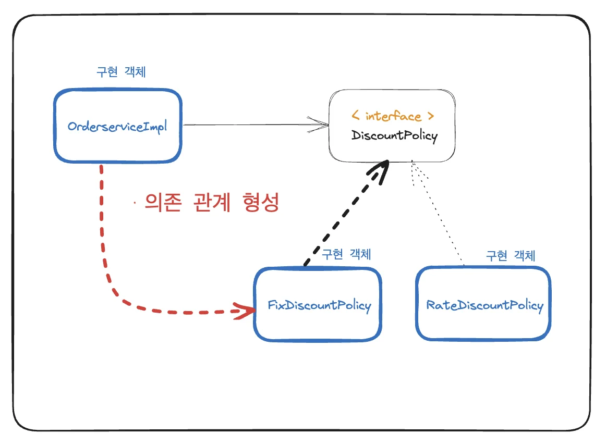
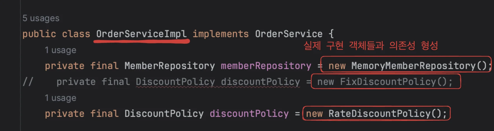
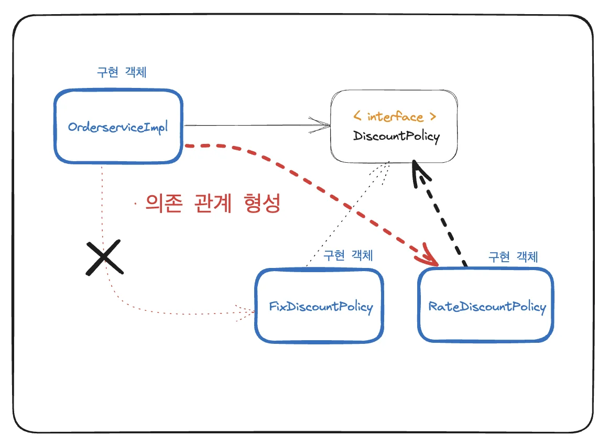
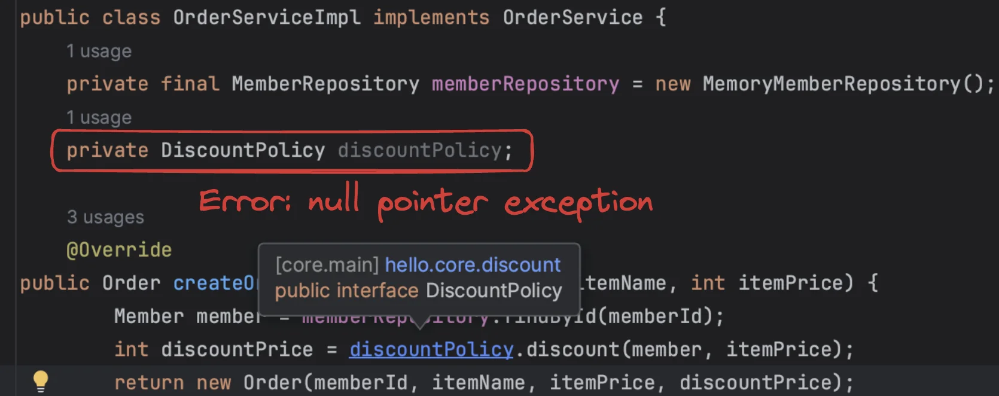

<details>
<summary>새로운 할인 정책 적용</summary>

> order&#46;orderServiceImpl

<a id="1c3eda9b0fe1815bbb4ac459b88c5022"></a>

```java
package hello.core.order;

import hello.core.discount.DiscountPolicy;
import hello.core.discount.FixDiscountPolicy;
import hello.core.discount.RateDiscountPolicy;
import hello.core.member.Member;
import hello.core.repository.MemberRepository;
import hello.core.repository.MemoryMemberRepository;


public class OrderServiceImpl implements OrderService {
    private final MemberRepository memberRepository = new MemoryMemberRepository();
//    private final DiscountPolicy discountPolicy = new FixDiscountPolicy();
    private final DiscountPolicy discountPolicy = new RateDiscountPolicy();

    @Override
public Order createOrder(Long memberId, String itemName, int itemPrice) {
        Member member = memberRepository.findById(memberId);
        int discountPrice = discountPolicy.discount(member, itemPrice);
        return new Order(memberId, itemName, itemPrice, discountPrice);
    }
}
```

</details>

<a id="1c3eda9b0fe18150ae0dce8235aea464"></a>

## 문제점 발견 &#45;DIP, OCP 위반

- <strong>&#91; </strong><strong>O</strong><strong> &#93; </strong><strong><code>역할</code></strong><strong>과</strong><strong> </strong><strong><code>구현</code></strong><strong> 분리</strong>

- <strong> &#91; </strong><strong>O</strong><strong> &#93; 다향성을 활용한, </strong><strong><code>인터페이스</code></strong><strong><u> </u></strong><strong>와 </strong><strong><code>구현 객체</code></strong><strong> 분리</strong>

- <strong> &#91;</strong><strong> X</strong><strong> &#93;</strong>  <strong>OCP, DIP 같은 객체지향 설계 원칙 준수 </strong>

<a id="1c3eda9b0fe1810e8a72e6baa7a65a67"></a>

주문서비스 클라이언트( <code>OrderServiceImpl</code> )는 <code>DiscountPolicy</code> 인터페이스에 의존하면서 DIP를 지킨 것 같지만, 그렇지 않다&#46;

<a id="1c3eda9b0fe181a698a7e7f005e7f503"></a>

### 클래스 의존관계를 분석해보면, 추상(인터페이스) 뿐만 아니라 <strong>구체(구현) 클래스에도 의존</strong>하고 있다&#46;



> <strong>• 추상(인터페이스) 의존</strong>&#58; <code>DiscountPolicy<br></code><strong>• 구체(구현) 클래스 의존&#58;</strong> <code>FixDiscountPolicy</code> , <code>RateDiscountPolicy</code>



<a id="1c3eda9b0fe181b9a7e8d11e785c500b"></a>

### ⇒  인터페이스만 의존해야 한다는 <u><code>DIP</code></u>를 <u>위반</u>한다&#46; 



<a id="1c3eda9b0fe181018e49c9e9b8c2c07d"></a>

### ⇒ ‘클라이언트’ 가 ‘인터페이스’ 만이 아닌, <u>‘구현 객체’ 에도 의존성이 형성</u>되어<strong> </strong><strong><u>확장(구현 객체 변경) 시 클라이언트 코드에도 영향</u></strong>을 준다&#46; <br>따라서  <u><code>OCP(변경하지 않고 확장할 수 있는)</code></u> 도 <u>위반</u>한다&#46;

<a id="1c3eda9b0fe18158a39fdc503e232e7d"></a>

## 해결 

> <code>final</code> &#58; 무조건 값이 할당 되어야함&#46;

<a id="1c3eda9b0fe18165bf1eed03b02e5145"></a>

### 구현 객체와의 <strong><u>의존 관계를 제거 </u></strong>→<strong> </strong><strong><code>Error</code></strong><strong>&#58; null pointer exception</strong>



<a id="1c3eda9b0fe181fc84b4f852d6bbeef3"></a>

### 따라서 <u>외부에서 의존 관계를 주입</u>해 주어야 한다&#46;  → &#91; 다음 챕터에서 &#93;

<a id="1c3eda9b0fe1819d9cc5cbe5f38cebb9"></a>

DI(의존성 주입)을 통해 다향성을 구현한다&#46; 

- final 키워드와 롬복(&#64;RequiredArgsConstructor) 사용
