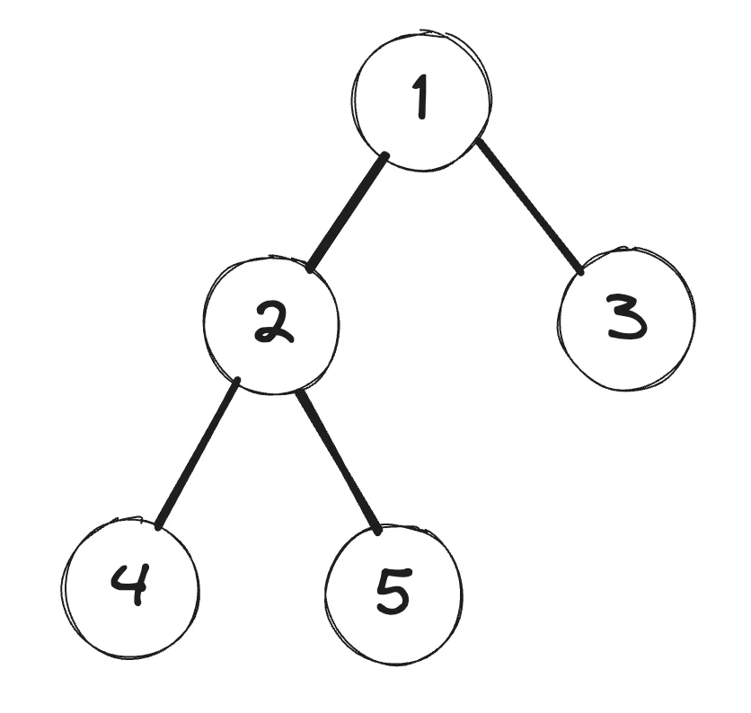
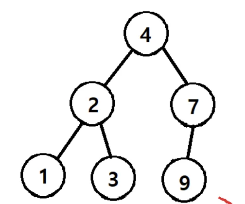

<a id="1c3eda9b0fe1815aa6f8f36c60564153"></a>

# 문제

<a id="1c3eda9b0fe1817a9920fc5798b5b1e1"></a>

## 9&#46; Tree 말단 노드까지 가장 짧은 경로(DFS)

<a id="1c3eda9b0fe18199a7d1d565f4337a0e"></a>

### 설명

<a id="1c3eda9b0fe181f7a2efdced374375fa"></a>

아래 그림과 같은 이진트리에서 루트 노드 1에서 말단노드까지의 길이 중 가장 짧은 길이를 구하는 프로그램을 작성하세요&#46;

<a id="1c3eda9b0fe1811c8493fc66942b9cd8"></a>

각 경로의 길이는 루트 노드에서 말단 노드까지 가는데 이동한 횟수를 즉, 간선(에지)의 개수의 길이로 하겠습니다&#46; 



<a id="1c3eda9b0fe1811281bbfe22013ef511"></a>

### 출력

<a id="1c3eda9b0fe1812a80a0e4fa21a96ce2"></a>

가장 짧은 길이는 3번 노드까지의 길이인 1이다&#46;

<a id="1c3eda9b0fe181a7bcb6e6c36719d027"></a>

```plaintext
1
```

<a id="1c3eda9b0fe18174b89aee94a4d1ec79"></a>

# 풀이

<a id="1c3eda9b0fe181e38d4dd2bd4850867c"></a>

## 풀이1) <code>내 풀이</code>  DFS(재귀), Set 자료형

<a id="1c3eda9b0fe181d98ef7ff9125dc7f15"></a>

```java
import java.lang.reflect.Array;
import java.util.*;

class Node{
    int data;
    Node lt, rt;
    Node(int val){
        data=val;
        lt=rt=null;
    }
}

public class Main {
    static Node root;
    static Set<Integer> level;
    public void DFS(Node root, int L){
        if(root==null) {
            level.add(L-1);
            return;
        }
        DFS(root.lt, L+1);
        DFS(root.rt, L+1);
    }

    public static void main(String args[]) {
        Main tree=new Main();
        tree.root=new Node(1);
        tree.root.lt=new Node(2);
        tree.root.rt=new Node(3);
        tree.root.lt.lt=new Node(4);
        tree.root.lt.rt=new Node(5);
        level=new HashSet<>();
        int L=0;
       tree.DFS(root, L);
       System.out.println(level.iterator().next());
    }
}
```

<a id="1c3eda9b0fe1816389d1de4e0c818ad7"></a>

## 풀이2) <code>강의 풀이</code> 

<a id="1c3eda9b0fe1810baa72f51d71f57e5c"></a>

### Error &#45; NullPointerException

<a id="1c3eda9b0fe181d882fae60ada8cdd75"></a>

해당 풀이는 <strong><code>자식노드가 2 or 0 개 일 경우</code></strong> 만( <strong><a href="https://velog.io/@dltjq2323/%ED%8A%B8%EB%A6%ACTree-%EC%9D%B4%EC%A7%84%ED%8A%B8%EB%A6%AC-%EC%9D%B4%EC%A7%84%ED%83%90%EC%83%89%ED%8A%B8%EB%A6%ACBST#%EC%A0%95-%EC%9D%B4%EC%A7%84-%ED%8A%B8%EB%A6%AC-full-binary-tree">정 이진 트리 (Full Binary Tree), 포화이진트리(Perfect Binary Trre)</a></strong>일때만 성립된다 &#46;

<a id="1c3eda9b0fe1818687b5de71bc57dbf5"></a>

아래와 같은 트리의 경우는  



<a id="1c3eda9b0fe18177a053f03efe7ba991"></a>

```java
Math.min( DFS(root.lt, L+1),  DFS(root.rt, L+1)); 
```

<a id="1c3eda9b0fe181638621fff2b997d94d"></a>

위 로직에서 <strong> root&#46;rt</strong>가 <code>null</code> 값이 나오므로<u> </u><strong><u>Node타입</u></strong>의 <strong>root 값</strong>에 적합하지 않아 Error가 발생된다&#46;( NullPointerException )<br>

<a id="1c3eda9b0fe18109a9b7dfee0caa9278"></a>

```java
import java.util.*;

class Node{
    int data;
    Node lt, rt;
    Node(int val){
        data=val;
        lt=rt=null;
    }
}

public class Main {

    public int DFS(Node node, int L) {
        if(node.lt == null && node.rt == null) return L;
        else return Math.min(DFS(node.lt, L+1),DFS(node.rt, L+1));
    }

    public static void main(String args[]) {
        Main T=new Main();
        Node root;
        root=new Node(1);
        root.lt=new Node(2);
        root.rt=new Node(3);
        root.lt.lt=new Node(4);
        root.lt.rt=new Node(5);
        System.out.println(T.DFS(root, 0));
    }
}
```

<a id="1c3eda9b0fe181248a1ecbdb13fa3667"></a>

## 풀이3) 2차 풀이, ArrayList

<a id="1c3eda9b0fe181458784e611fdc58daa"></a>

```java
import java.lang.reflect.Array;
import java.util.*;

class Node {
    int data;
    Node lt, rt;
    Node(int val) {
        data=val;
        lt=rt=null;
    }
}

public class Main {
    static Node root;
    static ArrayList<Integer> depths;
    public void DFS(Node root, int depth){
        if(root.lt==null&&root.rt==null) depths.add(depth);
        else{
            if(root.lt!=null)DFS(root.lt, depth+1);
            if(root.rt!=null)DFS(root.rt, depth+1);
        }
    }
    public static void main(String args[]) {
        Main tree = new Main();
        tree.root=new Node(1);
        tree.root.lt=new Node(2);
        tree.root.rt=new Node(3);
        tree.root.lt.lt=new Node(4);
        tree.root.lt.rt=new Node(5);
        depths=new ArrayList<>();
        tree.DFS(tree.root,0);
        int min=Integer.MAX_VALUE;
        for(int x : depths){
            min = Math.min(min, x);
        }
        System.out.println(min);
    }
}
```

<a id="1c3eda9b0fe181f8b11bc1fa08ee34fc"></a>

## 풀이4) 3차 풀이, BFS

<a id="1c3eda9b0fe181bab0cccbb07092ad30"></a>

```java
import java.util.*;

class Node{
    int data;
    Node lt, rt;
    Node(int val){
        data=val;
        lt=rt=null;
    }
}

public class Main {
    static Node root;
    public int BFS(Node root) {
        Queue<Node> Q = new LinkedList<>();
        Q.offer(root);
        int L = 0;
        while (!Q.isEmpty()) {
            int len = Q.size();
            for (int i = 0; i < len; i++) {
                Node cur = Q.poll();
                if(cur.lt==null && cur.rt==null) return L;
                if(cur.lt!=null) Q.offer(cur.lt);
                if(cur.rt!=null) Q.offer(cur.rt);
            }
            L++;
        }
        return L;
    }

    public static void main(String args[]) {
        Main tree=new Main();
        tree.root=new Node(1);
        tree.root.lt=new Node(2);
        tree.root.rt=new Node(3);
        tree.root.lt.lt=new Node(4);
        tree.root.lt.rt=new Node(5);
        System.out.println(tree.BFS(tree.root));
    }
}
```
