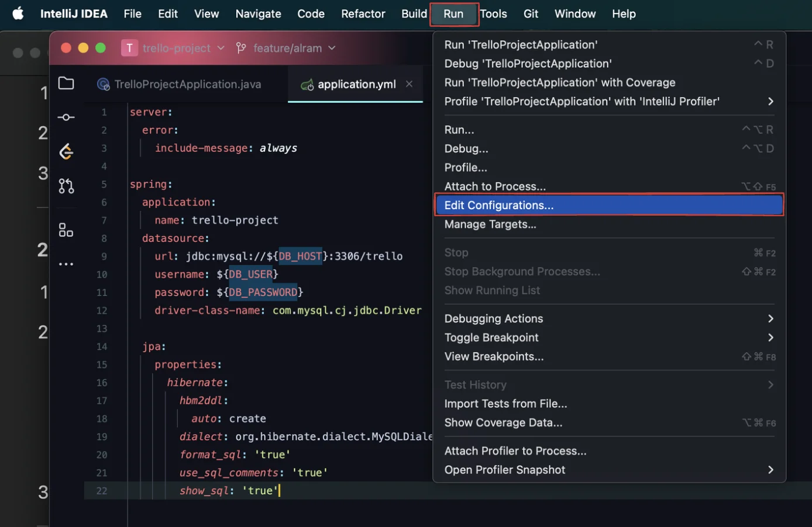
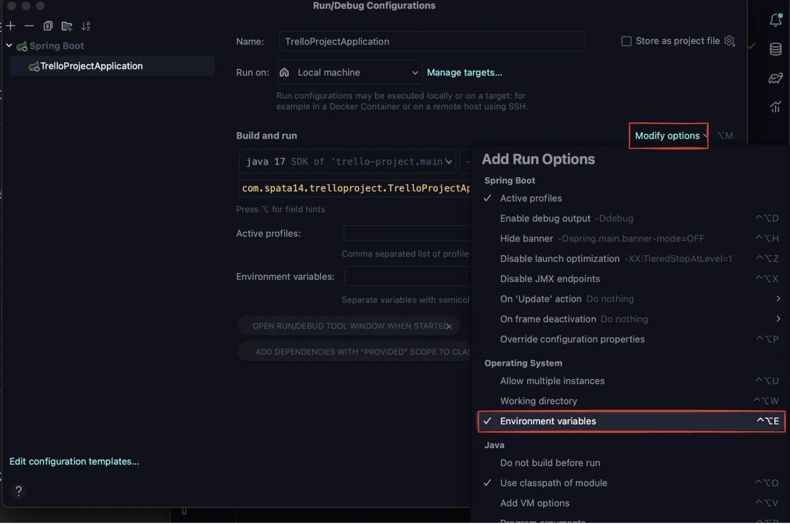
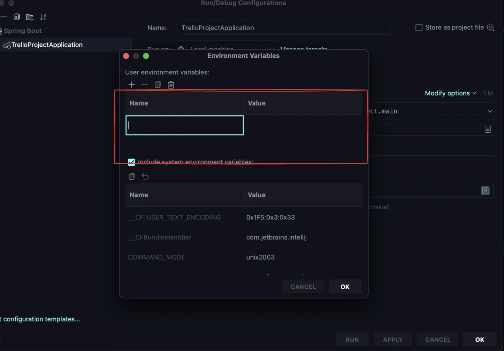
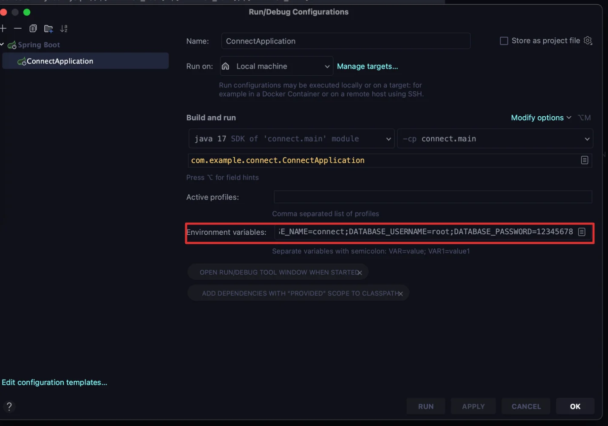

- run &#45; edit configuration
    

- Modify options
    

- 환경 변수로 등록할 key, value 입력
    

- 직접 동시에 입력
    


<a id="1c3eda9b0fe181c58994d878e0d70442"></a>

```javascript
DATABASE_HOST=localhost;DATABASE_NAME=connect;DATABASE_PASSWORD=12345678;DATABASE_PORT=3306;DATABASE_USERNAME=root;
```


- applications&#46;properties
    <a id="1c3eda9b0fe1816bbd53d3970f40cb32"></a>

    ```javascript
    spring.application.name=Connect
    spring.datasource.driver-class-name=com.mysql.cj.jdbc.Driver
    spring.datasource.url=jdbc:mysql://${DATABASE_HOST}:${DATABASE_PORT}/${DATABASE_NAME}
    spring.datasource.username=${DATABASE_USERNAME}
    spring.datasource.password=${DATABASE_PASSWORD}
    spring.jpa.show-sql=true
    spring.jpa.database-platform=org.hibernate.dialect.MySQL8Dialect
    # create, update, none, creat-drop
    spring.jpa.database=mysql
    spring.jpa.hibernate.ddl-auto=create
    spring.jpa.hibernate.naming.physical-strategy=org.hibernate.boot.model.naming.CamelCaseToUnderscoresNamingStrategy
    spring.jpa.generate-ddl=false
    spring.jpa.properties.hibernate.format_sql=true
    spring.jpa.properties.hibernate.enable_lazy_load_no_trans=true
    jwt.secret=jwt-secret-have-to-be-longer-than-32-characters
    jwt.expiry-millis=36000000
    jwt.refresh-expiry-millis=604800000
    aws.access-key=${AWS_ACCESS_KEY}
    aws.secret-key=${AWS_SECRET_KEY}
    aws.s3.bucket-name=${AWS_BUCKET_NAME}
    aws.s3.region=ap-northeast-2

    ```
