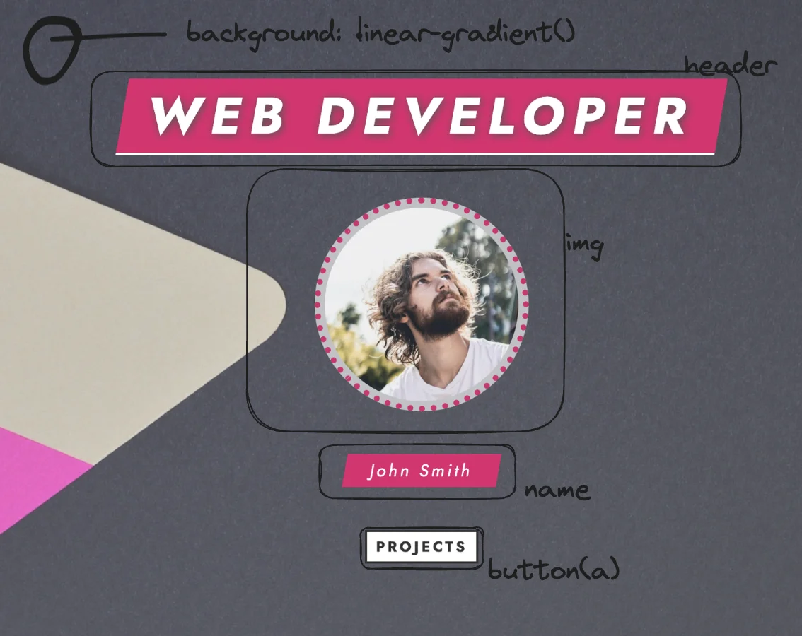
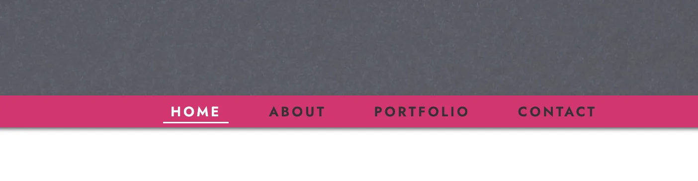
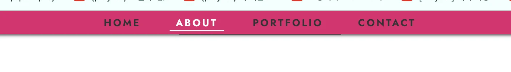
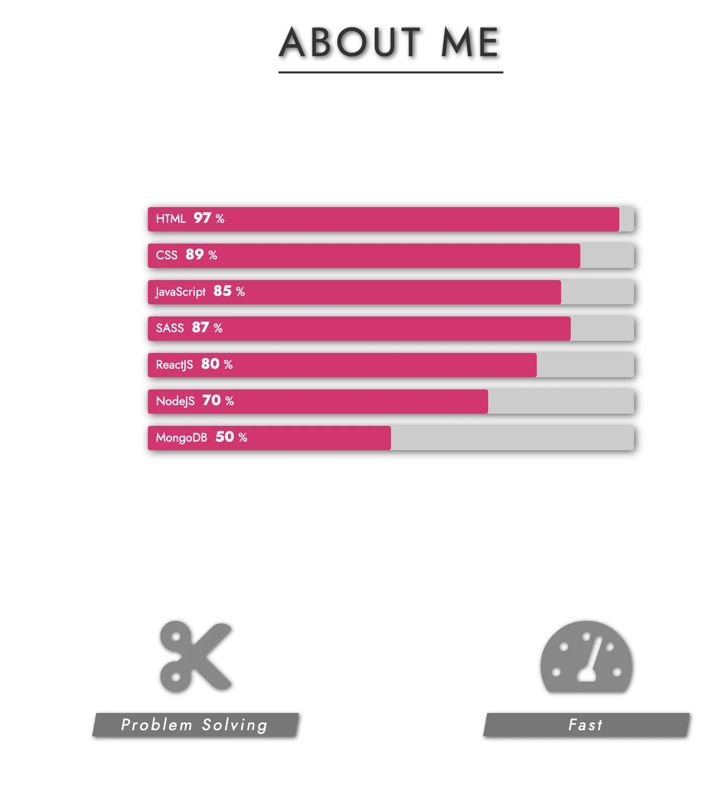
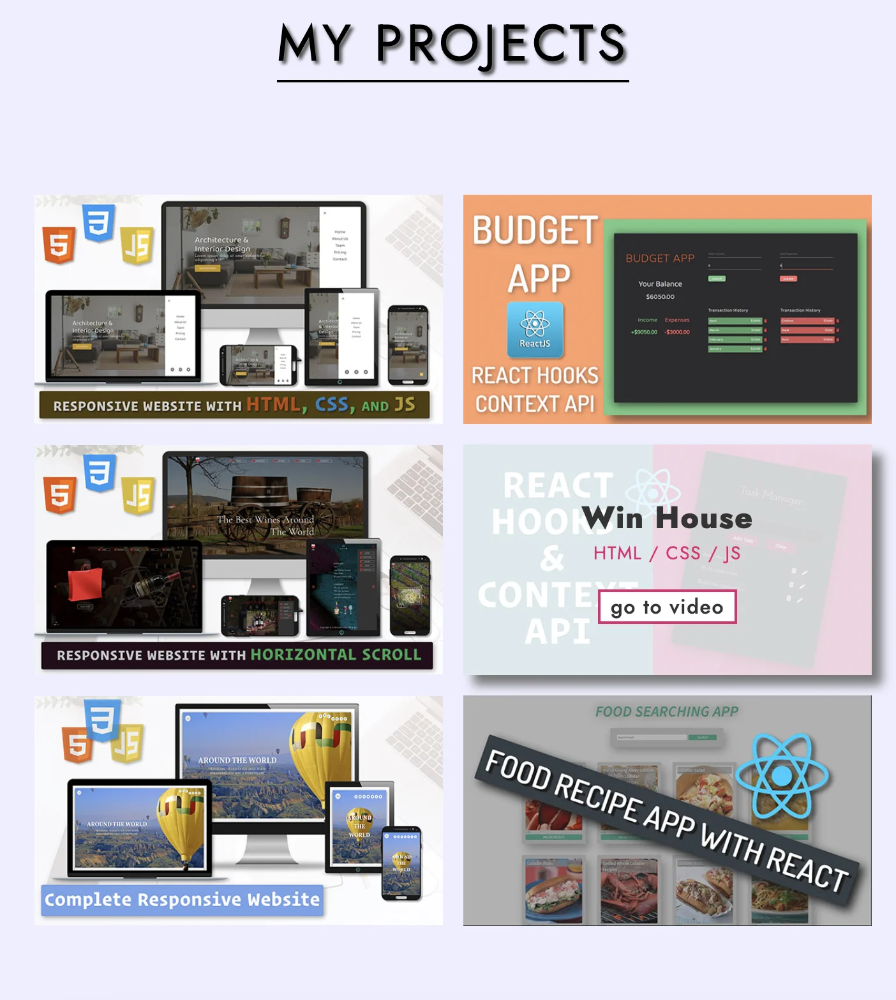
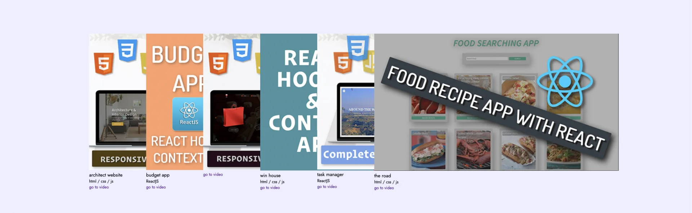
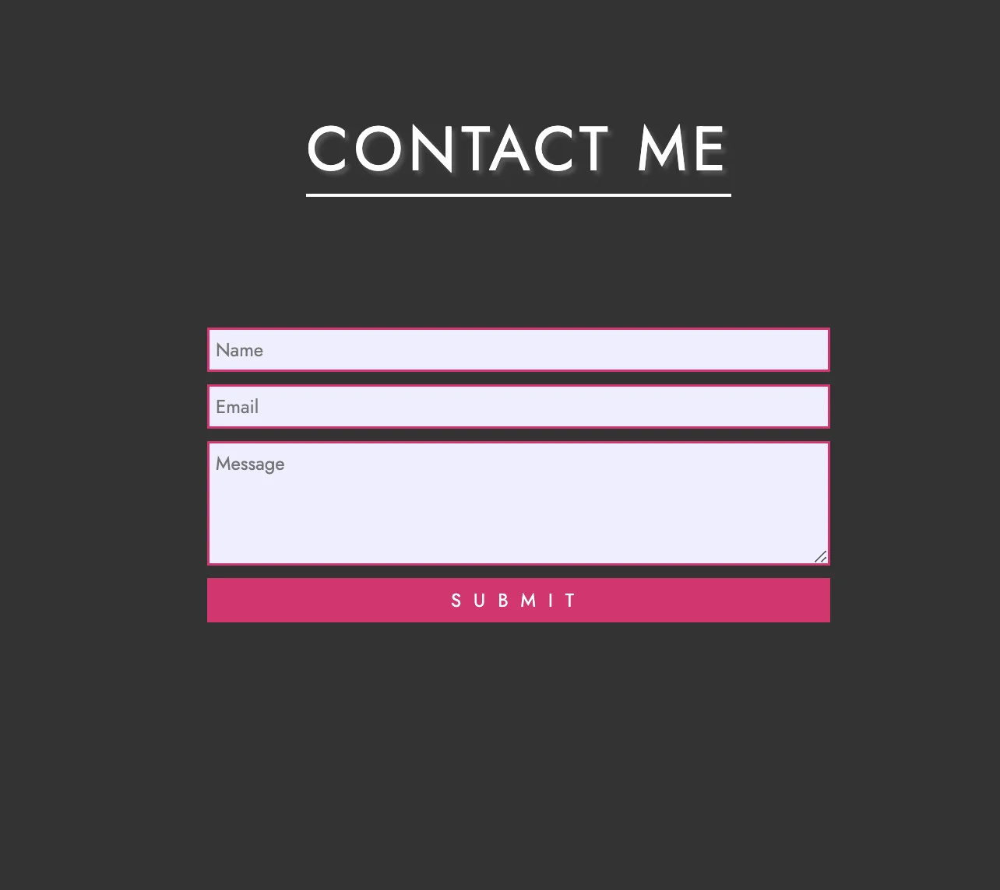
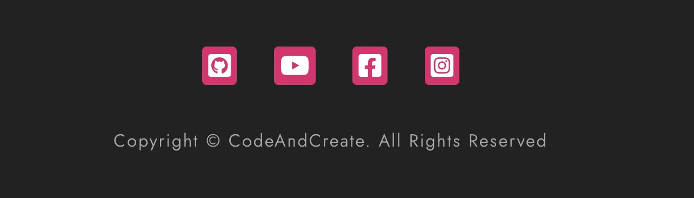

<a id="1c3eda9b0fe181868871c3bc2a312f1a"></a>

## Section 1) Header



<a id="1c3eda9b0fe1813bb78cc25d1e53649b"></a>

### html

<a id="1c3eda9b0fe181fe9af9ec40fcc7f226"></a>

```html
<!-- section 1 -->
  <div class="container">
    <h1 class="section1-heading">Web Developer</h1>
    
    <h3 class="section1-name">john smith</h3>
    <a href="" class="section1-btn">project</a>
  </div>
<!-- End of section 1 -->
```

<a id="1c3eda9b0fe18195aab3d501fc265162"></a>

### css

<a id="1c3eda9b0fe181f6baf1c3f6504e9fb5"></a>

```css
.section-1 {
  width: 100%;
  height: 100vh;
  background: linear-gradient(
      rgba(255, 255, 255, 0.2),
      rgba(255, 255, 255, 0.3)
    ),
    url(../images/bg.jpg) center no-repeat;
  background-size: cover;
  flex-direction: column;
}

.section1-heading {
  font-size: 6rem;
  font-weight: 700;
  color: #fff;
  background-color: #e41c6f;
  padding: 0.3rem 2rem;
  margin-bottom: 5rem;
  letter-spacing: 1rem;
  text-transform: uppercase;
  border-bottom: 0.3rem solid #fff;
  text-shadow: 0.2rem 0.2rem 1rem #555;
  transform: skew(-10deg);
}

.section1-img {
  width: 28rem;
  border: #e41c6f solid 0.3rem;
  border-radius: 50%;
}

.section1-name {
  margin-top: 5rem;
  padding: 0.3rem 4rem;
  font-size: 2.5rem;
  color: #fff;
  transform: skew(-10deg);
  background-color: #e41c6f;
}

.section1-btn {
  margin-top: 5rem;
  color: black;
  background-color: #fff;
  font-size: 2rem;
  padding: 0.2rem 1rem;
  border: solid black 0.3rem;
  text-transform: uppercase;
  font-weight: 600;
  letter-spacing: 0.2rem;
}
```

<a id="1c3eda9b0fe181d7bf16ecf09132d07e"></a>

###  border&#45;box&#58; 기울이기


<a id="1c3eda9b0fe181b59348e9eea3981a9b"></a>

```css
transform: skew(-10deg);
```

<a id="1c3eda9b0fe181499a86d21a1a859eaa"></a>

## Section  &#45; navbar



- &#91; 100vh &#93;scroll 후 상단 fixed



<a id="1c3eda9b0fe181408522d37064676ba3"></a>

### html

<a id="1c3eda9b0fe181f995dec3321133664e"></a>

```html
<!-- Navbar -->
  <nav class="navbar center">
    <a href="#section-1" class="navbar-link">home</a>
    <a href="#section-2" class="navbar-link">about</a>
    <a href="#section-3" class="navbar-link">portfolio</a>
    <a href="#section-4" class="navbar-link">contact</a>
  </nav>
<!-- End of navbar  -->
```

<a id="1c3eda9b0fe181b7a834e9b3df4ed429"></a>

### css

<a id="1c3eda9b0fe181a6b04fddcac92c650e"></a>

```css
.navbar {
  width: 100%;
  height: 4rem;
  background-color: var(--main-color);
  box-shadow: 0.2rem 0.2rem 0.5rem #555;
  position: absolute;
  z-index: 300;
}

.sticky {
  position: fixed;
  top: 0;
}

.navbar-link {
  font-size: 1.7rem;
  font-weight: 600;
  color: #333;
  margin: 0 3rem;
  letter-spacing: 0.3rem;
  text-transform: uppercase;
  transition: color 0.2s;
  position: relative;
}

.navbar-link:hover {
  color: #fff;
}

.navbar-link::before {
  content: "";
  width: 0;
  height: 0.2rem;
  background-color: #fff;
  position: absolute;
  right: -15%;
  bottom: -0.3rem;
  transition: width 0.2s;
}

.change.navbar-link {
  color: #fff;
}

.change.navbar-link::before {
  width: 130%;
}

.navbar-link:hover::before {
  width: 130%;
}
```

<a id="1c3eda9b0fe181e0a351da02fcad7c64"></a>

### js

<a id="1c3eda9b0fe181c0ae20f71ab2bdb3d8"></a>

```javascript
const navbar = document.querySelector(".navbar");
const navbarOffsetTop = navbar.offsetTop;
const sections = document.querySelectorAll("section");
const navbarLinks = document.querySelectorAll(".navbar-link");
const progress = document.querySelector(".progress-bars-wrapper");
const progressBarPercents = [97, 89, 85, 87, 80, 70, 50];

window.addEventListener("scroll", () => {
  mainFn();
});

const mainFn = () => {
  if (window.pageYOffset >= navbarOffsetTop) {
    navbar.classList.add("sticky");
  } else {
    navbar.classList.remove("sticky");
  }

  sections.forEach((section, i) => {
    if (window.pageYOffset >= section.offsetTop - 10) {
      navbarLinks.forEach((navbarLink) => {
        navbarLink.classList.remove("change");
      });
      navbarLinks[i].classList.add("change");
    }
  });

  if (window.pageYOffset + window.innerHeight >= progress.offsetTop) {
    document.querySelectorAll(".progress-percent").forEach((el, i) => {
      el.style.width = `${progressBarPercents[i]}%`;
      el.previousElementSibling.firstElementChild.textContent =
        progressBarPercents[i];
    });
  }
};

mainFn();

window.addEventListener("resize", () => {
  window.location.reload();
});
```

<a id="1c3eda9b0fe181b0add5e606def62f26"></a>

## Section  2 &#45; graph bars



<a id="1c3eda9b0fe1814dbcabdecf0dd82230"></a>

### html

<a id="1c3eda9b0fe1816fae18d14759492443"></a>

```html
<!-- section 2 -->
      <section class="section-2 center" id="section-2">
        <h1 class="section-heading">about me</h1>
        <div class="progress-bars-wrapper">
          <div class="progress-bar">
            <p class="progress-text">
              HTML
              <span>97</span>%
            </p>
            <div class="progress-percent"></div>
          </div>
          <div class="progress-bar">
            <p class="progress-text">
              CSS
              <span>89</span>%
            </p>
            <div class="progress-percent"></div>
          </div>
          <div class="progress-bar">
            <p class="progress-text">
              JavaScript
              <span>85</span>%
            </p>
            <div class="progress-percent"></div>
          </div>
          <div class="progress-bar">
            <p class="progress-text">
              SASS
              <span>87</span>%
            </p>
            <div class="progress-percent"></div>
          </div>
          <div class="progress-bar">
            <p class="progress-text">
              ReactJS
              <span>80</span>%
            </p>
            <div class="progress-percent"></div>
          </div>
          <div class="progress-bar">
            <p class="progress-text">
              NodeJS
              <span>70</span>%
            </p>
            <div class="progress-percent"></div>
          </div>
          <div class="progress-bar">
            <p class="progress-text">
              MongoDB
              <span>50</span>%
            </p>
            <div class="progress-percent"></div>
          </div>
        </div>
        <div class="services">
          <div class="service">
            <i class="far fa-lightbulb"></i>
            <h2 class="service-heading">Creative</h2>
          </div>
          <div class="service">
            <i class="fas fa-cut"></i>
            <h2 class="service-heading">Problem Solving</h2>
          </div>
          <div class="service">
            <i class="fas fa-tachometer-alt"></i>
            <h2 class="service-heading">Fast</h2>
          </div>
          <div class="service">
            <i class="fas fa-rocket"></i>
            <h2 class="service-heading">Dynamic</h2>
          </div>
        </div>
      </section>
      <!-- End of section 2 -->
```

<a id="1c3eda9b0fe181acb589f31903a7c7b8"></a>

### css

<a id="1c3eda9b0fe181af9951ffe71f7be111"></a>

```css
.section-2 {
  width: 100%;
  height: 100%;
  padding: 15rem 0 10rem 0;
  background-color: #fff;
  display: flex;
  flex-direction: column;
  align-items: center;
}


/* .section-heading::before {
  content: "";
  width: 100%;
  height: 0.3rem;
  background-color: #555;
  bottom: 0;
  position: absolute;
} */

/* Progreass bars */
.progress-bars-wrapper {
  margin-bottom: 10rem;
}

.progress-bar {
  width: 60rem;
  height: 3rem;
  background-color: #ccc;
  margin: 1.5rem 0;
  border-radius: 0.3rem;
  box-shadow: 0.2rem 0.2rem 1rem #555;
  position: relative;
}

.progress-text {
  position: absolute;
  left: 1rem;
  color: #fff;
  font-size: 1.5rem;
  letter-spacing: 0.2rem;
}

.progress-text span {
  margin: 0 0.5rem;
  font-size: 1.8rem;
  font-weight: 700;
}

.progress-percent {
  left: 0;
  width: 90%;
  height: 100%;
  background-color: var(--main-color);
  border-radius: 0.3rem;
  transition: width 0.5s 0.5s ease-in-out;
}

/* Service icons */

.services {
  width: 100%;
  height: 30vh;
  display: flex;
  justify-content: space-evenly;
  align-items: center;
}

.service {
  text-align: center;
}

.service:first-child,
.service:last-child {
  align-self: flex-start;
}

.service i {
  font-size: 10rem;
  color: #888;
  margin-bottom: 2rem;
  text-shadow: 0.1rem 0.1rem 0.5rem #555;
}

.service-heading {
  width: 25rem;
  font-size: 2rem;
  letter-spacing: 0.2rem;
  text-transform: capitalize;
  background-color: #888;
  color: #fff;
  transform: var(--skew-deg);
  box-shadow: 0.1rem 0.1rem 0.5rem #555;
}
```

<a id="1c3eda9b0fe18162a12de09969a5b1cc"></a>

### js

<a id="1c3eda9b0fe181b6930ae405c7c9bf70"></a>

```javascript
const navbar = document.querySelector(".navbar");
const navbarOffsetTop = navbar.offsetTop;
const sections = document.querySelectorAll("section");
const navbarLinks = document.querySelectorAll(".navbar-link");
const progress = document.querySelector(".progress-bars-wrapper");
const progressBarPercents = [97, 89, 85, 87, 80, 70, 50];

window.addEventListener("scroll", () => {
  mainFn();
});

const mainFn = () => {
  if (window.pageYOffset >= navbarOffsetTop) {
    navbar.classList.add("sticky");
  } else {
    navbar.classList.remove("sticky");
  }

  sections.forEach((section, i) => {
    if (window.pageYOffset >= section.offsetTop - 10) {
      navbarLinks.forEach((navbarLink) => {
        navbarLink.classList.remove("change");
      });
      navbarLinks[i].classList.add("change");
    }
  });

  if (window.pageYOffset + window.innerHeight >= progress.offsetTop) {
    document.querySelectorAll(".progress-percent").forEach((el, i) => {
      el.style.width = `${progressBarPercents[i]}%`;
      el.previousElementSibling.firstElementChild.textContent =
        progressBarPercents[i];
    });
  }
};

mainFn();

window.addEventListener("resize", () => {
  window.location.reload();
});
```

<a id="1c3eda9b0fe181d98dbdf009c6ab3c6f"></a>

## Section  3 &#45;  link boxs



<a id="1c3eda9b0fe1817d86ffcfe86b88cd16"></a>

### html

<a id="1c3eda9b0fe18185b8a7c83ab194244f"></a>

```html
<!-- section 3 -->
      <section class="section-3 center" id="section-3">
        <h1 class="section-heading">my projects</h1>
        <div class="videoBox-wrapper center">
          <div class="videoBox">
            
            <div class="video-text">
              <h2 class="video-title">architect website</h2>
              <h4 class="video-tag">html / css / js</h4>
            </div>
            <a href="" class="video_link">go to video</a>
          </div>
          <div class="videoBox">
            
            <div class="video-text">
              <h2 class="video-title">budget app</h2>
              <h4 class="video-tag">ReactJS</h4>
            </div>
            <a href="" class="video_link">go to video</a>
          </div>
          <div class="videoBox">
            
            <div class="video-text">
              <h2 class="video-title">task manager</h2>
              <h4 class="video-tag">ReactJS</h4>
            </div>
            <a href="" class="video_link">go to video</a>
          </div>
          <div class="videoBox">
            
            <div class="video-text">
              <h2 class="video-title">win house</h2>
              <h4 class="video-tag">html / css / js</h4>
            </div>
            <a href="" class="video_link">go to video</a>
          </div>
          <div class="videoBox">
            
            <div class="video-text">
              <h2 class="video-title">task manager</h2>
              <h4 class="video-tag">ReactJS</h4>
            </div>
            <a href="" class="video_link">go to video</a>
          </div>
          <div class="videoBox">
            
            <div class="video-text">
              <h2 class="video-title">the road</h2>
              <h4 class="video-tag">html / css / js</h4>
            </div>
            <a href="" class="video_link">go to video</a>
          </div>
        </div>
      </section>
      <!-- end of section 3 -->
```

<a id="1c3eda9b0fe181d6986af9da25b34cef"></a>

### css

<a id="1c3eda9b0fe181dfb7dbef83b2909dad"></a>

```css
.section-3 {
  width: 100%;
  height: 100%;
  background-color: #eef;
  padding: 10rem 0;
  display: flex;
  flex-direction: column;
  align-items: center;
}

.videoBox-wrapper {
  width: 80%;
  flex-wrap: wrap;
}

.videoBox {
  width: 40rem;
  height: 20;
  display: flex;
  flex-direction: column;
  justify-content: center;
  align-items: center;
  margin: 1rem;
  box-sizing: 0.3rem 0.3rem 0.5rem #777;
  position: relative;
  overflow: hidden;
  transition: box-shadow 0.5s;
}

.video-img {
  width: 100%;
  height: 100%;
  transition: opacity 0.3s;
}

.videoBox:hover {
  background-color: #fff;
  z-index: 5;
  box-shadow: 1rem 1rem 1rem #777;
}

.video-text {
  text-align: center;
  letter-spacing: 0.1rem;
  position: absolute;
  top: -10rem;
  transition: top 0.3s;
  text-transform: uppercase;
}

.video-tag {
  font-size: 1.8rem;
  color: #e41c6f;
}

.video-title {
  font-size: 3rem;
  font-weight: 800;
  text-transform: capitalize;
  color: #333;
}

.video_link {
  font-size: 2rem;
  font-weight: 500;
  color: #333;
  letter-spacing: 0.1rem;
  border: 0.3rem solid #e41c6f;
  padding: 0 1rem;
  background-color: #fff;
  position: absolute;
  bottom: -5rem;
  transition: bottom 0.3s;
}

.videoBox:hover .video-text {
  top: 5rem;
  transition: top 0.3s 0.3s;
}

.videoBox:hover .video_link {
  transition: bottom 0.3s 0.3s;
  bottom: 5rem;
}

.videoBox:hover .video-img {
  opacity: 0.2;
}
```

<a id="1c3eda9b0fe18108a897d46830cad5e2"></a>

### Error) 

<details>
<summary>1 &#45; video box 이미지 사이즈 조정이 안됨</summary>



- 내가 짠 코드(CSS)

<a id="1c3eda9b0fe1813f8cd3f32ae13386b7"></a>

```css
.section-3 {
  width: 100%;
  height: 100%;
  background-color: #eef;
  padding: 10rem 0;
  display: flex;
  flex-direction: column;
  align-items: center;
}

.videoBox-wrapper {
  display: flex;
  justify-content: center;
  flex-wrap: wrap;
}

.videoBox {
  margin: 2rem;
  width: 100px;
}
```

- 강의 코드

<a id="1c3eda9b0fe18146969de1f349fb8320"></a>

```css
.videoBox-wrapper {
	width: 80%
  flex-wrap: wrap;
}

.videoBox {
 display: flex;
 flex-direction: colum;
  width: 100px;
}
```

<a id="1c3eda9b0fe181dd946df1077c5e2590"></a>

<code>flex&#45;wrap</code>→ <strong>flex box</strong> 지정하지 않아도 사용 가능

<a id="1c3eda9b0fe18122a09bd9d7af7a2ab1"></a>

<code>flex&#45;direction&#58; colum</code>  을 지정하니 해당 크기가 조절됨&#46;

</details>

<a id="1c3eda9b0fe1813ab78eee7a28b665e6"></a>

## Section 4  &#45; contact form



<a id="1c3eda9b0fe181d6b701d5df4fb2ce71"></a>

### html

<a id="1c3eda9b0fe181a49d2fe619f4e079cd"></a>

```html
<!-- Navbar -->
  <nav class="navbar center">
    <a href="#section-1" class="navbar-link">home</a>
    <a href="#section-2" class="navbar-link">about</a>
    <a href="#section-3" class="navbar-link">portfolio</a>
    <a href="#section-4" class="navbar-link">contact</a>
  </nav>
<!-- End of navbar  -->
```

<a id="1c3eda9b0fe181e0bcbefa5bb1ed9cdd"></a>

### css

<a id="1c3eda9b0fe1819aa6e2f5332e1169dd"></a>

```css
.section-4 {
  width: 100%;
  height: 70vh;
  padding: 10rem 0;
  background-color: #333;
  display: flex;
  flex-direction: column;
  align-items: center;
}

.section-4-heading {
  color: #fff;
  box-shadow: none;
  border-color: #fff;
}

.contact-form {
  width: 50rem;
  flex-direction: column;
}

.contact-form input,
.contact-form textarea {
  width: 100%;
  padding: 0.5rem;
  margin: 0.5rem 0;
  background-color: #eef;
  font-size: 1.5rem;
  border: 0.2rem solid #e41c6f;
  color: #555;
}

.contact-form textarea {
  height: 10rem;
  max-height: 15rem;
  max-width: 100%;
}

.contact-form .contact-form-btn {
  background-color: #e41c6f;
  color: #fff;
  text-transform: uppercase;
  letter-spacing: 1rem;
  cursor: pointer;
}
```

<a id="1c3eda9b0fe1813c8321dcfb1ab4b94d"></a>

## Section  5 &#45; footer



<a id="1c3eda9b0fe18127b188da577eb3eb7d"></a>

### html

<a id="1c3eda9b0fe1810382ddd8188b16b995"></a>

```html
<!-- Navbar -->
  <nav class="navbar center">
    <a href="#section-1" class="navbar-link">home</a>
    <a href="#section-2" class="navbar-link">about</a>
    <a href="#section-3" class="navbar-link">portfolio</a>
    <a href="#section-4" class="navbar-link">contact</a>
  </nav>
<!-- End of navbar  -->
```

<a id="1c3eda9b0fe1815e8af5da791dfd9441"></a>

### css

<a id="1c3eda9b0fe181caa387f3c4563ef13c"></a>

```css
/* Section 5 */
.section-5 {
  width: 100%;
  height: 30vh;
  background-color: #222;
  flex-direction: column;
}

.social-media {
  margin-bottom: 5rem;
}

.social-media-link {
  margin: 0 2rem;
  padding: 0.7rem;
  background-color: #e41c6f;
  border-radius: 0.5rem;
  display: inline-block;
}

.social-media-link i {
  font-size: 3rem;
  color: #fff;
}

.copyright {
  color: #aaa;
  font-size: 2rem;
  letter-spacing: 0.2rem;
  font-weight: 300;
  text-align: center;
}
```
