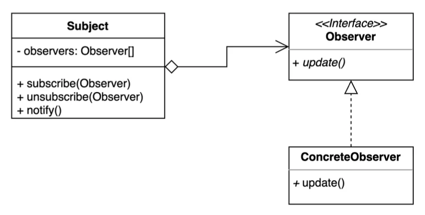
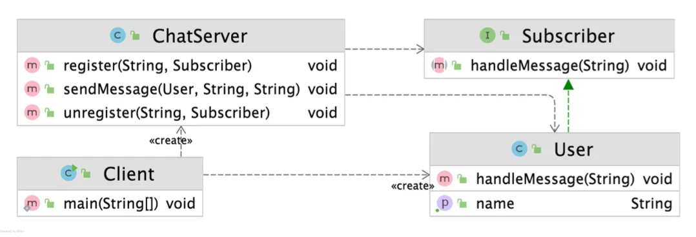

> 📝 
> 
> <a id="1ddeda9b0fe1800190f1c7b531015284"></a>
> 
> <strong>질문</strong>
> 
> <details>
> <summary>옵저버 패턴이란 무엇인가?</summary>
> 
> 
> 
> </details>
> 
> <details>
> <summary>옵저버 패턴의 장•단점은?</summary>
> 
> 
> 
> </details>
> 
> <details>
> <summary>옵저버 패턴의 실무 활용 예제는?</summary>
> 
> 
> 
> </details>

<a id="1ddeda9b0fe180dfa428df88935b1099"></a>

## 옵저버 ( Observer ) 패턴

---

> 📖 
> 
> <a id="1ddeda9b0fe18025a761f6d409a5da8b"></a>
> 
> 옵저버 ( Observer ) 패턴
> 
> ---
> 
> > <strong><u>다수의 객체</u></strong>가 <strong><u>특정 객체 상태 변화</u></strong><strong><u>를 </u></strong><strong><u>감지</u></strong><strong><u>하고 </u></strong><strong><u>알람</u></strong>을 받는 패턴
> > 
> > - <code>발행(publish) &#45; 구독(subscribe) 패턴</code> 구현
> 
> 
> 
> <details>
> <summary>구성 요소</summary>
> 
> - <code>주체(Subject)</code>
>     - 상태 변화를 감지하고, 변화가 발생하면 등록된 옵저버들에게 알람을 보낸다&#46;
> 
> - <code>옵저버(Observer)</code>
>     - 주체에 등록되어 있다가, 주체의 상태 변화 알람을 받으면 자신의 동작을 수행한다&#46; 
> 
> ---
> 
> - 옵저버들은 언제든 주체에 등록 또는 제거될 수 있다 &#46;
> 
> - 주체와 옵저버는 <code>1&#58;N(일대다)</code> 관계를 가진다&#46; 즉, 한 주체에 여러 옵저버가 등록될 수 있다&#46;
> 
> </details>
> 
> <details>
> <summary>장•단점</summary>
> 
> > 장점
> 
> - <code>느슨한 결합</code> ( <code>loosely coupled</code> )
>     - 주체(subject)와 옵저버(Observer)가 <u>서로의 구체적인 정보를 몰라도 동작</u>할 수 있다&#46; → 시스템의 <strong>유연성, 확장성 증가</strong>
> 
> - <code>확장성</code>
>     - 새로운 옵저버가 <u>기존의 코드를 건드리지 않고 쉽게 확장 및 제거</u>될 수 있다&#46;   → <code>OCP</code>
> 
> - <code>재사용성</code>
>     - 주체와 옵저버를 <u>독립적으로 재사용</u> 할 수 있다&#46; 
> 
> > 단점
> 
> - <code>복잡성 증가</code>
>     - <u>옵저버가 많</u>아질수록 <u>관리가 복잡</u>해질 수 있다&#46; 
> 
> - <code>업데이트 순서 불확실</code>
>     - 여러 옵저버가 있을 때, <u>알람을 받는 순서</u>는 <u>예측할 수 없</u>다&#46;
> 
> - <code>순환 참조 위험</code>
>     - <u>옵저버 간 상호 갱신이 반복</u>될 경우, 무한 루프가 발생될 수 있다&#46;
> 
> </details>
> 
> <details>
> <summary>실무 활용 예시</summary>
> 
> > ✏️ 
> > 
> > <a id="1ddeda9b0fe180d69ca4cd84b42867cc"></a>
> > 
> > 옵저버 패턴은 객체 간의 결합도를 낮추면서, 한 객체 상태 변화가 여러 객체에 동적으로 전파되어야 할 때 사용한다&#46; 
> > 
> > <a id="1ddeda9b0fe18005b865fab00de28eea"></a>
> > 
> > <u>이벤트 기반 시스템</u>, <u>실시간 알람 기능</u> 등 다양한 곳에서 활용된다&#46; 
> 
> - 유튜브 구독 시스템
>     - 채널(주체)이 영상을 업로드(상태 변화)하면, 구독자(옵저버)들에게 알람이 간다&#46;
> 
> - 게임 체력 시스템
>     - 플레이어의 체력(주체)이 변하면, 체력바 UI(옵저버)가 자동으로 갱신된다&#46; 
> 
> - GUI 이벤트 시스템
> 
> - 데이터베이스 변경 감지
> 
> - 실시간 알림 서비스 등
> 
> </details>

<a id="1ddeda9b0fe18069894dc3760810febd"></a>

### 1&#46; 기본 예제

<a id="1ddeda9b0fe180e0ab94d0463e3c2afd"></a>

### 코드

<details>
<summary>&#91; 코드 &#93; ChatServer</summary>

<a id="1ddeda9b0fe180649bcdc6b0052fba87"></a>

```java
package _03_behavioral_patterns._19_observer._01_before;

import java.util.ArrayList;
import java.util.HashMap;
import java.util.Map;
import java.util.List;


public class ChatServer {

    private Map<String, List<String>> messages;

    public ChatServer() {
        this.messages = new HashMap<>();
    }

    public void add(String subject, String message) {
        if (messages.containsKey(subject)) {
            messages.get(subject).add(message);
        } else {
            List<String> messageList = new ArrayList<>();
            messageList.add(message);
            messages.put(subject, messageList);
        }
    }

    public List<String> getMessage(String subject) {
        return messages.get(subject);
    }
}
```

</details>

<details>
<summary>&#91; 코드 &#93; Client</summary>

<a id="1ddeda9b0fe180bd9441d81b83a9d06c"></a>

```java
package _03_behavioral_patterns._19_observer._01_before;

public class Client {
    public static void main(String[] args) {
        ChatServer chatServer = new ChatServer();

        User user1 = new User(chatServer);
        user1.sendMessage("디자인패턴", "이번엔 옵저버 패턴입니다.");
        user1.sendMessage("롤드컵2021", "LCK 화이팅!");

        User user2 = new User(chatServer);
        System.out.println(user2.getMessage("디자인패턴"));

        user1.sendMessage("디자인패턴", "예제 코드 보는 중..");
        System.out.println(user2.getMessage("디자인패턴"));
    }
}
```

</details>

<details>
<summary>&#91; 코드 &#93; User</summary>

<a id="1ddeda9b0fe1807b8f20ff66f692672c"></a>

```java
package _03_behavioral_patterns._19_observer._01_before;

import java.util.List;

public class User {

    private ChatServer chatServer;

    public User(ChatServer chatServer) {
        this.chatServer = chatServer;
    }

    public void sendMessage(String subject, String message) {
        chatServer.add(subject, message);
    }

    public List<String> getMessage(String subject) {
        return chatServer.getMessage(subject);
    }
}
```

</details>

<a id="1ddeda9b0fe180218e89c4c1950c6fcc"></a>

### 2&#46; 패턴 적용

<a id="1ddeda9b0fe18069870bec0a0c7bb36f"></a>

### 코드



<details>
<summary>&#91; 코드 &#93; &#60; interface &#62; Subscriber</summary>

<a id="1ddeda9b0fe180598c8ecc2dc2041590"></a>

```java
package _03_behavioral_patterns._19_observer._02_after;

public interface Subscriber {
    void handleMessage(String message);
}

```

</details>

<details>
<summary>&#91; 코드 &#93; User</summary>

<a id="1ddeda9b0fe18077b7a4ecfa800a6d74"></a>

```java
package _03_behavioral_patterns._19_observer._02_after;

public class User implements Subscriber {
    private String name;

    public User(String name) {
        this.name = name;
    }

    public String getName() {
        return name;
    }

    @Override
    public void handleMessage(String message) {
        System.out.println(message);
    }
}

```

</details>

<details>
<summary>&#91; 코드 &#93; ChatServer</summary>

<a id="1ddeda9b0fe18030aebbc65d6529a181"></a>

```java
package _03_behavioral_patterns._19_observer._02_after;

import java.util.ArrayList;
import java.util.HashMap;
import java.util.List;
import java.util.Map;

public class ChatServer {

    private Map<String, List<Subscriber>> subscribers = new HashMap<>();

    public void register(String subject, Subscriber subscriber) {
        if (this.subscribers.containsKey(subject)) {
            this.subscribers.get(subject).add(subscriber);
        } else {
            List<Subscriber> list = new ArrayList<>();
            list.add(subscriber);
            this.subscribers.put(subject, list);
        }
    }

    public void unregister(String subject, Subscriber subscriber) {
        if (this.subscribers.containsKey(subject)) {
            this.subscribers.get(subject).remove(subscriber);
        }
    }

    public void sendMessage(User user, String subject, String message) {
        if (this.subscribers.containsKey(subject)) {
            String userMessage = user.getName() + ": " + message;
            this.subscribers.get(subject).forEach(s -> s.handleMessage(userMessage));
        }
    }
}

```

</details>

<details>
<summary>&#91; 코드 &#93; Client</summary>

<a id="1ddeda9b0fe18013a858f445c8a6c9cf"></a>

```java
package _03_behavioral_patterns._19_observer._02_after;

public class Client {

    public static void main(String[] args) {
        ChatServer chatServer = new ChatServer();
        User user1 = new User("keesun");
        User user2 = new User("lee");

        chatServer.register("오징어게임", user1);
        chatServer.register("오징어게임", user2);

        chatServer.register("디자인패턴", user1);

        chatServer.sendMessage(user1, "오징어게임", "아.. 이름이 기억났어.. 일남이야.. 오일남");
        chatServer.sendMessage(user1, "디자인패턴", "옵저버 패턴으로 만든 채팅");

        chatServer.unregister("디자인패턴", user2);

        chatServer.sendMessage(user2, "디자인패턴", "옵저버 패턴 장, 단점 보는 중");
    }
}

```

</details>

<a id="1ddeda9b0fe1808bafbee902cffde8db"></a>

### 3&#46; 장•단점

- 장점
    - 느슨한 결합 ( loosley coupled )
        - <u>상태를 변경하는 객체(publisher)</u>와 <u>변경을 감지하는 객체(subscriber)</u>의 관계를 느슨하게 유지할 수 있다&#46; 

    - Subject의 상태 변경을 주기적으로 조회하지 않고 자동으로 감지할 수 있다&#46;

    - 런타임에 옵저버를 추가하거나 제거할 수 있다&#46;<br>

- 단점
    - 복잡도가 증가한다&#46; 

    - 다수의 Observer 객체를 등록 이후 해지 않는다면 <strong><u>memory leak이 발생</u></strong>할 수 있다&#46;

<a id="1ddeda9b0fe180fd9c27dd9b80f22cf3"></a>

### 4&#46; 실무 활용

> ✏️ 
> 
> > 자바
> 
> - Observer, Observer ( 자바 9 부터 <code>deprecated</code> )
> 
> - 자바 9 이후 부터는
>     - <code>PropertyChangeListener</code>, <code>PropertyChangeEvent</code>
> 
>     - <code>Flow API</code>
> 
> - <code>SAX</code> (Simple API for XML) 라이브러리
> 
> > 스프링
> 
> - <code>ApplicationContext</code>, <code>ApplicationEvent</code>

<a id="1ddeda9b0fe180af9da6fab987571d1d"></a>

### 코드

<details>
<summary>&#91; 코드 &#93; ObserverInJava</summary>

<a id="1ddeda9b0fe180f58110eb0125cd16c9"></a>

```java
package _03_behavioral_patterns._19_observer._03_java;

import java.util.Observable;
import java.util.Observer;

public class ObserverInJava {

    static class User implements Observer {
        @Override
        public void update(Observable o, Object arg) {
            System.out.println(arg);
        }
    }

    static class Subject extends Observable {
        public void add(String message) {
            setChanged();
            notifyObservers(message);
        }
    }

    public static void main(String[] args) {
        Subject subject = new Subject();
        User user = new User();
        subject.addObserver(user);
        subject.add("Hello Java, Observer");
    }
}

```

</details>

<details>
<summary>&#91; 코드 &#93; FlowInJava</summary>

<a id="1ddeda9b0fe1800ab218fb3b1844978b"></a>

```java
package _03_behavioral_patterns._19_observer._03_java;

import java.util.concurrent.Flow;
import java.util.concurrent.SubmissionPublisher;

public class FlowInJava {

    public static void main(String[] args) {
        Flow.Publisher<String> publisher = new SubmissionPublisher<>();

        Flow.Subscriber<String> subscriber = new Flow.Subscriber<String>() {

            private Flow.Subscription subscription;

            @Override
            public void onSubscribe(Flow.Subscription subscription) {
                System.out.println("sub!");
                this.subscription = subscription;
                this.subscription.request(1);
            }

            @Override
            public void onNext(String item) {
                System.out.println("onNext called");
                System.out.println(Thread.currentThread().getName());
                System.out.println(item);
            }

            @Override
            public void onError(Throwable throwable) {

            }

            @Override
            public void onComplete() {
                System.out.println("completed");
            }
        };

        publisher.subscribe(subscriber);

        ((SubmissionPublisher)publisher).submit("hello java");

        System.out.println("이게 먼저 출력될 수도 있습니다.");
    }
}

```

</details>

<details>
<summary>&#91; 코드 &#93; PropertyChangeExample</summary>

<a id="1ddeda9b0fe18073bb0cc2408f0283be"></a>

```java
package _03_behavioral_patterns._19_observer._03_java;

import java.beans.PropertyChangeEvent;
import java.beans.PropertyChangeListener;
import java.beans.PropertyChangeSupport;

public class PropertyChangeExample {

    static class User implements PropertyChangeListener {
        @Override
        public void propertyChange(PropertyChangeEvent evt) {
            System.out.println(evt.getNewValue());
        }
    }

    static class Subject {
        PropertyChangeSupport support = new PropertyChangeSupport(this);

        public void addObserver(PropertyChangeListener observer) {
            support.addPropertyChangeListener(observer);
        }

        public void removeObserver(PropertyChangeListener observer) {
            support.removePropertyChangeListener(observer);
        }

        public void add(String message) {
            support.firePropertyChange("eventName", null, message);
        }
    }

    public static void main(String[] args) {
        Subject subject = new Subject();
        User observer = new User();
        subject.addObserver(observer);
        subject.add("자바 PCL 예제 코드");
        subject.removeObserver(observer);
        subject.add("이 메시지는 볼 수 없지..");
    }
}

```

</details>

<details>
<summary>&#91; 코드 &#93; MyEvent</summary>

<a id="1ddeda9b0fe18099baa8f820a6a5ad59"></a>

```java
package _03_behavioral_patterns._19_observer._03_java;

public class MyEvent {

    private String message;

    public MyEvent(String message) {
        this.message = message;
    }

    public String getMessage() {
        return message;
    }
}

```

</details>

<details>
<summary>&#91; 코드 &#93; MyEventListener</summary>

<a id="1ddeda9b0fe180819d6bdac3b52db411"></a>

```java
package _03_behavioral_patterns._19_observer._03_java;

import org.springframework.context.event.EventListener;
import org.springframework.stereotype.Component;

@Component
public class MyEventListener {

    @EventListener(MyEvent.class)
    public void onApplicationEvent(MyEvent event) {
        System.out.println(event.getMessage());
    }
}

```

</details>

<details>
<summary>&#91; 코드 &#93; MyRunner</summary>

<a id="1ddeda9b0fe18034a472e5604eec066b"></a>

```java
package _03_behavioral_patterns._19_observer._03_java;

import org.springframework.boot.ApplicationArguments;
import org.springframework.boot.ApplicationRunner;
import org.springframework.context.ApplicationEventPublisher;

public class MyRunner implements ApplicationRunner {

    private ApplicationEventPublisher publisher;

    public MyRunner(ApplicationEventPublisher publisher) {
        this.publisher = publisher;
    }

    @Override
    public void run(ApplicationArguments args) throws Exception {
        publisher.publishEvent(new MyEvent("hello spring event"));
    }
}

```

</details>

<details>
<summary>&#91; 코드 &#93; ObserverInSpring</summary>

<a id="1ddeda9b0fe180d68981d8cf5fdf8f0d"></a>

```java
package _03_behavioral_patterns._19_observer._03_java;

import org.springframework.boot.SpringApplication;
import org.springframework.boot.WebApplicationType;
import org.springframework.boot.autoconfigure.SpringBootApplication;

@SpringBootApplication
public class ObserverInSpring {

    public static void main(String[] args) {
        SpringApplication app = new SpringApplication(ObserverInSpring.class);
        app.setWebApplicationType(WebApplicationType.NONE);
        app.run(args);
    }
}

```

</details>
