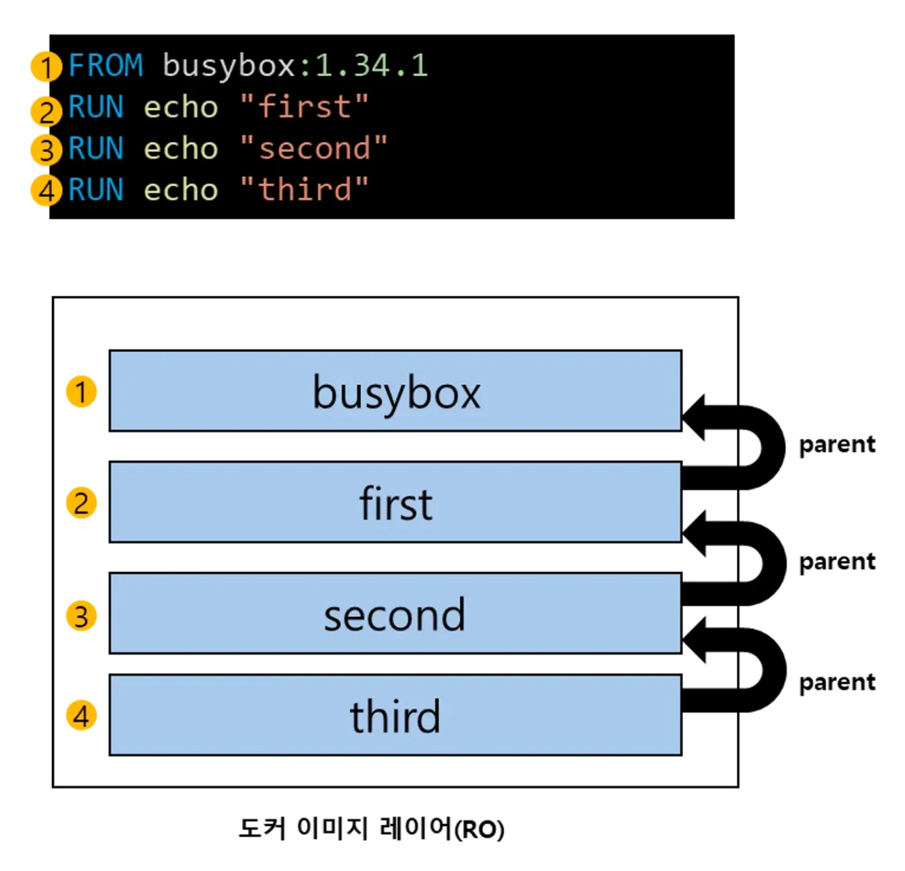
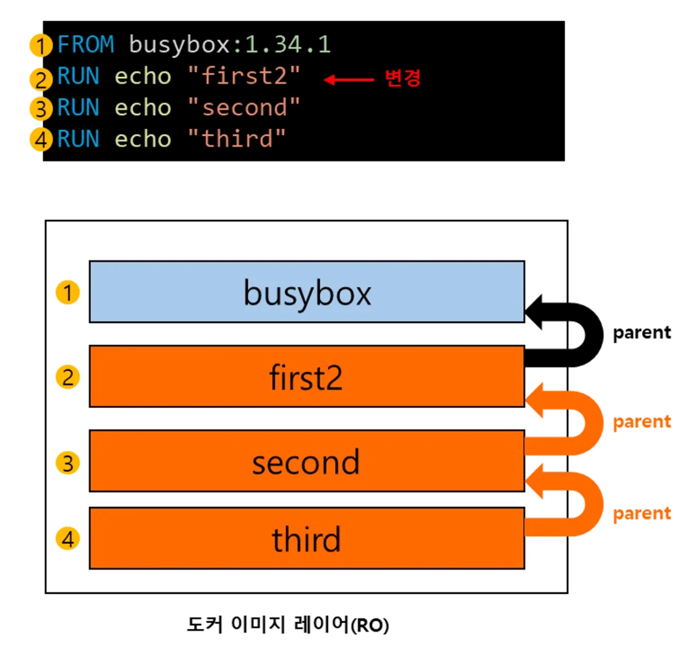

[Docker Layer와 Cache]()

### <strong>Docker Cache 효율적으로 사용하기</strong>

> ✏️ 
> 
> 
> 
> <strong><u>변경이 잦은 레이어</u></strong>를 최대한 코드 <strong><u>마지막에 배치</u></strong>한다&#46;

> <strong>❓ 변경이 잦은 레이어를 마지막에 배치하는 이유</strong>

- 이미지 레이어가 변경되면 <strong>하위 이미지 레이어는 변경 사항이 없더라도 캐시를 사용하지 못한다&#46; (이미지 레이어 체인)</strong>

이미지 레이어는 데이터와 Parent 정보로 구성되어 있기 때문에,<u> </u><strong><u>Parent의 정보가 변경</u></strong><strong>되면 </strong><strong><u>하위 이미지 레이어 전체가 변경</u></strong><strong>된다&#46; </strong>

만약 위와 같은 경우<strong> ,하위 Dockerfile 명령은 새 이미지를 생성 시, 캐시 사용이 되지 않는다&#46; ( 캐시 무효화 )</strong>

<strong>따라서</strong><strong><u> </u></strong><strong><u>코드 수정이 잦은 레이어</u></strong><strong>는 </strong><strong><u>하단으로 배치</u></strong><strong>하여 </strong><strong><u>마지막에 빌드</u></strong><strong>하는 것으로 </strong><strong><u>캐시 기능을 잘 활용</u></strong><strong>할 수 있다&#46; </strong>
