<a id="1c3eda9b0fe181f28a23fd4777071371"></a>

## RestTemplate

> 🤔 <code>RestTemplate</code>은 <strong><u>클라이언트 측에서 다른 서버로 HTTP 요청을 보낼 때 사용하는 라이브러리</u></strong>이다&#46;  여기서 혼동이 있을 수 있는데, <strong>“클라이언트”</strong>란 브라우저나 모바일 애플리케이션을 의미하는 것이 아니라, <strong>다른 서버에 HTTP 요청을 보내는 주체를 의미</strong>한다&#46; <strong><u>서버가 다른 서버에 요청을 보내는 상황에서도 그 서버는 “클라이언트” 역할을 한</u></strong>다&#46; 따라서 <strong><u>RestTemplate은 서버에서 다른 서버로 요청할 때 사용</u></strong><u>된</u>다&#46;
> 
> <details>
> <summary><strong>Server To Server</strong></summary>
> 
> 
> 
> <a id="1c3eda9b0fe181cd9d5ede1f9efd1d50"></a>
> 
> 이전까지는 Client 즉, 브라우저로부터 요청을 받는 서버의 입장에서 개발을 진행했다&#46; 서비스 개발을 진행하다보면 라이브러리 사용만으로 구현이 힘든 기능들이 무수히 많이 존재한다&#46; 
> 
> > 🧐 서비스에서 회원가입을 진행할 때 사용자 주소를 받아야 한다면? 
> 
> <a id="1c3eda9b0fe1817b8779f738170fb6a8"></a>
> 
> 주소를 검색할 수 있는 기능을 구현을 해야한다&#46; 이를 직접 구현이 너무 많은 시간과 비용이 들어간다&#46; 
> 
> 
> 
> <a id="1c3eda9b0fe1815e920fce137e3f7249"></a>
> 
> 이때, 카카오에서 만든 주소 검색 API를 사용한다면 해당 기능을 간편하게 구현할 수 있다&#46;
> 
> <a id="1c3eda9b0fe18186aa26d8a307453a64"></a>
> 
> 이럴 때, 우리는 서버에서 Client의 입장이 되어 Kako 서버에 요청을 진행해야 한다&#46; <strong>Spring에서는 서버에서 다른 서버로 간편하게 요청할 수 있도록 RestTemplate 기능을 제공</strong>하고 있다&#46; 
> 
> </details>

<a id="1c3eda9b0fe181a8afd0f4a881af6c94"></a>

### 주요 클래스 및 메서드 

<a id="1c3eda9b0fe181198791f8ba1f798494"></a>

### <strong>RestTemplate </strong>

<a id="1c3eda9b0fe18195b8cad63342b8225c"></a>

스프링 프레임워크에서 제공하는 <strong>동기식 HTTP 클라이언트</strong>로, <strong><u>RESTful 웹 서비스와 통신할 때 사용</u></strong>

<a id="1c3eda9b0fe1818798a2e68b7a3426cc"></a>

### <strong>RestTemplateBuilder</strong>

<a id="1c3eda9b0fe181a28531c25c66f03e35"></a>

<strong><u>RestTemplate 인스턴스를 더 쉽게 생성</u></strong>하고 <strong><u>구성</u></strong>할 수 있도록<strong><u> 도와주는 빌더 클래스</u></strong>이다&#46;

<a id="1c3eda9b0fe1817fb197e30cf97e6586"></a>

### GET &#45; <strong><code>getForEntity()</code></strong>

> 📌 <strong><code>getForEntity(url, responseType)</code></strong>
> 
> - URL로 지정된 리소스를 GET 요청 가져옴
> 
> - responseType을 통해 역직렬화하여 반환 되는 값의 타입을 지정해야 함
> 
> - 반환된 ResponseEntity에서 상태 코드, 헤더 및 본문에 액세스할 수 있음
> 
> <a id="1c3eda9b0fe18159b543ce8fd9bcd79e"></a>
> 
> ```java
> ResponseEntity<String> response = restTemplate.getForEntity(url, String.class);
> ```

<details>
<summary>ex</summary>

<a id="1c3eda9b0fe181b7ae00c8a2f2d91ed1"></a>

```java
import org.springframework.web.client.RestTemplate;
import org.springframework.http.ResponseEntity;

public class GetExample {

    public static void main(String[] args) {
        RestTemplate restTemplate = new RestTemplate();
        String url = "https://jsonplaceholder.typicode.com/posts/1";
        
        // GET 요청으로 데이터를 가져옴
        ResponseEntity<String> response = restTemplate.getForEntity(url, String.class);
        System.out.println(response.getBody());
    }
}
```

</details>

<a id="1c3eda9b0fe181baa5cce12fdea0f111"></a>

### POST &#45; <strong><code>postForEntity()</code></strong>

> 📌 <strong><code>postForEntity(url, request, responseType)</code></strong>
> 
> - URL로 지정된 리소스를 POST 요청을 통해 생성
> 
> - responseType을 통해 역직렬화하여 반환 되는 값의 타입을 지정해야 함
> 
> - 요청 본문을 HttpEntity로 감싸서 전송
> 
> - 반환된 ResponseEntity에서 상태 코드, 헤더 및 본문에 액세스할 수 있음
> 
> <a id="1c3eda9b0fe1819fb223d65f2ea09240"></a>
> 
> ```java
> HttpHeaders headers = new HttpHeaders();
> headers.setContentType(MediaType.APPLICATION_JSON);
> String jsonBody = "{\"title\": \"foo\", \"body\": \"bar\", \"userId\": 1}";
> HttpEntity<String> request = new HttpEntity<>(jsonBody, headers);
> ResponseEntity<String> response = restTemplate.postForEntity(url, request, String.class);
> ```

<details>
<summary>🧐 강의 예시 &#45; 요청 본문, <strong>객체</strong> 넘김</summary>

<details>
<summary>의문점 코드 </summary>

<a id="1c3eda9b0fe181b8a83bed4092bafca6"></a>

```java
 public ItemDto postCall(String query) {
        // 요청 URL 만들기
        URI uri = UriComponentsBuilder
                .fromUriString("http://localhost:7070")
                .path("/api/server/post-call/{query}")
                .encode()
                .build()
                .expand(query)
                .toUri();
        log.info("uri = " + uri);

        User user = new User("Robbie", "1234");

        ResponseEntity<ItemDto> responseEntity = restTemplate.postForEntity(uri, user, ItemDto.class);

        log.info("statusCode = " + responseEntity.getStatusCode());

        return responseEntity.getBody();
```

</details>

---

<a id="1c3eda9b0fe1814fa729fd375009c2df"></a>

Spring의 RestTemplate을 사용할 때, 요청 본문을 전송하는 방법에는 <strong>두 가지</strong>가 있다&#46; 하나는 <strong>HttpEntity로 감싸서 전송</strong>하는 방법이고, 다른 하나는 <strong>객체를 직접 전송</strong>하는 방법이다&#46; <br>

1. <strong>HttpEntity 사용</strong>
    - HTTP 헤더와 본문을 함께 설정,<br>이를 통해 요청 헤더에 추가 정보를 설정하거나, 요청 본문에 특정 미디어 타입을 지정할 수 있다&#46;

    - 요청 헤더를 명시적으로 설정해야 할 경우 유용하다&#46; 예를 들어, Content&#45;Type이나 인증 정보를 포함해야 할 때 사용한다&#46;

    <details>
    <summary>ex)</summary>

    <a id="1c3eda9b0fe1815cb4f4e1f36072cdc0"></a>

    ```java
    import org.springframework.web.client.RestTemplate;
    import org.springframework.http.ResponseEntity;
    import org.springframework.http.HttpEntity;
    import org.springframework.http.HttpHeaders;
    import org.springframework.http.MediaType;

    public class PostExampleWithHttpEntity {

        public static void main(String[] args) {
            RestTemplate restTemplate = new RestTemplate();
            String url = "https://jsonplaceholder.typicode.com/posts";
            
            HttpHeaders headers = new HttpHeaders();
            headers.setContentType(MediaType.APPLICATION_JSON);
            
            String jsonBody = "{\"title\": \"foo\", \"body\": \"bar\", \"userId\": 1}";
            HttpEntity<String> request = new HttpEntity<>(jsonBody, headers);
            
            ResponseEntity<String> response = restTemplate.postForEntity(url, request, String.class);
            
            // 상태 코드 액세스
            int statusCode = response.getStatusCodeValue();
            System.out.println("Status Code: " + statusCode);
            
            // 헤더 액세스
            HttpHeaders responseHeaders = response.getHeaders();
            System.out.println("Headers: " + responseHeaders);
            
            // 본문 액세스
            String responseBody = response.getBody();
            System.out.println("Body: " + responseBody);
        }
    }
    ```

    </details>

1. <strong>객체 직접 전송</strong>
    - 객체를 직접 전송할 때는 RestTemplate이 내부적으로 객체를 JSON으로 변환하고, 기본 헤더를 설정하여 요청을 보낸다&#46;

    - 요청 본문을 간단하게 전송할 때 사용

    <details>
    <summary>ex)</summary>

    <a id="1c3eda9b0fe181f19d31e8e9de3fd125"></a>

    ```java
    import org.springframework.web.client.RestTemplate;
    import org.springframework.http.ResponseEntity;

    public class PostExampleWithObject {

        public static void main(String[] args) {
            RestTemplate restTemplate = new RestTemplate();
            String url = "https://jsonplaceholder.typicode.com/posts";
            
            // 요청 본문을 나타내는 객체 생성
            PostRequest postRequest = new PostRequest("foo", "bar", 1);
            
            ResponseEntity<String> response = restTemplate.postForEntity(url, postRequest, String.class);
            
            // 상태 코드 액세스
            int statusCode = response.getStatusCodeValue();
            System.out.println("Status Code: " + statusCode);
            
            // 헤더 액세스
            HttpHeaders responseHeaders = response.getHeaders();
            System.out.println("Headers: " + responseHeaders);
            
            // 본문 액세스
            String responseBody = response.getBody();
            System.out.println("Body: " + responseBody);
        }
    }

    // 요청 본문을 나타내는 클래스
    class PostRequest {
        private String title;
        private String body;
        private int userId;

        public PostRequest(String title, String body, int userId) {
            this.title = title;
            this.body = body;
            this.userId = userId;
        }

        // getters and setters
    }
    ```

    </details>

<a id="1c3eda9b0fe18195bca3e141d7eddb58"></a>

<strong>결론)</strong>

<a id="1c3eda9b0fe1815f9f9cc2e96a5cc60a"></a>

HttpEntity를 사용하지 않고도 객체를 직접 전송할 수 있는 이유는 <strong>Spring의 RestTemplate이 이를 지원하도록 설계</strong>되었기 때문이다&#46; 그러나, <strong>더 세밀한 제어가 필요할 때는 HttpEntity를 사용하는 것이 좋</strong>다&#46;

</details>

<details>
<summary>ex)</summary>

<a id="1c3eda9b0fe181f5b8b6f6e8cfe5c5c1"></a>

```java
import org.springframework.web.client.RestTemplate;
import org.springframework.http.ResponseEntity;
import org.springframework.http.HttpEntity;
import org.springframework.http.HttpHeaders;
import org.springframework.http.MediaType;

public class PostExample {

    public static void main(String[] args) {
        RestTemplate restTemplate = new RestTemplate();
        String url = "https://jsonplaceholder.typicode.com/posts";
        
        // POST 요청에 필요한 헤더 설정
        HttpHeaders headers = new HttpHeaders();
        headers.setContentType(MediaType.APPLICATION_JSON);
        
        // 요청 본문 설정
        String jsonBody = "{\"title\": \"foo\", \"body\": \"bar\", \"userId\": 1}";
        HttpEntity<String> request = new HttpEntity<>(jsonBody, headers);
        
        // POST 요청으로 새로운 리소스를 생성
        ResponseEntity<String> response = restTemplate.postForEntity(url, request, String.class);
        System.out.println(response.getBody());
    }
}
```

</details>

<a id="1c3eda9b0fe18121973ddc2c92f2215c"></a>

### PUT &#45; <strong><code>put()</code></strong>

> 📌 <strong><code>put(url, request);</code></strong>
> 
> - <strong>URL로 지정된 리소스를 PUT 요청을 통해 업데이트</strong>
> 
> - <strong>요청 본문을 HttpEntity로 감싸서 전송</strong>
> 
> - <strong>반환값 없음</strong>
> 
> <a id="1c3eda9b0fe1811e81ddf51cf4d68482"></a>
> 
> ```java
> HttpHeaders headers = new HttpHeaders();
> headers.setContentType(MediaType.APPLICATION_JSON);
> String jsonBody = "{\"id\": 1, \"title\": \"foo updated\", \"body\": \"bar updated\", \"userId\": 1}";
> HttpEntity<String> request = new HttpEntity<>(jsonBody, headers);
> restTemplate.put(url, request);
> ```

<details>
<summary>ex)</summary>

<a id="1c3eda9b0fe18169a32af29fd2018f08"></a>

```java
import org.springframework.web.client.RestTemplate;
import org.springframework.http.HttpEntity;
import org.springframework.http.HttpHeaders;
import org.springframework.http.MediaType;

public class PutExample {

    public static void main(String[] args) {
        RestTemplate restTemplate = new RestTemplate();
        String url = "https://jsonplaceholder.typicode.com/posts/1";
        
        // PUT 요청에 필요한 헤더 설정
        HttpHeaders headers = new HttpHeaders();
        headers.setContentType(MediaType.APPLICATION_JSON);
        
        // 업데이트할 데이터 설정
        String jsonBody = "{\"id\": 1, \"title\": \"foo updated\", \"body\": \"bar updated\", \"userId\": 1}";
        HttpEntity<String> request = new HttpEntity<>(jsonBody, headers);
        
        // PUT 요청으로 리소스를 업데이트
        restTemplate.put(url, request);
        System.out.println("Resource updated successfully");
    }
} 
```

</details>

<a id="1c3eda9b0fe1812fa3abfc84815936e2"></a>

### DELET &#45; <strong><code>delete()</code></strong>

> 📌 <strong><code>delete(url);</code></strong>
> 
> - URL로 지정된 리소스를 DELETE 요청을 통해 삭제
> 
> - 반환값 없음
> 
> <a id="1c3eda9b0fe181128a4ac23a88c1511d"></a>
> 
> ```java
> restTemplate.delete(url);
> ```

<details>
<summary>ex</summary>

<a id="1c3eda9b0fe1812ebf3cfb1c501bf0f0"></a>

```java
import org.springframework.web.client.RestTemplate;

public class DeleteExample {

    public static void main(String[] args) {
        RestTemplate restTemplate = new RestTemplate();
        String url = "https://jsonplaceholder.typicode.com/posts/1";
        
        // DELETE 요청으로 리소스를 삭제
        restTemplate.delete(url);
        System.out.println("Resource deleted successfully");
    }
}
```

</details>

<details>
<summary>상태 코드, 헤더, 본문, 상태코드 액세스하기</summary>

<details>
<summary><code>ResponseEntity</code>를 통한 Access ( <code>GET</code>, <code>POST</code> )</summary>

<a id="1c3eda9b0fe181239bfbd386ab5ba9e9"></a>

```java
ResponseEntity<String> response = restTemplate.getForEntity(url, String.class);
// ResponseEntity<String> response = restTemplate.postForEntity(url, request, String.class);

        
// 상태 코드 액세스
int statusCode = response.getStatusCodeValue();
System.out.println("Status Code: " + statusCode);

// 헤더 액세스
HttpHeaders headers = response.getHeaders();
System.out.println("Headers: " + headers);

// 본문 액세스
String body = response.getBody();
System.out.println("Body: " + body);
```

</details>

<details>
<summary><code>try&#45;catch</code>를 통한 상태코드 반환 ( <code>PUT</code>, <code>DELETE</code> )</summary>

> 예외가 발생 시에만 상태코드 확인 가능

<a id="1c3eda9b0fe181eaa73cfe73b16e3953"></a>

```java
try {
		// UPDATE ( PUT )
    restTemplate.put(url, request);
    System.out.println("Resource updated successfully");
    
    // DELET
    // restTemplate.delete(url);
    // System.out.println("Resource deleted successfully");
    
} catch (HttpClientErrorException e) {
    HttpStatus statusCode = e.getStatusCode();
    System.out.println("Status Code: " + statusCode.value());
}
```

</details>

</details>

<details>
<summary><strong>🧐 </strong><strong><code>RestTemplate</code></strong><strong> 사용을 위한 DI 시, </strong><strong><code>RestTemplateBuilder</code></strong><strong>를 통해 RestTemplate를 만들어 주입한다&#46; 왜 그렇게 동작하는가? </strong></summary>

<a id="1c3eda9b0fe18186b679fb606ba52e75"></a>

<code>RestTemplateBuilder</code>를 통해 생성하는 이유는 더 유연하게 <code>RestTemplate</code> 인스턴스를 만들 수 있기 때문이다&#46; 

<a id="1c3eda9b0fe1819fb2d9c53f596ee320"></a>

### <strong> 1&#46; 기본 RestTemplate 생성의 문제점</strong>

<a id="1c3eda9b0fe181a7a298cee71abc202b"></a>

아래와 같이 <strong>직접  RestTemplate 생성 시</strong>, 기본 설정으로만 구성되어 보다 복잡한 설정이 필요한 경우 한계가 존재한다&#46; 

<a id="1c3eda9b0fe181efb33aedba1387e846"></a>

```java
private final RestTemplate restTemplate = new RestTemplate();
```

<a id="1c3eda9b0fe181ef9c15f32361450693"></a>

### <strong>2&#46; RestTemplateBuilder를 통한 유연한 생성</strong>

<a id="1c3eda9b0fe1815695caec5afc9fb521"></a>

 RestTemplateBuilder는 <strong>다양한 설정 옵션을 제공</strong>하여 <strong><code>RestTemplate</code></strong><strong>을 커스터마이징</strong>할<strong> </strong>수 있도록 도와준다&#46; 

<a id="1c3eda9b0fe181d9bc6ef43f15d99b75"></a>

<strong><u>기본 헤더, 타임아웃 설정, 메시지 컨버터 추가, 에러 핸들러 설정</u></strong> 등이 가능하다&#46;

- 예시 &#45; <code>RestTemplateBuilder</code> 사용한 <code>RestTemplate</code> 커스텀
    <a id="1c3eda9b0fe181f8bd61eb5a80fc2779"></a>

    ```java
    import org.springframework.boot.web.client.RestTemplateBuilder;
    import org.springframework.web.client.RestTemplate;

    public class RestTemplateService {

        private final RestTemplate restTemplate;

        public RestTemplateService(RestTemplateBuilder builder) {
            // RestTemplateBuilder를 사용하여 RestTemplate을 생성
            this.restTemplate = builder
                .setConnectTimeout(Duration.ofSeconds(5))  // 연결 타임아웃 설정
                .setReadTimeout(Duration.ofSeconds(5))     // 읽기 타임아웃 설정
                .defaultHeader(HttpHeaders.CONTENT_TYPE, MediaType.APPLICATION_JSON_VALUE)  // 기본 헤더 설정
                .errorHandler(new CustomErrorHandler())    // 커스텀 에러 핸들러 설정
                .build();
        }

        // RestTemplate을 사용하는 메서드들...
    }
    ```

<a id="1c3eda9b0fe1812c802de7929b550c0a"></a>

### <strong>장점</strong>

1. <strong>유연한 구성</strong>&#58; RestTemplateBuilder를 통해 다양한 설정을 <strong><u>체인 방식</u></strong>으로 추가할 수 있다&#46;

1. <strong>읽기 쉬운 코드</strong>&#58; 설정 옵션들이 체인 방식으로 구성되어 <strong>가독성이 높</strong>아진다&#46;&#46;

1. <strong>DI(의존성 주입)와의 통합</strong>&#58; 스프링 부트에서 <strong>RestTemplateBuilder</strong>를 <strong>빈으로 자동 구성</strong>하므로, 설정된 RestTemplateBuilder를 주입받아 사용할 수 있다&#46;

1. <strong>테스트 용이성</strong>&#58; <strong><u>설정이 외부화</u></strong>되어 있기 때문에 <strong>테스트 시 다른 설정으로 쉽게 변경</strong>할 수 있다&#46;

<a id="1c3eda9b0fe18179b21bc0ea750f98dd"></a>

### <strong>사용 예시</strong>

<details>
<summary><strong>Application Configuration</strong> ( <code>수동 빈 등록</code> )</summary>

<a id="1c3eda9b0fe18192b019c3a234bd4d2d"></a>

```java
import org.springframework.boot.web.client.RestTemplateBuilder;
import org.springframework.context.annotation.Bean;
import org.springframework.context.annotation.Configuration;

@Configuration
public class AppConfig {

    @Bean
    public RestTemplate restTemplate(RestTemplateBuilder builder) {
        return builder
            .setConnectTimeout(Duration.ofSeconds(5))
            .setReadTimeout(Duration.ofSeconds(5))
            .build();
    }
}

```

</details>

<details>
<summary><strong>Service 클래스에서 사용&#58; </strong>등록한<strong> </strong>restTemplate 빈 주입</summary>

<a id="1c3eda9b0fe1815b9a4eed80109493fd"></a>

```java
import org.springframework.stereotype.Service;
import org.springframework.web.client.RestTemplate;

@Service
public class RestTemplateService {

    private final RestTemplate restTemplate;

    public RestTemplateService(RestTemplate restTemplate) {
        this.restTemplate = restTemplate;
    }

    // RestTemplate을 사용하는 메서드들...
}
```

</details>

</details>

<details>
<summary>🧐 <strong>Error)</strong> <strong>ResourceAccessException</strong></summary>

<a id="1c3eda9b0fe181e1b971f3570923ee49"></a>

### 오류 해석

<details>
<summary><strong>Error Message</strong></summary>

<a id="1c3eda9b0fe181b2bcf0c93fef52ed46"></a>

```java
2024-05-31T13:26:02.722+09:00 ERROR 2665 --- [spring-resttemplate-client] [nio-8080-exec-3] o.a.c.c.C.[.[.[/].[dispatcherServlet]    : Servlet.service() for servlet [dispatcherServlet] in context with path [] threw exception [Request processing failed: org.springframework.web.client.ResourceAccessException: I/O error on GET request for "http://localhost:7070/api/server/get-call-obj": Connection refused] with root cause
```

</details>

- Spring의 <strong><code>RestTemplate</code></strong>을 사용하여 HTTP GET 요청을 보내려고 했을 때 발생한 I/O<code>(in/out, 입출력)</code> 오류
    <details>
    <summary><strong>1&#46; </strong><strong><code>I/O error on GET request for &#34;http&#58;//localhost&#58;7070/api/server/get&#45;call&#45;obj&#34;&#58; Connection refused</code></strong><strong> </strong></summary>

    - 이 부분은 <code>RestTemplate</code>이 <code>http&#58;//localhost&#58;7070/api/server/get&#45;call&#45;obj</code> URL로 GET 요청을 보낼 때 I/O 오류가 발생했음을 나타낸다&#46; 

    - &#34;Connection refused&#34;는 대상 서버가 요청을 거부했음을 의미, <strong>서버가 실행 중이지 않</strong>거나, <strong>지정된 포트(여기서는 7070)에서 수신 대기 중이지 않</strong>음을 나타낸다&#46;

    </details>

    <details>
    <summary><strong>2&#46; </strong><strong><code>org&#46;springframework&#46;web&#46;client&#46;ResourceAccessException</code></strong></summary>

    -  Spring <strong><code>RestTemplate</code></strong>에서 발생한 예외로, 리소스에 접근할 수 없을 때 발생

    </details>

    <details>
    <summary><strong>3&#46; </strong><strong><code>Servlet&#46;service() for servlet &#91;dispatcherServlet&#93; in context with path &#91;&#93; threw exception &#91;Request processing failed</code></strong></summary>

    - Spring MVC의 <strong><code>DispatcherServlet</code></strong>이 요청을 처리하는 중에 예외가 발생했음을 나타냄

    </details>

<a id="1c3eda9b0fe181129c1ffc7b7e698335"></a>

### 원인 분석

1. <strong>서버가 실행 중이지 않음 </strong>
    - <strong><code>localhost&#58;7070</code></strong>에서 실행 중이어야 할 서버가 실행 중이지 않음

1. <strong>잘못된 포트 또는 URL</strong>

1. <strong>방화벽 또는 네트워크 문제</strong>
    - 로컬 환경에서 방화벽이나 네트워크 설정으로 인해 포트 7070에 대한 연결이 차단

1. <strong>서버 설정 문제</strong>
    - 대상 서버가 요청을 올바르게 수신할 수 있도록 설정되어 있는지 확인<br>예를 들어, 서버가 해당 포트에서 수신 대기하고 있는지, 필요한 권한이 있는지 등을 점검

> 오류의 원인은 1번에 해당하였음, 서버를 실행하지 않았음

</details>

<a id="1c3eda9b0fe181fc85d3d19773502a6f"></a>

## RestTemplate &#45; GET 요청

<details>
<summary>GET &#45; <strong><code>getForEntity()</code></strong></summary>

> 📌 <strong><code>getForEntity(url, responseType)</code></strong>
> 
> - URL로 지정된 리소스를 GET 요청 가져옴
> 
> - responseType을 통해 역직렬화하여 반환 되는 값의 타입을 지정해야 함
> 
> - 반환된 ResponseEntity에서 상태 코드, 헤더 및 본문에 액세스할 수 있음
> 
> <a id="1c3eda9b0fe1810f9ffdcb29cc5e9482"></a>
> 
> ```java
> ResponseEntity<String> response = restTemplate.getForEntity(url, String.class);
> ```

<details>
<summary>ex</summary>

<a id="1c3eda9b0fe1812598f2d321cb79aca2"></a>

```java
import org.springframework.web.client.RestTemplate;
import org.springframework.http.ResponseEntity;

public class GetExample {

    public static void main(String[] args) {
        RestTemplate restTemplate = new RestTemplate();
        String url = "https://jsonplaceholder.typicode.com/posts/1";
        
        // GET 요청으로 데이터를 가져옴
        ResponseEntity<String> response = restTemplate.getForEntity(url, String.class);
        System.out.println(response.getBody());
    }
}
```

</details>

</details>

---

<details>
<summary><strong>🧐 직렬화, 역직렬화 </strong></summary>

<a id="1c3eda9b0fe18183a46fe65c9adb8e3f"></a>

<strong>직렬화(Serialization)</strong>는 <u>객체를 저장하거나 전송</u>할 수 있도록 <strong><u>객체의 상태를 </u></strong><strong><u>바이트 스트림</u></strong><strong><u>으로 변환</u></strong>하는 과정이다&#46;

<a id="1c3eda9b0fe181e68ce0d5e9fca8dd17"></a>

예를 들어<u>, Java 객체를 파일로 저장</u>하거나<u> 네트워크를 통해 전송</u>할 때 직렬화를 사용한다&#46;

<a id="1c3eda9b0fe181f6a74de289c8400500"></a>

<strong>역직렬화(Deserialization)</strong>는 <u>직렬화된 바이트 스트림</u>을 다시 <strong><u>객체로 복원</u></strong>하는 과정인다&#46; <u>저장된 파일</u>이나 <u>네트워크를 통해 전송된 데이터</u>를 다시<u> 프로그램 내 사용을 위한 객체로 복원하는데 사용</u>한다&#46;

<a id="1c3eda9b0fe1817c9047ff060c2e6ac3"></a>

Java에서 직렬화와 역직렬화를 위해 java&#46;io&#46;Serializable 인터페이스를 사용한다&#46;

</details>

<details>
<summary>한개의 item  GET 요청</summary>

<details>
<summary><code>Client</code></summary>

<details>
<summary><code>Controller</code>&#58; <strong>RestTemplatecontroller</strong></summary>

- 요청 url 에서의 <code>query</code> Controller로 보냄

<a id="1c3eda9b0fe181dfbde7d3d928dc0d72"></a>

```java
@GetMapping("/get-call-obj")
public ItemDto getCallObject(String query) {
    return restTemplateService.getCallObject(query);
}
```

</details>

<details>
<summary><code>Service</code>&#58; <strong>RestTemplateServer</strong></summary>

- Controller에서 받아온  <code>query</code>로  <strong><u>서버에 요청할 url 동적으로 생성</u></strong>

-  restTemplate&#46;getForEntity()로 동적으로 생성한 url에 GET 요청 후 서버에서 ResponseEntity 반환받음

- <strong>GET 요청</strong>을 통해 (<code>restTemplate&#46;getForEntity()</code>) 반환 받은 ResponseEntity에 <code>getBody()</code>를 통해 <code>ItemDto</code> 값만 반환
    <details>
    <summary>🧐 <strong><code>responseEntity&#46;getBody()</code></strong><strong> 확인</strong></summary>

    - 로그 출력
        <a id="1c3eda9b0fe181069e40e7ecf78aa2b5"></a>

        ```java
         log.info("responseEntity.getBody: "  + responseEntity.getBody());
        ```

    - 출력 확인
        <a id="1c3eda9b0fe1811bb4dbf1564ec058e3"></a>

        ```java
         responseEntity.getBody: com.sparta.springresttemplateclient.dto.ItemDto@5b9b3091
        ```

    </details>

<a id="1c3eda9b0fe181ce9494d016e0c6b815"></a>

```java
public ItemDto getCallObject(String query) {
    //server 요청 URL 생성
    URI uri = UriComponentsBuilder
            .fromUriString("http://localhost:7070")  // 서버 url
            .path("/api/server/get-call-obj")
            .queryParam("query", query)  //  쿼리 입력 받음, 동적 url 생성
            .encode()
            .build()
            .toUri();
    log.info("uri = " + uri);

    // 역직렬화 될 ItemDto 클래스 넘김
    ResponseEntity<ItemDto> responseEntity = restTemplate.getForEntity(uri, ItemDto.class);

    log.info("statusCode = " + responseEntity.getStatusCode());

    return responseEntity.getBody();
}
```

</details>

<details>
<summary><code>Dto</code>&#58; <strong>ItemDto</strong></summary>

<a id="1c3eda9b0fe18162af37e4d2d959b517"></a>

```java
package com.sparta.springresttemplateclient.dto;

import lombok.Getter;
import lombok.NoArgsConstructor;
import org.json.JSONObject;

@Getter
@NoArgsConstructor
public class ItemDto {
    private String title;
    private int price;

    public ItemDto(JSONObject itemJson) {
        this.title = itemJson.getString("title");
        this.price = itemJson.getInt("price");
    }
}
```

</details>

</details>

<details>
<summary><code>Server</code></summary>

<details>
<summary>🧐 <code>&#64;RequestParam</code> ?</summary>

<a id="1c3eda9b0fe181dd86ebf316ddce61c7"></a>

Spring MVC &#45; 애노테이션<br>HTTP 요청에서 <strong><u>쿼리 파라미터</u></strong><strong>, </strong><strong><u>폼 데이터</u></strong><strong>, 혹은 </strong><strong><u>URL 매개변수</u></strong>를 <strong><u>메서드의 파라미터로 바인딩</u></strong>하는데 사용<br>

<details>
<summary>ex)  <code>&#64;RequestParam</code></summary>

<a id="1c3eda9b0fe181e296f0f2586b2fd9f4"></a>

```java
import org.springframework.web.bind.annotation.GetMapping;
import org.springframework.web.bind.annotation.RequestParam;
import org.springframework.web.bind.annotation.RestController;

@RestController
public class MyController {

    @GetMapping("/greet")
    public String greet(@RequestParam(name = "name", required = false, defaultValue = "Guest") String name) {
        return "Hello, " + name;
    }
}
```

- <code>name = &#34;name&#34;&#58; HTTP</code> 요청 파라미터의 이름을 지정

- <code>required = false</code>&#58; 이 파라미터가 필수인지 여부, <code>defualt = true</code>

- <code>defaultValue = &#34;Guest&#34;</code>&#58; 파라미터가 제공되지 않을 경우 사용할 기본값을 지정

1. <strong>파라미터가 제공된 경우</strong>
    <a id="1c3eda9b0fe181ada43ae4b758d8d78f"></a>

    ```java
    GET /greet?name=John
    ```

    - 응답&#58; Hello, John

1. <strong>파라미터가 제공되지 않은 경우</strong>
    <a id="1c3eda9b0fe181ada68ede08e339b2ec"></a>

    ```java
    GET /greet
    ```

    - 응답&#58; Hello, Guest 

</details>

</details>

<details>
<summary><code>Controller</code>&#58; <strong>ItemController</strong></summary>

- 요청 url에서 받아온 query Controller로 넘김

<a id="1c3eda9b0fe181468865d9e3d400159e"></a>

```java
@GetMapping("/get-call-obj")
public Item getCallObject(@RequestParam String query) {
    return itemService.getCallObject(query);
}
```

</details>

<details>
<summary><code>Service</code>&#58; <strong>ItemService</strong></summary>

- for문을 통해 받아온 query와 동일한 아이템 값이 존재하면 해당하는 아이템 반환

<a id="1c3eda9b0fe181e0a6f6e23656c0c696"></a>

```java
 private final List<Item> itemList = Arrays.asList(
        new Item("Mac", 3_888_000),
        new Item("iPad", 1_230_000),
        new Item("iPhone", 1_550_000),
        new Item("Watch", 450_000),
        new Item("AirPods", 350_000)
);

public Item getCallObject(String query) {
    for (Item item : itemList) {
        if(item.getTitle().equals(query)) {
            return item;
        }
    }
    return null;
}
```

</details>

</details>

<details>
<summary>PostMan을 통한 테스트 </summary>

- PostMan &#45; GET 요청 

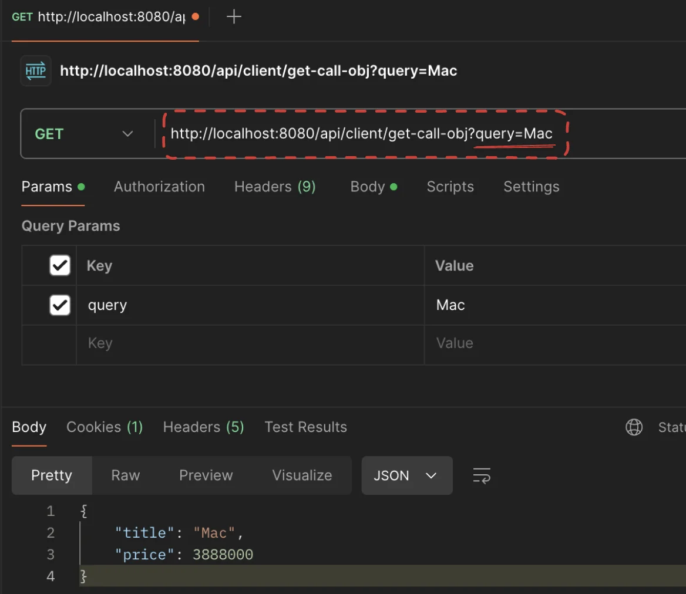

- client &#45; log
    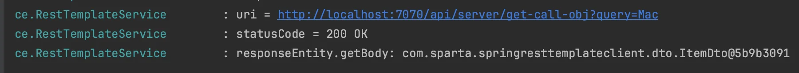

</details>

</details>

<details>
<summary>전체 list GET 요청</summary>

<details>
<summary><code>Client</code></summary>

<details>
<summary><code>Controller</code>&#58; <strong>RestTemplateController</strong></summary>

<a id="1c3eda9b0fe181919af4c487d3da67ab"></a>

```java
@GetMapping("/get-call-list")
public List<ItemDto> getCallList() {
    return restTemplateService.getCallList();
}
```

</details>

<details>
<summary><code>Service</code>&#58; <strong>RestTemplateService</strong></summary>

- 전체 리스트 조회이기 때문에 개별 아이템을 구분할 query가 필요없음

- 전체 itemList를 가져오기 때문에 ItemDto가 아닌 <code>String&#46;class</code>로 역직렬화하여 가져옴

<a id="1c3eda9b0fe18181aa48d25dced626fc"></a>

```java
public List<ItemDto> getCallList() {
		// 요청 URL 만들기
		URI uri = UriComponentsBuilder
		        .fromUriString("http://localhost:7070")
		        .path("/api/server/get-call-list")
		        .encode()
		        .build()
		        .toUri();
		log.info("uri = " + uri);
		
		// String으로 한번에 넘김
		ResponseEntity<String> responseEntity = restTemplate.getForEntity(uri, String.class);
		
		log.info("statusCode = " + responseEntity.getStatusCode());
		log.info("Body = " + responseEntity.getBody());
		
		return fromJSONtoItems(responseEntity.getBody());
}
```

</details>

</details>

<details>
<summary><code>Server</code></summary>

<details>
<summary><code>Controller</code>&#58; <strong>ItemController</strong></summary>

<a id="1c3eda9b0fe181d1bc66d9a37eb3ff8a"></a>

```java
@GetMapping("/get-call-list")
public ItemResponseDto getCallList() {
	  return itemService.getCallList();
}
```

</details>

<details>
<summary><code>Service</code>&#58; <strong>ItemService</strong></summary>

- 전체 아이템 List,  ItemResponseDto에 담아 반환

<a id="1c3eda9b0fe1814c8fdae137088d33d7"></a>

```java
public ItemResponseDto getCallList() {
    ItemResponseDto responseDto = new ItemResponseDto();
    for (Item item : itemList) {
        responseDto.setItems(item);
    }
    return responseDto;
}
```

</details>

<details>
<summary><code>Dto</code>&#58; <strong>ItemResponseDto</strong></summary>

<a id="1c3eda9b0fe1816e9cd6cf87d433d8bc"></a>

```java
package com.sparta.springresttemplateserver.dto;

import com.sparta.springresttemplateserver.entity.Item;
import lombok.Getter;

import java.util.ArrayList;
import java.util.List;

@Getter
public class ItemResponseDto {
    private final List<Item> items = new ArrayList<>();

    public void setItems(Item item) {
        items.add(item);
    }
}
```

</details>

</details>

<details>
<summary>PostMan을 통한 테스트 </summary>

- 전체리스트 GET 요청
    > <code>http&#58;//localhost&#58;8080/api/client/get&#45;call&#45;list</code> 로 GET 요청 시 아래와 같티 전체 리스트가 반환되는 것을 확인 

    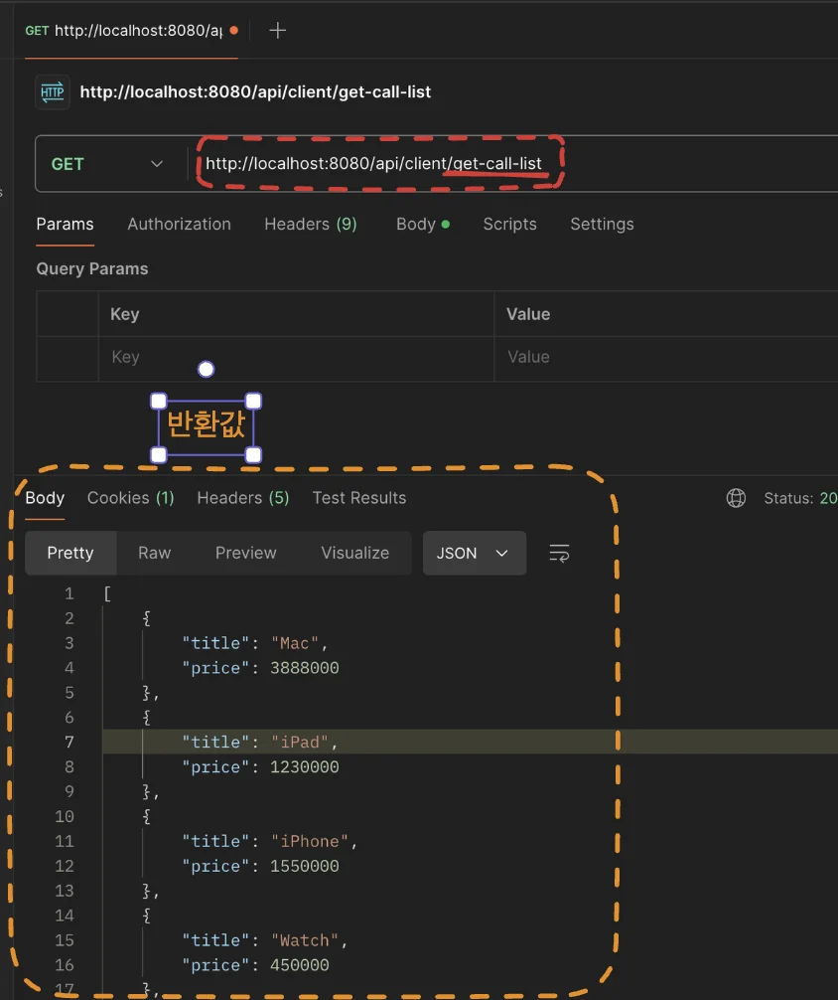

- client &#45; log 출력
    > 아래와 같이 url, 상태코드, 반환값이 정상적으로 잘 나오는 것을 확인

    <a id="1c3eda9b0fe1812eb94ce431d9bd9492"></a>

    ```java
    log.info("uri = " + uri);
    log.info("statusCode = " + responseEntity.getStatusCode());
    log.info("Body = " + responseEntity.getBody());
    ```

    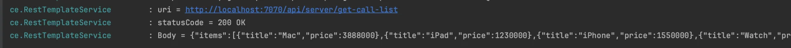

</details>

</details>

<a id="1c3eda9b0fe18140a386c6ca009a8b88"></a>

## RestTemplate &#45; POST 요청

<details>
<summary>POST &#45; <strong><code>postForEntity()</code></strong></summary>

> 📌 <strong><code>postForEntity(url, request, responseType)</code></strong>
> 
> - URL로 지정된 리소스를 POST 요청을 통해 생성
> 
> - responseType을 통해 역직렬화하여 반환 되는 값의 타입을 지정해야 함
> 
> - 요청 본문을 HttpEntity로 감싸서 전송
> 
> - 반환된 ResponseEntity에서 상태 코드, 헤더 및 본문에 액세스할 수 있음
> 
> <a id="1c3eda9b0fe18135b4bec2994cab139e"></a>
> 
> ```java
> HttpHeaders headers = new HttpHeaders();
> headers.setContentType(MediaType.APPLICATION_JSON);
> String jsonBody = "{\"title\": \"foo\", \"body\": \"bar\", \"userId\": 1}";
> HttpEntity<String> request = new HttpEntity<>(jsonBody, headers);
> ResponseEntity<String> response = restTemplate.postForEntity(url, request, String.class);
> ```

<details>
<summary>🧐 강의 예시 &#45; 요청 본문, <strong>객체</strong> 넘김</summary>

<details>
<summary>의문점 코드 </summary>

<a id="1c3eda9b0fe18105b981e526eab9d446"></a>

```java
 public ItemDto postCall(String query) {
        // 요청 URL 만들기
        URI uri = UriComponentsBuilder
                .fromUriString("http://localhost:7070")
                .path("/api/server/post-call/{query}")
                .encode()
                .build()
                .expand(query)
                .toUri();
        log.info("uri = " + uri);

        User user = new User("Robbie", "1234");

        ResponseEntity<ItemDto> responseEntity = restTemplate.postForEntity(uri, user, ItemDto.class);

        log.info("statusCode = " + responseEntity.getStatusCode());

        return responseEntity.getBody();
```

</details>

---

<a id="1c3eda9b0fe181089027d64751adf5f2"></a>

Spring의 RestTemplate을 사용할 때, 요청 본문을 전송하는 방법에는 <strong>두 가지</strong>가 있다&#46; 하나는 <strong>HttpEntity로 감싸서 전송</strong>하는 방법이고, 다른 하나는 <strong>객체를 직접 전송</strong>하는 방법이다&#46; <br>

1. <strong>HttpEntity 사용</strong>
    - HTTP 헤더와 본문을 함께 설정,<br>이를 통해 요청 헤더에 추가 정보를 설정하거나, 요청 본문에 특정 미디어 타입을 지정할 수 있다&#46;

    - 요청 헤더를 명시적으로 설정해야 할 경우 유용하다&#46; 예를 들어, Content&#45;Type이나 인증 정보를 포함해야 할 때 사용한다&#46;

    <details>
    <summary>ex)</summary>

    <a id="1c3eda9b0fe181bc9cc3c097db903ca5"></a>

    ```java
    import org.springframework.web.client.RestTemplate;
    import org.springframework.http.ResponseEntity;
    import org.springframework.http.HttpEntity;
    import org.springframework.http.HttpHeaders;
    import org.springframework.http.MediaType;

    public class PostExampleWithHttpEntity {

        public static void main(String[] args) {
            RestTemplate restTemplate = new RestTemplate();
            String url = "https://jsonplaceholder.typicode.com/posts";
            
            HttpHeaders headers = new HttpHeaders();
            headers.setContentType(MediaType.APPLICATION_JSON);
            
            String jsonBody = "{\"title\": \"foo\", \"body\": \"bar\", \"userId\": 1}";
            HttpEntity<String> request = new HttpEntity<>(jsonBody, headers);
            
            ResponseEntity<String> response = restTemplate.postForEntity(url, request, String.class);
            
            // 상태 코드 액세스
            int statusCode = response.getStatusCodeValue();
            System.out.println("Status Code: " + statusCode);
            
            // 헤더 액세스
            HttpHeaders responseHeaders = response.getHeaders();
            System.out.println("Headers: " + responseHeaders);
            
            // 본문 액세스
            String responseBody = response.getBody();
            System.out.println("Body: " + responseBody);
        }
    }
    ```

    </details>

1. <strong>객체 직접 전송</strong>
    - 객체를 직접 전송할 때는 RestTemplate이 내부적으로 객체를 JSON으로 변환하고, 기본 헤더를 설정하여 요청을 보낸다&#46;

    - 요청 본문을 간단하게 전송할 때 사용

    <details>
    <summary>ex)</summary>

    <a id="1c3eda9b0fe1811382aff9f1097f52cf"></a>

    ```java
    import org.springframework.web.client.RestTemplate;
    import org.springframework.http.ResponseEntity;

    public class PostExampleWithObject {

        public static void main(String[] args) {
            RestTemplate restTemplate = new RestTemplate();
            String url = "https://jsonplaceholder.typicode.com/posts";
            
            // 요청 본문을 나타내는 객체 생성
            PostRequest postRequest = new PostRequest("foo", "bar", 1);
            
            ResponseEntity<String> response = restTemplate.postForEntity(url, postRequest, String.class);
            
            // 상태 코드 액세스
            int statusCode = response.getStatusCodeValue();
            System.out.println("Status Code: " + statusCode);
            
            // 헤더 액세스
            HttpHeaders responseHeaders = response.getHeaders();
            System.out.println("Headers: " + responseHeaders);
            
            // 본문 액세스
            String responseBody = response.getBody();
            System.out.println("Body: " + responseBody);
        }
    }

    // 요청 본문을 나타내는 클래스
    class PostRequest {
        private String title;
        private String body;
        private int userId;

        public PostRequest(String title, String body, int userId) {
            this.title = title;
            this.body = body;
            this.userId = userId;
        }

        // getters and setters
    }
    ```

    </details>

<a id="1c3eda9b0fe18120984bd2bf05ad26af"></a>

<strong>결론)</strong>

<a id="1c3eda9b0fe181d2a9bafc6f0a8e4fe9"></a>

HttpEntity를 사용하지 않고도 객체를 직접 전송할 수 있는 이유는 <strong>Spring의 RestTemplate이 이를 지원하도록 설계</strong>되었기 때문이다&#46; 그러나, <strong>더 세밀한 제어가 필요할 때는 HttpEntity를 사용하는 것이 좋</strong>다&#46;

</details>

<details>
<summary>ex)</summary>

<a id="1c3eda9b0fe18144bdc1f6b5260261ae"></a>

```java
import org.springframework.web.client.RestTemplate;
import org.springframework.http.ResponseEntity;
import org.springframework.http.HttpEntity;
import org.springframework.http.HttpHeaders;
import org.springframework.http.MediaType;

public class PostExample {

    public static void main(String[] args) {
        RestTemplate restTemplate = new RestTemplate();
        String url = "https://jsonplaceholder.typicode.com/posts";
        
        // POST 요청에 필요한 헤더 설정
        HttpHeaders headers = new HttpHeaders();
        headers.setContentType(MediaType.APPLICATION_JSON);
        
        // 요청 본문 설정
        String jsonBody = "{\"title\": \"foo\", \"body\": \"bar\", \"userId\": 1}";
        HttpEntity<String> request = new HttpEntity<>(jsonBody, headers);
        
        // POST 요청으로 새로운 리소스를 생성
        ResponseEntity<String> response = restTemplate.postForEntity(url, request, String.class);
        System.out.println(response.getBody());
    }
}
```

</details>

</details>

---

<details>
<summary><code>Client</code></summary>

<details>
<summary><code>Controller</code>&#58; <strong>RestTemplateController</strong></summary>

<a id="1c3eda9b0fe18131b540e6bcc1a0574d"></a>

```java
@GetMapping("/post-call")
public ItemDto postCall(String query) {
    return restTemplateService.postCall(query);
}
```

</details>

<details>
<summary><code>Service</code>&#58; <strong>RestTemplateService</strong></summary>

- PathVariable 방식으로 url 생성&#58; <code>/api/server/post&#45;call/{query}</code>

- restTemplate에 의해 자동으로 JSON으로 변환됨

<a id="1c3eda9b0fe181999d2ffae0c0f72bdb"></a>

```java
public ItemDto postCall(String query) {
    // 요청 URL 만들기
    URI uri = UriComponentsBuilder
            .fromUriString("http://localhost:7070")
            .path("/api/server/post-call/{query}")
            .encode()
            .build()
            .expand(query)
            .toUri();
    log.info("uri = " + uri);

    User user = new User("Robbie", "1234");

    ResponseEntity<ItemDto> responseEntity = restTemplate.postForEntity(uri, user, ItemDto.class);

    log.info("statusCode = " + responseEntity.getStatusCode());

    return responseEntity.getBody();
}
```

</details>

</details>

<details>
<summary><code>Server</code></summary>

<details>
<summary><code>Controller</code>&#58; <strong>ItemController</strong></summary>

<a id="1c3eda9b0fe181a5b3e2faef86a57278"></a>

```java
@PostMapping("post-call/{query}")
public Item postCall(@PathVariable String query, @RequestBody UserRequestDto requestDto) {
    return itemService.postCall(query, requestDto );
}
```

</details>

<details>
<summary><code>Service</code>&#58; <strong>ItemService</strong></summary>

<a id="1c3eda9b0fe181159e3af38ba40e9311"></a>

```java
public Item postCall(String query, UserRequestDto userRequestDto) {
    System.out.println("userRequestDto.getUsername() = " + userRequestDto.getUsername());
    System.out.println("userRequestDto.getPassword() = " + userRequestDto.getPassword());

    return getCallObject(query);
}
```

</details>

<details>
<summary><code>Dto</code>&#58; <strong>UserRequestDto</strong></summary>

<a id="1c3eda9b0fe1816d9a9ee14e4cc9b5f8"></a>

```java
package com.sparta.springresttemplateserver.dto;

import lombok.Getter;

@Getter
public class UserRequestDto {
    private String username;
    private String password;
}
```

</details>

</details>

<details>
<summary>PostMan을 통한 테스트</summary>

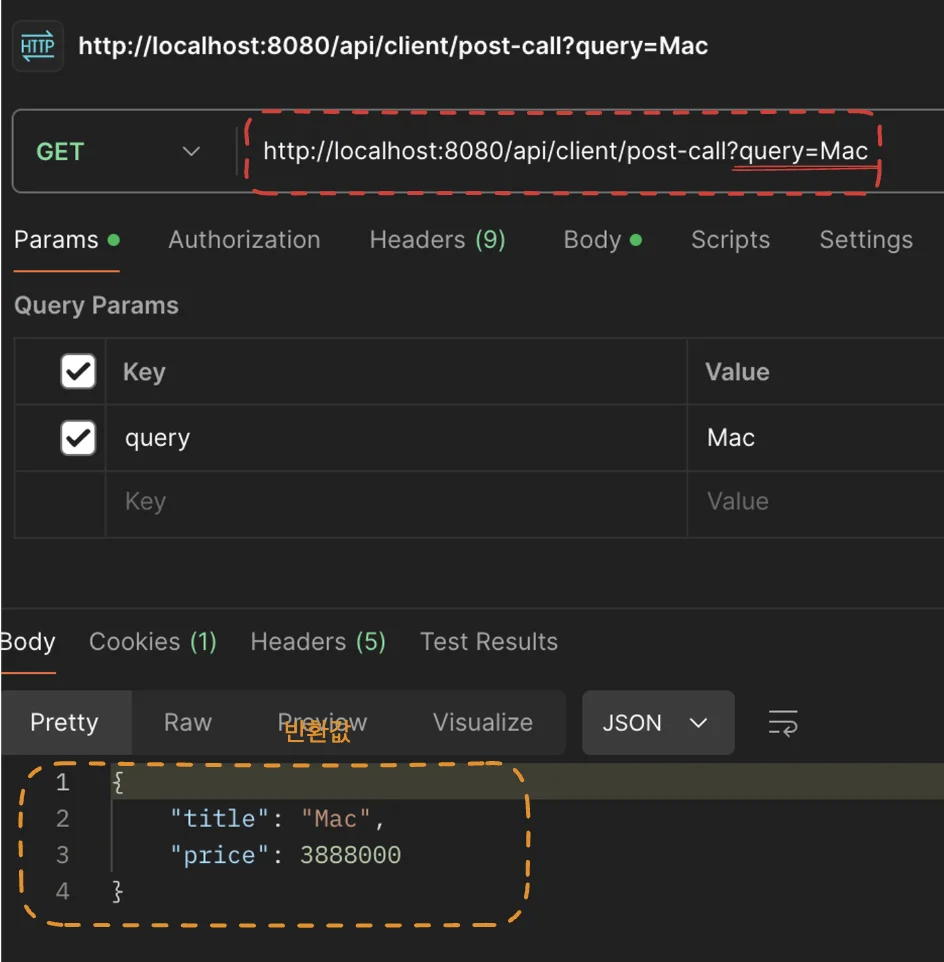

- Client &#45; log&#58; url, 상태코드
    <a id="1c3eda9b0fe181b4a7efc2ae7063f1e0"></a>

    ```java
     log.info("uri = " + uri);
     log.info("statusCode = " + responseEntity.getStatusCode());
    ```

    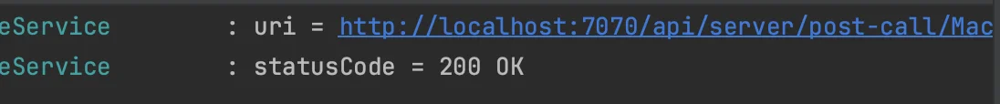

- Server &#45; log&#58; client에서 받아온  User 정보 출력 
    <a id="1c3eda9b0fe1814bb71ec600238ee47a"></a>

    ```java
    System.out.println("userRequestDto.getUsername() = " + userRequestDto.getUsername());
    System.out.println("userRequestDto.getPassword() = " + userRequestDto.getPassword());
    ```

    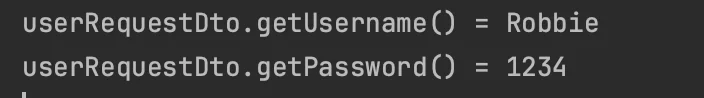

</details>

<details>
<summary>🧐 POST 요청으로 새로운 Item 값 생성하기</summary>

<a id="1c3eda9b0fe181539ef2ea8e1461d438"></a>

### 문제

> 여러개의 query 값을 가져오지 못함

<details>
<summary><code>Client</code></summary>

<details>
<summary>RestTemplateController</summary>

<a id="1c3eda9b0fe181d480a9ed0864d1d9d9"></a>

```java
@GetMapping("/post-call")
public ItemDto postCall(String query) {
    return restTemplateService.postCall(query);
}
```

</details>

<details>
<summary>RestTemplateService</summary>

<a id="1c3eda9b0fe18137a292ff8b8ff580a0"></a>

```java
public ItemDto postCall(String query) {
    // 요청 URL 만들기
    URI uri = UriComponentsBuilder
            .fromUriString("http://localhost:7070")
            .path("/api/server/post-call/{query}")
            .encode()
            .build()
            .expand(query)
            .toUri();
    log.info("uri = " + uri);

    User user = new User("Robbie", "1234");

    ResponseEntity<ItemDto> responseEntity = restTemplate.postForEntity(uri, user, ItemDto.class);

    log.info("statusCode = " + responseEntity.getStatusCode());

    return responseEntity.getBody();
}
```

</details>

</details>

<a id="1c3eda9b0fe1812c96bfd0086337e2b8"></a>

위 Client의 로직에서 query의 ㄱ<br>따라서 아래와 같이 1개의 값 밖에 가져오지 못함

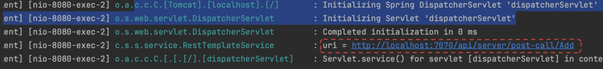

</details>

<a id="1c3eda9b0fe18185ba64f5521be13d41"></a>

## RestTemplate &#45; exchange

<details>
<summary>🧐 RestTemplate &#45; <code>RequestEntity</code>의 메서드</summary>

<details>
<summary>RESTful api</summary>

- <code>get()</code>

- <code>post()</code>

<a id="1c3eda9b0fe1811e98a7e307079bdfb9"></a>

   &#46;   &#46;   &#46;

</details>

- <code>header()</code>

- <code>body()</code>

</details>

<details>
<summary>🧐 <strong>RestTemplate</strong> &#45; <code>exchange()</code> <strong>Overide</strong></summary>

<details>
<summary>RestTemplate &#45; Overide 된 exchange들</summary>

<a id="1c3eda9b0fe181a38923fb47ec5d97ff"></a>

```java
// exchange

	@Override
	public <T> ResponseEntity<T> exchange(String url, HttpMethod method,
			@Nullable HttpEntity<?> requestEntity, Class<T> responseType, Object... uriVariables)
			throws RestClientException {

		RequestCallback requestCallback = httpEntityCallback(requestEntity, responseType);
		ResponseExtractor<ResponseEntity<T>> responseExtractor = responseEntityExtractor(responseType);
		return nonNull(execute(url, method, requestCallback, responseExtractor, uriVariables));
	}

	@Override
	public <T> ResponseEntity<T> exchange(String url, HttpMethod method,
			@Nullable HttpEntity<?> requestEntity, Class<T> responseType, Map<String, ?> uriVariables)
			throws RestClientException {

		RequestCallback requestCallback = httpEntityCallback(requestEntity, responseType);
		ResponseExtractor<ResponseEntity<T>> responseExtractor = responseEntityExtractor(responseType);
		return nonNull(execute(url, method, requestCallback, responseExtractor, uriVariables));
	}

	@Override
	public <T> ResponseEntity<T> exchange(URI url, HttpMethod method, @Nullable HttpEntity<?> requestEntity,
			Class<T> responseType) throws RestClientException {

		RequestCallback requestCallback = httpEntityCallback(requestEntity, responseType);
		ResponseExtractor<ResponseEntity<T>> responseExtractor = responseEntityExtractor(responseType);
		return nonNull(execute(url, method, requestCallback, responseExtractor));
	}

	@Override
	public <T> ResponseEntity<T> exchange(String url, HttpMethod method, @Nullable HttpEntity<?> requestEntity,
			ParameterizedTypeReference<T> responseType, Object... uriVariables) throws RestClientException {

		Type type = responseType.getType();
		RequestCallback requestCallback = httpEntityCallback(requestEntity, type);
		ResponseExtractor<ResponseEntity<T>> responseExtractor = responseEntityExtractor(type);
		return nonNull(execute(url, method, requestCallback, responseExtractor, uriVariables));
	}

	@Override
	public <T> ResponseEntity<T> exchange(String url, HttpMethod method, @Nullable HttpEntity<?> requestEntity,
			ParameterizedTypeReference<T> responseType, Map<String, ?> uriVariables) throws RestClientException {

		Type type = responseType.getType();
		RequestCallback requestCallback = httpEntityCallback(requestEntity, type);
		ResponseExtractor<ResponseEntity<T>> responseExtractor = responseEntityExtractor(type);
		return nonNull(execute(url, method, requestCallback, responseExtractor, uriVariables));
	}

	@Override
	public <T> ResponseEntity<T> exchange(URI url, HttpMethod method, @Nullable HttpEntity<?> requestEntity,
			ParameterizedTypeReference<T> responseType) throws RestClientException {

		Type type = responseType.getType();
		RequestCallback requestCallback = httpEntityCallback(requestEntity, type);
		ResponseExtractor<ResponseEntity<T>> responseExtractor = responseEntityExtractor(type);
		return nonNull(execute(url, method, requestCallback, responseExtractor));
	}

	@Override
	public <T> ResponseEntity<T> exchange(RequestEntity<?> entity, Class<T> responseType)
			throws RestClientException {

		RequestCallback requestCallback = httpEntityCallback(entity, responseType);
		ResponseExtractor<ResponseEntity<T>> responseExtractor = responseEntityExtractor(responseType);
		return nonNull(doExecute(resolveUrl(entity), resolveUriTemplate(entity), entity.getMethod(), requestCallback, responseExtractor));
	}

	@Override
	public <T> ResponseEntity<T> exchange(RequestEntity<?> entity, ParameterizedTypeReference<T> responseType)
			throws RestClientException {

		Type type = responseType.getType();
		RequestCallback requestCallback = httpEntityCallback(entity, type);
		ResponseExtractor<ResponseEntity<T>> responseExtractor = responseEntityExtractor(type);
		return nonNull(doExecute(resolveUrl(entity), resolveUriTemplate(entity), entity.getMethod(), requestCallback, responseExtractor));
	}
```

</details>

</details>

> 📌 RestTemplate의 <code>exchange</code> 메서드는 <strong><u>HTTP 요청을 보낼 때 많이 사용</u></strong>하는 메서드 중 하나로 <strong>다양한 HTTP 메서드(GET, POST, PUT, DELETE 등)를 지원</strong>하며, <strong>요청과 응답 모두에 대해 유연하게 설정</strong>할 수 있다&#46;

<details>
<summary><code>Client</code></summary>

<details>
<summary><code>Controller</code>&#58; <strong>RestTemplateController</strong></summary>

<a id="1c3eda9b0fe181b58858ddcc2c7932cd"></a>

```java
@GetMapping("/exchange-call")
public List<ItemDto> exchangeCall(@RequestHeader("Authorization") String token) {
    return restTemplateService.exchangeCall(token);
}
```

</details>

<details>
<summary><code>Service</code>&#58; <strong>RestTemplateService</strong></summary>

- <code>RequestEntity</code>를 통해 서버에 보낼 HTTP 요청 메서지에  상세정보 입력
    - <code>&#46;post(url)</code>&#58; HTTP 메서드 &#45; POST 요청

    - <code>&#46;header()</code>&#58; 메세지 header 값 추가

    - <code>&#46;body()</code>&#58; 메세지 body에 정보(유저) 추가

- <code>restTemplate&#46;exchange()</code>를 통해 HTTP 요청을 보낸다&#46; 
    > RequestEntity를 통해 HTTP 메서드를 명시하기 때문에 따로 인자로 HTTP 메서드를 넘기지 않는다&#46;

- 받아온 repsonseEntity의 body 값(<code>&#46;getBody()</code>)을 JSON 데이터로 포맷(<code>fromJSONtoItems</code>) 후  return 한다&#46;  

<a id="1c3eda9b0fe18148aa57fb2036b8cb84"></a>

```java
public List<ItemDto> exchangeCall(String token) {
    // 요청 URL 만들기
    URI uri = UriComponentsBuilder
            .fromUriString("http://localhost:7070")
            .path("/api/server/exchange-call")
            .encode()
            .build()
            .toUri();
    log.info("uri = " + uri);

    User user = new User("Robbie", "1234");

    RequestEntity<User> requestEntity = RequestEntity
            .post(uri)
            .header("X-Authorization", token)
            .body(user);

    ResponseEntity<String> responseEntity = restTemplate.exchange(requestEntity, String.class);

    return fromJSONtoItems(responseEntity.getBody());
}
```

</details>

</details>

<details>
<summary><code>Server</code></summary>

<details>
<summary><code>Controller</code>&#58; <strong>ItemController</strong></summary>

- <code>&#64;RequestHeader(&#34;X&#45;Authorization&#34;)</code>를 통해 HTTP 메세지 헤더에서 클라이언트에서 header에 넣어둔 <code>token</code>을 받아온다&#46;

- <code>&#64;RequestBody</code>를 통해 HTTP 메세지의 body에 입력한 유저 정보를 받아온다&#46;(<em><code>UserRequestDto</code></em>)

<a id="1c3eda9b0fe18102889af9093f53a672"></a>

```java
@PostMapping("/exchange-call")
public ItemResponseDto exchangeCall(@RequestHeader("X-Authorization") String token, @RequestBody UserRequestDto requestDto) {
    return itemService.exchangeCall(token, requestDto);
}
```

</details>

<details>
<summary><code>Service</code>&#58; <strong>ItemService</strong></summary>

> 그냥 값을 찍어보기 위한 예시, 업데이트 로직은 따로 없음 ( 나중에 추가해보기 )

<a id="1c3eda9b0fe181d694a7e68abab6a1ac"></a>

```java
public ItemResponseDto exchangeCall(String token, UserRequestDto requestDto) {
    System.out.println("token = " + token);
    System.out.println("requestDto.getUsername() = " + requestDto.getUsername());
    System.out.println("requestDto.getPassword() = " + requestDto.getPassword());

    return getCallList();
}
```

</details>

</details>

<details>
<summary>PostMan 테스트</summary>

> &#64;RequestHeader(’key’)를 통해 url에 있는 쿼리 key값으로 value 가져옴

<a id="1c3eda9b0fe1819f9cb3fbc40b4b0cad"></a>

<del>해당 예시로 쿼리에 토큰을 담아보내지만, 실제로는 탈취당하여 보안 이슈가 발생하기  때문에 하면 안된다… </del>

<a id="1c3eda9b0fe1811daff7dcf2656c3faa"></a>

```java
@GetMapping("/exchange-call")
public List<ItemDto> exchangeCall(@RequestHeader("Authorization") String token) {
```

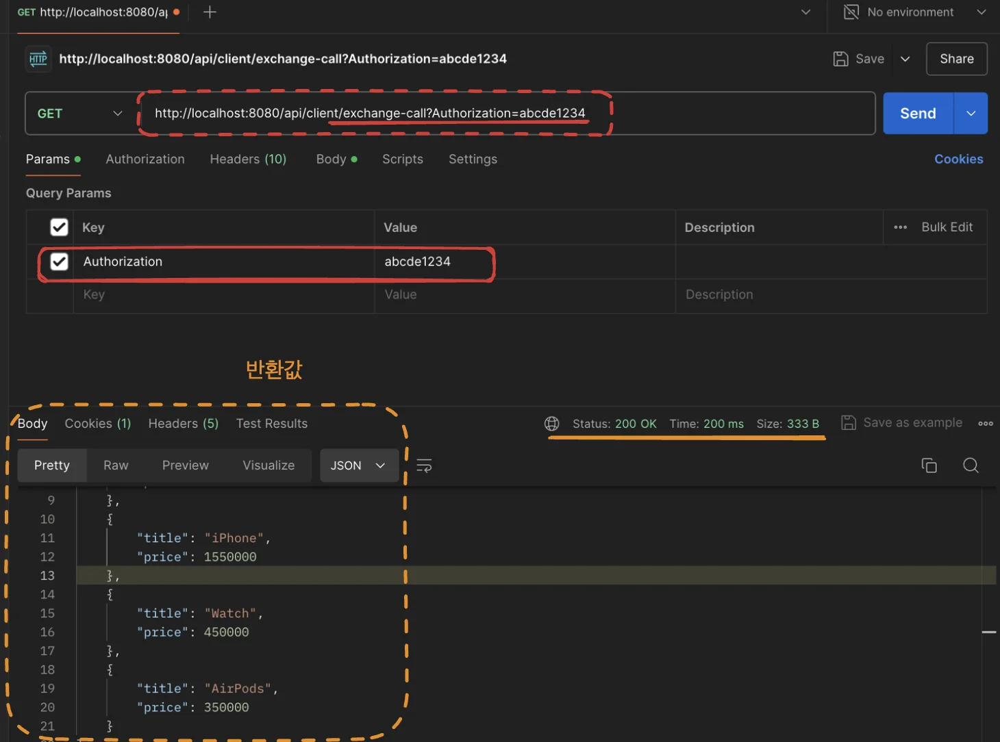

</details>

<a id="1c3eda9b0fe1811ea728da261f98a765"></a>

## Naver Open API

<details>
<summary><a href="https://developers.naver.com/products/intro/plan/">제공하는 API</a></summary>

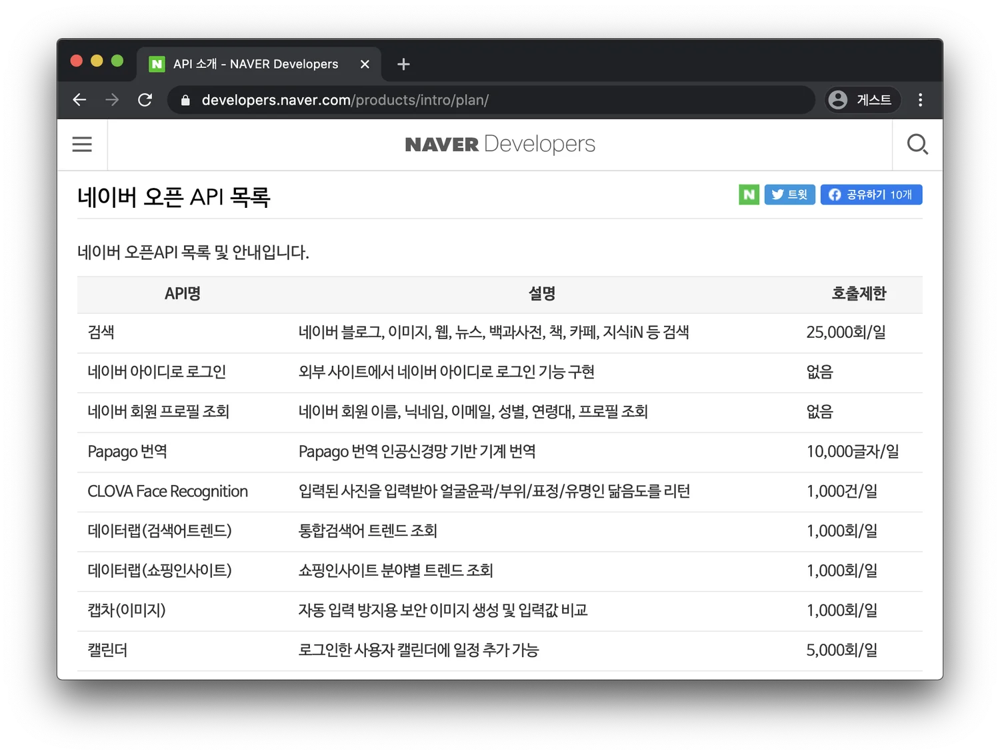

</details>

<details>
<summary>API 이용 신청하기</summary>

> 강의 Notion에서 발췌

1. 애플리케이션 등록을 누릅니다&#46;
    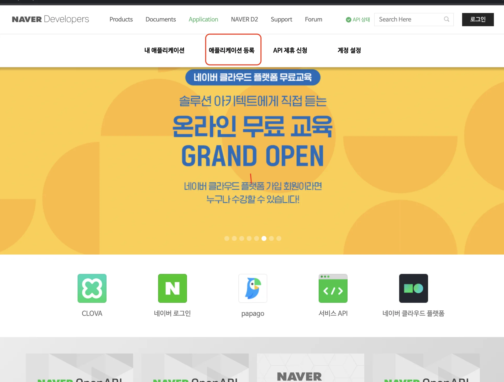

1. 네이버 로그인을 진행합니다&#46;

1. 다음과 같이 입력한 뒤 &#34;등록하기&#34;를 클릭합니다&#46;
    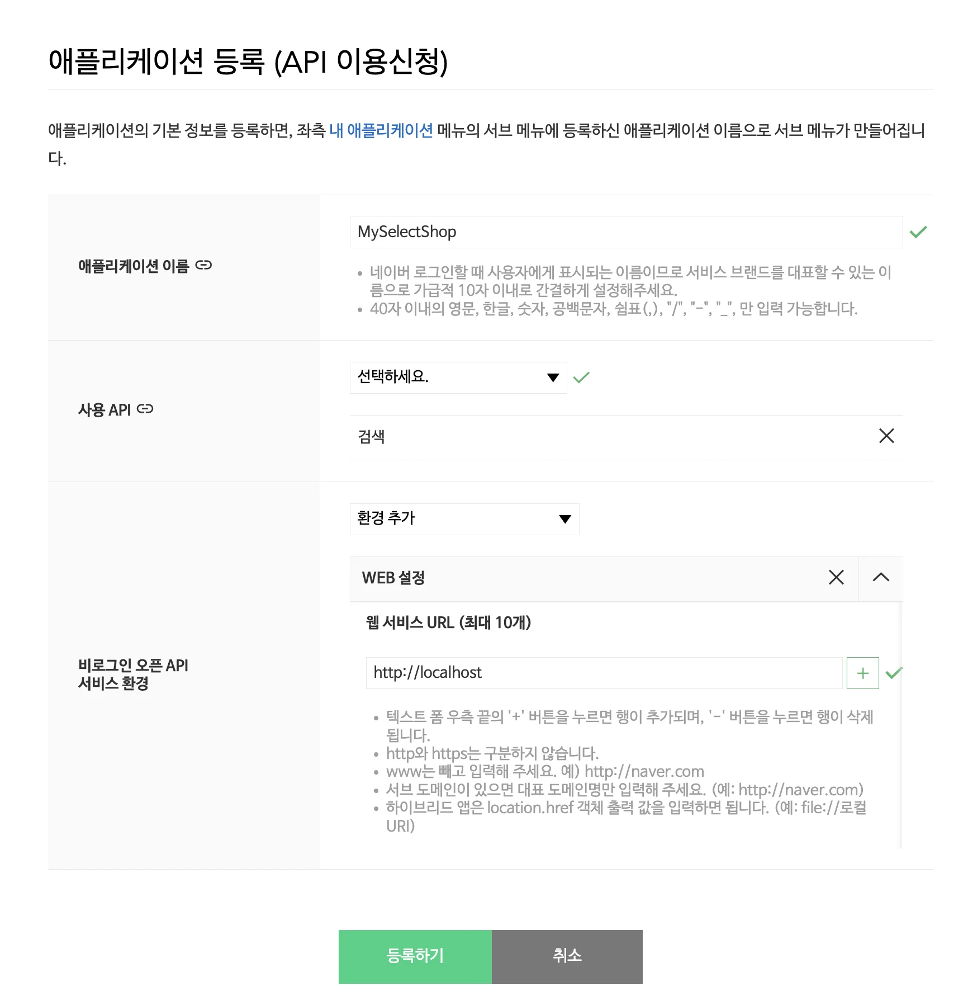

    - 애플리케이션 이름 &#45; MySelectShop

    - 사용 API &#58; 검색

    - 비로그인 오픈 API 서비스 환경 &#45; WEB 선택 후 http&#58;//localhost 입력

1. Client ID, Client Secret 이 생성된 것을 확인합니다&#46;
    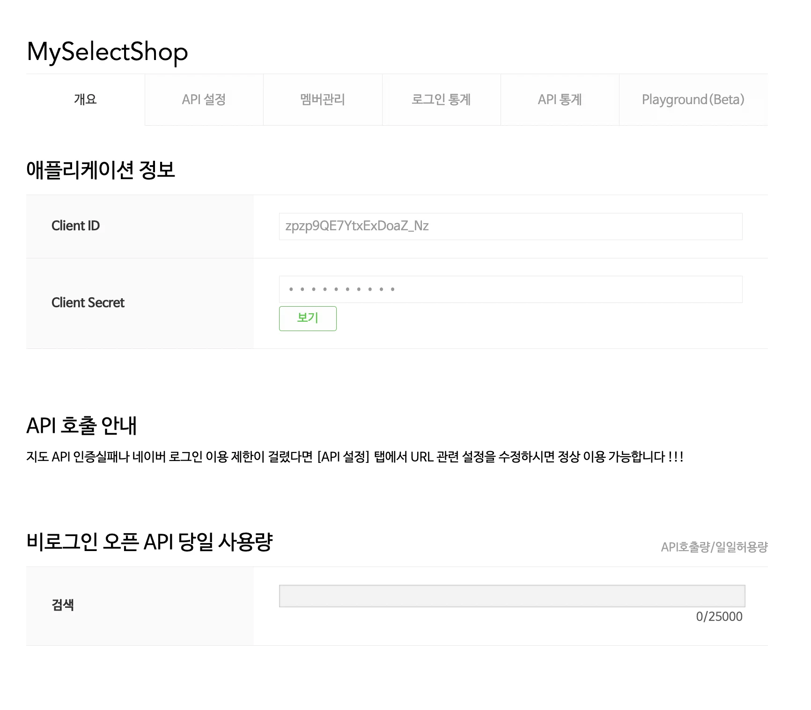

1. 이용 신청이 완료되었습니다&#46;

</details>

<details>
<summary>PostMan을 사용한 Naver API 테스트</summary>

- <a href="https://developers.naver.com/apps/#/myapps/hA6DNVkQKQU9jOAj7vCI/overview">Naver Developers &#45; Application 상세정보</a>

- <a href="https://developers.naver.com/docs/serviceapi/search/shopping/shopping.md#%EC%87%BC%ED%95%91">Naver API &#45; 검색 &#62; 쇼핑 &#45; Search API</a>

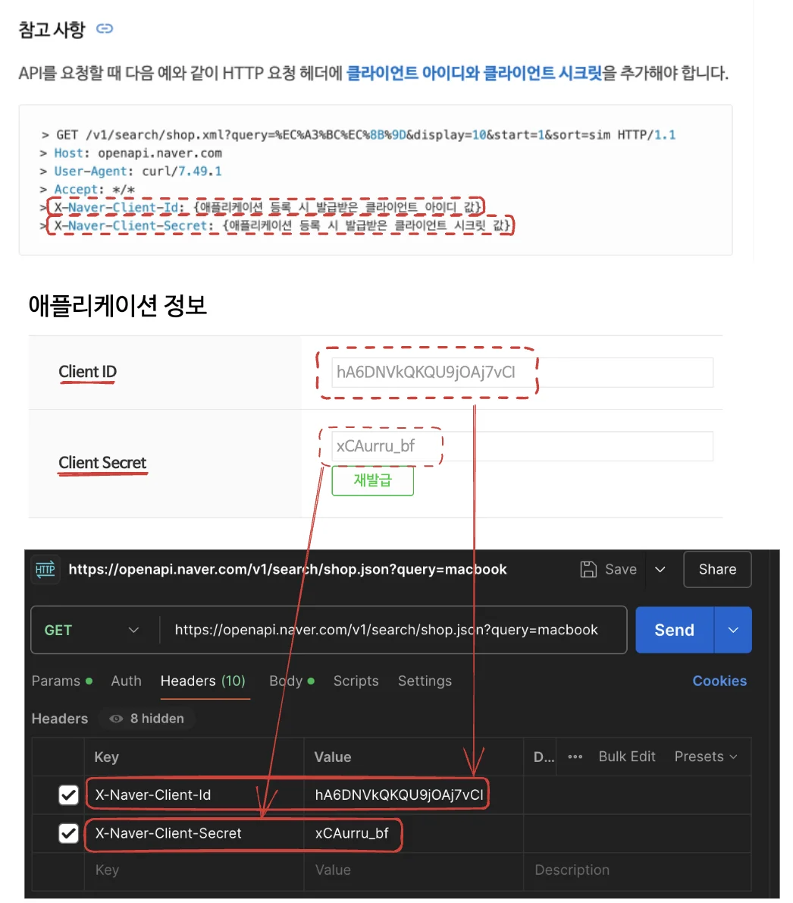

</details>

<a id="1c3eda9b0fe1813a98ecc2b21e2fac79"></a>

### “상품 검색 API” 동작 순서 이해하기

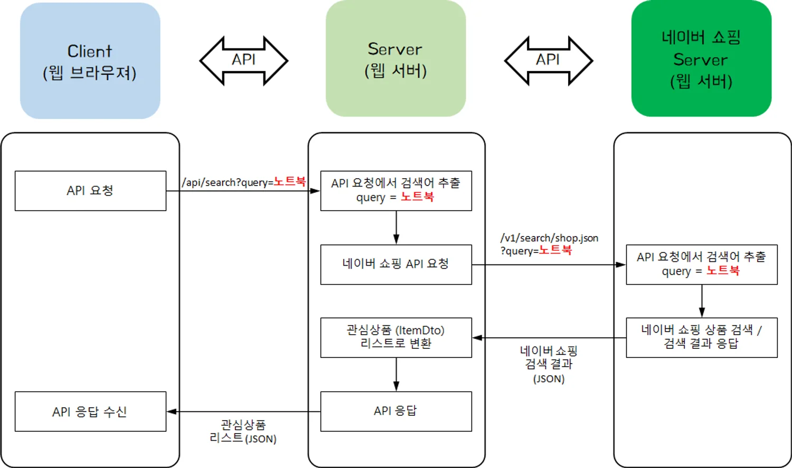

<a id="1c3eda9b0fe1812f9c5ecc068d3c0b6b"></a>

### 상품 검색 API 구현

> 검색한 상품을 반환하는 API 생성

<details>
<summary><code>Controller</code>&#58; Naver &#62; controller &#62; <strong>NaverApiController</strong></summary>

- <code>&#64;RequestParam</code> 을 통해 요청 받는 url에서 query 값 service로 넘김
    > http&#58;//localhost&#58;8080/api/search?<code>query=MacbookPro</code><br>→ query = <code>“MacbookPro”</code>

<a id="1c3eda9b0fe181568599ca35f366178f"></a>

```java
package com.sparta.naver.controller;

import com.sparta.naver.dto.ItemDto;
import com.sparta.naver.service.NaverApiService;
import org.springframework.web.bind.annotation.GetMapping;
import org.springframework.web.bind.annotation.RequestMapping;
import org.springframework.web.bind.annotation.RequestParam;
import org.springframework.web.bind.annotation.RestController;

import java.util.List;

@RestController
@RequestMapping("/api")
public class NaverApiController {

    private final NaverApiService naverApiService;

    public NaverApiController(NaverApiService naverApiService) {
        this.naverApiService = naverApiService;
    }

    @GetMapping("/search")
    public List<ItemDto> searchItems(@RequestParam String query)  {
        return naverApiService.searchItems(query);
    }
}
```

</details>

<details>
<summary><code>Service</code>&#58; Naver &#62; service &#62; <strong>NaverApiService</strong></summary>

<details>
<summary>1&#46; 받아온 인자(쿼리) 값으로 네이버 서버에 요청할 url 동적으로 생성</summary>

- <code>queryParam(”display”, 15)</code> &#58; 요청으로 받는 List의 요소 개수, 15로 설정했으니 15개의 아이템(요소)을 받아옴<br>

<a id="1c3eda9b0fe181139f6cf943b36ecf56"></a>

```java
 URI uri = UriComponentsBuilder
                .fromUriString("https://openapi.naver.com")
                .path("/v1/search/shop.json")
                .queryParam("display", 15)
                .queryParam("query", query)
                .encode()
                .build()
                .toUri();
        log.info("uri = " + uri);
```

</details>

<details>
<summary>2&#46; <code>RequestEntity</code>를 통해 네이버 서버로 보내는 HTTP 요청 메세지의 Header에 인가에 필요한 <code>Client ID</code>, <code>ClientSecret</code> 값 추가</summary>

<a id="1c3eda9b0fe1811cba57d056873b1778"></a>

```java
 RequestEntity<Void> requestEntity = RequestEntity
                .get(uri)
                .header("X-Naver-Client-Id", "hA6DNVkQKQU9jOAj7vCI")
                .header("X-Naver-Client-Secret", "xCAurru_bf")
                .build();
```

</details>

<details>
<summary>3&#46; <code>restTemplate&#46;exchange()</code>&#58; HTTP GET 요청, 전체 리스트를 받아오기 때문에 반환 타입을 String 클래스로 설정</summary>

<a id="1c3eda9b0fe1812db58fe7cf8daff1c2"></a>

```java
 ResponseEntity<String> responseEntity = restTemplate.exchange(requestEntity, String.class);
```

</details>

<details>
<summary>4&#46; response <strong><u>상태코드</u></strong><u> 로그 출력</u></summary>

<a id="1c3eda9b0fe18146bbd1c3c51665b39f"></a>

```java
log.info("NAVER API Status Code : " + responseEntity.getStatusCode());
```

</details>

<details>
<summary>반환받은 responseEntity에서 본문을 가져오고(<code>getBody()</code>) JSON 데이터로 포맷함(<code>fromJSONtoItems</code>)</summary>

<a id="1c3eda9b0fe1818b890dfbcd4ac545d5"></a>

```java
return fromJSONtoItems(responseEntity.getBody());
```

<a id="1c3eda9b0fe181ebb9a3f05ce8b9a03e"></a>

```java
 public List<ItemDto> fromJSONtoItems(String responseEntity) {
    JSONObject jsonObject = new JSONObject(responseEntity);
    JSONArray items  = jsonObject.getJSONArray("items");
    List<ItemDto> itemDtoList = new ArrayList<>();

    for (Object item : items) {
        ItemDto itemDto = new ItemDto((JSONObject) item);
        itemDtoList.add(itemDto);
    }

    return itemDtoList;
}
```

</details>

<a id="1c3eda9b0fe181a99171fc3c8db1f707"></a>

```java
package com.sparta.naver.service;

import com.sparta.naver.dto.ItemDto;
import lombok.extern.slf4j.Slf4j;
import org.json.JSONArray;
import org.json.JSONObject;
import org.springframework.boot.web.client.RestTemplateBuilder;
import org.springframework.http.RequestEntity;
import org.springframework.http.ResponseEntity;
import org.springframework.stereotype.Service;
import org.springframework.web.client.RestTemplate;
import org.springframework.web.util.UriComponentsBuilder;

import java.net.URI;
import java.util.ArrayList;
import java.util.List;

@Slf4j(topic = "NAVER API")
@Service
public class NaverApiService {

    private final RestTemplate restTemplate;

    public NaverApiService(RestTemplateBuilder builder) {
        this.restTemplate = builder.build();
    }

    public List<ItemDto> searchItems(String query) {
        // 요청 URL 만들기
        URI uri = UriComponentsBuilder
                .fromUriString("https://openapi.naver.com")
                .path("/v1/search/shop.json")
                .queryParam("display", 15)
                .queryParam("query", query)
                .encode()
                .build()
                .toUri();
        log.info("uri = " + uri);

        RequestEntity<Void> requestEntity = RequestEntity
                .get(uri)
                .header("X-Naver-Client-Id", "hA6DNVkQKQU9jOAj7vCI")
                .header("X-Naver-Client-Secret", "xCAurru_bf")
                .build();

        ResponseEntity<String> responseEntity = restTemplate.exchange(requestEntity, String.class);

        log.info("NAVER API Status Code : " + responseEntity.getStatusCode());

        return fromJSONtoItems(responseEntity.getBody());
    }

    public List<ItemDto> fromJSONtoItems(String responseEntity) {
        JSONObject jsonObject = new JSONObject(responseEntity);
        JSONArray items  = jsonObject.getJSONArray("items");
        List<ItemDto> itemDtoList = new ArrayList<>();

        for (Object item : items) {
            ItemDto itemDto = new ItemDto((JSONObject) item);
            itemDtoList.add(itemDto);
        }

        return itemDtoList;
    }
}
```

</details>

<details>
<summary> <code>Dto</code>&#58; Naver &#62; dto &#62; <strong>ItemDto</strong></summary>

> <a href="#/post/115eda9b-0fe1-804b-89c4-e4101d9bec0e">페이지</a> 

- 실제 반환 받는 데이터
    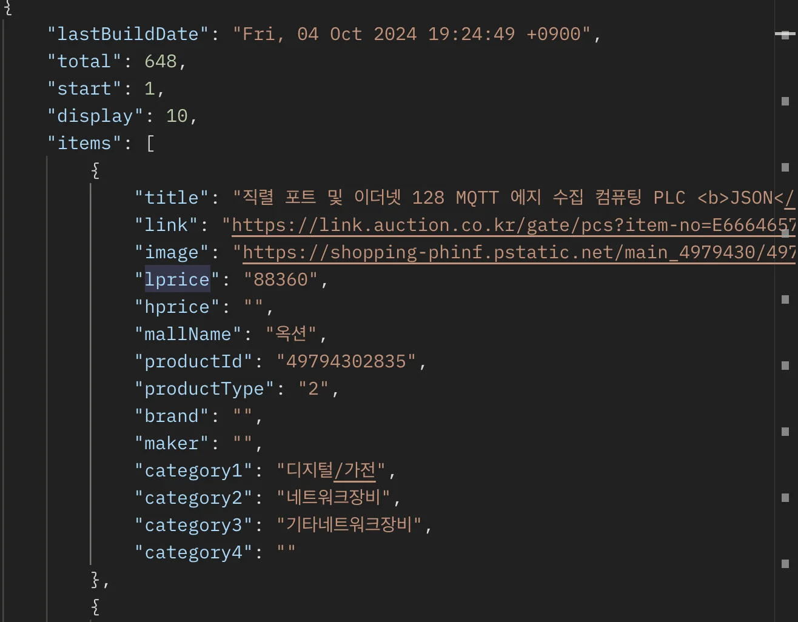

- 필요한 데이터 필드만 정의하면, 스프링이 알아서 처리해줌 (겁나 편함)
    <a id="1c3eda9b0fe18106938ee4021ff4a644"></a>

    ```java
    package com.sparta.naver.dto;

    import lombok.Getter;
    import lombok.NoArgsConstructor;
    import org.json.JSONObject;

    @Getter
    @NoArgsConstructor
    public class ItemDto {
        private String title;
        private String link;
        private String image;
        private int lprice;

        public ItemDto(JSONObject itemJson) {
            this.title = itemJson.getString("title");
            this.link = itemJson.getString("link");
            this.image = itemJson.getString("image");
            this.lprice = itemJson.getInt("lprice");
        }
    }
    ```

</details>
