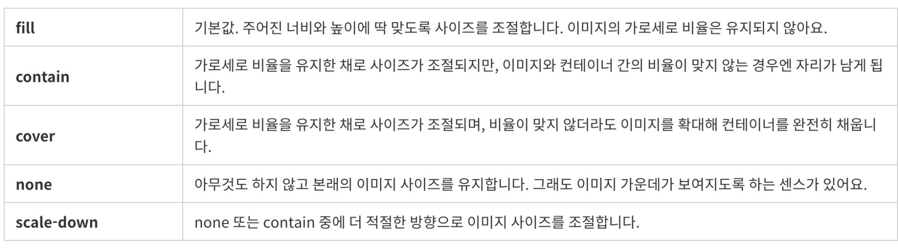

<a id="1c3eda9b0fe181bfafabf8957bfbb604"></a>

<a href="https://www.udemy.com/course/10-mega-responsive-websites-with-html-css-and-javascript/learn/lecture/23079676#overview">강의 링크 </a>

> 💡 Project&#58; 10 Responsive Websites<br>기간&#58; 23&#46;08&#46;12 &#126; 23&#46;09&#46;29

[1 - Foods](#/post/1c3eda9b-0fe1-81b7-82c6-e9ebb8f57cb4)

[2 - Creative Design](#/post/1c3eda9b-0fe1-81c0-8eb0-d31c013b386f)

[3 - Business Agency](#/post/1c3eda9b-0fe1-816f-8bee-e960770f0aa0)

[4 - Apple Commerce](#/post/1c3eda9b-0fe1-81a7-bc16-d205fb8c6d1b)

[5 - Personal Portfolio](#/post/1c3eda9b-0fe1-81d3-aa6d-c2e6da9e6df9)

[6 - Classic Cars](#/post/1c3eda9b-0fe1-81b0-bde8-f859c2419d6e)

[7 - Architecture Website](#/post/1c3eda9b-0fe1-8100-a23f-fdec1fd2d7b2)

[제목 없음](#/post/1c3eda9b-0fe1-8155-9776-d0282c5697a5)

[제목 없음](#/post/1c3eda9b-0fe1-8111-9376-f4cdb6aec1e0)

[제목 없음](#/post/1c3eda9b-0fe1-811a-b508-cc5a82c1a7dc)

[제목 없음](#/post/1c3eda9b-0fe1-81fb-a260-d97e40679db6)

<a id="1c3eda9b0fe1819baba8e1aee730c995"></a>

## Template

---

<a id="1c3eda9b0fe181e7b86bfc44072337cc"></a>

## Section  &#45;

<a id="1c3eda9b0fe18126b525d97b955ad8e5"></a>

### html

<a id="1c3eda9b0fe18190b6d2da6b5175b5f3"></a>

```html

```

<a id="1c3eda9b0fe181628c5ae66da57acbec"></a>

### css

<a id="1c3eda9b0fe1815fab71d3c7489394a4"></a>

```css

```

<a id="1c3eda9b0fe181d7a3fbecf8c0d7a16c"></a>

### js

<a id="1c3eda9b0fe181699a1fd65bdd00ad56"></a>

```javascript

```

<a id="1c3eda9b0fe1810885d9fb5b58fb23e7"></a>

### 

<details>
<summary>html</summary>

<a id="1c3eda9b0fe18104837bf69940afdd14"></a>

```html

```

</details>

<details>
<summary>css</summary>

<a id="1c3eda9b0fe181959de5eac8b5721010"></a>

```css

```

</details>

<details>
<summary>CSS &#45; default </summary>

<details>
<summary>1) </summary>

<a id="1c3eda9b0fe181edb2bfd6bc9b4900cc"></a>

```css
* {
	margin: 0;
	padding: 0;
	outline: none;
	box-sizing: border-box;
	text-decoration: none;
	list-style-type: none;
	font-weight: 400;
  /* 원하는 font-style */
}

html {
	font-size: 62.5%
}

```

</details>

<details>
<summary>2)</summary>

<a id="1c3eda9b0fe1813b9fc6dde4b6fb101b"></a>

```css
/* http://meyerweb.com/eric/tools/css/reset/ 
   v2.0 | 20110126
   License: none (public domain)
*/

html, body, div, span, applet, object, iframe,
h1, h2, h3, h4, h5, h6, p, blockquote, pre,
a, abbr, acronym, address, big, cite, code,
del, dfn, em, img, ins, kbd, q, s, samp,
small, strike, strong, sub, sup, tt, var,
b, u, i, center,
dl, dt, dd, ol, ul, li,
fieldset, form, label, legend,
table, caption, tbody, tfoot, thead, tr, th, td,
article, aside, canvas, details, embed, 
figure, figcaption, footer, header, hgroup, 
menu, nav, output, ruby, section, summary,
time, mark, audio, video {
	margin: 0;
	padding: 0;
	border: 0;
	font-size: 100%;
	font: inherit;
	vertical-align: baseline;
}
/* HTML5 display-role reset for older browsers */
article, aside, details, figcaption, figure, 
footer, header, hgroup, menu, nav, section {
	display: block;
}
body {
	line-height: 1;
}
ol, ul {
	list-style: none;
}
blockquote, q {
	quotes: none;
}
blockquote:before, blockquote:after,
q:before, q:after {
	content: '';
	content: none;
}
table {
	border-collapse: collapse;
	border-spacing: 0;
}
```

</details>

</details>

<a id="1c3eda9b0fe181e29759c916f6d44e0a"></a>

# CSS

---

<a id="1c3eda9b0fe18188887df1e9e64c5f34"></a>

### element 중앙정렬

<a id="1c3eda9b0fe18183a698e47d0e9b32fd"></a>

```css
{
    display: flex;
    justify-contents: center;
}

{
    text-align: center;
}


{ 
    position: absolute;
    width: {크기};
	  left: calc(50% - {크기});
}	


{
	position: absolute;
  left: 50%;
  transform: translateX(-50%);
}

```

<details>
<summary>이미지 컨테이너 크기에 맞추기 (object&#45;fit)</summary>



<a id="1c3eda9b0fe1810493cfea0bdf49decb"></a>

Reference) <a href="https://nykim.work/86">https&#58;//nykim&#46;work/86</a>

</details>

<a id="1c3eda9b0fe181628d4ad7ee35287459"></a>

### 🧐 <code>display&#58; none</code> vs <code>visibility&#58; hidden;</code> , <code>opacity&#58; 0</code> 

<details>
<summary><code>display&#58;none</code></summary>

- 영역 사라짐

- 이벤트(ex&#46;클릭) 작동 안함

- tab focus 안됨

</details>

<details>
<summary><code>visibility&#58;hidden</code></summary>

- 영역 있음

- 이벤트(ex&#46;클릭) 작동 안함

- tab focus 안됨

- 뒤에 있는 요소 클릭 가능

</details>

<details>
<summary><code>opacity&#58;0</code></summary>

- 영역 있음

- 이벤트(ex&#46;클릭) 작동 함

- tab focus 됨

- 뒤에 있는 요소 클릭 불가능

</details>

<a id="1c3eda9b0fe181888d15efc775795ce1"></a>

요소에 fadeIn 효과를 주고 싶을 때 display를 사용하면

<a id="1c3eda9b0fe18174a5dac436dac6c20f"></a>

영역 자체가 없어졌다가 보여지기 때문에 transition 효과가 보이지 않음&#46;

<a id="1c3eda9b0fe181a9a39cfa52971e4512"></a>

```scss
.box {
	tansition: 0.3s;
    display: none;

&.fadeIn {
    	display: block;
	}
}
```

<a id="1c3eda9b0fe181998cf7dbf3f4194f89"></a>

 

<a id="1c3eda9b0fe18154a23cdd20851fed7b"></a>

opacity와 visibiliy를 사용하면 요소에 있는 클릭 이벤트의 작동도 방지하면서 transition 효과를 줄 수 있음&#46;

<a id="1c3eda9b0fe181749507f14c70a64c4e"></a>

```scss
.box {
	tansition: 0.3s;
    opacity: 0;
    visibility: hidden;

&.fadeIn {
      opacity: 1;
      visibility: visible;
	}
}
```

<a id="1c3eda9b0fe1814dafaffef0d9df5798"></a>

Reference &#124;  <a href="https://velog.io/@kya754/no1">https&#58;//velog&#46;io/&#64;kya754/no1</a>

<details>
<summary><code>perspective</code>&#58; ‘값’</summary>

<a id="1c3eda9b0fe18120b9d2ecda6017123d"></a>

해당 설정을 해야 <code>translateZ</code> 의 변화를 느낄 수 있다&#46; 

<a id="1c3eda9b0fe181848130d9a18a70ab36"></a>

(perspective 의 숫자가 커질수록 멀리서 보는 느낌)

---

<a id="1c3eda9b0fe18110a1b1e8171e1ecc13"></a>

Reference) <a href="https://gahyun-web-diary.tistory.com/80">https&#58;//gahyun&#45;web&#45;diary&#46;tistory&#46;com/80</a>

</details>

- 의icon 크기 조절 → font size 

- <a href="https://developer.mozilla.org/en-US/docs/Web/CSS/scroll-behavior">scroll&#45;behavior</a>

- <a href="https://developer.mozilla.org/en-US/docs/Web/CSS/list-style-type">list&#45;stype&#45;type</a>

- <a href="https://developer.mozilla.org/en-US/docs/Web/CSS/background-size">background&#45;size</a>

<a id="1c3eda9b0fe1816e8de3fff4272cc67f"></a>

###  border&#45;box&#58; 기울이기


<a id="1c3eda9b0fe181cda28aebfac01aed63"></a>

```css
transform: skew(-10deg);
```

<a id="1c3eda9b0fe181cfab15d7fbec5089ef"></a>

# Error

---

<a id="1c3eda9b0fe181cb8bc6f572ddc86f0a"></a>

### &#91;JS&#93; <code>addEventListener</code> 를 함수로 래핑 시 리스너가 동작하지 않음&#46; &#91;해결 X &#93;

<a id="1c3eda9b0fe1814b8abbf93a2715f4ff"></a>

```javascript
// ,/js/navbar.js

export function handleNavbar() {
  const navbar = document.querySelector(".navbar ");
  const menu = document.querySelector(".menu");

  menu.addEventListener("click", () => {
    navbar.classList.toggle(".change");
    menu.classList.toggle(".change");
  });
}
```

<a id="1c3eda9b0fe18199984cc66d47d71f6d"></a>

```javascript
//script.js

import { handleNavbar } from "./js/navbar";

handleNavbar();
```

<a id="1c3eda9b0fe181da8716ffe42a2cb01a"></a>

위 처럼 모듈화를 시켜 실행하니 ‘click’ 이벤트가 동작하지 않았음&#46; 

<a id="1c3eda9b0fe181dd9725e0f00295c6bd"></a>

→  함수의 래핑을 제거하고 아래와 같이 실행했더니 정상적으로 실행됨&#46;

<a id="1c3eda9b0fe181d6b554e36e8a24b429"></a>

```javascript
  const navbar = document.querySelector(".navbar ");
  const menu = document.querySelector(".menu");

  menu.addEventListener("click", () => {
    navbar.classList.toggle(".change");
    menu.classList.toggle(".change");
  });
```

<a id="1c3eda9b0fe181c89002f98ff92f4da8"></a>

## 🧐  이유가 무엇인가? 

<a id="1c3eda9b0fe181759065d30e37a75071"></a>

→ 아직 해결하지 못함&#46; 

[tilt.js를 통해 card animation 간편히 구현](#/post/1c3eda9b-0fe1-817b-af84-d1c40356c53e)
