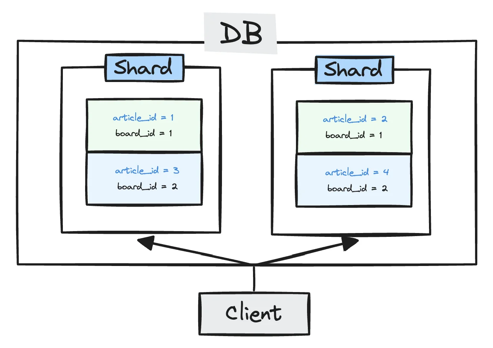
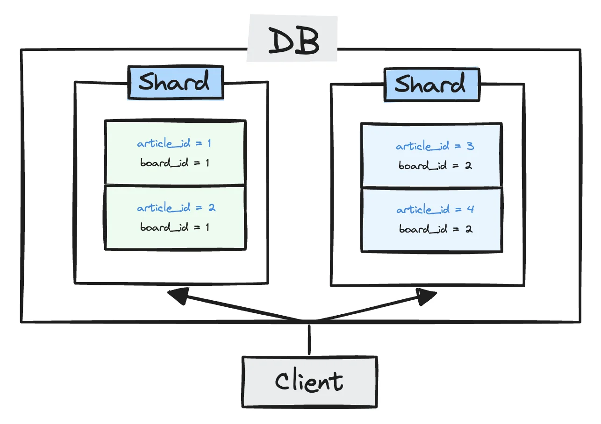

## Shard Key 적용 근거

---

게시글 서비스는 게시판 단위로 서비스를 이용한다&#46; 

- 게시판 단위로 게시글 목록 조회

<strong><u>게시판 ID로 샤딩 Key를 구성</u></strong>해야 <strong><u>동일한 게시판에 속한 게시글들이 같은 DB에 저장</u></strong>된다&#46;

따라서 <strong><u>조회 및 삭제 처리하는데 수월</u></strong>하다&#46; 

### <strong>&#91; 🤬 Bad Case &#93;</strong> Shard Key = <strong><code>article&#95;id</code></strong> 

---

만약 <strong><code>Shard Key</code></strong>가 <strong><code>article&#95;i</code></strong><code>d</code> 면 동일한 게시판에 속한 게시글이 아래의 그림과 같이 별도의 샤드에 저장될 수 있다&#46;

- <code>게시판(board) 1</code> 
    -  <strong><code>게시글(article) 1</code></strong> &#45;&#62; <strong><u>좌측 샤드</u></strong>

    -  <strong><code>게시글(article) 2</code></strong>  → <strong><u>우측 샤드</u></strong>

- <code>게시판(board) 2</code> 
    -  <strong><code>게시글(article) 3</code></strong> &#45;&#62; <strong><u>좌측 샤드</u></strong>

    -  <strong><code>게시글(article) 4</code></strong>  → <strong><u>우측 샤드</u></strong>

따라서 <strong><u>각 게시판의 게시글 목록 조회</u></strong> 시, <strong>게시글이 속한 모든 샤드에 조회 요청</strong>을 해야 한다&#46; 

만약 <strong>N개의 샤드</strong> 라면 <strong><u>게시글은 N개의 샤드로 분산</u></strong>되어 있으므로, <strong>게시글 목록 조회를 위해 N개의 쿼리를 날려 목록을 만들어내는 복잡한 처리가 필요</strong>하다&#46; 

### &#91; 😎 Best Case &#93; Shard Key = <strong><code>board&#95;id</code></strong>

---

- <code>게시판(board) 1</code> 
    - <strong><code>게시글(article) 1</code></strong><strong>, </strong>  <strong><code>게시글(article) 2</code></strong><strong>  ⇒ </strong> <strong><u>좌측 샤드</u></strong>

- <code>게시판(board) 2</code> 
    - <strong><code>게시글(article) 3</code></strong> ,  <strong><code>게시글(article) 4</code></strong>  ⇒  <strong><u>우측 샤드</u></strong>

<code>샤드 키 (Shard Key)</code>를 <code>게시판 ID (board&#95;id)</code>로  위와 그림과 같이 <strong><u>각 게시판 마다 단일 샤드에 저장</u></strong>할 수 있다&#46;

따라서 <strong><u>게시판의 모든 게시글 조회</u></strong> 시, <strong><u>단일 샤드</u></strong><strong>에서만 요청</strong>하여 효율적으로 처리할 수 있다&#46;
