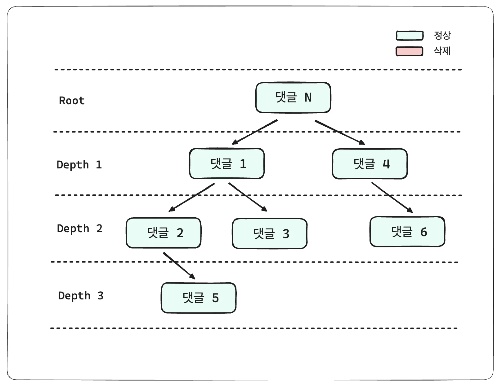
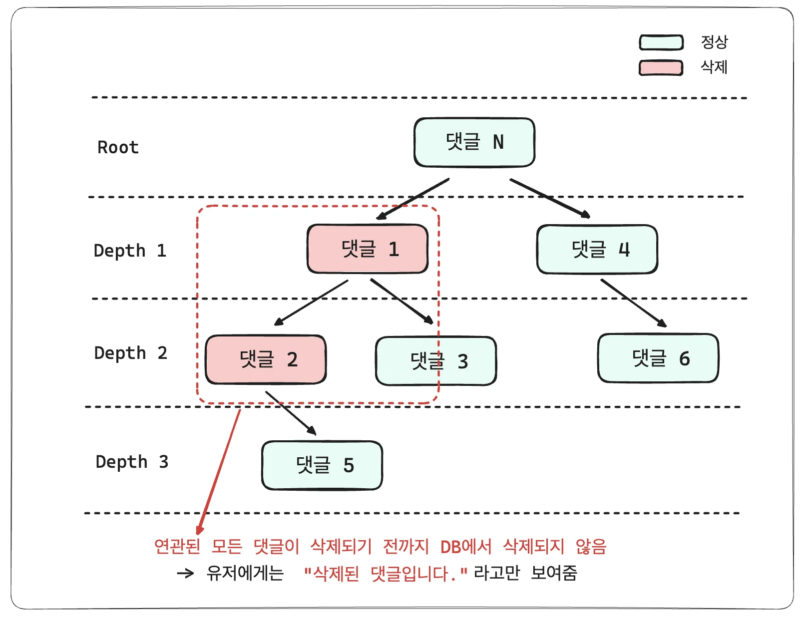
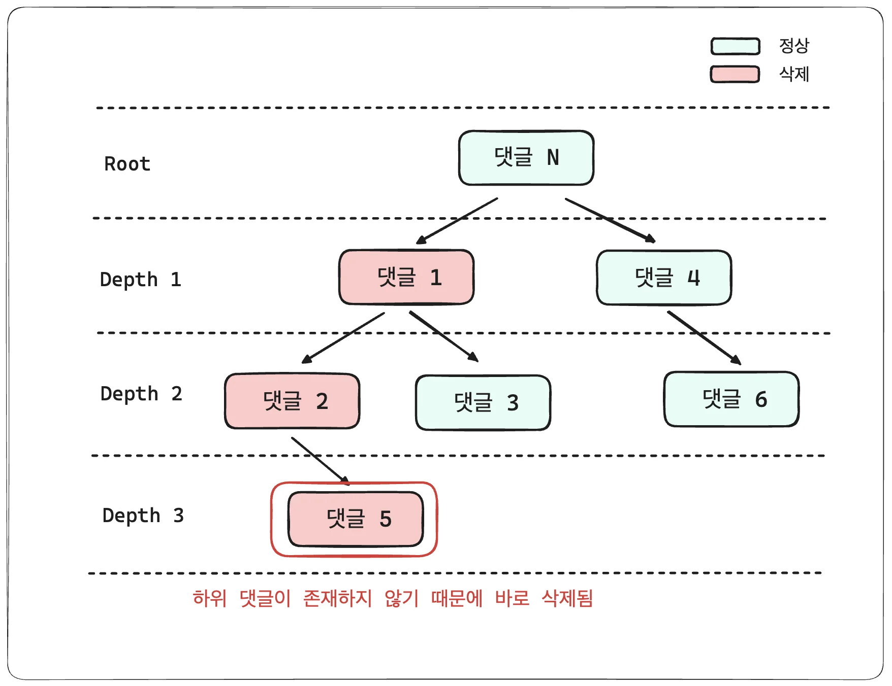
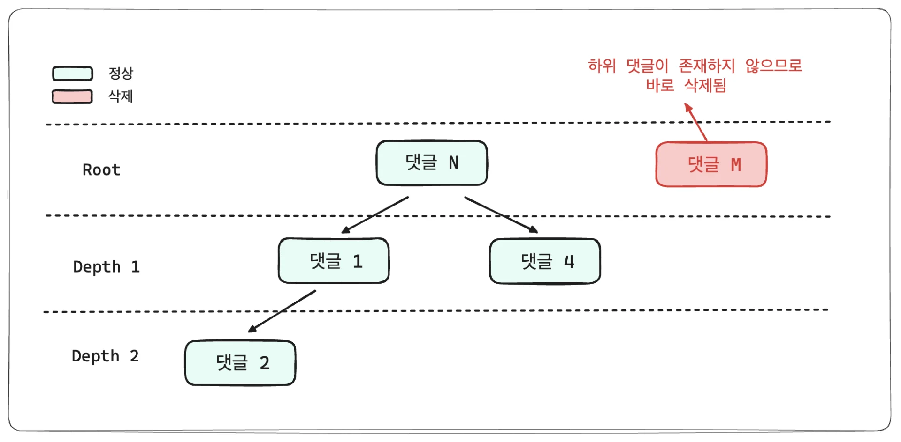

## 댓글 요구사항

---

- 댓글 조회, 생성, 삭제 API

- 목록 조회 API
    > 계층형

    - 최대 2 depth의 대댓글

    - 무한 depth의 대댓글

- 계층별 오래된 순 정렬

- 페이지 번호, 무한 스크롤 

### 계층형 대댓글

> ✏️ 
> 
> - 하위 댓글이 모두 삭제되어야 상위 댓글을 삭제할 수 있다&#46; 
>     - 하위 댓글이 없으면, 댓글은 즉시 삭제된다&#46; 
> 
>     - 하위 댓글이 있으면 댓글은 삭제 표시만 된다&#46;

- 위와 같이 댓글이 생성됬다고 가정

- 하위 댓글이 존재하는 댓글 삭제 시, <code>isDeleted</code> 컬럼이 <code>false</code>가 되고  유저에게는 이미 <strong><code>“삭제된 댓글입니다”</code></strong> 라는 문장으로 대체되어서 보여짐

- 하위 댓글이 모두 삭제되기 전까지 DB에서 삭제되지 않음

- 하위 댓글이 존재하지 않기 때문에 바로 삭제됨

하위 댓글이 존재하지 않는 경우

- 하위 댓글이 존재하는 않는 경우, 바로 DB에서 삭제됨

### 계층형 depth의 따른 설계 방식

> ✏️ 
> 
> 1. <strong><code>최대 2 depth</code></strong>
>     - Adjacency list ( 인접 리스트 )
> 
> 1. <strong><code>무한 depth</code></strong>
>     - Path enumeration ( 경로 열거 )
