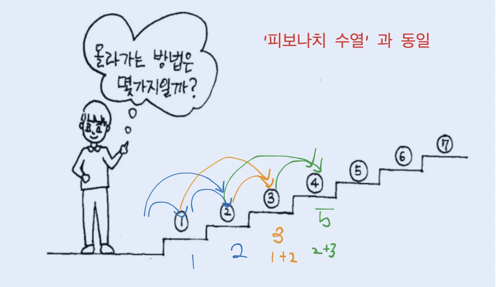

<a id="1c3eda9b0fe1818b8a9fe70ec5182a1d"></a>

# 문제

<a id="1c3eda9b0fe181d79af0d71b69db7ef8"></a>

## <strong>1&#46; 계단오르기</strong>

<a id="1c3eda9b0fe181f2a089c47b994a6d49"></a>

### 설명

<a id="1c3eda9b0fe181d7b005dcf025318165"></a>

철수는 계단을 오를 때 한 번에 한 계단 또는 두 계단씩 올라간다&#46; 만약 총 4계단을 오른다면 그 방법의 수는

<a id="1c3eda9b0fe1811d8363fa027d5d4f07"></a>

1&#43;1&#43;1&#43;1, 1&#43;1&#43;2, 1&#43;2&#43;1, 2&#43;1&#43;1, 2&#43;2 로 5가지이다&#46;

<a id="1c3eda9b0fe1819f9ac0f0a467880957"></a>

그렇다면 총 N계단일 때 철수가 올라갈 수 있는 방법의 수는 몇 가지인가?


<a id="1c3eda9b0fe181e49ed2d6eef87df3b7"></a>

### 입력

<a id="1c3eda9b0fe181a68343f5db9e5ba435"></a>

첫째 줄은 계단의 개수인 자연수 N(3≤N≤35)이 주어집니다&#46;

<a id="1c3eda9b0fe181cb8c97cd8ce9b94cce"></a>

### 출력

<a id="1c3eda9b0fe1816b90b7edac1d063020"></a>

첫 번째 줄에 올라가는 방법의 수를 출력합니다&#46;

---

<a id="1c3eda9b0fe181b784d7e925fffc8935"></a>

### 예시 입력 1

<a id="1c3eda9b0fe1815fbbf2cdc7ab4a7608"></a>

```plaintext
7
```

<a id="1c3eda9b0fe181daa522d340d1274502"></a>

### 예시 출력 1

<a id="1c3eda9b0fe1810aac32f5a5bfd8feb4"></a>

```plaintext
21
```

<a id="1c3eda9b0fe181cdb48dc53bf797353f"></a>

# 풀이

<a id="1c3eda9b0fe1813dafc6e891e7bd123b"></a>

## 풀이1) <code>DFS</code>

<a id="1c3eda9b0fe1813e8b4dcc9433a53ab4"></a>

```java
import java.util.*;

public class Main {
    static int n, cnt;
    public void DFS(int sum){
        if(sum>n) return;
        if(sum==n) cnt++;
        else {
            DFS(sum+1);
            DFS(sum+2);
        }

    }

    public static void main(String[] args) {
        Main T = new Main();
        Scanner sc = new Scanner(System.in);
        n= sc.nextInt();
        T.DFS(0);
        System.out.println(cnt);
    }
}
```

<a id="1c3eda9b0fe181fc88abfe2565578673"></a>

## 풀이2) <code>피보나치 수열</code>



<a id="1c3eda9b0fe181aaaccec32467bba64e"></a>

```java
import java.util.*;

public class Main {
    static int[] dy;
    public int solution(int n){
        dy[1]=1;
        dy[2]=2;
        for(int i=3; i<=n; i++){
            dy[i]=dy[i-1] + dy[i-2];
        }
        return dy[n];
    }

    public static void main(String[] args) {
        Main T = new Main();
        Scanner sc = new Scanner(System.in);
        int  n= sc.nextInt();
        dy = new int[n+1];
        System.out.println(T.solution(n));
    }
}
```
