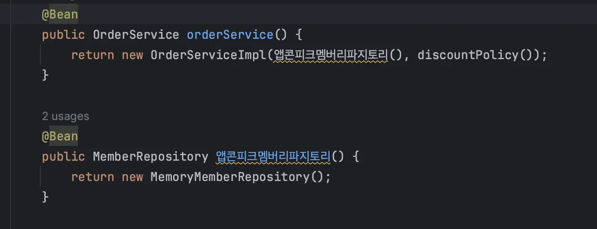
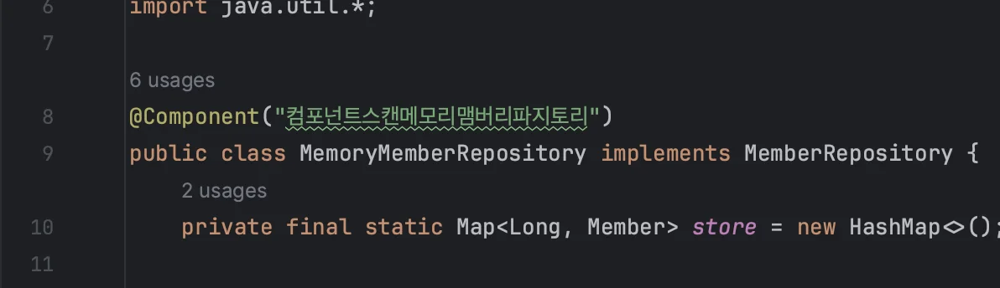
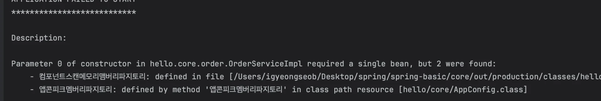
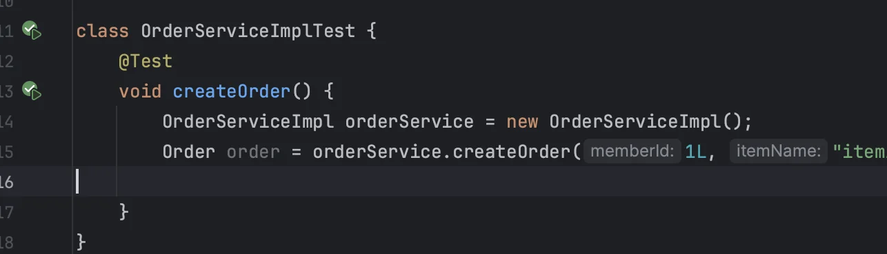
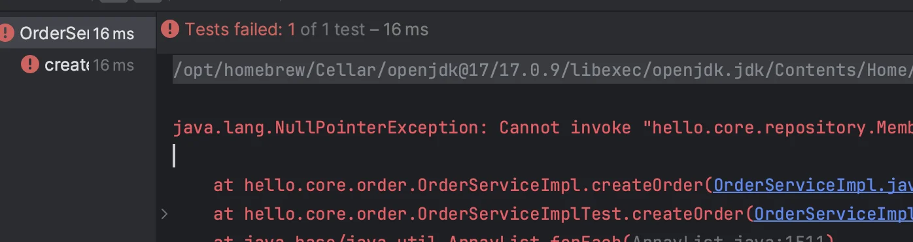
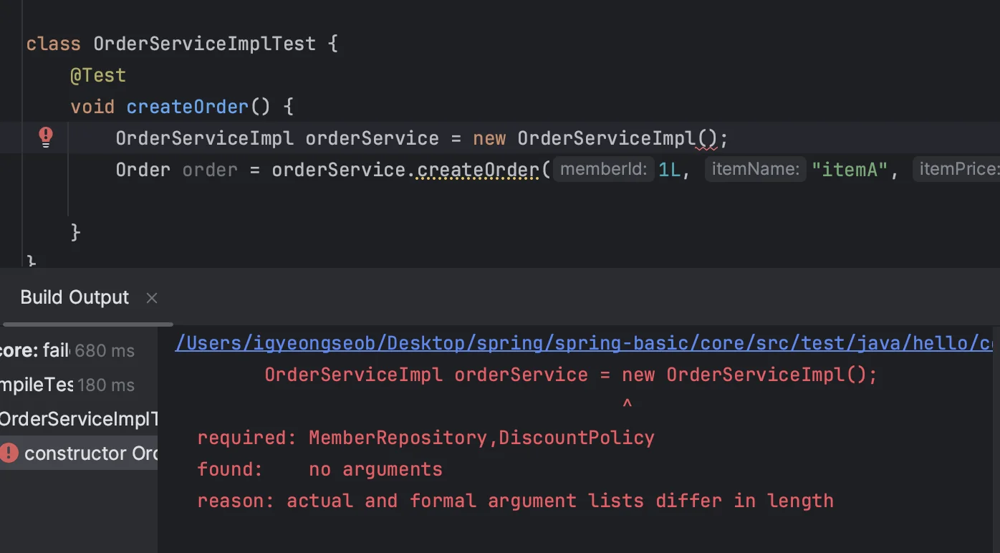

<a id="1c3eda9b0fe18193be9cdfb7fbd86df6"></a>

### ★) CoreApplicationTests 테스트 오류

<details>
<summary><strong>🧐 CoreApplicationTests 란?</strong></summary>

<a id="1c3eda9b0fe181ddaa84cf48069952f4"></a>

스프링이 자동으로 스프링 컨테이너를 띄워 테스트를 통합해서 테스트를 실행해준다&#46;  <br>( 필드 주입 사용 가능)

</details>

<a id="1c3eda9b0fe1812da547f67d6836799e"></a>

CoreApplicationTests 실행 시, 아래와 같은 오류가 발생

<a id="1c3eda9b0fe1819a8f86f77920732f7e"></a>

```plaintext
Parameter 0 of constructor in hello.core.order.OrderServiceImpl required a single bean, but 2 were found:
	- memoryMemberRepository: defined in file [/Users/igyeongseob/Desktop/spring/spring-basic/core/out/production/classes/hello/core/repository/MemoryMemberRepository.class]
	- memberRepository: defined by method 'memberRepository' in class path resource [hello/core/AppConfig.class]
```

<a id="1c3eda9b0fe18145b00bd9cd6cd26e36"></a>

→ <a href="https://www.inflearn.com/questions/1089023/%EC%84%B9%EC%85%98-7-%EC%98%B5%EC%85%98-%EC%B2%98%EB%A6%AC-%EC%A0%84%EC%B2%B4-%ED%85%8C%EC%8A%A4%ED%8A%B8-%EC%A4%91-coreapplicationtests-%ED%81%B4%EB%9E%98%EC%8A%A4%EC%9D%98-contextloads-%ED%85%8C%EC%8A%A4%ED%8A%B8-%EC%8B%A4%ED%8C%A8-%EC%A7%88%EB%AC%B8%EC%9E%85%EB%8B%88%EB%8B%A4">강의 질문 란을 찾아보니 같은 오류 해결내역 존재</a><br>    ( 정리가 너무 잘 되어있어, 해당 내용을 중심으로 정리함)<br>

<a id="1c3eda9b0fe181f49b3ddb40c09dfc77"></a>

<strong>자동 등록한 빈(컴포넌트 스캔) 과 AppConfig를 통해 수동 등록한 빈이 겹쳐서 생기는 오류</strong>







<a id="1c3eda9b0fe181058c64dd774ed7bd9b"></a>

### 해결)  설정 변경

> Build, Execution, Deployment &#45;&#62; Build Tools &#45;&#62; Gradle

<a id="1c3eda9b0fe181448b6fc2003dfa012f"></a>

Build and run using를&#46; Gradle로 선택하면 Gradle이 컴파일 시점에 해당 옵션을 자동으로 적용해줌&#46; 

<a id="1c3eda9b0fe181ff9ee3e917b3f40654"></a>

### 🧐 <code>AutoAppConfig</code> 에서 <code>Configuration</code> 어노테이션이 붙은 클래스는 스캔의 대상에서 제외를 했는데 왜 중복해서 등록이 된 것인가?

<a id="1c3eda9b0fe181a2b364fa874ebf8d17"></a>

<strong>스프링의 </strong><strong><code>&#64;ComponentScan</code></strong><strong>이 중복 적용된 경우</strong>에는<strong> excludeFilters가 적용되지 않</strong>는다&#46; 

<details>
<summary><strong> </strong><strong><code>&#64;ComponentScan</code></strong><strong>이 중복 적용 예시 </strong></summary>

<a id="1c3eda9b0fe1812d8122fade0d86bbaf"></a>

```java
package com.example.app;

import org.springframework.stereotype.Component;

@Component
public class AppBean { }
```

<a id="1c3eda9b0fe1818f908dd63e76712884"></a>

```java
// 1.@Component를 제외하고 스캔한다. AppBean은 스캔되지 않아야 한다.
@ComponentScan(basePackages = "com.example.app", excludeFilters = @ComponentScan.Filter(type = FilterType.ANNOTATION, classes = Component.class))

// 2.모든 빈을 스캔한다. AppBean이 스캔 되어야 한다.
@ComponentScan(basePackages = "com.example.app")
public class SpringScanApplication { } 
```

<a id="1c3eda9b0fe181cf8047c15f5783251b"></a>

중복 정의된 경<strong><u>우 한곳에서 이미 스캔을 하도록 되어 있기 때문</u></strong>에 <strong><u>결과적으로 AppBean은 컴포넌트 스캔의 대상이 된</u></strong>다&#46;

</details>

<a id="1c3eda9b0fe181e7828af4693ee28bab"></a>

CoreApplicationTests를 스프링 부트로 실행하게 되면<strong><code>&#64;SpringBootApplication</code></strong><strong> 애노테이션이 있는 CoreApplication을 찾아서 설정 파일로 사용</strong>한다&#46;

<a id="1c3eda9b0fe181a8b1b2e79f596aa436"></a>

<strong><u>SpringBootApplication 내부에는 </u></strong><strong><u><code>&#64;ComponentScan</code></u></strong><strong><u> </u></strong><strong><u>코드가 있</u></strong>어 <br>(스프링 부트는 편리함을 위해 자동으로 컴포넌트 스캔을 제공)

<a id="1c3eda9b0fe181fa9d8be5c5aed60639"></a>

현재 클래스가 있는 패키지 부터 하위 패키지를 모두 컴포넌트 스캔한다&#46;<br>(<strong><code>&#64;SpringBootApplication</code></strong><strong> 애노테이션이 있는 곳의 패키지 부터 모든 빈들을 컴포넌트 스캔함</strong>)

<a id="1c3eda9b0fe18131b9f6c949c09ed7b9"></a>

결과적으로 스프링 부트를 통해서 실행하는 경우, <strong>이미 </strong><strong><code>&#64;ComponentScan</code></strong><strong>을 통해서 모든 빈들을 읽어버리기 때문</strong>에 <strong><code>AutoAppConfig</code></strong><strong>의 컴포넌트 스캔의 excludeFilter 설정은 적용되지 않</strong>는다&#46;

> 과거에는 수정자 주입, 필드 주입을 많이 사용했지만, 최근에는 스프링을 포함한 DI 프레임워크 대부분이 생성자 주입을 권장한다&#46; <br>생성자 주입 사용 시 아래와 같은 장점이 있다&#46;

> 📌 <strong>컴파일 오류가 가장 빠르고, 좋은 오류이다&#46;</strong>

<a id="1c3eda9b0fe181a9b423f280ae51a639"></a>

## 불변

---

> 대부분의 의존관계 주입은 한번 일어나면 애플리케이션 종료시점까지 의존관계를 변경할 일이 없다&#46; 오히려 <strong>대부분 의존관계는 애플리케이션 종료 전까지 변하지 않아야 한</strong>다&#46; (<strong>불변</strong>해야 한다)<br><br><strong>수정자 주입 </strong>사용 시, <strong>setXxx 메서드(setter)</strong> 를 <strong><u>public으로 열</u></strong>어두어야 한다&#46; 따라서 <strong><u>누군가 실수로 변경할</u></strong> 수 있다&#46; 변경하면 안되는 메서드를 열어두는 것은 좋은 설계가 아니므로 <strong>생성자 주입을 통해 불변성</strong>을 지키자&#46;<br><br>생성자 주입은 객체를 생성할 때, 딱 1번만 호출된다&#46; (이후 호출 X)<br>따라서 불변하게 설계할 수 있다&#46; 

<a id="1c3eda9b0fe181b689d9f0202849945a"></a>

## 주입 데이터 누락 → 컴파일 오류

> 프레임워크 없이<strong> 순수한 Java 단위 테스트</strong> 코드를 작성하는 경우가 많다&#46; (좋은 테스트)<br>( 해당 테스트를 작성 시, 더미 데이터 (객체)를 주입해서 쓸 경우도 많다&#46; )<br>그럴때,<strong> 주입 데이터가 누락되는 경우, 생성자 주입을 사용하면 쉽게 파악 가능하다&#46; <br>(</strong>자세한 아래의 수정자 주입과, 생성자 주입의 예시 확인)

---

<a id="1c3eda9b0fe1812ebd8fdec097e23f1d"></a>

### <strong>수정자(setter) 주입</strong>

- <strong>수정자(setter)를 사용한 의존관계 주입</strong>

<a id="1c3eda9b0fe181efa0bce73ee66a27d0"></a>

```java
public class OrderServiceImpl implements OrderService {

    private MemberRepository memberRepository;
		private DiscountPolicy discountPolicy;

		// setter
    @Autowired
    public void setMemberRepository(MemberRepository memberRepository) {
        this.memberRepository = memberRepository;
    }

    @Autowired
    public void setDiscountPolicy(DiscountPolicy discountPolicy) {
        this.discountPolicy = discountPolicy;
    }

                   .     .     .
}
```

- <strong>테스트코드</strong>

<a id="1c3eda9b0fe18111baefc487fb9afbc8"></a>

```java
@Test
 void createOrder() {
     OrderServiceImpl orderService = new OrderServiceImpl();
     orderService.createOrder(1L, "itemA", 10000);
 }
```

> 테스트 수행 시, 아래와 같이 <strong><code>NPE(Null Point Exception)</code></strong>이 발생한다&#46;<br>→ <strong>setter를 통한</strong> <strong><code>memberRepository</code></strong><strong>,</strong><strong> </strong><strong><code>discountPolicy</code></strong><strong>의 의존관계를 설정하지 않았다&#46; </strong>





> ⚠️ <strong>참고</strong><br><code>&#64;Autowired</code> 가 프레임워크 안에서 동작할 때는 의존관계가 없으면 오류가 발생하지만, 지금은 프레임워크 없이<strong><u> 순수한 자바 코드로만 단위 테스트를 수행</u></strong>하기 때문에 발생되지 않음&#46;

<a id="1c3eda9b0fe181f9b7c5f6d247c065bd"></a>

### 생성자 주입

<a id="1c3eda9b0fe18167ad0bc877dec251d2"></a>

위 수정자(setter) 주입 처럼 테스트를 짤 때, 눈으로 의존관계를 파악하기가 쉽지 않다&#46;<br> (실제 코드를 까봐야 알 수 있다&#46;) 

<a id="1c3eda9b0fe1815492b6e33744c5737b"></a>

### ⇒ 그러나 <strong>생성자 주입을 사용</strong>하면 위처럼 <strong><u>주입 데이터를 누락</u></strong> 했을 때, 아래와 같이 <strong>컴파일 오류</strong>로 바로<strong> </strong>알려준다&#46; 또한 <strong>IDE</strong> 에서 <strong><u>어떤 값을 필수로 주입해야 하는지 바로 알 </u></strong>수 있다<strong>&#46;</strong>



- <strong>생성자 통한 의존관계 주입 </strong>

<a id="1c3eda9b0fe1817bad09f588d790add0"></a>

```java
@Component
public class OrderServiceImpl implements OrderService {

    private MemberRepository memberRepository;
    private DiscountPolicy discountPolicy;

		// 생성자 주입  ( @Autowired 생략 )
    public OrderServiceImpl(MemberRepository memberRepository, DiscountPolicy discountPolicy) {
        this.memberRepository = memberRepository;
        this.discountPolicy = discountPolicy;
    }
```

<details>
<summary><strong>테스트 코드</strong></summary>

<a id="1c3eda9b0fe181c2b305dd8aacb6bb5e"></a>

```java
package hello.core.order;

import hello.core.discount.FixDiscountPolicy;
import hello.core.member.Grade;
import hello.core.member.Member;
import hello.core.repository.MemoryMemberRepository;
import org.junit.jupiter.api.Test;

import static org.junit.jupiter.api.Assertions.*;

class OrderServiceImplTest {
    @Test
    void createOrder() {
        MemoryMemberRepository memberRepository = new MemoryMemberRepository();
        memberRepository.save(new Member(1L, "name", Grade.VIP));

        OrderServiceImpl orderService = new OrderServiceImpl(memberRepository, new FixDiscountPolicy());
        Order order = orderService.createOrder(1L, "itemA", 10000);
        org.assertj.core.api.Assertions.assertThat(order.getDiscountPrice()).isEqualTo(1000);

    }
}
```

</details>

<a id="1c3eda9b0fe181a8bee8c0ed418d601d"></a>

## <code>final</code> 키워드 → 컴파일 오류

---

> <u>생성자 주입을 사용</u>하면 필드에 <strong><code>final</code></strong><strong> 키워드를 사용할</strong>  수 있다&#46; <br>생성자에 값이 설정되지 않는 오류(필드 값이 초기화 되지 않은 경우)를 컴파일 시점에서 막아준다&#46; 

<a id="1c3eda9b0fe181e6882cf5c8fb01a253"></a>

```java
		private final MemberRepository memberRepositor;
		private final DiscountPolicy discountPolicy;
		
		@Autowired
    public OrderServiceImpl(MemberRepository memberRepository, DiscountPolicydiscountPolicy) {
        this.memberRepository = memberRepository;
				// discount 생성자 생략
    }

			        .    .   . 
}
```

<a id="1c3eda9b0fe18182b2ddf045ab6be2bd"></a>

필수 필드인 <code>discountPolicy</code> 에 값 누락 → <strong>컴파일 오류 발생 </strong>

>  <strong>java&#58; variable discountPolicy might not have been initialized </strong>

> ⚠️ <strong>참고<br>수정자 주입을 포함한 나머지 주입 방법은, 모두 생성자 이후에 호출 되므로, 필드에 </strong><strong><code>final</code></strong><strong> 키워드를 사용할 수 없다&#46;<br></strong><strong>→ 오직 생성성자 주입 방식만 </strong><strong><code>final</code></strong><strong> 키워드 사용 가능</strong>

<details>
<summary>final 키워드 &#43; 롬복(&#64;RequiredArgsConstructor)</summary>


</details>

<a id="1c3eda9b0fe18166b9b1e83e0da3e97f"></a>

### 정리

---

<a id="1c3eda9b0fe181bfb7f3e47f36bc1528"></a>

생성자 주입 방식을 선택하는 이유는 여러가지가 있지만, 그 중 하나는 ‘<u>프레임워크에 의존하지 않</u>고 <strong>순수한 자바 언어의 특징을 잘 살리기 위해서’ </strong>이다

<a id="1c3eda9b0fe18164a787f16c0847e146"></a>

항상 생성자 주입을 사용하고, 가끔 옵션이 필요한 경우 수정자 주입 방식을 사용<br>(필드 주입은 사용하지 않는 것이 좋음, 또한 생성자 주입과, 수정자 주입은 동시에 사용 가능함)
